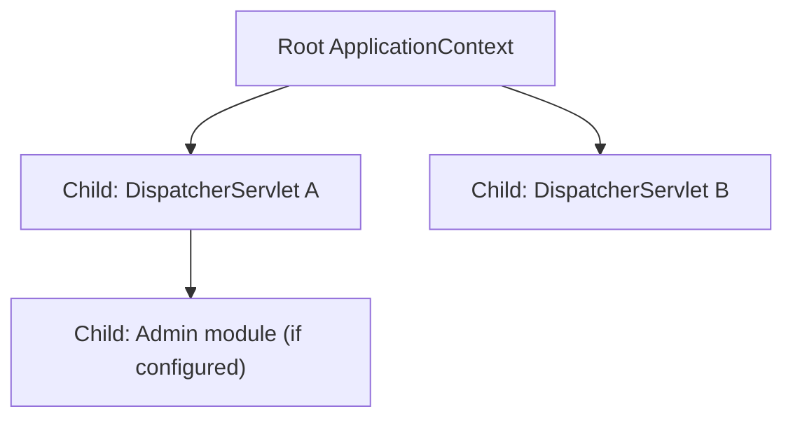
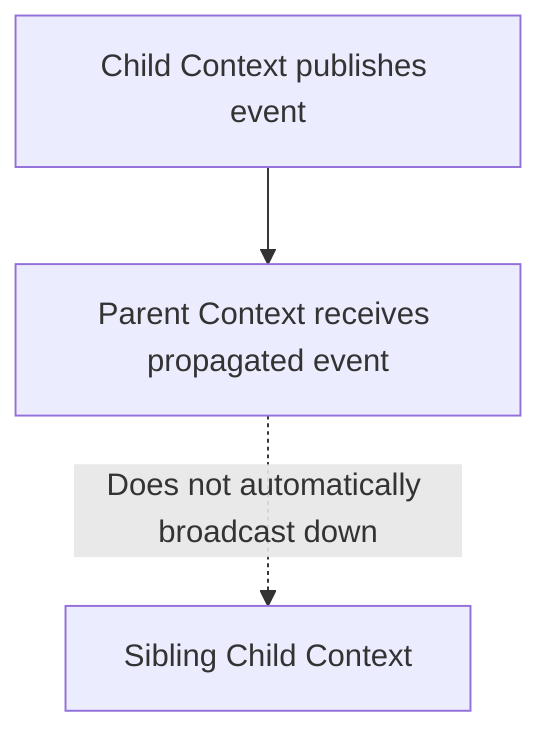

# Parent Context, Child Context, and Bean Visibility Scope

Spring Framework allows an application to have multiple `ApplicationContext` instances linked in a parent–child relationship. This model commonly appears when an application needs to separate shared foundational configuration from the configuration of individual web applications or individual `DispatcherServlet` instances, or when Spring Cloud creates a context for the bootstrap phase in certain legacy architectures.

The most important point is that **beans are looked up upward from the child context to the parent context**. A child context can use beans managed by the parent; the parent context cannot see beans declared only in the child context. Each context remains a separate container with its own bean registry, lifecycle, and state.

This lesson belongs to the **Context Hierarchy** chapter of the **SPRING_CLOUD_CORE** module. Understanding the hierarchy properly helps design bean boundaries, avoid duplicate initialization, handle property sources intentionally, and test applications that have multiple contexts.

## 1. ApplicationContext as a Container Supporting Hierarchy

A simple Spring application typically needs only a single `ApplicationContext`. The context holds the application's beans, configuration, and foundational services. When scopes need to be separated, you can create another context and set the first context as its parent.

Conceptual example:

```text
Parent ApplicationContext
  ├── DataSource
  ├── Repository
  ├── SharedService
  └── Child ApplicationContext
        ├── Controller
        ├── ViewResolver
        └── Web-specific components
```

In this example:
- The parent manages shared beans.
- The child manages beans belonging only to a specific web scope.
- Beans in the child can look up beans in the parent.
- The parent cannot look up beans that exist only in the child.

A context can have at most one direct parent, whereas one parent can have multiple children. Therefore, a hierarchy can be a multi-level tree, not just two levels.



This is a relationship between Spring contexts within the same process or the same application. It does not mean a relationship between two microservices, two JVMs, or two containers. Communication between processes requires HTTP, messaging, or a distributed protocol.

## 2. Bean Visibility Rule: Child Looks Up to Parent

When a bean in a child context needs another bean, Spring can look for the bean in the child context first; if it is not found by name, the lookup can continue in the parent via the BeanFactory hierarchy mechanism.

| Lookup direction | Accessible? | Explanation |
| --- | --- | --- |
| Child → bean declared in child | Yes | The bean belongs to the current container |
| Child → bean declared in parent | Yes | The parent BeanFactory is used as the next lookup target |
| Parent → bean declared in child | No | The parent has no knowledge of beans created only in the child |
| Child A → bean only in Child B | Not directly | Two children are separate branches; they can share beans in the parent |
| Parent → parent's own bean | Yes | The parent looks up within its own scope and its ancestors, if any |

Example:
- `SharedService` is declared in the parent.
- `OrderController` is declared in the child.
- The controller can inject `SharedService`.
- A bean in the parent cannot inject the child's `OrderController`.

**Visibility is asymmetric.** This is the foundational principle when deciding which context to place a bean in.

## 3. Example of Creating Parent and Child Contexts

Spring supports creating contexts programmatically. The example below uses Spring Boot's `SpringApplicationBuilder` to demonstrate one parent and one child:

```java
import org.springframework.boot.autoconfigure.SpringBootApplication;
import org.springframework.boot.builder.SpringApplicationBuilder;
import org.springframework.context.annotation.Bean;
import org.springframework.context.annotation.Configuration;

@Configuration
class ParentConfiguration {
    @Bean
    SharedCatalog sharedCatalog() {
        return new SharedCatalog();
    }
}

@Configuration
class ChildConfiguration {
    @Bean
    OrderFacade orderFacade(SharedCatalog catalog) {
        return new OrderFacade(catalog);
    }
}

class SharedCatalog {
    String description() {
        return "Shared catalog";
    }
}

class OrderFacade {
    private final SharedCatalog catalog;

    OrderFacade(SharedCatalog catalog) {
        this.catalog = catalog;
    }

    String describeCatalog() {
        return catalog.description();
    }
}

public class HierarchyApplication {
    public static void main(String[] args) {
        new SpringApplicationBuilder(ParentConfiguration.class)
                .child(ChildConfiguration.class)
                .run(args);
    }
}
```

The example shows that the `orderFacade` bean created in the child can receive `SharedCatalog` from the parent. When running a real project, you need to configure sources, package scanning, and lifecycles appropriately; this simplified example only illustrates the bean relationship.

### 3.1. Set the Parent Before Refreshing the Child

The parent needs to be set before the child completes the refresh process and initializes beans that depend on the parent. Hierarchy-building APIs such as `SpringApplicationBuilder` manage this order. If you create contexts manually, set the parent before calling `refresh()`.

Example with plain Spring contexts:

```java
import org.springframework.context.annotation.AnnotationConfigApplicationContext;

AnnotationConfigApplicationContext parent =
        new AnnotationConfigApplicationContext(ParentConfiguration.class);

AnnotationConfigApplicationContext child =
        new AnnotationConfigApplicationContext();

child.setParent(parent);
child.register(ChildConfiguration.class);
child.refresh();
```

Here, the child is created, assigned its parent, and then refreshed. After refreshing, the child can resolve beans from the parent. In a real application, you must manage closing both contexts in the proper lifecycle order; do not let the parent be closed while the child still needs to use the parent's beans.

## 4. Beans with the Same Name: Child Can Shadow Parent Beans

Suppose both parent and child have a bean named `messageProvider`:

```java
@FunctionalInterface
interface MessageProvider {
    String message();
}

@Configuration
class ParentConfiguration {
    @Bean
    MessageProvider messageProvider() {
        return () -> "parent";
    }
}

@Configuration
class ChildConfiguration {
    @Bean
    MessageProvider messageProvider() {
        return () -> "child";
    }
}
```

When looking up a bean by name from the child, the child's local bean takes precedence. The parent bean still exists in the parent; the child does not modify or overwrite the bean definition in the parent.

| Caller location | Result of looking up `messageProvider` |
| --- | --- |
| Parent context | The parent's `messageProvider` bean |
| Child context | The child's `messageProvider` bean if a local bean with the same name exists; otherwise looks up in the parent |

This is **shadowing in a hierarchy**, which differs from declaring two beans with the same name in the same BeanFactory. The policy for allowing bean definition overriding within a single context is a separate configuration concern; Spring Boot may disable bean definition overriding by default in some configurations.

### 4.1. Same Type but Different Names

If the parent and child both have beans of the same type with different names, injecting by type may produce multiple candidates depending on the search scope and how dependencies are resolved. When multiple beans satisfy the dependency, the application may need:
- `@Qualifier` to specify the desired bean.
- `@Primary` to designate the preferred candidate within the appropriate resolution scope.
- Renaming or moving beans to the appropriate context to reduce ambiguity.

Do not rely on initialization order to guess which bean gets injected. Design bean names, qualifiers, and context scopes clearly.

## 5. Singletons Are Singletons Per Context

A common misconception is thinking that `singleton` means there is only one object in the entire JVM. In Spring, a singleton is one instance per bean definition within each BeanFactory/ApplicationContext that manages it.

Example:
- The parent has a `SharedClock` singleton.
- Child A and Child B both look up `SharedClock` from the parent.
- Both use the same object managed by the parent.
- If Child A declares its own `LocalClock` bean, that object belongs exclusively to Child A.
- Child B does not automatically see Child A's `LocalClock`.

```text
Parent context
  └── SharedClock (singleton P)
       ↑             ↑
       |             |
Child A             Child B
  └── LocalCache A    └── LocalCache B
      (singleton A)      (singleton B)
```

A parent's singleton is shared by children that access that specific bean. A singleton in each child is a separate instance. If two independent contexts both declare the same bean class, they may create two different singletons.

This matters for:
- Caches and mutable state.
- Shared connection pools and clients.
- Counters, schedulers, and threads.
- Beans holding resources that must be closed when the context stops.

Do not place a shared mutable object in the parent if children need isolated state. Conversely, placing a shared thread-safe client in the parent can avoid creating multiple identical pools/connections if the lifecycle and configuration are genuinely shared.

## 6. Lifecycle of Parent and Child

Each ApplicationContext has its own lifecycle: create, refresh, run, close. In a hierarchy, the parent typically must be ready before the child so that the child can resolve dependencies from the parent.

Practical guidelines:
- Create/refresh the parent before the child.
- Ensure the parent remains active while the child is still using parent beans.
- Close the child before the parent when the application manages a multi-context lifecycle itself.
- Do not close a shared context while another context still depends on it.
- When creating multiple children, clearly define who owns and closes each context.

With `SpringApplicationBuilder`, Spring Boot helps construct a context hierarchy; the application still needs to manage running and closing contexts appropriately for how they were initialized. With manually created contexts, keep references to the contexts and close them in the right order.

### 6.1. Bean Destruction and Resources

When a context closes, singleton beans managed by that context can receive destruction callbacks such as `@PreDestroy`, `DisposableBean.destroy()`, or a custom destroy method. Beans obtained from the parent still belong to the parent's lifecycle; a child should not treat itself as the owner of those beans.

For example, if the parent manages a shared connection pool, closing a child should not close the pool. The parent only closes the pool when the parent itself shuts down and no children still need it.

## 7. ApplicationEvent in a Context Hierarchy

Spring events have propagation behavior in a hierarchy. When an event is published in a child context, that event can be forwarded up to the parent. Listeners in the parent can therefore receive events published from the child. Events published from the parent do not automatically propagate down to the children.



This means internal events remain events within the scope of the context hierarchy of the same application, not distributed messages sent to every JVM.

Illustrative example:

```java
import org.springframework.context.ApplicationEventPublisher;
import org.springframework.context.event.EventListener;
import org.springframework.stereotype.Component;

@Component
class ChildEventPublisher {
    private final ApplicationEventPublisher publisher;

    ChildEventPublisher(ApplicationEventPublisher publisher) {
        this.publisher = publisher;
    }

    void publishOrderCreated(String orderId) {
        publisher.publishEvent(new OrderCreatedEvent(orderId));
    }
}

class OrderCreatedEvent {
    private final String orderId;

    OrderCreatedEvent(String orderId) {
        this.orderId = orderId;
    }

    String orderId() {
        return orderId;
    }
}

@Component
class ParentEventListener {
    @EventListener
    void onOrderCreated(OrderCreatedEvent event) {
        System.out.println("Received order " + event.orderId());
    }
}
```

If the publisher belongs to the child and the listener belongs to the parent, the event can be received by the parent through propagation. If you need to send an event to a service running in another JVM, use a message broker or HTTP; do not rely on ApplicationEvent.

## 8. Environment and PropertySource in a Hierarchy

The bean hierarchy and the property source hierarchy are related, but they are two distinct aspects.

- **Bean hierarchy:** the child BeanFactory can look up beans in the parent.
- **Environment/property sources:** configuration can be inherited/merged between Environments depending on how the contexts are created and configured.

When a ConfigurableEnvironment is merged with a parent's Environment, the parent's property sources and profiles can be brought into the child's Environment. The child's own property sources can be ordered at higher precedence than the sources merged from the parent. How the contexts are created and how the Environment is configured determine the exact sharing/merging behavior.

Do not conclude that merely setting a parent context causes every kind of state in the Environment to automatically share the same object. Determine whether the child uses a separate Environment, a merged Environment, or a shared Environment based on how the context is built.

### 8.1. Conceptual Example of Parent and Child Configuration

Suppose the parent provides default properties:

```text
app.region = ap-southeast-1
app.timeout = 5s
```

Child A has its own configuration:

```text
app.timeout = 2s
app.feature.admin = true
```

If the Environments are merged according to a rule where the child's property sources have higher precedence than the parent's, the lookup results in the child might be:

| Property | Effective value in child |
| --- | --- |
| `app.region` | `ap-southeast-1` from parent |
| `app.timeout` | `2s` from child |
| `app.feature.admin` | `true` from child |

This illustrates precedence; it is not a guarantee that every context builder or every Spring Cloud bootstrap version produces the exact same order. When certainty is needed, inspect the actual PropertySources in the Environment.

### 8.2. Do Not Confuse Environment Inheritance with Bean Visibility

A property appearing in the child Environment does not mean parent beans automatically see all child beans. Conversely, a child can use parent beans even when the two contexts' property configurations are organized separately.

Check two independent questions:
1. In which context is a bean created, and which contexts can look it up?
2. Into which Environment is a property loaded, and which source has precedence?

## 9. Spring MVC: A Common Example of a Parent–Child Context

In traditional Spring MVC applications, a common pattern is a root WebApplicationContext managing shared beans, while each DispatcherServlet has a child WebApplicationContext containing its own web configuration.

```text
Root WebApplicationContext
  ├── Service
  ├── Repository
  ├── DataSource
  └── DispatcherServlet WebApplicationContext
        ├── Controller
        ├── HandlerMapping
        ├── ViewResolver
        └── Web-specific configuration
```

A controller in the child can inject a service from the root context. A service in the root cannot inject a controller created in the child.

If the application has two DispatcherServlets, each servlet can have its own child context and share foundational beans from the root. Controllers and view resolvers of servlet A do not automatically see servlet B's private beans.

### 9.1. Avoid Overlapping Component Scans

If both root and child scan a broad package, beans can be created in both contexts. This causes:
- Services/repositories to be initialized twice.
- Transaction managers or clients to be duplicated.
- Beans with the same name to shadow each other between parent and child.
- Controllers to be accidentally registered in both root and child.

Separate packages/configurations clearly:
- Root scans shared business and persistence components.
- Child scans controllers and servlet-specific web configuration.
- Use `@Import` or explicit Java configuration when beans need to be shared.

The exact structure depends on whether the application uses Spring Boot auto-configuration or traditional Spring MVC. Do not copy the context hierarchy configuration of an older application verbatim into a modern Boot application without checking how the servlet context is constructed.

## 10. Connection to the Spring Cloud Bootstrap Context

In some legacy Spring Cloud versions/configurations, a bootstrap context is created as the parent context of the main ApplicationContext. It handles early initialization of components and property sources, such as Config Client needing to fetch configuration before the main context finishes starting.

Conceptual model:

```text
Bootstrap Context (legacy)
  ├── bootstrap-related beans
  ├── property source locators / bootstrap infrastructure
  └── Main ApplicationContext
        ├── application beans
        └── web / business beans
```

Distinguish clearly:
- The legacy bootstrap context is a context in the application's hierarchy.
- Config Server is an external service providing configuration.
- Config Client/provider is code running in the application to fetch data.
- PropertySource is the representation of a property source in the Environment.
- Spring Boot Config Data is the modern configuration loading mechanism, which can replace the need for legacy bootstrap in many applications.

Starting with newer Spring Cloud generations, legacy bootstrap is no longer enabled by default in all cases; applications can use `spring.config.import=configserver:` via Config Data. If you still use the bootstrap context, you must enable the proper dependency/configuration for your release train. Do not assume every Spring Cloud project has a bootstrap parent context.

## 11. When to Use a Hierarchy and When Not To

A single context is usually easier to understand and operate. A hierarchy is useful when there are clear configuration boundaries, such as a root/servlet context or multiple sub-applications sharing foundational beans.

| Situation | Consider a hierarchy? | Reason |
| --- | --- | --- |
| Standard Boot application with a single web stack | Usually unnecessary | One context is enough to manage beans and lifecycle |
| Multiple DispatcherServlets with separate configurations | Yes | Each servlet gets a child context while sharing services in root |
| Multiple modules needing to share some foundational beans | Possible | Parent holds shared beans; children hold module-specific configuration |
| Sharing beans between microservices in different JVMs | No | Context hierarchy is not a network protocol |
| Separating configuration by profile | Not necessarily | Profiles/PropertySources may suffice without multiple contexts |
| Completely isolating state between modules | Needs careful thought | Children can still access parent; hierarchy is not a security boundary |

Do not create a hierarchy just to solve every configuration or modularity problem. If modules need independence in lifecycle, classloader, deployment, or access control, use an appropriate module/process architecture rather than relying solely on an ApplicationContext parent–child relationship.

## 12. Testing a Context Hierarchy

Spring Test supports `@ContextHierarchy` to describe a chain of contexts in integration tests. Example:

```java
import org.junit.jupiter.api.Test;
import org.junit.jupiter.api.extension.ExtendWith;
import org.springframework.test.context.junit.jupiter.SpringExtension;
import org.springframework.test.context.ContextConfiguration;
import org.springframework.test.context.ContextHierarchy;

@ExtendWith(SpringExtension.class)
@ContextHierarchy({
    @ContextConfiguration(classes = ParentConfiguration.class),
    @ContextConfiguration(classes = ChildConfiguration.class)
})
class ContextHierarchyTest {

    @Test
    void childContextCanUseParentBean() {
        // The test can inject a bean from the child,
        // which uses SharedCatalog created in the parent.
    }
}
```

The example illustrates the test structure; in real tests, declare injected fields or test method parameters to verify the target beans. Spring Test creates contexts according to the declared hierarchy and can cache contexts across tests when configurations are compatible.

Recommended test cases:

| Test case | Expected verification |
| --- | --- |
| Bean only in parent | Child can resolve that bean |
| Bean only in child | Parent cannot resolve that bean |
| Same-named bean in parent and child | Child lookup uses the local bean; parent still uses the parent's bean |
| Same type, different names | Dependency resolution is unambiguous or uses explicit qualifiers |
| Two children sharing a parent singleton | Both reference the same bean managed by the parent |
| Each child has its own singleton | Each context has an independent instance |
| Event published from child | Listener in parent can receive the propagated event |
| Event published from parent | Do not assume the event automatically propagates down to children |
| Child Environment is merged | Verify actual property sources and precedence |
| Closing child | Child beans are destroyed per lifecycle; parent remains managed separately |

### 12.1. Checking Bean Visibility Directly

You can check using the context API in tests:

```java
assertThat(child.containsBean("sharedCatalog")).isTrue();
assertThat(parent.containsBean("sharedCatalog")).isTrue();

assertThat(child.containsBean("orderFacade")).isTrue();
assertThat(parent.containsBean("orderFacade")).isFalse();
```

Here `containsBean` on the child can return true for a bean found through the hierarchy; to determine whether a bean is declared locally in a context, check the local BeanFactory or the appropriate bean definition source. Do not use `containsBean` alone to infer where a bean was created.

## 13. Common Errors and How to Diagnose Them

| Symptom | Possible cause | How to handle |
| --- | --- | --- |
| Child cannot inject parent bean | Parent was not attached before refresh, bean does not exist, or is not a candidate | Check hierarchy, refresh timing, and bean name/qualifier |
| Parent does not see child bean | Design places bean in child while requiring parent to use it | Move the shared abstraction up to parent or adjust boundaries |
| Bean created twice | Overlapping component scans or same configuration imported in both contexts | Narrow scans and separate configurations |
| Child uses unexpected bean | Local bean shadows same-named parent bean | Check bean names, qualifiers, and context order |
| Ambiguous autowiring | Multiple beans of the same type visible in resolution scope | Use qualifier/primary or adjust scope |
| Inconsistent cache/state between children | Each child creates its own singleton | Put shared bean in parent if appropriate or use a synchronized store |
| Parent closed while child still active | Multi-context lifecycle not coordinated properly | Close child before parent, manage context ownership |
| Parent listener does not receive event | Event published outside hierarchy, listener not registered, or event propagation differs from assumption | Check contexts containing publisher/listener and event type |
| Properties differ between parent and child | Environment not merged/shared as expected or precedence differs | Inspect Environment, PropertySources, and context construction |

When debugging, log the context identifier and bean name rather than only the class. When multiple contexts contain the same bean class, the class name alone is not enough to tell which context an object belongs to.

## Key Takeaways

A parent–child context relationship creates a hierarchy of BeanFactory/ApplicationContext containers. A child can look up local beans and beans from the parent; the parent does not see beans declared only in the child. Singletons are managed per container, events from a child can propagate up to the parent, and Environment/property sources must be checked separately according to actual merging and precedence behavior. Use a hierarchy when you need to share foundational beans across child scopes with clear boundaries; do not treat it as an inter-microservice communication mechanism or a security boundary.
