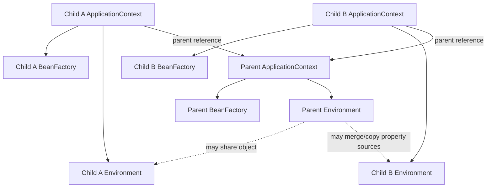
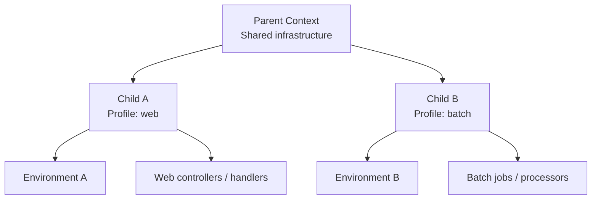

# Sharing the Environment and When Not to Share It

## 1. Why Distinguish the Environment?

In a Spring application, `ApplicationContext` manages beans, component lifecycles, resources, and events. Each context has an `Environment` to read properties, inspect active profiles, and access `PropertySource` entries such as configuration files, environment variables, system properties, or remote configuration sources.

When an application has a **context hierarchy**, such as a parent context containing shared beans and multiple child contexts containing separate web components, a common question is: do those contexts share a single `Environment`, or does each context have its own environment?

The answer directly affects how configuration is resolved:

- If two contexts use the **same Environment object**, changes to active profiles or the property source list on that object can be seen by every context using it.
- If each context uses a **separate Environment**, they can have different profiles, property sources, and configuration values. Shared values can be passed to the child via a merge/copy mechanism, but the two Environments do not automatically become a single object.
- The **parent–child relationship of ApplicationContext** also governs bean lookup. Sharing an Environment does not merge the bean factories of two contexts.

This lesson belongs to the **Context Hierarchy** chapter of **SPRING_CLOUD_CORE**. The focus is on understanding the boundary between context, bean factory, Environment, and property sources, and choosing the right sharing approach when using Spring Boot's `SpringApplicationBuilder` and Spring Cloud Context.

## 2. Four Concepts Not to Conflate

| Concept | Contains or manages | Automatically shared? |
| --- | --- | --- |
| `ApplicationContext` | Beans, lifecycle, resource loader, event publisher, parent reference | Each context is a separate container; parent–child can be configured |
| `BeanFactory` inside the context | Bean definitions and bean instances for that context | Not merged across contexts |
| `Environment` | Active/default profiles, property resolver, and property sources | Depends on how contexts are created and builder configuration |
| `PropertySource` | A specific key/value source, such as system environment or Config Server | Can be added to multiple Environments, but that does not mean the two Environments are the same object |

One way to visualize it:



The diagram shows the available options. A context parent–child relationship does not automatically dictate that their Environments must be the same object. Conversely, two contexts can reference the same Environment while still having separate BeanFactories.

## 3. What Rules Govern Bean Sharing in a Parent–Child Context?

In a Spring hierarchy:

- **A child can look up beans in itself and in its parent.** Thus a child can use services, repositories, or infrastructure beans declared in the parent.
- **The parent does not look downward for beans in the child.** The parent is unaware of beans created in child contexts.
- **Two siblings do not see each other's private beans.** They can only use beans in their own context or a shared ancestor.
- When both child and parent have a bean with the same name, lookups from the child prefer the child's bean; the parent bean still belongs to the parent container.

Example:

```java
@Configuration(proxyBeanMethods = false)
public class ParentConfiguration {

    @Bean
    Clock applicationClock() {
        return Clock.systemUTC();
    }

    @Bean
    SharedFormatter sharedFormatter() {
        return new SharedFormatter();
    }
}
```

The child context declares a bean depending on parent beans:

```java
@Configuration(proxyBeanMethods = false)
public class WebChildConfiguration {

    @Bean
    ReportService reportService(
            Clock applicationClock,
            SharedFormatter sharedFormatter) {
        return new ReportService(applicationClock, sharedFormatter);
    }
}
```

When configuring the hierarchy with `SpringApplicationBuilder`, the child can resolve `Clock` and `SharedFormatter` from the parent. However, if a bean in the parent tries to inject `ReportService`, the search does not descend into the child to find it.

| Lookup caller | Bean in parent | Bean in child A | Bean in sibling B |
| --- | --- | --- | --- |
| Parent | Yes | No | No |
| Child A | Yes | Yes | No |
| Sibling B | Yes | No | Yes |

This is very useful when you want shared beans such as a cache client, connection factory, or shared service in the parent, and separate controllers, handlers, or adapters in each child.

**Note:** a bean in the parent has only one instance in the parent container. Children looking up that bean receive the same bean instance from the parent; they do not automatically create copies of the parent bean. Beans declared separately in each child have their own lifecycles and instances.

## 4. Sharing the Same Environment Object

A `ConfigurableEnvironment` can be passed to multiple contexts. When multiple contexts hold a **reference to that exact object**, they read the same property source list and profiles from that object.

Example using `SpringApplicationBuilder`:

```java
import org.springframework.boot.builder.SpringApplicationBuilder;
import org.springframework.context.ConfigurableApplicationContext;
import org.springframework.core.env.ConfigurableEnvironment;
import org.springframework.core.env.StandardEnvironment;

public class HierarchyApplication {

    public static void main(String[] args) {
        ConfigurableEnvironment sharedEnvironment =
                new StandardEnvironment();

        ConfigurableApplicationContext childContext =
                new SpringApplicationBuilder(ParentConfiguration.class)
                        .environment(sharedEnvironment)
                        .child(WebChildConfiguration.class)
                        .environment(sharedEnvironment)
                        .run(args);

        ConfigurableApplicationContext parentContext =
                (ConfigurableApplicationContext) childContext.getParent();

        boolean sameEnvironment =
                childContext.getEnvironment()
                        == parentContext.getEnvironment();

        System.out.println("Same Environment: " + sameEnvironment);
    }
}
```

The key point in the example is passing the **same `sharedEnvironment` variable** to both the parent and child builders. The `==` comparison checks object identity, not merely whether two Environments have equal property values.

When two contexts share an Environment:

- `getProperty("app.region")` is resolved through the same property source list.
- Active profiles and default profiles are read from the same object.
- Adding, removing, or reordering property sources on that object affects all contexts using it.
- If the Environment is modified at runtime, every context can see the change at the property resolver level.

However, **sharing an Environment does not mean already-created beans automatically reinitialize**. For example, a bean that read `@Value` in its constructor keeps the value it received. To update beans upon configuration changes, an appropriate rebind or refresh mechanism is needed, such as those supported by Spring Cloud Context; sharing an Environment alone does not replace a refresh lifecycle.

### 4.1. When Should You Share?

Sharing an Environment object can be appropriate when:

- Parent and children are parts of the same logical application and need the same profiles and configuration sources.
- Shared configuration must remain consistent throughout the hierarchy's lifecycle.
- You deliberately want a property source change to be visible across all contexts sharing the object.
- The application has a centralized configuration change management process and clearly controls update timing.

Keep in mind that one context modifying profiles or property sources affects all remaining contexts. This creates coupling: a child is no longer completely independent with respect to its configuration environment.

## 5. Cases Where the Environment Is Not Shared

Not every context needs the same profiles or configuration sources. For instance, an application might create two children serving two tenants or two web adapters with distinct configurations.

You can explicitly pass separate Environments:

```java
import org.springframework.boot.builder.SpringApplicationBuilder;
import org.springframework.core.env.ConfigurableEnvironment;
import org.springframework.core.env.StandardEnvironment;

public class IsolatedEnvironmentApplication {

    public static void main(String[] args) {
        ConfigurableEnvironment parentEnvironment =
                new StandardEnvironment();

        ConfigurableEnvironment childEnvironment =
                new StandardEnvironment();

        new SpringApplicationBuilder(ParentConfiguration.class)
                .environment(parentEnvironment)
                .child(WebChildConfiguration.class)
                .environment(childEnvironment)
                .run(args);
    }
}
```

In this example, the two contexts still have a parent–child relationship for bean lookup, but are given two distinct Environment objects. The active profiles and property sources of each object can be configured independently before context refresh.

Cases where you generally should not share the same Environment:

- Two independent applications that simply happen to run in the same JVM.
- Children needing distinct profiles or configurations, such as one child using `web` and another using `batch`.
- Modules needing independent configuration sources per tenant or per environment.
- One context needing to modify property sources without altering how another context resolves properties.
- Siblings with different lifecycles and configuration requirements.

If two contexts are created from two separate `SpringApplication` instances without a parent–child hierarchy and without passing the same Environment, they operate with separate configuration environments. Running in the same process does not automatically make them share an Environment.

### 5.1. A Separate Environment Does Not Mean Zero Shared Values

A child can have a separate Environment while still needing part of the parent's configuration. In that case, you can use `ConfigurableEnvironment.merge(parentEnvironment)` before refreshing the context:

```java
ConfigurableEnvironment parentEnvironment =
        new StandardEnvironment();
parentEnvironment.setActiveProfiles("shared");

ConfigurableEnvironment childEnvironment =
        new StandardEnvironment();
childEnvironment.setActiveProfiles("web");

childEnvironment.merge(parentEnvironment);
```

The `merge` method adds active profiles, default profiles, and property sources from the parent Environment into the child Environment. When both have a property source with the same name, the child's source is kept and the parent's same-named source is omitted from the merged list. Thus the child's local configuration can preserve its precedence.

**Merging is not sharing a live object.** Merging does not make parent and child point to the same Environment. Changes to the property source list or profiles in the parent after merging do not automatically propagate to the child. Finish configuring the parent before merging if you want the child to receive all configuration sources present at that point.

## 6. Distinguishing Sharing, Inheritance, and Merging

The three approaches below produce different results:

| Approach | Same Environment object in both contexts? | Child receives shared values? | Parent changes afterward reflected automatically? |
| --- | --- | --- | --- |
| Pass same object via `.environment(sharedEnvironment)` | Yes | Yes, because it is the same object | Yes at the property source/profile level of the shared object |
| Use separate Environments, then `childEnvironment.merge(parentEnvironment)` | No | Yes, for profiles/property sources merged at call time | No automatic sync of source list/profiles after merge |
| Neither share nor merge | No | Does not receive parent's private property sources via Environment merge | No |

Additionally, **bean inheritance/lookup** is a separate mechanism: a child context can look up beans from the parent via the context hierarchy relationship even when both contexts use separate Environments. Therefore, you cannot use a child injecting a parent bean to conclude that they share an Environment.

## 7. SpringApplicationBuilder and Considerations When Creating a Hierarchy

`SpringApplicationBuilder` supports creating parent, child, and sibling contexts:

```java
new SpringApplicationBuilder(ParentConfiguration.class)
        .child(WebChildConfiguration.class)
        .run(args);
```

Several rules to remember:

- `parent(...)` sets up the parent application; `child(...)` creates a child application; `sibling(...)` creates an application sharing the same parent as the current context.
- The builder propagates/copies environment settings and default arguments down to the child according to the Boot version's API. If the **exact same Environment object** is required, pass the same instance explicitly via `environment(...)` and verify identity at runtime.
- Contexts in a hierarchy have separate BeanFactories; a child can look up beans from the parent, while the parent does not look downward.
- Siblings do not automatically see each other's beans. Each sibling can have its own profiles and configuration sources, even if it receives shared values from the parent depending on initialization.
- Web components should live in child contexts; the parent is typically a non-web context to avoid lifecycle and web server conflicts.

Example with parent for shared beans and child for the web application:

```java
new SpringApplicationBuilder(SharedInfrastructureConfiguration.class)
        .web(WebApplicationType.NONE)
        .child(WebApplication.class)
        .web(WebApplicationType.SERVLET)
        .run(args);
```

This organization separates shared infrastructure beans from the child application's web configuration. Use a hierarchy only when there is a genuine need; many standard Spring Boot applications need only a single ApplicationContext.

### 7.1. Sibling Contexts Can Have Different Configurations

Suppose a parent holds shared beans and two children handle two adapters:



Child A and Child B can receive shared property sources from the parent, while each child still maintains its own property sources. If one child needs to change `server.port` or a feature flag, avoid accidentally altering the sibling's configuration by sharing a single Environment object.

## 8. Spring Cloud Bootstrap Context and Environment

In Spring Cloud's **legacy bootstrap** mechanism, the bootstrap context is the parent context of the main application context. Spring Cloud documentation describes the bootstrap context and main context sharing an Environment so that properties loaded during the bootstrap phase can be resolved in the main application.

The bootstrap context can use `PropertySourceLocator` to load external configuration, such as from Spring Cloud Config Server. Property sources loaded during this phase can be added to the Environment with high precedence. This is behavior specific to the traditional bootstrap mechanism; do not generalize that every custom ApplicationContext hierarchy shares an Environment by the exact same rules.

When extending a hierarchy with `SpringApplicationBuilder`:

- The bootstrap context is the parent of the highest ancestor created by the application itself.
- Each context in the hierarchy can have its own bootstrap property source, sometimes empty, to avoid accidentally pushing values from parent down to all descendants.
- With Config Server, each context can in principle use a different `spring.application.name` and receive different remote property sources.
- Properties from a child can override properties from the parent according to context hierarchy rules.
- If a child has a property source with the same name as a parent source, the parent's same-named source is not included in the child's resolution results.

Spring Cloud documentation also notes that sharing a single Environment across an entire hierarchy should not be assumed by default. Spring Boot's builder may propagate/copy environment settings down to children; if a design requires Environment object identity, specify the shared object explicitly and verify on the running version.

### 8.1. Modern Bootstrap and Config Data

Since Spring Boot 2.4, Spring Cloud Config Client uses Config Data import via `spring.config.import` by default. This mechanism does not require a legacy bootstrap context merely to load configuration from Config Server.

That does not remove the ability to create a context hierarchy in an application; it only changes how remote configuration is loaded. When debugging a system, check whether the application enables legacy bootstrap or uses Config Data so you understand the actual property sources and contexts involved.

## 9. Property Source Precedence in a Context Hierarchy

When each context has different property sources, key resolution follows Spring's precedence rules:

1. A child's property sources can override values for the same key in the parent.
2. If the child has a property source with the same name as the parent's, the parent's same-named source is not added to the child.
3. When child and parent have differently named sources containing the same key, the order of property sources in the Environment determines the returned value.
4. Remote property sources loaded by Spring Cloud bootstrap have their own precedence rules; do not apply them mechanically to every context hierarchy.

Example:

```text
Parent Environment:
  applicationConfig: [classpath:application.yml]
    app.region = ap-southeast

Child Environment:
  childOverrides
    app.region = eu-west
```

If the child has a preceding property source providing the key `app.region`, the child returns `eu-west`. The parent value still exists in the parent context; it is simply not the final result when looked up from the child.

To inspect, you can examine each source:

```java
ConfigurableEnvironment environment = context.getEnvironment();

for (PropertySource<?> source : environment.getPropertySources()) {
    System.out.println(source.getName());
}
```

Do not print all property values in production because configuration sources may contain passwords, tokens, or sensitive information. When debugging, prefer printing source names and selected non-sensitive keys.

## 10. Does a Shared Environment Automatically Refresh Beans?

No. The Environment is the source for resolving properties; beans created in each context still belong to that context's BeanFactory.

For example, two contexts share an Environment, yet a bean already read a property at initialization time:

```java
@Component
public class RegionLabel {

    private final String region;

    public RegionLabel(@Value("${app.region:unknown}") String region) {
        this.region = region;
    }

    public String getRegion() {
        return region;
    }
}
```

If a property source is modified after the bean is created, the `region` field does not change automatically just because the Environment object is shared. Likewise, sharing an Environment does not automatically trigger `EnvironmentChangeEvent` or `RefreshScope`.

In Spring Cloud Context, `EnvironmentChangeEvent` can notify listeners of changed keys; appropriate mechanisms can rebind `@ConfigurationProperties`. Beans in `@RefreshScope` can be recreated when the target is invalidated and accessed again. However, you must ensure the Environment already holds the new values and that the refresh mechanism is invoked in each relevant context.

If a hierarchy has multiple child contexts, do not assume refreshing one context automatically refreshes all siblings. Identify which context receives the event, which beans belong to that context, and what broadcast/coordination mechanism is needed if multiple instances must be updated.

## 11. How to Inspect the Actual Environment in an Application

You can create a simple component to report Environment identity and active profiles:

```java
import org.springframework.context.ApplicationContext;
import org.springframework.core.env.Environment;
import org.springframework.stereotype.Component;

import java.util.Arrays;

@Component
public class ContextEnvironmentReport {

    private final ApplicationContext context;
    private final Environment environment;

    public ContextEnvironmentReport(
            ApplicationContext context,
            Environment environment) {
        this.context = context;
        this.environment = environment;
    }

    public void printReport() {
        System.out.println("Context ID: " + context.getId());
        System.out.println("Parent: " + context.getParent());
        System.out.println("Active profiles: "
                + Arrays.toString(environment.getActiveProfiles()));
        System.out.println("app.region: "
                + environment.getProperty("app.region"));
    }
}
```

In each context, call the corresponding report and compare:

- Context ID and parent reference show the context's position in the hierarchy.
- Active profiles show which configuration groups are applied.
- Property value shows the final value resolved by the Environment.
- To verify the same object, obtain the Environment of both contexts and compare with `==`; comparing property values is not sufficient to prove object identity.

In tests, you can verify these scenarios:

| Test | How to check | Expected result |
| --- | --- | --- |
| Parent bean used by child | Inject parent bean into child bean | Succeeds |
| Parent looks up child bean | Look up a bean declared only in child from parent | Not found |
| Siblings look up each other's beans | Look up a bean declared only in another sibling | Not found |
| Same Environment | Compare `child.getEnvironment() == parent.getEnvironment()` | `true` when the same object is passed |
| Separate Environments | Compare identity after supplying two separate objects | `false` |
| Merge Environment | Call `childEnv.merge(parentEnv)` before refresh | Child receives merged profiles/property sources |
| Parent changes after merge | Modify source list/profiles on parent after merge | Child does not automatically sync the new list/profiles |

## 12. Common Design Mistakes

| Misconception | Consequence | Correct understanding |
| --- | --- | --- |
| "Parent and child always share everything." | Unintended coupling of beans and configuration | Share only what is needed; BeanFactory and Environment are distinct concepts |
| "Child can inject beans from a sibling." | `NoSuchBeanDefinitionException` | Siblings only share a parent; they do not see each other's beans |
| "Parent can inject beans from a child." | Parent fails to initialize beans depending on child | Place beans in parent if shared, or move the dependency down to child |
| "Same property values mean the same Environment." | Misdiagnosing configuration issues | Check object identity and property source lists |
| "Merging Environments is live synchronization." | Child does not receive new configuration changes as expected | Merge only adds profiles/property sources at call time; subsequent changes are not synced automatically |
| "Sharing an Environment makes beans auto-refresh." | Already-initialized beans retain old values | Requires a dedicated rebind/refresh mechanism |
| "Every context gets the same remote config." | Child receives wrong application configuration | Each context can have its own `spring.application.name` and remote property source |
| "Config Data always creates a bootstrap parent context." | Misunderstanding context structure in newer apps | Config Data import does not require a legacy bootstrap context |

## 13. Principles for Choosing a Model

- Choose a **single shared Environment** when contexts need the same profiles, the same property sources, and must observe the same runtime changes.
- Choose **separate Environments** when each child/sibling has independent configuration or lifecycle.
- Choose **merge** when a child needs to receive foundational configuration from the parent at startup while preserving its ability to override locally.
- Keep shared beans in the parent and specialized beans in children; avoid having the parent depend back on child beans.
- With Spring Cloud bootstrap, distinguish the Environment of the bootstrap/main contexts from Environments of application-defined hierarchies.
- When in doubt about specific behavior, check object identity, profiles, and property sources on your actual Spring Boot/Spring Cloud version.

## 14. Self-Check Questions

1. How do `ApplicationContext` and `Environment` differ in responsibility?
2. Why can a child find a parent's bean, while the parent cannot find a bean existing only in the child?
3. Can two sibling contexts see each other's private beans?
4. How does sharing the same Environment object affect active profiles and property sources?
5. How does `ConfigurableEnvironment.merge(parent)` differ from passing the same Environment object?
6. Why does changing the Environment not automatically update a field injected with `@Value`?
7. In legacy Spring Cloud bootstrap, what is the Environment relationship between the bootstrap context and the main context?
8. When each child needs a different `spring.application.name`, what must be considered regarding remote property sources?
9. How do you verify whether two contexts actually use the same Environment object?

## 15. Official References

- [Spring Cloud Context — Application Context Services](https://docs.spring.io/spring-cloud-commons/reference/spring-cloud-commons/application-context-services.html) — bootstrap context, context hierarchy, Environment, and property sources.
- [Spring Boot — SpringApplicationBuilder](https://docs.spring.io/spring-boot/api/java/org/springframework/boot/builder/SpringApplicationBuilder.html) — parent, child, sibling APIs, and Environment configuration.
- [Spring Boot — SpringApplication](https://docs.spring.io/spring-boot/reference/features/spring-application.html) — creating a context hierarchy with the fluent builder.
- [Spring Framework — ApplicationContext API](https://docs.spring.io/spring-framework/docs/current/javadoc-api/org/springframework/context/ApplicationContext.html) — context roles and parent relationships.
- [Spring Framework — ConfigurableEnvironment API](https://docs.spring.io/spring-framework/docs/current/javadoc-api/org/springframework/core/env/ConfigurableEnvironment.html) — managing profiles, property sources, and the `merge` method.

*This document clearly distinguishes bean hierarchy, Environment identity, and property source merging. Detailed builder and bootstrap behavior should be verified against the exact Spring Boot/Spring Cloud version used by your application.*
