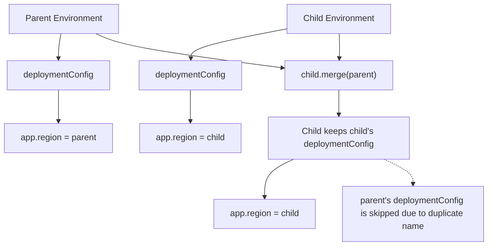

# Same-Named Properties and Same-Named PropertySources Across Contexts

In a Spring application with multiple `ApplicationContext` instances, configuration can be provided from multiple `PropertySource` instances in parent and child contexts. A key such as `app.region` can appear in several sources; that is normal and Spring resolves it using precedence order. However, **the name of the PropertySource also carries specific meaning**: Spring uses this name to identify the source in the `MutablePropertySources` list and when merging Environments across contexts.

Two situations must be distinguished:

1. **Duplicate property key name:** multiple sources both contain `app.region`. The effective value depends on which source is searched first.
2. **Duplicate PropertySource name:** two different sources both share the name `deploymentConfig`. When they sit in the same source list or are merged, Spring handles them by source name; the two sources do not simply coexist as two independent entries.

This distinction is especially important in context hierarchies, Spring Cloud Config, and applications with multiple per-tenant or per-module configurations.

## 1. Two Kinds of Names to Distinguish

Suppose an application has the configuration:

```text
PropertySource name: tenantOverrides
  app.region = ap-southeast-1
  app.timeout = 2s
```

In this example:
- `tenantOverrides` is the **source name** (PropertySource name).
- `app.region` and `app.timeout` are the **property key names**.
- `ap-southeast-1` and `2s` are the values.

| Component | Example | What is it used for? |
| --- | --- | --- |
| Property key | `app.region` | Application code looks up the value in the Environment |
| PropertySource name | `tenantOverrides` | Identifies a source in the PropertySource list |
| Property value | `ap-southeast-1` | Value returned when looking up the key |

Property keys may collide across multiple PropertySources. The PropertySource name is used as the source's identifier within a collection; duplicate source names can cause one source to replace or be skipped when adding/merging.

For example, two differently named sources declaring the same key is valid:

```text
Environment
  1. tenantOverrides
       app.region = ap-southeast-1
  2. platformDefaults
       app.region = ap-southeast-2
```

If `tenantOverrides` comes first, `Environment.getProperty("app.region")` receives `ap-southeast-1`. This is a **duplicate key**, not a duplicate source name.

## 2. Looking Up Same-Named Property Keys

When calling `Environment.getProperty("app.region")`, Spring searches the PropertySources in order within `MutablePropertySources`. The first source that supplies a non-`null` value determines the result.

Example:

```java
import java.util.Map;
import org.springframework.core.env.ConfigurableEnvironment;
import org.springframework.core.env.MapPropertySource;
import org.springframework.core.env.StandardEnvironment;

ConfigurableEnvironment environment = new StandardEnvironment();

environment.getPropertySources().addFirst(
        new MapPropertySource(
                "tenantOverrides",
                Map.of("app.region", "ap-southeast-1")
        )
);

environment.getPropertySources().addLast(
        new MapPropertySource(
                "platformDefaults",
                Map.of(
                        "app.region", "ap-southeast-2",
                        "app.timeout", "5s"
                )
        )
);

String region = environment.getProperty("app.region");
// ap-southeast-1

String timeout = environment.getProperty("app.timeout");
// 5s
```

In the example:
- `app.region` appears in both sources; the first source wins.
- `app.timeout` exists only in the later source; Spring continues searching and retrieves the value.
- The two sources have different names, so both remain in the list.

This is the Environment's basic precedence mechanism. When a child context merges an Environment from a parent context, the same lookup rule applies; the order between child sources and parent sources determines the effective value.

### 2.1. Null Values and Empty Strings

When a PropertySource does not contain a key or returns `null`, lookup continues to the next source. If a source contains the key with an empty string value `""`, the empty string is a non-`null` value and can shadow a value in a lower-precedence source.

```text
1. tenantOverrides
     app.region = ""
2. platformDefaults
     app.region = ap-southeast-1
```

In this case, the result can be an empty string. If business rules treat an empty string as missing configuration, handle normalization or validation explicitly. Do not assume Spring automatically ignores every empty value.

## 3. PropertySource Name Is the Identifier in MutablePropertySources

Each `PropertySource` has a name passed when constructed:

```java
MapPropertySource source = new MapPropertySource(
        "tenantOverrides",
        Map.of("app.region", "ap-southeast-1")
);
```

This name is used in `MutablePropertySources` to access, order, replace, or remove sources. In Spring, equality for `PropertySource` is based on the source name. Consequently, two distinct PropertySource objects with the same name are treated as the same identifier when managed in this collection.

Example:

```java
MapPropertySource first = new MapPropertySource(
        "runtimeOverrides",
        Map.of("app.timeout", "2s")
);

MapPropertySource second = new MapPropertySource(
        "runtimeOverrides",
        Map.of("app.timeout", "4s")
);
```

The two objects have different maps but share the name `runtimeOverrides`. If both are added to the same `MutablePropertySources` via add APIs, the new source replaces the old source's slot/identity rather than creating two entries with the same name.

### 3.1. `addFirst`/`addLast` with an Existing Source Name

`MutablePropertySources.addFirst` and `addLast` remove any source with the same name before inserting the new source. Thus, calling add with an existing name can both replace the old object and change its precedence position depending on the method.

```java
import org.springframework.core.env.MutablePropertySources;

MutablePropertySources sources = new StandardEnvironment().getPropertySources();

sources.addFirst(new MapPropertySource(
        "runtimeOverrides",
        Map.of("app.timeout", "2s")
));

sources.addFirst(new MapPropertySource(
        "runtimeOverrides",
        Map.of("app.timeout", "4s")
));

// Only one source named runtimeOverrides remains.
// The value looked up from that source is 4s.
```

If two independent sources must both contribute properties, give them different names, for example:
- `moduleA.runtimeOverrides`
- `moduleB.runtimeOverrides`

Do not share one name merely because two sources have the same format or class type. The name should describe the data origin and ownership scope.

## 4. Same PropertySource Name in Two Independent Environments

Suppose parent and child have two separate Environments. Each Environment has its own PropertySource list, so the same source name can appear in both without creating an immediate conflict:

```text
Parent Environment
  deploymentConfig
    app.region = parent-region

Child Environment
  deploymentConfig
    app.region = child-region
```

At this point, the parent looks up in the parent's list; the child looks up in the child's list. The two collections are independent, so sharing the name `deploymentConfig` does not cause them to replace each other automatically.

However, once the two Environments are merged, the duplicate source-name rule takes effect. That is why it is important to understand how a context hierarchy is constructed and when `ConfigurableEnvironment.merge` is called.

## 5. How `ConfigurableEnvironment.merge` Handles Duplicate Source Names

`ConfigurableEnvironment.merge(parent)` merges profiles and PropertySources from the parent Environment into the current Environment (typically the child's Environment). In principle:
- PropertySources already present in the child are kept.
- PropertySources from the parent are appended after the child's sources.
- If the child already has a PropertySource with the same name, the parent's same-named source is skipped.
- Because child sources precede appended parent sources, same-named keys in child sources generally have higher precedence.

Key takeaway: **when source names collide, Spring skips the parent's same-named PropertySource as a single unit; it does not merge individual keys from two same-named sources.**

Diagram:



### 5.1. Example: Different Source Names Keep Both

```java
import java.util.Map;
import org.springframework.core.env.MapPropertySource;
import org.springframework.core.env.StandardEnvironment;

StandardEnvironment parent = new StandardEnvironment();
parent.getPropertySources().addFirst(
        new MapPropertySource(
                "platformDefaults",
                Map.of(
                        "app.region", "ap-southeast-2",
                        "app.timeout", "5s"
                )
        )
);

StandardEnvironment child = new StandardEnvironment();
child.getPropertySources().addFirst(
        new MapPropertySource(
                "tenantOverrides",
                Map.of("app.region", "ap-southeast-1")
        )
);

child.merge(parent);

String region = child.getProperty("app.region");
// ap-southeast-1: child source comes first

String timeout = child.getProperty("app.timeout");
// 5s: key is absent in child source, so it comes from parent
```

The two sources have different names, so the parent source is appended to the child's list after existing sources. The child overrides the duplicate key; keys present only in the parent remain visible from the child.

### 5.2. Example: Same Source Name Skips the Parent Source

```java
StandardEnvironment parent = new StandardEnvironment();
parent.getPropertySources().addFirst(
        new MapPropertySource(
                "deploymentConfig",
                Map.of(
                        "app.region", "parent-region",
                        "app.timeout", "5s"
                )
        )
);

StandardEnvironment child = new StandardEnvironment();
child.getPropertySources().addFirst(
        new MapPropertySource(
                "deploymentConfig",
                Map.of("app.region", "child-region")
        )
);

child.merge(parent);

String region = child.getProperty("app.region");
// child-region

String timeout = child.getProperty("app.timeout");
// null if no other source declares app.timeout
```

Even though the parent has `app.timeout`, the parent's `deploymentConfig` PropertySource is not added to the child because the child already has a source with that name. Spring does not extract `app.timeout` individually to merge into the child's map.

This is a common reason properties appear to "disappear" after merging Environments: two sources were given the same name even though they hold different sets of keys.

### 5.3. Shared Default Names Can Collide

Some integrations create PropertySources using conventional names. If multiple contexts use the same name for sources with different contents, merging can cause the parent's source to be skipped. Do not build business logic around internal framework source names or assume two same-named sources hold identical contents.

When creating PropertySources yourself, choose stable, namespaced names such as `orders.tenantOverrides` or `platform.sharedDefaults`. When integrating third-party libraries, observe the actual source names in the Environment and test merge behavior in your active version.

## 6. When a Parent–Child Context Is Configured

When calling `AbstractApplicationContext.setParent(parent)`, if the parent's Environment is a `ConfigurableEnvironment`, Spring calls `merge` to bring profiles and PropertySources from the parent into the child's Environment. Therefore, `ConfigurableEnvironment.merge` rules are not just manual test operations; they directly relate to how a context hierarchy is built. With custom contexts or Environments, you still need to check the exact initialization path.

Manual example:

```java
import org.springframework.context.annotation.AnnotationConfigApplicationContext;

AnnotationConfigApplicationContext parent =
        new AnnotationConfigApplicationContext(ParentConfiguration.class);

AnnotationConfigApplicationContext child =
        new AnnotationConfigApplicationContext();

child.setParent(parent);
child.register(ChildConfiguration.class);
child.refresh();
```

When using a context builder or framework-managed context creation, Environment construction can be customized. If the application configures a shared Environment, replaces it with a separate Environment, or has an integration reordering PropertySources, verify the specific configuration rather than assuming every context always merges the same way.

Examples using `Map.of` require Java 9 or later. For Java 8 projects, you can substitute `HashMap`/`LinkedHashMap` or `Collections.singletonMap`.

### 6.1. Bean Hierarchy and PropertySource Hierarchy Are Separate Concerns

| Aspect | Bean hierarchy | PropertySource hierarchy |
| --- | --- | --- |
| Managed items | Bean definitions and bean instances | Key/value sources |
| Primary mechanism | BeanFactory parent lookup | Environment and MutablePropertySources |
| Key rule | Child looks up to parent; parent does not look up child | Lookup follows source order; merge applies source-name rules |
| Name collision | Local bean can shadow parent bean when looked up from child | Duplicate source name can cause parent source to be skipped on merge |
| Impact | Dependency injection and bean lookup | Effective property values |

A bean in a child can read properties merged from the parent. However, that does not mean a parent bean can inject a child bean. Do not use PropertySource rules to infer bean visibility or vice versa.

## 7. Practical Scenario: Platform and Tenant Configuration

Suppose a Spring Cloud platform runs multiple tenants. The parent provides platform defaults, while each child context holds tenant-specific configuration.

Desired configuration:

```text
Parent:
  platformDefaults
    app.region = ap-southeast-1
    app.timeout = 5s
    app.currency = VND

Child tenant-A:
  tenantAOverrides
    app.timeout = 2s
    app.brand = A

Child tenant-B:
  tenantBOverrides
    app.timeout = 3s
    app.brand = B
```

Different source names allow each child to receive platform defaults from the parent and override its own keys:

| Key | Tenant A | Tenant B |
| --- | --- | --- |
| `app.region` | `ap-southeast-1` | `ap-southeast-1` |
| `app.timeout` | `2s` | `3s` |
| `app.currency` | `VND` | `VND` |
| `app.brand` | `A` | `B` |

If all three sources were named `applicationConfig`, the child could prevent the parent's same-named source from being merged. Therefore, name sources to reflect their scope and purpose, such as `platformDefaults`, `tenantAOverrides`, and `tenantBOverrides`.

### 7.1. When Should You Use the Same Name?

Use the same name only when two sources represent the same logical identity and the desired merge policy is to retain a single source according to framework rules. For example, a child intentionally supplies a complete `deploymentConfig` source to replace the parent's same-named source.

If the intent is to **supplement individual keys** across parent and child, use different names. Giving sources the same name does not mean "two same-named maps will be merged key-by-key."

## 8. Connection to Spring Cloud Config and Bootstrap

Spring Cloud Config Client can place properties from Config Server into the Environment as PropertySources. In architectures with a legacy bootstrap context, property sources can be prepared in the bootstrap hierarchy and shared/merged into the main context according to the version's mechanism.

Distinguish clearly:
- Config Server is an external service providing configuration.
- Config Client/provider is code running in the application to fetch data.
- PropertySource is the Spring structure representing configuration data.
- Environment is where application code looks up properties.
- Context hierarchy determines bean scope and how Environments are attached/merged per configuration.

In Spring Boot generations using the Config Data API, remote configuration is commonly declared via `spring.config.import=configserver:`. Legacy bootstrap has a different initialization path. Do not assume a specific PropertySource name always exists across every release train or use Config Client's internal source names as a contract across modules.

If Config Client loads a property source into the child while the parent has a source with the same name, inspect ordering and merge rules. It is best to use distinct source names for sources with different contents/scopes and test behavior on your actual version.

## 9. Refresh and Modifying PropertySources

Changing a PropertySource and refreshing beans are two separate steps:
1. Update/replace the source in the Environment.
2. Have beans using the new configuration re-read values via the appropriate mechanism.

For example, if you replace a `MapPropertySource` with a new source of the same name, `MutablePropertySources.addFirst` can remove the old source and place the new one at the front of the list. The next Environment read will use the new source. However, beans that already received values via `@Value` at initialization do not automatically update fields in all cases.

With Spring Cloud Context, `@RefreshScope` can help recreate target beans when refresh is triggered and the Environment has been updated. It does not automatically resolve PropertySource name collisions. If a parent source was skipped during merge, refreshing beans still cannot read keys that were never added to the Environment.

The workflow should be:
- Identify which source needs to change.
- Set the source name and order properly.
- Update the Environment/PropertySource.
- Trigger refresh if beans need to re-read configuration.
- Verify effective values and bean state after refresh.

## 10. Inspecting and Observing PropertySources at Runtime

You can list PropertySource names and types in the Environment to understand its structure:

```java
import org.springframework.core.env.ConfigurableEnvironment;
import org.springframework.core.env.PropertySource;

void inspectSources(ConfigurableEnvironment environment) {
    for (PropertySource<?> source : environment.getPropertySources()) {
        System.out.printf("%s (%s)%n",
                source.getName(),
                source.getClass().getSimpleName());
    }
}
```

To inspect a specific source, you can use `get(name)` and query keys on that source. With a `CompositePropertySource`, inspect the child sources in order.

Do not log all configuration values in production because configuration sources may expose secrets. Log only source names, source types, and non-sensitive keys; for sensitive keys, mask them or omit them completely.

### 10.1. Debugging Checklist Questions

1. Are parent and child using separate Environments or the same Environment?
2. Has the child's Environment merged the parent yet?
3. Which PropertySource contains the key?
4. Does the parent's PropertySource name collide with a child source?
5. If so, was the parent source skipped during merge?
6. What is the order of top-level PropertySources?
7. If a source is composite, what is the order of its nested sources?
8. Is the first value found `null`, an empty string, or a valid value?
9. Do beans that already bound the property need a refresh?

Answering these questions helps pinpoint the true cause when a property does not have the expected value.

## 11. Testing Duplicate Keys and Duplicate Source Names

Test the two cases separately: duplicate keys across differently named sources, and duplicate source names between parent and child.

### 11.1. Test: Duplicate Keys, Different Source Names

```java
import static org.assertj.core.api.Assertions.assertThat;

import java.util.Map;
import org.junit.jupiter.api.Test;
import org.springframework.core.env.MapPropertySource;
import org.springframework.core.env.StandardEnvironment;

class EnvironmentMergeTest {

    @Test
    void childPropertyWinsAndParentProvidesMissingKeys() {
        StandardEnvironment parent = new StandardEnvironment();
        parent.getPropertySources().remove("systemProperties");
        parent.getPropertySources().remove("systemEnvironment");
        parent.getPropertySources().addFirst(new MapPropertySource(
                "platformDefaults",
                Map.of(
                        "app.region", "parent-region",
                        "app.timeout", "5s"
                )
        ));

        StandardEnvironment child = new StandardEnvironment();
        child.getPropertySources().remove("systemProperties");
        child.getPropertySources().remove("systemEnvironment");
        child.getPropertySources().addFirst(new MapPropertySource(
                "tenantOverrides",
                Map.of("app.region", "child-region")
        ));

        child.merge(parent);

        assertThat(child.getProperty("app.region"))
                .isEqualTo("child-region");
        assertThat(child.getProperty("app.timeout"))
                .isEqualTo("5s");
    }
}
```

This test confirms that the child source takes higher precedence when two sources have different names and share a key; keys existing only in the parent are still resolved.

### 11.2. Test: Duplicate Source Names

```java
@Test
void parentSourceWithDuplicateNameIsNotMerged() {
    StandardEnvironment parent = new StandardEnvironment();
    parent.getPropertySources().remove("systemProperties");
    parent.getPropertySources().remove("systemEnvironment");
    parent.getPropertySources().addFirst(new MapPropertySource(
            "deploymentConfig",
            Map.of(
                    "app.region", "parent-region",
                    "app.timeout", "5s"
            )
    ));

    StandardEnvironment child = new StandardEnvironment();
    child.getPropertySources().remove("systemProperties");
    child.getPropertySources().remove("systemEnvironment");
    child.getPropertySources().addFirst(new MapPropertySource(
            "deploymentConfig",
            Map.of("app.region", "child-region")
    ));

    child.merge(parent);

    assertThat(child.getProperty("app.region"))
            .isEqualTo("child-region");
    assertThat(child.getProperty("app.timeout")).isNull();
}
```

This test confirms an important behavior: when the child already has a source named `deploymentConfig`, the same-named source from the parent is not added. The parent's `app.timeout` property is therefore absent from the child via that source.

### 11.3. Test: `addFirst` Replaces a Same-Named Source

```java
@Test
void addingSourceWithSameNameReplacesExistingSource() {
    StandardEnvironment environment = new StandardEnvironment();
    environment.getPropertySources().remove("systemProperties");
    environment.getPropertySources().remove("systemEnvironment");

    environment.getPropertySources().addFirst(new MapPropertySource(
            "runtimeOverrides",
            Map.of("app.timeout", "2s")
    ));

    environment.getPropertySources().addFirst(new MapPropertySource(
            "runtimeOverrides",
            Map.of("app.timeout", "4s")
    ));

    assertThat(environment.getProperty("app.timeout")).isEqualTo("4s");
    int count = 0;
    for (org.springframework.core.env.PropertySource<?> source
            : environment.getPropertySources()) {
        if (source.getName().equals("runtimeOverrides")) {
            count++;
        }
    }
    assertThat(count).isEqualTo(1);
}
```

The three tests above separate three concepts:
- Duplicate keys are resolved by precedence.
- Duplicate source names during merge cause the parent source to be skipped.
- Duplicate source names when adding to the same collection cause the existing source to be replaced.

## 12. Common Errors and How to Handle Them

| Symptom | Possible cause | How to check |
| --- | --- | --- |
| Child does not receive a property present only in parent | Parent source was not merged, or source name collided with a child source | Inspect `child.getPropertySources()` and source names |
| Some parent keys disappear after merge | Parent PropertySource has the same name as a child source and is skipped entirely | Rename the source if keys should supplement each other, or intentionally replace the whole source |
| Property value differs from expectation | Key appears in multiple sources and a higher-precedence source wins | Check PropertySource order and per-source values |
| Added new source, old source disappeared | Two sources share the same name in the same MutablePropertySources | Give distinct names or deliberately use replace behavior |
| Child has new value, but bean still holds old value | Bean bound/injected before Environment changed | Check refresh scope or recreate the bean |
| Two contexts share a source name independently | Not merged yet, so each collection has its own source | Check parent setup and Environment configuration |
| Same-named source replaced unintentionally | Overly generic name such as `customProperties` used by multiple modules | Use stable namespacing by module/tenant/provider |

## 13. Principles for Naming PropertySources

To reduce errors with multiple contexts and configuration sources:

- Choose names describing **data origin and ownership scope**, such as `platformDefaults`, `orders.tenantA`, `orders.runtimeOverrides`.
- Avoid using a generic name like `customProperties` for multiple sources with different contents.
- Use the same name only when you want the same logical source identifier replaced/prioritized under well-understood merge rules.
- If you want to combine properties from multiple sources, use distinct names and establish explicit precedence order.
- Inspect source names at runtime when integrating third-party providers.
- Do not treat PropertySource names as a security namespace; using different names does not isolate access permissions or hide secrets.

## Key Takeaways

Duplicate **property keys** mean multiple sources declare the same key; Spring chooses the value according to the Environment's lookup order. Duplicate **PropertySource names** mean two sources share the same identifier in a collection; when merging Environments, a parent source with the same name as a child source is skipped, whereas when adding to the same `MutablePropertySources`, the existing same-named source is replaced. To supplement keys from the parent, give the sources different names. When debugging a context hierarchy, separately verify which Environment is used, which sources were merged, the source names, and the precedence order before concluding that a property was lost or overwritten.
