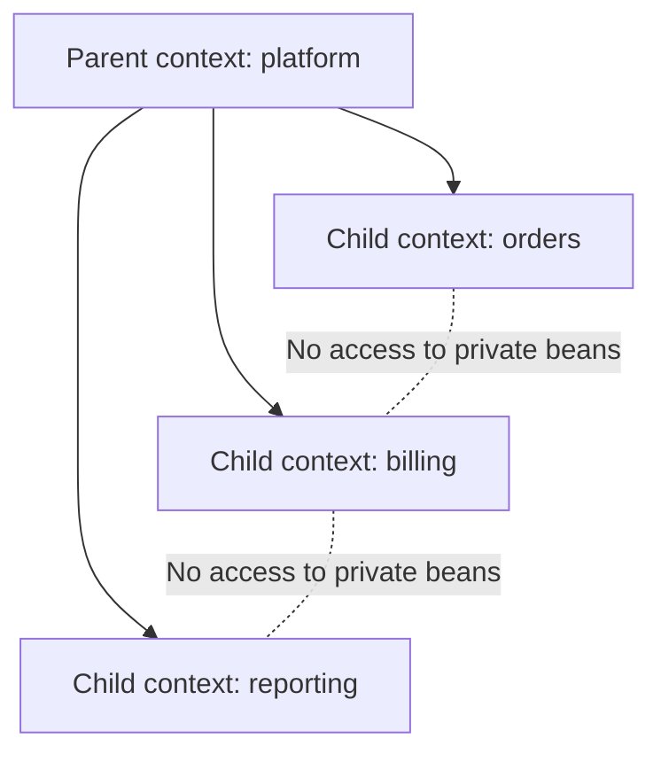

# Application Identity, Context ID, and Dedicated Configuration Sources

> **Chapter:** Context Hierarchy  
> **Module:** `SPRING_CLOUD_CORE` — core Spring Cloud foundations in distributed systems, including Spring Cloud Commons, Context, externalized configuration, discovery, service registry, service-to-service communication, and operating shared abstractions.  
> **Focus:** A single process can contain multiple Spring `ApplicationContext` instances. Application name, context ID, and remote configuration bundle name are related, yet they are not the same concept. Understanding them properly ensures each context receives the right configuration and prevents property leakage across parent, child, and siblings.

## 1. Why Must Identifiers Be Distinguished?

A typical Spring Boot application usually has only one ApplicationContext, so many teams treat `spring.application.name` as the name of everything. When a system evolves into an application with a context hierarchy, that assumption easily causes bugs:

- two contexts in the same JVM share the same `spring.application.name`, making logs or management data hard to distinguish;
- Config Client fetches configuration for the wrong service because the lookup name sent to Config Server is wrong;
- a child context unexpectedly inherits properties from the parent;
- two sibling contexts are assumed to share profiles or the same `Environment`, while each context has its own configuration;
- instance IDs collide in the registry because the team conflated service name, context ID, and instance ID.

To avoid confusion, distinguish at least four identifiers:

| Identifier | Meaning | Example |
| --- | --- | --- |
| **Application name** (`spring.application.name`) | Logical name of the application/service | `order-service` |
| **ApplicationContext ID** (`context.getId()`) | ID of a specific Spring context within the process | `order-service:prod:8081` or an application-assigned ID |
| **Config lookup name** (`spring.cloud.config.name`) | Name or list of configuration file names requested by Config Client | `order-service,shared-database` |
| **Instance ID** | ID of a specific running instance recognized by a registry or platform | `order-service:node-2:8081` |

Some framework or provider defaults may use the application name to construct the context ID or instance ID. That does not make the concepts identical. You must know **what generates the ID, what it is used for, and where its uniqueness scope lies**.

### Learning Outcomes

After this lesson, learners will be able to:

1. explain the relationship between `spring.application.name`, ApplicationContext ID, and instance ID;
2. describe how Spring Cloud Config uses application, profile, and label to locate remote property sources;
3. distinguish `spring.cloud.config.name` from `spring.application.name`;
4. design parent, child, and sibling contexts with dedicated configuration sources;
5. understand how Environment and PropertySources are inherited, overridden, and isolated;
6. configure and inspect `SpringApplicationBuilder` without unintentionally sharing an Environment;
7. diagnose errors involving wrong config retrieval, duplicate IDs, and parent/child property overrides.

## 2. Application Name and ApplicationContext ID

### 2.1. `spring.application.name` Is the Logical Name

`spring.application.name` typically describes the application name used by the Spring Cloud ecosystem to identify a service. It can be used as:

- the default name for Config Client to look up configuration on Config Server;
- the default service name when a discovery provider registers an instance;
- part of the identifying metadata in logs, metrics, tracing, or platform integrations;
- input for Spring Boot to generate the ApplicationContext ID in the corresponding initializer mechanism.

Example:

```yaml
spring:
  application:
    name: order-service
```

This name should be stable according to the service's logical role, not tied to a hostname, IP, or specific pod name. When running multiple replicas of `order-service`, replicas typically share the same application name while having different instance IDs.

### 2.2. ApplicationContext ID Identifies a Context in the JVM

`ApplicationContext` is the container managing beans, Environment, events, and lifecycle for a part of a Spring application. `getId()` returns that context's ID.

Spring Boot has `ContextIdApplicationContextInitializer`; this initializer uses `spring.application.name` to build the ApplicationContext ID and falls back to `application` if no name is set. In Spring Cloud's legacy bootstrap model, Spring Cloud documentation notes that if you want `spring.application.name` to be used as the context ID, you should place the property in `bootstrap.yml` or `bootstrap.properties`.

This matters in a hierarchy: a single JVM can host multiple contexts. If each context has a distinct role, set an appropriate application name in each context's Environment and inspect the actual ID after initialization. When custom IDs are needed, use an initializer or context creation mechanism appropriate for your version; do not assume changing `spring.application.name` alone always guarantees a unique ID.

Verification example:

```java
ConfigurableApplicationContext context =
        SpringApplication.run(OrderApplication.class, args);

System.out.println("contextId = " + context.getId());
System.out.println("applicationName = "
        + context.getEnvironment().getProperty("spring.application.name"));
```

The two values may be related, yet they represent two different things: one is the context's ID, and the other is the application name property in the Environment.

### 2.3. Application Name Is Not Instance ID

Suppose `order-service` runs three replicas:

| Replica | `spring.application.name` | Illustrative Instance ID |
| --- | --- | --- |
| Pod A | `order-service` | `order-service:pod-a:8080` |
| Pod B | `order-service` | `order-service:pod-b:8080` |
| Pod C | `order-service` | `order-service:pod-c:8080` |

A discovery registry needs to distinguish instances to update health, addresses, and metadata. Application name groups them under the same logical service. Instance ID must be unique according to the rules of the registry or deployment platform.

Some providers may generate a default instance ID from the Spring ApplicationContext ID and port. For example, Spring Cloud Consul uses the context ID as the default instance ID in certain configurations, while allowing overrides via a dedicated property. That is a provider-specific rule, not a universal guarantee across all registries.

**Do not use context ID in place of a well-defined instance ID** if the application runs multiple contexts, multiple server ports, or multiple replicas on the same host.

## 3. Which Identifiers Does Config Client Use to Find Configuration?

### 3.1. Three Parameters: Application, Profile, and Label

Spring Cloud Config Server serves configuration in the form:

```text
/{application}/{profile}/{label}
```

By default, Config Client maps:

- `application` from `spring.application.name`;
- `profile` from active profiles in the Environment;
- `label` from client/server configuration, typically a repository version label.

Example conceptual request:

```text
/order-service/prod/release-2026
```

This means fetching configuration for application `order-service`, profile `prod`, from label `release-2026`. With the default Git backend, a label can be a branch, tag, or commit ID. The default label value depends on server configuration and version; do not hardcode an assumption of `master`.

### 3.2. `spring.cloud.config.name` Can Override Application Name

`spring.cloud.config.name` controls the name used to search remote property sources. If unset, Config Client uses `spring.application.name`. You can specify a single name or a comma-separated list of names to share configuration files across a group of applications.

Example:

```yaml
spring:
  application:
    name: order-service
  cloud:
    config:
      name: order-service,shared-database
      profile: prod
      label: release-2026
```

In this example, the application name remains `order-service`, while Config Client additionally requests the `shared-database` configuration bundle. This is useful when multiple services share common settings such as Redis, datasource, or telemetry.

`spring.cloud.config.profile` and `spring.cloud.config.label` can also override the profile/label values used for lookup. Verify the exact properties for your Config Client version.

### 3.3. Config Server Has Both Shared and Dedicated Configuration

Config Server can serve an `application` source as base configuration shared across applications. In addition, each application has its own files, profile-specific files, and shared configuration names requested via `spring.cloud.config.name`.

Example repository:

```text
config-repo/
  application.yml
  application-prod.yml
  order-service.yml
  order-service-prod.yml
  shared-database.yml
  shared-database-prod.yml
  billing-service.yml
  billing-service-prod.yml
```

With `spring.application.name=order-service` and `spring.cloud.config.name=order-service,shared-database`, Config Server can return the base `application` property sources, profile-specific sections, dedicated `order-service` configuration, and the `shared-database` group. The order of property sources returned by Config Server determines which values override which; sources appearing later in the list typically take higher precedence per repository rules.

When naming an application, avoid using the reserved `application-` prefix in a service name because it can cause ambiguity when Config Server resolves property source names.

### 3.4. `spring.application.name` and Config Lookup Name Do Not Have to Match

You can use the same name for simplicity, but the two properties have distinct responsibilities:

| Setting | Value | Meaning |
| --- | --- | --- |
| `spring.application.name` | `order-service` | Identifies the logical service and can serve as input for context ID |
| `spring.cloud.config.name` | `order-service,shared-database` | Requests multiple remote config groups |
| `spring.cloud.config.profile` | `prod,metrics` | Profiles used when fetching remote config |
| `spring.cloud.config.label` | `release-2026` | Configuration source version |

Changing `spring.cloud.config.name` does not automatically change the service name in the registry. Changing `spring.application.name` can affect multiple other integrations, so evaluate its impact before changing it.

## 4. Dedicated Configuration Sources in a Context Hierarchy

### 4.1. Parent, Child, and Sibling

Spring supports building a context hierarchy. A child context can access beans from its parent context; the parent context cannot reach backward for beans declared only in child contexts. Sibling contexts do not automatically see each other's beans.

Example of a modular application in the same JVM:

- **Parent context:** holds shared infrastructure beans such as certain adapters, a clock, or foundational clients;
- **Order context:** holds order controllers, services, and repositories;
- **Billing context:** holds billing components;
- **Reporting context:** holds reporting components.



The diagram shows bean visibility relationships. Each child can have its own profiles, property sources, and configuration; sharing an Environment is a separate decision from sharing a parent context.

### 4.2. `SpringApplicationBuilder`

`SpringApplicationBuilder` provides an API to create parent, child, and sibling contexts:

```java
ConfigurableApplicationContext context =
        new SpringApplicationBuilder(PlatformConfiguration.class)
                .properties("spring.application.name=platform")
                .child(OrderConfiguration.class)
                    .properties("spring.application.name=order-service")
                .sibling(BillingConfiguration.class)
                    .properties("spring.application.name=billing-service")
                .run(args);
```

This example illustrates how to structure the builder; in real projects, check how Environment, profiles, web application types, and server ports are configured for each context. If multiple children create web servers, configure separate ports or designate a single context as the web entry point.

The `properties(...)` method adds default properties to the builder. System properties, environment variables, or command-line arguments can take higher precedence, so verify each context's effective `spring.application.name` rather than only reading the string passed to the builder.

You can use `getParent()` to walk up the hierarchy and inspect each context. If you need references to all contexts created by the builder, retain references or register appropriate listeners rather than guessing them by name.

### 4.3. Each Context Has a Separate Environment by Default

An easy pitfall: **`SpringApplicationBuilder` can share one Environment across the entire hierarchy, but that is not the default**. Under default behavior, each context has its own Environment; a child typically starts with appropriate inherited values from the parent and adds its own configuration.

This allows `orders` and `billing` to have different profiles or remote configs. If the application deliberately shares an Environment, property/profile changes in one context can have broader effects than expected. Before choosing to share, determine whether both contexts truly require the same configuration set and lifecycle.

### 4.4. Separate Bootstrap Property Source per Context

In Spring Cloud's legacy bootstrap model, the bootstrap context is added as the parent of the highest-level context created by the application. Each context in the hierarchy gets its own `bootstrap` property source, which may be empty. This prevents properties from a parent from accidentally being promoted into a shared bootstrap source for all descendants.

With Config Server, in principle each context in the hierarchy can have a different `spring.application.name` and receive different remote property sources. This is an important capability when one JVM needs to run multiple modules with separate configurations.

Do not assume there is only one remote config request for the whole hierarchy. Nor should you assume every context is guaranteed to load remote config: check how each context is initialized, along with dependencies and the Spring Cloud version.

## 5. How Are PropertySources Inherited and Overridden?

### 5.1. Basic Rules

A Spring Environment holds an ordered list of PropertySources. When multiple sources declare the same key, the higher-precedence source is used.

In a context hierarchy, Spring applies inheritance rules for the parent's property sources and processes the child's sources. In general:

- properties in the child can override properties from the parent;
- property sources with the same name follow specific handling rules;
- if the child has a property source with the same name as a parent source, the parent's same-named source is not included in the child as a separate copy;
- a child's profiles can differ from the parent's if their Environments are not shared.

This matters more than comparing only the final value: you need to know **which property source supplied that value**.

### 5.2. Example of Same-Named Sources

Suppose the parent has:

```yaml
# Parent context
platform:
  region: ap-southeast-1
feature:
  audit: true
```

The `orders` child has its own source:

```yaml
# Child orders
platform:
  region: ap-southeast-2
order:
  reservation-timeout: 3s
```

The child can receive `platform.region=ap-southeast-2` and retain `feature.audit=true` from the parent if property sources are organized in a way that permits inheritance. However, if the child adds a PropertySource with the same name as a parent source, Spring can omit the parent's same-named source from the inherited list; other keys present only in that parent source can also disappear from the child.

Therefore, PropertySource names must be chosen intentionally. Do not dump all custom configuration into a generically named source and accidentally cause collisions across contexts.

### 5.3. Remote `bootstrap` Source vs. Bootstrap File Are Not the Same

In legacy mode, distinguish:

- the property source named `bootstrap`, which typically holds remote data returned by `PropertySourceLocator` and can have high precedence;
- `applicationConfig: [classpath:bootstrap.yml]`, which holds bootstrap file values and typically has lower precedence than `application.yml` and regular child sources.

The filename `bootstrap.yml` does not mean every property in that file always has the highest precedence. The remote property source and the bootstrap file are two distinct sources.

### 5.4. Inspecting Property Sources at Runtime

You can inspect property sources in the Environment:

```java
ConfigurableEnvironment environment =
        (ConfigurableEnvironment) context.getEnvironment();

for (PropertySource<?> source : environment.getPropertySources()) {
    System.out.println(source.getName());
}
```

To inspect a key, log both the effective value and the source owning that value if your observability tooling supports it. With Spring Boot Actuator, the `env` endpoint can assist investigation once enabled and secured. Mask secrets; never log credentials or private keys.

## 6. Identifiers and Dedicated Configuration in the Orders/Billing Example

### 6.1. Goal

Suppose one process hosts two child contexts:

- `orders` uses the `order-service` remote config;
- `billing` uses the `billing-service` remote config;
- both inherit certain infrastructure beans from the `platform` parent;
- each context has its own profiles and configuration sources.

Desired table:

| Attribute | Parent | Child orders | Child billing |
| --- | --- | --- | --- |
| `spring.application.name` | `platform` | `order-service` | `billing-service` |
| Config lookup name | `platform-shared` | `order-service,shared-db` | `billing-service,shared-db` |
| Profile | `common` | `prod` | `prod,payment` |
| Desired Context ID | `platform` | `orders-context` | `billing-context` |
| Remote config | Shared platform | Orders + shared database | Billing + shared database |

The desired Context IDs in the table represent an administrative goal, not values automatically generated from the properties above in every setup. Inspect `context.getId()` and use an appropriate initializer if custom IDs are required.

### 6.2. Configuring Config Client for Each Context

In the `orders` Environment:

```yaml
spring:
  application:
    name: order-service
  cloud:
    config:
      name: order-service,shared-db
      profile: prod
      label: release-2026
```

In the `billing` Environment:

```yaml
spring:
  application:
    name: billing-service
  cloud:
    config:
      name: billing-service,shared-db
      profile: prod,payment
      label: release-2026
```

The two contexts use the same Config Server yet request different configuration bundles. If both define a `datasource.pool-size` property, the values can differ without renaming beans or service logic. To prevent confusion, use domain-specific prefixes such as `orders.datasource` and `billing.datasource` unless both genuinely need the same contract.

### 6.3. An Important Note About Parent Config

Avoid having the parent load an overly broad remote config and assuming every child should inherit all of it verbatim. Put only genuinely shared and safe-to-share values in the parent. Each child should have its own property sources for its domain's endpoints, credentials, timeouts, feature flags, and profiles.

If using Spring Cloud Config, verify the name, order, and precedence of each context's remote property sources. Pay special attention to each context's separate `bootstrap` source and the exclusion rule when names collide with a parent source.

## 7. Application Name in Discovery and Service Registry

### 7.1. Service Name and Instance Metadata

Discovery typically registers a logical service ID, usually taken from `spring.application.name`. Each instance has its own address, port, health status, and metadata.

Example:

```text
Service ID: order-service
  Instance A: 10.0.1.11:8080, zone=az-a
  Instance B: 10.0.1.12:8080, zone=az-b
```

A load balancer looks up by service ID `order-service`, then selects an instance. Context ID is not something callers should use instead of service ID to locate all replicas.

### 7.2. Multiple Contexts in One JVM Need Clear Instance IDs

If two contexts both create a discovery client or register a service instance, check:

- whether they share `spring.application.name`;
- whether each context has its own server port;
- whether the provider derives instance ID from context ID or from a dedicated property;
- whether metadata distinguishes the module/context;
- whether shutting down one context accidentally deregisters another context's instance.

If the two contexts represent two independent services, use different application names. If they are simply two modules of the same logical service, they can share a service ID, but instance identity and lifecycle must be configured appropriately for the provider.

Not every application needs multiple web contexts in the same JVM. For independent microservices, deploying each service in a separate process/container is usually simpler for scaling, health checks, failure isolation, and configuration.

## 8. Common Design Mistakes

### 8.1. Using One Application Name for Every Context

Possible consequences:

- Config Client fetches the same configuration bundle for both children;
- the service registry groups two components under the same service ID unexpectedly;
- context IDs are hard to tell apart;
- logs and metrics fail to indicate which context produced an error.

How to handle: determine whether the two contexts belong to the same logical application. If they belong to different domains/services, set distinct `spring.application.name` values in each context's Environment. If they belong to the same service, keep a shared application name while configuring distinct context IDs and instance IDs as needed.

### 8.2. Changing Context ID Expecting Config Server Lookup to Follow

By default, Config Client looks up configuration using `spring.application.name`, not merely `context.getId()`. Changing the context ID does not automatically change the remote application name. To change the config bundle name, set `spring.cloud.config.name`; to change the logical application name, review `spring.application.name` and its impact on the registry.

### 8.3. Changing `spring.cloud.config.name` Expecting the Service Registry Name to Change

`spring.cloud.config.name` controls only the remote configuration name requested by Config Client. It does not automatically change discovery's default service ID. To change the service name, configure `spring.application.name` intentionally.

### 8.4. Sharing an Environment Unintentionally

If the builder is configured to share an Environment, property/profile changes in one context can affect another context. This easily causes bugs when `orders` and `billing` require different profiles or remote configs.

Share an Environment only if both contexts genuinely need a shared configuration source and lifecycle. If only certain shared values are needed, put them in a parent property source or a shared configuration bundle instead of sharing the entire Environment.

### 8.5. Same-Named PropertySource Accidentally Drops Parent Source

A child creating a PropertySource with the same name as a parent source can prevent the parent's same-named source from being brought into the child. When a property "disappears," check the source list and source names before concluding Config Server failed to return data.

### 8.6. Assuming Profiles Are Automatically Identical

Each context can have its own Environment and active profiles. If the application shares an Environment, profiles are shared; otherwise, profiles must be set per context. Do not infer from a context name or application name that a profile is always `prod`.

## 9. Identifier-Based Diagnostic Procedure

When a context receives the wrong configuration, inspect in sequence:

1. **Which context is running?** Log `context.getId()`, parent ID, and configuration class names.
2. **What is the application name?** Read `spring.application.name` from that exact context's Environment.
3. **What is the config lookup name?** Check `spring.cloud.config.name`, or the default derived from application name.
4. **Which profile/label is sent?** Read active profiles and Config Client overrides.
5. **Which property sources are present?** Inspect names, order, and origins of sources.
6. **Is the Environment shared?** Check how the builder/hierarchy is constructed and whether code calls Environment-sharing APIs.
7. **Was a parent source replaced?** Check for duplicate PropertySource names and precedence order.
8. **Which IDs does the service registry use?** Distinguish service ID, context ID, and instance ID.
9. **Are you inspecting the wrong context?** Log the context ID alongside request/correlation IDs to cross-check.

### 9.1. Symptom and Investigation Table

| Symptom | Possible cause | Evidence to inspect |
| --- | --- | --- |
| `orders` gets `billing`'s config | `spring.application.name` or `spring.cloud.config.name` shared/overridden | Environment and Config Server requests |
| Two contexts share the same ID | Same application name property or initializer generating identical IDs | `getId()` of each context |
| Child does not see parent properties | Child has a same-named PropertySource or Environment did not inherit as expected | Per-context PropertySource lists |
| Siblings have different profiles | Each sibling has a separate Environment | Active profiles per context |
| Two instances overwrite each other in registry | Duplicate instance ID | Registry IDs and provider configuration |
| Changed context ID but config did not change | Config lookup still relies on application/config name | `spring.application.name`, `spring.cloud.config.name` |
| Property visible locally, missing in production | Different profile, label, or Config Server backend | Config requests and property source origins |

## 10. Testing Context Hierarchy and Configuration Sources

### 10.1. Testing Each Environment Individually

An integration test should verify:

- context IDs differ if required by the design;
- each context's `spring.application.name` is accurate;
- Config lookup name/profile/label values are accurate;
- a child's private property source does not unintentionally drop parent values;
- siblings do not accidentally share an Environment;
- bean visibility matches parent/child design;
- discovery registration generates the intended service/instance IDs.

Do not verify only a single final property. Verify both the originating property source and profiles to catch cases where an expected value appears only because another misconfiguration happened to override it.

### 10.2. Testing with a Mock Config Server

You can use a mock HTTP server or a Config Server test instance returning distinct configurations:

```yaml
# order-service-prod.yml
module:
  name: orders
  datasource:
    pool-size: 12
```

```yaml
# billing-service-prod.yml
module:
  name: billing
  datasource:
    pool-size: 6
```

After starting the hierarchy, verify that `orders` receives `module.name=orders`, `billing` receives `module.name=billing`, and parent beans do not depend on properties existing only in children. If both contexts also use `shared-db`, confirm shared values apply in the expected source order.

### 10.3. Safe Runtime Observation

Actuator `env` and `configprops` endpoints can help inspect effective configuration; endpoints must be secured and mask sensitive data. Logs should include:

- context ID;
- application name;
- active profiles;
- instance ID or service registration ID when needed;
- property source names, without dumping sensitive contents.

Never log passwords, tokens, secret keys, or the entire Environment. When debugging Config Client, prefer logging metadata about the requested application/profile/label and fetch results rather than printing credentials.

## 11. Design Recommendations

- Set `spring.application.name` according to the logical service, stable across replicas.
- Use context ID to identify contexts within a process; ensure they differ when multiple contexts run in one JVM if operations tooling needs to distinguish them.
- Use `spring.cloud.config.name` when a service needs additional shared configuration or a config bundle name different from the application name.
- Set profiles and labels explicitly by environment and release process.
- Create a context hierarchy only when there is a modularization or bean-sharing reason; do not use a hierarchy to simulate multiple microservices when services need independent failure/scale isolation.
- Keep Environments separate when contexts have different configurations; share deliberately only when they truly share a lifecycle and configuration sources.
- Give context-specific custom PropertySources distinct names; avoid unintended name collisions with parent sources.
- Place shared configuration in the parent or a controlled shared config group; keep sensitive/domain-specific configuration in its corresponding context.
- Verify service ID and instance ID behavior per discovery provider; do not assume every provider uses the same defaults.
- Record the Spring Boot/Spring Cloud versions and re-test hierarchies when upgrading release trains because bootstrap/configuration lifecycles can change.

## 12. Practice Exercises

### Exercise 1 — Application Name and Context ID

One JVM hosts `orders` and `billing`. Both have `spring.application.name=platform`, yet operations needs to distinguish the two contexts in logs and Actuator. Outline three approaches: splitting application names if they are two logical services, setting separate context IDs if they remain the same service, or adding a module identifier to logs/metrics. Explain the impact of each approach on Config Server and the registry.

### Exercise 2 — Fetching the Wrong Remote Config

`billing` receives `orders`'s configuration. `billing`'s `context.getId()` is indeed `billing-context`, yet Config Server returns `orders-prod.yml`. Identify which properties must be checked and why changing the context ID is not enough. Suggest inspecting `spring.application.name` and `spring.cloud.config.name`.

### Exercise 3 — Parent Property Disappears

The parent has a PropertySource named `platform-defaults` containing two keys: `platform.region` and `platform.timezone`. The child adds a PropertySource also named `platform-defaults` containing only `platform.region`. Predict what happens to the parent's property source and propose a source-naming convention to avoid unintended exclusion.

### Exercise 4 — Sharing an Environment

Two sibling contexts need the same `spring.application.name` but different profiles. The team enables Environment sharing to avoid duplicating configuration. Analyze why this breaks profile independence; propose using separate Environments and a shared parent property source if needed.

### Exercise 5 — Duplicate Instance ID

Two contexts register the same service name on the same port, and the provider builds instance IDs from the context ID. When both contexts have the same ID, the registry shows only one instance. Describe how to verify this and select a unique ID rule suitable for the provider.

### Quick Self-Check

1. Is `spring.application.name` synonymous with `context.getId()`? **No; the framework may use the application name to build the context ID, but the two values serve different purposes.**
2. Where does Config Client get the application name by default? **From `spring.application.name`, unless overridden by `spring.cloud.config.name`.**
3. Does changing the context ID automatically change the Config Server lookup name? **No.**
4. Can each context in a hierarchy have its own remote config? **Yes, if each context has an appropriate Environment and Config Client configuration.**
5. Is the Environment shared by default by `SpringApplicationBuilder`? **No; sharing can be configured, but by default each context has a separate Environment.**
6. What impact can a child property source sharing the same name as a parent source have? **The parent's same-named source may be omitted from the child.**
7. Is application name the same as instance ID? **No; multiple replicas share an application name while needing distinct instance identities.**

## 13. Pre-Deployment Checklist

Before deploying a multi-context application to production, verify:

1. Each context has an application name matching its logical role.
2. Context IDs are verified via `getId()` and are clear in logs.
3. Config lookup name/profile/label settings are confirmed.
4. Remote config returns the right property sources for each context.
5. Parent/child/sibling hierarchy and bean visibility match the design.
6. Whether each context has a separate or shared Environment is explicitly decided.
7. Custom PropertySources have distinct names and tested precedence.
8. Discovery service IDs and instance IDs do not collide.
9. Actuator and logs do not leak secrets.
10. Startup, refresh, and shutdown of each context are tested independently.

**Core message:** `spring.application.name` identifies the logical application and usually serves as the default input for Config Client; ApplicationContext ID identifies a specific context; `spring.cloud.config.name` selects the remote configuration bundle name; instance ID distinguishes a running replica in the registry. In a hierarchy, each context can have its own Environment, profiles, and remote property sources. Only when identifiers, property sources, and inheritance rules are designed clearly will contexts receive the right configuration and operate independently as intended.

**References:** [Spring Cloud Commons — Application Context Services and Context Hierarchies](https://docs.spring.io/spring-cloud-commons/reference/spring-cloud-commons/application-context-services.html), [Spring Cloud Config Client — Locating Remote Configuration Resources](https://docs.spring.io/spring-cloud-config/reference/client.html), [Spring Boot ContextIdApplicationContextInitializer API](https://docs.spring.io/spring-boot/api/java/org/springframework/boot/context/ContextIdApplicationContextInitializer.html), and [Spring Cloud](https://spring.io/projects/spring-cloud). Bootstrap, discovery, and context ID details may vary by release train/provider; consult the documentation for the exact version in use.
