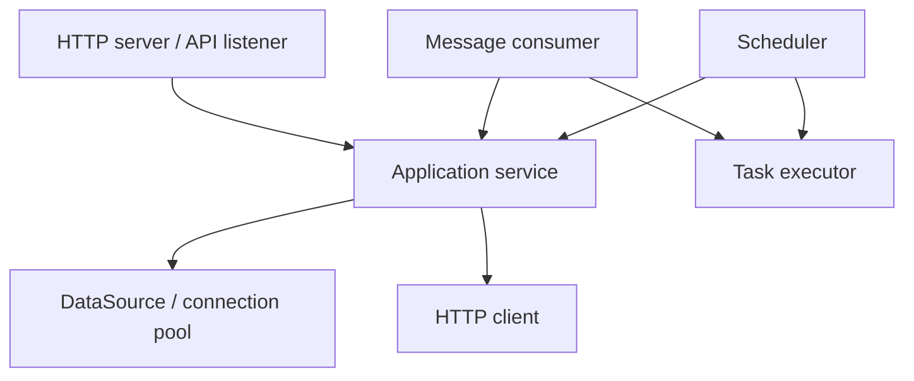
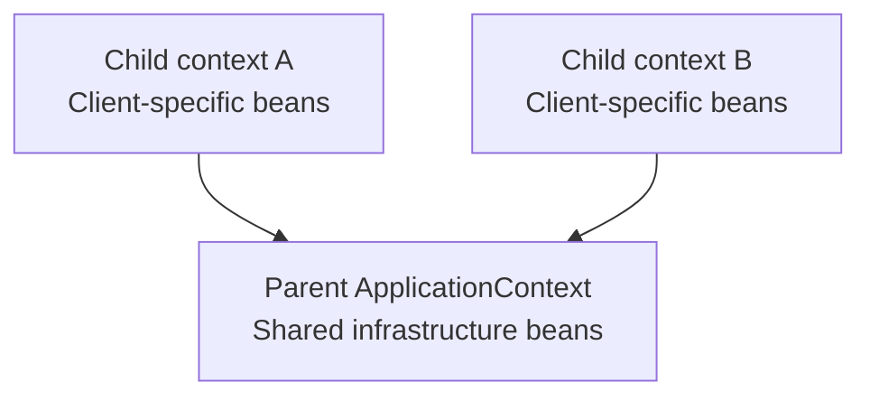
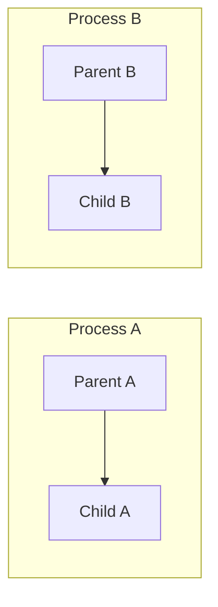

# Context Shutdown Lifecycle and Dependent Resource Management

A Spring Cloud application often owns many resources that outlive a single request: connection pools, HTTP clients, message listeners, schedulers, executors, caches, file handles, and components connecting to external systems. Spring manages bean lifecycles within an `ApplicationContext`, yet to shut down an application safely, components must be **stopped in dependency order**. If a database pool is closed while a consumer is still processing messages, or a process stops while a request is still writing data, the application can lose in-flight work and leave resources unreleased.

This lesson belongs to the **Context Hierarchy** chapter of the `SPRING_CLOUD_CORE` module. It focuses on closing an `ApplicationContext`, parent–child relationships, bean destruction callbacks, `Lifecycle`/`SmartLifecycle`, graceful shutdown, and managing dependent resources within a multi-context or multi-instance process.

## 1. Why Does the Context Shutdown Lifecycle Matter?

During operation, a service can form a dependency graph like the following:



During shutdown, components that accept new work—such as the HTTP server, message consumers, and schedulers—must stop accepting new work first. In-flight tasks need time to finish or return to a retryable state. Only afterward should the executors, clients, and connection pools used by those tasks be closed.

If the order is reversed, problems can occur:

- The consumer still pulls new messages while the executor has already shut down.
- An in-flight request needs database access, but the connection pool is already closed.
- The scheduler starts a new job while its dependencies have already stopped.
- Application-created threads continue running after the context closes, holding classloaders or sockets and preventing the JVM from exiting.
- A task is aborted mid-flight after its message was already acknowledged, causing lost processing.

**Context shutdown is part of operational design**, not merely a process termination step.

## 2. What Does `ApplicationContext.close()` Do?

`ConfigurableApplicationContext` provides `close()` to shut down a context in a controlled manner. In a typical context, the shutdown sequence broadly consists of:

1. Marking the context as inactive and publishing `ContextClosedEvent`.
2. Asking the `LifecycleProcessor` to stop beans participating in lifecycle management.
3. Destroying singletons managed by the `BeanFactory`, invoking appropriate destroy callbacks.
4. Closing the `BeanFactory` and releasing internal context management structures.

Internal details and specific hooks may vary across Spring versions; the sequence above clarifies the responsibility of each stage. Do not put a lengthy cleanup routine depending on multiple resources inside an event listener and assume it replaces bean lifecycle/destroy mechanisms.

### 2.1. Closing a Context Programmatically

```java
import org.springframework.context.annotation.AnnotationConfigApplicationContext;

public class ContextLifecycleExample {
    public static void main(String[] args) {
        AnnotationConfigApplicationContext context =
                new AnnotationConfigApplicationContext(AppConfiguration.class);

        try {
            // Use beans in the context.
        } finally {
            context.close();
        }
    }
}
```

`close()` releases singletons managed by the context and invokes their corresponding destruction callbacks. In Spring Boot applications, `SpringApplication` normally manages the context and registers a shutdown mechanism for JVM termination. When creating auxiliary contexts, child contexts, or test contexts programmatically, the owner must clearly establish who is responsible for calling `close()`.

### 2.2. Shutdown Hook

`ConfigurableApplicationContext` provides `registerShutdownHook()` to register a hook that closes the context when the JVM enters shutdown:

```java
ConfigurableApplicationContext context =
        new AnnotationConfigApplicationContext(AppConfiguration.class);
context.registerShutdownHook();
```

A shutdown hook is useful in Java applications managing contexts manually. Do not register multiple hooks for the same context or build custom hooks if the framework already manages shutdown. Hooks only run during JVM shutdown paths that allow hooks to execute; they are not guaranteed to run on forced kills, power loss, or exceeded termination deadlines.

### 2.3. `stop()` vs. `close()`

`stop()` and `close()` do not mean the same thing:

| Operation | Primary effect | Is the context still usable? |
| --- | --- | --- |
| `Lifecycle.stop()` / `context.stop()` | Stops components participating in lifecycle | The context remains active; beans are not destroyed merely by calling stop |
| `context.close()` | Closes the context, stops lifecycle, and destroys singletons | No; the context is closed |
| JVM/process termination | Ends the process, potentially triggering shutdown hooks | No process remains to use the context |

You can stop a context to pause lifecycle components without destroying all beans. When closing a context, Spring executes the corresponding stop and destruction phases. If components need to be restarted, follow the bean's proper lifecycle contract; do not assume calling `start()` after `close()` reopens a closed context.

## 3. Bean Destruction Callbacks

Spring supports several ways for beans to release resources when a context closes. Choose an approach suited to the resource type and avoid having multiple classes close the same resource without a clear ownership convention.

### 3.1. `@PreDestroy`

`@PreDestroy` marks a method to be called during bean destruction:

```java
import jakarta.annotation.PreDestroy;
import org.springframework.stereotype.Component;

@Component
public class CatalogClientHolder {
    private final CatalogHttpClient client;

    public CatalogClientHolder(CatalogHttpClient client) {
        this.client = client;
    }

    @PreDestroy
    public void release() {
        // Close the client only if this bean owns the resource.
        client.close();
    }
}
```

In this example, `CatalogClientHolder` should call `client.close()` only if it actually owns the client. If the client is injected from another bean that is responsible for closing it, closing in both places can cause double-close errors or break beans still in use.

Modern Spring Framework uses `jakarta.annotation.PreDestroy`; older Spring applications may use the `javax.annotation` namespace. Choose the import matching your project's version and dependencies.

### 3.2. `DisposableBean`

A bean can implement `DisposableBean`:

```java
import org.springframework.beans.factory.DisposableBean;
import org.springframework.stereotype.Component;

@Component
public class LocalBuffer implements DisposableBean {
    @Override
    public void destroy() {
        // Release buffer or resources owned by the bean.
    }
}
```

Its advantage is an explicit destruction contract in Spring. Its drawback is coupling the class directly to Spring's API. For business classes where minimal framework coupling is preferred, `@PreDestroy` or a custom destroy method is often more flexible.

### 3.3. Custom Destroy Method with `@Bean`

For beans created via `@Bean`, you can declare the destroy method explicitly:

```java
import org.springframework.context.annotation.Bean;
import org.springframework.context.annotation.Configuration;

@Configuration
public class ClientConfiguration {
    @Bean(destroyMethod = "close")
    CatalogHttpClient catalogHttpClient() {
        return new CatalogHttpClient();
    }
}
```

Spring can also infer common destroy methods such as `close` or `shutdown` for `@Bean`-declared beans when appropriate. Specifying `destroyMethod` explicitly makes ownership and intended behavior clear to readers. You can disable inference using `destroyMethod = ""` in special cases, such as resources managed by an external container.

### 3.4. Comparing the Mechanisms

| Mechanism | Contract | Best suited when |
| --- | --- | --- |
| `@PreDestroy` | Callback annotation | A bean needs to close resources with minimal Spring API coupling |
| `DisposableBean` | Spring interface | You want to implement Spring's lifecycle contract directly |
| `@Bean(destroyMethod = "...")` | Method name declared in configuration | A bean is created by a factory method and exposes a close/shutdown API |
| `Lifecycle` / `SmartLifecycle` | Ordered start/stop and coordination | Background components needing phased startup/shutdown or async stop notification |

Destroy callbacks are generally suited for releasing local resources. For a consumer or server that must stop accepting work, wait for in-flight processing, and signal completion, `SmartLifecycle` expresses the contract better.

## 4. Bean Destruction Order by Dependency

Spring tracks dependencies among singletons. If bean A depends on bean B, B must still exist while A is being destroyed; thus dependent beans are generally destroyed before the dependencies they use.

Example:

```java
@Service
public class OrderService {
    private final OrderRepository repository;

    public OrderService(OrderRepository repository) {
        this.repository = repository;
    }

    @PreDestroy
    public void close() {
        // Finish internal work requiring the repository before the repository is destroyed.
    }
}
```

Because `OrderService` depends on `OrderRepository`, Spring has dependency metadata from injection and manages destruction order accordingly. There is no need to use `@DependsOn` just to substitute for constructor injection.

### 4.1. `@DependsOn` and Initialization/Destruction Order

`@DependsOn` declares that a bean depends on another bean by name:

```java
import org.springframework.context.annotation.DependsOn;
import org.springframework.stereotype.Component;

@Component
@DependsOn("schemaInitializer")
public class CatalogCache {
    // This bean requires schemaInitializer to be initialized first.
}
```

For singletons, the bean named in `@DependsOn` is initialized before the dependent bean and destroyed after the dependent bean. Use it when there is an auxiliary initialization order relationship not expressed by injection. If a bean actually needs a dependency to operate, declare it via constructor or method parameters.

### 4.2. Do Not Close Dependencies Owned by Other Beans

An important rule is that **every resource has a clear lifecycle owner**. For example:

- The `DataSource` bean owns the connection pool and is responsible for closing it.
- A service injecting `DataSource` only uses connections; it does not close the entire pool in `@PreDestroy`.
- An `ExecutorService` bean owns the executor; services submitting tasks to it do not shut down the executor unless they own it.
- A shared HTTP client is managed by a configuration bean; services using the client do not close it themselves.

Closing a resource from a place that does not own it can cause failures in other beans while the context is still shutting down.

## 5. Lifecycle and SmartLifecycle

### 5.1. When to Use `Lifecycle`?

`Lifecycle` provides `start()`, `stop()`, and `isRunning()` contracts for components with running/stopped states. The context's `LifecycleProcessor` coordinates beans implementing this contract when the context is refreshed, stopped, or closed.

Simple example:

```java
import org.springframework.context.Lifecycle;
import org.springframework.stereotype.Component;

@Component
public class LocalPoller implements Lifecycle {
    private boolean running;

    @Override
    public void start() {
        running = true;
        // Start local polling activity.
    }

    @Override
    public void stop() {
        running = false;
        // Stop polling and release running state.
    }

    @Override
    public boolean isRunning() {
        return running;
    }
}
```

`Lifecycle` suits components that need start/stop without complex ordering control or async stopping. Real implementations must ensure `start()`/`stop()` can be called safely based on state and do not spawn unintended threads or tasks.

### 5.2. `SmartLifecycle` and Phases

`SmartLifecycle` extends `Lifecycle`, allowing you to declare:

- `isAutoStartup()` to indicate whether to start automatically upon context refresh.
- `getPhase()` to determine startup and shutdown ordering.
- `stop(Runnable callback)` to signal when asynchronous stopping has completed.

Typically, lower phases start first; when stopping, higher phases stop first. This is useful when work-accepting components must stop before the infrastructure components they use.

Example of a consumer with a high phase:

```java
import org.springframework.context.SmartLifecycle;
import org.springframework.stereotype.Component;

@Component
public class CatalogMessageConsumer implements SmartLifecycle {
    private volatile boolean running;

    @Override
    public void start() {
        running = true;
        // Start receiving messages.
    }

    @Override
    public void stop(Runnable callback) {
        running = false;
        // Stop accepting new messages and wait for in-flight messages to finish.
        callback.run();
    }

    @Override
    public void stop() {
        stop(() -> { });
    }

    @Override
    public boolean isRunning() {
        return running;
    }

    @Override
    public boolean isAutoStartup() {
        return true;
    }

    @Override
    public int getPhase() {
        return 100;
    }
}
```

This is an illustrative lifecycle skeleton; in a real consumer, `stop(Runnable)` must invoke the callback **after** the listener stops accepting new messages and in-flight work finishes or transitions to a safe retry state. Invoking the callback immediately while tasks are still running falsely reports that the consumer has stopped.

If a component stops asynchronously, define a timeout and a timeout policy. Do not hold the callback forever without completing; the context needs to know the component stopped to continue shutdown.

### 5.3. Designing Phases Around the Dependency Graph

Suppose a consumer uses an executor, and the executor submits tasks using a repository and a DataSource. The shutdown goal is:

1. The consumer stops accepting new messages.
2. The consumer waits for in-flight processing to finish.
3. The executor stops accepting new tasks and waits for remaining tasks.
4. Repositories/services complete cleanup callbacks.
5. The DataSource/connection pool closes last.

You can use phases for `SmartLifecycle` components and the dependency graph for bean destruction order. Not every bean implements `SmartLifecycle`; connection pools typically use their own destroy callbacks. Therefore, coordinate phases, dependency relationships, and destroy callbacks rather than assigning phases arbitrarily.

## 6. Context Hierarchy: Who Closes Which Context?

Spring supports parent–child relationships between `ApplicationContext` instances. A child context can look up beans from the parent context; the parent context does not see beans existing only in child contexts.



Each context manages the lifecycle of the beans it owns. When child A closes, singletons belonging to A are destroyed; the parent remains active and child B can still use the parent's beans. Closing a child **does not automatically** close the parent. The application owner must manage the shutdown order of contexts in the hierarchy.

### 6.1. Creating a Parent–Child Context

```java
import org.springframework.context.annotation.AnnotationConfigApplicationContext;

public class ContextHierarchyExample {
    public static void main(String[] args) {
        AnnotationConfigApplicationContext parent =
                new AnnotationConfigApplicationContext(SharedConfiguration.class);

        AnnotationConfigApplicationContext child =
                new AnnotationConfigApplicationContext();
        child.setParent(parent);
        child.register(ClientConfiguration.class);
        child.refresh();

        try {
            // Child can use parent beans and its own beans.
        } finally {
            child.close();
            parent.close();
        }
    }
}
```

In this example, the child is closed before the parent because the child may use resources provided by the parent. If the parent is closed first, the child still holds references to destroyed parent beans and can fail while continuing to operate.

### 6.2. Shared Beans and Ownership

Do not register the same physical resource such as a connection pool in multiple contexts with multiple independent owners without a clear ownership mechanism. If the parent creates a `DataSource` and children only inject it for use, the parent is the owner; children must not close the `DataSource`. If each child creates its own client, each child is responsible for closing its own client.

Some Spring Cloud components use named child contexts to isolate client or integration configurations. For example, factories that create named child contexts can own multiple child contexts. When closing a factory or managing context, verify whether the factory's lifecycle API closes all child contexts it created. Do not retain references to custom-created child contexts without a corresponding close procedure.

### 6.3. Parent Is Not a Mechanism for Sharing State Across JVMs

Parent–child is strictly an intra-process relationship. Two replicas of a service still have separate context trees:



Closing a context in JVM A does not close contexts in JVM B. Coordinating cluster-wide shutdown requires an orchestration platform, service registry/traffic management, a message broker, or an appropriate coordination protocol. Spring's lifecycle manages components only within process/context boundaries.

## 7. Managing Executors, Schedulers, and Message Consumers

### 7.1. Executors Must Have an Owner

Do not create a thread pool via `Executors.newFixedThreadPool(...)` inside a service and forget to shut it down. Let Spring manage the executor or provide an explicit destroy callback.

Example executor declaration:

```java
import java.util.concurrent.ExecutorService;
import java.util.concurrent.Executors;
import org.springframework.context.annotation.Bean;
import org.springframework.context.annotation.Configuration;

@Configuration
public class TaskConfiguration {
    @Bean(destroyMethod = "shutdown")
    ExecutorService catalogExecutor() {
        return Executors.newFixedThreadPool(8);
    }
}
```

This snippet ensures `shutdown()` is called when the bean is destroyed. However, `shutdown()` only rejects new tasks while letting already-submitted tasks continue; if bounded waiting is required, use a wrapper bean managing `awaitTermination`, or use a Spring executor with appropriate shutdown options. Do not block indefinitely in a destroy callback.

With `ThreadPoolTaskExecutor`, shutdown configuration can control waiting for tasks to complete and the wait timeout. Check the exact properties for your Spring Framework/Spring Boot version, and ensure the executor's timeout aligns with the overall shutdown timeout.

### 7.2. Schedulers

Schedulers must also stop scheduling new work when the context closes. If a job is currently running, decide whether to:

- Wait for the job to finish within a bounded timeout.
- Interrupt/cancel if the job supports safe interruption.
- Record incomplete state so another instance can resume.
- Ensure jobs are idempotent or use durable locks/claims when multiple replicas run.

`@Scheduled` registers tasks per context/JVM. When scaling to multiple replicas, each replica can run its own schedule; shutdown callbacks do not turn a local scheduler into a distributed scheduler.

### 7.3. Message Consumers

A consumer needs a clear stopping strategy:

1. Stop polling or stop accepting new messages.
2. Wait for in-flight messages to finish within the allowed time.
3. Acknowledge messages only after processing commits per system contract.
4. If work cannot complete, allow messages to be retried or reprocessed according to broker policy.
5. Close connections/channels after the listener has stopped.

Do not acknowledge before business results are durably saved if zero data loss is required. Shutdown can occur between database commit and acknowledgment; the design must handle redelivery via idempotency or appropriate transactions.

## 8. Graceful Shutdown of a Spring Boot Web Application

For web applications, closing the context safely requires coordination with the embedded web server. Spring Boot supports graceful shutdown for embedded servers when configured:

```yaml
server:
  shutdown: graceful

spring:
  lifecycle:
    timeout-per-shutdown-phase: 20s
```

During shutdown, the web server stops accepting new requests using the server's mechanism and gives in-flight requests time to complete. `spring.lifecycle.timeout-per-shutdown-phase` defines the maximum wait time per lifecycle phase during shutdown. Practical values should reflect request duration, background work, and the platform's termination budget.

Graceful shutdown does not guarantee every request finishes in all scenarios. Hung requests, unresponsive dependencies, or processes exceeding the allowed budget can still be terminated. Applications still need client/database timeouts, bounded processing times, and safe retry capabilities.

### 8.1. Coordinating with Kubernetes

When Kubernetes terminates a Pod, the container receives a stop signal and gets a termination window before being forcibly killed. `terminationGracePeriodSeconds` sets the time budget for this process; any `preStop` hook also consumes time from that budget.

Example fragment:

```yaml
spec:
  terminationGracePeriodSeconds: 45
  containers:
    - name: catalog-service
      image: catalog-service:1.0.0
```

The shutdown budget must exceed the time the application needs to stop receiving traffic, finish in-flight requests, stop consumers, and close resources. If Spring's timeouts exceed the termination grace period, Kubernetes may kill the process before Spring finishes.

A typical deployment sequence includes:

1. The Pod enters terminating state and is removed from new traffic selection via Kubernetes Service/Endpoint mechanics.
2. The application receives the stop signal, transitions to not-ready, and stops accepting new work.
3. In-flight requests, consumers, and jobs are handled according to the graceful policy.
4. The context closes and releases resources.
5. If the termination grace period expires, the process may be forcibly killed.

Readiness probes should reflect the ability to accept traffic; liveness probes should not turn a normal shutdown process into an unintended restart. `preStop` is not a substitute for in-application lifecycle management; it only assists external coordination and must be accounted for in the total time budget.

### 8.2. Shutdown Timings Must Be Consistent

For example, suppose a request can take up to 10 seconds, a consumer needs up to 15 seconds to finish its current batch, and a lifecycle phase has a 20-second timeout. If the Pod's termination grace period is only 15 seconds, the system may kill the process before the consumer finishes.

Design a deliberate time budget:

| Component | Limit to determine |
| --- | --- |
| Load balancer/endpoint removal | Time to stop routing new traffic |
| Web server | Wait time for in-flight requests |
| Message consumer | Drain time for in-flight messages |
| Scheduler/executor | Wait time for tasks to finish or cancel safely |
| Bean cleanup | Time to close connections/clients/resources |
| Container runtime | Total termination grace period |

Timeouts should include buffer room for logging, network delay, and scheduler jitter. Do not set every timeout to the same value and expect every stage to receive the full duration independently.

## 9. Failures and Limitations of Shutdown Callbacks

Destroy callbacks are an opportunity to release resources, not a guarantee that business transactions complete. There are situations where callbacks do not run or cannot finish:

- The process receives `SIGKILL`, is forcibly killed by the runtime, or the host loses power.
- The JVM crashes or hits a fatal native error.
- Shutdown hooks are not executed during abnormal termination.
- A callback waits on a dependency that already failed or closed earlier.
- A thread hangs, preventing the callback from finishing before timeout.
- A background task is interrupted, but the code does not handle interruption properly.

Therefore, durable business data must be committed to storage before confirming completion. For long jobs, persist progress state, checkpoints, or recoverable leases/claims. For messages, use acknowledgment/retry and idempotency. For HTTP requests, clients may retry, so write APIs must handle duplicate requests.

### 9.1. Handling Interruption Properly

When a waiting thread is interrupted, do not swallow the signal and keep waiting indefinitely:

```java
try {
    executor.awaitTermination(10, TimeUnit.SECONDS);
} catch (InterruptedException ex) {
    Thread.currentThread().interrupt();
}
```

This is the pattern for restoring the interrupt flag. In real cleanup code, combine it with your shutdown policy: after the timeout, you may call `shutdownNow()` if tasks are designed to handle interruption safely, while recording unfinished tasks for recovery.

### 9.2. Do Not Put Heavy Work in `ContextClosedEvent` Listeners

`ContextClosedEvent` is useful for observing when the context closes or recording metrics. However, event listeners do not replace lifecycle phases or destroy callbacks. If multiple listeners perform heavy cleanup, ordering and timeouts become difficult to manage.

For components needing ordered shutdown, use `SmartLifecycle`; for individual resources, use destroy callbacks. Keep listeners lightweight, without unbounded network calls or waiting for consumer drain without a timeout.

## 10. Testing the Context Shutdown Lifecycle

Shutdown tests should verify both callbacks and ordering relationships, not merely check that closing the context does not throw an exception.

| Objective | Scenario | What to verify |
| --- | --- | --- |
| Destroy callback | Create context then call `close()` | `@PreDestroy`/destroy method is invoked |
| Dependency order | Bean A depends on bean B | A is destroyed before B |
| `@DependsOn` | Declare initialization dependency by name | Target bean initializes before and destroys after dependent bean |
| Lifecycle phase | Two `SmartLifecycle` beans with different phases | Start in phase order; stop in reverse order |
| Async stop | Consumer invokes callback only after draining | Context waits for callback within configured timeout |
| Parent–child | Close child before parent | Child resources close; parent remains active |
| Prototype | Create prototype and close context | Caller is responsible for prototype cleanup |
| Graceful web shutdown | Request in flight when shutdown signal arrives | Request is awaited within configured limit |
| Executor | Submit task then close context | Task stops/finishes per policy; no unintended threads linger |
| Kubernetes termination | Delete Pod in test environment | Actual duration fits within termination budget |

Example test for destroy callback with a standalone context:

```java
import java.util.concurrent.atomic.AtomicBoolean;
import org.junit.jupiter.api.Test;
import org.springframework.context.annotation.AnnotationConfigApplicationContext;

class ContextCloseTest {
    @Test
    void closesManagedResource() {
        AtomicBoolean closed = new AtomicBoolean();

        try (AnnotationConfigApplicationContext context =
                     new AnnotationConfigApplicationContext()) {
            context.registerBean("resource", TestResource.class,
                    () -> new TestResource(closed));
            context.refresh();
        }

        // Assert closed.get() == true.
    }

    static class TestResource {
        private final AtomicBoolean closed;

        TestResource(AtomicBoolean closed) {
            this.closed = closed;
        }

        @jakarta.annotation.PreDestroy
        void close() {
            closed.set(true);
        }
    }
}
```

This is an illustrative skeleton; the test requires the Jakarta Annotation API compatible with your Spring version and should use real assertions. You do not need an extra `@Configuration` class when registering beans directly as shown.

### 10.1. Testing Shutdown Order

You can inject a shared recorder into two beans, record start/stop/destroy events, and assert the expected order. For `SmartLifecycle`, test both asynchronous stop callback completion and timeout cases. Do not use `Thread.sleep()` as proof of ordering; prefer latches/futures or controllable test doubles.

### 10.2. Testing Graceful Shutdown at the Process Level

An integration test can:

1. Start the application on a test port with `server.shutdown=graceful`.
2. Send a request with controlled processing time.
3. While the request is running, send a shutdown signal to the process.
4. Verify the in-flight request completes within the timeout and new requests are rejected/no longer accepted per server behavior.
5. Verify shutdown logs and resource cleanup occur.

This scenario requires careful process and timeout management. Unit testing callbacks cannot fully replace server/container integration tests.

## 11. Practice: Stopping a Service with HTTP, Consumer, and Database

Suppose `catalog-service` has three components: an HTTP API, a message consumer, and a PostgreSQL connection pool. The goal is to stop accepting new work, drain in-flight work, and then close resources.

**Step 1 — Define ownership:** `DataSource` is configured as its own bean and owns the pool; services only use repositories; the consumer owns its listener container; the executor has a lifecycle-managed bean.

**Step 2 — Configure server graceful shutdown:**

```yaml
server:
  shutdown: graceful
spring:
  lifecycle:
    timeout-per-shutdown-phase: 30s
```

**Step 3 — Stop the consumer:** stop polling new messages, wait for in-flight processing to finish, acknowledge only after commit, and let unprocessed messages be redelivered.

**Step 4 — Stop scheduler/executor:** stop creating new tasks, wait for current tasks within a time limit, save checkpoints, or allow tasks to retry if unfinished.

**Step 5 — Close resources:** close the HTTP client, executor, and connection pool according to ownership/dependency relationships. Do not let a service close the context-managed DataSource itself.

**Step 6 — Align with the platform:** set the termination grace period larger than the application shutdown budget and account for any `preStop` duration.

**Step 7 — Failure testing:** test a slow message, an in-flight database write request, a disconnected dependency, and a shutdown that hits the timeout. Confirm committed data is not lost, unfinished messages can retry, and no threads/resources leak.

### Self-Check Questions

1. What main groups of work does `ApplicationContext.close()` perform?
2. How does `stop()` differ from `close()`?
3. If bean A depends on bean B, what is the typical destruction order?
4. How does `@DependsOn` affect singleton initialization and destruction order?
5. Why is `SmartLifecycle` suited for a consumer requiring asynchronous draining?
6. In what order do higher phases start and stop relative to lower phases?
7. Does closing a child context automatically close the parent?
8. Why does Spring not automatically invoke destroy callbacks for prototype beans the same way as singletons?
9. What does `server.shutdown=graceful` guarantee, and what does it not guarantee?
10. Why must the Kubernetes termination grace period exceed the total required shutdown duration?

**Answer hints:** (1) Publish close event, stop lifecycle, destroy singletons, and close bean factory; (2) Stop halts lifecycle components while the context stays active, whereas close shuts down the context; (3) A is destroyed before B; (4) The named bean initializes before and destroys after the dependent bean; (5) Because it provides a callback to signal completion after draining; (6) Lower phases start first, higher phases stop first; (7) No; (8) Because prototypes are handed over to the caller and the container does not track their full destruction afterward; (9) Stops accepting new requests and awaits in-flight requests within limits, but provides no guarantee against forced kills; (10) If the budget runs out, the process may be killed before cleanup finishes.

## 12. Principles to Remember

- Each `ApplicationContext` manages the lifecycle of beans in its scope; child and parent contexts need clear shutdown ownership.
- `close()` stops lifecycle and destroys singletons; `stop()` only halts lifecycle-participating components without replacing context closure.
- Use `@PreDestroy`, `DisposableBean`, or a custom destroy method to clean up resources with clear ownership.
- Dependent beans should be destroyed before the dependencies they use; use dependency injection to express relationships and `@DependsOn` for auxiliary ordering.
- Use `SmartLifecycle` when phases and async stopping are needed; invoke the callback only after the component has truly stopped.
- Stop accepting new work first, drain in-flight work, and only then close executors, clients, and connection pools.
- Graceful shutdown requires aligning timeouts across Spring Boot, server, consumer, executor, and the platform's termination grace period.
- Shutdown callbacks do not replace business durability; jobs and messages must support retry/recovery when a process is killed.
- Test destruction order, parent–child ownership, async stop, and process/container-level shutdown.

Understanding the context shutdown lifecycle ensures Spring Cloud components stop in an orderly fashion within each JVM. When resource ownership, dependency relationships, and graceful shutdown budgets are designed clearly, applications can perform rolling deployments, scale, and recover from failures with lower risk of abandoned work or resource leaks.
