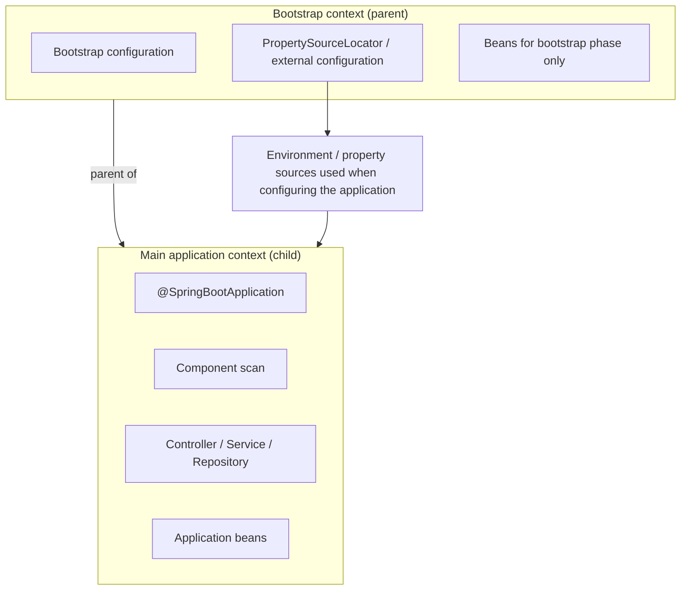
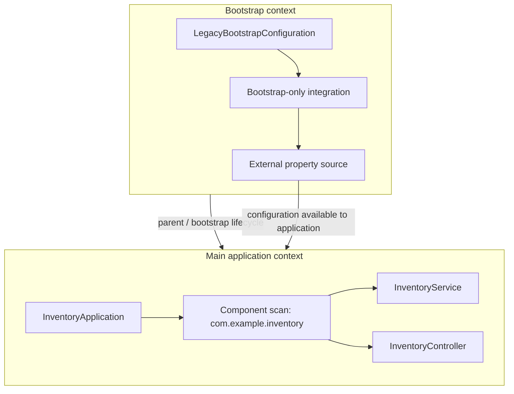

# Avoiding Component Scan Loading Bootstrap Configuration into the Main Context

In a Spring Cloud application using the legacy bootstrap context mechanism, the application can have two related Spring `ApplicationContext` instances: the **bootstrap context** and the **main application context**. The bootstrap context is used to prepare initial configuration and bootstrap integration components; the main context holds business beans and most application configuration.

A common package-organization mistake is placing a bootstrap configuration class inside a package scanned by the application's `@SpringBootApplication`. Because `@Configuration` is also a component, component scanning can discover that class and register it in the main context, even while the bootstrap mechanism already loaded the same class into the bootstrap context. As a result, a configuration meant to run only at bootstrap appears in the main context, creating unexpected beans or property sources.

This lesson belongs to the **Context Hierarchy** chapter of **SPRING_CLOUD_CORE**. The focus is on understanding context hierarchies, how component scanning works, why bootstrap configuration must sit outside the main application's scan scope, how to organize packages, and how to test to prevent accidental registration.

> **Scope:** this lesson explains Spring Cloud's **legacy bootstrap context** mechanism. For modern applications, Spring Boot Config Data with `spring.config.import` is generally the preferred way to integrate external configuration. Not every Spring Cloud application needs a bootstrap context.

## 1. Learning Objectives

After this lesson, learners will be able to:

1. Distinguish the bootstrap context from the main application context in the legacy model.
2. Explain the parent–child relationship and bean visibility direction between the two contexts.
3. Describe how `@SpringBootApplication` enables package-based component scanning.
4. Identify why a bootstrap class discovered by component scanning can additionally be loaded into the main context.
5. Organize packages and scan configuration to keep bootstrap-only configuration in the right context.
6. Distinguish legacy bootstrap from Spring Boot Config Data.
7. Test context structure and diagnose beans/property sources registered in the wrong place.

## 2. Bootstrap Context and Main Application Context

### 2.1. Two Contexts with Different Roles

In legacy bootstrap mode, Spring Cloud creates a parent context before the main application context is built. The bootstrap context handles components needed at an early stage, such as configuration for fetching properties from external sources, certain encryption/decryption components, or application-registered bootstrap extensions.

The main application context is created afterward to run the actual application: controllers, services, repositories, business clients, schedulers, and regular configurations.



The diagram illustrates the high-level relationship. Details of property source loading, Environment sharing, and initialization order can vary by release train, Config Client, and how the application enables bootstrap. When relying on specific behavior, consult the documentation for the exact Spring Cloud version in use.

### 2.2. Parent–Child Rules

In a Spring ApplicationContext hierarchy:

- **The child context can look up beans from the parent context** if no matching bean is found locally.
- **The parent context does not look backward for child beans.** The bootstrap context cannot rely on a service or repository created only in the main context.
- A bean defined in the child can shadow a same-named bean in the parent when looked up from the child.
- The two contexts are two separate containers. Registering the same class in both places can produce two separate instances, even if the bean names match.

This is why bootstrap configuration should depend only on components available during the bootstrap phase. Do not put bootstrap logic inside a business service that exists only after the main context is created.

For example, a `PropertySourceLocator` that needs to read a Config Server endpoint or authenticate to fetch configuration should not depend on the application's `OrderRepository` or `InventoryService`. Those beans do not belong to the bootstrap context and would create an inverted dependency.

### 2.3. Bootstrap Is Not the Context for the Entire Application

The bootstrap context is not the place for controllers, business services, or full-application component scanning. It should stay small and focused on components that must run early. The main context is where the application registers regular components.

If a bootstrap configuration enables component scanning on an overly broad root package, it can pull business beans into the parent context. Then the main context cannot be seen in reverse by the parent; the application can end up with duplicate bean copies or missing-dependency failures when bootstrap tries to instantiate business beans.

## 3. Why Does Component Scan Accidentally Discover Bootstrap Configuration?

### 3.1. `@SpringBootApplication` Includes Component Scan

`@SpringBootApplication` is a composite annotation comprising `@SpringBootConfiguration`, `@EnableAutoConfiguration`, and `@ComponentScan`. Unless a different scope is specified, component scanning uses the package containing the main class as the root package and scans sub-packages.

Example:

```java
package com.example.inventory;

import org.springframework.boot.autoconfigure.SpringBootApplication;

@SpringBootApplication
public class InventoryApplication {

    public static void main(String[] args) {
        SpringApplication.run(InventoryApplication.class, args);
    }
}
```

With the package above, Spring Boot scans `com.example.inventory` and its sub-packages by default. Classes recognized as components—including `@Component`, `@Service`, `@Repository`, `@Controller`, and `@Configuration`—can be registered in the main context.

### 3.2. `@Configuration` Is Also a Component

A bootstrap class is often written like this:

```java
package com.example.inventory.bootstrap;

import org.springframework.context.annotation.Configuration;

@Configuration
public class LegacyBootstrapConfiguration {

    // Beans for bootstrap
}
```

If the class resides in a sub-package of `com.example.inventory`, `InventoryApplication`'s default component scan can discover it. This still happens even if the class was already registered separately for the bootstrap context via the legacy mechanism.

Distinguish the two mechanisms:

1. **Bootstrap registration:** Spring Cloud loads the class into the bootstrap context according to the bootstrap configuration list.
2. **Component scan:** Spring discovers the class because its package falls inside the main application context's scan scope.

A single class can be picked up by both mechanisms. Being registered for bootstrap does not automatically exclude a class from the main context's component scan.

### 3.3. Example of an Error-Prone Package Layout

```text
com.example.inventory
├── InventoryApplication.java
├── api/
├── service/
├── repository/
└── bootstrap/
    └── LegacyBootstrapConfiguration.java
```

Because `bootstrap` is a sub-package of `com.example.inventory`, the bootstrap configuration class sits inside the default scan scope. If it is simultaneously registered in `spring.factories` for the bootstrap context, the class can be loaded in both parent and child.

The issue does not necessarily manifest as a single error. Depending on the beans and configuration contents, the application may:

- Create two instances of a client or locator across the two contexts.
- Register the same integration in both parent and child.
- Create extra property sources or invoke configuration sources multiple times.
- Encounter bean ambiguity, bean shadowing, or name collisions within the same context.
- Initialize bootstrap beans late in the main context, when lifecycle assumptions no longer hold.
- Struggle to control refresh, shutdown, or resource management because the two contexts have separate lifecycles.

Not every case throws `BeanDefinitionOverrideException`: parent and child have separate registries. Override errors typically involve multiple definitions with the same name in **the same context**, whereas registering the same class in parent and child usually produces two beans belonging to two different containers.

## 4. Legacy Bootstrap Configuration Registration Mechanism

In legacy bootstrap mode, Spring Cloud lets you extend the bootstrap context via the `org.springframework.cloud.bootstrap.BootstrapConfiguration` key in `META-INF/spring.factories`.

Example file:

```properties
org.springframework.cloud.bootstrap.BootstrapConfiguration=\
com.example.bootstrap.LegacyBootstrapConfiguration
```

Listed classes are used as bootstrap configurations via Spring Cloud's mechanism. For multiple classes, separate them with commas using properties syntax:

```properties
org.springframework.cloud.bootstrap.BootstrapConfiguration=\
com.example.bootstrap.LegacyBootstrapConfiguration,\
com.example.bootstrap.CustomPropertySourceConfiguration
```

This is Spring Cloud's registration mechanism for bootstrap configuration. It differs from Spring Boot's modern auto-configuration registration via `AutoConfiguration.imports`; do not replace this file or key with Boot's auto-configuration key.

### 4.1. Place Bootstrap Classes Outside Scanned Packages

The simplest and most controllable approach is placing bootstrap configuration in an independent package outside the application's root package.

Example:

```text
com.example
├── bootstrap
│   └── LegacyBootstrapConfiguration.java
└── inventory
    ├── InventoryApplication.java
    ├── api/
    ├── service/
    └── repository/
```

The main class sits in `com.example.inventory`, so default scanning descends only into sub-packages of `com.example.inventory`, not sideways into the sibling package `com.example.bootstrap`.

If the main class is placed in `com.example` instead of `com.example.inventory`, the bootstrap package becomes a sub-package again and can be scanned. Therefore, verify the actual root package of the main class rather than just glancing at folder names.

### 4.2. Declaring a Bootstrap Class

```java
package com.example.bootstrap;

import org.springframework.context.annotation.Bean;
import org.springframework.context.annotation.Configuration;

@Configuration(proxyBeanMethods = false)
public class LegacyBootstrapConfiguration {

    @Bean
    BootstrapMarker bootstrapMarker() {
        return new BootstrapMarker("legacy-bootstrap");
    }
}

record BootstrapMarker(String source) {
}
```

`BootstrapMarker` is an illustrative bean showing that the class is registered in the bootstrap context. A real configuration might declare components that load property sources, configuration clients, or extensions needed only during the bootstrap phase.

If this configuration needs properties beans, register them via a mechanism suitable for the bootstrap context. Do not assume every bean created by the main application's component scan can be injected here.

## 5. Ways to Prevent the Main Context from Scanning Bootstrap Configuration

### 5.1. Prefer Package Separation

Placing bootstrap classes outside the main application's root package is the easiest solution to read. It reduces reliance on filters and is less affected when the team adds new components.

Example convention:

- Main application: `com.example.inventory`.
- Business components: `com.example.inventory.api`, `com.example.inventory.service`, `com.example.inventory.repository`.
- Bootstrap-only configuration: `com.example.bootstrap`.

When an application has multiple modules, agree on package conventions early. Do not put every class directly under `com.example` and component-scan the entire root if it includes configurations intended for another context.

### 5.2. Restrict `scanBasePackages`

If the current structure cannot move bootstrap classes, you can narrow the scan scope:

```java
package com.example;

import org.springframework.boot.autoconfigure.SpringBootApplication;

@SpringBootApplication(
    scanBasePackages = {
        "com.example.inventory.api",
        "com.example.inventory.service",
        "com.example.inventory.repository"
    }
)
public class InventoryApplication {
    public static void main(String[] args) {
        SpringApplication.run(InventoryApplication.class, args);
    }
}
```

The example scans only the required application packages. Because the default scope was changed, ensure every needed component, mapper, or business configuration class is registered by an explicit mechanism.

`scanBasePackages` is an alias for `@ComponentScan`'s scope on `@SpringBootApplication`. It does not automatically configure the scope for other scan mechanisms such as `@EntityScan` or `@EnableJpaRepositories`. If the application uses JPA or repository scanning, declare those scopes separately as needed.

### 5.3. Use an Exclude Filter When Keeping a Broad Package

If the application must scan a broad package while excluding a specific bootstrap class, you can use `@ComponentScan` with a filter. Organize configuration annotations so only one component scan definition applies; do not arbitrarily add a second `@ComponentScan` onto a class already annotated with `@SpringBootApplication`.

Example using explicit application configuration instead of the composite `@SpringBootApplication`:

```java
@Configuration
@EnableAutoConfiguration
@ComponentScan(
    basePackages = "com.example",
    excludeFilters = @ComponentScan.Filter(
        type = FilterType.ASSIGNABLE_TYPE,
        classes = LegacyBootstrapConfiguration.class
    )
)
class InventoryApplicationConfiguration {
}
```

In a complete example, import `ComponentScan`, `FilterType`, `Configuration`, and `EnableAutoConfiguration`. This lets you exclude a specific class from the main context's component scan. However, the filter applies only to the scan configured here; if another component scan also scans the bootstrap package, the class can still be discovered through that scan.

With a dedicated bootstrap package, package separation is usually clearer than an exclude filter.

### 5.4. Do Not Use Component Scan in Bootstrap to Scan the Whole Application

A bootstrap configuration can also declare `@ComponentScan`. If its scan root covers application packages, it can pull controllers/services/repositories into the parent context before the main context is created.

```java
@Configuration
@ComponentScan("com.example")
class LegacyBootstrapConfiguration {
}
```

This is a dangerous design if the goal is merely to register a few bootstrap beans. The parent cannot see child beans; scanning the whole application package in the parent can also create duplicate bean copies and instantiate business dependencies prematurely.

Instead of scanning entire packages, declare the required bootstrap beans explicitly with `@Bean` or limit component scanning to a small, dedicated bootstrap package.

## 6. Proper Context Structure in a Sample Application

Suppose the inventory application has a configuration that fetches a property source from an external system in legacy bootstrap mode.



Corresponding package structure:

```text
src/main/java/
└── com/example/
    ├── bootstrap/
    │   └── LegacyBootstrapConfiguration.java
    └── inventory/
        ├── InventoryApplication.java
        ├── api/
        │   └── InventoryController.java
        ├── service/
        │   └── InventoryService.java
        └── repository/
            └── InventoryRepository.java

src/main/resources/
└── META-INF/
    └── spring.factories
```

And the contents of `spring.factories`:

```properties
org.springframework.cloud.bootstrap.BootstrapConfiguration=\
com.example.bootstrap.LegacyBootstrapConfiguration
```

The main application scans `com.example.inventory`; the bootstrap configuration is loaded via the bootstrap mechanism. The two registration paths have distinct goals and lifecycles.

## 7. Distinguishing Legacy Bootstrap from Spring Boot Config Data

One source of confusion is that older documentation often describes `bootstrap.yml` and the bootstrap context as the default way to load external configuration. In modern Spring Cloud generations, the legacy bootstrap context is no longer the default mechanism in every application. Spring Boot Config Data is the preferred integration approach for many scenarios.

### 7.1. Config Data Import

An application using Spring Cloud Config Client can declare:

```yaml
spring:
  application:
    name: inventory-service
  config:
    import: "optional:configserver:"
```

With the appropriate Config Client dependency, Config Data import allows the application to fetch configuration from Config Server during configuration loading. This mechanism does not require placing a `BootstrapConfiguration` class anywhere near the main application's component scan.

If the Config Server source is mandatory, remove the `optional:` prefix per your version's guidelines. Distinguish optional import from required properties: an unreachable Config Server may be skipped under optional semantics, yet a business property lacking a default can still cause application errors when used.

### 7.2. When Is the Bootstrap Context Still Used?

Some legacy systems or specialized extensions still use the bootstrap context. In those cases, the application must enable legacy bootstrap as supported by the release train's documentation, typically via the `spring-cloud-starter-bootstrap` dependency or a bootstrap-enabling property supplied early to the process.

Do not add the starter merely because an old example shows it. Before choosing a mechanism, determine:

- Which release train is the application using?
- Is Config Client already using `spring.config.import`?
- Is there a `PropertySourceLocator` or bootstrap extension that must run before the main context?
- Does the application rely on `bootstrap.yml` or legacy bootstrap property sources?
- Does the current mechanism have a migration path to Config Data?

Do not accidentally enable both mechanisms just to work around a missing-property error. Read the migration notes and documentation for your exact Spring Cloud version.

### 7.3. Comparison Table

| Criterion | Legacy bootstrap context | Spring Boot Config Data |
| --- | --- | --- |
| Goal | Create a parent bootstrap context for early config processing | Load property sources inside Boot's Config Data flow |
| Extension method | `BootstrapConfiguration`, `spring.factories` | Config Data import/resolver and corresponding source config |
| Common files/settings | `bootstrap.yml` when bootstrap is enabled | `application.yml`, `spring.config.import` |
| Component scan | Requires separating bootstrap-only classes from main context scan | No bootstrap configuration component scan needed just to import Config Server |
| Usage | Compatibility with legacy systems or extensions requiring a bootstrap context | Modern direction for external config when integrations support it |
| Primary risks | Accidental class registration in main context, parent–child complexity | Wrong import, optional/required semantics, precedence, and config source connectivity |

## 8. Signs That Bootstrap Configuration Was Accidentally Scanned

When a class is loaded in multiple contexts, symptoms may not appear immediately at startup. Check for the following signs:

- Bootstrap beans appear in the main context even though they should exist only in the parent.
- A bootstrap bean's constructor runs twice, once in each context.
- A property source locator or config client is invoked multiple times unexpectedly.
- Two clients, schedulers, listeners, or resource pools exist for the same integration.
- A bean in the main context is shadowed by a same-named bean in the parent, or vice versa during lookups.
- A configuration relying on business beans fails while running in the bootstrap context.
- Shutdown or refresh runs on one context, yet resources in the other context remain active.
- Condition reports or logs show the same configuration being processed in two `ApplicationContext` instances.

Being initialized twice is not sole proof of a component scan bug: there can be two intentionally designed beans or multiple valid application contexts. Check context IDs, parent contexts, bean definition sources, and class registration paths before concluding.

## 9. Diagnosing Context and Bean Registration

### 9.1. Inspecting Context Names and Relationships

You can log context details at application startup:

```java
@Component
class ContextDiagnostics implements ApplicationContextAware {

    @Override
    public void setApplicationContext(ApplicationContext context) {
        ApplicationContext parent = context.getParent();

        log.info("Context id: {}", context.getId());
        log.info("Context name: {}", context.getDisplayName());
        log.info("Parent context: {}",
            parent == null ? "<none>" : parent.getId());
    }
}
```

This is an illustrative example; declare the logger and appropriate imports. Place the diagnostic bean in the main context to observe the main context. To inspect the bootstrap context, use the corresponding hook or logging for the bootstrap lifecycle in the running Spring Cloud version.

Do not log full property values or bean objects that might contain credentials. Context ID, bean type, and registration source are usually sufficient to begin investigation.

### 9.2. Inspecting Bean Definitions

Once you know which context holds a bean, inspect bean names and bean definition metadata:

```java
ConfigurableApplicationContext configurable =
    (ConfigurableApplicationContext) applicationContext;

String[] names = configurable.getBeanFactory()
    .getBeanNamesForType(LegacyBootstrapMarker.class);

for (String name : names) {
    BeanDefinition definition =
        configurable.getBeanFactory().getBeanDefinition(name);

    log.info("Bean {} from {}", name, definition.getResourceDescription());
}
```

`resourceDescription` can reveal which configuration class or file a bean originated from. Use this inspection in diagnostic/test code, not regular business logic.

If the same bean type appears in both parent and child, inspect both contexts. Looking only at `getBeanNamesForType` on the child may not reflect beans defined in the parent the way you expect; query each context individually.

### 9.3. Identifying Registration Paths

For an accidentally loaded configuration class, check:

1. Is it listed under `org.springframework.cloud.bootstrap.BootstrapConfiguration` in `spring.factories`?
2. Is the class's package beneath `@SpringBootApplication`'s root package?
3. Does any other `@ComponentScan` scan that package?
4. Does any `@Import` or explicit configuration bring the class into the main context?
5. Does any test configuration or auto-configuration register the same class?

The goal is to find the exact path creating the bean in the main context. Merely deleting the entry in `spring.factories` can break the bootstrap integration while leaving the accidental scan root cause intact.

## 10. Testing to Prevent Regression

A test that merely checks that the application starts successfully is not enough to prove bootstrap-only classes are excluded from scanning. Test package boundaries and which beans appear in the context.

### 10.1. Testing That the Main Context Does Not Contain Bootstrap-Only Beans

You can use `ApplicationContextRunner` to create a test context with the application's component scan configuration:

```java
class MainComponentScanTests {

    private final ApplicationContextRunner runner =
        new ApplicationContextRunner()
            .withUserConfiguration(InventoryApplicationConfiguration.class);

    @Test
    void mainContextDoesNotScanBootstrapOnlyConfiguration() {
        runner.run(context -> {
            assertThat(context)
                .doesNotHaveBean(BootstrapMarker.class);
        });
    }
}
```

This test assumes `InventoryApplicationConfiguration` uses a restricted scan scope and `BootstrapMarker` is created only by legacy bootstrap configuration. If the main context intentionally uses this bean type via another adapter, assert on a specific bean name or bootstrap-only marker to avoid false test failures.

### 10.2. Testing Parent–Child Visibility

A small test with Spring contexts can verify lookup rules:

```java
@Test
void childCanResolveParentBeanButParentCannotResolveChildBean() {
    AnnotationConfigApplicationContext parent =
        new AnnotationConfigApplicationContext();
    parent.registerBean("parentMarker", BootstrapMarker.class,
        () -> new BootstrapMarker("parent"));
    parent.refresh();

    AnnotationConfigApplicationContext child =
        new AnnotationConfigApplicationContext();
    child.setParent(parent);
    child.registerBean("childMarker", MainMarker.class,
        MainMarker::new);
    child.refresh();

    assertThat(child.getBean(BootstrapMarker.class))
        .isSameAs(parent.getBean(BootstrapMarker.class));

    assertThat(parent.containsBean("childMarker")).isFalse();

    child.close();
    parent.close();
}
```

This test illustrates Spring Framework's parent–child rules; it does not start the full Spring Cloud bootstrap lifecycle. A separate integration test is needed to confirm the application's bootstrap listeners and `spring.factories` actually behave as expected.

### 10.3. Testing Packaged Artifacts

Bootstrap registration is read from classpath resources, so inspect the built JAR as well:

- `META-INF/spring.factories` exists in the legacy bootstrap artifact.
- The `org.springframework.cloud.bootstrap.BootstrapConfiguration` key lists the right classes.
- No bootstrap class is component-scanned by the main application.
- The main application context does not create bootstrap-only markers.
- The bootstrap extension loads exactly once in the bootstrap context as designed.
- If Config Data is used instead of legacy bootstrap, tests verify `spring.config.import` and remote property sources work.

Tests on an IDE classpath can miss resource filtering or JAR packaging issues. For shared bootstrap libraries, verifying the released artifact is an important step.

## 11. Fixes by Scenario

| Scenario | Common cause | How to fix |
| --- | --- | --- |
| Bootstrap class appears in both parent and child | Package lies inside component scan while also registered for bootstrap | Move class outside scan root or narrow the scan |
| Bootstrap config is not loaded in parent | Missing `spring.factories` entry or legacy bootstrap not enabled | Check artifact, registration key, and version-specific enablement |
| Parent tries to inject business service | Bootstrap config scans entire application package | Declare only bootstrap beans; remove broad component scan |
| Bean created twice in the same context | Multiple import/scan/auto-config paths | Identify definition sources and remove duplicate registration path |
| Property source loaded multiple times | Locator registered in multiple contexts or multiple times | Check locator registration and lifecycle |
| New app uses Config Data while legacy bootstrap code remains | Leftover legacy config after migration | Identify whether extension is still needed; migrate to Config Data or enable legacy intentionally |

Do not fix this by disabling component scanning altogether. That can prevent controllers, services, or repositories from being registered. Narrow the exact packages or exclude the exact bootstrap configuration.

## 12. Package and Context Hierarchy Design Checklist

Before releasing an application or starter with a legacy bootstrap extension, verify:

1. **Main class root package:** identify the exact default component scan boundary.
2. **Bootstrap class location:** place it outside the main context's scan scope.
3. **Bootstrap registration:** list the class under the right key in `spring.factories`.
4. **Bean scope:** bootstrap contains only components needed at the early stage.
5. **Dependency direction:** bootstrap does not depend on beans existing only in the main context.
6. **Component scan in bootstrap:** avoid scanning broad application packages.
7. **Duplicate registration paths:** check `@Import`, `@ComponentScan`, `spring.factories`, and test configurations.
8. **Configuration mechanism:** distinguish legacy bootstrap from Config Data import.
9. **Testing:** verify bootstrap-only beans do not appear in the main context.
10. **Packaging:** confirm `spring.factories` resource is included in the JAR if legacy mode is required.
11. **Versions:** cross-check documentation for the active Spring Cloud and Spring Boot release trains.
12. **Lifecycle:** test shutdown, refresh, and resource cleanup in the right context.

## 13. Self-Check Questions and Exercises

### Questions

1. What role does the bootstrap context play compared to the main application context in legacy Spring Cloud?
2. Why can a child context look up beans in the parent, while the parent cannot look up beans in the child?
3. Why can a `@Configuration` class located under `@SpringBootApplication`'s package appear in the main context?
4. Does registering a class via `spring.factories` automatically exclude it from component scanning?
5. Why does registering the same class in both parent and child not necessarily throw `BeanDefinitionOverrideException`?
6. Why should bootstrap configuration avoid component-scanning entire business packages?
7. Does `scanBasePackages` automatically change the scope of `@EntityScan` and `@EnableJpaRepositories`?
8. How does Spring Boot Config Data differ from the legacy bootstrap context?

### Exercise 1. Fixing Package Structure

An application has the structure:

```text
com.acme
├── Application.java
├── order/
├── payment/
└── bootstrap/
    └── ExternalConfigBootstrap.java
```

`Application.java` uses `@SpringBootApplication`, while `ExternalConfigBootstrap` is registered in `spring.factories`.

Explain why the bootstrap class can be scanned into the main context. Propose two fixes: moving the bootstrap package outside the scan root, or narrowing the component scan scope. For each approach, list other components that must be checked so nothing is accidentally missed.

### Exercise 2. Investigating Double Initialization

Logs show `ExternalConfigBootstrap` being initialized twice and a property source locator calling a remote endpoint multiple times.

Draft an investigation plan:

- Determine the ID of each `ApplicationContext` and its parent.
- Inspect `spring.factories` in the JAR.
- Check the root package of `@SpringBootApplication`.
- Search for additional component scans and `@Import` annotations.
- Inspect bean definition sources in parent and child.
- Fix the registration path and re-test.

### Exercise 3. Choosing a Configuration Mechanism

A modern Spring Boot application only needs to fetch configuration from Spring Cloud Config Server and has no custom bootstrap extensions.

Determine whether the legacy bootstrap context needs to be enabled, describe how to use `spring.config.import`, and list cases where a legacy system would still require bootstrap configuration.

## 14. Reference Sources

- [Spring Cloud Commons Reference — Application Context Services](https://docs.spring.io/spring-cloud-commons/reference/spring-cloud-commons/application-context-services.html): bootstrap context, context hierarchy, and context services.
- [Spring Cloud Config Reference — Client](https://docs.spring.io/spring-cloud-config/reference/client.html): Config Client integration and loading configuration from Config Server.
- [Spring Boot Reference — Structuring Your Code](https://docs.spring.io/spring-boot/reference/using/structuring-your-code.html): root packages and organizing component scanning.
- [Spring Framework Reference — ApplicationContext and BeanFactory](https://docs.spring.io/spring-framework/reference/core/beans/basics.html): containers, bean definitions, and bean lookup mechanisms.

## Key Takeaways

In legacy Spring Cloud, the bootstrap context is a parent created early to prepare configuration; the main application context is the child holding application beans. `@SpringBootApplication`'s component scan relies solely on packages and filters, unaware that a class was intended exclusively for bootstrap. Therefore, place bootstrap configuration outside the scan root, register it through the proper legacy mechanism, and keep the bootstrap context small. For modern applications, consider Spring Boot Config Data to load external configuration without maintaining the legacy bootstrap context.
