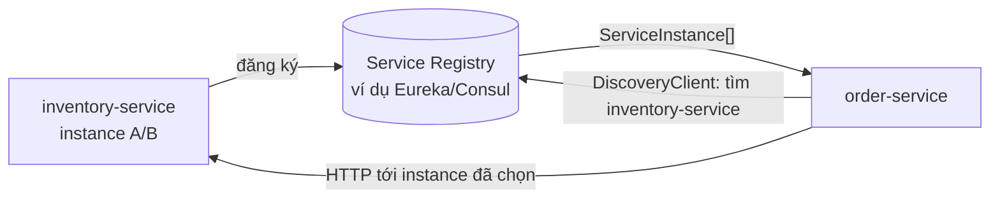
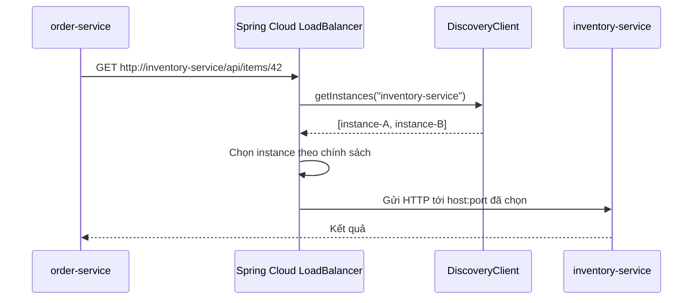

# Spring Cloud Core là gì trong phạm vi Spring Cloud Commons và Context?

## 1. Bức tranh tổng quan

Một ứng dụng Spring Boot đơn lẻ thường đọc cấu hình từ `application.yml`, quản lý bean bằng `ApplicationContext` và gọi các thành phần nội bộ trực tiếp. Khi chuyển sang kiến trúc nhiều dịch vụ triển khai độc lập, những bài toán chung xuất hiện:

- `order-service` cần tìm địa chỉ hiện tại của `inventory-service` khi instance tăng, giảm hoặc thay đổi IP.
- Nhiều instance của cùng một service cần phân phối yêu cầu phù hợp.
- Cấu hình có thể đến từ file, biến môi trường hoặc hệ thống tập trung; ứng dụng cần biết nguồn nào được ưu tiên và cập nhật ra sao.
- Phiên bản Spring Boot, Spring Cloud và thư viện tích hợp phải tương thích để tránh lỗi khởi động.

**Spring Cloud** là hệ sinh thái bổ sung các quy ước và công cụ cho các mẫu phổ biến của hệ thống phân tán, xây trên Spring Framework và Spring Boot. Trong học phần **SPRING_CLOUD_CORE**, từ *Core* chỉ **nền tảng cốt lõi của Spring Cloud**, đặc biệt là **Spring Cloud Commons** và **Spring Cloud Context**; đây không phải tên một starter duy nhất gọi là “spring-cloud-core”.

| Thành phần | Trách nhiệm | Ví dụ |
| --- | --- | --- |
| Spring Framework / Spring Boot | Container, vòng đời bean, `Environment`, cấu hình, HTTP server, Actuator | `@Bean`, `@ConfigurationProperties`, `application.yml` |
| **Spring Cloud Commons** | Hợp đồng chung cho discovery, registration, tích hợp load balancing và các tiện ích | `DiscoveryClient`, `ServiceInstance`, `ServiceRegistry` |
| **Spring Cloud Context** | Dịch vụ quản lý context, môi trường và làm mới bean khi cấu hình đổi | `EnvironmentChangeEvent`, `@RefreshScope` |
| Dự án Spring Cloud khác | Cung cấp triển khai cụ thể cho registry, cấu hình từ xa, cân bằng tải, gateway… | Eureka, Consul, Config Server, LoadBalancer, Gateway |

**Tư tưởng quan trọng:** Commons đưa ra *cách gọi chung*, Context đưa ra *cơ chế dùng chung*, còn một hệ thống cụ thể phải chọn backend và dependency thích hợp. Có interface `DiscoveryClient` chưa có nghĩa đã cài một máy chủ Eureka hoặc Consul.

## 2. Spring Cloud Commons: các abstraction dùng chung

### 2.1. Service discovery: tìm dịch vụ bằng tên logic

Thay vì ghi cứng `http://10.0.0.18:8080`, phía gọi dùng tên `inventory-service` để tìm các instance hiện có.

- `DiscoveryClient` là API đồng bộ để liệt kê service ID và tìm các `ServiceInstance`.
- `ReactiveDiscoveryClient` cung cấp hướng truy cập reactive.
- `ServiceInstance` mô tả một instance qua service ID, host, port, URI, metadata và trạng thái secure khi có.
- `SimpleDiscoveryClient` dùng danh sách instance cấu hình tĩnh, hữu ích cho bài thực hành không có registry.

Ví dụ đọc danh sách instance:

```java
import org.springframework.cloud.client.ServiceInstance;
import org.springframework.cloud.client.discovery.DiscoveryClient;
import org.springframework.stereotype.Service;

import java.util.List;

@Service
public class InventoryDirectory {
    private final DiscoveryClient discoveryClient;

    public InventoryDirectory(DiscoveryClient discoveryClient) {
        this.discoveryClient = discoveryClient;
    }

    public List<ServiceInstance> availableInstances() {
        return discoveryClient.getInstances("inventory-service");
    }
}
```

`getInstances(...)` có thể trả danh sách rỗng. Đây là thao tác **tra cứu**, chưa gửi HTTP request đến server đích. Khi có nhiều provider discovery, Spring Cloud có cơ chế xác định thứ tự client. Với cấu hình thông thường, việc đưa implementation discovery phù hợp vào classpath đã đủ để auto-configuration hoạt động; annotation `@EnableDiscoveryClient` không còn bắt buộc trong nhiều trường hợp.

### 2.2. Service registry: đăng ký instance đang phục vụ

Ở phía server, một instance thông báo rằng nó đang cung cấp `inventory-service` tại host/port nhất định. Commons định nghĩa `Registration` (thông tin đăng ký) và `ServiceRegistry` (gồm các thao tác như `register(Registration)`, `deregister(Registration)`). Các implementation cho Eureka, Consul hoặc Zookeeper cung cấp hành vi thực tế.

| Khái niệm | Hướng xử lý | Mục đích |
| --- | --- | --- |
| `DiscoveryClient` | Registry/danh sách → client | Đọc vị trí các instance |
| `ServiceRegistry` | Instance → registry | Đăng ký/hủy đăng ký, cập nhật trạng thái nếu được hỗ trợ |
| `InstancePreRegisteredEvent` / `InstanceRegisteredEvent` | Sự kiện trong ứng dụng | Phản ứng trước/sau khi tự động đăng ký |



Tính năng tự đăng ký chỉ có ý nghĩa khi tồn tại implementation registry phù hợp. Có thể tắt nó qua `spring.cloud.service-registry.auto-registration.enabled=false` khi implementation hỗ trợ. Heartbeat, lease, health check và chính sách loại bỏ instance là trách nhiệm của từng hệ thống registry; Commons không tự triển khai chúng.

### 2.3. Từ discovery đến lời gọi dịch vụ

Khi `inventory-service` có nhiều instance, **Spring Cloud LoadBalancer** có thể chọn một instance cho HTTP client. Đây là một thành phần riêng dựa trên các abstraction chung, không phải chức năng tự có chỉ nhờ `DiscoveryClient`.



LoadBalancer có chiến lược như round-robin và random; danh sách instance có thể đến từ `ServiceInstanceListSupplier` kết hợp discovery. Việc phân tải **không tự bảo đảm tính sẵn sàng**: backend có thể chết sau khi được tra cứu, các bản ghi có thể chưa cập nhật, và xử lý timeout/retry/circuit breaker phải được thiết kế tương ứng.

## 3. Spring Cloud Context: ngữ cảnh và cấu hình lúc chạy

Spring Boot đã cung cấp `Environment`, `PropertySource`, `@Value` và `@ConfigurationProperties`. Spring Cloud Context bổ sung các cơ chế thiết thực cho cấu hình của ứng dụng phân tán: thay đổi môi trường, rebind một số cấu hình, refresh target bean và tích hợp bootstrap trong những trường hợp cần.

### 3.1. Các nguồn cấu hình

Một ứng dụng có thể lấy thuộc tính từ:

- `application.yml` và file theo profile;
- system properties, biến môi trường và tham số dòng lệnh;
- nguồn ngoài qua cơ chế **Spring Boot Config Data**;
- hệ thống tập trung như **Spring Cloud Config Server**, nếu đã thêm Spring Cloud Config Client.

Ví dụ trong ứng dụng **đã có Config Client**:

```yaml
spring:
  application:
    name: order-service
  config:
    import: "optional:configserver:http://localhost:8888"
```

`optional:` cho phép ứng dụng tiếp tục khởi động khi không truy cập được Config Server; bỏ tiền tố khi muốn buộc phải tải được cấu hình từ nguồn đó. Ví dụ này cần dependency **Spring Cloud Config Client**, không chạy chỉ bằng Commons/Context.

Thứ tự ưu tiên của property source phụ thuộc Spring Boot, loại nguồn và cấu hình override tương ứng. Không nên mặc định “cấu hình từ xa luôn thắng toàn bộ cấu hình local” trong mọi tình huống.

### 3.2. Config Data và bootstrap context

Tài liệu cũ của Spring Cloud thường nói về **bootstrap application context**, một context cha dùng để khởi tạo và tải các nguồn cấu hình sớm thông qua `PropertySourceLocator`. Trong mô hình này thường xuất hiện `bootstrap.yml`.

Với Spring Boot hiện đại, **`spring.config.import` theo cơ chế Config Data là cách mặc định** để kết nối Config Server và **không cần `bootstrap.yml`**. Muốn dùng cơ chế bootstrap truyền thống, phải kích hoạt riêng, chẳng hạn với `spring-cloud-starter-bootstrap` hoặc thuộc tính `spring.cloud.bootstrap.enabled=true` đặt đủ sớm qua environment/system property.

Vì vậy, cần xác định dự án dùng **Config Data** hay **bootstrap truyền thống** trước khi tìm nguyên nhân cấu hình bị thiếu, nạp hai lần hoặc có độ ưu tiên bất ngờ.

### 3.3. Thay đổi `Environment` khác với refresh một bean

| Cơ chế | Điều làm được | Điều không tự làm |
| --- | --- | --- |
| Thay đổi giá trị trong `Environment` | Cung cấp bộ giá trị property mới | Không tự đổi field đã đọc ở constructor của mọi bean |
| `EnvironmentChangeEvent` | Thông báo danh sách key thay đổi; Context có thể rebind `@ConfigurationProperties` và cập nhật logging level | Không tự lấy cấu hình mới từ remote nếu chưa có cơ chế nạp |
| `@RefreshScope` và `RefreshScope` | Loại target bean được cache để tạo lại vào lần gọi tiếp theo | Không tạo lại toàn bộ bean phụ thuộc và không refresh mọi loại tài nguyên |

Bean có `@RefreshScope` được truy cập qua **proxy**. Target bean được tạo lười khi sử dụng và lưu trong cache. Khi refresh, cached target bị vô hiệu hóa; lần gọi tiếp theo tạo target mới với các property đã được cập nhật.

```java
import org.springframework.beans.factory.annotation.Value;
import org.springframework.cloud.context.config.annotation.RefreshScope;
import org.springframework.stereotype.Component;

@Component
@RefreshScope
public class BannerProvider {
    private final String message;

    public BannerProvider(@Value("${demo.banner:Hello}") String message) {
        this.message = message;
    }

    public String getMessage() {
        return message;
    }
}
```

Nếu cấu hình `demo.banner` trong **nguồn mà ứng dụng thực sự tải lại** thay đổi, thao tác refresh phù hợp khiến `BannerProvider` nhận giá trị mới khi target được tạo lại. Bean khác đã sao chép banner vào field của chính nó vẫn có thể giữ giá trị cũ.

Với ứng dụng có Spring Boot Actuator và Context phù hợp, có thể cho phép endpoint refresh:

```yaml
management:
  endpoints:
    web:
      exposure:
        include: health,info,refresh
```

```bash
curl -X POST http://localhost:8080/actuator/refresh
```

Endpoint `/actuator/refresh` thường làm mới các nguồn cấu hình thích hợp và những bean `@RefreshScope`. Cần kiểm tra hành vi theo phiên bản và cách nạp cấu hình. Chỉ bật endpoint quản trị khi cần và **bảo vệ bằng xác thực, phân quyền và giới hạn mạng**. Refresh một instance không có nghĩa toàn bộ instance trong cụm cùng refresh; Spring Cloud Bus hoặc cơ chế triển khai khác có thể truyền thông báo rộng hơn.

**Các giới hạn cần biết:** constructor-bound `@ConfigurationProperties` (bao gồm Java record ở trường hợp được tài liệu nêu) không được rebind/refresh như mutable properties bean; xóa hẳn một key chưa chắc cho kết quả như mong muốn sau refresh; `HikariDataSource` thuộc nhóm không refresh mặc định. Context Refresh cũng không hỗ trợ Spring AOT/native image theo cơ chế này. Với kết nối database và bean có state quan trọng, phải thử hành vi đóng/mở tài nguyên trước khi dùng trong production.

## 4. Ví dụ nhỏ: `order-service` gọi `inventory-service`

Giả sử có hai backend thử nghiệm cùng phục vụ `GET /api/items/{id}`:

- `http://localhost:8091` — instance A;
- `http://localhost:8092` — instance B.

Mục tiêu là gọi theo **service ID** bằng Commons và LoadBalancer mà chưa cần server Eureka hoặc Consul.

### Bước 1: quản lý phiên bản và dependency

Dùng BOM `spring-cloud-dependencies` của **release train** tương thích với Spring Boot. Ví dụ tại thời điểm 11/2026, tài liệu Spring Cloud Release ghi nhận cặp **Spring Cloud 2025.1.4 – Spring Boot 4.0.9**; cần xác nhận lại ma trận tương thích trước khi áp dụng cho dự án mới.

Phần cấu hình Maven liên quan đến Cloud, đặt vào dự án Spring Boot đã có phần parent/dependency web phù hợp:

```xml
<properties>
    <spring-cloud.version>2025.1.4</spring-cloud.version>
</properties>

<dependencyManagement>
    <dependencies>
        <dependency>
            <groupId>org.springframework.cloud</groupId>
            <artifactId>spring-cloud-dependencies</artifactId>
            <version>${spring-cloud.version}</version>
            <type>pom</type>
            <scope>import</scope>
        </dependency>
    </dependencies>
</dependencyManagement>

<dependencies>
    <dependency>
        <groupId>org.springframework.cloud</groupId>
        <artifactId>spring-cloud-starter-loadbalancer</artifactId>
    </dependency>
</dependencies>
```

Starter này cung cấp tích hợp load balancing; nếu muốn kết nối registry hoặc Config Server thật, cần thêm các starter tương ứng.

### Bước 2: cấu hình instance tĩnh để học discovery

Trong `application.yml` của `order-service`:

```yaml
spring:
  application:
    name: order-service
  cloud:
    discovery:
      client:
        simple:
          instances:
            inventory-service:
              - uri: http://localhost:8091
              - uri: http://localhost:8092
```

`SimpleDiscoveryClient` đọc danh sách từ cấu hình này. Nó **không tự nhận biết** instance mới vừa khởi động, instance đang lỗi hay IP vừa thay đổi.

### Bước 3: tạo HTTP client theo service ID

Ví dụ dùng `RestClient.Builder` và `@LoadBalanced`:

```java
import org.springframework.cloud.client.loadbalancer.LoadBalanced;
import org.springframework.context.annotation.Bean;
import org.springframework.context.annotation.Configuration;
import org.springframework.web.client.RestClient;

@Configuration(proxyBeanMethods = false)
public class HttpClientConfig {
    @Bean
    @LoadBalanced
    RestClient.Builder loadBalancedRestClientBuilder() {
        return RestClient.builder();
    }
}
```

```java
import org.springframework.cloud.client.loadbalancer.LoadBalanced;
import org.springframework.stereotype.Service;
import org.springframework.web.client.RestClient;

@Service
public class InventoryClient {
    private final RestClient client;

    public InventoryClient(@LoadBalanced RestClient.Builder builder) {
        this.client = builder.build();
    }

    public String getItem(String id) {
        return client.get()
                .uri("http://inventory-service/api/items/{id}", id)
                .retrieve()
                .body(String.class);
    }
}
```

Trong URL, `inventory-service` được LoadBalancer diễn giải như **service ID**, sau đó thay bằng host/port thực của một instance. Không nên hiểu đây là hostname DNS mặc định. Nếu thiếu `@LoadBalanced` hoặc tích hợp LoadBalancer, request có thể tìm DNS hostname `inventory-service` và thất bại.

### Bước 4: thử và quan sát

1. Khởi động hai backend trên cổng `8091` và `8092` với phản hồi có dấu hiệu phân biệt (ví dụ `inventory-A` và `inventory-B`).
2. Gọi nhiều lần `InventoryClient.getItem("42")`; quan sát backend nhận từng request.
3. Tắt backend A và gọi lại. Với danh sách instance **tĩnh**, địa chỉ A vẫn có thể được chọn, gây lỗi kết nối.
4. Thay SimpleDiscoveryClient bằng implementation Eureka/Consul phù hợp khi triển khai thật; code gọi theo tên `inventory-service` vẫn dựa vào abstraction chung.

Chiến lược round-robin thường phân bố lần lượt trên hai instance hoạt động; không cam kết trình tự cứng trong mọi hoàn cảnh vì concurrency, cache và chính sách chọn instance có thể thay đổi.

## 5. Kiểm thử và vận hành

| Tình huống | Cách kiểm thử | Điều cần xác minh |
| --- | --- | --- |
| Discovery thành công | Mock `DiscoveryClient` hoặc cấu hình `SimpleDiscoveryClient` với hai instance | Tìm đúng service ID, host/port và metadata cần dùng |
| Không có instance | Trả danh sách rỗng cho một service ID | Có lỗi rõ ràng hoặc cơ chế fallback đã thiết kế, không tự chọn địa chỉ tùy ý |
| Instance bị lỗi | Tắt một backend khi có hai backend | Hành vi timeout/retry/failover đúng với cấu hình thật |
| Đổi cấu hình | Cập nhật nguồn được hỗ trợ và trigger refresh kiểm soát | Bean `@RefreshScope` dùng giá trị mới sau khi tạo lại target |
| Bean không refresh | Bean chỉ đọc `@Value` một lần khi khởi tạo | Không kỳ vọng field tự đổi sau `EnvironmentChangeEvent` |
| Lỗi dependency | Kiểm tra dependency tree và log khởi động | Boot và Cloud BOM tương thích, không trùng phiên bản thư viện |

Về vận hành, nên gắn các tín hiệu quan sát với đúng lớp gây lỗi: discovery không tìm thấy instance, load balancer không chọn được server, hay request HTTP bị timeout. Spring Boot Actuator có thể giúp theo dõi health và metrics; Commons cung cấp health indicator cho discovery khi điều kiện auto-configuration đáp ứng. Với registry lớn, kiểm tra chi phí gọi `getServices` trong health check và tùy chọn `spring.cloud.discovery.client.health-indicator.use-services-query`.

Để điều tra cấu hình, xem active profiles, nguồn property và độ ưu tiên qua log hoặc endpoint `/actuator/env`, `/actuator/configprops` khi được cho phép. Các endpoint này có thể lộ dữ liệu nhạy cảm; không nên mở công khai. Cũng cần giới hạn `/actuator/refresh`, `/actuator/env` (đặc biệt POST) và `/actuator/serviceregistry` nếu chúng được kích hoạt.

### Những nhầm lẫn phổ biến

| Nhầm lẫn | Cách hiểu đúng |
| --- | --- |
| “Thêm Commons là đã có Eureka.” | Commons chỉ cung cấp hợp đồng; Eureka là implementation riêng. |
| “DiscoveryClient tự gửi HTTP request.” | DiscoveryClient tìm instance; HTTP client mới thực hiện request. |
| “Luôn phải dùng `@EnableDiscoveryClient`.” | Nhiều tích hợp discovery tự cấu hình chỉ qua dependency phù hợp. |
| “Refresh Config Server thì tất cả bean đổi ngay.” | Cần làm mới `Environment` và bean đúng cách trên từng instance. |
| “`@RefreshScope` tạo lại mọi bean phụ thuộc.” | Chỉ target bean trong scope được invalidated và tạo lại khi gọi. |
| “Spring Cloud Config luôn cần `bootstrap.yml`.” | Config Data qua `spring.config.import` không cần file bootstrap. |
| “Boot mới nhất đi với mọi Cloud release.” | Chọn release train theo bảng tương thích và BOM. |

## 6. Kết nối các khái niệm

Khi `order-service` cần gọi `inventory-service`, Commons cung cấp cách tìm instance bằng tên logic. LoadBalancer sử dụng danh sách ấy để chọn instance, sau đó HTTP client thực hiện yêu cầu. Context phối hợp với Spring Boot để ứng dụng đọc nguồn cấu hình, phản ứng với thay đổi và làm mới một số bean khi được kích hoạt. Registry, Config Server, cơ chế truyền sự kiện, circuit breaker hoặc gateway là những thành phần bổ sung theo nhu cầu của hệ thống.

Nắm được nền tảng này giúp trả lời ba câu hỏi thiết kế quan trọng: **dịch vụ được tìm ở đâu, cấu hình được nạp và cập nhật thế nào, và abstraction chung được nối với implementation cụ thể ra sao?**

## 7. Câu hỏi tự kiểm tra

1. Vì sao `DiscoveryClient` không thể thay cho một máy chủ registry?
2. `DiscoveryClient` và `ServiceRegistry` khác nhau ở thao tác nào?
3. Vì sao một service ID có nhiều instance cần cơ chế chọn instance khi gọi HTTP?
4. Tại sao `Environment` đổi nhưng bean đọc giá trị ở constructor có thể chưa đổi?
5. Khi nào dùng `spring.config.import`, khi nào cần mô hình bootstrap truyền thống?
6. Gọi `/actuator/refresh` trên một instance có làm toàn bộ instance đổi cấu hình không?
7. Tại sao phải quản lý Spring Boot và Spring Cloud theo release train tương thích?

## 8. Tài liệu tham khảo chính thức

- [Spring Cloud Release Train Reference](https://docs.spring.io/spring-cloud-release/reference/index.html) — release train và phiên bản Boot tương thích.
- [Spring Cloud Commons: Common Abstractions](https://docs.spring.io/spring-cloud-commons/reference/spring-cloud-commons/common-abstractions.html) — discovery, registry và compatibility verifier.
- [Spring Cloud Context: Application Context Services](https://docs.spring.io/spring-cloud-commons/reference/spring-cloud-commons/application-context-services.html) — bootstrap, môi trường và refresh scope.
- [Spring Cloud LoadBalancer](https://docs.spring.io/spring-cloud-commons/reference/spring-cloud-commons/loadbalancer.html) — chọn instance và tích hợp HTTP client.
- [Spring Cloud Config Client](https://docs.spring.io/spring-cloud-config/reference/client.html) — Config Data và bootstrap.

*Ví dụ phục vụ học tập. Khi triển khai production, cần kiểm tra đúng phiên bản tài liệu và thử hành vi thực tế của các integration.*
