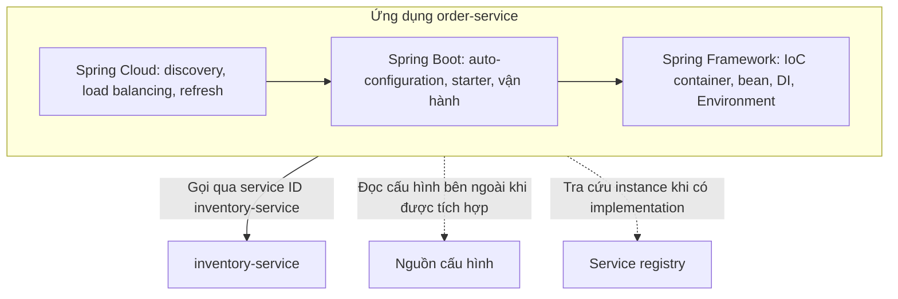
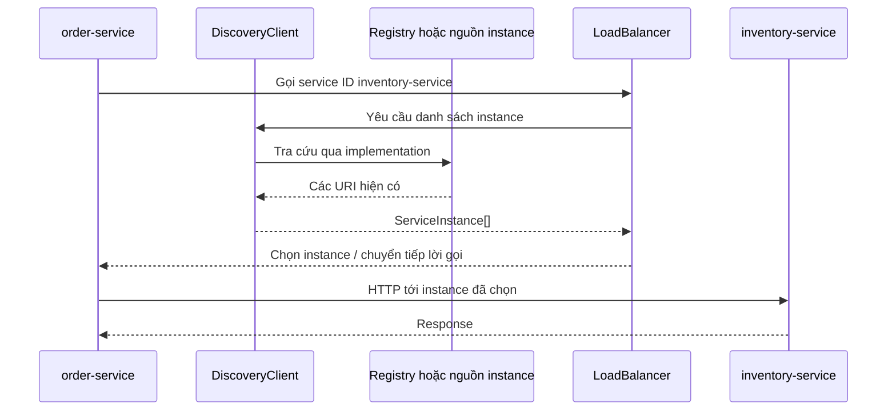

# Phân biệt Spring Framework Core, Spring Boot và Spring Cloud

## 1. Bối cảnh và mục tiêu

Một ứng dụng Java có thể dùng **Spring Framework Core** để quản lý các đối tượng và phụ thuộc, dùng **Spring Boot** để khởi động và vận hành ứng dụng với ít cấu hình thủ công, rồi dùng **Spring Cloud** khi ứng dụng cần phối hợp với những dịch vụ khác trong hệ thống phân tán. Ba tên gọi thường xuất hiện cùng nhau, nhưng chúng giải quyết **ba nhóm vấn đề khác nhau**.

Bài học thuộc phạm vi **SPRING_CLOUD_CORE**: tìm hiểu những nền tảng cốt lõi của Spring Cloud trong hệ thống phân tán, đặc biệt Spring Cloud Commons, Spring Cloud Context, cấu hình bên ngoài, tính tương thích với Spring Boot, refresh scope, discovery, service registry, giao tiếp dịch vụ và khả năng kiểm thử, vận hành các abstraction chung.

Sau bài học, người học có thể:

- Giải thích mỗi lớp cung cấp khả năng gì, phụ thuộc vào lớp nào và khi nào cần dùng.
- Phân biệt dependency injection, auto-configuration và distributed-system abstraction bằng ví dụ cụ thể.
- Xác định thành phần phụ trách cấu hình, tra cứu dịch vụ, cân bằng tải và cập nhật cấu hình lúc chạy.
- Chọn các dependency phù hợp, hiểu vai trò của Spring Boot BOM và Spring Cloud release train.
- Tránh nhầm lẫn giữa khả năng được cung cấp bởi abstraction và khả năng chỉ có khi thêm implementation tương ứng.

## 2. Mô hình ba lớp

Có thể hình dung một dịch vụ `order-service` cần xử lý đơn hàng và gọi `inventory-service`:



Sơ đồ biểu diễn **quan hệ sử dụng năng lực**, không có nghĩa mọi ứng dụng Boot đều phải cài Spring Cloud hoặc mọi Spring Cloud component đều tự khởi chạy một registry/config server.

| Tiêu chí | Spring Framework Core | Spring Boot | Spring Cloud |
| --- | --- | --- | --- |
| Câu hỏi chính | Các thành phần trong ứng dụng được tạo, nối và quản lý thế nào? | Làm sao đóng gói, cấu hình, khởi chạy và quan sát ứng dụng nhanh, nhất quán? | Các dịch vụ phân tán tìm nhau, nhận cấu hình và phối hợp như thế nào? |
| Khả năng nổi bật | IoC, dependency injection, bean lifecycle, `ApplicationContext`, `Environment`, resource, event | Starter, auto-configuration, embedded server tùy loại ứng dụng, externalized configuration, Actuator | `DiscoveryClient`, `ServiceRegistry`, Spring Cloud LoadBalancer, `@RefreshScope`, tích hợp Config/Bus và các giải pháp phân tán khác |
| Đơn vị quan tâm | Đối tượng và cấu hình trong một application context | Một ứng dụng có thể build, chạy và vận hành | Quan hệ giữa nhiều dịch vụ và nguồn hạ tầng của chúng |
| Ví dụ | Inject `OrderRepository` vào `OrderService` | Chạy ứng dụng web bằng `SpringApplication.run(...)` | Gọi `http://inventory-service` thông qua bộ cân bằng tải và nguồn discovery |
| Có thể dùng riêng? | Có thể sử dụng Spring Framework không cần Boot | Có; một ứng dụng Boot không cần Cloud | Các tích hợp Spring Cloud thông dụng vận hành trên nền Spring Boot/Framework tương thích |

**Điểm mấu chốt:** Spring Boot không thay thế Spring Framework; nó xây dựng trên Spring Framework. Spring Cloud tiếp tục sử dụng nền tảng đó để chuẩn hóa một số nhu cầu của hệ thống phân tán.

## 3. Spring Framework Core: nền tảng bên trong ứng dụng

### 3.1. IoC, bean và dependency injection

**Inversion of Control (IoC)** chuyển trách nhiệm khởi tạo và lắp ghép đối tượng từ mã nghiệp vụ sang container. **Dependency Injection (DI)** là một cách container cấp phụ thuộc cho đối tượng. Trong Spring, `ApplicationContext` quản lý các bean, vòng đời, scope và quan hệ phụ thuộc của chúng.

```java
@Repository
class OrderRepository {
    long countPending() {
        return 12L; // Ví dụ minh họa; thực tế truy vấn dữ liệu.
    }
}

@Service
class OrderService {
    private final OrderRepository repository;

    OrderService(OrderRepository repository) {
        this.repository = repository; // Constructor injection.
    }

    long pendingOrders() {
        return repository.countPending();
    }
}
```

`@Repository` và `@Service` đánh dấu các bean có thể được tìm thấy qua component scanning. Spring tạo `OrderRepository`, sau đó truyền nó vào constructor của `OrderService`. Trong ví dụ này, **chưa có điều gì thuộc riêng Spring Cloud**; đây là cơ chế nền tảng của Spring Framework.

Các khái niệm nền tảng cần phân biệt:

- **Bean:** đối tượng được Spring container quản lý; không phải mọi đối tượng tạo bằng `new` đều là bean.
- **Application context:** không gian quản lý bean, cấu hình và một số dịch vụ nền tảng của Spring.
- **Scope:** quy định vòng đời và cách truy cập bean, ví dụ `singleton`, `prototype`, request scope trong ứng dụng web; `refresh` là scope bổ sung từ Spring Cloud Context.
- **`Environment` / `PropertySource`:** giao diện thống nhất để đọc thuộc tính từ các nguồn cấu hình với thứ tự ưu tiên xác định.
- **`@Configuration` / `@Bean`:** cách định nghĩa bean khi không dùng hoặc không thể dùng component scanning.

### 3.2. Spring Framework có tự trở thành ứng dụng microservice không?

Không. Container và DI giải quyết việc **tổ chức mã và thành phần trong một ứng dụng**. Muốn nhận HTTP request, ứng dụng cần thêm web stack; muốn kết nối cơ sở dữ liệu cần dependency và cấu hình tương ứng; muốn biết một instance từ xa đang ở địa chỉ nào cần cơ chế discovery hoặc cấu hình địa chỉ. Spring Framework cung cấp nhiều thư viện ngoài phần Core, nhưng tên gọi **Spring Framework Core** trong bài này chỉ lớp nền tảng IoC, bean và cấu hình, không đồng nghĩa toàn bộ hệ sinh thái Spring.

## 4. Spring Boot: đóng gói và vận hành một ứng dụng Spring

Spring Boot giúp giảm cấu hình lặp lại, đưa ra những giá trị mặc định có điều kiện và hỗ trợ triển khai một ứng dụng Spring theo cách nhất quán.

```java
@SpringBootApplication
public class OrderApplication {
    public static void main(String[] args) {
        SpringApplication.run(OrderApplication.class, args);
    }
}
```

`@SpringBootApplication` kết hợp các khả năng như cấu hình ứng dụng, component scanning và kích hoạt auto-configuration. **Auto-configuration** quan sát dependency, bean đang tồn tại và các property để đăng ký cấu hình phù hợp; không có nghĩa Boot tự động cung cấp mọi loại hạ tầng bên ngoài.

Ba cơ chế thường dùng cùng nhau:

1. **Starter dependencies:** nhóm dependency theo nhu cầu, ví dụ `spring-boot-starter-web` hoặc `spring-boot-starter-actuator`.
2. **Auto-configuration:** cấu hình mặc định có điều kiện, cho phép ghi đè hoặc tùy biến theo từng trường hợp.
3. **Externalized configuration:** đọc giá trị từ file, biến môi trường, command-line arguments và các nguồn được hỗ trợ, thông qua hệ thống cấu hình của Boot/Spring.

Ví dụ `application.yml` của một ứng dụng Boot:

```yaml
spring:
  application:
    name: order-service

server:
  port: 8080

orders:
  timeout: 3s
```

Ứng dụng có thể binding `orders.timeout` vào đối tượng `@ConfigurationProperties`. Khả năng nạp cấu hình từ file và môi trường **đã có trong Spring Boot**; không cần Spring Cloud Config chỉ để đọc `application.yml`.

Về vận hành, Spring Boot Actuator có thể cung cấp health, metrics và thông tin chẩn đoán khi thêm dependency, cấu hình và kiểm soát quyền truy cập phù hợp. Actuator **không phải** service registry và không tự giúp một dịch vụ tìm thấy địa chỉ của dịch vụ khác.

## 5. Spring Cloud: các abstraction cho hệ thống phân tán

Spring Cloud là hệ sinh thái các dự án tích hợp trên Spring, trong đó các module cốt lõi rất quan trọng gồm **Spring Cloud Commons** và **Spring Cloud Context**. Nhiều năng lực như Config, Gateway, Bus hoặc các integration với công nghệ discovery là **thành phần riêng**, được thêm khi cần.

### 5.1. Spring Cloud Commons: một hợp đồng cho nhiều implementation

Commons định nghĩa các abstraction mà mã ứng dụng có thể phụ thuộc vào thay vì gắn chặt với một nhà cung cấp:

| Abstraction / thành phần | Trách nhiệm | Giới hạn cần nhớ |
| --- | --- | --- |
| `DiscoveryClient` | Liệt kê các `ServiceInstance` theo service ID | Cần implementation hoặc danh sách instance tĩnh; bản thân giao diện không vận hành registry |
| `ReactiveDiscoveryClient` | Biến thể discovery theo kiểu reactive | Chỉ hữu ích khi có implementation phù hợp |
| `ServiceRegistry` | Trừu tượng hóa thao tác đăng ký/hủy đăng ký instance | Không phải mọi discovery client đều cho phép hoặc cần ứng dụng tự đăng ký |
| Spring Cloud LoadBalancer | Chọn một instance khi gọi qua service ID | Cần instance từ discovery/cấu hình; không đồng nghĩa tự có retry, circuit breaker hay registry |
| Các cơ chế kiểm tra compatibility và context hỗ trợ | Giúp tích hợp đúng bộ phiên bản và hành vi khởi tạo | Không thay thế ma trận tương thích chính thức của release train |

Ví dụ mã chỉ dùng hợp đồng `DiscoveryClient`:

```java
@RestController
class InstanceController {
    private final DiscoveryClient discoveryClient;

    InstanceController(DiscoveryClient discoveryClient) {
        this.discoveryClient = discoveryClient;
    }

    @GetMapping("/inventory-instances")
    List<String> inventoryInstances() {
        return discoveryClient.getInstances("inventory-service")
                .stream()
                .map(instance -> instance.getUri().toString())
                .toList();
    }
}
```

Mã nghiệp vụ không chỉ đích danh Eureka, Consul hay Kubernetes. Tuy nhiên, **cần một implementation** của discovery để kết quả phản ánh các instance thực tế. Trong môi trường học tập có thể dùng `SimpleDiscoveryClient` với danh sách URI cố định; trong hệ thống thực tế, implementation phải phù hợp hạ tầng.

### 5.2. Discovery khác service registry và load balancing ra sao?

Quy trình điển hình khi `order-service` gọi `inventory-service`:



Sơ đồ mang tính logic; việc chọn instance, tái sử dụng danh sách đã cache và chuyển tiếp request phụ thuộc vào HTTP client và LoadBalancer integration cụ thể.

- **Registry** lưu/được dùng làm nguồn thông tin về instance đang có; **discovery** đọc thông tin đó.
- **Service registration** là thao tác khai báo instance với registry nếu công nghệ được chọn yêu cầu hoặc hỗ trợ.
- **Client-side load balancing** chọn một instance ở phía caller; server-side load balancing nằm ở proxy/load balancer bên ngoài.
- **Giao tiếp HTTP** vẫn do client như `RestClient`/`WebClient` đảm nhiệm; discovery và load balancer bổ sung khả năng định tuyến theo tên dịch vụ.

Chẳng hạn, chuỗi `http://inventory-service` có thể là **service ID logic** khi HTTP client được cấu hình sử dụng Spring Cloud LoadBalancer. Nếu dùng HTTP client thông thường không có integration đó, hostname chỉ được xử lý theo DNS như bình thường; không có phép biến đổi kỳ diệu nào chỉ vì dự án chứa Spring Cloud.

### 5.3. Spring Cloud Context: vòng đời cấu hình và refresh scope

Spring Cloud Context bổ sung các cơ chế phục vụ ngữ cảnh ứng dụng khi cấu hình thay đổi, tiêu biểu là `@RefreshScope`. Một bean thuộc refresh scope có thể được tạo lại sau sự kiện refresh để đọc giá trị cấu hình mới. Điều này khác với `singleton` thông thường vốn không tự tái tạo chỉ vì file cấu hình thay đổi.

```java
@RefreshScope
@RestController
class BannerController {
    @Value("${orders.banner:Welcome}")
    private String banner;

    @GetMapping("/banner")
    String banner() {
        return banner;
    }
}
```

Khi nguồn property đã được cập nhật **và** cơ chế refresh được kích hoạt đúng cách, Spring Cloud có thể loại bỏ instance đích đang được cache trong refresh scope; lần truy cập tiếp theo tạo bean mới và inject giá trị `orders.banner` mới. Nói cách khác, refresh thường gắn với **tạo lại bean/proxy**, không phải một cơ chế tự thay đổi mọi trường của mọi singleton đang tồn tại.

Những giới hạn quan trọng:

- Không phải mọi loại bean hay mọi property đều refresh được; đặc biệt cần kiểm tra những thành phần giữ kết nối hoặc trạng thái lâu dài.
- Việc sửa file cấu hình không bảo đảm lập tức có refresh. Cần cơ chế cập nhật nguồn property và trigger phù hợp.
- Một số phiên bản/tích hợp hỗ trợ endpoint Actuator như `/actuator/refresh`; endpoint cần được bật và bảo vệ, tuyệt đối không mở công khai tùy tiện.
- Spring Cloud Bus có thể hỗ trợ lan truyền sự kiện đến nhiều instance khi được tích hợp; không phải chức năng mặc định của riêng `@RefreshScope`.
- Ứng dụng cần kiểm tra tính nhất quán trong thời gian các instance cập nhật cấu hình ở các thời điểm khác nhau.

### 5.4. Cấu hình ngoài: Boot Config Data và Spring Cloud Config

Hai khái niệm liên quan nhưng khác trách nhiệm:

| Thành phần | Giải quyết vấn đề |
| --- | --- |
| Spring Boot externalized configuration / Config Data | Nạp, hợp nhất và ưu tiên property từ các nguồn được hỗ trợ khi ứng dụng khởi động |
| Spring Cloud Config Server | Cung cấp cấu hình tập trung cho nhiều ứng dụng, thường lấy từ kho cấu hình được quản lý |
| Spring Cloud Config Client | Tích hợp ứng dụng với Config Server thông qua cơ chế cấu hình phù hợp |
| Spring Cloud Context refresh | Hỗ trợ cập nhật và tái tạo một số bean khi cấu hình đã thay đổi và refresh được kích hoạt |

Ví dụ cấu hình **client** khi đã thêm đúng Spring Cloud Config Client starter:

```yaml
spring:
  application:
    name: order-service
  config:
    import: optional:configserver:http://localhost:8888
```

`optional:` cho phép ứng dụng tiếp tục theo semantics của Config Data import nếu Config Server không truy cập được trong tình huống tương ứng. Đối với hệ thống cần cấu hình tập trung để chạy chính xác, hãy quyết định rõ có nên dùng chế độ optional hay bắt buộc. Cú pháp `spring.config.import` là con đường tích hợp Config Data hiện đại; `bootstrap.yml` thuộc cơ chế bootstrap cũ hoặc các cấu hình bật bootstrap riêng, không nên mặc định suy ra mọi dự án đều cần file đó.

**Phân biệt hai thời điểm:** lấy cấu hình lúc startup không đồng nghĩa đồng bộ cấu hình liên tục lúc runtime; thay đổi runtime cần cơ chế refresh/triển khai lại được thiết kế và kiểm thử.

## 6. Ví dụ nối ba lớp trong một dịch vụ

Giả sử `order-service` cung cấp API đặt hàng và cần tìm endpoint của `inventory-service`.

### 6.1. Tập dependency theo trách nhiệm

Trong dự án Maven dùng Spring Boot parent hoặc Boot dependency management, các dependency sau thể hiện vai trò từng lớp:

```xml
<dependencies>
    <!-- Spring Boot: web server và REST MVC -->
    <dependency>
        <groupId>org.springframework.boot</groupId>
        <artifactId>spring-boot-starter-web</artifactId>
    </dependency>

    <!-- Spring Cloud: client-side load balancing -->
    <dependency>
        <groupId>org.springframework.cloud</groupId>
        <artifactId>spring-cloud-starter-loadbalancer</artifactId>
    </dependency>

    <!-- Có thể thêm một discovery starter phù hợp hạ tầng, nếu cần. -->
</dependencies>
```

Spring Framework đi vào ứng dụng qua các dependency nền tảng của Spring Boot. LoadBalancer starter mang khả năng chọn instance; muốn dùng registry thật cần **thêm** discovery implementation thích hợp. Ví dụ dưới dùng danh sách tĩnh để làm rõ khái niệm mà không phải chạy registry bên ngoài.

### 6.2. Định nghĩa instance tĩnh cho môi trường thực hành

```yaml
spring:
  application:
    name: order-service
  cloud:
    discovery:
      client:
        simple:
          instances:
            inventory-service:
              - uri: http://localhost:8081
              - uri: http://localhost:8082
```

Đây là cấu hình mẫu cho `SimpleDiscoveryClient`. Hai URL chỉ là endpoint giả định; muốn thực sự gọi thành công phải chạy hai instance `inventory-service` cung cấp API tương ứng. Ở production, có thể thay cơ chế tĩnh bằng implementation discovery phù hợp hoặc sử dụng DNS/service discovery do nền tảng cung cấp.

### 6.3. Gọi service ID qua HTTP client có LoadBalancer

Ví dụ sau áp dụng với tổ hợp Spring Framework/Boot/Cloud **tương thích và có hỗ trợ `RestClient`**:

```java
@Configuration
class ClientConfiguration {
    @Bean
    @LoadBalanced
    RestClient.Builder inventoryRestClientBuilder() {
        return RestClient.builder();
    }
}

@Service
class InventoryClient {
    private final RestClient client;

    InventoryClient(@LoadBalanced RestClient.Builder builder) {
        this.client = builder.build();
    }

    boolean inStock(String sku) {
        Boolean result = client.get()
                .uri("http://inventory-service/api/stock/{sku}", sku)
                .retrieve()
                .body(Boolean.class);
        return Boolean.TRUE.equals(result);
    }
}
```

Nhìn vào ví dụ này có thể xác định chính xác trách nhiệm:

1. **Spring Framework Core** tạo và inject `ClientConfiguration`, `RestClient.Builder` và `InventoryClient` dưới dạng bean.
2. **Spring Boot** chuẩn bị application context, cơ chế khởi chạy web và các cấu hình tự động tương ứng với dependency có mặt.
3. **Spring Cloud Commons/LoadBalancer** cho phép client dùng service ID để chọn instance từ nguồn discovery đã cấu hình.
4. **HTTP client** thực hiện kết nối thật; nếu inventory không chạy hoặc trả lỗi, chương trình vẫn phải xử lý timeout, response lỗi và chính sách chịu lỗi thích hợp.

Đây là ví dụ diễn giải cơ chế, chưa có định nghĩa API phía `inventory-service`. Nếu chỉ có một địa chỉ DNS ổn định do hạ tầng cung cấp, một HTTP client thông thường có thể đã đáp ứng yêu cầu; Cloud LoadBalancer là lựa chọn khi cần cách chọn instance ở phía client.

## 7. Quản lý tương thích: Boot version khác Cloud release train

Spring Framework, Spring Boot và Spring Cloud được phát hành theo **những hệ phiên bản khác nhau**. Không nên đoán rằng ba dự án có cùng số version hoặc bất kỳ bản Spring Cloud nào cũng chạy đúng với mọi bản Spring Boot.

Khi xây dựng dự án:

1. Chọn một phiên bản Spring Boot được hỗ trợ theo yêu cầu runtime, JDK và các dependency của dự án.
2. Tra **bảng tương thích chính thức** của Spring Cloud để chọn release train hỗ trợ phiên bản Boot đó.
3. Dùng Boot parent/Boot BOM cho hệ dependency Spring Boot và import BOM `spring-cloud-dependencies` tương ứng cho các module Spring Cloud.
4. Chỉ định rõ những starter cần thiết; kiểm tra dependency tree để phát hiện các version bị ép không tương thích.
5. Khởi chạy ứng dụng và xử lý cảnh báo/lỗi compatibility verifier theo nguyên nhân gốc, thay vì vô hiệu hóa kiểm tra để tiếp tục chạy.

Đoạn Maven sau minh họa **vị trí khai báo BOM**, trong đó `${spring-cloud.version}` phải được thay bằng release train tương thích đã xác minh; dự án cũng phải khai báo Boot parent/BOM riêng:

```xml
<properties>
    <spring-cloud.version>RELEASE_TRAIN_TUONG_THICH</spring-cloud.version>
</properties>

<dependencyManagement>
    <dependencies>
        <dependency>
            <groupId>org.springframework.cloud</groupId>
            <artifactId>spring-cloud-dependencies</artifactId>
            <version>${spring-cloud.version}</version>
            <type>pom</type>
            <scope>import</scope>
        </dependency>
    </dependencies>
</dependencyManagement>
```

Không cố định số phiên bản trong bài vì ma trận hỗ trợ thay đổi theo các đợt phát hành. BOM giúp quản lý version dependency; **nó không tự động bật Config Server, discovery, LoadBalancer hoặc refresh endpoint** nếu chưa có component và cấu hình cần thiết.

## 8. Khi nào dùng lớp nào?

| Tình huống | Lựa chọn có cơ sở | Giải thích |
| --- | --- | --- |
| Cần DI, quản lý vòng đời và cấu hình bean trong một thư viện | Spring Framework Core | Chỉ cần cơ chế container; không nhất thiết phải tạo ứng dụng Boot |
| Xây dựng một REST API độc lập với database và health check | Spring Boot trên Spring Framework | Starter, auto-configuration và Actuator thường đã đủ |
| Nhiều dịch vụ cần tra cứu instance động và phân phối lời gọi | Spring Boot + Spring Cloud discovery/LoadBalancer phù hợp | Cloud bổ sung abstraction cho dịch vụ phân tán; cần implementation discovery thực tế |
| Nhiều dịch vụ muốn dùng cấu hình tập trung | Spring Boot + Spring Cloud Config (nếu chọn giải pháp này) | Config Server/Client là một triển khai cụ thể, không phải phần bắt buộc của Spring Cloud Commons |
| Cần thay đổi một số cấu hình khi ứng dụng đang chạy | Spring Cloud Context và cơ chế refresh thích hợp | Phải thiết kế trigger, giới hạn refresh và xử lý nhất quán giữa instance |
| Chạy trên Kubernetes đã có Service DNS và ConfigMap/Secret | Đánh giá tính năng nền tảng trước khi thêm Spring Cloud | Nhiều nhu cầu có thể đã được giải quyết bởi nền tảng; Spring Cloud là lựa chọn theo yêu cầu tích hợp |

Lưu ý: **Spring Cloud không đồng nghĩa một nhà cung cấp cloud cụ thể** và cũng không đồng nghĩa tự động biến mọi ứng dụng thành kiến trúc microservice. Quyết định kiến trúc liên quan cả giới hạn domain, dữ liệu, triển khai, network, quan sát và vận hành.

## 9. Kiểm thử và vận hành đúng tầng

Đối với một dịch vụ sử dụng các abstraction của Spring Cloud, nên kiểm tra theo những lớp trách nhiệm đã phân biệt:

| Mức kiểm tra | Điều cần xác minh | Cách tiếp cận |
| --- | --- | --- |
| Spring Framework | Bean được tạo đúng, constructor được inject, property được bind | Unit test cho logic và context test khi cần xác nhận cấu hình bean |
| Spring Boot | Ứng dụng khởi động bằng profile mong muốn, endpoint/health và cấu hình ngoài hợp lệ | `@SpringBootTest`, kiểm tra Actuator và các nguồn config thực sự được sử dụng |
| Spring Cloud discovery | Tra cứu service ID trả đúng tập instance; xử lý danh sách rỗng | Dùng cấu hình instance tĩnh/test double, sau đó kiểm thử với implementation thực tế |
| Spring Cloud LoadBalancer | Có thể chọn instance, URI được giải quyết đúng, ứng xử khi instance không truy cập được | Integration test với các endpoint kiểm thử và xác minh timeout/error handling |
| Spring Cloud Context | Thay đổi nguồn property + trigger refresh có làm bean cần thiết nhận giá trị mới? | Test trước/sau refresh; đồng thời kiểm tra các bean không hỗ trợ refresh |
| Tương thích và vận hành | Dependency/version hợp lệ, hệ thống có khả năng chẩn đoán lỗi config/discovery | Kiểm tra compatibility, health/log/metrics, timeout, mức độ truy cập endpoint nhạy cảm |

Ba ví dụ lỗi dễ gặp cho thấy vì sao cần chẩn đoán đúng tầng:

- **`NoSuchBeanDefinitionException`:** xem lại component scanning, bean definition và các điều kiện auto-configuration trước; không mặc định đó là lỗi discovery.
- **Không tìm thấy `inventory-service`:** xác định HTTP client đã được tích hợp LoadBalancer chưa, có nguồn instance hay không, và service ID có khớp không.
- **Sửa cấu hình nhưng API vẫn trả giá trị cũ:** kiểm tra nguồn property có cập nhật, đã có trigger refresh, bean có phù hợp với `@RefreshScope` và đã được truy cập lại chưa.

Khi vận hành, tránh ghi bí mật cấu hình ra log, kiểm soát quyền vào các actuator endpoint có thể thay đổi trạng thái và chọn timeout rõ ràng cho các cuộc gọi mạng. Refresh cấu hình hoặc discovery không thay thế chiến lược retry, circuit breaker và xử lý idempotency; các nhu cầu đó phải được thiết kế riêng.

## 10. Những nhầm lẫn thường gặp

| Nhận định sai | Cách hiểu đúng |
| --- | --- |
| “Spring Boot là một framework thay thế Spring Framework.” | Boot sử dụng các tính năng của Spring Framework, thêm cách cấu hình, khởi chạy và vận hành thuận tiện. |
| “Hễ dùng Spring Boot là đã có Spring Cloud.” | Cloud là tập các dependency/integration tùy chọn cho nhu cầu phân tán. |
| “Có `DiscoveryClient` nghĩa là có registry đang chạy.” | Interface và implementation khác nhau; registry và quá trình đăng ký cần một giải pháp cụ thể. |
| “Chỉ cần thêm LoadBalancer starter là mọi URL tự cân bằng tải.” | HTTP client cần tích hợp đúng, dùng service ID và có danh sách instance để lựa chọn. |
| “Config Server là bắt buộc nếu muốn cấu hình bên ngoài.” | Boot đã có externalized configuration; Config Server là một lựa chọn cho cấu hình tập trung. |
| “Thay file YAML sẽ tự cập nhật mọi singleton.” | Cần cơ chế cập nhật/refresh, và không phải mọi bean hoặc property đều có thể refresh. |
| “Version Spring Cloud phải trùng version Spring Boot.” | Chọn theo ma trận tương thích và release train; không so số version theo tên. |

## 11. Kết nối các khái niệm vào một kiến trúc thật

Trong một hệ thống đơn hàng gồm `order-service`, `inventory-service`, `payment-service`:

- **Framework Core** giúp từng dịch vụ quản lý `OrderService`, `InventoryClient`, `PaymentClient` và các bean cấu hình một cách có kiểm soát.
- **Boot** giúp mỗi dịch vụ khởi chạy thành ứng dụng độc lập, lấy cấu hình theo môi trường, cung cấp health/metrics và đóng gói nhất quán.
- **Cloud Commons** cho phép code gọi dịch vụ qua các abstraction như `DiscoveryClient`; **Cloud LoadBalancer** có thể chọn instance của inventory/payment khi có nguồn instance.
- **Cloud Context** hỗ trợ xử lý một số thay đổi cấu hình lúc chạy, còn **Cloud Config** chỉ được bổ sung nếu đội ngũ quyết định quản lý cấu hình tập trung theo cơ chế đó.

Nếu tạm bỏ toàn bộ Spring Cloud, từng dịch vụ Boot vẫn có thể khởi động và phục vụ API theo cấu hình của nó; điểm thay đổi là ứng dụng cần **một cách khác** để tìm endpoint, quản lý cấu hình tập trung hoặc phân phối lời gọi khi hệ thống yêu cầu. Nếu bỏ Boot, Spring Framework vẫn có thể quản lý bean, nhưng đội ngũ phải tự tổ chức nhiều phần khởi tạo, dependency và vận hành hơn.

## 12. Tài liệu tham khảo chính thức

- [Spring Framework — IoC Container](https://docs.spring.io/spring-framework/reference/core/beans.html): bean, dependency injection và application context.
- [Spring Boot — Externalized Configuration](https://docs.spring.io/spring-boot/reference/features/external-config.html): cấu hình ngoài, thứ tự ưu tiên và Config Data.
- [Spring Boot — Auto-configuration](https://docs.spring.io/spring-boot/reference/using/auto-configuration.html): cách Boot quyết định cấu hình tự động.
- [Spring Cloud Commons](https://docs.spring.io/spring-cloud-commons/reference/): discovery, load balancing, common abstractions.
- [Spring Cloud Context](https://docs.spring.io/spring-cloud-commons/reference/spring-cloud-commons/application-context-services.html): bootstrap context và refresh scope.
- [Spring Cloud Config](https://docs.spring.io/spring-cloud-config/reference/): Config Server/Client và cấu hình phân tán.
- [Spring Cloud — Project overview và release trains](https://spring.io/projects/spring-cloud): tra phiên bản hiện hành và quan hệ tương thích với Spring Boot.

**Ghi nhớ:** *Spring Framework Core quản lý thành phần bên trong ứng dụng; Spring Boot chuẩn hóa cách tạo, cấu hình và vận hành ứng dụng; Spring Cloud cung cấp những abstraction/tích hợp khi nhiều ứng dụng cần hoạt động cùng nhau.*
