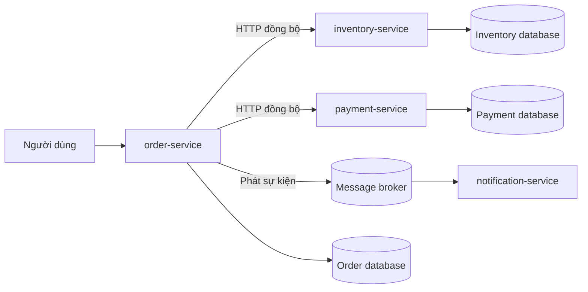
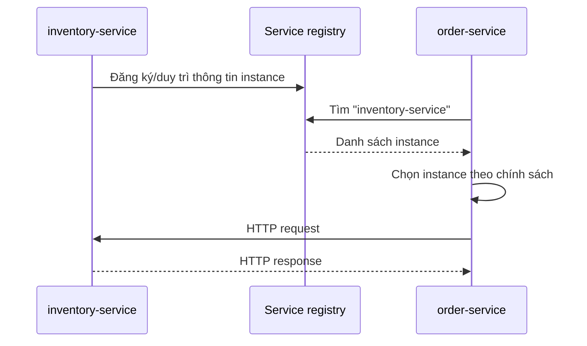
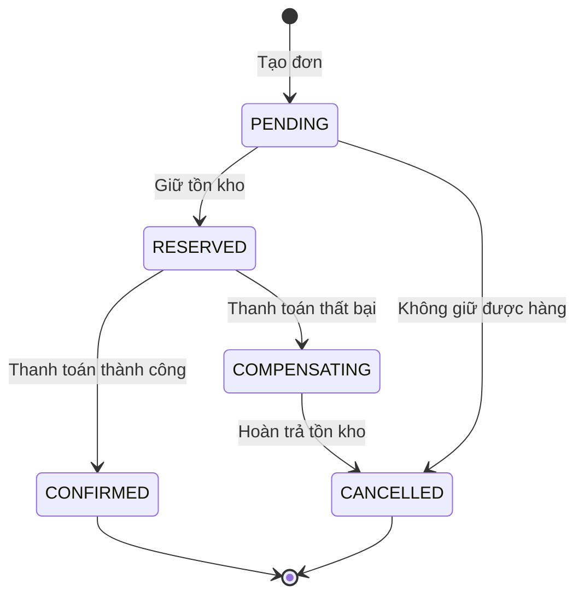
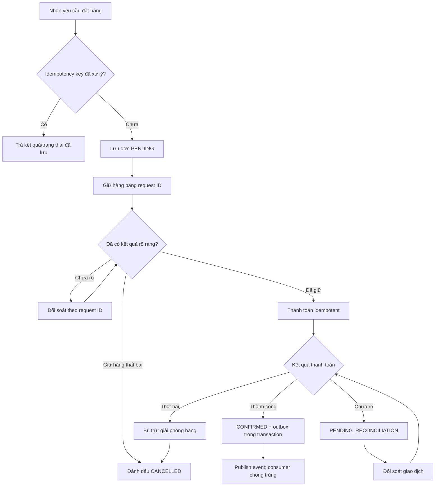

# Những bài toán nền tảng của ứng dụng phân tán

Trong một ứng dụng chạy trên một tiến trình, lời gọi hàm thường có kết quả rõ ràng: thành công hoặc phát sinh lỗi. Khi một nghiệp vụ phải đi qua nhiều dịch vụ, mạng và kho dữ liệu, cùng một lời gọi có thể chậm, thất bại một phần, được xử lý hai lần hoặc đã thành công nhưng bên gọi không nhận được phản hồi. Đó là lý do hệ thống phân tán cần cách thiết kế khác với ứng dụng đơn khối.

Bài học thuộc chương **Tổng quan** của **SPRING_CLOUD_CORE**. Trọng tâm là nhận diện các bài toán cơ bản, lựa chọn biện pháp xử lý phù hợp và hiểu những abstraction chung mà Spring Cloud cung cấp qua **Spring Cloud Commons**, **Spring Cloud Context** và cơ chế cấu hình bên ngoài của Spring Boot. Những thư viện này tạo nền tảng cho việc định vị dịch vụ, chọn instance, quản lý cấu hình và vận hành; chúng không tự bảo đảm tính nhất quán nghiệp vụ hay loại bỏ lỗi mạng.

## Mục tiêu học tập

Sau bài này, người học có thể:

1. Phân biệt lỗi của một tiến trình với **lỗi từng phần** trong hệ thống nhiều dịch vụ.
2. Giải thích vì sao cần timeout, deadline, retry có kiểm soát, idempotency và giới hạn tải.
3. Mô tả cách **service discovery**, **service registry** và cân bằng tải giúp các dịch vụ giao tiếp khi địa chỉ instance thay đổi.
4. Phân tích sự đánh đổi giữa tính nhất quán dữ liệu, tính sẵn sàng, độ trễ và khả năng mở rộng.
5. Hiểu vai trò của cấu hình bên ngoài, thay đổi cấu hình lúc chạy, tương thích phiên bản và quan sát hệ thống.
6. Kết nối từng nhóm vấn đề với Spring Cloud Core và xây dựng chiến lược kiểm thử phù hợp.

## 1. Một tình huống xuyên suốt: xử lý đơn hàng

Xét một hệ thống bán hàng gồm các dịch vụ:

- `order-service`: nhận yêu cầu đặt hàng, quản lý trạng thái đơn.
- `inventory-service`: kiểm tra và giữ hàng tồn kho.
- `payment-service`: tạo và xác nhận thanh toán.
- `notification-service`: gửi thông báo qua hàng đợi sự kiện.

`order-service` cần biết nơi gọi `inventory-service`, chờ phản hồi trong thời gian hợp lý, xử lý trường hợp thanh toán không rõ kết quả và tránh tạo hai đơn khi người dùng bấm lại nút đặt hàng. Nếu một dịch vụ bị triển khai lại, địa chỉ của instance có thể đổi ngay giữa luồng xử lý.



Mỗi dịch vụ có quyền sở hữu dữ liệu riêng. Một giao dịch trong cơ sở dữ liệu của `order-service` không tự động bao phủ các thao tác đã được thực hiện tại `inventory-service` hay `payment-service`.

| Tình huống | Điều nhìn thấy | Rủi ro thực tế |
| --- | --- | --- |
| Instance tồn kho bị thay thế | Kết nối đến địa chỉ cũ thất bại | Không tìm được instance đang hoạt động |
| Thanh toán xử lý xong nhưng phản hồi bị mất | `order-service` gặp timeout | Gọi lại có thể trừ tiền lần hai |
| Tồn kho được giữ nhưng thanh toán từ chối | Nghiệp vụ hoàn tất một phần | Hàng bị giữ vô hạn nếu không bù trừ |
| Nhiều yêu cầu đến cùng lúc | Một số instance quá tải | Độ trễ tăng dây chuyền |
| Thay đổi cấu hình giữa lúc chạy | Các instance đọc giá trị khác nhau | Hành vi thiếu nhất quán |
| Có lỗi nhưng log nằm ở bốn dịch vụ | Khó lần ra nguyên nhân | Chậm phát hiện và khôi phục |

### Đặc trưng làm nên độ khó

Một hệ thống phân tán thường phải đối diện đồng thời với bốn sự thật:

- **Không có bộ nhớ hay đồng hồ chung tuyệt đối.** Mỗi tiến trình chỉ biết trạng thái cục bộ; đồng hồ máy chủ có thể lệch nhau.
- **Mạng có độ trễ và có thể gián đoạn.** Gói tin có thể đến muộn, mất, lặp hoặc bị chặn bởi thiết bị trung gian.
- **Các thành phần thay đổi độc lập.** Instance được thêm, xóa, thay phiên bản hoặc khởi động lại.
- **Không có một giao dịch bao trùm mọi hệ thống theo mặc định.** Database, message broker và dịch vụ từ xa có cơ chế commit riêng.

Vì thế, thiết kế cần trả lời rõ ba câu hỏi: *Điều gì xảy ra nếu một bước không có phản hồi? Điều gì xảy ra nếu bước đó đã thành công nhưng ta tưởng thất bại? Điều gì xảy ra nếu cùng một thao tác được nhận nhiều lần?*

## 2. Lỗi từng phần, timeout và độ trễ

### 2.1. Timeout không cho biết kết quả nghiệp vụ

Giả sử `order-service` gửi yêu cầu thanh toán và chờ tối đa hai giây. Khi hết hai giây, có ít nhất ba khả năng:

1. Yêu cầu chưa đến được `payment-service`.
2. Yêu cầu đã đến nhưng chưa được xử lý xong.
3. Thanh toán đã thành công, chỉ có phản hồi bị mất hoặc đến muộn.

Cả ba có thể biểu hiện bằng cùng một lỗi timeout ở phía gọi. Do đó, **timeout có nghĩa là “chưa biết kết quả trong khoảng chờ”, không đồng nghĩa “thao tác chưa xảy ra”**. Đây là lý do phải thiết kế idempotency và khả năng truy vấn trạng thái nghiệp vụ.

Phân biệt các loại lỗi để quyết định xử lý:

| Loại lỗi | Ví dụ | Hướng xử lý thường gặp |
| --- | --- | --- |
| Lỗi kết nối | Connection refused, DNS không phân giải | Kiểm tra discovery, mạng; có thể thử instance khác |
| Timeout | Không nhận phản hồi trong hạn | Ghi nhận kết quả chưa rõ; retry chỉ khi thao tác an toàn |
| HTTP 429 / quá tải | Dịch vụ từ chối do vượt giới hạn | Giảm tốc độ, tuân thủ `Retry-After` khi có |
| HTTP 503 tạm thời | Dịch vụ chưa sẵn sàng | Retry giới hạn với backoff, nếu phù hợp |
| Lỗi nghiệp vụ 4xx | Hết hàng, yêu cầu không hợp lệ | Trả kết quả nghiệp vụ; không retry mù quáng |
| Lỗi dữ liệu hoặc lập trình | Sai schema, NullPointerException | Sửa nguyên nhân; retry thường không giúp |

Mã HTTP chỉ là tín hiệu ban đầu. Hợp đồng API của từng dịch vụ phải quy định lỗi nào có thể thử lại và trạng thái nghiệp vụ nào cần đối soát.

### 2.2. Đặt deadline cho toàn bộ yêu cầu

*Timeout* thường là giới hạn thời gian của một thao tác; *deadline* là thời điểm cuối mà toàn bộ yêu cầu phải hoàn tất. Ví dụ, API đặt hàng có ngân sách 2,5 giây thì không thể cấp 2 giây riêng cho mỗi lời gọi tồn kho, thanh toán và ba lượt retry nối tiếp.

Một cách phân bổ minh họa:

| Công đoạn | Ngân sách dự kiến |
| --- | ---: |
| Xác thực và xử lý đầu vào | 100 ms |
| Giữ tồn kho | 600 ms |
| Thanh toán | 1.000 ms |
| Ghi trạng thái đơn | 200 ms |
| Dự phòng mạng và xử lý | 600 ms |
| **Tổng** | **2.500 ms** |

Các con số chỉ là ví dụ thiết kế; cần đo độ trễ thực tế, đặc biệt phân vị p95/p99, rồi cân chỉnh. Với một deadline còn lại ngắn, hệ thống nên dừng công việc không còn kịp hoàn tất hoặc chuyển sang trạng thái xử lý bất đồng bộ có thể theo dõi.

### 2.3. Retry có thể làm sự cố nặng hơn

Retry phù hợp khi lỗi là tạm thời và thao tác an toàn để lặp lại. Nhưng nếu ba tầng mỗi tầng retry ba lần, một yêu cầu gốc có thể khuếch đại thành tới 27 lần gọi ở tầng sâu nhất. Khi dịch vụ đang quá tải, điều đó tạo thêm tải và làm thời gian hồi phục lâu hơn.

Các nguyên tắc thực hành:

- Chỉ retry những lỗi được hợp đồng API xác định là tạm thời.
- Giới hạn số lượt retry và tổng thời gian theo deadline của yêu cầu gốc.
- Dùng **exponential backoff có jitter** để các client không thử lại đồng loạt.
- Ưu tiên đặt retry tại một tầng có đủ ngữ cảnh, tránh nhiều tầng tự retry chồng nhau.
- Với thao tác ghi có tác dụng phụ, dùng idempotency key hoặc cơ chế đối soát trước khi thử lại.

**Circuit breaker** tạm ngừng gọi phụ thuộc liên tục lỗi; **bulkhead** cách ly tài nguyên giữa các nhóm lời gọi; **rate limiting** và **load shedding** giúp từ chối sớm khi vượt sức chịu tải. Chúng là các mẫu thiết kế bổ trợ, không đảm bảo một yêu cầu bất kỳ sẽ thành công.

## 3. Địa chỉ dịch vụ thay đổi: discovery, registry và load balancing

Một URL gắn cứng như `http://10.0.1.12:8080` nhanh chóng trở nên không đáng tin khi instance được scale, đổi IP, thay máy hoặc bị loại khỏi cụm. Ứng dụng cần làm việc với **tên dịch vụ logic** như `inventory-service`.

### 3.1. Ba vai trò cần phân biệt

- **Service registration:** instance khai báo danh tính và địa chỉ tới registry, hoặc được nền tảng hạ tầng đăng ký thay.
- **Service discovery:** phía gọi hỏi hệ thống discovery để lấy các instance hiện có của một dịch vụ.
- **Load balancing:** lựa chọn một instance trong danh sách và chuyển yêu cầu tới đó.



Có hai mô hình phổ biến: **client-side load balancing** (client tự chọn từ danh sách instance) và **server-side load balancing** (client gửi qua proxy/load balancer). Trong Kubernetes, Service và DNS có thể cung cấp địa chỉ ổn định và phân phối lưu lượng; không phải mọi hệ thống đều cần tự dựng một registry ứng dụng.

### 3.2. Abstraction chung của Spring Cloud

**Spring Cloud Commons** cung cấp những hợp đồng dùng chung, giúp tầng gọi dịch vụ ít phụ thuộc vào một nhà cung cấp discovery cụ thể:

| Abstraction | Nhiệm vụ | Điều không tự làm |
| --- | --- | --- |
| `DiscoveryClient` | Tìm tên dịch vụ và danh sách `ServiceInstance` | Không cam kết các instance sẽ luôn khỏe |
| `ReactiveDiscoveryClient` | Khám phá dịch vụ qua API reactive | Không tự thay thế quản lý lỗi mạng |
| `ServiceInstance` | Biểu diễn địa chỉ, cổng, metadata, trạng thái secure của một instance | Không bảo đảm endpoint nghiệp vụ đáp ứng |
| `ServiceRegistry` và `Registration` | Mô hình hóa thao tác đăng ký/hủy đăng ký instance khi implementation hỗ trợ | Không tạo registry vật lý |
| Spring Cloud LoadBalancer | Chọn instance cho lời gọi qua tích hợp HTTP client | Không thay cho timeout, idempotency hay kiểm soát tải |

Một implementation discovery tương ứng phải hiện diện và được cấu hình. `DiscoveryClient` là lớp trừu tượng; việc sử dụng Eureka, Consul, Kubernetes hoặc nguồn khác phụ thuộc kiến trúc và dependency thực tế.

### 3.3. Ví dụ gọi dịch vụ bằng tên logic

Khi ứng dụng có Spring Cloud LoadBalancer và nguồn instance phù hợp, có thể cấu hình `RestClient.Builder` được đánh dấu `@LoadBalanced`:

```java
import org.springframework.cloud.client.loadbalancer.LoadBalanced;
import org.springframework.context.annotation.Bean;
import org.springframework.context.annotation.Configuration;
import org.springframework.web.client.RestClient;

@Configuration
class ClientConfiguration {
    @Bean
    @LoadBalanced
    RestClient.Builder inventoryRestClientBuilder() {
        return RestClient.builder();
    }
}
```

```java
import org.springframework.cloud.client.loadbalancer.LoadBalanced;
import org.springframework.stereotype.Service;
import org.springframework.web.client.RestClient;

@Service
class InventoryClient {
    private final RestClient client;

    InventoryClient(@LoadBalanced RestClient.Builder builder) {
        this.client = builder.build();
    }

    InventoryAvailability getAvailability(String sku) {
        return client.get()
                .uri("http://inventory-service/internal/items/{sku}/availability", sku)
                .retrieve()
                .body(InventoryAvailability.class);
    }
}

record InventoryAvailability(String sku, boolean available) {}
```

Phần host `inventory-service` ở đây là **service ID**, không phải DNS/IP cố định. LoadBalancer cần một danh sách instance để phân giải. Để học và chạy thử mà chưa có registry, Spring Cloud Commons có cơ chế **SimpleDiscoveryClient** dựa trên cấu hình tĩnh:

```yaml
spring:
  cloud:
    discovery:
      client:
        simple:
          instances:
            inventory-service:
              - uri: http://localhost:8082
```

Ví dụ sử dụng một instance ở `localhost:8082`. Khi chạy trong container hoặc môi trường khác, phải đổi URI cho phù hợp. Cách cấu hình tĩnh hữu ích khi thử nghiệm; môi trường có instance thay đổi liên tục thường dùng discovery hạ tầng hoặc registry chuyên dụng.

**Giới hạn cần nhớ:** tìm được instance không có nghĩa instance ấy còn sống khi yêu cầu đến. Thông tin discovery có thể trễ; readiness, health checks, timeout và xử lý khi danh sách rỗng vẫn cần được thiết kế. Đừng retry vô hạn chỉ để chờ service xuất hiện.

## 4. Tính sẵn sàng phụ thuộc vào chuỗi lời gọi

Nếu để trả lời một yêu cầu, `order-service` bắt buộc nhận phản hồi từ ba dịch vụ khác, toàn bộ luồng thất bại khi chỉ một mắt xích không sẵn sàng. Trong ví dụ đơn giản, giả sử bốn thành phần bắt buộc đều có xác suất sẵn sàng 99,9% và độc lập, xác suất cả bốn cùng sẵn sàng xấp xỉ:

```text
0,999 × 0,999 × 0,999 × 0,999 ≈ 0,9960 = 99,60%
```

Đây chỉ là mô hình minh họa: sự cố thực tế thường có tương quan, mức sẵn sàng còn phụ thuộc topology, thời gian phục hồi và cách xử lý lỗi. Điều quan trọng là **chuỗi phụ thuộc đồng bộ tạo thêm điểm thất bại**.

Không phải công việc nào cũng cần đồng bộ. Trong đơn hàng, người dùng cần phản hồi sớm về việc tiếp nhận đơn; việc gửi email có thể thực hiện sau qua message broker. Tuy vậy, chuyển sang bất đồng bộ lại xuất hiện các vấn đề mới: gửi trùng, thứ tự sự kiện và nhất quán cuối cùng.

### Chọn kiểu giao tiếp theo yêu cầu nghiệp vụ

| Đặc điểm | Đồng bộ (HTTP/RPC) | Bất đồng bộ (message/event) |
| --- | --- | --- |
| Kết quả tức thời | Phù hợp khi phải trả ngay | Thường trả trạng thái đã tiếp nhận |
| Phụ thuộc thời gian chạy | Bên gọi chờ bên nhận | Có thể giảm phụ thuộc trực tiếp |
| Quản lý lỗi | Timeout, retry, circuit breaker | Redelivery, dead-letter, retry consumer |
| Dữ liệu nhất quán | Không tự có giao dịch xuyên dịch vụ | Thường cần eventual consistency |
| Phức tạp chính | Độ trễ và chuỗi phụ thuộc | Trùng lặp, ordering, quan sát luồng xử lý |

Không nên chuyển tất cả sang message broker chỉ để tránh timeout. Hãy dựa trên yêu cầu người dùng, ngữ nghĩa thành công và khả năng chấp nhận kết quả đến muộn.

## 5. Dữ liệu nằm ở nhiều nơi: consistency và giao dịch phân tán

### 5.1. Vấn đề commit không đồng thời

Xét luồng đặt hàng:

1. `order-service` tạo đơn trạng thái `PENDING`.
2. `inventory-service` giữ một sản phẩm.
3. `payment-service` xác nhận thanh toán.
4. `order-service` chuyển đơn thành `CONFIRMED`.

Nếu bước 3 thành công nhưng bước 4 lỗi, database thanh toán và database đơn hàng tạm thời thể hiện hai trạng thái khác nhau. Một annotation `@Transactional` trong `order-service` chỉ quản lý transaction của các tài nguyên mà transaction manager tương ứng điều phối; nó không tự biến toàn bộ HTTP call thành giao dịch ACID xuyên các service.

### 5.2. Chọn mức nhất quán có chủ đích

- **Strong consistency:** sau khi thao tác được xác nhận, các bên đọc thấy trạng thái đáp ứng quy tắc nhất quán đã chọn; thường tăng phối hợp và có thể tăng độ trễ.
- **Eventual consistency:** các bản sao hoặc dịch vụ có thể khác nhau tạm thời nhưng hội tụ khi đồng bộ thành công.
- **Read-your-writes:** người dùng đọc lại được chính thay đổi của họ sau một thao tác đã được xác nhận, dù thành phần khác còn đang đồng bộ.

Những mức này phải được mô tả cụ thể cho từng luồng. Ví dụ, tồn kho không được bán âm có thể là **invariant** bắt buộc; việc số lượt mua hàng hiển thị chậm vài giây có thể chấp nhận được.

**CAP** đề cập lựa chọn giữa consistency và availability *khi có network partition* theo các định nghĩa kỹ thuật của định lý. Không nên diễn giải CAP thành quy tắc “chọn bất kỳ hai trong ba” cho mọi tình huống, hoặc dùng nó thay thế phân tích độ trễ, mô hình dữ liệu và yêu cầu nghiệp vụ.

### 5.3. Saga và thao tác bù trừ

Một **Saga** chia nghiệp vụ thành các transaction cục bộ. Nếu một bước thất bại, hệ thống thực hiện hành động bù trừ thay vì kỳ vọng rollback cơ sở dữ liệu của mọi dịch vụ:



Saga có thể được **orchestrate** bởi một bộ điều phối hoặc **choreograph** qua sự kiện. Cả hai cần quy định thời gian hết hạn, retry, idempotency, cách đối soát và xử lý khi chính bước bù trừ cũng lỗi. “Hoàn tiền” là một hành động nghiệp vụ mới, không phải lúc nào cũng có thể đảo ngược hoàn hảo một giao dịch đã diễn ra.

### 5.4. Transactional outbox

Một lỗi thường gặp là lưu đơn thành công nhưng tiến trình chết ngay trước khi phát sự kiện `OrderCreated`. Nếu lưu dữ liệu và publish message là hai hành động tách rời, chúng có thể xảy ra lệch nhau.

Mẫu **transactional outbox** ghi bản ghi đơn hàng và bản ghi sự kiện vào một database transaction cục bộ. Một tiến trình khác đọc outbox và chuyển sự kiện đến broker. Điều đó giảm nguy cơ “database đã commit nhưng không có sự kiện”; tuy nhiên tiến trình gửi có thể phát lại, nên consumer vẫn phải xử lý trùng lặp. Mẫu này đòi hỏi cơ chế phát outbox, đánh dấu đã gửi và theo dõi backlog.

Spring Cloud Core không tự cung cấp giao dịch phân tán cho nghiệp vụ này. Cần lựa chọn công nghệ lưu trữ, messaging và cách triển khai phù hợp với hợp đồng dữ liệu.

## 6. Thông điệp trùng lặp, thứ tự và idempotency

Trong hệ thống bất đồng bộ, cơ chế **at-least-once delivery** có thể chuyển cùng một thông điệp nhiều lần. Với yêu cầu HTTP, client cũng có thể gửi lặp do mất phản hồi hoặc người dùng thao tác lại. Vì thế, consumer hoặc endpoint ghi dữ liệu phải được thiết kế sao cho lặp lại không tạo thêm tác dụng phụ ngoài ý muốn.

Một **idempotency key** là mã định danh ổn định cho cùng một thao tác nghiệp vụ. Ví dụ API thanh toán nhận header `Idempotency-Key: order-782-payment-v1`. Server phải lưu khóa này **bền vững**, gắn với yêu cầu và kết quả tương ứng; nếu nhận lại cùng khóa và cùng nội dung, trả kết quả đã ghi nhận hoặc trạng thái đang xử lý. Nếu cùng khóa nhưng nội dung khác, trả lỗi xung đột theo hợp đồng API.

Quy trình minh họa:

```text
Nhận request (idempotency key, payload)
    |
    v
Kiểm tra/giành quyền sở hữu key bằng ràng buộc UNIQUE trong DB
    |-- Đã hoàn tất cùng payload --> trả kết quả đã lưu
    |-- Đang xử lý -------------> trả trạng thái phù hợp / yêu cầu thử sau
    |-- Trùng key khác payload --> từ chối xung đột
    |
    v
Thực hiện thao tác nghiệp vụ theo transaction/thiết kế phù hợp
    |
    v
Ghi kết quả bền vững và trả response
```

Chỉ “query xem key đã tồn tại rồi insert” mà không có **unique constraint** và cơ chế tranh chấp đồng thời thì vẫn có race condition khi hai yêu cầu đến cùng lúc. Với dịch vụ thanh toán bên ngoài, còn phải dùng idempotency theo hợp đồng của provider hoặc đối soát trạng thái qua mã giao dịch trước khi tạo tác dụng phụ lần nữa.

**Thứ tự thông điệp** cũng cần được xác định theo phạm vi. Hai sự kiện `OrderCancelled` và `OrderConfirmed` có thể đến không đúng thứ tự phát nếu đi qua nhiều partition hoặc consumer. Sử dụng version/sequence per aggregate, optimistic locking và state machine để từ chối chuyển trạng thái không hợp lệ; không giả định broker cung cấp thứ tự toàn cục.

## 7. Cấu hình bên ngoài và thay đổi khi hệ thống đang chạy

Một ứng dụng phân tán thường chạy qua các môi trường dev, staging, production, nhiều vùng và nhiều instance. Gắn cứng URL, timeout hay giới hạn tải trong mã nguồn làm mỗi lần điều chỉnh cần build/triển khai lại và dễ tạo sai khác giữa các môi trường.

### 7.1. Externalized configuration

**Spring Boot** cho phép lấy cấu hình từ `application.yml`, biến môi trường, command-line arguments và các nguồn `ConfigData` khác theo quy tắc độ ưu tiên. Ví dụ:

```yaml
app:
  inventory:
    timeout: 800ms
    reserve-limit: 20
management:
  endpoints:
    web:
      exposure:
        include: health,info
```

Những giá trị này cần được quản lý theo môi trường, xác thực khi khởi động và theo dõi khi thay đổi. Secrets không nên xuất hiện trong ví dụ cấu hình công khai, source control hay log. Việc đưa cấu hình ra ngoài source code không mặc nhiên làm nó được cập nhật ở bean đang chạy.

Khi dùng nguồn cấu hình tập trung như Spring Cloud Config, cần cân nhắc thêm khả dụng của nguồn cấu hình, caching/fallback, thông tin xác thực, quy trình rollout và thời điểm đồng bộ qua các instance. Cấu hình quá mới hoặc không tương thích có thể gây sự cố trên diện rộng.

### 7.2. Refresh scope trong Spring Cloud Context

**Spring Cloud Context** cung cấp `@RefreshScope` cho các bean cần nhận lại cấu hình sau một sự kiện refresh hợp lệ. Ví dụ:

```java
import org.springframework.beans.factory.annotation.Value;
import org.springframework.cloud.context.config.annotation.RefreshScope;
import org.springframework.stereotype.Component;

@Component
@RefreshScope
class DisplayMessage {
    private final String message;

    DisplayMessage(@Value("${app.display-message:Welcome}") String message) {
        this.message = message;
    }

    String current() {
        return message;
    }
}
```

Bean trong refresh scope có thể được tái tạo khi cache của scope bị invalidated; đối tượng mới đọc cấu hình hiện hành từ `Environment`. **Đổi file cấu hình hoặc nguồn dữ liệu không đồng nghĩa refresh tự diễn ra.** Cần cơ chế nạp lại môi trường và kích hoạt refresh phù hợp với phiên bản/tích hợp đang dùng. Trong các cấu hình hỗ trợ, Actuator có thể cung cấp endpoint refresh; nếu bật, phải bảo vệ chặt chẽ bằng xác thực, phân quyền và giới hạn truy cập.

Các giới hạn thực tế cần hiểu:

- `@RefreshScope` không làm mọi object trong JVM tự cập nhật tức thì; request đang dùng instance cũ có thể hoàn thành với giá trị cũ.
- Không phải bean hay resource nào cũng được refresh an toàn; kết nối lâu dài, cache và tài nguyên được quản lý riêng cần xem xét vòng đời.
- Một số thay đổi cấu hình cần **restart/rolling deployment** để đạt trạng thái nhất quán.
- Với thay đổi ảnh hưởng hợp đồng dữ liệu hoặc quy tắc nghiệp vụ, cần rollout có version và có phương án rollback.

Tách rõ **cấu hình đọc lúc khởi động**, **cấu hình có thể refresh**, và **cấu hình cần triển khai lại**. Việc các instance tạm thời chạy với hai bộ cấu hình phải được đưa vào thiết kế.

## 8. Tương thích phiên bản và thay đổi độc lập

Microservices không được nâng cấp cùng lúc theo giả định. Trong giai đoạn rolling deployment, phiên bản cũ và mới thường tồn tại đồng thời; các API và schema cần cho phép khoảng thời gian chồng lấn đó.

### 8.1. Tương thích giữa Spring Boot và Spring Cloud

**Spring Cloud phát hành theo release train.** Mỗi release train chỉ tương thích với những dải phiên bản Spring Boot được công bố. Không thể lấy bất kỳ phiên bản mới nhất của từng starter rồi kỳ vọng chúng chạy cùng nhau.

Ở dự án dùng Maven, thông thường quản lý phiên bản Spring Cloud qua BOM:

```xml
<dependencyManagement>
    <dependencies>
        <dependency>
            <groupId>org.springframework.cloud</groupId>
            <artifactId>spring-cloud-dependencies</artifactId>
            <version>${spring-cloud.version}</version>
            <type>pom</type>
            <scope>import</scope>
        </dependency>
    </dependencies>
</dependencyManagement>
```

`spring-cloud.version` là biến dự án phải điền theo **bảng tương thích chính thức** của Spring Cloud với Spring Boot đang sử dụng. Ví dụ phụ thuộc LoadBalancer:

```xml
<dependency>
    <groupId>org.springframework.cloud</groupId>
    <artifactId>spring-cloud-starter-loadbalancer</artifactId>
</dependency>
```

BOM giúp quản lý phiên bản dependency tương thích trong release train, nhưng không đảm bảo code ứng dụng, contract API hay dependency bên ngoài sẽ tương thích. Khi nâng cấp, cần chạy kiểm thử khởi động application context, integration tests, API contract tests và thử rollout nhiều phiên bản. Các cơ chế kiểm tra tương thích tích hợp có thể báo lỗi sớm nếu kết hợp phiên bản không hỗ trợ.

### 8.2. Tiến hóa hợp đồng giữa các dịch vụ

Ví dụ, phiên bản mới của `inventory-service` thêm field `warehouseId`. Một cách tiến hóa an toàn là thêm field tùy chọn và giữ nguyên semantics của các field cũ trong giai đoạn chuyển tiếp; tránh đổi tên hoặc đổi nghĩa field khiến client cũ bị lỗi. Với sự kiện và database schema, có thể dùng mô hình **expand → migrate → contract**: bổ sung cấu trúc mới, chuyển người dùng/consumer, rồi mới loại bỏ cấu trúc cũ sau khi xác nhận không còn phụ thuộc.

Cần phân biệt hai lớp tương thích: **khả năng chạy của thư viện** (Spring Boot ↔ Spring Cloud) và **hợp đồng nghiệp vụ** (service ↔ service). Một lớp tương thích không thay thế lớp còn lại.

## 9. An toàn khi giao tiếp giữa các dịch vụ

Việc tách ứng dụng thành nhiều tiến trình tạo thêm đường đi qua mạng và nhiều điểm quản lý quyền truy cập. Tên dịch vụ tìm được qua discovery không chứng minh rằng phía gọi có quyền thực hiện nghiệp vụ.

Các vấn đề cần xử lý gồm xác thực service-to-service, phân quyền theo tài nguyên/hành động, truyền danh tính người dùng khi cần, bảo vệ kênh truyền (TLS, có thể mTLS), vòng đời secrets và kiểm soát endpoint nội bộ. Không chia sẻ tài khoản có đặc quyền rộng chỉ vì các dịch vụ nằm cùng một mạng.

Đặc biệt, các endpoint có thể thay đổi trạng thái hệ thống, chẳng hạn endpoint refresh cấu hình, cần hạn chế truy cập. Tránh ghi access token, API key, dữ liệu thanh toán hoặc dữ liệu nhạy cảm vào log và trace. Chính sách bảo mật cần áp dụng nhất quán qua các instance và cả đường xử lý bất đồng bộ.

## 10. Quan sát và vận hành: biết lỗi xảy ra ở đâu

Một yêu cầu đặt hàng có thể đi qua bốn process. Log riêng lẻ tại `order-service` không cho biết liệu timeout đến từ DNS, chờ kết nối, hàng đợi, SQL, hay một downstream đang quá tải.

Ba lớp quan sát bổ trợ nhau:

| Tín hiệu | Giúp trả lời |
| --- | --- |
| **Metrics** | Tỷ lệ lỗi, độ trễ, lưu lượng, mức bão hòa thay đổi thế nào? |
| **Traces** | Một yêu cầu đi qua những service/span nào và chậm tại bước nào? |
| **Logs có cấu trúc** | Ở thời điểm xảy ra sự kiện, ứng dụng quyết định gì và gặp lỗi nào? |

Spring Boot Actuator và hệ sinh thái Micrometer cung cấp nền tảng cho metrics, health information và observation/tracing khi có dependency, cấu hình và hệ thống thu thập thích hợp. Spring Cloud Commons và các starter có thể tích hợp với những tín hiệu này tùy phiên bản; không phải cứ thêm một dependency là hệ thống tự có dashboard/tracing hoàn chỉnh.

Một số thực hành có ích:

- Theo dõi **RED** cho API: request rate, error rate, duration; bổ sung saturation cho CPU, thread pool, connection pool và hàng đợi.
- Gắn trace ID/correlation ID xuyên request đồng bộ và message khi phù hợp.
- Phân biệt **liveness** (tiến trình nên được khởi động lại hay không) với **readiness** (instance có nên nhận lưu lượng mới hay không). Không dùng một endpoint health duy nhất cho mọi quyết định.
- Đặt SLI/SLO có thể đo được, ví dụ tỷ lệ yêu cầu đặt hàng thành công trong deadline; thiết lập cảnh báo theo tác động người dùng và error budget.
- Theo dõi số lượng instance trong discovery, circuit breaker mở, timeout, retry và độ dài hàng đợi; không chỉ xem CPU.
- Đảm bảo log/tracing không rò rỉ dữ liệu bí mật và không tăng tải quá lớn khi sự cố xảy ra.

Sự cố phổ biến là **retry storm**: downstream chậm → upstream timeout → đồng loạt retry → downstream càng quá tải. Metric về lưu lượng, số lần thử lại và độ trễ giúp nhận diện vòng phản hồi này.

## 11. Kiểm thử những điều mà happy path bỏ sót

Một bài kiểm thử chỉ xác nhận `200 OK` chưa chứng minh được hệ thống chịu được lỗi từng phần. Chiến lược kiểm thử nên gắn với ranh giới dịch vụ và invariant nghiệp vụ.

| Lớp kiểm thử | Trường hợp tiêu biểu | Kết quả cần chứng minh |
| --- | --- | --- |
| Unit test | Logic chuyển trạng thái đơn | Không cho phép `CANCELLED → CONFIRMED` trái quy tắc |
| Integration test | Database transaction, idempotency key | Hai request trùng không tạo hai giao dịch |
| Contract test | Client cũ gọi server mới | Field, mã lỗi và semantics còn tương thích |
| Test discovery/load balancing | Instance biến mất, danh sách rỗng | Client báo lỗi hoặc chuyển instance có kiểm soát |
| Fault injection | Timeout, 503, mất phản hồi sau commit | Không tạo tác dụng phụ trùng; có đối soát |
| Messaging test | Message phát lại, đảo thứ tự | Consumer giữ trạng thái hợp lệ |
| Configuration test | Giá trị thiếu/sai, refresh, rollout hai phiên bản | Khởi động hoặc thay đổi thất bại một cách có kiểm soát |
| Load/soak test | Tăng đồng thời, queue dồn, retry storm | Đáp ứng mục tiêu độ trễ và giới hạn tài nguyên |

Khi kiểm thử HTTP, có thể dùng mock server như WireMock để mô phỏng độ trễ và mã lỗi. Khi hành vi phụ thuộc database, broker hay service registry thật, dùng môi trường tích hợp cô lập như Testcontainers hoặc hạ tầng thử nghiệm tương đương. **Thất bại sau commit nhưng trước khi gửi response** là test case đặc biệt quan trọng để kiểm tra idempotency.

Cần phân biệt kiểm thử thư viện và kiểm thử kiến trúc: Spring Cloud LoadBalancer có thể chọn instance đúng nhưng quy trình giữ hàng vẫn bị sai nếu thao tác nghiệp vụ không idempotent.

## 12. Ghép các mảnh thành thiết kế đủ sức vận hành

Quay lại hệ thống đơn hàng. Một thiết kế hợp lý có thể thực hiện các bước sau:

1. Client gửi `POST /orders` kèm idempotency key; `order-service` lưu đơn `PENDING` theo transaction cục bộ và trả mã theo dõi.
2. Dịch vụ tìm `inventory-service` qua service discovery hoặc địa chỉ hạ tầng ổn định. HTTP client có timeout, deadline và giới hạn tài nguyên.
3. Tồn kho giữ hàng bằng mã yêu cầu duy nhất. Khi không nhận được phản hồi, phía gọi tra cứu trạng thái giữ hàng hoặc retry an toàn theo hợp đồng.
4. Thanh toán sử dụng mã giao dịch/idempotency riêng. Nếu kết quả chưa rõ, đơn chuyển sang trạng thái cần đối soát, tránh tự động kết luận thất bại.
5. Khi thanh toán thành công, `order-service` commit trạng thái `CONFIRMED` cùng bản ghi outbox. Bộ phát chuyển sự kiện tới broker; consumer thông báo chấp nhận sự kiện bị lặp.
6. Nếu thanh toán thất bại, quy trình Saga giải phóng hàng đã giữ. Các bước bù trừ được ghi nhận, thử lại có giới hạn và cảnh báo nếu quá hạn.
7. Tất cả bước chính ghi correlation ID và metrics. Thay đổi URL, timeout hoặc cờ tính năng được phân phối theo quy trình cấu hình có kiểm soát.
8. Mỗi lần nâng cấp kiểm tra tương thích Boot–Cloud, compatibility của API và cách phiên bản cũ/mới cùng hoạt động trong rolling deployment.



Sơ đồ mô tả *trạng thái logic*, không phải lời hứa mọi bước kết thúc ngay. Đường đối soát cần giới hạn thời gian, retry có kiểm soát, theo dõi thủ công khi vượt ngưỡng và quy tắc kết thúc rõ ràng; không tạo vòng lặp vô hạn tại một request HTTP.

### Bản đồ vấn đề và năng lực Spring Cloud

| Bài toán nền tảng | Cơ chế/khái niệm | Vai trò của Spring Cloud Core |
| --- | --- | --- |
| Không biết instance đang ở đâu | Discovery, service ID, registry | Commons cung cấp `DiscoveryClient`, `ServiceInstance`, `ServiceRegistry` |
| Nhiều instance cần chia tải | Client-side load balancing | Tích hợp Spring Cloud LoadBalancer với discovery/HTTP client |
| Cấu hình khác nhau giữa môi trường | Externalized configuration, ConfigData | Spring Boot cung cấp nền tảng; Spring Cloud Context bổ sung cơ chế context/refresh |
| Thay đổi cấu hình khi chạy | Refresh lifecycle | `@RefreshScope`, tích hợp refresh khi được hỗ trợ và kích hoạt |
| Phối hợp phiên bản thư viện | Release train, BOM, compatibility check | Spring Cloud quy định dải Spring Boot hỗ trợ và dependency management |
| Timeout, retry storm, quá tải | Deadline, retry policy, isolation | Cần cấu hình HTTP client và thư viện/mẫu resilience thích hợp; Commons không thay toàn bộ chiến lược |
| Dữ liệu lệch giữa các service | Saga, outbox, idempotency | Phải giải ở tầng nghiệp vụ và hạ tầng lưu trữ/messaging |
| Không biết chậm ở đâu | Metrics, tracing, health | Tích hợp với Spring Boot Actuator, Micrometer và hệ thống quan sát |
| Giao tiếp không an toàn | AuthN/AuthZ, TLS, secrets | Cần Spring Security, hạ tầng và chính sách bảo vệ phù hợp |

## 13. Những sai lầm dễ gặp

**“Thêm discovery là hết lỗi kết nối.”** Discovery chỉ tìm được ứng viên; instance có thể chết sau khi được tìm thấy. Vẫn cần readiness, timeout, cân bằng tải và fallback hợp lý.

**“Timeout nghĩa là server chưa làm gì.”** Phản hồi có thể mất sau khi server đã commit. Với thao tác ghi, cần idempotency và đối soát.

**“Cứ retry là tăng độ tin cậy.”** Retry sai có thể nhân tải và gây duplicate. Chọn lỗi, giới hạn số lần, deadline, backoff và tính an toàn khi lặp.

**“Có `@Transactional` là đồng bộ được mọi database.”** Transaction cục bộ không bao trùm các HTTP call. Dùng invariant, Saga/outbox và trạng thái nghiệp vụ có thể khôi phục.

**“Đổi `application.yml` là mọi bean nhận giá trị mới.”** Cấu hình bên ngoài và refresh là hai cơ chế khác nhau; có những thay đổi cần tái tạo bean hoặc restart.

**“Đưa mọi thứ lên message broker là đạt eventual consistency.”** Hệ thống phải có quy trình hội tụ, idempotent consumer, xử lý mất/trùng/đảo thứ tự và giám sát backlog.

**“Tương thích dependency là đủ để rolling upgrade.”** Cần cả tương thích API, sự kiện, schema và khả năng chung sống giữa các phiên bản.

## 14. Câu hỏi tự kiểm tra và bài tập ứng dụng

1. `order-service` gọi thanh toán, timeout sau hai giây. Những trạng thái nào có thể đã xảy ra? Vì sao không nên gọi lại ngay bằng một giao dịch mới?
2. Sự khác nhau giữa `DiscoveryClient`, `ServiceRegistry` và load balancer là gì? Điều gì xảy ra khi discovery trả danh sách rỗng?
3. Vì sao retry ở nhiều tầng có thể biến một lỗi nhỏ thành sự cố toàn hệ thống? Bạn sẽ đặt giới hạn retry theo deadline như thế nào?
4. Nếu giữ hàng thành công nhưng thanh toán bị từ chối, các trạng thái và bước bù trừ nào phải được lưu để có thể chạy lại an toàn?
5. Khi cấu hình timeout được thay đổi trong nguồn tập trung, điều kiện nào khiến một bean thực sự nhận giá trị mới? Khi nào cần rolling restart?
6. Một đội nâng cấp Spring Boot nhưng giữ nguyên Spring Cloud release train. Những thông tin và phép thử nào cần kiểm tra trước khi triển khai?
7. Hãy thiết kế một integration test gửi hai yêu cầu cùng idempotency key song song. Điều kiện ở database và kết quả cuối cùng cần thỏa mãn là gì?

**Bài tập nhỏ:** phác thảo một API `POST /reservations` gọi sang `payment-service` và `notification-service`. Ghi rõ deadline của request, idempotency key, trạng thái khi thanh toán chưa xác định, cách bù trừ, event outbox, ba metrics cần theo dõi và hai tình huống fault injection. Sau đó chỉ ra phần nào có thể dựa trên Spring Cloud Commons/Context và phần nào phải được giải quyết bằng thiết kế nghiệp vụ.

## Ghi nhớ

Một ứng dụng phân tán đáng tin cậy phải **mô hình hóa điều chưa biết**: mạng có thể im lặng, trạng thái có thể lệch, thao tác có thể lặp và phiên bản có thể không đồng nhất. Spring Cloud Core giúp chuẩn hóa các điểm kết nối quan trọng như discovery, registry, load balancing, context và cấu hình. Chất lượng hệ thống còn phụ thuộc vào các quyết định nghiệp vụ cụ thể: giới hạn thời gian, idempotency, giao dịch cục bộ, đối soát, quan sát và kiểm thử lỗi từng phần.
