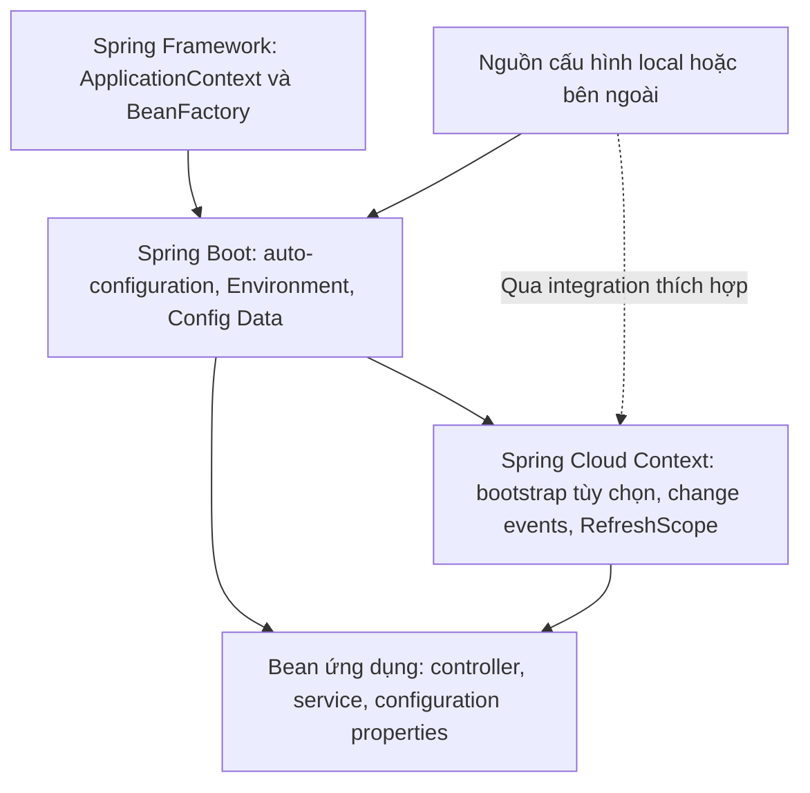
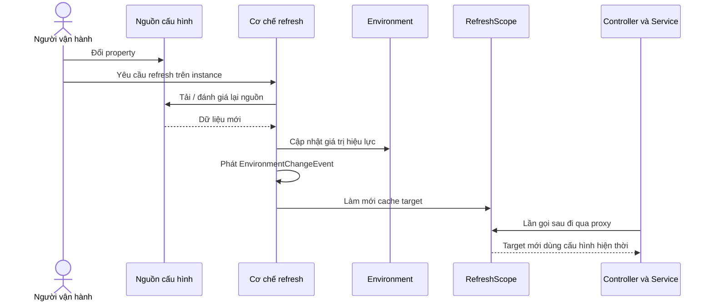

# Vai trò Spring Cloud Context đối với ApplicationContext

## 1. Bối cảnh và mục tiêu

Trong Spring Boot, `ApplicationContext` là trung tâm của Spring IoC container: nó tạo và quản lý bean, thực hiện dependency injection, cung cấp `Environment`, phát sự kiện và quản lý vòng đời ứng dụng. Với một dịch vụ đơn lẻ, cấu hình thường được đọc lúc khởi động và giữ nguyên đến lần triển khai tiếp theo.

Trong hệ thống phân tán, một dịch vụ có thể chạy trên nhiều instance, nhận cấu hình từ nguồn bên ngoài, thay đổi tham số vận hành mà không dừng toàn bộ hệ thống và cần các cơ chế chung để thư viện hạ tầng tham gia vào quá trình khởi tạo. **Spring Cloud Context** bổ sung khả năng tích hợp cấu hình, theo dõi sự thay đổi của `Environment` và làm mới một số bean vào nền tảng `ApplicationContext` đã có. Nó không thay thế Spring Framework, Spring Boot hoặc IoC container.

Bài học thuộc **SPRING_CLOUD_CORE**, nền tảng Spring Cloud cho hệ thống phân tán: Spring Cloud Commons, Context, cấu hình bên ngoài, tương thích Spring Boot, cùng khả năng kiểm thử và vận hành. Bài này tập trung vào **mối quan hệ giữa Spring Cloud Context và ApplicationContext**; discovery, service registry và giao tiếp giữa dịch vụ là các abstraction liên quan, nhưng không phải trách nhiệm chính của Context.

Mục tiêu học tập:

- Phân biệt trách nhiệm của `ApplicationContext`, Spring Boot và Spring Cloud Context.
- Hiểu bootstrap context, Config Data, `EnvironmentChangeEvent` và `@RefreshScope`.
- Giải thích tại sao thay đổi một property không có nghĩa tất cả bean tự cập nhật.
- Triển khai, kiểm thử và chẩn đoán một ví dụ cập nhật cấu hình từ xa.
- Nhận diện giới hạn về phiên bản, bảo mật và tính nhất quán khi refresh.

## 2. ApplicationContext vẫn là container chính

Spring `ApplicationContext` quản lý bean definition, tạo instance, nối các dependency, áp dụng scope, gọi các hook vòng đời, và cung cấp cơ chế `ApplicationEvent`. `Environment` trong context tổng hợp các `PropertySource` như file cấu hình, biến môi trường, tham số dòng lệnh và các nguồn do thư viện tích hợp thêm.

Spring Boot xây dựng ứng dụng trên nền đó: tự cấu hình bean theo classpath, đọc Config Data và tạo context chính của ứng dụng web hoặc batch. Khi đưa dependency Spring Cloud thích hợp vào ứng dụng, **Spring Cloud Context đăng ký thêm thành phần** để tích hợp với các cơ chế Spring có sẵn. Controller, service và repository vẫn là bean được Spring quản lý theo cách quen thuộc.



Sơ đồ biểu diễn **quan hệ chức năng**; nó không có nghĩa mọi ứng dụng Spring Cloud đều tạo thêm một application context.

| Thành phần | Trách nhiệm | Cần ghi nhớ |
| --- | --- | --- |
| Spring `ApplicationContext` | IoC, vòng đời bean, event, quản lý scope | Container thực sự đang chạy ứng dụng. |
| Spring Boot `Environment` / Config Data | Tổng hợp và xác định độ ưu tiên của nguồn cấu hình | Property hiệu lực phụ thuộc thứ tự `PropertySource`. |
| Spring Cloud Context | Bootstrap integration, thông báo thay đổi và refresh scope | Cơ chế bổ sung, chỉ có tác dụng với bean và tích hợp phù hợp. |
| Spring Cloud Commons | Các abstraction như `DiscoveryClient`, `ServiceRegistry` | Không đồng nghĩa Spring Cloud Context. |
| Spring Cloud Config Client | Kết nối và nạp cấu hình do Config Server cung cấp | Một nguồn cấu hình bên ngoài thường gặp; không phải nguồn duy nhất. |

Ví dụ, khi dịch vụ đọc `app.greeting.message` từ Config Server, Spring Boot và phần tích hợp cấu hình đưa giá trị vào `Environment`; Spring Cloud Context có thể hỗ trợ cập nhật giá trị và tạo lại bean; Spring `ApplicationContext` vẫn quản lý toàn bộ vòng đời ứng dụng.

## 3. Spring Cloud Context bổ sung những gì?

### 3.1. Chuẩn bị cấu hình từ các nguồn bên ngoài

Một `Environment` có nhiều `PropertySource`. Khi nhiều nguồn cùng khai báo một khóa, nguồn có độ ưu tiên cao hơn sẽ quyết định giá trị. Spring Cloud cung cấp các điểm mở rộng như `PropertySourceLocator` và tích hợp với các thư viện cấu hình, giúp đưa property từ hạ tầng bên ngoài vào ứng dụng.

Ứng dụng thường dùng starter tương ứng thay vì tự viết `PropertySourceLocator`. Cách nạp cấu hình cụ thể phụ thuộc phiên bản Spring Boot, Spring Cloud và việc ứng dụng dùng cơ chế Config Data hay bootstrap truyền thống.

### 3.2. Thông báo thay đổi qua EnvironmentChangeEvent

`EnvironmentChangeEvent` mô tả các khóa đã thay đổi. Các listener có thể phản ứng; cơ chế Spring Cloud hỗ trợ rebind những bean `@ConfigurationProperties` phù hợp và xử lý một số cấu hình hạ tầng, chẳng hạn mức log.

**Chỉ phát sự kiện không đồng nghĩa tự đọc lại toàn bộ nguồn cấu hình**. Giá trị mới trước hết phải hiện diện trong `Environment` qua một cơ chế tải lại phù hợp. Sự kiện cũng không mặc nhiên tạo lại mọi singleton hoặc xóa cache của tất cả bean.

### 3.3. Làm mới bean bằng RefreshScope

`@RefreshScope` là scope đặc biệt của Spring Cloud Context. Các bean được đánh dấu thường được truy cập thông qua **proxy**. Khi scope được refresh, đối tượng đích trong cache bị loại bỏ; lần truy cập tiếp theo sẽ tạo đối tượng đích mới, đọc cấu hình đang có trong `Environment`.

Cơ chế này hữu ích khi bean giữ cấu hình trong field khởi tạo bằng constructor hoặc `@Value`. Refresh **không gọi lại toàn bộ quá trình tạo ApplicationContext**, không thay mới tất cả bean và không buộc các request đang chạy phải lập tức dùng đối tượng mới.

### 3.4. Tích hợp với vòng đời ApplicationContext

Context tận dụng hệ thống event, scope và dependency injection vốn có của Spring. Thư viện hạ tầng Spring Cloud có thể đăng ký bean và listener theo cơ chế Spring Boot auto-configuration, giúp những khả năng chung như cấu hình và refresh phối hợp được với ứng dụng.

## 4. Bootstrap context và main application context

Trong mô hình Spring Cloud **bootstrap truyền thống**, một context được tạo sớm, thường làm **parent** của application context chính. Nó chuẩn bị property source và các thành phần hạ tầng cần thiết trước khi main context hoàn tất khởi tạo. Bootstrap context có cấu hình và phạm vi bean riêng.

Từ Spring Cloud **2020.0**, bootstrap theo cơ chế cũ không còn được bật mặc định trong thiết lập thông thường. Các phiên bản hiện đại có thể dùng **Spring Boot Config Data API**, chẳng hạn `spring.config.import=configserver:`, để nạp cấu hình bên ngoài. Nếu một tích hợp thật sự cần bootstrap, có thể dùng `spring-cloud-starter-bootstrap` hoặc cách kích hoạt được hướng dẫn cho đúng phiên bản.

| Khía cạnh | Main application context | Bootstrap context nếu bật |
| --- | --- | --- |
| Mục đích | Chạy logic nghiệp vụ và hạ tầng ứng dụng | Chuẩn bị sớm một số cấu hình và bean hạ tầng |
| Thời điểm | Khởi tạo ứng dụng chính | Tạo trước main context |
| Quan hệ | Chứa controller, service, repository… | Thường là parent theo mô hình bootstrap cũ |
| Có bắt buộc? | Có | Không; phụ thuộc phiên bản và cách tích hợp |

Vì vậy, **không nên mặc định mọi ứng dụng có Spring Cloud Context đều có hai context**, hoặc mọi ứng dụng dùng Config Server đều cần `bootstrap.yml`. Thời điểm thực thi `PropertySourceLocator` và thứ tự nạp nguồn cấu hình cũng có khác biệt giữa các release. Khi nâng cấp, phải đối chiếu tài liệu của chính release train đang chạy.

## 5. Hai bước khác nhau: cập nhật Environment và cập nhật bean

Giả sử cấu hình ban đầu là:

```yaml
app:
  greeting:
    message: "Xin chào"
  rate-limit:
    requests-per-minute: 100
```

Việc một nguồn bên ngoài thay đổi chỉ mang ý nghĩa **giá trị đầu vào có thể thay đổi**. Bean có nhận được giá trị mới hay không là câu hỏi riêng.

### 5.1. Giá trị mới phải đi vào Environment

Một yêu cầu refresh được hỗ trợ có thể khiến ứng dụng tải lại hoặc đánh giá lại nguồn cấu hình, xác định các khóa thay đổi và phát `EnvironmentChangeEvent`. Bean `@ConfigurationProperties` dạng mutable được cơ chế rebind hỗ trợ có thể được cập nhật các field tương ứng. Không nên giả định record bất biến hoặc mọi kiểu constructor binding đều có thể rebind tại chỗ.

### 5.2. Singleton thông thường không tự chạy lại constructor

```java
@Service
public class GreetingService {
    private final String message;

    public GreetingService(@Value("${app.greeting.message:Xin chào}") String message) {
        this.message = message;
    }

    public String greeting() {
        return message;
    }
}
```

Với đoạn mã trên, `message` được chụp vào field `final` khi instance khởi tạo. Dù `Environment` đổi, constructor không tự chạy lại.

Nếu service cần tái tạo đối tượng từ cấu hình mới, có thể dùng:

```java
@Service
@RefreshScope
public class GreetingService {
    private final String message;

    public GreetingService(@Value("${app.greeting.message:Xin chào}") String message) {
        this.message = message;
    }

    public String greeting() {
        return message;
    }
}
```

Trong bản thứ hai, nơi sử dụng service thường nắm **proxy ổn định**, còn target có thể được tạo mới sau khi refresh scope. `@RefreshScope` không cần thiết cho mọi bean; chỉ dùng khi muốn thay đổi vòng đời của đối tượng.

### 5.3. Luồng refresh điển hình



Đây là luồng khái niệm cho trường hợp có cơ chế refresh thích hợp. Chi tiết thứ tự xử lý, cách so sánh property và nguồn được nạp khác nhau theo phiên bản. Việc gọi refresh của `RefreshScope` cũng **khác với** phương thức `refresh()` dùng trong vòng đời `ConfigurableApplicationContext`.

## 6. Ví dụ: dịch vụ nhận lời chào mới từ Config Server

Ví dụ sau dùng Spring Boot, Spring Cloud Config Client, Actuator và Spring Cloud Context. Mục tiêu: thay đổi `app.greeting.message` trên nguồn cấu hình từ xa, yêu cầu một instance refresh, rồi quan sát câu trả lời mới từ REST API.

### 6.1. Dependency

Maven cần Spring Boot starter và Spring Cloud BOM thuộc **release train tương thích với Spring Boot**. Thuộc tính `spring-cloud.version` trong ví dụ phải được khai báo theo phiên bản thực tế mà dự án chọn:

```xml
<dependencyManagement>
    <dependencies>
        <dependency>
            <groupId>org.springframework.cloud</groupId>
            <artifactId>spring-cloud-dependencies</artifactId>
            <version>${spring-cloud.version}</version>
            <type>pom</type>
            <scope>import</scope>
        </dependency>
    </dependencies>
</dependencyManagement>

<dependencies>
    <dependency>
        <groupId>org.springframework.boot</groupId>
        <artifactId>spring-boot-starter-web</artifactId>
    </dependency>
    <dependency>
        <groupId>org.springframework.boot</groupId>
        <artifactId>spring-boot-starter-actuator</artifactId>
    </dependency>
    <dependency>
        <groupId>org.springframework.cloud</groupId>
        <artifactId>spring-cloud-starter-config</artifactId>
    </dependency>
</dependencies>
```

Spring Cloud Config Client mang theo những phần tích hợp Context cần thiết; không cần tự tạo thêm một `ApplicationContext`.

### 6.2. Cấu hình

```yaml
spring:
  application:
    name: greeting-service
  config:
    import: "optional:configserver:http://localhost:8888"

app:
  greeting:
    message: "Xin chào từ local"

management:
  endpoints:
    web:
      exposure:
        include: "health,info,refresh"
```

`spring.config.import` thể hiện cách tích hợp bằng Config Data. `optional:` cho phép ứng dụng khởi động khi Config Server chưa sẵn sàng, nhưng tất nhiên không thể nhận cấu hình từ xa nếu chưa kết nối được. Giá trị local giúp kiểm tra nguồn dự phòng; giá trị hiệu lực phụ thuộc độ ưu tiên giữa các nguồn. Cú pháp import và khả năng expose endpoint cần phù hợp với phiên bản dự án.

### 6.3. Service và Controller

```java
import org.springframework.beans.factory.annotation.Value;
import org.springframework.cloud.context.config.annotation.RefreshScope;
import org.springframework.stereotype.Service;

@Service
@RefreshScope
public class GreetingService {
    private final String message;

    public GreetingService(@Value("${app.greeting.message:Xin chào}") String message) {
        this.message = message;
    }

    public String greeting() {
        return message;
    }
}
```

```java
import org.springframework.web.bind.annotation.GetMapping;
import org.springframework.web.bind.annotation.RequestMapping;
import org.springframework.web.bind.annotation.RestController;

@RestController
@RequestMapping("/api/greeting")
public class GreetingController {
    private final GreetingService service;

    public GreetingController(GreetingService service) {
        this.service = service;
    }

    @GetMapping
    public String greeting() {
        return service.greeting();
    }
}
```

Controller giữ tham chiếu tới proxy của service. Sau khi một refresh được thực hiện thành công, lần gọi tiếp theo có thể nhận target mới của service và giá trị `message` hiện thời.

### 6.4. Chạy thử

1. Khởi động Config Server có cấu hình cho ứng dụng `greeting-service` và khởi động ứng dụng.
2. Gọi `GET /api/greeting`, ghi nhận giá trị ban đầu.
3. Thay đổi `app.greeting.message` trong **nguồn cấu hình mà Config Server thật sự phục vụ**, xác minh Config Server trả giá trị mới.
4. Yêu cầu refresh trên **instance ứng dụng**:

   ```bash
   curl -X POST http://localhost:8080/actuator/refresh
   ```

5. Gọi lại API:

   ```bash
   curl http://localhost:8080/api/greeting
   ```

Response từ endpoint refresh có thể liệt kê các khóa đã thay đổi. Nếu không có khóa nào đổi, hãy kiểm tra cấu hình trả về, thứ tự ưu tiên property, profile và cách nạp nguồn. Chỉnh sửa file `application.yml` của tiến trình đang chạy **không tự bảo đảm** refresh sẽ đọc lại nội dung file đó.

**Vận hành:** endpoint `/actuator/refresh` có thể thay đổi trạng thái ứng dụng; trong production phải hạn chế khả năng truy cập và dùng cơ chế xác thực, phân quyền phù hợp. Lệnh `curl` không kèm xác thực ở trên chỉ dành cho môi trường phát triển. Mỗi instance có context, `Environment` và cache riêng; refresh instance A không đồng nghĩa instance B đã cập nhật. Nếu cần lan truyền thay đổi tới nhiều instance, phải có cách điều phối thích hợp, chẳng hạn tích hợp Spring Cloud Bus khi được triển khai.

## 7. Phân biệt các cơ chế qua bảng đối chiếu

| Cơ chế | Khi cấu hình thay đổi | Có tạo lại target bean? |
| --- | --- | --- |
| `Environment.getProperty(...)` tại lúc xử lý | Đọc giá trị đang hiệu lực trong `Environment` | Không |
| Singleton nhận `@Value` qua constructor | Thường giữ nguyên giá trị đã inject | Không |
| `@ConfigurationProperties` mutable, được rebind hỗ trợ | Có thể cập nhật field sau thay đổi/sự kiện phù hợp | Không nhất thiết |
| `@RefreshScope` kèm refresh scope | Xóa cache target, tạo lại khi được gọi | Có, theo cơ chế lazy |
| Restart ứng dụng | Dựng lại context và bean theo cấu hình mới | Có, toàn bộ |

Những trường hợp cần thận trọng:

- Gắn `@RefreshScope` cho một lớp `@Configuration` không tự biến tất cả bean do các phương thức `@Bean` của lớp tạo ra thành bean refreshable.
- Bean kết nối mạng, connection pool hoặc bean giữ tài nguyên có thể không hỗ trợ tái khởi tạo an toàn; phải kiểm tra cách đóng, tạo lại và giới hạn của phiên bản đang dùng.
- Refresh không cung cấp một giao dịch cập nhật đồng thời cho toàn bộ request hay toàn bộ cluster. Trong khoảng chuyển tiếp, request khác nhau có thể quan sát hai phiên bản cấu hình.
- Xóa hẳn một property khỏi nguồn cấu hình có thể không được xử lý như mong đợi đối với bean đã bind; nên kiểm chứng hành vi và dùng giá trị tường minh khi muốn vô hiệu hóa tùy chọn.
- Thay đổi bean definition, dependency graph hoặc code vẫn thường cần triển khai và restart. Refresh scope không thay thế việc này.

## 8. Kiểm thử và chẩn đoán

### 8.1. Kiểm thử lifecycle của RefreshScope

Một kiểm thử độc lập với Config Server có thể dùng `@SpringBootTest`, `ConfigurableApplicationContext` và `MapPropertySource` ưu tiên cao. Thêm giá trị vào source, gọi `RefreshScope.refreshAll()`, kiểm tra service; thay đổi giá trị trong source, gọi `refreshAll()` lần nữa, rồi kiểm tra service trả kết quả mới.

```java
@SpringBootTest
class GreetingRefreshTest {
    @Autowired ConfigurableApplicationContext context;
    @Autowired RefreshScope refreshScope;
    @Autowired GreetingService greetingService;

    @Test
    void readsNewValueAfterRefresh() {
        Map<String, Object> values = new HashMap<>();
        values.put("app.greeting.message", "Trước khi đổi");
        context.getEnvironment().getPropertySources()
                .addFirst(new MapPropertySource("test-override", values));

        refreshScope.refreshAll();
        assertThat(greetingService.greeting()).isEqualTo("Trước khi đổi");

        values.put("app.greeting.message", "Sau khi đổi");
        refreshScope.refreshAll();
        assertThat(greetingService.greeting()).isEqualTo("Sau khi đổi");
    }
}
```

Đoạn test minh họa giả định các import JUnit 5, AssertJ, Spring Test, `java.util.Map`, `HashMap`, `MapPropertySource` và `RefreshScope` đã có. Nên cô lập test context hoặc bỏ `PropertySource` thử nghiệm sau test để tránh làm ảnh hưởng test khác. Test này chỉ chứng minh target bean có thể được tái tạo từ `Environment`; cần integration test riêng để xác minh Config Server và HTTP `/actuator/refresh`.

### 8.2. Checklist tìm nguyên nhân refresh không hiệu quả

1. **Nguồn:** Config Server có phục vụ đúng ứng dụng, profile và label, đồng thời trả property mới không?
2. **Environment:** property mới có hiệu lực hay đang bị nguồn ưu tiên cao hơn ghi đè?
3. **Phiên bản:** dự án đang dùng bootstrap hay Config Data? Dependency và BOM có tương thích Spring Boot không?
4. **Refresh:** endpoint hoặc cơ chế refresh có được gọi thành công? Bean có `@RefreshScope` hoặc cơ chế rebind tương ứng không?
5. **Cache khác:** một singleton khác có giữ bản sao giá trị cũ hoặc cache đối tượng cần tạo lại không?
6. **Instance:** request đang đi đến instance nào và những instance nào đã được refresh?

Khi dùng log hoặc Actuator để chẩn đoán, tránh xuất thông tin nhạy cảm như token, mật khẩu hay connection string từ `Environment`.

## 9. Giới hạn về tương thích và vận hành

Spring Cloud Context **không** tự đăng ký service vào registry, không tự cập nhật mọi ứng dụng trong cluster và không cung cấp shared `ApplicationContext` giữa các process. Những abstraction discovery/registry thuộc Spring Cloud Commons và các tích hợp tương ứng.

Các điểm phải kiểm tra theo **đúng phiên bản** triển khai:

- **Spring Cloud BOM và Spring Boot:** chọn release train theo compatibility matrix chính thức; không ghép phiên bản tùy ý.
- **Bootstrap và Config Data:** hướng dẫn cũ dùng `bootstrap.yml` có thể không phù hợp với ứng dụng dùng `spring.config.import`.
- **Actuator:** sự có mặt của Spring Cloud Context không bảo đảm HTTP refresh endpoint đã được expose hoặc được cấp quyền truy cập.
- **AOT / native image:** context refresh có giới hạn; với cấu hình AOT/native theo hướng dẫn Spring Cloud cần tắt refresh, chẳng hạn `spring.cloud.refresh.enabled=false`.
- **Nhất quán:** refresh có thể tái tạo bean và tác động lên request đang chạy; thay đổi quan trọng cần có theo dõi, rollback và cách phối hợp giữa các instance.

## 10. Tổng kết và câu hỏi tự kiểm tra

> `ApplicationContext` là container quản lý bean. `Environment` cung cấp các giá trị cấu hình hiệu lực. Spring Cloud Context bổ sung cơ chế tích hợp cấu hình, thông báo thay đổi và làm mới những bean được thiết kế cho việc đó.

Khi yêu cầu "đổi cấu hình mà không restart", cần xác minh **cả hai điều kiện**: giá trị mới đã vào `Environment` và bean đang phục vụ request có thể nhận hoặc tái tạo từ giá trị đó. Một điều kiện đúng không bảo đảm điều kiện còn lại đúng.

Câu hỏi tự kiểm tra:

1. Vì sao singleton dùng constructor `@Value` có thể trả dữ liệu cũ sau khi `Environment` đã đổi?
2. `EnvironmentChangeEvent` khác gì `RefreshScope.refreshAll()`?
3. Bootstrap context có vai trò gì và khi nào ứng dụng dùng Config Data mà không cần `bootstrap.yml`?
4. Khi hai instance trả kết quả khác nhau sau refresh, nên kiểm tra điều gì?
5. Vì sao phải chọn Spring Cloud release train tương thích Spring Boot trước khi triển khai cơ chế này?
