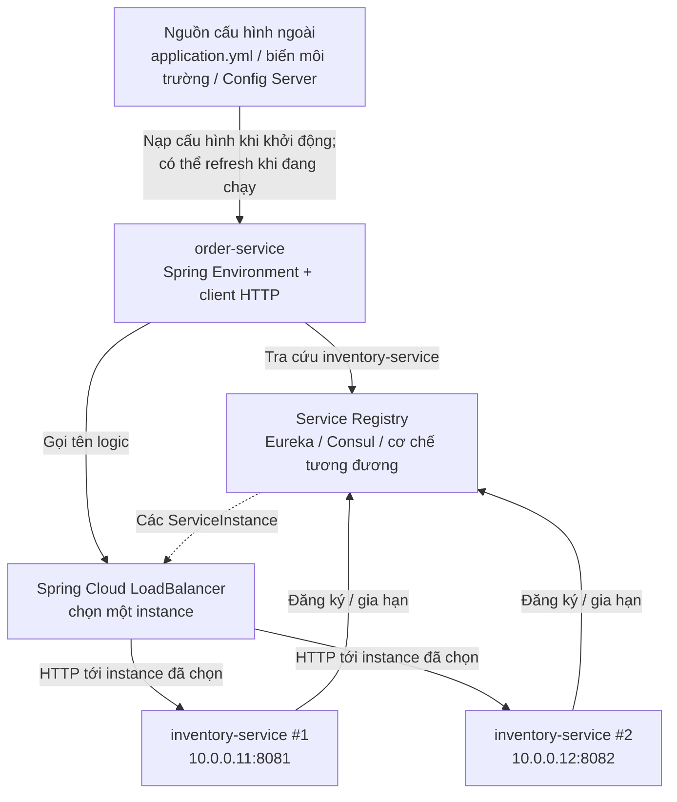
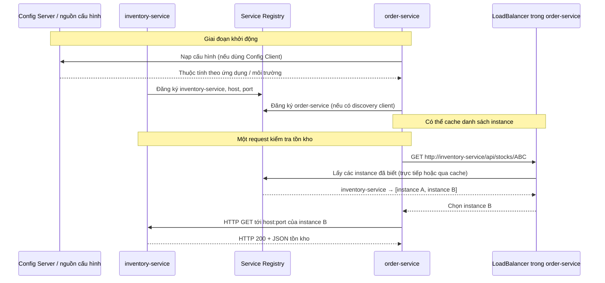

# Mối quan hệ giữa cấu hình, khám phá dịch vụ và gọi dịch vụ trong Spring Cloud

## 1. Ba câu hỏi của một lời gọi trong hệ thống phân tán

Giả sử một hệ thống bán hàng có hai ứng dụng Spring Boot:

- `order-service` nhận yêu cầu tạo đơn và cần biết một sản phẩm còn bao nhiêu hàng.
- `inventory-service` cung cấp API kiểm tra tồn kho, có thể chạy đồng thời trên nhiều máy hoặc container.

Trong ứng dụng đơn khối, mã xử lý đơn hàng có thể gọi trực tiếp một đối tượng Java khác. Khi tách thành hai dịch vụ, `order-service` cần giải quyết ba câu hỏi:

1. **Cấu hình (configuration):** Tôi phải gọi dịch vụ nào, theo đường dẫn nào, với timeout và chính sách kết nối nào? Tôi lấy các giá trị này từ đâu?
2. **Khám phá dịch vụ (service discovery):** Tên logic `inventory-service` hiện tương ứng với những địa chỉ mạng cụ thể nào?
3. **Gọi dịch vụ (service invocation):** Tôi chọn instance nào, gửi yêu cầu HTTP ra sao, và xử lý thế nào khi mạng hoặc instance gặp sự cố?

Ba hoạt động có liên quan nhưng không đồng nhất. **Cấu hình mô tả cách ứng dụng vận hành; khám phá dịch vụ cung cấp danh sách instance hiện có; thành phần gọi dịch vụ sử dụng các thông tin đó để thực hiện yêu cầu.** Spring Cloud cung cấp các abstraction giúp những hoạt động này có thể kết hợp mà ứng dụng không phải gắn chặt với địa chỉ IP hoặc một sản phẩm hạ tầng cụ thể.

Sau bài học, người đọc có thể lần theo một request từ lúc ứng dụng khởi động đến khi nhận phản hồi, phân biệt vai trò của Config Server, Service Registry và LoadBalancer, cũng như tìm đúng lớp cần kiểm tra khi request thất bại.

## 2. Cấu trúc tổng thể và trách nhiệm của từng lớp



Sơ đồ tách các vai trò để dễ quan sát. Trong một ứng dụng Spring, **Spring Cloud LoadBalancer thường là thành phần chạy trong tiến trình client**, không phải một máy chủ mạng nằm giữa hai dịch vụ. Tùy discovery implementation, thông tin instance có thể đến qua bộ nhớ đệm và được cập nhật theo chu kỳ; không nhất thiết mỗi HTTP request đều hỏi registry qua mạng. Registry thông thường cũng **không chuyển tiếp nội dung request HTTP**.

| Khái niệm | Câu hỏi được giải quyết | Các abstraction/thành phần tiêu biểu |
| --- | --- | --- |
| **Externalized Configuration** | Thuộc tính nào áp dụng trong môi trường hiện tại? | Spring `Environment`, `application.yml`, biến môi trường, Config Data |
| **Spring Cloud Config** | Làm sao tập trung và phân phối cấu hình cho nhiều ứng dụng? | Config Server, Config Client, `spring.config.import` |
| **Spring Cloud Context** | Bean chịu ảnh hưởng thế nào khi cấu hình được làm mới? | `@RefreshScope`, cơ chế refresh của application context |
| **Service Registry** | Instance nào đăng ký và còn được biết tới? | Eureka, Consul hoặc cơ chế đăng ký tương đương |
| **DiscoveryClient** | Với một service ID, tìm được những `ServiceInstance` nào? | `DiscoveryClient#getInstances(String)` |
| **ServiceRegistry** | Đăng ký hoặc hủy đăng ký instance bằng API chung ở nơi có hỗ trợ | `ServiceRegistry` trong Spring Cloud Commons |
| **Client-side Load Balancing** | Chọn một instance từ tập instance đã biết | Spring Cloud LoadBalancer và `@LoadBalanced` client |
| **HTTP Client / Service Invocation** | Thực hiện request, đọc response, xử lý timeout/lỗi | `RestClient`, `WebClient`, `RestTemplate`, OpenFeign |

Điểm quan trọng: chỉ thêm thư viện discovery không làm mọi HTTP client tự động hiểu URL theo service ID. Để gọi `http://inventory-service` như một tên logic, HTTP client phải được tích hợp đúng với load balancer hoặc một lớp định tuyến tương đương.

### 2.1. Cấu hình là đầu vào, không phải bản đồ instance

Một dịch vụ có thể nhận cấu hình từ nhiều nguồn: file bên trong ứng dụng, file bên ngoài, biến môi trường, tham số chạy, hệ thống quản lý cấu hình tập trung. Spring Boot tổng hợp những nguồn này vào `Environment` với quy tắc ưu tiên thuộc tính của nó.

Ví dụ:

```yaml
spring:
  application:
    name: order-service
inventory:
  client:
    stock-path: /api/stocks
```

`spring.application.name` là danh tính logic của ứng dụng; `inventory.client.stock-path` là một quy ước API mà client sẽ dùng. Các giá trị này **không chỉ ra** `inventory-service` đang chạy ở IP nào. Việc trả lời câu hỏi đó thuộc discovery hoặc cơ chế phân giải địa chỉ khác, chẳng hạn DNS của Kubernetes.

### 2.2. Discovery là danh sách instance, không phải request HTTP

Một `ServiceInstance` thường cung cấp các thông tin như service ID, host, port, URI và metadata. Có thể có nhiều instance mang cùng một service ID. Khi mở rộng hay thu hẹp cụm, danh sách này thay đổi theo thời gian.

```java
// Dùng để kiểm tra thông tin discovery, không cần gọi thủ công
// trong mỗi request nếu đã dùng @LoadBalanced client.
List<ServiceInstance> instances =
    discoveryClient.getInstances("inventory-service");

instances.forEach(instance ->
    System.out.println(instance.getHost() + ":" + instance.getPort()));
```

`DiscoveryClient` là giao diện tra cứu; `ServiceRegistry` là giao diện thao tác đăng ký/hủy đăng ký ở các implementation có hỗ trợ. Việc ứng dụng tự đăng ký, gia hạn heartbeat, kiểm tra sức khỏe và hủy đăng ký phụ thuộc vào thư viện discovery và nền tảng triển khai. Hai giao diện có liên hệ nhưng không thay thế cho nhau.

### 2.3. Load balancing là bước nối discovery với HTTP client

Với hai instance của `inventory-service`, load balancer có thể chọn instance A cho một request và instance B cho request khác. Thuật toán, bộ nhớ đệm, health check, sticky session, retry và các bộ lọc instance phụ thuộc vào cấu hình và thành phần thực tế được cài đặt.

Lựa chọn instance **không bảo đảm** cuộc gọi thành công: registry có thể chưa kịp loại instance lỗi, mạng có thể đứt sau khi lựa chọn, hoặc ứng dụng đích có thể trả lỗi nghiệp vụ. Do đó cần phối hợp timeout, kiểm soát retry, bảo vệ tài nguyên và quan sát hệ thống.

## 3. Trình tự từ lúc khởi động đến khi có response



Trên thực tế các sự kiện khởi động có thể diễn ra song song hoặc theo thứ tự khác nhau. Sơ đồ diễn tả **quan hệ phụ thuộc logic**, không bắt buộc Config Server, registry và các ứng dụng khởi động đúng thứ tự như hình.

1. **Nạp cấu hình:** Spring Boot tạo `Environment` và đọc nguồn cấu hình. Nếu có Spring Cloud Config Client, Config Data có thể được nạp từ Config Server thông qua `spring.config.import`.
2. **Khởi tạo bean:** Ứng dụng tạo HTTP client, load balancer và các bean sử dụng cấu hình. `@Value` hoặc `@ConfigurationProperties` lấy giá trị từ `Environment`.
3. **Đăng ký/khám phá:** Discovery implementation cung cấp thông tin instance; ứng dụng có thể đăng ký bản thân, đồng thời tra cứu các dịch vụ khác.
4. **Xử lý request:** Mã nghiệp vụ gọi URL có service ID. Load balancer lấy danh sách instance khả dụng mà nó nhìn thấy và chọn một mục.
5. **Gửi request và nhận response:** HTTP client kết nối tới địa chỉ instance; các lỗi mạng, HTTP, timeout và dữ liệu trả về phải được xử lý ở tầng gọi dịch vụ/nghiệp vụ.
6. **Trong khi chạy:** Cấu hình và danh sách instance có thể đổi theo hai cơ chế riêng. Refresh cấu hình không đồng nghĩa refresh tức thì mọi thông tin discovery; thay đổi registry cũng không tự cập nhật mọi bean ứng dụng.

## 4. Ví dụ: order-service gọi inventory-service qua Eureka

Ví dụ sau dùng Spring Boot hỗ trợ `RestClient` (Spring Framework 6.1 trở lên), Spring Cloud Commons, Spring Cloud LoadBalancer, Eureka Discovery Client và **tùy chọn** Spring Cloud Config Client. Mục tiêu là minh họa đường đi của lời gọi; các server Eureka/Config và cấu hình build phải được chuẩn bị tương ứng.

**Phụ thuộc cần thiết, theo từng ứng dụng:**

| Ứng dụng | Dependency chính | Mục đích |
| --- | --- | --- |
| Cả hai dịch vụ | `spring-boot-starter-web` | Chạy HTTP API và dùng `RestClient` |
| Cả hai dịch vụ | `spring-cloud-starter-netflix-eureka-client` | Đăng ký/khám phá instance qua Eureka |
| `order-service` | `spring-cloud-starter-loadbalancer` | Hỗ trợ client-side load balancing |
| Ứng dụng dùng Config Server | `spring-cloud-starter-config` | Nạp cấu hình tập trung |
| Tùy chọn | `spring-boot-starter-actuator` | Health, metrics và các endpoint vận hành |

Khi dùng Maven, import BOM `spring-cloud-dependencies` tương thích với phiên bản Spring Boot của dự án để quản lý phiên bản các starter Spring Cloud. Không tự ghép ngẫu nhiên một Spring Boot version với Spring Cloud release train; cách chọn phiên bản được đề cập ở mục 8.

### 4.1. Khai báo inventory-service

```yaml
# inventory-service/src/main/resources/application.yml
server:
  port: 8081

spring:
  application:
    name: inventory-service

eureka:
  client:
    serviceUrl:
      defaultZone: http://localhost:8761/eureka/
```

`inventory-service` có thể cung cấp API minh họa:

```java
import org.springframework.web.bind.annotation.GetMapping;
import org.springframework.web.bind.annotation.PathVariable;
import org.springframework.web.bind.annotation.RequestMapping;
import org.springframework.web.bind.annotation.RestController;

@RestController
@RequestMapping("/api/stocks")
class StockController {
    @GetMapping("/{sku}")
    StockResponse getStock(@PathVariable String sku) {
        // Giá trị cố định để minh họa. Thực tế đọc từ kho dữ liệu.
        return new StockResponse(sku, 12);
    }

    record StockResponse(String sku, int available) {}
}
```

Chạy thêm một instance của cùng ứng dụng với `--server.port=8082`. Hai instance dùng chung `spring.application.name` nhưng có địa chỉ cổng khác nhau, vì thế registry có thể trả về hai địa chỉ dưới cùng service ID.

### 4.2. Khai báo order-service

```yaml
# order-service/src/main/resources/application.yml
server:
  port: 8080

spring:
  application:
    name: order-service
  config:
    import: "optional:configserver:http://localhost:8888"

eureka:
  client:
    serviceUrl:
      defaultZone: http://localhost:8761/eureka/

inventory:
  client:
    stock-path: /api/stocks
```

Ý nghĩa của các thuộc tính:

- `spring.application.name`: tên logic của chính `order-service`, cũng thường được Config Client dùng để tìm tập cấu hình phù hợp.
- `spring.config.import`: yêu cầu đọc cấu hình từ Config Server. Tiền tố `optional:` cho phép ứng dụng tiếp tục khởi động khi không tải được nguồn này; nếu cấu hình tập trung là bắt buộc thì cần một chính sách fail-fast phù hợp thay vì cho phép thiếu cấu hình.
- `eureka.client.serviceUrl.defaultZone`: địa chỉ **Eureka Server**, không phải địa chỉ của `inventory-service`. `defaultZone` là khóa Eureka có cách viết riêng.
- `inventory.client.stock-path`: đường dẫn API do ứng dụng quản lý. Có thể đặt ở cấu hình local hoặc nguồn ngoài theo môi trường.

**Lưu ý:** Ví dụ giả định Config Server tại cổng 8888 nếu dùng dependency Config Client, Eureka Server tại cổng 8761 và các dịch vụ có thể kết nối tới những địa chỉ trên. Nếu không triển khai Config Server, bỏ dependency Config Client và dòng `spring.config.import`; phần discovery/load balancing vẫn hoạt động khi Eureka có sẵn.

### 4.3. Tạo RestClient có khả năng gọi bằng service ID

```java
import org.springframework.cloud.client.loadbalancer.LoadBalanced;
import org.springframework.context.annotation.Bean;
import org.springframework.context.annotation.Configuration;
import org.springframework.web.client.RestClient;

@Configuration
class HttpClientConfig {
    @Bean
    @LoadBalanced
    RestClient.Builder loadBalancedRestClientBuilder() {
        return RestClient.builder();
    }
}
```

`@LoadBalanced` gắn khả năng phân giải service ID và chọn instance vào `RestClient.Builder` đã được Spring quản lý khi có tích hợp Spring Cloud LoadBalancer thích hợp. Mã gọi dịch vụ:

```java
import org.springframework.beans.factory.annotation.Value;
import org.springframework.cloud.client.loadbalancer.LoadBalanced;
import org.springframework.cloud.context.config.annotation.RefreshScope;
import org.springframework.stereotype.Service;
import org.springframework.web.client.RestClient;

@Service
@RefreshScope
public class InventoryGateway {
    private final RestClient client;
    private final String stockPath;

    public InventoryGateway(
            @LoadBalanced RestClient.Builder builder,
            @Value("${inventory.client.stock-path:/api/stocks}") String stockPath) {
        this.client = builder.build();
        this.stockPath = stockPath;
    }

    public StockResponse findStock(String sku) {
        return client.get()
                .uri("http://inventory-service" + stockPath + "/{sku}", sku)
                .retrieve()
                .body(StockResponse.class);
    }

    public record StockResponse(String sku, int available) {}
}
```

Ở đây:

- `inventory-service` trong URL là **service ID**, không phải hostname DNS được hardcode cho một container.
- Load balancer tìm instance ứng với ID này và dùng host/port của instance được chọn.
- `stockPath` đến từ cấu hình; đổi đường dẫn API không buộc phải sửa tên service ID.
- `@RefreshScope` cho phép bean được tạo lại với thuộc tính mới **sau khi có sự kiện refresh thực sự**. Chỉ sửa file trên Config Server không có nghĩa bean được cập nhật ngay.
- `retrieve()` xử lý phản hồi HTTP; lời gọi thực tế phải thêm timeout, xử lý lỗi, bảo đảm tương thích JSON và chính sách retry phù hợp.

Một controller trong `order-service` có thể sử dụng gateway:

```java
import org.springframework.web.bind.annotation.GetMapping;
import org.springframework.web.bind.annotation.PathVariable;
import org.springframework.web.bind.annotation.RequestMapping;
import org.springframework.web.bind.annotation.RestController;

@RestController
@RequestMapping("/api/orders")
class OrderController {
    private final InventoryGateway inventoryGateway;

    OrderController(InventoryGateway inventoryGateway) {
        this.inventoryGateway = inventoryGateway;
    }

    @GetMapping("/inventory/{sku}")
    InventoryGateway.StockResponse stock(@PathVariable String sku) {
        return inventoryGateway.findStock(sku);
    }
}
```

Với hạ tầng và ứng dụng đã chạy, request `GET http://localhost:8080/api/orders/inventory/ABC` đi qua controller → gateway → `@LoadBalanced RestClient` → instance `inventory-service` → JSON `{"sku":"ABC","available":12}`.

Đây là ví dụ minh họa kiến trúc: giá trị tồn kho cố định, chưa có database, xác thực, xử lý lỗi domain hay chính sách chịu lỗi cho production. Java source trong mỗi ứng dụng phải nằm trong package đúng của chính ứng dụng đó.

### 4.4. Nếu không dùng Eureka hay không dùng RestClient

**Service discovery là abstraction.** Có thể chọn Eureka, Consul hoặc một discovery implementation khác. Với Kubernetes, ứng dụng cũng có thể gọi DNS `inventory-service` do Kubernetes Service cung cấp và để hạ tầng xử lý cân bằng tải; khi đó không nhất thiết phải có Eureka hoặc Spring Cloud DiscoveryClient. Không nên vừa giả định DNS vừa dùng `@LoadBalanced` mà chưa xác định rõ cơ chế phân giải mong muốn.

Tương tự, một dự án có thể dùng `@LoadBalanced WebClient.Builder` cho WebFlux, `RestTemplate` trong mã cũ hoặc Spring Cloud OpenFeign với `@FeignClient(name = "inventory-service")`. Việc tích hợp, timeout, xử lý lỗi và khả năng hỗ trợ cụ thể phụ thuộc starter và phiên bản đang sử dụng. Ý nghĩa chung vẫn là: **client gọi tên logic; lớp phân giải và chọn instance biến tên đó thành một đích mạng thực**.

## 5. Khi có thay đổi: cấu hình và instance ảnh hưởng nhau ra sao?

Hai luồng thay đổi quan trọng cần phân biệt.

### 5.1. Thay đổi cấu hình

Ví dụ đội phát triển đổi `inventory.client.stock-path` từ `/api/stocks` thành `/api/v2/stocks` trong nguồn cấu hình tập trung. Config Server có thể phục vụ giá trị mới, nhưng `order-service` đang chạy vẫn có thể giữ giá trị trước đó trong `Environment` hoặc trong bean cho đến khi cơ chế refresh được kích hoạt đúng cách.

Với Spring Cloud Context, bean dùng `@RefreshScope` có thể được tạo lại khi refresh để đọc cấu hình mới. Trong một số kiến trúc, việc refresh có thể được chủ động kích hoạt qua cơ chế quản trị hoặc phân phối sự kiện như Spring Cloud Bus. **Refresh không phải cơ chế tự động đồng bộ mọi thuộc tính hoặc mọi singleton bean.** Một số cấu hình cần restart để thay đổi có hiệu lực an toàn. Các endpoint quản trị như `/actuator/refresh` (khi được bật và hỗ trợ) phải được bảo vệ và không nên công khai ra Internet.

Nếu đổi `spring.application.name` hoặc cấu hình discovery, đó là thay đổi có thể tác động đến **danh tính dịch vụ, cách đăng ký, hoặc đối tượng tra cứu**; không nên giả định chỉ refresh bean là đủ. Với những thay đổi hạ tầng loại này, thường cần triển khai lại/restart và xác nhận trạng thái registry.

### 5.2. Thay đổi danh sách instance

Ví dụ mở rộng `inventory-service` từ hai lên ba instance. Instance mới đăng ký vào registry, sau đó discovery client/load balancer của `order-service` dần nhìn thấy tập địa chỉ mới. Bản thân `inventory.client.stock-path` không cần đổi: đây là lợi ích của việc dùng tên logic thay vì cố định IP.

Ngược lại, khi một instance ngừng hoạt động đột ngột, nó có thể chưa bị loại khỏi danh sách ngay. Cửa sổ không nhất quán này phụ thuộc vào heartbeat/lease, health check, cache và cơ chế đồng bộ. Một vài request có thể vẫn gặp instance lỗi; cần cấu hình timeout, retry có giới hạn và thiết kế API phù hợp.

| Tình huống | Thứ thay đổi | Tầng chịu tác động chính | Việc cần xác minh |
| --- | --- | --- | --- |
| Chuyển đường dẫn API theo môi trường | `inventory.client.stock-path` | Configuration + bean client | Thuộc tính mới đã nạp/refresh chưa; API mới có tồn tại không? |
| Scale thêm instance | Danh sách `ServiceInstance` | Registry + Discovery + LoadBalancer | Instance mới đã đăng ký và được client thấy chưa? |
| Một instance bị lỗi | Health, kết nối mạng, lease | Discovery + HTTP | Client có timeout và loại/bỏ qua instance lỗi theo chính sách không? |
| Đổi địa chỉ Eureka | `eureka.client.serviceUrl.defaultZone` | Discovery infrastructure | Client có kết nối registry và được khởi tạo lại đúng chưa? |
| Config Server không sẵn sàng | Nguồn cấu hình trung tâm | Config bootstrap | Dịch vụ fail-fast hay được phép dùng cấu hình khác? |
| Đổi tên service ID | `spring.application.name` hoặc service name ở client | Cấu hình + đăng ký + tra cứu | Bên gọi và bên cung cấp có cùng quy ước tên không? |

**Không có quan hệ một-một giữa “refresh cấu hình” và “refresh discovery”.** Chúng dùng những vòng đời khác nhau. Việc cấu hình quyết định tên dịch vụ đích chỉ là một điểm giao nhau giữa hai vòng đời đó.

## 6. Tính chịu lỗi và các giả định dễ gây nhầm lẫn

### 6.1. Service discovery không thay thế timeout

Discovery trả về thông tin đích dựa trên góc nhìn tại một thời điểm. Sau đó request có thể thất bại do socket timeout, DNS, TLS, kết nối bị từ chối, instance quá tải hoặc API trả 5xx. Thực tế cần:

- Đặt **connection timeout** và **response/read timeout** có giá trị hữu hạn, phù hợp SLA của luồng nghiệp vụ.
- Phân biệt lỗi mạng và lỗi HTTP 4xx/5xx để quyết định có thử lại hay không.
- Giới hạn số lần thử lại, dùng backoff/jitter khi phù hợp và tránh khuếch đại tải trong sự cố.
- Chỉ retry an toàn với thao tác idempotent hoặc có cơ chế bảo đảm idempotency (ví dụ idempotency key cho tạo đơn).
- Cân nhắc circuit breaker, bulkhead hoặc giới hạn đồng thời ở tầng chuyên trách nếu yêu cầu độ bền cao; những cơ chế này không xuất hiện tự động chỉ vì đã thêm discovery starter.

### 6.2. Một URL có hai cách hiểu khác nhau

```text
http://inventory-service/api/stocks/ABC
```

- Với `RestClient` thông thường, `inventory-service` có thể được xem là **hostname** và sẽ cần phân giải bằng DNS.
- Với `@LoadBalanced RestClient`, `inventory-service` được coi là **service ID** và được LoadBalancer tra cứu theo discovery implementation đã cấu hình.

Chữ trong URL giống nhau nhưng đường đi mạng có thể hoàn toàn khác. Đây là nguyên nhân thường gặp khi ứng dụng “tìm được dịch vụ trong Eureka” nhưng HTTP client vẫn báo lỗi phân giải tên.

### 6.3. Registry không nhất thiết là một thành phần riêng

Eureka/Consul có registry tập trung hoặc theo cụm. Trong Kubernetes, DNS và Service/EndpointSlice có thể đóng vai trò cung cấp địa chỉ đích; hệ thống cũng có thể áp dụng `SimpleDiscoveryClient` với danh sách instance từ properties cho môi trường nhỏ hoặc kiểm thử. **Spring Cloud Commons định nghĩa hợp đồng**, còn việc ai sở hữu danh sách endpoint và cập nhật danh sách đó phụ thuộc vào môi trường.

### 6.4. Config Server không phải tiền điều kiện của service discovery

Một ứng dụng có thể:

- Đọc toàn bộ cấu hình từ `application.yml` và biến môi trường nhưng vẫn dùng Eureka + LoadBalancer.
- Dùng Config Server để phân phối thuộc tính nhưng gọi URL cố định hoặc DNS, không dùng registry riêng.
- Kết hợp Config Server, registry và load balancer khi cần quản lý tập trung cấu hình và nhiều instance động.

Chọn mô hình dựa trên hạ tầng hiện có. Không phải mọi dự án Spring Cloud đều phải triển khai đủ các sản phẩm trên.

## 7. Kiểm thử luồng cấu hình → discovery → gọi dịch vụ

Nên kiểm tra riêng từng trách nhiệm, rồi kiểm tra luồng tích hợp. Ví dụ dưới đây là danh sách tình huống kiểm thử đề xuất; không yêu cầu dựng toàn bộ hệ thống sản xuất để kiểm tra tất cả trong một test.

| Mức kiểm thử | Thao tác | Kết quả mong đợi |
| --- | --- | --- |
| Cấu hình | Chạy `order-service` với thuộc tính `inventory.client.stock-path` khác nhau theo profile | Gateway tạo đúng đường dẫn tương ứng; thiếu cấu hình bắt buộc được phát hiện |
| Discovery | Khởi động `inventory-service` và xem danh sách instance qua Eureka hoặc `DiscoveryClient` | Có service ID và host/port hợp lệ |
| Client integration | Có ít nhất một `inventory-service` thật hoặc stub trả JSON đúng hợp đồng | `order-service` trả dữ liệu đúng và không phụ thuộc IP hardcode |
| Scale | Khởi động instance thứ hai ở cổng khác | Danh sách instance cập nhật; có thể quan sát request đi đến instance khả dụng |
| Failure | Dừng một instance, tạo độ trễ, hoặc ngắt kết nối | Timeout/cơ chế xử lý lỗi theo thiết kế; không treo vô hạn |
| Refresh | Đổi thuộc tính có hỗ trợ refresh rồi kích hoạt refresh một cách kiểm soát | Bean dùng `@RefreshScope` đọc giá trị mới và lời gọi đổi theo |
| Hợp đồng API | Thay đổi JSON/status của `inventory-service` | Client nhận diện thay đổi không tương thích trước khi triển khai |

Khi viết unit test cho logic nghiệp vụ, có thể mock `InventoryGateway`. Khi kiểm thử cách resolve service ID và chọn instance, cần test tích hợp có load balancer và nguồn instance kiểm soát được; một unit test mock gateway không chứng minh được discovery hoạt động.

Một kịch bản chạy tay tối thiểu:

1. Bật Eureka Server tại `localhost:8761`. Nếu dùng Config Client, bật thêm Config Server tại `localhost:8888` với cấu hình hợp lệ; nếu không, bỏ import như mục 4.2.
2. Chạy `inventory-service` tại 8081, sau đó chạy thêm instance tại 8082; kiểm tra cả hai xuất hiện cùng tên trong registry.
3. Chạy `order-service` tại 8080 và gửi `GET /api/orders/inventory/ABC`; xác nhận JSON trả về.
4. Dừng một instance, quan sát thời gian cập nhật discovery và hành vi HTTP; kiểm tra log timeout, lựa chọn instance, lỗi HTTP nếu có.
5. Thử thay đổi `stock-path` và kích hoạt cơ chế refresh đã được cấu hình; đối chiếu giá trị sử dụng thực tế với thay đổi trong nguồn cấu hình.

## 8. Tương thích phiên bản Spring Boot – Spring Cloud

Các cơ chế chung nằm trong hệ sinh thái Spring Boot/Spring Cloud nhưng **khả năng hỗ trợ và auto-configuration thay đổi theo phiên bản**. Đây là một phần của tính đúng đắn, không chỉ là công việc nâng cấp thư viện.

- Spring Cloud được phát hành theo **release train**. Chọn release train tương thích với phiên bản Spring Boot đang dùng theo bảng compatibility chính thức, sau đó import `spring-cloud-dependencies` BOM.
- Dùng starter đúng trách nhiệm: Config Client cho Config Server, starter discovery cho registry, Spring Cloud LoadBalancer cho client-side load balancing, và HTTP client tương ứng.
- `RestClient` thuộc Spring Framework 6.1 trở lên; khi dùng một hệ phiên bản cũ hơn, cần xem lựa chọn `RestTemplate` hoặc `WebClient` và cơ chế tích hợp load balancer phù hợp.
- Các dependency cùng tên không bảo đảm auto-configuration hoạt động giống nhau qua mọi thế hệ. Sau khi nâng phiên bản, kiểm tra lại bean `@LoadBalanced`, cách xử lý `spring.config.import`, endpoint quản trị và starter discovery.
- Không dùng release train mới nhất chỉ vì nó mới nhất. Phiên bản **phù hợp với Spring Boot và JDK của dự án** mới là lựa chọn đúng.

Nguồn kiểm tra khi triển khai dự án thực tế: [Spring Cloud](https://spring.io/projects/spring-cloud) (release train và compatibility), [Spring Cloud Commons](https://docs.spring.io/spring-cloud-commons/reference/) (DiscoveryClient, ServiceRegistry, LoadBalancer, RefreshScope), [Spring Cloud Config](https://docs.spring.io/spring-cloud-config/reference/) (Config Client/Server) và tài liệu discovery implementation mà dự án chọn.

## 9. Quan sát và xử lý sự cố theo đúng tầng

Khi một request không đi từ `order-service` tới `inventory-service`, nên lần theo thứ tự **cấu hình → registry/discovery → chọn instance → kết nối HTTP → API đích**. Cách tiếp cận này giúp tránh suy đoán một lỗi ở tầng mạng là lỗi của Config Server, hoặc ngược lại.

| Triệu chứng | Khả năng đáng kiểm tra | Hướng kiểm tra đầu tiên |
| --- | --- | --- |
| Ứng dụng lỗi ngay khi khởi động | Config source không truy cập được, thiếu thuộc tính cần thiết, sai phiên bản phụ thuộc | Log Config Data / bean creation; nguồn và độ ưu tiên cấu hình |
| Eureka không thấy `inventory-service` | Sai `defaultZone`, chưa đăng ký, network/health/lease | Cấu hình Eureka Client, log đăng ký, instance host/port |
| Registry có instance nhưng client báo không có server | Service ID không khớp, discovery cache chậm, thiếu LoadBalancer integration | `DiscoveryClient#getInstances`; bean `@LoadBalanced`; cache và service ID |
| Lỗi phân giải hostname `inventory-service` | HTTP client thường đang dùng DNS thay cho discovery | Kiểm tra client được inject và cơ chế phân giải URL |
| Một số request timeout hoặc connection refused | Instance lỗi, địa chỉ không định tuyến được, cache chưa cập nhật | Instance đã chọn, route, timeout, log theo instance |
| HTTP 404 dù discovery thành công | Sai path hoặc phiên bản API | Thuộc tính `stock-path`, controller mapping, hợp đồng API |
| Đổi Config Server nhưng hành vi cũ | Chưa refresh, bean không hỗ trợ refresh hoặc property override | Giá trị `Environment`, cách kích hoạt refresh, vòng đời bean |
| Chỉ hỏng sau khi nâng dependency | Spring Boot và Spring Cloud không tương thích, đổi auto-configuration | Compatibility matrix, dependency tree, startup condition report |

Trong vận hành cần có **log mang correlation/trace ID**, thời gian phản hồi, tỷ lệ lỗi, timeout và metric theo service/endpoint/instance. Nếu dùng Actuator và Micrometer, chọn endpoint health/metrics phù hợp, bảo vệ endpoint quản trị và tránh đưa thông tin bí mật trong logs. Một request có trace xuyên dịch vụ sẽ giúp xác định lỗi xảy ra ở lúc lấy cấu hình, chọn instance, kết nối mạng hay xử lý API.

## 10. Những nguyên tắc cần giữ khi thiết kế

1. **Tách tên logic khỏi địa chỉ vật lý.** Cấu hình và mã nghiệp vụ nên dùng service ID ổn định; danh sách host/port thuộc discovery hoặc hạ tầng định tuyến.
2. **Cấu hình phản ánh môi trường triển khai.** Timeout, endpoint và cách kết nối hạ tầng có thể thay đổi theo profile/nguồn ngoài. Không đưa secret trực tiếp vào source; cần quản lý secrets và phân quyền nguồn cấu hình.
3. **Đăng ký dịch vụ không đồng nghĩa đã phục vụ được request.** Cần health/readiness, timeout và chính sách lỗi phù hợp với độ trễ cập nhật registry.
4. **Load balancing không đồng nghĩa retry hay circuit breaking.** Từng khả năng phải có thư viện, cấu hình và kiểm chứng cụ thể.
5. **Refresh cấu hình có giới hạn.** Bean thuộc refresh scope có thể nhận cấu hình mới sau sự kiện refresh; thay đổi tên dịch vụ, cổng, cơ chế đăng ký hoặc kết nối nền tảng có thể cần restart.
6. **Giữ tương thích Boot–Cloud.** Spring Cloud Commons cung cấp abstraction xuyên suốt, nhưng starter và API cụ thể chỉ được dùng an toàn trên tổ hợp phiên bản đã được hỗ trợ và kiểm thử.

Với ví dụ `order-service` và `inventory-service`, có thể đọc toàn bộ hành trình của lời gọi bằng một chuỗi đơn giản: **đọc cấu hình để biết cách gọi → tìm các instance của tên dịch vụ → chọn một instance → gửi HTTP và xử lý kết quả**. Khi scale, failover hoặc đổi cấu hình, mỗi mắt xích có vòng đời và giới hạn riêng; hiểu các ranh giới đó là nền tảng để thiết kế và vận hành microservice với Spring Cloud.
