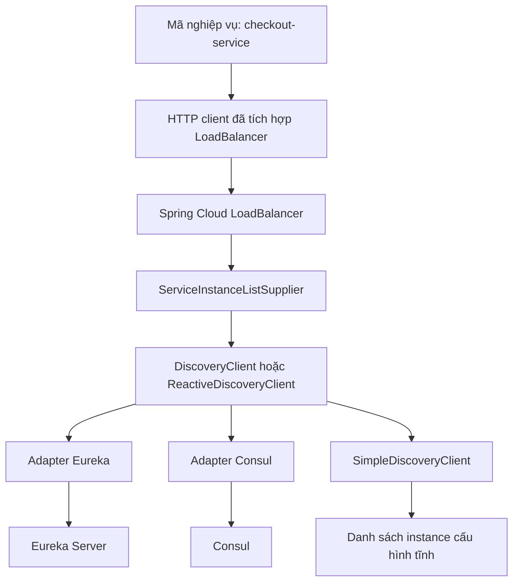

# Trừu tượng dùng chung và phần triển khai theo nhà cung cấp

Trong hệ thống phân tán, một dịch vụ thường cần tìm dịch vụ khác, chọn một địa chỉ đang hoạt động, đăng ký chính mình vào hệ thống khám phá dịch vụ, lấy cấu hình từ bên ngoài và phản ứng khi cấu hình thay đổi. Nếu mã nghiệp vụ gọi trực tiếp API của từng hệ thống như Eureka, Consul hay ZooKeeper, mỗi lần thay đổi hạ tầng sẽ kéo theo sửa mã ứng dụng. Spring Cloud giải quyết một phần vấn đề này bằng **các trừu tượng dùng chung (common abstractions)** và **các phần tích hợp theo nhà cung cấp (provider-specific implementations)**.

Bài học thuộc chương **Tổng quan** của **SPRING_CLOUD_CORE**: tập trung vào Spring Cloud Commons, Spring Cloud Context, discovery, service registry, cân bằng tải phía client, cấu hình bên ngoài và các ranh giới tương thích với Spring Boot. Mục tiêu là nhận diện chính xác *hợp đồng nào ổn định*, *thư viện nào thực hiện hợp đồng đó* và *những khác biệt nào vẫn phải xử lý khi đổi nhà cung cấp*.

## 1. Mục tiêu học tập

Sau bài này, bạn có thể:

- Phân biệt API trừu tượng, phần triển khai, starter và cơ chế tự cấu hình của Spring Boot/Spring Cloud.
- Giải thích vai trò của `DiscoveryClient`, `ReactiveDiscoveryClient`, `ServiceInstance`, `ServiceRegistry` và `Registration`.
- Mô tả cách Spring Cloud LoadBalancer tận dụng thông tin discovery mà không buộc mã nghiệp vụ phụ thuộc trực tiếp vào Eureka hoặc Consul.
- Xác định phần nào thuộc Spring Cloud Commons, Spring Cloud Context và phần nào là tích hợp tùy chọn.
- Chuyển một ví dụ discovery tĩnh sang nhà cung cấp thật, đồng thời nêu được các điều kiện để việc chuyển đổi an toàn.
- Thiết kế kiểm thử và quy trình chẩn đoán khi đăng ký dịch vụ, tìm instance, chọn địa chỉ hoặc làm mới cấu hình gặp sự cố.

## 2. Vì sao cần một lớp trừu tượng?

Giả sử dịch vụ `checkout-service` cần gọi `inventory-service`. Trong môi trường phát triển, inventory có thể chạy tại `localhost:8082`; trên môi trường thật, dịch vụ có nhiều instance, thường xuyên được tạo lại, đổi địa chỉ và cổng. Bài toán gồm ba bước độc lập:

1. **Đặt tên logic:** ứng dụng biết tên `inventory-service`, không cần ghi cứng địa chỉ từng máy.
2. **Khám phá:** tìm các instance tương ứng với tên logic tại thời điểm cần sử dụng.
3. **Chọn và gọi:** quyết định instance nào nhận yêu cầu, sau đó thực hiện HTTP/gRPC hoặc một giao thức khác.

Hệ thống còn một luồng ngược: mỗi instance phải **đăng ký** hoặc được nền tảng đăng ký vào nguồn dữ liệu mà discovery sử dụng.

Nếu toàn bộ logic nằm trong lớp nghiệp vụ, mã nguồn phải hiểu cụ thể API đăng ký, đối tượng trả về, cách xác định instance khỏe mạnh và quy tắc lựa chọn của từng nhà cung cấp. Một lớp trừu tượng giúp mã nghiệp vụ biểu đạt nhu cầu ở mức như “tìm instance của dịch vụ X”, còn adapter tích hợp nhận trách nhiệm giao tiếp với hạ tầng cụ thể.

> **Nguyên tắc:** trừu tượng hóa *hợp đồng mà ứng dụng sử dụng*; không mặc nhiên đồng nhất *mọi hành vi vận hành của các nhà cung cấp*.

### 2.1. Bốn lớp thường gặp

| Lớp | Vai trò | Ví dụ |
| --- | --- | --- |
| Mã ứng dụng | Nêu yêu cầu nghiệp vụ, chẳng hạn kiểm tra tồn kho | `InventoryClient`, `CheckoutService` |
| Hợp đồng chung | Mô tả cách tìm dịch vụ hoặc biểu diễn một instance | `DiscoveryClient`, `ServiceInstance` trong Spring Cloud Commons |
| Tích hợp và cơ chế hỗ trợ | Cung cấp bean, lựa chọn instance, chuyển đổi giữa HTTP client và tên dịch vụ | Spring Cloud LoadBalancer, auto-configuration, các adapter discovery |
| Hạ tầng nhà cung cấp | Quản lý thông tin đăng ký, tình trạng instance, cấu hình và API riêng | Eureka Server, Consul Agent/Server, ZooKeeper, Kubernetes API |

**Starter** là gói phụ thuộc thuận tiện để kích hoạt một tích hợp; **auto-configuration** đăng ký các bean khi đáp ứng điều kiện classpath và cấu hình. Starter không phải là bản thân hợp đồng API, và có starter trên classpath cũng không bảo đảm máy chủ hạ tầng tương ứng đang hoạt động.

### 2.2. Sơ đồ luồng phụ thuộc



Sơ đồ thể hiện **quan hệ khái niệm**. Trong một ứng dụng cụ thể, auto-configuration, loại client đồng bộ/bất đồng bộ, chuỗi supplier, cache và provider đang được bật sẽ quyết định những bean thực tế nào tham gia. Luồng **đăng ký dịch vụ** là một hướng khác với luồng **truy vấn discovery**.

## 3. Spring Cloud Commons: các hợp đồng dùng chung

Spring Cloud Commons cung cấp những giao diện và kiểu dữ liệu chia sẻ giữa nhiều dự án Spring Cloud. Cần phân biệt **API trong Commons** với **thư viện thực hiện API**: Commons không tự biến một ứng dụng thành Eureka Server hoặc Consul Agent.

### 3.1. `ServiceInstance`: biểu diễn một điểm đến

`org.springframework.cloud.client.ServiceInstance` đại diện cho một instance của dịch vụ, thường cung cấp:

| Thuộc tính/phương thức | Ý nghĩa |
| --- | --- |
| `getServiceId()` | Tên logic của dịch vụ, ví dụ `inventory-service` |
| `getHost()`, `getPort()` | Địa chỉ máy và cổng được công bố |
| `isSecure()` | Thông tin về việc dùng kết nối an toàn |
| `getUri()` | URI truy cập instance |
| `getMetadata()` | Metadata dạng khóa–giá trị của instance |

Đây là **mô hình trao đổi thông tin**. Nó không cam kết rằng mọi metadata sẽ có cùng ý nghĩa giữa các provider, hoặc instance trả về chắc chắn có thể truy cập ngay lúc gọi. Ví dụ, vùng triển khai, trọng số, tag, version hay trạng thái sức khỏe có thể được mô hình hóa khác nhau; các thuộc tính đó cần một quy ước riêng của hệ thống.

### 3.2. `DiscoveryClient`: tìm dịch vụ đồng bộ

Giao diện `org.springframework.cloud.client.discovery.DiscoveryClient` cung cấp hai thao tác cốt lõi:

```java
public interface DiscoveryClient {
    String description();
    List<ServiceInstance> getInstances(String serviceId);
    List<String> getServices();
}
```

`getServices()` trả về những tên dịch vụ mà client biết; `getInstances(serviceId)` trả về các instance ứng với tên đó. Danh sách có thể rỗng nếu dịch vụ chưa đăng ký, registry không sẵn sàng, dữ liệu đã hết hạn hoặc bộ lọc loại hết các instance.

Một ứng dụng có thể có **nhiều** discovery client. `CompositeDiscoveryClient` là cơ chế tổng hợp theo thứ tự của Spring Cloud Commons; không nên giả định rằng kết quả từ mọi nguồn luôn được gộp thành một tập thống nhất hoặc có cùng độ mới.

Ví dụ đọc thông tin instance để chẩn đoán:

```java
import java.net.URI;
import java.util.List;
import org.springframework.cloud.client.ServiceInstance;
import org.springframework.cloud.client.discovery.DiscoveryClient;
import org.springframework.stereotype.Service;

@Service
public class InventoryDirectory {
    private final DiscoveryClient discoveryClient;

    public InventoryDirectory(DiscoveryClient discoveryClient) {
        this.discoveryClient = discoveryClient;
    }

    public List<URI> knownInventoryEndpoints() {
        return discoveryClient.getInstances("inventory-service").stream()
                .map(ServiceInstance::getUri)
                .toList();
    }
}
```

Đoạn mã trên **chỉ liệt kê địa chỉ**. Không nên lấy phần tử đầu tiên trong danh sách rồi coi đó là thuật toán cân bằng tải; làm vậy bỏ qua chiến lược chọn instance, cache, xử lý lỗi và khả năng thay đổi tập instance theo thời gian.

### 3.3. `ReactiveDiscoveryClient`: biến thể bất đồng bộ

`ReactiveDiscoveryClient` cung cấp cách lấy dữ liệu discovery bằng kiểu phản ứng, với các phương thức tương ứng trả về `Flux<ServiceInstance>` và `Flux<String>`. Đây là API thích hợp khi tầng ứng dụng làm việc theo reactive pipeline.

Sự khác nhau không nằm ở tên registry: một provider có thể hỗ trợ discovery đồng bộ, reactive hoặc cả hai tùy module và phiên bản. Khi thiết kế kiến trúc, hãy kiểm tra loại bean và cách tích hợp của provider đã chọn. Đưa một API đồng bộ có thể chặn luồng vào đoạn xử lý reactive cần được xem xét cẩn thận.

### 3.4. `Registration` và `ServiceRegistry`: vòng đời đăng ký

`Registration` mở rộng ý tưởng `ServiceInstance` để biểu diễn một instance dùng khi **đăng ký chính nó**. `ServiceRegistry<R extends Registration>` định nghĩa các thao tác như `register`, `deregister`, `setStatus`, `getStatus` và `close`.

Những điểm quan trọng:

- **Discovery** trả lời “hiện có instance nào?”; **registration** trả lời “instance của tôi xuất hiện trong registry ra sao?”.
- Không phải provider nào cũng có cùng mô hình chủ động đăng ký. Chẳng hạn trong Kubernetes, endpoint có thể được suy ra từ tài nguyên của nền tảng thay vì ứng dụng trực tiếp đăng ký theo một API registry truyền thống.
- Cách duy trì lease, heartbeat, health check, trạng thái `UP`/`DOWN` và hủy đăng ký lúc shutdown là **hành vi theo provider**.
- Spring Cloud có cơ chế auto-registration trong các tích hợp phù hợp. Mã nghiệp vụ thông thường không cần tự gọi `ServiceRegistry.register(...)`.

Ví dụ: nếu một instance đăng ký thành công nhưng health check bị fail, registry có thể không trả nó vào danh sách instance sẵn sàng. Ngược lại, dữ liệu cũ trong cache cũng có thể khiến một client tạm thời vẫn nhìn thấy instance đã dừng.

### 3.5. Load-balancing: lớp chọn instance riêng

Spring Cloud Commons định nghĩa một số giao diện tích hợp cân bằng tải; **Spring Cloud LoadBalancer** là phần triển khai hiện đại thường dùng để chọn instance phía client. Các khái niệm nổi bật:

- `ServiceInstanceListSupplier` cung cấp danh sách instance, có thể ghép với lớp lọc, cache hoặc xử lý theo yêu cầu.
- `ReactorServiceInstanceLoadBalancer` là hợp đồng chọn instance trong cơ chế reactive của Spring Cloud LoadBalancer.
- `@LoadBalanced` đánh dấu những HTTP client builder/template được cấu hình để phân giải tên dịch vụ thành một instance phù hợp.
- `LoadBalancerClientFactory` quản lý các thành phần cấu hình cân bằng tải theo tên dịch vụ.

Chú ý: thuật toán chọn instance, cache, retry, health check và các quy tắc bổ sung **không tự động giống nhau** giữa tất cả cấu hình. Discovery và load-balancing có trách nhiệm khác nhau: discovery cung cấp *ứng viên*, load-balancer chọn *đích gọi*.

## 4. Những triển khai theo nhà cung cấp

Khi thêm dependency của một provider và cấu hình kết nối đúng cách, Spring Boot/Spring Cloud thường tạo những bean tích hợp cần thiết thông qua auto-configuration. Mã sử dụng `DiscoveryClient` vẫn gọi cùng một giao diện, nhưng các hành vi bên dưới vẫn phụ thuộc hạ tầng.

| Lựa chọn | Nguồn danh sách instance | Đặc điểm cần chú ý |
| --- | --- | --- |
| `SimpleDiscoveryClient` | Danh sách URI cấu hình trong ứng dụng | Hữu ích cho phát triển/kiểm thử; không cung cấp cơ chế health check, đăng ký và đồng bộ registry phân tán |
| Spring Cloud Netflix Eureka | Eureka Server | Mô hình đăng ký và lease/heartbeat, thời gian cập nhật dữ liệu và cơ chế trạng thái riêng |
| Spring Cloud Consul Discovery | Consul | Registry, health check, tags và metadata theo Consul; cần kết nối tới Consul Agent/Server |
| Spring Cloud Zookeeper Discovery | ZooKeeper | Cơ chế node/phiên và trạng thái kết nối ảnh hưởng dữ liệu khám phá |
| Spring Cloud Kubernetes Discovery | Kubernetes API và các tài nguyên liên quan | Phụ thuộc quyền API, namespace, Service/EndpointSlice và cách triển khai; không đồng nhất với đăng ký chủ động kiểu Eureka |

Bảng trên mô tả **các hướng tích hợp**, không có nghĩa mọi starter đều có chung bean, thuộc tính, khả năng đăng ký hay phiên bản tương thích. Chọn provider bằng cách kiểm tra tài liệu chính thức của đúng release train Spring Cloud và nền tảng triển khai.

### 4.1. Điều gì có thể thay đổi mà mã nghiệp vụ vẫn giữ nguyên?

Khi chỉ đổi nguồn discovery, đoạn mã truy vấn `DiscoveryClient#getInstances("inventory-service")` có thể giữ nguyên. Một HTTP client được cấu hình để gọi bằng tên logic cũng có thể giữ nguyên khi dữ liệu instance chuyển từ danh sách tĩnh sang Consul hoặc Eureka.

Các phần thường **phải thay đổi** là dependency, cấu hình kết nối, quyền truy cập, cách đăng ký, cấu hình health check, quy ước metadata và vận hành registry. Vì thế, khả năng thay provider ở cấp API là một lợi thế thiết kế, nhưng không đồng nghĩa việc di chuyển hạ tầng luôn chỉ là đổi một dòng cấu hình.

### 4.2. Phân biệt chức năng hỗ trợ và chức năng riêng

| Nhu cầu | Phần dùng chung | Phần tích hợp hoặc bổ sung |
| --- | --- | --- |
| Tìm instance theo tên | `DiscoveryClient`, `ReactiveDiscoveryClient`, `ServiceInstance` | Eureka/Consul/ZooKeeper/Kubernetes Discovery hoặc nguồn tĩnh |
| Đăng ký instance | `Registration`, `ServiceRegistry` và cơ chế auto-registration tương ứng | Cách đăng ký, lease, heartbeat, health check của provider |
| Lựa chọn instance để gọi | Hợp đồng load-balancer và mô hình `ServiceInstance` | Spring Cloud LoadBalancer, tích hợp `WebClient`/`RestTemplate`/`RestClient` tùy phiên bản |
| Cấu hình ứng dụng | Spring Boot `Environment`, `PropertySource`, `@ConfigurationProperties` | Spring Cloud Config Client, Consul Config, cơ chế của nền tảng |
| Làm mới bean khi cấu hình thay đổi | Spring Cloud Context với `@RefreshScope` và hạ tầng refresh | Nguồn phát hiện thay đổi, endpoint/event, Spring Cloud Bus hoặc cơ chế riêng |
| Khai báo HTTP client | API của HTTP client/framework | Spring Cloud OpenFeign và các adapter load-balancing nếu được sử dụng |

**Spring Cloud OpenFeign**, **Spring Cloud Config** hay **Spring Cloud Bus** là những dự án/chức năng liên quan, không nên coi mọi thành phần của chúng đều nằm trong Spring Cloud Commons. Tương tự, `Environment` và `@ConfigurationProperties` thuộc nền tảng Spring/Spring Boot; Spring Cloud bổ sung các cách nạp, cập nhật và lan truyền cấu hình.

## 5. Ví dụ hoàn chỉnh: gọi dịch vụ bằng tên logic

Xét một `checkout-service` cần đọc dữ liệu từ `inventory-service`. Ta xây dựng phiên bản dùng discovery tĩnh để thấy chính xác ranh giới API, rồi thay bằng provider thật.

### 5.1. Khai báo thư viện

Ví dụ Gradle sau giả định dự án **đã cấu hình dependency management/BOM cho một Spring Cloud release train tương thích với Spring Boot hiện có**:

```groovy
dependencies {
    implementation 'org.springframework.boot:spring-boot-starter-webflux'
    implementation 'org.springframework.cloud:spring-cloud-starter-loadbalancer'
}
```

`spring-boot-starter-webflux` cung cấp `WebClient`; `spring-cloud-starter-loadbalancer` hỗ trợ phân giải tên dịch vụ và chọn instance. Không tự gán phiên bản rời rạc cho từng starter Spring Cloud khi đã dùng BOM: hãy chọn cặp phiên bản Boot/Cloud từ **bảng tương thích chính thức** của release train đang sử dụng.

### 5.2. Cấu hình discovery tĩnh

Trong `application.yml` của `checkout-service`:

```yaml
spring:
  application:
    name: checkout-service
  cloud:
    discovery:
      client:
        simple:
          instances:
            inventory-service:
              - uri: http://localhost:8082
              - uri: http://localhost:8083
```

Các URI là ví dụ; cần có hai instance `inventory-service` thực sự chạy ở các cổng này nếu muốn thực hiện lời gọi. Simple discovery phù hợp cho bài thực hành hoặc môi trường cố định; nó không tự kiểm tra tình trạng sống/chết của các địa chỉ đã khai báo.

### 5.3. Đăng ký builder có khả năng cân bằng tải

```java
import org.springframework.cloud.client.loadbalancer.LoadBalanced;
import org.springframework.context.annotation.Bean;
import org.springframework.context.annotation.Configuration;
import org.springframework.web.reactive.function.client.WebClient;

@Configuration
public class ClientConfiguration {

    @Bean
    @LoadBalanced
    public WebClient.Builder loadBalancedWebClientBuilder() {
        return WebClient.builder();
    }
}
```

`@LoadBalanced` là điểm tích hợp: các request đi qua builder được cấu hình phù hợp có thể dùng tên dịch vụ trong URI. Nó cần dependency/cấu hình load-balancer đúng và một nguồn instance phù hợp. Chỉ đặt URL `http://inventory-service` trên một HTTP client thông thường **không** tự kích hoạt Spring Cloud discovery.

### 5.4. Mã nghiệp vụ chỉ biết tên dịch vụ

```java
import org.springframework.cloud.client.loadbalancer.LoadBalanced;
import org.springframework.stereotype.Service;
import org.springframework.web.reactive.function.client.WebClient;
import reactor.core.publisher.Mono;

record StockView(String sku, int available) {}

@Service
public class InventoryClient {
    private final WebClient webClient;

    public InventoryClient(@LoadBalanced WebClient.Builder builder) {
        this.webClient = builder
                .baseUrl("http://inventory-service")
                .build();
    }

    public Mono<StockView> getStock(String sku) {
        return webClient.get()
                .uri("/api/stocks/{sku}", sku)
                .retrieve()
                .bodyToMono(StockView.class);
    }
}
```

Ở đây `inventory-service` là **service ID**, không phải một hostname vật lý được hardcode. Trong đường đi thông thường:

1. `InventoryClient` phát sinh request mang service ID `inventory-service`.
2. Tích hợp Spring Cloud LoadBalancer nhận diện tên logic.
3. Supplier lấy các `ServiceInstance` từ discovery, có thể qua cache và các bước lọc.
4. Load-balancer chọn instance theo chính sách cấu hình.
5. HTTP client thực hiện request đến host, port và scheme của instance đã chọn.

Ví dụ chưa trình bày timeout, retry, circuit breaker, xác thực giữa các dịch vụ hay xử lý kết quả thất bại. Những chức năng đó cần thiết kế rõ ràng cho môi trường thật; load-balancing **không tự thay thế** chúng.

### 5.5. Đổi sang Consul Discovery

Giữ nguyên `InventoryClient` và builder ở trên. Thay phần cấu hình discovery tĩnh bằng tích hợp Consul phù hợp:

```groovy
dependencies {
    implementation 'org.springframework.boot:spring-boot-starter-webflux'
    implementation 'org.springframework.cloud:spring-cloud-starter-loadbalancer'
    implementation 'org.springframework.cloud:spring-cloud-starter-consul-discovery'
}
```

```yaml
spring:
  application:
    name: checkout-service
  cloud:
    consul:
      host: localhost
      port: 8500
      discovery:
        service-name: checkout-service
```

Ví dụ giả định Consul đang chạy ở `localhost:8500`, và các instance `inventory-service` đã được đăng ký với đúng service ID và health check phù hợp. Ngoài các dòng trên, hệ thống thật cần thiết lập địa chỉ reachable, service registration, ACL/token khi có bảo vệ, thời gian kiểm tra sức khỏe và cấu hình network tương ứng. Không nên để cấu hình `simple.instances` minh họa lẫn trong môi trường thử nghiệm chuyển đổi nếu nó có thể làm sai nguồn dữ liệu discovery.

Đổi sang Eureka sẽ dùng dependency và thuộc tính Eureka tương ứng; ý tưởng hợp đồng với `InventoryClient` giữ nguyên. Sự thay đổi cụ thể còn phụ thuộc phiên bản Spring Cloud và cấu hình của từng môi trường.

## 6. Spring Cloud Context và cấu hình bên ngoài

Discovery/registry xử lý **vị trí dịch vụ**; cấu hình bên ngoài xử lý **giá trị điều khiển hành vi ứng dụng**. Hai nhu cầu đều xuất hiện trong hệ thống phân tán nhưng thuộc những lớp khác nhau.

Spring Boot xây dựng `Environment` từ nhiều `PropertySource` theo quy tắc ưu tiên. Spring Cloud Context bổ sung các khả năng như `@RefreshScope`, hỗ trợ refresh và những cơ chế tích hợp cấu hình. Một nguồn bên ngoài có thể là Spring Cloud Config Server, Consul Config hoặc cơ chế nền tảng; mỗi nguồn có cách kết nối, bảo mật và cập nhật khác nhau.

### 6.1. Ba thao tác dễ bị nhầm

| Thao tác | Có nghĩa là | Không mặc nhiên có nghĩa là |
| --- | --- | --- |
| **Nạp cấu hình** | Đưa giá trị từ nguồn bên ngoài vào `Environment` | Giá trị sẽ tự cập nhật sau khi app đã khởi động |
| **Phát hiện/nhận thay đổi** | Có sự kiện, truy vấn hoặc thao tác khiến ứng dụng biết cấu hình mới | Mọi bean đều tự dựng lại và áp dụng giá trị tức thời |
| **Refresh/rebind** | Một số bean hoặc đối tượng được tái tạo/gắn giá trị theo cơ chế hỗ trợ | Toàn bộ ứng dụng được khởi động lại hoặc mọi trạng thái runtime đều đổi an toàn |

Ví dụ Spring Cloud Config Client dùng cơ chế Config Data trong các dòng Spring Boot/Spring Cloud hỗ trợ:

```yaml
spring:
  application:
    name: checkout-service
  config:
    import: optional:configserver:http://localhost:8888
```

Để dùng cấu hình trên, dự án còn cần dependency Spring Cloud Config Client tương thích và một Config Server khả dụng. Tiền tố `optional:` quy định cách xử lý khi nguồn cấu hình không sẵn sàng lúc nạp theo cơ chế tương ứng; không có nghĩa ứng dụng sẽ tự động đồng bộ tất cả thay đổi về sau.

### 6.2. `@RefreshScope` hoạt động thế nào?

```java
import org.springframework.beans.factory.annotation.Value;
import org.springframework.cloud.context.config.annotation.RefreshScope;
import org.springframework.stereotype.Component;

@Component
@RefreshScope
public class CheckoutPolicy {
    @Value("${checkout.maximum-items:20}")
    private int maximumItems;

    public int maximumItems() {
        return maximumItems;
    }
}
```

Bean trong refresh scope được sử dụng qua proxy. Khi có thao tác refresh thích hợp, các đối tượng scope cần thiết được vô hiệu hóa và sẽ được tạo lại vào lần truy cập tiếp theo để đọc giá trị mới. Việc nguồn cấu hình thay đổi **không đủ**, nếu ứng dụng chưa nhận biết và thực hiện cơ chế cập nhật thích hợp.

Các giới hạn thực tế:

- Bean không nằm trong cơ chế có khả năng refresh/rebind có thể giữ nguyên giá trị cũ.
- Đối tượng immutable, resource đang mở, connection pool và trạng thái giữ ngoài bean có thể cần cách cập nhật khác.
- Thay đổi cấu hình không thay thế cơ chế điều phối cập nhật giữa nhiều replica; trong một khoảng thời gian, các instance có thể dùng phiên bản cấu hình khác nhau.
- Endpoint quản trị như `/actuator/refresh` chỉ tồn tại và có thể truy cập khi module Actuator, cơ chế refresh và cấu hình exposure/security tương ứng cho phép. Không nên công khai endpoint nhạy cảm ra Internet.

**Ranh giới quan trọng:** `@RefreshScope` thuộc Spring Cloud Context; Eureka/Consul không phải là cách duy nhất hoặc bắt buộc để cơ chế này hoạt động. Ngược lại, dùng Consul để discovery không tự động biến mọi property thành cấu hình động.

## 7. Khả năng thay nhà cung cấp: điều được bảo đảm và điều không được bảo đảm

Một hệ thống có thể dùng cùng `DiscoveryClient` với nhiều provider mà vẫn gặp khác biệt lớn khi triển khai. Dưới đây là những rủi ro dễ bỏ sót.

### 7.1. Service ID và quy tắc đặt tên

Ứng dụng A có thể gọi `inventory-service` nhưng registry công bố `inventory`, `INVENTORY-SERVICE` hoặc tên gắn namespace. Khả năng phân giải tên và quy tắc chuẩn hóa có thể khác nhau. Cần chốt tên dịch vụ logic và cách kiểm tra nó trên từng môi trường.

### 7.2. Sức khỏe và tính mới của danh sách instance

Provider có thể sử dụng heartbeat, lease, health check HTTP, phiên kết nối hoặc thông tin endpoint do nền tảng cung cấp. Bên cạnh đó, client thường có cache, nên danh sách nhìn thấy chưa chắc phản ánh trạng thái từng instance ở mili giây hiện tại.

Hệ quả: một request vẫn có thể thất bại sau khi load-balancer đã chọn instance. Cần timeout, retry có giới hạn và điều kiện retry phù hợp với tính idempotent của request; có thể dùng circuit breaker nếu nghiệp vụ yêu cầu.

### 7.3. Metadata không có hợp đồng ngữ nghĩa chung

`getMetadata()` có cùng kiểu dữ liệu nhưng không áp đặt cùng cách đặt tên, định nghĩa zone, version, weight hoặc tag. Nếu chiến lược định tuyến phụ thuộc `zone=ap-southeast-1a`, phải kiểm tra chính xác metadata và bộ lọc của provider mới.

### 7.4. Đăng ký, hủy đăng ký và scale

Trong Eureka/Consul, service registration có thể gắn với ứng dụng hoặc agent. Trong Kubernetes, tài nguyên Service và tập endpoint thường được điều khiển từ nền tảng. Auto-registration, shutdown hook và trạng thái drain traffic không nhất thiết tương đồng. Quá trình scale-out hoặc rolling update cần kiểm tra thời điểm một instance bắt đầu/không còn nhận request.

### 7.5. Nhiều discovery provider cùng xuất hiện

Khi classpath có nhiều starter discovery, ứng dụng có thể có nhiều bean client hoặc cơ chế composite. Đừng dựa vào giả định “client nào cũng trả cùng một tập instance”. Cần xác định thứ tự ưu tiên, những nguồn đang bật và hành vi khi một nguồn trả danh sách rỗng hoặc bị lỗi.

### 7.6. Tương thích phiên bản

**Spring Boot**, **Spring Cloud release train**, phiên bản Java và các starter của provider phải tương thích. Sử dụng BOM Spring Cloud phù hợp với Boot, kiểm tra compatibility verifier và tài liệu release train đang chạy. Không trộn các starter từ release train khác nhau chỉ vì chúng có thể cùng biên dịch.

Một lỗi khi khởi động do sai phiên bản có thể xuất hiện dưới dạng bean không được tạo, thiếu class, thay đổi phương thức API hoặc cảnh báo compatibility. Đây là vấn đề của dependency/runtime, không được giải quyết bằng cách đổi cấu hình registry.

## 8. Kiểm thử theo ranh giới trừu tượng

Kiến trúc dùng hợp đồng chung hỗ trợ kiểm thử theo nhiều tầng, mỗi tầng trả lời một câu hỏi khác nhau.

| Tầng kiểm thử | Cách làm | Câu hỏi cần xác nhận |
| --- | --- | --- |
| Unit test nghiệp vụ | Mock HTTP gateway hoặc mock `DiscoveryClient` nếu lớp cần đọc danh sách | Logic xử lý đúng khi có, không có hoặc có nhiều instance? |
| Integration test với discovery tĩnh | Cấu hình `SimpleDiscoveryClient`, chạy endpoint thử trên các cổng dự kiến | HTTP client có phân giải service ID và gọi đúng instance không? |
| Integration test theo provider | Dùng registry thật trong môi trường thử nghiệm được kiểm soát | Đăng ký, discovery, health check và metadata có đúng không? |
| Kiểm thử resilience | Dừng một instance, gây timeout, xóa registry tạm thời | Ứng dụng xử lý instance biến mất, dữ liệu cũ và lỗi downstream ra sao? |
| Kiểm thử cấu hình | Thay property tại nguồn và kích hoạt refresh theo cơ chế được hỗ trợ | Bean mong đợi có nhận giá trị mới, các bean khác có giữ hành vi an toàn không? |

Với ví dụ `InventoryClient`, phép thử quan trọng không phải kiểm tra xem phương thức có gọi đúng API nội bộ của Consul hay không. Điều cần xác minh là request gửi tới `http://inventory-service` thực sự được phân giải thành endpoint được cung cấp, kết quả trả về đúng, và trường hợp không có instance được xử lý bằng chính sách lỗi rõ ràng.

### 8.1. Các bước chẩn đoán khi request không tới đích

1. **Kiểm tra tên:** `inventory-service` có khớp service ID được công bố không?
2. **Kiểm tra nguồn:** ứng dụng đang dùng `SimpleDiscoveryClient`, Eureka, Consul hay một composite? Bean nào đang được tự cấu hình?
3. **Kiểm tra registry:** registry có nhìn thấy instance không? Instance có vượt qua điều kiện health check không?
4. **Kiểm tra URI/metadata:** host, port, scheme, namespace, zone và quyền network có phù hợp không?
5. **Kiểm tra tích hợp HTTP:** builder/template có `@LoadBalanced` và starter load-balancer phù hợp không?
6. **Kiểm tra thời điểm:** có cache cũ, instance vừa dừng hoặc quá trình rolling deployment làm thay đổi danh sách không?
7. **Kiểm tra lỗi cuối chuỗi:** log, timeout, HTTP status và khả năng kết nối trực tiếp tới endpoint có chỉ ra lỗi DNS, TLS, auth hay ứng dụng đích không?

Khi không có instance thích hợp, đường tích hợp load-balancing cho HTTP có thể phản hồi lỗi không sẵn sàng (thường là 503); hành vi cụ thể phụ thuộc client và cấu hình. Đừng suy luận rằng một lỗi 503 luôn do registry: nó cũng có thể đến từ downstream hoặc tầng gateway.

## 9. Quy tắc thiết kế cho hệ thống phân tán

### 9.1. Phụ thuộc vào cấp trừu tượng phù hợp

- **Mã nghiệp vụ** nên gọi gateway/client có ý nghĩa nghiệp vụ như `InventoryClient`, thay vì tự truy xuất registry và chọn instance.
- **Hạ tầng giao tiếp** nên chịu trách nhiệm discovery, load-balancing, timeout và các quy tắc retry.
- **Tích hợp theo nhà cung cấp** nên tập trung ở phần cấu hình, dependency và adapter đặc thù, tránh đưa object của Consul/Eureka xuyên suốt domain.
- Nếu cần một tính năng chỉ provider A có, hãy mô tả nó như một **khả năng đặc thù** và kiểm thử điều kiện sử dụng; đừng giả định hợp đồng Commons đã bảo đảm.

### 9.2. Không đánh đồng discovery với độ tin cậy

Discovery trả về thông tin địa chỉ, còn tính sẵn sàng của lời gọi phụ thuộc đường truyền, sức khỏe instance, tải hiện tại, chính sách timeout và xử lý lỗi. Một cơ chế discovery hoạt động đúng vẫn có thể trả về instance vừa bị ngắt kết nối vì độ trễ đồng bộ là điều bình thường trong hệ thống phân tán.

### 9.3. Giữ cấu hình vận hành có thể quan sát

Trong môi trường thật, nên có cách kiểm tra an toàn và có kiểm soát đối với tên instance được đăng ký, danh sách endpoint hiện thời, metadata cần thiết, trạng thái sức khỏe, thời gian discovery và lỗi chọn instance. Metrics và log có nhãn service ID giúp phân biệt sự cố registry với sự cố ứng dụng đích. Tránh đưa thông tin nhạy cảm hoặc token của provider vào log.

## 10. Tình huống áp dụng: di chuyển từ Eureka sang Consul

Một nhóm đang dùng Eureka, còn yêu cầu vận hành mới ưu tiên Consul. Cả hai đều có thể cung cấp thông tin discovery qua các tích hợp Spring Cloud. Một kế hoạch kỹ thuật hợp lý:

1. **Kiểm kê phần phụ thuộc:** tìm lớp nào chỉ dùng `DiscoveryClient`/client theo tên dịch vụ, lớp nào đang dùng trực tiếp các kiểu hoặc API Eureka.
2. **Chuẩn hóa service ID:** xác định tên, cổng và quy ước metadata cần giữ; lập bảng ánh xạ nếu registry mới biểu diễn khác.
3. **Cấu hình Consul trong môi trường thử:** thêm starter tương thích, kết nối, đăng ký, kiểm tra health và ACL; tách khỏi cấu hình Eureka.
4. **Kiểm tra chu trình:** service khởi động → được phát hiện → nhận request → mất health → bị loại khỏi lưu lượng → tắt và hủy đăng ký theo cơ chế áp dụng.
5. **Kiểm tra giao tiếp và lỗi:** dùng lại client theo tên dịch vụ; kiểm thử nhiều instance, cache, timeout, rolling update, và fallback nếu cần.
6. **Chuyển môi trường có kiểm soát:** quan sát danh sách instance và tỷ lệ lỗi trong quá trình chuyển; có phương án quay lại cấu hình cũ nếu hạ tầng mới không đáp ứng kỳ vọng.

Nếu lớp `InventoryClient` ở phần 5 không dùng loại dữ liệu riêng của Eureka, lớp đó có thể giữ nguyên. Tuy vậy, cấu hình, vận hành và cách kiểm thử Consul vẫn cần thay đổi. Đó là **giá trị thực tế và đồng thời là giới hạn** của các trừu tượng chung.

## 11. Những hiểu lầm thường gặp

| Nhận định | Điều cần hiểu đúng |
| --- | --- |
| “Thêm `spring-cloud-commons` là tự có registry.” | Commons chủ yếu định nghĩa hợp đồng và hỗ trợ; cần cấu hình/triển khai provider phù hợp. |
| “`DiscoveryClient` chính là load-balancer.” | Discovery cung cấp instance; load-balancer có trách nhiệm chọn đích. |
| “Có service ID trong URL thì mọi HTTP client tự phân giải được.” | Cần tích hợp load-balancer hoặc cơ chế DNS/định tuyến riêng thực sự hoạt động. |
| “Đổi Eureka sang Consul không cần kiểm thử.” | API chung có thể ổn định, nhưng health, lease, metadata, naming và vận hành khác nhau. |
| “Có `@RefreshScope` thì Config Server cập nhật là mọi bean tự đổi.” | Phải có nguồn cấu hình mới được nạp và một cơ chế refresh phù hợp; phạm vi bean được cập nhật có giới hạn. |
| “Các starter Spring Cloud dùng bản nào cũng được.” | Phải căn chỉnh theo bảng tương thích Spring Boot/Spring Cloud release train và phiên bản Java. |
| “Registry trả instance nghĩa là request chắc chắn thành công.” | Danh sách có độ trễ và không thay thế xử lý timeout, lỗi mạng, retry hoặc giám sát. |

## 12. Tổng kết kiến thức

Spring Cloud Core giúp tách các mối quan tâm chung của hệ thống phân tán khỏi phần triển khai của từng nhà cung cấp:

- **Spring Cloud Commons** cung cấp các hợp đồng discovery, service instance, registration và những giao diện tích hợp chung.
- **Spring Cloud LoadBalancer** sử dụng thông tin instance để chọn nơi gọi, kết hợp với HTTP client đã cấu hình.
- **Các provider integration** như Eureka, Consul, ZooKeeper hoặc Kubernetes cung cấp thông tin instance và hành vi vận hành theo nền tảng tương ứng.
- **Spring Cloud Context** hỗ trợ làm mới một số bean khi cấu hình bên ngoài thay đổi; tính năng này tách biệt về trách nhiệm với registry/discovery.
- **Spring Boot và Spring Cloud phải tương thích phiên bản**; khả năng chuyển provider ở cấp giao diện không xóa bỏ những khác biệt về health check, metadata, cache, bảo mật và triển khai.

Khi thiết kế một dịch vụ, hãy bắt đầu từ **hợp đồng mà ứng dụng thực sự cần**. Chỉ sử dụng API riêng của provider khi có yêu cầu cụ thể và đưa sự phụ thuộc đó vào một ranh giới rõ ràng. Cách tiếp cận này giữ phần lớn mã nghiệp vụ ổn định, đồng thời cho phép kiểm chứng những khác biệt vận hành không thể trừu tượng hóa hoàn toàn.
