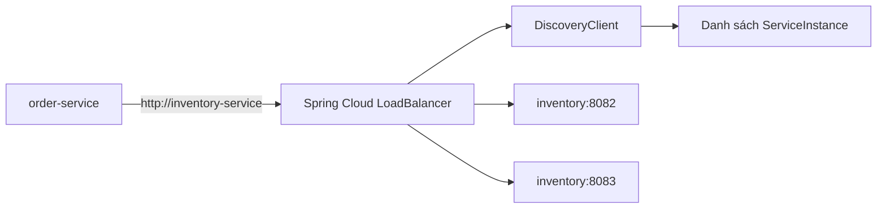

# Trường hợp cần Spring Cloud và chi phí bổ sung

Spring Boot giúp xây dựng và chạy một ứng dụng Java độc lập. Khi hệ thống gồm nhiều ứng dụng triển khai riêng, các câu hỏi mới xuất hiện: một dịch vụ tìm dịch vụ khác bằng cách nào, cấu hình được quản lý ra sao, phải xử lý thế nào khi một instance bị thay thế hoặc một lời gọi mạng thất bại? **Spring Cloud** cung cấp những abstraction và thành phần tích hợp với Spring Boot để giải quyết các mẫu bài toán phân tán đó. Tuy nhiên, thêm Spring Cloud cũng có chi phí về thư viện, hạ tầng, kiểm thử và vận hành.

Bài học thuộc chương **Tổng quan** của **SPRING_CLOUD_CORE**, tập trung vào việc **quyết định khi nào cần Spring Cloud và đánh giá những chi phí bổ sung**. Các khái niệm nền tảng được sử dụng gồm Spring Cloud Commons, Spring Cloud Context, cấu hình ngoài ứng dụng, refresh scope, discovery, service registry, giao tiếp giữa các dịch vụ và tương thích với Spring Boot.

## 1. Mục tiêu học tập

Sau bài này, người học có thể:

- Phân biệt bài toán mà Spring Boot đã giải quyết với bài toán phát sinh khi nhiều dịch vụ giao tiếp qua mạng.
- Nhận diện các dấu hiệu nên dùng Spring Cloud, đồng thời biết khi nào tính năng có sẵn của nền tảng triển khai là đủ.
- Giải thích vai trò của **Spring Cloud Commons** và **Spring Cloud Context** trước khi chọn một thành phần như Config Client, LoadBalancer hoặc Discovery Client.
- Dự tính chi phí kỹ thuật, hạ tầng và vận hành do một cơ chế phân tán mang lại.
- Đề xuất cách áp dụng từng phần, kiểm thử tình huống lỗi và chọn release train tương thích với Spring Boot.

## 2. Spring Boot đã đủ trong trường hợp nào?

Một ứng dụng Spring Boot có thể tự đáp ứng HTTP, xử lý nghiệp vụ, truy cập cơ sở dữ liệu, đọc `application.yml`, biến môi trường và cấu hình ngoài, xuất các endpoint quản trị với Actuator. Việc đóng gói ứng dụng thành container hay chạy nhiều bản sao cũng **không tự động** đòi hỏi Spring Cloud.

Ví dụ, một hệ thống quản lý kho chỉ có một API Spring Boot và một cơ sở dữ liệu, chạy sau load balancer của hạ tầng, thường chưa có lý do rõ ràng để bổ sung service registry hoặc Config Server. Thêm Eureka, Config Server và Gateway chỉ vì ứng dụng được gọi là “microservice” có thể tạo thêm điểm lỗi mà không cải thiện yêu cầu kinh doanh.

Khác biệt thường bắt đầu khi **nhiều đơn vị triển khai độc lập phải tìm nhau, phối hợp với nhau hoặc thay đổi cấu hình theo cách nhất quán**.

| Vấn đề | Khả năng sẵn có | Khi nào cần xem xét Spring Cloud |
| --- | --- | --- |
| Chạy API, xử lý nghiệp vụ, cấu hình tại thời điểm khởi động | Spring Boot | Chưa đủ lý do chỉ từ nhu cầu này |
| Gọi một URL cố định, ít thay đổi | `RestClient`, `WebClient` hoặc client HTTP thông thường | Khi cần gọi theo **tên dịch vụ** với nhiều instance biến động |
| Cân bằng tải ở rìa hệ thống | Load balancer/ingress của nền tảng | Khi **client nội bộ** cần chọn instance qua discovery |
| Đọc biến môi trường, file cấu hình, secret từ nền tảng | Spring Boot và hệ thống triển khai | Khi cần nguồn cấu hình tập trung, phiên bản hóa và cơ chế phân phối rõ ràng |
| Chạy nhiều bản sao trong Kubernetes | Service DNS, Service/Ingress và controller của Kubernetes | Khi cần abstraction Spring thống nhất giữa nhiều môi trường hoặc tính năng bổ sung cụ thể |
| Xử lý lỗi của một lời gọi HTTP | Timeout, xử lý exception, retry phù hợp trong thư viện | Khi cần chính sách phối hợp cho nhiều client/dịch vụ, có quan sát và giới hạn rõ ràng |

**Nguyên tắc:** xác định một vấn đề đang tồn tại, chọn abstraction hoặc thành phần nhỏ nhất giải quyết được vấn đề đó, rồi đo hiệu quả. Spring Cloud là một tập hợp dự án; không cần cài tất cả thành phần.

## 3. Spring Cloud Core giải quyết những lớp vấn đề nào?

### 3.1. Commons: hợp đồng chung cho dịch vụ phân tán

**Spring Cloud Commons** cung cấp những interface, annotation và tích hợp chung để mã nghiệp vụ ít phụ thuộc vào một giải pháp hạ tầng cụ thể:

- `DiscoveryClient` và `ReactiveDiscoveryClient`: tra cứu các instance theo **service ID**; chúng là cơ chế đọc thông tin discovery.
- `ServiceInstance`: thông tin một instance, như host, port, URI và metadata.
- `ServiceRegistry` và `Registration`: abstraction dành cho việc đăng ký/hủy đăng ký, được triển khai bởi adapter tương ứng với registry.
- `@LoadBalanced` cùng Spring Cloud LoadBalancer: giúp client dùng URI logic như `http://inventory-service/...` và chọn instance thực tế.
- Các abstraction liên quan đến circuit breaker để tích hợp triển khai resilience phù hợp; **Commons không tự cung cấp khả năng chịu lỗi đầy đủ cho mọi lời gọi**.

Ví dụ, cùng một `DiscoveryClient` có thể lấy danh sách instance từ các tích hợp như Eureka hoặc Consul; ứng dụng phụ thuộc vào abstraction trong phạm vi được hỗ trợ thay vì tự viết mã gọi API của registry. Khi thay công nghệ registry, vẫn cần thay dependency, cấu hình, kiểm thử và đánh giá khác biệt về metadata hoặc health check.

### 3.2. Context: thay đổi môi trường cấu hình và vòng đời bean

**Spring Cloud Context** mở rộng cách ứng dụng xử lý `Environment`, nguồn cấu hình và việc làm mới bean. Hai cơ chế cần phân biệt:

1. `EnvironmentChangeEvent` có thể kích hoạt việc **bind lại** một số `@ConfigurationProperties` và cập nhật mức log, khi `Environment` đã nhận được giá trị mới.
2. `@RefreshScope` đặt bean trong một scope có proxy và cache; khi scope được refresh, instance được cache sẽ bị loại bỏ và được tạo lại ở lần truy cập tiếp theo.

Việc thay đổi file cấu hình ở máy chủ **không mặc nhiên** khiến mọi JVM nhận cấu hình mới. Phải có cơ chế cập nhật nguồn cấu hình, truyền tín hiệu refresh đến đúng instance và xác nhận bean/luồng xử lý thực sự sử dụng giá trị mới. `@RefreshScope` cũng không bảo đảm mọi bean phụ thuộc đều được tạo lại; không phải mọi loại bean đều hỗ trợ refresh, và refresh context không được hỗ trợ cho native image/AOT theo tài liệu hiện hành.

### 3.3. Các thành phần dùng khi phát sinh nhu cầu

| Nhu cầu | Thành phần có thể dùng | Quyết định cần cân nhắc |
| --- | --- | --- |
| Quản lý cấu hình tập trung qua các môi trường | Spring Cloud Config Client/Server | Có cần tự vận hành Config Server khi nền tảng đã có nguồn cấu hình và secret? |
| Tìm instance khi IP/port thay đổi | Discovery Client với Eureka, Consul hoặc tích hợp tương ứng | Nền tảng đã cung cấp DNS/service discovery đủ tốt chưa? |
| Phân phối lời gọi nội bộ đến nhiều instance | Spring Cloud LoadBalancer | Client-side load balancing có đem lại lợi ích hơn load balancing của hạ tầng? |
| Định tuyến và chính sách ở cửa vào hệ thống | Spring Cloud Gateway | Hệ thống đã có API gateway/ingress đáp ứng yêu cầu chưa? |
| Circuit breaker, timeout, retry và fallback | Tích hợp Spring Cloud CircuitBreaker với triển khai hỗ trợ, cộng cấu hình client | Có chính sách lỗi, deadline và tính idempotent phù hợp chưa? |
| Thông báo thay đổi cấu hình cho nhiều instance | Spring Cloud Bus hoặc cơ chế phát sự kiện khác | Có nhu cầu refresh hàng loạt và vận hành message broker chưa? |

Tên dự án trong bảng là **lựa chọn có điều kiện**, không phải danh sách dependency bắt buộc của một ứng dụng Spring Cloud.

## 4. Những trường hợp Spring Cloud mang lại giá trị rõ ràng

### Trường hợp A: nhiều instance được tạo và hủy thường xuyên

Một nền tảng bán hàng có `order-service` gọi `inventory-service`. Trong giờ cao điểm, inventory tăng từ hai lên sáu instance; instance lỗi được thay thế bằng địa chỉ mới. Nếu `order-service` lưu cố định từng IP, mỗi lần thay đổi phải cập nhật cấu hình hoặc triển khai lại.

Với discovery, client có thể truy vấn service ID và chọn instance từ danh sách hiện thời. Spring Cloud Commons định nghĩa cách truy vấn; Spring Cloud LoadBalancer hỗ trợ chọn instance ở phía client. Điều kiện để cách này hiệu quả là **registry/discovery phải phản ánh tình trạng instance đủ chính xác** và chính sách client phải xử lý danh sách rỗng, instance lỗi hoặc thông tin tạm thời đã cũ.

Nếu `order-service` và `inventory-service` cùng chạy trong Kubernetes, `http://inventory-service` có thể đã được phân giải qua Kubernetes Service DNS và chuyển tiếp bởi hạ tầng. Trong trường hợp đó, **không nhất thiết** phải cài thêm một registry chỉ để tìm instance.

### Trường hợp B: nhiều dịch vụ chia sẻ cấu hình có quản trị thay đổi

Một tổ chức có nhiều dịch vụ dùng chung timeout, hạn mức và cờ tính năng theo môi trường `dev`, `staging`, `prod`. Cấu hình được sửa thường xuyên, cần xem lịch sử, phê duyệt và có khả năng rollback. Spring Cloud Config có thể cung cấp một nguồn cấu hình tập trung; Context cung cấp cơ chế cập nhật một số bean khi có tín hiệu refresh.

Giá trị thực tế là **quy trình quản lý cấu hình**: xác định ai được sửa, cấu hình nào được làm mới lúc chạy, cấu hình nào buộc phải restart và cách khôi phục khi giá trị mới gây lỗi. Dùng Config Server mà không kiểm soát thay đổi hoặc không có phương án khi server cấu hình mất kết nối vẫn là một hệ thống mong manh.

### Trường hợp C: giao tiếp liên dịch vụ có yêu cầu chịu lỗi

`checkout-service` lần lượt gọi `pricing-service` và `inventory-service` trong cùng một request. Một service chậm sẽ kéo dài độ trễ toàn luồng; retry thiếu kiểm soát có thể tạo bão request khi downstream đang quá tải.

Tích hợp load balancing, timeout, circuit breaker, giới hạn đồng thời và quan sát theo từng client có ích trong trường hợp này. Tuy vậy, Spring Cloud không thể tự quyết định **giao dịch nào được retry an toàn**. Ví dụ, gửi yêu cầu thanh toán lần hai có thể tạo khoản thu kép nếu downstream không có cơ chế idempotency. Chính sách lỗi phải xuất phát từ hợp đồng nghiệp vụ.

### Trường hợp D: hệ thống chạy trên nhiều môi trường hoặc nhiều hạ tầng

Một nhóm có dịch vụ chạy trên máy ảo nội bộ, nhóm khác trên nền tảng container. Họ muốn giữ API `DiscoveryClient` hoặc quy ước cấu hình tương đối thống nhất, trong khi mỗi môi trường có cơ chế đăng ký/tìm dịch vụ riêng. Các abstraction Spring Cloud có thể giảm lượng mã gắn trực tiếp với nhà cung cấp hạ tầng, dù cấu hình tích hợp và thử nghiệm xuyên môi trường vẫn là phần việc thực tế.

## 5. Những trường hợp chưa nên bổ sung Spring Cloud

- **Ứng dụng đơn khối đang đáp ứng tốt yêu cầu:** chưa có nhiều dịch vụ triển khai độc lập, không có bài toán discovery hay cấu hình phân tán rõ ràng.
- **Hệ thống nhỏ với endpoint ổn định:** client HTTP thường và một cấu hình tĩnh đã đủ; thêm registry làm tăng số thành phần cần bảo trì.
- **Kubernetes đã giải quyết trọn nhu cầu:** Service DNS, ConfigMap, Secret, ingress và công cụ quan sát sẵn có có thể đáp ứng mục tiêu. Chỉ thêm tính năng Spring Cloud khi xác định phần thiếu.
- **Đội ngũ chưa có khả năng vận hành hệ phân tán:** ưu tiên đặt timeout, health check, log/metric/tracing và quy trình triển khai ổn định trước khi xây thêm Config Server hoặc registry.
- **Lợi ích chỉ là “theo kiến trúc microservices”:** tên gọi kiến trúc không phải một yêu cầu chức năng hoặc chất lượng có thể đo.

Một dự án có thể chỉ dùng **Spring Cloud LoadBalancer**, chỉ dùng **Config Client**, hoặc không cần Spring Cloud. Phương án ít thành phần hơn thường dễ kiểm chứng và dễ quay lại khi nhu cầu thay đổi.

## 6. Chi phí bổ sung: nhìn từ thiết kế đến vận hành

Chi phí thường bị đánh giá thấp vì một starter có thể thêm bằng vài dòng dependency, trong khi việc vận hành hệ thống xảy ra hằng ngày.

| Nhóm chi phí | Điều phát sinh | Câu hỏi trước khi chấp nhận |
| --- | --- | --- |
| **Tương thích phiên bản** | Phải ghép đúng Spring Boot, Spring Cloud release train và các starter; kiểm soát dependency transitives | Có kế hoạch nâng cấp và kiểm tra tương thích theo từng bản phát hành không? |
| **Hạ tầng và tính sẵn sàng** | Registry, Config Server, gateway hoặc broker có thể cần triển khai dự phòng, sao lưu, giám sát | Nếu thành phần này ngừng hoạt động, service còn khởi động/phục vụ được không? |
| **Độ trễ và số điểm lỗi** | Thêm hop mạng, lookup, timeout, retry, circuit breaker và khả năng lỗi một phần | P95/P99 và error budget chịu được mức tăng nào? |
| **Quan sát và chẩn đoán** | Cần log có correlation ID, metric theo service, distributed tracing, cảnh báo | Có thể xác định request lỗi ở hop nào trong thời gian chấp nhận được không? |
| **Bảo mật** | Bảo vệ cấu hình/secret, xác thực giữa dịch vụ, quyền quản trị registry và Actuator | Ai có quyền đọc/sửa cấu hình và kích hoạt refresh? |
| **Kiểm thử** | Phải thử discovery stale, registry mất kết nối, rollout, timeout, retry, config refresh | Kiểm thử tích hợp có mô phỏng được tình trạng dịch vụ chập chờn không? |
| **Triển khai và quy trình** | Phải quản lý thứ tự khởi động, rollback, schema/API compatibility và thay đổi cấu hình | Có thể rollback riêng một service mà không gây lỗi dây chuyền không? |
| **Con người và tài liệu** | Cần trực vận hành, runbook và kỹ năng chẩn đoán hệ phân tán | Ai sở hữu thành phần chung và ai xử lý sự cố ngoài giờ? |

### 6.1. Chi phí trực tiếp và chi phí ẩn

Chi phí trực tiếp gồm CPU/RAM, lưu trữ, mạng, hạ tầng dự phòng và thời gian kỹ sư thiết lập. Chi phí ẩn gồm lỗi do version lệch nhau, hồi quy cấu hình, thời gian tìm nguyên nhân request qua nhiều service, hoặc mất doanh thu khi một dependency chung lỗi.

Có thể dùng công thức ước lượng cho một chu kỳ vận hành:

```text
Tổng chi phí sở hữu (TCO)
  = Chi phí xây dựng và tích hợp
  + Chi phí tài nguyên/hạ tầng
  + Chi phí vận hành, quan sát và bảo mật
  + Chi phí nâng cấp và kiểm thử
  + Thiệt hại kỳ vọng do gián đoạn
```

Đây là **khung kiểm kê chi phí**, không phải công thức dự báo chính xác. Khi so sánh phương án, phải tính cả chi phí của giải pháp thay thế, ví dụ vận hành một registry riêng so với dùng Kubernetes Service DNS đã có.

### 6.2. Ba hệ quả thường bị bỏ qua

**Lỗi khởi động lan rộng:** nếu mọi instance mới buộc lấy cấu hình từ Config Server, sự cố server cấu hình có thể khiến nhiều service không scale hoặc khởi động được dù các instance cũ còn sống. Chọn cơ chế fail-fast, retry và fallback theo yêu cầu, đồng thời kiểm tra hành vi startup khi Config Server không khả dụng.

**Retry nhân tải:** giả sử mỗi trong ba tầng gọi mạng đều retry tối đa ba lần, trong tình huống xấu số lần thử ở tầng sâu có thể tăng theo cấp số nhân. Ví dụ minh họa ba tầng có tối đa 3 lần gọi mỗi tầng tạo tới `3 × 3 × 3 = 27` lần thử ở tầng cuối cho một yêu cầu gốc. Cần deadline tổng, backoff/jitter, giới hạn retry và bảo đảm idempotency.

**Refresh không đồng nhất tức thời:** hai instance có thể dùng cấu hình khác nhau nếu chưa cùng nhận sự kiện, hoặc bean đang xử lý request vẫn giữ trạng thái cũ. Với thay đổi ảnh hưởng tính đúng đắn, dùng cơ chế rollout/versioning hoặc restart có kiểm soát thay vì giả định refresh là giao dịch nguyên tử trên toàn cụm.

## 7. Ví dụ triển khai tối thiểu: gọi dịch vụ theo tên logic

Giả sử `order-service` cần lấy số lượng tồn kho từ `inventory-service` đang chạy ở `localhost:8082` và `localhost:8083`. Ta thử Spring Cloud Commons và LoadBalancer **trước khi đưa một registry thực vào hệ thống**.



Mũi tên đến `DiscoveryClient` là bước lấy danh sách instance; request thực tế được gửi đến một instance đã chọn. Sơ đồ cố ý lược bỏ timeout, bảo mật và lỗi mạng để tập trung vào discovery/load balancing.

### 7.1. Chọn dependency và phiên bản

Với Maven, dùng BOM Spring Cloud **tương thích với phiên bản Spring Boot của dự án**; không tự chọn version độc lập cho từng Spring Cloud starter. Đoạn sau chỉ minh họa cấu trúc, cần thay `${spring-cloud.version}` bằng release train được tài liệu chính thức xác nhận tương thích:

```xml
<dependencyManagement>
    <dependencies>
        <dependency>
            <groupId>org.springframework.cloud</groupId>
            <artifactId>spring-cloud-dependencies</artifactId>
            <version>${spring-cloud.version}</version>
            <type>pom</type>
            <scope>import</scope>
        </dependency>
    </dependencies>
</dependencyManagement>

<dependencies>
    <dependency>
        <groupId>org.springframework.cloud</groupId>
        <artifactId>spring-cloud-starter-loadbalancer</artifactId>
    </dependency>
</dependencies>
```

Đây là phần `dependencyManagement` và dependency để đặt **bên trong** một `pom.xml` đã có cấu hình Spring Boot; đoạn trích không phải POM hoàn chỉnh. Bản Spring Cloud không tương thích với Spring Boot có thể bị bộ kiểm tra tương thích chặn lúc ứng dụng khởi động. Không tắt kiểm tra để che vấn đề phiên bản.

### 7.2. Khai báo hai instance thử nghiệm

Khi chưa thêm client cho registry bên ngoài, Spring Cloud có thể sử dụng `SimpleDiscoveryClient` để đọc instance từ property. Trong `application.properties` của `order-service`:

```properties
spring.application.name=order-service
spring.cloud.discovery.client.simple.instances.inventory-service[0].uri=http://localhost:8082
spring.cloud.discovery.client.simple.instances.inventory-service[1].uri=http://localhost:8083
```

Cách khai báo này thích hợp cho học tập hoặc môi trường cố định. Với hệ thống tự scale, cần nguồn discovery động hoặc dùng service endpoint/DNS do nền tảng quản lý; `SimpleDiscoveryClient` không tự theo dõi instance mới xuất hiện.

### 7.3. Dùng `RestClient` với service ID

Ví dụ Java bên dưới sử dụng Spring Boot có `RestClient` và Spring Cloud LoadBalancer. Dependency web phù hợp phải có sẵn trong ứng dụng.

```java
import org.springframework.cloud.client.loadbalancer.LoadBalanced;
import org.springframework.context.annotation.Bean;
import org.springframework.context.annotation.Configuration;
import org.springframework.stereotype.Service;
import org.springframework.web.client.RestClient;

@Configuration
class ClientConfiguration {
    @Bean
    @LoadBalanced
    RestClient.Builder inventoryRestClientBuilder() {
        return RestClient.builder();
    }
}

@Service
class InventoryGateway {
    private final RestClient client;

    InventoryGateway(@LoadBalanced RestClient.Builder builder) {
        this.client = builder.build();
    }

    String findStock(String sku) {
        return client.get()
                .uri("http://inventory-service/api/inventory/{sku}", sku)
                .retrieve()
                .body(String.class);
    }
}
```

Trong URL, `inventory-service` là **service ID**, không phải DNS host vật lý. LoadBalancer lấy danh sách instance từ discovery và chọn một URI thật. Trong ứng dụng thực, cần cấu hình timeout, xử lý HTTP status, giới hạn retry và định nghĩa kiểu dữ liệu trả về. Đoạn code tập trung minh họa cơ chế chọn instance, chưa phải HTTP client sản xuất hoàn chỉnh.

Để thấy lợi ích và chi phí, hãy thử cho một instance ngừng chạy. Một số request có thể lỗi nếu client vẫn chọn instance đó; việc dùng LoadBalancer **không bảo đảm request luôn thành công**. Phải phối hợp health signal, chính sách chọn instance và hành vi lỗi mà nghiệp vụ chấp nhận được.

## 8. Ví dụ cấu hình tập trung và refresh

Khi thật sự cần Spring Cloud Config Client, ứng dụng Spring Boot có thể import cấu hình từ Config Server bằng cơ chế Config Data:

```yaml
spring:
  application:
    name: order-service
  config:
    import: "configserver:http://config-server:8888"
```

Ví dụ giả định `order-service` có dependency `spring-cloud-starter-config` và Config Server đã hoạt động tại địa chỉ trên. Không có tiền tố `optional:` nghĩa là ứng dụng có thể **không khởi động được** khi không lấy được cấu hình. Dùng `optional:configserver:...` chỉ khi cấu hình dự phòng hợp lệ và chính sách hệ thống cho phép tiếp tục chạy.

Giả sử chỉ có một chính sách nghiệp vụ nhỏ muốn đọc lại ngưỡng vận chuyển. Với Spring Cloud Context trên classpath:

```java
import org.springframework.beans.factory.annotation.Value;
import org.springframework.cloud.context.config.annotation.RefreshScope;
import org.springframework.stereotype.Component;

@Component
@RefreshScope
class ShippingPolicy {
    @Value("${shipping.free-threshold:500000}")
    private long freeThreshold;

    boolean isFreeShipping(long orderTotal) {
        return orderTotal >= freeThreshold;
    }
}
```

Khi nguồn cấu hình có giá trị mới và ứng dụng thực hiện quy trình refresh phù hợp, đối tượng trong refresh scope được tạo lại khi sử dụng tiếp, nhờ vậy có thể nhận ngưỡng mới. Cần lưu ý:

- Cập nhật giá trị trên Config Server **không tự động** phát tín hiệu đến tất cả instance client.
- Endpoint `/actuator/refresh` chỉ có khi đã cấu hình tính năng/Actuator và cho phép truy cập; nếu bật, phải bảo vệ quyền gọi và ghi audit, không công khai cho Internet.
- Không mặc định áp dụng refresh cho `DataSource`, bean trạng thái phức tạp hoặc cấu hình yêu cầu đổi toàn bộ dependency graph. Kiểm tra loại bean cụ thể và giới hạn nêu trong tài liệu.
- Với native image/AOT, quy trình refresh context không được hỗ trợ theo hướng dẫn Spring Cloud Context hiện hành; cần chiến lược cập nhật khác.

Ví dụ minh họa lý do chọn Context, đồng thời cho thấy chi phí đi kèm: xác định cách phát sự kiện, quyền quản trị, trạng thái đang xử lý và hành vi giữa các instance trong lúc thay đổi.

## 9. Kiểm thử và vận hành trước khi đưa vào production

| Tình huống cần kiểm chứng | Điều cần quan sát | Hành vi mong muốn |
| --- | --- | --- |
| Không tìm thấy instance của `inventory-service` | HTTP status, log, metric và thời gian trả lỗi | Không treo vô hạn; lỗi có ý nghĩa hoặc fallback đã xác định |
| Registry/discovery tạm thời không khả dụng | Startup, cache danh sách instance, health signal | Ứng xử đúng chính sách đã chọn; không giả định luôn có registry |
| Một instance inventory chết khi đang xử lý | Tỷ lệ lỗi, P95/P99, retry, số request bị nhân | Giới hạn thời gian và số lần gọi; không retry thao tác không an toàn |
| Config Server không truy cập được lúc startup | Khả năng khởi động và giá trị cấu hình thực nhận | Fail-fast hoặc fallback đúng quy định, có cảnh báo |
| Refresh khi đang có request | Giá trị cũ/mới theo instance, lỗi tạo bean, metric health | Thay đổi được kiểm soát, có kế hoạch rollback |
| Nâng cấp Spring Boot hoặc Spring Cloud | Dependency tree, startup, integration test và hành vi runtime | Release train tương thích; không có hồi quy ở client và cấu hình |

Đội vận hành nên có dashboard theo `service ID`, instance, kết quả lời gọi, độ trễ, lỗi discovery và trạng thái nguồn cấu hình. Log cần có trace/correlation ID để lần theo một yêu cầu xuyên dịch vụ. Health check phải tránh thao tác nặng trên registry nếu không cần thiết, vì bản thân health probe cũng có thể tạo tải đáng kể.

Một kế hoạch thử nghiệm thực tế nên có **unit test** cho nghiệp vụ độc lập, **integration test** cho adapter/configuration đã chọn và **bài thử lỗi** trên môi trường gần production. Nếu chỉ dùng SimpleDiscoveryClient trong test, phải hiểu rằng bài test chưa chứng minh được khả năng hoạt động với registry thực và khi lease/health thay đổi.

## 10. Khung quyết định trước khi thêm dependency

Thay vì bắt đầu bằng tên sản phẩm, trả lời lần lượt các câu hỏi sau:

1. **Vấn đề là gì?** Ví dụ: địa chỉ dịch vụ đổi liên tục, cấu hình phải sửa ở nhiều nơi, hoặc request nội bộ thường xuyên lỗi.
2. **Có bằng chứng không?** Dữ liệu từ sự cố, độ trễ, tần suất deploy, thời gian cấu hình và số lần phải sửa tay.
3. **Spring Boot hoặc nền tảng hiện tại đã giải quyết được bao nhiêu?** Kiểm tra Service DNS, ingress, environment variables, ConfigMap/Secret, gateway, secret manager và hệ thống quan sát.
4. **Cần abstraction Spring nào?** Commons/Context, LoadBalancer, Config Client hay một dự án Cloud riêng; tránh kéo cả hệ sinh thái nếu chỉ cần một cơ chế.
5. **Thêm điểm lỗi nào?** Registry, Config Server, broker, gateway, client-side timeout hay refresh event; xác định hành vi khi chúng mất kết nối.
6. **Ai vận hành?** Quyền truy cập, backup, cảnh báo, on-call, quy trình nâng cấp và rollback.
7. **Đo thành công bằng gì?** Ví dụ: giảm cập nhật IP thủ công, giảm sự cố cấu hình, cải thiện thời gian phục hồi hoặc giảm lỗi gọi dịch vụ.

Có thể lập bảng quyết định ngắn cho từng tính năng:

| Tình huống | Lựa chọn ban đầu hợp lý | Điều kiện đổi quyết định |
| --- | --- | --- |
| Một ứng dụng Spring Boot duy nhất | Giữ Spring Boot và hạ tầng hiện có | Xuất hiện bài toán phân tán cụ thể |
| Nhiều service cùng Kubernetes, gọi nhau qua Service DNS | Thử DNS/Service trước | Cần client-side routing hoặc abstraction bổ sung đã đo được lợi ích |
| Service chạy động trên VM với registry tổ chức đang vận hành | Tích hợp DiscoveryClient phù hợp; cân nhắc LoadBalancer | Đánh giá độ chính xác của registry và tình huống stale instance |
| Nhiều service cần cấu hình tập trung, có yêu cầu audit | So sánh nền tảng config hiện có với Config Client/Server | Chọn khi lợi ích quy trình lớn hơn chi phí vận hành và phụ thuộc startup |
| Các lời gọi nội bộ thường quá thời gian hoặc có lỗi dây chuyền | Thiết kế deadline, timeout, quan sát, idempotency trước | Thêm circuit breaker/retry có giới hạn khi dữ liệu lỗi chứng minh cần |

### Ví dụ quyết định tổng hợp

Một đội có tám dịch vụ Spring Boot trên Kubernetes, hiện giao tiếp ổn định bằng Service DNS. Họ muốn bổ sung Eureka và Config Server để “chuẩn hóa microservices”. Sau khi đối chiếu nhu cầu:

- Địa chỉ dịch vụ đã được DNS/Service xử lý, nên **chưa có lợi ích rõ** từ registry riêng.
- Cấu hình ít thay đổi và đang được triển khai có kiểm soát qua công cụ của cluster, nên **chưa cần** Config Server.
- Một số request có độ trễ cao khi inventory quá tải. Việc cần làm trước là đặt deadline, timeout, metric và chính sách giảm tải. Nếu sau đo đạc cần lựa chọn instance từ phía client hoặc policy resilience chung, nhóm mới đánh giá thành phần Spring Cloud phù hợp.

Ngược lại, nếu tám dịch vụ đó triển khai trên VM với địa chỉ biến động, không có cơ chế tìm dịch vụ thống nhất, việc dùng một discovery integration của Spring Cloud có thể giảm cấu hình cứng và rút ngắn thời gian thay thế instance. Phần lợi ích phải được đối chiếu với chi phí duy trì registry và xử lý tình huống registry không khả dụng.

## 11. Các ngộ nhận cần tránh

**“Dùng microservices thì bắt buộc dùng Spring Cloud.”** Sai. Microservices là lựa chọn kiến trúc; cơ chế discovery, routing và config có thể được nền tảng triển khai cung cấp.

**“Có `@LoadBalanced` thì lời gọi nào cũng chịu lỗi.”** Sai. Load balancing chỉ giúp chọn điểm đến; timeout, retry, idempotency, fallback và khả năng phục hồi là những quyết định riêng.

**“Có `@RefreshScope` thì sửa cấu hình xong mọi instance đổi ngay.”** Sai. Phải có nguồn cấu hình mới, cơ chế kích hoạt refresh và kiểm tra loại bean hỗ trợ. Trong giai đoạn chuyển đổi có thể tồn tại nhiều giá trị song song.

**“Thêm starter rất nhẹ nên tổng chi phí thấp.”** Không nhất thiết. Một dependency có thể cần cả cụm hạ tầng, dashboard, bảo mật và quy trình vận hành.

**“Cập nhật Spring Boot độc lập với Spring Cloud.”** Sai. Spring Cloud phát hành theo **release train**, có ma trận tương thích với các dòng Spring Boot. Phải kiểm tra trước khi nâng cấp và dùng BOM để quản lý các thành phần Cloud tương ứng.

## 12. Kết luận

Spring Cloud có giá trị khi giải quyết **một vấn đề phân tán đã xác định**: tìm dịch vụ động, cân bằng tải nội bộ, quản lý cấu hình giữa nhiều ứng dụng hoặc tích hợp chính sách giao tiếp đáng tin cậy. Spring Cloud Commons tạo lớp abstraction chung, còn Spring Cloud Context hỗ trợ thay đổi môi trường cấu hình và vòng đời bean. Những cơ chế này làm giảm mã tích hợp lặp lại nhưng không xóa bỏ bản chất không ổn định của mạng và hệ phân tán.

Quyết định tốt bắt đầu từ đo lường và so sánh với năng lực có sẵn của Spring Boot cùng nền tảng chạy ứng dụng. Chỉ chọn những thành phần cần thiết, kiểm soát tương thích phiên bản và tính đủ **chi phí phát triển, hạ tầng, bảo mật, kiểm thử, quan sát, vận hành và rủi ro sự cố**.

## Tài liệu tham khảo

- [Spring Cloud — dự án và ma trận tương thích Spring Boot](https://spring.io/projects/spring-cloud/).
- [Spring Cloud Commons — Common Abstractions](https://docs.spring.io/spring-cloud-commons/reference/spring-cloud-commons/common-abstractions.html): `DiscoveryClient`, `ServiceRegistry`, `SimpleDiscoveryClient`, HTTP clients có LoadBalancer.
- [Spring Cloud Commons — Spring Cloud LoadBalancer](https://docs.spring.io/spring-cloud-commons/reference/spring-cloud-commons/loadbalancer.html): cách chọn instance và các tùy chọn load balancing.
- [Spring Cloud Context — Application Context Services](https://docs.spring.io/spring-cloud-commons/reference/spring-cloud-commons/application-context-services.html): `EnvironmentChangeEvent`, `@RefreshScope`, giới hạn và endpoint refresh.
- [Spring Cloud Config — Config Client](https://docs.spring.io/spring-cloud-config/reference/client.html): `spring.config.import`, cấu hình bắt buộc/tùy chọn và hành vi startup.

Các URL tham chiếu tới tài liệu chính thức. Khi thực hành, hãy chọn đúng **nhánh tài liệu theo release train** đang dùng vì API, mặc định cấu hình và danh sách phiên bản hỗ trợ có thể thay đổi.
