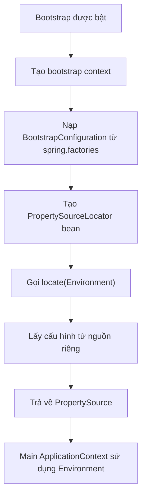
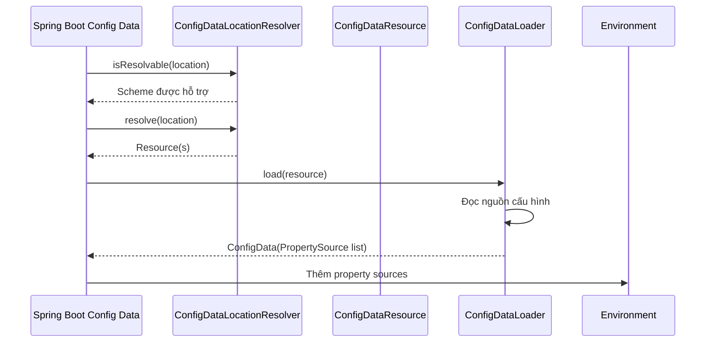

# Khi nào cần PropertySourceLocator hoặc Config Data extension

## 1. Bài toán: đưa nguồn cấu hình riêng vào Environment

Spring Boot hỗ trợ nhiều nguồn cấu hình thông dụng: `application.yml`, profile-specific files, biến môi trường, tham số dòng lệnh, Config Server và các location khác. Spring tổng hợp chúng thành `Environment`; bean đọc giá trị qua `@Value`, `@ConfigurationProperties` hoặc API của Environment.

Một số hệ thống cần lấy cấu hình từ nguồn riêng: dịch vụ quản lý tenant, kho tham số theo vùng, API cấu hình nội bộ, cơ sở dữ liệu cấu hình hoặc một hệ thống secrets có giao thức riêng. Khi đó nhóm phát triển có thể viết integration để tải dữ liệu và thêm các khóa vào Environment.

Spring Cloud và Spring Boot cung cấp hai extension point thường được cân nhắc:

- **`PropertySourceLocator`**: cơ chế của Spring Cloud gắn với bootstrap lifecycle truyền thống, dùng để tìm và trả về `PropertySource` từ nguồn ngoài.
- **Config Data extension**: cơ chế của Spring Boot, kết hợp `ConfigDataLocationResolver` và `ConfigDataLoader`, cho phép ứng dụng import location có scheme riêng qua `spring.config.import`.

Hai cách đều có thể đóng góp property source, nhưng khác nhau về lifecycle, cách khai báo, xử lý profile và mức độ tích hợp với Spring Boot. Chọn sai extension point có thể khiến code không chạy ở thời điểm mong đợi hoặc không được gọi trong ứng dụng không bật bootstrap.

Bài thuộc chương **Nguồn cấu hình tùy biến** của mô-đun **SPRING_CLOUD_CORE**. Người học cần hiểu Spring Cloud Commons, Context, cấu hình bên ngoài và tương thích Spring Boot; bài này tập trung vào quyết định thiết kế khi cần mở rộng cơ chế nạp cấu hình.

Sau bài học, người học có thể:

- Xác định khi nào nguồn cấu hình cần `PropertySourceLocator`.
- Xác định khi nào nên triển khai Config Data resolver/loader.
- Phân biệt bootstrap context với Config Data processing.
- Thiết kế location, resource, property source và đăng ký extension.
- Xử lý profile, optional location, precedence, lỗi mạng và bảo mật.
- Kiểm thử integration để chứng minh nguồn tùy biến được nạp đúng lúc.

## 2. Chọn extension point theo lifecycle

| Tiêu chí | `PropertySourceLocator` | Config Data extension |
| --- | --- | --- |
| Chủ sở hữu API | Spring Cloud | Spring Boot |
| Thành phần chính | `PropertySourceLocator` | `ConfigDataLocationResolver` và `ConfigDataLoader` |
| Giai đoạn | Bootstrap / legacy property-source integration | Config Data processing khi Boot chuẩn bị `Environment` |
| Khai báo nguồn | Bootstrap configuration | `spring.config.import` với scheme tùy biến |
| Đầu ra | Một `PropertySource<?>` hoặc `null` | Một `ConfigData` gồm một hay nhiều `PropertySource<?>` |
| Profile | Đọc profile từ `Environment`; cách gọi phụ thuộc release train | Resolver có hook `resolveProfileSpecific(...)` sau khi profile được xác định |
| Optional / lỗi location | Theo hành vi bootstrap integration và locator | `optional:` cùng các exception của Config Data |
| Context bắt buộc | Gắn với bootstrap legacy | Không cần bootstrap context Spring Cloud |
| Nên dùng khi | Duy trì integration đã dựa trên bootstrap hoặc cần thêm nguồn trong bootstrap context | Xây dựng integration mới theo Config Data, có location scheme riêng và cần tích hợp với Boot |

**Quy tắc chọn nhanh:** nếu ứng dụng mới cần import một nguồn cấu hình theo cú pháp như `spring.config.import=tenantcfg:orders`, hãy xem xét Config Data extension trước. Nếu ứng dụng đã duy trì bootstrap legacy và cần thêm property source vào chính bootstrap context, `PropertySourceLocator` là extension point phù hợp.

Trước khi tự viết extension, hãy kiểm tra xem Boot hoặc thư viện hiện có đã hỗ trợ location đó chưa. Nếu chỉ cần đọc file, biến môi trường, Config Server hoặc config tree theo chuẩn, dùng cơ chế có sẵn sẽ giảm code, dependency và chi phí vận hành.

## 3. PropertySourceLocator: mở rộng bootstrap của Spring Cloud

### 3.1. Cách hoạt động

Trong mô hình bootstrap truyền thống, Spring Cloud dựng bootstrap context trước main application context. Các lớp cấu hình được liệt kê trong `META-INF/spring.factories` dưới key `org.springframework.cloud.bootstrap.BootstrapConfiguration` được dùng để tạo context này.

Một bean triển khai `PropertySourceLocator` được gọi với `Environment` của application context sắp được tạo. Nó có thể dùng thông tin sẵn có như `spring.application.name`, profile hoặc region để truy vấn nguồn cấu hình và trả về `PropertySource`. Spring Cloud đưa property source đó vào Environment theo quy tắc của bootstrap integration.



### 3.2. Ví dụ locator

Giả sử tổ chức có một dịch vụ cấu hình nội bộ trả về map thuộc tính theo tên ứng dụng. `RemoteSettingsClient` dưới đây là adapter do ứng dụng tự triển khai để gọi API đó:

```java
import java.util.Map;
import org.springframework.cloud.bootstrap.config.PropertySourceLocator;
import org.springframework.core.env.Environment;
import org.springframework.core.env.MapPropertySource;
import org.springframework.core.env.PropertySource;

public final class TenantPropertySourceLocator implements PropertySourceLocator {

    private final RemoteSettingsClient client;

    public TenantPropertySourceLocator(RemoteSettingsClient client) {
        this.client = client;
    }

    @Override
    public PropertySource<?> locate(Environment environment) {
        String application = environment.getProperty(
                "spring.application.name", "application");
        String region = environment.getProperty("app.region", "default");
        Map<String, Object> properties =
                client.loadProperties(application, region);

        if (properties == null || properties.isEmpty()) {
            return null;
        }
        return new MapPropertySource("tenant-settings", properties);
    }
}
```

`RemoteSettingsClient` đại diện cho adapter kết nối HTTP, database hoặc SDK của hệ thống cấu hình. Locator không nên tự chứa toàn bộ logic retry, xác thực, cache và parse; tách chúng vào adapter để có thể kiểm thử độc lập.

### 3.3. Đăng ký trong bootstrap context

Tạo một lớp cấu hình riêng:

```java
import org.springframework.context.annotation.Bean;
import org.springframework.context.annotation.Configuration;
import org.springframework.cloud.bootstrap.config.PropertySourceLocator;

@Configuration
public class TenantBootstrapConfiguration {

    @Bean
    RemoteSettingsClient remoteSettingsClient() {
        return new HttpRemoteSettingsClient();
    }

    @Bean
    PropertySourceLocator tenantPropertySourceLocator(
            RemoteSettingsClient client) {
        return new TenantPropertySourceLocator(client);
    }
}
```

Trong thư mục `src/main/resources/META-INF`, khai báo file `spring.factories`:

```properties
org.springframework.cloud.bootstrap.BootstrapConfiguration=\
com.example.config.TenantBootstrapConfiguration
```

Tên package và class trong ví dụ cần thay bằng package thực tế của thư viện. Bootstrap phải được bật theo phiên bản và deployment; chỉ có file `spring.factories` không có nghĩa bootstrap tự chạy.

**Lưu ý quan trọng:** đặt bootstrap configuration ở package riêng, ngoài vùng component scan của ứng dụng chính. Nếu lớp cấu hình bị scan vào main context ngoài ý muốn, bean bootstrap có thể được tạo thêm ở sai lifecycle hoặc hai lần. Tránh phụ thuộc vào bean nghiệp vụ chỉ tồn tại trong main context vì locator chạy trước khi những bean đó sẵn sàng.

### 3.4. Thay đổi hành vi locator theo release train

Không nên giả định locator luôn chỉ chạy một lần ở cùng một context:

- Trước Spring Cloud 2022.0.3, tài liệu Spring Cloud ghi nhận `PropertySourceLocators` (bao gồm locator của Config Client) chạy trong main application context, không phải bootstrap context. Có thể yêu cầu chạy trong bootstrap context bằng `spring.cloud.config.initialize-on-context-refresh=true` trong bootstrap configuration.
- Từ Spring Cloud 2022.0.3, các locator được gọi hai lần: lần đầu không có profile để lấy property source có thể kích hoạt `spring.profiles.active`; sau khi main context bắt đầu, locator được gọi lần nữa với các profile active để tải property source tương ứng.

Vì vậy, locator cần **an toàn khi được gọi lặp**. Tránh ghi dữ liệu, tạo tài nguyên hoặc thực hiện thao tác có side effect không thể lặp lại. Cache có thể hữu ích, nhưng cache key phải bao gồm các yếu tố ảnh hưởng kết quả như application name, region, profile và label.

### 3.5. Khi nào không nên dùng?

- Ứng dụng không bật bootstrap legacy và không có integration nào kích hoạt locator.
- Dự án mới chỉ cần import một nguồn cấu hình theo `spring.config.import`.
- Nguồn cần xử lý profile-specific resources theo lifecycle chuẩn của Config Data.
- Locator phải phụ thuộc bean của main context để thực hiện công việc.
- Một location resolver/loader của Boot có thể diễn đạt yêu cầu rõ ràng hơn.

## 4. Config Data extension: tạo location scheme riêng

### 4.1. Ba khái niệm cốt lõi

Config Data API được Spring Boot giới thiệu từ **2.4**. Một extension thường gồm ba phần:

1. **`ConfigDataLocationResolver`** nhận location do người dùng khai báo, xác định location có thuộc scheme của mình không và chuyển nó thành một hay nhiều resource.
2. **`ConfigDataResource`** biểu diễn tài nguyên cụ thể sẽ được tải, ví dụ tenant, URI, region hoặc version của cấu hình.
3. **`ConfigDataLoader`** đọc resource và trả về `ConfigData`, chứa các `PropertySource` đóng góp vào Environment.

Resolver tập trung vào việc *xác định cần tải gì*; loader tập trung vào việc *đọc tài nguyên đó*. Việc tách hai trách nhiệm giúp xử lý profile, location và lỗi rõ ràng hơn.

Các extension chạy trước khi main application context hoàn tất khởi tạo, vì vậy không nên giả định chúng có thể autowire tùy ý các bean nghiệp vụ của ứng dụng. Boot hỗ trợ một số tham số constructor dành riêng cho extension: resolver có thể nhận `Binder`, `ResourceLoader`, `DeferredLogFactory` và `ConfigurableBootstrapContext`; loader có thể nhận `DeferredLogFactory` và `ConfigurableBootstrapContext`. Nếu cần chia sẻ client tốn chi phí khởi tạo giữa các giai đoạn, dùng bootstrap registry theo hợp đồng của Boot thay vì phụ thuộc vào bean của main context.

### 4.2. Luồng xử lý



Nếu nguồn cần tải dữ liệu riêng theo profile, resolver có thể triển khai `resolveProfileSpecific(...)`. Boot gọi hook này sau khi các profile được xác định từ dữ liệu đã nạp ở bước trước.

### 4.3. Ví dụ location tùy biến

Giả sử thư viện cần hỗ trợ:

```yaml
spring:
  config:
    import: "optional:tenantcfg:orders"
```

Trong đó `tenantcfg:` là scheme do thư viện định nghĩa và `orders` là tenant hoặc nhóm cấu hình. Tiền tố `optional:` cho phép location không có dữ liệu mà ứng dụng vẫn tiếp tục theo quy tắc Config Data.

#### Resolver

```java
import java.util.Collections;
import java.util.List;
import org.springframework.boot.context.config.ConfigDataLocation;
import org.springframework.boot.context.config.ConfigDataLocationResolver;
import org.springframework.boot.context.config.ConfigDataLocationResolverContext;

public final class TenantConfigDataLocationResolver
        implements ConfigDataLocationResolver<TenantConfigDataResource> {

    @Override
    public boolean isResolvable(
            ConfigDataLocationResolverContext context,
            ConfigDataLocation location) {
        return location.hasPrefix("tenantcfg:");
    }

    @Override
    public List<TenantConfigDataResource> resolve(
            ConfigDataLocationResolverContext context,
            ConfigDataLocation location) {
        String tenant = location.getNonPrefixedValue("tenantcfg:");
        return Collections.singletonList(
                new TenantConfigDataResource(tenant, location.isOptional()));
    }
}
```

#### Resource

```java
import java.util.Objects;
import org.springframework.boot.context.config.ConfigDataResource;

public final class TenantConfigDataResource extends ConfigDataResource {

    private final String tenant;

    public TenantConfigDataResource(String tenant, boolean optional) {
        super(optional);
        this.tenant = tenant;
    }

    public String getTenant() {
        return tenant;
    }

    @Override
    public boolean equals(Object other) {
        if (this == other) return true;
        if (!(other instanceof TenantConfigDataResource)) return false;
        TenantConfigDataResource that = (TenantConfigDataResource) other;
        return Objects.equals(tenant, that.tenant);
    }

    @Override
    public int hashCode() {
        return Objects.hash(tenant);
    }

    @Override
    public String toString() {
        return "TenantConfigDataResource{tenant='" + tenant + "'}";
    }
}
```

`ConfigDataResource` yêu cầu implementation có `equals`, `hashCode` và `toString` hợp lệ. Constructor nhận cờ optional được bổ sung trong dòng API Config Data từ Spring Boot 2.4.6; nếu hỗ trợ baseline cũ hơn, cần đối chiếu API của đúng phiên bản và xử lý optional theo cách phiên bản đó hỗ trợ.

#### Loader

```java
import java.io.IOException;
import java.util.Collections;
import java.util.Map;
import org.springframework.boot.context.config.ConfigData;
import org.springframework.boot.context.config.ConfigDataLoader;
import org.springframework.boot.context.config.ConfigDataLoaderContext;
import org.springframework.core.env.MapPropertySource;
import org.springframework.core.env.PropertySource;

public final class TenantConfigDataLoader
        implements ConfigDataLoader<TenantConfigDataResource> {

    @Override
    public ConfigData load(
            ConfigDataLoaderContext context,
            TenantConfigDataResource resource) throws IOException {

        Map<String, Object> values =
                fetchFromConfigurationService(resource.getTenant());

        if (values == null || values.isEmpty()) {
            return ConfigData.EMPTY;
        }

        PropertySource<?> source = new MapPropertySource(
                "tenantcfg:" + resource.getTenant(), values);
        return new ConfigData(Collections.singletonList(source));
    }

    private Map<String, Object> fetchFromConfigurationService(String tenant)
            throws IOException {
        // Gọi adapter HTTP/SDK của thư viện và trả về map property.
        // Ví dụ được rút gọn; không hard-code dữ liệu cấu hình tại đây.
        throw new UnsupportedOperationException("Implement configuration transport");
    }
}
```

Đây là skeleton thể hiện hợp đồng resolver/resource/loader; `fetchFromConfigurationService` là phần adapter cần được hiện thực theo giao thức thật. Trong implementation production, xử lý resource không tồn tại theo optional flag: location bắt buộc phải phát lỗi Config Data phù hợp, location optional có thể được bỏ qua theo hợp đồng API. Không biến mọi lỗi mạng hoặc lỗi xác thực thành `ConfigData.EMPTY`, vì điều đó che giấu sự cố nguồn cấu hình.

### 4.4. Đăng ký resolver và loader

Config Data resolver và loader được đăng ký qua `META-INF/spring.factories` của thư viện:

```properties
org.springframework.boot.context.config.ConfigDataLocationResolver=\
com.example.config.TenantConfigDataLocationResolver

org.springframework.boot.context.config.ConfigDataLoader=\
com.example.config.TenantConfigDataLoader
```

Ứng dụng sử dụng thư viện chỉ cần có dependency chứa extension và khai báo location:

```yaml
spring:
  config:
    import: "optional:tenantcfg:orders"
```

Không cần `spring-cloud-starter-bootstrap` cho cơ chế này. Resolver/loader là extension point của Spring Boot Config Data, không phải `PropertySourceLocator`.

## 5. Profile, optional và precedence

### 5.1. Profile-specific configuration

Với `PropertySourceLocator`, locator nhận `Environment` và tự quyết định dùng application name, profile, region hoặc label nào để truy vấn. Hành vi gọi locator theo profile phụ thuộc release train; từ Spring Cloud 2022.0.3, locator được gọi hai lần như mô tả ở trên.

Với Config Data, resolver có hook `resolveProfileSpecific(context, location, profiles)`. Hãy dùng hook này khi một location cần sinh resource riêng theo profile, ví dụ `tenantcfg:orders` cần tải thêm tài nguyên `orders-prod` khi profile `prod` đã được xác định. Không tự đọc profile từ biến global hoặc file cấu hình khác nếu Boot đã cung cấp profile qua context.

### 5.2. Optional và lỗi

Config Data phân biệt location bắt buộc và tùy chọn bằng tiền tố `optional:`. Resolver có thể kiểm tra `location.isOptional()` và truyền trạng thái này vào resource. Khi resource không tồn tại, implementation cần tuân thủ exception contract của Boot để location bắt buộc thất bại còn location optional được xử lý đúng.

Với `PropertySourceLocator`, trả về `null` có thể biểu thị không có property source. Tuy nhiên, lỗi kết nối, lỗi xác thực hoặc response không hợp lệ không nên bị đổi thành `null` một cách tùy tiện. Quyết định fail-fast hay fallback phải là chính sách rõ ràng của ứng dụng.

| Tình huống | Config Data | PropertySourceLocator |
| --- | --- | --- |
| Location không tồn tại và là optional | Có thể bỏ qua theo optional semantics | Cần quy định hành vi trong locator/adapter |
| Location bắt buộc không tồn tại | Phát lỗi Config Data phù hợp | Phát lỗi để startup thất bại theo chính sách |
| API từ xa trả 401/403 | Không nên âm thầm coi là không có cấu hình | Không nên trả `null` để che lỗi quyền |
| Timeout hoặc server unavailable | Timeout/retry có giới hạn; fail hoặc fallback theo optional policy | Timeout/retry có giới hạn; không tạo property source giả |
| Response rỗng hợp lệ | Có thể trả `ConfigData.EMPTY` | Có thể trả `null` hoặc property source rỗng theo thiết kế |

### 5.3. Property source precedence

Mỗi extension trả về property source có tên riêng và phải hiểu vị trí của nó trong quy tắc precedence:

- Config Data loader trả về danh sách `PropertySource` theo thứ tự ưu tiên tăng dần; source sau có thể ghi đè source trước khi trùng khóa.
- `PropertySourceLocator` tham gia vào bootstrap/Cloud lifecycle; property source được thêm vào theo thứ tự của bootstrap context và release train.
- Các nguồn có độ ưu tiên cao hơn như command-line arguments, system properties hoặc environment variables vẫn có thể ảnh hưởng kết quả theo quy tắc của Boot.

Không đặt tên property source tùy tiện giống một source khác vì trùng tên có thể ảnh hưởng cách Spring hợp nhất hierarchy. Chọn tên ổn định, có namespace của extension, ví dụ `tenantcfg:orders` hoặc `tenant-settings:orders`.

### 5.4. Cấu hình nhạy cảm

Không ghi token, password hoặc private key vào log; không đưa toàn bộ map cấu hình vào exception message. Nếu nguồn chứa secret, cân nhắc tích hợp với secret manager chuyên dụng, kiểm soát quyền truy cập, mã hóa đường truyền, xoay vòng credential và giới hạn thời gian lưu cache.

## 6. Khi nào cần extension tùy biến và khi nào không?

| Nhu cầu | Lựa chọn nên xem xét trước |
| --- | --- |
| Đọc YAML/Properties từ file classpath hoặc file ngoài | Config Data location có sẵn (`classpath:`, `file:`) |
| Đọc Config Server | Spring Cloud Config Client với `spring.config.import=configserver:` |
| Đọc config tree mount từ nền tảng | Config tree support của Spring Boot |
| Nạp cấu hình từ giao thức hoặc API nội bộ bằng cú pháp import riêng | Config Data resolver + loader |
| Thêm nguồn vào ứng dụng đang phụ thuộc bootstrap legacy | `PropertySourceLocator` |
| Chỉ cần map một vài giá trị từ bean đã bind | `@ConfigurationProperties` hoặc cấu hình bean |
| Cần biến đổi dữ liệu nghiệp vụ sau startup | Service/adapter thông thường, không phải config loading extension |

Một extension tùy biến đáng làm khi nó là **tích hợp có thể tái sử dụng** giữa nhiều ứng dụng, có hợp đồng location rõ ràng, quản lý lỗi/profile/precedence và có test độc lập. Nếu chỉ một ứng dụng cần thêm vài khóa, một adapter đơn giản hoặc cấu hình tiêu chuẩn thường dễ bảo trì hơn.

## 7. Kiểm thử extension

### 7.1. Kiểm thử PropertySourceLocator

- Unit test locator với `MockEnvironment`, kiểm tra application name, profile và region được đọc đúng.
- Test trường hợp remote source trả map hợp lệ, map rỗng, lỗi xác thực và timeout.
- Integration test bật bootstrap, xác nhận locator được đăng ký từ `spring.factories` và property xuất hiện trong Environment.
- Với Spring Cloud 2022.0.3 trở lên, kiểm tra locator có thể được gọi hai lần và không gây side effect.
- Xác nhận package của `BootstrapConfiguration` không bị component scan vào main context.

### 7.2. Kiểm thử Config Data resolver/loader

- Test `isResolvable` chỉ nhận scheme do extension sở hữu; không nhận location chuẩn của Boot.
- Test `resolve` parse location thành resource đúng tenant/region và giữ optional flag.
- Test `resolveProfileSpecific` nếu nguồn có dữ liệu theo profile.
- Test loader trả `ConfigData` chứa property source với tên và giá trị mong đợi.
- Test location bắt buộc không tồn tại và location optional không tồn tại.
- Test lỗi IO, timeout, response lỗi và xác thực; xác nhận lỗi không bị nuốt.
- Integration test khởi động Spring Boot với `spring.config.import=tenantcfg:...`, rồi kiểm tra bean đọc được giá trị.

### 7.3. Kiểm thử precedence và profile

Đặt cùng một khóa ở local file, remote source, environment variable và command line. Xác minh giá trị cuối cùng theo thiết kế. Chạy ít nhất một test với profile mặc định và một test với profile `prod` hoặc profile đại diện để chắc chắn resolver/locator lấy đúng bộ cấu hình.

Không gọi dịch vụ cấu hình thật trong unit test. Dùng fake client hoặc mock server; chỉ integration test ở một lớp riêng mới kiểm tra hợp đồng mạng.

## 8. Vận hành và chẩn đoán

| Triệu chứng | Nguyên nhân thường gặp | Cách kiểm tra |
| --- | --- | --- |
| `PropertySourceLocator` không chạy | Bootstrap chưa bật hoặc configuration class chưa được đăng ký | Kiểm tra starter/cờ bootstrap và key `BootstrapConfiguration` |
| Locator chạy nhưng không có property | Sai application name/profile/region hoặc remote response rỗng | Ghi log metadata không nhạy cảm; kiểm tra request và response |
| Locator được gọi nhiều lần | Hành vi theo release train, đặc biệt từ 2022.0.3 | Kiểm tra release notes và làm locator idempotent |
| Config Data location không được nhận | Resolver chưa đăng ký hoặc `isResolvable` sai scheme | Kiểm tra `spring.factories`, dependency và location string |
| Loader không được gọi | Resolver không tạo resource đúng kiểu hoặc không có loader nhận resource | Kiểm tra generic type và `ConfigDataResource` |
| Optional location vẫn làm startup thất bại | Exception không tuân thủ optional semantics hoặc lỗi bị phân loại sai | Kiểm tra resource optional và exception contract |
| Property bị ghi đè | Precedence, import order hoặc tên source | Quan sát nguồn property đã sanitize và viết test trùng khóa |
| Startup chậm | Gọi API đồng bộ lâu, retry vô hạn hoặc tải lặp | Đặt timeout, retry có giới hạn, cache phù hợp và metric thời gian tải |

Một nguồn cấu hình tùy biến chạy trong giai đoạn startup có thể làm ứng dụng không khởi động nếu hệ thống ngoài chậm hoặc không khả dụng. Đặt connect/read timeout, retry có giới hạn và chính sách fail-fast/fallback rõ ràng. Không thực hiện vòng lặp chờ vô hạn trong resolver/loader/locator.

Khi có nhiều instance, mỗi instance có thể tải cấu hình ở thời điểm khác nhau. Config Data và `PropertySourceLocator` là cơ chế nạp cấu hình; chúng không tự cung cấp polling hoặc broadcast thay đổi runtime. Nếu cần cập nhật khi ứng dụng đang chạy, phải thiết kế riêng việc refresh Environment/bean và phân phối thay đổi tới các instance.

## 9. Ví dụ quyết định thiết kế

**Tình huống A — ứng dụng mới cần lấy chính sách theo tenant.** Mỗi ứng dụng khai báo `spring.config.import=tenantcfg:orders`; thư viện dùng resolver để parse tenant, loader để lấy chính sách và trả `ConfigData`. Cách này tích hợp trực tiếp với Config Data, hỗ trợ optional location và có thể mở rộng profile-specific resources.

**Tình huống B — hệ thống cũ đã bật bootstrap.** Nhiều dịch vụ đang dùng `bootstrap.yml`, có bootstrap context riêng và cần bổ sung property từ API nội bộ trước main context. Một `PropertySourceLocator` được đăng ký qua `BootstrapConfiguration` là lựa chọn ít thay đổi hơn. Cần kiểm tra release train, lần gọi locator và tránh đưa bootstrap config vào component scan.

**Tình huống C — ứng dụng chỉ cần đọc một file cấu hình.** Dùng `file:` hoặc `configtree:` nếu phù hợp với format và phiên bản Boot. Viết custom resolver/loader cho trường hợp này tạo thêm code mà không mang lại giá trị tương xứng.

**Tình huống D — cần nạp secret.** Chọn secret manager hoặc integration được hỗ trợ. Nếu thật sự cần custom extension, giới hạn quyền đọc theo service/tenant, không log nội dung, quản lý cache và xoay credential. Không dùng `PropertySourceLocator` hay Config Data loader như kho lưu trữ secret tự chế.

## 10. Tổng kết và câu hỏi tự kiểm tra

`PropertySourceLocator` thuộc hệ sinh thái Spring Cloud và gắn với bootstrap/legacy property-source lifecycle. Nó phù hợp khi cần mở rộng một ứng dụng đã dùng bootstrap context. Config Data extension thuộc Spring Boot; `ConfigDataLocationResolver` chuyển location thành resource, còn `ConfigDataLoader` tải resource và trả `ConfigData` để Boot thêm property source vào Environment. Đây là lựa chọn tự nhiên hơn cho integration mới muốn dùng `spring.config.import`.

Trước khi chọn, hãy xác định phiên bản Spring Boot/Spring Cloud, lifecycle cần tham gia, cách xử lý profile, optional/fail-fast, property precedence và yêu cầu vận hành. Extension chỉ hoàn chỉnh khi có kiểm thử startup, lỗi nguồn từ xa, profile, precedence và bảo mật.

Câu hỏi tự kiểm tra:

1. Vì sao `PropertySourceLocator` không phải lựa chọn mặc định cho một ứng dụng chỉ dùng Config Data?
2. `PropertySourceLocator` được đăng ký vào bootstrap context bằng key nào trong `spring.factories`?
3. Tại sao bootstrap configuration phải nằm ngoài vùng component scan của ứng dụng chính?
4. Phân biệt trách nhiệm của `ConfigDataLocationResolver`, `ConfigDataResource` và `ConfigDataLoader`.
5. `resolveProfileSpecific(...)` giải quyết vấn đề gì?
6. Làm thế nào để một custom Config Data location hỗ trợ `optional:` đúng hợp đồng?
7. Vì sao locator cần idempotent với các release train gọi nó nhiều lần?
8. Khi nào nên dùng Config Data extension, `PropertySourceLocator` hoặc cơ chế location có sẵn của Spring Boot?

## 11. Tài liệu tham khảo chính thức

- [Spring Cloud Commons — Customizing the Bootstrap Property Sources](https://docs.spring.io/spring-cloud-commons/reference/spring-cloud-commons/application-context-services.html)
- [Spring Boot 3.5 API — ConfigDataLocationResolver](https://docs.spring.io/spring-boot/3.5/api/java/org/springframework/boot/context/config/ConfigDataLocationResolver.html)
- [Spring Boot 3.5 API — ConfigDataLoader](https://docs.spring.io/spring-boot/3.5/api/java/org/springframework/boot/context/config/ConfigDataLoader.html)
- [Spring Boot — Externalized Configuration](https://docs.spring.io/spring-boot/reference/features/external-config.html)

Các chữ ký API và cơ chế đăng ký cần được đối chiếu với đúng phiên bản Spring Boot/Spring Cloud của thư viện. Config Data API có từ Spring Boot 2.4, nhưng một số constructor và chi tiết optional-resource được bổ sung ở các bản nhỏ sau đó.
