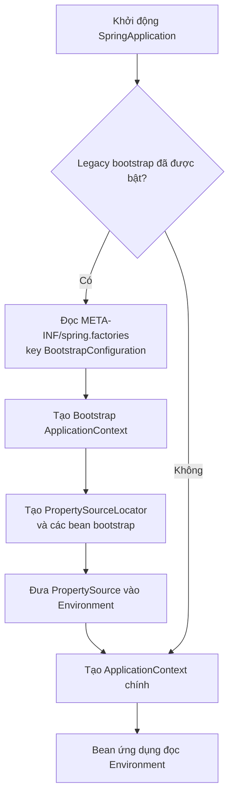

# Đăng ký BootstrapConfiguration qua META-INF/spring.factories

## 1. Mục tiêu của bootstrap configuration

Một ứng dụng Spring Boot thường nạp cấu hình từ YAML, biến môi trường, tham số JVM và các nguồn bên ngoài. Trong một số hệ thống Spring Cloud, ứng dụng còn cần khởi tạo thành phần **trước khi application context chính được tạo**, ví dụ đọc cấu hình kết nối tới máy chủ cấu hình, tìm thuộc tính từ kho riêng của tổ chức, đăng ký một PropertySourceLocator hoặc cung cấp ApplicationContextInitializer.

Spring Cloud có cơ chế bootstrap context cho giai đoạn này. Các lớp cấu hình được đăng ký qua key **org.springframework.cloud.bootstrap.BootstrapConfiguration** trong file **META-INF/spring.factories**. Cơ chế này thuộc mô hình **legacy bootstrap**; cần bật bootstrap thì các cấu hình đã đăng ký mới được nạp.

Trong bài này, ta tạo một nguồn cấu hình tùy biến cho order-service. Nguồn đó cung cấp một thuộc tính theo tên ứng dụng, sau đó mã trong application context chính có thể đọc thuộc tính qua Environment.

## 2. Bootstrap context trong vòng đời ứng dụng

Bootstrap context là một Spring ApplicationContext được tạo làm **context cha** của application context chính. Nó chuẩn bị cấu hình và các thành phần cần thiết cho quá trình khởi động. Những bean phù hợp được tạo trong context cha có thể được context con nhìn thấy theo quy tắc phân cấp context của Spring.



Nếu legacy bootstrap không được bật, Spring Cloud không tạo bootstrap context theo luồng này; entry trong spring.factories vì thế không được dùng để đăng ký bootstrap configuration. Đây là lý do một file spring.factories có vẻ đúng nhưng ứng dụng vẫn không thấy PropertySourceLocator.

Bootstrap context và application context chính có quan hệ cha-con. Một số bean bootstrap, đặc biệt bean kiểu ApplicationContextInitializer, còn được đưa vào SpringApplication chính trước khi ứng dụng bắt đầu giai đoạn khởi động thông thường.

## 3. Key BootstrapConfiguration trong spring.factories

Đây là key Spring Cloud dùng để tìm các lớp cấu hình bootstrap:

```properties
org.springframework.cloud.bootstrap.BootstrapConfiguration=\
com.example.bootstrap.InventoryBootstrapConfiguration
```

Giá trị là danh sách tên lớp đầy đủ (fully qualified class name) của các lớp @Configuration dùng để tạo bootstrap context. Nếu có nhiều lớp, phân tách bằng dấu phẩy:

```properties
org.springframework.cloud.bootstrap.BootstrapConfiguration=\
com.example.bootstrap.InventoryBootstrapConfiguration,\
com.example.bootstrap.SecurityBootstrapConfiguration
```

File phải nằm đúng vị trí tài nguyên:

```text
src/main/resources/
└── META-INF/
    └── spring.factories
```

Khi build thư viện dùng chung, file này phải được đóng gói trong JAR cùng với các lớp cấu hình được liệt kê. Ứng dụng tiêu thụ thư viện cần đưa JAR đó lên runtime classpath. Nếu cấu hình bootstrap nằm ngay trong ứng dụng, file vẫn được đặt trong src/main/resources/META-INF/spring.factories của ứng dụng.

spring.factories là file properties của Java. Không thêm dấu ngoặc kép quanh key hoặc tên lớp. Dấu gạch chéo ngược ở cuối dòng cho phép tiếp tục giá trị ở dòng tiếp theo. Các mục có cùng key từ nhiều thư viện trên classpath được Spring factories loader thu thập; nếu đóng gói thành shaded/uber JAR, cần cấu hình công cụ đóng gói để hợp nhất resource này thay vì làm mất nội dung của một thư viện.

Nếu có nhiều bootstrap configuration hoặc nhiều initializer cần thứ tự khởi tạo xác định, có thể dùng `@Order` để biểu đạt thứ tự. Tài liệu Spring Cloud quy định thứ tự mặc định của bootstrap configuration là cuối; chỉ đặt thứ tự tường minh khi các thành phần thực sự có quan hệ phụ thuộc, và không dựa vào thứ tự ngẫu nhiên của các JAR trên classpath.

### 3.1. Phân biệt key bootstrap với auto-configuration của Spring Boot

| Cơ chế | Key hoặc metadata | Mục đích |
| --- | --- | --- |
| Spring Cloud Bootstrap Configuration | org.springframework.cloud.bootstrap.BootstrapConfiguration trong META-INF/spring.factories | Tạo bootstrap context trước application context chính trong legacy bootstrap |
| Spring Boot auto-configuration hiện đại | META-INF/spring/org.springframework.boot.autoconfigure.AutoConfiguration.imports | Đăng ký auto-configuration cho application context của Boot |
| Spring factories cho extension point khác | Các key riêng trong META-INF/spring.factories | Nạp những loại extension mà framework tương ứng hỗ trợ |

Spring Boot 3 chuyển đăng ký danh sách auto-configuration sang AutoConfiguration.imports. Điều đó **không biến key Spring Cloud BootstrapConfiguration thành key auto-configuration của Boot**. Khi dùng legacy bootstrap, vẫn phải theo đúng hợp đồng và điều kiện kích hoạt của Spring Cloud. Không thay key BootstrapConfiguration bằng EnableAutoConfiguration hoặc bằng tên file AutoConfiguration.imports.

## 4. Tạo lớp BootstrapConfiguration

Ví dụ dưới đây định nghĩa một PropertySourceLocator đơn giản. Nó đọc spring.application.name từ Environment và đưa thêm hai thuộc tính vào nguồn có tên customInventoryProperties.

```java
package com.example.bootstrap;

import java.util.LinkedHashMap;
import java.util.Map;

import org.springframework.cloud.bootstrap.config.PropertySourceLocator;
import org.springframework.context.annotation.Configuration;
import org.springframework.core.env.Environment;
import org.springframework.core.env.MapPropertySource;
import org.springframework.core.env.PropertySource;

@Configuration
public class InventoryBootstrapConfiguration implements PropertySourceLocator {

    @Override
    public PropertySource<?> locate(Environment environment) {
        String applicationName = environment.getProperty(
                "spring.application.name",
                "unknown-application"
        );

        Map<String, Object> properties = new LinkedHashMap<>();
        properties.put("custom.bootstrap.application", applicationName);
        properties.put("custom.bootstrap.inventory-enabled", true);

        return new MapPropertySource(
                "customInventoryProperties",
                properties
        );
    }
}
```

Điểm cần hiểu trong ví dụ:

- @Configuration đánh dấu lớp cấu hình được bootstrap context nạp.
- PropertySourceLocator là hợp đồng Spring Cloud dùng để lấy thêm một PropertySource.
- locate(Environment) nhận Environment của application context đang được chuẩn bị. Nó đã có những property source Spring Boot thông thường, nên có thể đọc spring.application.name hoặc một thuộc tính định danh khác.
- MapPropertySource là nguồn dữ liệu minh họa trong bộ nhớ. Một implementation thực tế có thể lấy dữ liệu từ dịch vụ cấu hình, database hoặc secret store.
- Tên customInventoryProperties phải đủ riêng biệt để tránh xung đột với tên nguồn khác.

Lớp này được liệt kê trong spring.factories; không cần thêm @Component để component scan tìm nó. Cơ chế bootstrap sẽ tìm lớp thông qua key đã đăng ký.

### 4.1. Đăng ký lớp cấu hình

Tạo src/main/resources/META-INF/spring.factories:

```properties
org.springframework.cloud.bootstrap.BootstrapConfiguration=\
com.example.bootstrap.InventoryBootstrapConfiguration
```

Tên lớp trong file phải khớp package và class thực tế. Nếu đổi package hoặc tên class, phải cập nhật entry tương ứng.

Một cách bố trí thư mục cho thư viện bootstrap riêng:

```text
custom-bootstrap-source/
├── src/main/java/
│   └── com/example/bootstrap/
│       └── InventoryBootstrapConfiguration.java
└── src/main/resources/
    └── META-INF/
        └── spring.factories
```

## 5. Bật legacy bootstrap

Chỉ có entry trong spring.factories chưa đủ. Với các thế hệ Spring Cloud hiện đại, legacy bootstrap không mặc định bật trong mọi ứng dụng. Có hai cách thông dụng để kích hoạt.

### 5.1. Thêm starter bootstrap

Với Maven, thêm starter và để Spring Cloud BOM quản lý phiên bản:

```xml
<dependency>
    <groupId>org.springframework.cloud</groupId>
    <artifactId>spring-cloud-starter-bootstrap</artifactId>
</dependency>
```

Không tự gắn một phiên bản starter tùy ý nếu dự án đã import spring-cloud-dependencies. Chọn release train tương thích với Spring Boot của dự án.

### 5.2. Bật bằng system property hoặc environment variable

Có thể đặt thuộc tính trước khi tiến trình Spring Boot khởi động:

```bash
java -Dspring.cloud.bootstrap.enabled=true -jar order-service.jar
```

Hoặc dùng biến môi trường:

```bash
SPRING_CLOUD_BOOTSTRAP_ENABLED=true
```

Thuộc tính bật bootstrap cần có sẵn trước khi bootstrap phase diễn ra. Không nên chỉ đặt nó trong application.yml của application context chính rồi kỳ vọng nó kích hoạt chính giai đoạn đã xảy ra trước đó.

### 5.3. Cấu hình Config Server trong mô hình legacy

Nếu ứng dụng dùng Spring Cloud Config Client theo cách bootstrap truyền thống, địa chỉ Config Server thường được đặt trong bootstrap.yml hoặc một biến môi trường có sẵn từ lúc tiến trình bắt đầu:

```yaml
spring:
  application:
    name: order-service
  cloud:
    config:
      uri: http://localhost:8888
```

Ví dụ này dành cho **Config First Bootstrap**. Nếu ứng dụng chỉ dùng custom PropertySourceLocator trong ví dụ trước và không kết nối Config Server, không cần thêm dependency Config Client hoặc thuộc tính spring.cloud.config.uri.

## 6. Phân biệt legacy bootstrap với Config Data API

Spring Boot 2.4 giới thiệu Config Data API thông qua spring.config.import. Đây là cách mặc định hiện đại để Spring Cloud Config Client lấy cấu hình từ Config Server. Với cách này, không cần file bootstrap.yml:

```yaml
spring:
  application:
    name: order-service
  config:
    import: "optional:configserver:http://localhost:8888"
```

Hai mô hình có mục đích và vòng đời khác nhau:

| Tiêu chí | Legacy bootstrap | Config Data |
| --- | --- | --- |
| Cơ chế kích hoạt | spring-cloud-starter-bootstrap hoặc spring.cloud.bootstrap.enabled=true từ system property/environment | spring.config.import |
| File cấu hình riêng | Có thể dùng bootstrap.yml/bootstrap.properties | Không cần bootstrap file cho Config Data import |
| Điểm mở rộng | BootstrapConfiguration, PropertySourceLocator, initializer | Config Data loader/resolver và cơ chế import của Boot |
| Vòng đời | Bootstrap context được tạo trước context chính | Boot nạp Config Data trong quá trình chuẩn bị Environment |
| Trường hợp sử dụng | Ứng dụng cũ hoặc integration còn phụ thuộc bootstrap context | Cách nạp Config Server được ưu tiên cho ứng dụng mới |

Nếu đang viết một nguồn cấu hình mới cho ứng dụng Spring Boot hiện đại, hãy xem xét extension point của Config Data API. Không đăng ký BootstrapConfiguration rồi kỳ vọng nó tự chạy khi ứng dụng chỉ sử dụng spring.config.import. Cũng không trộn hai cơ chế để cùng nạp một nguồn cấu hình nếu tài liệu của integration không hỗ trợ cách kết hợp đó.

## 7. Vòng đời PropertySourceLocator và thứ tự thuộc tính

### 7.1. PropertySource được đưa vào Environment như thế nào?

Bootstrap context tìm các bean kiểu PropertySourceLocator, gọi chúng với Environment của context đang chuẩn bị và tập hợp các nguồn mà locator trả về. Những nguồn này được thêm vào quá trình chuẩn bị Environment của application context chính.

PropertySourceLocator không phải HTTP client hay Config Server. Nó chỉ định nghĩa điểm mở rộng để lấy một nguồn thuộc tính. Nếu cần đọc từ dịch vụ bên ngoài, implementation phải tự xử lý giao tiếp, timeout, xác thực, lỗi mạng và chính sách fallback.

### 7.2. Locator có thể được gọi nhiều lần

Theo tài liệu Spring Cloud Commons, từ Spring Cloud 2022.0.3, PropertySourceLocators được gọi hai lần trong quy trình hỗ trợ profile:

1. Lần đầu lấy property sources khi chưa có profile được kích hoạt, để các giá trị trả về có cơ hội kích hoạt profile.
2. Sau khi application context chính khởi động, locator được gọi lần nữa với các profile đang hoạt động để lấy thêm property sources theo profile.

Vì vậy, không viết locator với giả định locate() chỉ chạy đúng một lần. Nếu locator truy cập hệ thống ngoài, hãy dùng timeout hữu hạn, tránh thao tác có side effect không thể lặp và cân nhắc cache theo application name/profile khi phù hợp.

### 7.3. Thứ tự ưu tiên

Các property sources do bootstrap locator bổ sung thường được tổng hợp dưới nguồn bootstrap và có độ ưu tiên đáng kể trong Environment. Tuy nhiên, quy tắc ghi đè cuối cùng phụ thuộc cách nguồn được thêm, tên property source, thứ tự locator và chính sách của từng integration.

Với Spring Cloud Config, quyền cho phép ghi đè nguồn remote được kiểm soát bởi các thuộc tính như spring.cloud.config.allowOverride và các tùy chọn liên quan. Đây là chính sách do remote source cấp, không nên tự đặt một thuộc tính cục bộ rồi cho rằng nó luôn thay đổi được quyền ghi đè.

Khi có xung đột giá trị, hãy kiểm tra Environment.getPropertySources() trong runtime và xác định nguồn thắng. Không dựa vào suy đoán rằng mọi giá trị trong bootstrap.yml đều có ưu tiên cao nhất; file bootstrap và property sources được locator bổ sung là những nguồn khác nhau.

## 8. Không để bootstrap configuration bị component scan trùng

Các lớp được đăng ký qua BootstrapConfiguration được nạp trong bootstrap context. Nếu package của chúng đồng thời nằm trong phạm vi @ComponentScan hoặc package gốc của @SpringBootApplication, chúng có thể bị quét lại trong application context chính.

Điều này có thể tạo bean trùng, khiến một integration được khởi tạo hai lần hoặc gây lỗi inject do có nhiều bean cùng loại. Nên đặt bootstrap configuration trong package riêng nằm ngoài phạm vi component scan của ứng dụng.

Ví dụ:

```text
com.example.order
├── OrderApplication.java
├── controller/
└── service/

com.example.bootstrap
└── InventoryBootstrapConfiguration.java
```

Nếu OrderApplication đặt tại com.example.order, component scan mặc định không quét package anh em com.example.bootstrap. Nếu class chính đặt ở package gốc com.example, cần cấu hình phạm vi scan cẩn thận hoặc tách bootstrap module để tránh quét nhầm.

## 9. Kiểm thử và xác minh đăng ký

Nên kiểm tra cả nội dung mà locator trả về lẫn việc metadata được đóng gói đúng.

### 9.1. Unit test cho PropertySourceLocator

MockEnvironment giúp kiểm thử locator mà không cần dựng Config Server:

```java
import static org.assertj.core.api.Assertions.assertThat;

import org.junit.jupiter.api.Test;
import org.springframework.mock.env.MockEnvironment;
import org.springframework.core.env.PropertySource;

class InventoryBootstrapConfigurationTests {

    @Test
    void locatesPropertiesForApplication() {
        MockEnvironment environment = new MockEnvironment()
                .withProperty("spring.application.name", "order-service");

        InventoryBootstrapConfiguration locator =
                new InventoryBootstrapConfiguration();

        PropertySource<?> source = locator.locate(environment);

        assertThat(source.getName()).isEqualTo("customInventoryProperties");
        assertThat(source.getProperty("custom.bootstrap.application"))
                .isEqualTo("order-service");
        assertThat(source.getProperty("custom.bootstrap.inventory-enabled"))
                .isEqualTo(true);
    }
}
```

Test này chỉ xác minh logic tạo PropertySource. Nó không chứng minh Spring đã đọc spring.factories hoặc bootstrap context đã được bật.

### 9.2. Kiểm tra resource trong JAR

Sau khi build thư viện, xác minh JAR có cả class cấu hình và file factories:

```bash
jar tf custom-bootstrap-source.jar
```

Trong kết quả cần thấy các đường dẫn tương tự:

```text
com/example/bootstrap/InventoryBootstrapConfiguration.class
META-INF/spring.factories
```

Sau đó đọc nội dung META-INF/spring.factories bên trong JAR và kiểm tra key cùng tên lớp có đúng không. Với shaded/uber JAR, kiểm tra thêm resource đã được hợp nhất từ các dependency.

### 9.3. Integration test với bootstrap đã bật

Một smoke test ở mức ứng dụng có thể:

1. Bật legacy bootstrap bằng starter hoặc system property/environment variable.
2. Đưa JAR chứa custom bootstrap configuration vào runtime classpath.
3. Khởi động application context chính.
4. Inject Environment và kiểm tra custom.bootstrap.application có giá trị mong đợi.
5. Kiểm tra bean bootstrap không bị component scan tạo trùng.

Nếu test chạy nhưng thuộc tính không xuất hiện, hãy kiểm tra theo thứ tự: bootstrap đã bật chưa → JAR có trên runtime classpath không → resource factories có đúng key không → tên lớp có đúng không → lớp có phải @Configuration không → locator có trả PropertySource không.

## 10. Lỗi thường gặp

| Triệu chứng | Nguyên nhân có thể | Cách kiểm tra |
| --- | --- | --- |
| PropertySourceLocator không được gọi | Legacy bootstrap chưa bật | Kiểm tra starter hoặc system property/environment variable |
| Không tìm thấy lớp cấu hình | Sai FQCN hoặc lớp không có trong JAR | Kiểm tra jar tf, package và tên class trong factories |
| Entry đúng trong source nhưng không hoạt động | spring.factories không được đóng gói đúng vị trí | Kiểm tra META-INF/spring.factories bên trong artifact |
| Chạy local được nhưng thư viện phát hành không hoạt động | Resource không được đưa vào JAR hoặc bị ghi đè khi shading | Kiểm tra artifact cuối cùng và quy tắc merge resource |
| Thuộc tính không xuất hiện trong application context | Locator trả nguồn rỗng, bootstrap chưa chạy hoặc nguồn không được thêm | Kiểm tra return value, bootstrap lifecycle và property sources |
| Bean bị tạo hai lần | Bootstrap package nằm trong component scan chính | Tách package hoặc giới hạn component scan |
| Giá trị bị nguồn khác ghi đè | Thứ tự property source khác dự kiến | Kiểm tra Environment.getPropertySources() và chính sách override |
| Locator gọi nhiều lần gây tải ngoài lặp | Giả định locator chỉ chạy một lần | Làm logic an toàn khi lặp, timeout và cache hợp lý |
| Dùng spring.config.import nhưng mong factories bootstrap chạy | Đang dùng Config Data thay cho legacy bootstrap | Chọn đúng extension point và lifecycle |
| Nâng Boot/Spring Cloud làm bootstrap không hoạt động | Thay đổi compatibility hoặc dependency | Kiểm tra release train, starter và tài liệu migration đúng phiên bản |

## 11. Nguyên tắc khi xây custom bootstrap module

1. Đăng ký đúng key org.springframework.cloud.bootstrap.BootstrapConfiguration trong META-INF/spring.factories.
2. Giá trị key là danh sách lớp cấu hình đầy đủ package, không phải tên bean hoặc tên file.
3. Đóng gói spring.factories và class cấu hình vào cùng artifact, rồi xác minh JAR cuối cùng.
4. Bật legacy bootstrap trước giai đoạn tạo bootstrap context.
5. Đặt bootstrap classes ngoài phạm vi component scan của application context chính.
6. Dùng PropertySourceLocator khi mục tiêu là bổ sung nguồn thuộc tính; dùng ApplicationContextInitializer khi cần chuẩn bị context chính.
7. Thiết kế locator an toàn khi được gọi nhiều lần, có timeout và xử lý lỗi rõ ràng.
8. Kiểm tra thứ tự property source và tránh ghi đè cấu hình quan trọng ngoài ý muốn.
9. Chọn đúng phiên bản Spring Boot/Spring Cloud; không nhầm metadata bootstrap với metadata auto-configuration.
10. Với ứng dụng mới, cân nhắc Config Data API và extension point tương ứng trước khi chọn legacy bootstrap.

## 12. Tài liệu tham khảo

- [Spring Cloud Commons — Application Context Services](https://docs.spring.io/spring-cloud-commons/reference/spring-cloud-commons/application-context-services.html): bootstrap context, BootstrapConfiguration, PropertySourceLocator, thứ tự và vòng đời property source.
- [Spring Cloud Config Client](https://docs.spring.io/spring-cloud-config/reference/client.html): bật legacy bootstrap, Config First Bootstrap và Config Data import.
- [Spring Cloud Reference](https://docs.spring.io/spring-cloud/docs/current/reference/htmlsingle/): context hierarchy và các cơ chế bootstrap ở cấp hệ sinh thái.

Điểm cốt lõi là META-INF/spring.factories không tự tạo ra một nguồn cấu hình. Nó đăng ký các lớp cấu hình để Spring Cloud nạp trong bootstrap context. Chính các bean do những lớp đó cung cấp — chẳng hạn PropertySourceLocator — mới thực hiện việc tạo và đưa thuộc tính vào Environment. Khi phân biệt rõ đăng ký, kích hoạt bootstrap và thực thi locator, việc xây dựng nguồn cấu hình tùy biến trở nên dễ kiểm tra và vận hành hơn.
