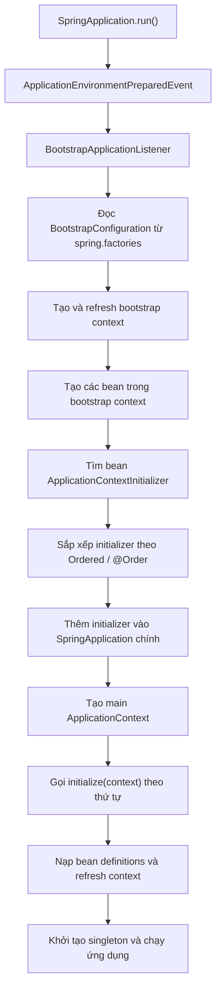

# Thứ tự BootstrapConfiguration và ApplicationContextInitializer

Khi một ứng dụng Spring Cloud cần bổ sung cấu hình trước khi các bean nghiệp vụ được tạo, có hai extension point thường được dùng trong cơ chế bootstrap truyền thống: **`BootstrapConfiguration`** và **`ApplicationContextInitializer`**. Chúng liên quan trực tiếp với nhau nhưng đảm nhiệm hai việc khác nhau.

`BootstrapConfiguration` khai báo các lớp cấu hình được nạp vào bootstrap context. Các lớp này có thể tạo bean phục vụ bootstrap, trong đó có bean triển khai `ApplicationContextInitializer`. Spring Cloud lấy các initializer đó, sắp xếp theo thứ tự, rồi thêm vào `SpringApplication` chính. Sau khi main `ApplicationContext` được tạo, Spring Boot gọi từng initializer trước khi refresh context.

Với **SPRING_CLOUD_CORE**, hiểu đúng thứ tự này giúp đặt nguồn cấu hình vào đúng thời điểm, tránh đọc property quá sớm hoặc khởi tạo bean trước khi cấu hình đã sẵn sàng. Bài học thuộc chương **Nguồn cấu hình tùy biến**, tập trung vào cách đăng ký, sắp xếp và kiểm thử hai cơ chế.

## 1. Mục tiêu học tập

Sau bài này, bạn có thể:

- Phân biệt `BootstrapConfiguration` với `ApplicationContextInitializer`.
- Mô tả thứ tự tạo bootstrap context và main application context trong legacy bootstrap.
- Giải thích vì sao initializer được khai báo như một bean trong bootstrap context nhưng được áp dụng lên main context.
- Sắp xếp initializer bằng `Ordered` hoặc `@Order`.
- Hiểu ý nghĩa của giá trị order nhỏ/lớn và hành vi mặc định khi không khai báo order.
- Đăng ký cấu hình bootstrap qua `META-INF/spring.factories`.
- Tổ chức package để bootstrap configuration không bị component scan của ứng dụng chính nạp nhầm.
- Chọn đúng extension point giữa `EnvironmentPostProcessor`, `ApplicationContextInitializer` và `BeanFactoryPostProcessor`.
- Kiểm thử thứ tự khởi tạo và chẩn đoán lỗi khi cấu hình được thêm quá muộn.

## 2. Hai extension point giải quyết hai lớp công việc

### 2.1. `BootstrapConfiguration`: khai báo nội dung của bootstrap context

`org.springframework.cloud.bootstrap.BootstrapConfiguration` là **tên key đăng ký** trong `META-INF/spring.factories`. Giá trị của key là danh sách các lớp `@Configuration` mà Spring Cloud dùng để xây dựng bootstrap context.

Ví dụ:

```properties
org.springframework.cloud.bootstrap.BootstrapConfiguration=\
com.example.bootstrap.PlatformBootstrapConfiguration
```

Lớp cấu hình được liệt kê có thể khai báo:

- Bean dùng để truy cập nguồn cấu hình từ xa.
- `PropertySourceLocator` nếu ứng dụng dùng cơ chế tìm property source kiểu bootstrap.
- Bean `ApplicationContextInitializer` để tùy chỉnh main context trước refresh.
- Các thành phần hỗ trợ khác cần có trong bootstrap context.

Nói cách khác, `BootstrapConfiguration` trả lời câu hỏi: **những cấu hình và bean nào phải tồn tại trong giai đoạn bootstrap?**

### 2.2. `ApplicationContextInitializer`: tùy chỉnh context trước refresh

`org.springframework.context.ApplicationContextInitializer<C extends ConfigurableApplicationContext>` là callback được gọi trên một `ConfigurableApplicationContext` sau khi context được tạo và trước khi context được refresh.

```java
public interface ApplicationContextInitializer<C extends ConfigurableApplicationContext> {
    void initialize(C applicationContext);
}
```

Initializer có thể:

- Thêm, thay thế hoặc sắp xếp lại `PropertySource` trong `Environment`.
- Kích hoạt profile phù hợp.
- Đặt parent context hoặc tùy chỉnh một số thuộc tính của context.
- Đăng ký bean definition trước khi quá trình refresh xử lý chúng.

Initializer không phải nơi phù hợp để lấy một bean nghiệp vụ đã được khởi tạo từ main context, vì main context chưa hoàn tất refresh. Nếu gọi `getBean()` quá sớm, ứng dụng có thể kích hoạt việc tạo bean trước thời điểm dự kiến và gây lỗi phụ thuộc.

Initializer trả lời câu hỏi: **cần điều chỉnh main context như thế nào trước khi container bắt đầu refresh?**

### 2.3. Bảng so sánh

| Tiêu chí | `BootstrapConfiguration` | `ApplicationContextInitializer` |
| --- | --- | --- |
| Bản chất | Lớp cấu hình được dùng để tạo bootstrap context | Callback nhận một context để tùy chỉnh |
| Đăng ký trong legacy bootstrap | Key `org.springframework.cloud.bootstrap.BootstrapConfiguration` trong `spring.factories` | Thường được khai báo thành bean trong bootstrap configuration |
| Context được dùng để tạo/chạy | Bootstrap context | Thông thường là main application context khi được cung cấp từ bootstrap |
| Thời điểm | Trong lúc Spring Cloud xây dựng bootstrap context | Sau khi context đích được tạo, trước khi refresh |
| Công việc điển hình | Khai báo bean phục vụ bootstrap | Thêm property source, profile, bean definition hoặc tùy chỉnh context |
| Điều khiển thứ tự | Danh sách lớp cấu hình xác định các cấu hình cần nạp; không nên dựa vào thứ tự khai báo để điều khiển callback | `Ordered` hoặc `@Order` điều khiển thứ tự initializer trong cơ chế sắp xếp |

**Điểm dễ nhầm:** một lớp `BootstrapConfiguration` không tự động là một `ApplicationContextInitializer`. Nó là lớp cấu hình được nạp vào bootstrap context; lớp đó có thể khai báo một hoặc nhiều bean initializer.

## 3. Trình tự khởi động trong legacy bootstrap

Khi bật cơ chế bootstrap truyền thống, trình tự khái quát như sau:



Sơ đồ tập trung vào quan hệ giữa hai extension point. Các listener, initializer nội bộ và sự kiện khác của Spring Boot/Spring Cloud có thể xuất hiện giữa các bước. Điều quan trọng là initializer được thu thập từ bootstrap context trước khi SpringApplication chính hoàn tất khởi tạo context.

### 3.1. Bước 1 — SpringApplication chuẩn bị Environment

Khi gọi:

```java
SpringApplication.run(CheckoutApplication.class, args);
```

Spring Boot chuẩn bị `Environment` và phát sự kiện `ApplicationEnvironmentPreparedEvent`. Các listener được đăng ký từ trước có thể phản ứng ở giai đoạn này, tức là trước khi main application context được tạo.

Trong legacy bootstrap, `BootstrapApplicationListener` lắng nghe sự kiện này. Nếu bootstrap được bật, listener bắt đầu tạo bootstrap context.

### 3.2. Bước 2 — Nạp BootstrapConfiguration

Spring Cloud tìm các lớp được đăng ký dưới key:

```text
org.springframework.cloud.bootstrap.BootstrapConfiguration
```

Các lớp này được dùng làm nguồn cấu hình cho bootstrap context. Context đó được khởi tạo độc lập với main context và có thể chứa các bean phục vụ việc lấy cấu hình từ xa hoặc chuẩn bị context chính.

Nếu nhiều thư viện cùng đóng góp `BootstrapConfiguration`, các lớp của chúng có thể cùng được nạp. Vì vậy, mỗi thư viện nên dùng package riêng và chỉ khai báo những bean cần thiết.

### 3.3. Bước 3 — Tạo bean initializer trong bootstrap context

Bootstrap context được refresh để đăng ký và tạo các bean cần thiết. Spring Cloud tìm những bean có kiểu `ApplicationContextInitializer`.

Ví dụ:

```java
@Configuration(proxyBeanMethods = false)
public class PlatformBootstrapConfiguration {

    @Bean
    TenantDefaultsInitializer tenantDefaultsInitializer() {
        return new TenantDefaultsInitializer();
    }
}
```

Bean `TenantDefaultsInitializer` được tạo trong bootstrap context. Khi bootstrap hoàn tất, Spring Cloud lấy instance này và thêm vào danh sách initializer của `SpringApplication` chính.

### 3.4. Bước 4 — Sắp xếp và chuyển initializer sang main SpringApplication

Spring Cloud thu thập các initializer bean, sắp xếp chúng bằng `AnnotationAwareOrderComparator`, sau đó thêm chúng vào `SpringApplication` chính.

Điều này có nghĩa:

- `BootstrapConfiguration` quyết định lớp cấu hình nào được nạp vào bootstrap context.
- Các bean initializer được tạo trong context đó.
- `Ordered` hoặc `@Order` trên initializer quyết định thứ tự thực thi trong danh sách được sắp xếp.
- Việc liệt kê các lớp cấu hình trong `spring.factories` không phải cách đáng tin cậy để biểu diễn thứ tự thực thi initializer.

### 3.5. Bước 5 — Initializer chạy trước refresh của main context

Spring Boot tạo main context, sau đó gọi các initializer đã đăng ký. `initialize(context)` được thực thi trước `refresh()`.

Đây là thời điểm phù hợp để thêm một property source mà bean sẽ đọc khi được tạo, hoặc để kiểm tra một cấu hình bắt buộc trước khi ứng dụng tiếp tục.

Sau khi initializer hoàn tất, Spring Boot tiếp tục nạp bean definitions, chạy các processor và refresh context. Các bean nghiệp vụ được khởi tạo theo dependency graph và scope của chúng.

## 4. Thứ tự initializer với Ordered và @Order

Spring hỗ trợ điều khiển thứ tự của nhiều extension object bằng `Ordered`, `PriorityOrdered` và `@Order`. Trong cơ chế bootstrap, Spring Cloud dùng `AnnotationAwareOrderComparator` để sắp xếp các bean `ApplicationContextInitializer` được thu thập.

### 4.1. Quy tắc số order

| Giá trị | Ý nghĩa |
| --- | --- |
| Số nhỏ hơn | Được gọi sớm hơn |
| Số lớn hơn | Được gọi muộn hơn |
| `Ordered.HIGHEST_PRECEDENCE` | Giá trị order thấp nhất, ưu tiên sớm nhất |
| `Ordered.LOWEST_PRECEDENCE` | Giá trị order cao nhất, ưu tiên muộn nhất |
| Không khai báo order | Mặc định ở cuối theo tài liệu Spring Cloud bootstrap |

Ví dụ:

```java
@Order(10)
public class AddDefaultsInitializer
        implements ApplicationContextInitializer<ConfigurableApplicationContext> {
    // ...
}

@Order(20)
public class ValidateConfigurationInitializer
        implements ApplicationContextInitializer<ConfigurableApplicationContext> {
    // ...
}
```

`AddDefaultsInitializer` chạy trước `ValidateConfigurationInitializer`. Điều này hữu ích khi initializer đầu tiên bổ sung giá trị mặc định và initializer thứ hai kiểm tra giá trị cuối cùng.

Nếu hai initializer có cùng order, không nên dựa vào thứ tự tình cờ của classpath hoặc thứ tự file. Hãy dùng giá trị order khác nhau khi thứ tự có ý nghĩa, và xác minh bằng integration test.

### 4.2. Implement Ordered

Thay cho annotation, có thể triển khai `Ordered`:

```java
public class AddDefaultsInitializer
        implements ApplicationContextInitializer<ConfigurableApplicationContext>, Ordered {

    @Override
    public int getOrder() {
        return 10;
    }

    @Override
    public void initialize(ConfigurableApplicationContext context) {
        // Customize context before refresh.
    }
}
```

Cách này phù hợp khi thứ tự được quyết định bằng logic hoặc cấu hình của class. `@Order` thường ngắn gọn hơn khi thứ tự là hằng số.

### 4.3. PriorityOrdered

`PriorityOrdered` là một dạng mở rộng của `Ordered`, cho phép nhóm có mức ưu tiên cao được sắp xếp trước nhóm `Ordered` thông thường khi comparator hỗ trợ. Chỉ dùng nó khi có yêu cầu thứ tự thực sự cần thiết; đa số ứng dụng có thể dùng `@Order` với các giá trị rõ ràng.

### 4.4. @Order không phải là thứ tự tạo mọi bean

`@Order` trong ngữ cảnh này điều khiển việc sắp xếp các initializer. Nó không phải một cam kết tổng quát rằng mọi singleton bean trong Spring sẽ được khởi tạo theo số order.

Không dùng các cơ chế sau để thay thế thứ tự initializer:

- `@Primary`: chọn bean ưu tiên khi có nhiều candidate cho dependency injection.
- `@DependsOn`: khai báo phụ thuộc khởi tạo giữa các bean.
- Thứ tự method `@Bean` trong source code.
- Thứ tự các dòng khai báo `BootstrapConfiguration` trong `spring.factories`.

Nếu mục tiêu là initializer A phải chạy trước initializer B, hãy đặt order trên chính initializer và kiểm thử thứ tự callback.

## 5. Ví dụ hoàn chỉnh: defaults trước, validation sau

Một ứng dụng cần thêm một số giá trị mặc định cho tenant trước khi kiểm tra cấu hình. Ta khai báo hai initializer:

1. `TenantDefaultsInitializer` thêm property source ở mức ưu tiên thấp.
2. `ValidateTenantInitializer` kiểm tra `tenant.id` đã được cấu hình hay chưa.

### 5.1. Cấu hình bootstrap

```java
package com.example.bootstrap;

import org.springframework.context.annotation.Bean;
import org.springframework.context.annotation.Configuration;

@Configuration(proxyBeanMethods = false)
public class PlatformBootstrapConfiguration {

    @Bean
    TenantDefaultsInitializer tenantDefaultsInitializer() {
        return new TenantDefaultsInitializer();
    }

    @Bean
    ValidateTenantInitializer validateTenantInitializer() {
        return new ValidateTenantInitializer();
    }
}
```

### 5.2. Initializer thứ nhất: thêm defaults

```java
package com.example.bootstrap;

import java.util.Map;

import org.springframework.context.ApplicationContextInitializer;
import org.springframework.context.ConfigurableApplicationContext;
import org.springframework.core.annotation.Order;
import org.springframework.core.env.MapPropertySource;

@Order(10)
public class TenantDefaultsInitializer
        implements ApplicationContextInitializer<ConfigurableApplicationContext> {

    @Override
    public void initialize(ConfigurableApplicationContext context) {
        Map<String, Object> defaults = Map.of(
                "tenant.region", "local",
                "tenant.max-connections", 10);

        context.getEnvironment()
                .getPropertySources()
                .addLast(new MapPropertySource("tenantDefaults", defaults));
    }
}
```

`addLast` đặt nguồn ở cuối danh sách, do đó các property source có ưu tiên cao hơn vẫn có thể ghi đè giá trị mặc định.

### 5.3. Initializer thứ hai: xác thực cấu hình

```java
package com.example.bootstrap;

import org.springframework.context.ApplicationContextInitializer;
import org.springframework.context.ConfigurableApplicationContext;
import org.springframework.core.annotation.Order;
import org.springframework.util.StringUtils;

@Order(20)
public class ValidateTenantInitializer
        implements ApplicationContextInitializer<ConfigurableApplicationContext> {

    @Override
    public void initialize(ConfigurableApplicationContext context) {
        String tenantId = context.getEnvironment().getProperty("tenant.id");

        if (!StringUtils.hasText(tenantId)) {
            throw new IllegalStateException(
                    "Required property 'tenant.id' is missing");
        }
    }
}
```

Initializer validation chạy sau khi nguồn defaults được thêm. Nếu `tenant.id` không có trong bất kỳ nguồn cấu hình nào, ứng dụng dừng sớm với thông báo rõ ràng.

### 5.4. Đăng ký BootstrapConfiguration

Tạo file:

`src/main/resources/META-INF/spring.factories`

```properties
org.springframework.cloud.bootstrap.BootstrapConfiguration=\
com.example.bootstrap.PlatformBootstrapConfiguration
```

Để legacy bootstrap hoạt động, ứng dụng phải bật cơ chế bootstrap theo cách phù hợp với release train, chẳng hạn thêm `spring-cloud-starter-bootstrap` hoặc bật `spring.cloud.bootstrap.enabled=true` từ nguồn đủ sớm.

### 5.5. Cấu hình ứng dụng chính

Trong `application.yaml`:

```yaml
tenant:
  id: checkout-prod
  region: ap-southeast-1
```

Giá trị `tenant.region` trong file ứng dụng có thể thắng giá trị mặc định `local` vì initializer đã dùng `addLast`. `tenant.id` được validation initializer đọc từ Environment trước khi context refresh.

### 5.6. Kết quả mong đợi

```text
1. PlatformBootstrapConfiguration được nạp vào bootstrap context.
2. TenantDefaultsInitializer và ValidateTenantInitializer được tạo.
3. Spring Cloud sắp xếp initializer theo order 10 và 20.
4. Main ApplicationContext được tạo.
5. TenantDefaultsInitializer thêm tenantDefaults.
6. ValidateTenantInitializer kiểm tra tenant.id.
7. Main ApplicationContext refresh và tạo bean ứng dụng.
```

Thứ tự trên là thứ tự callback, không phải thứ tự khởi tạo mọi bean trong main context.

## 6. BootstrapConfiguration được đăng ký như thế nào?

### 6.1. Đăng ký một lớp

```properties
org.springframework.cloud.bootstrap.BootstrapConfiguration=\
com.example.bootstrap.PlatformBootstrapConfiguration
```

### 6.2. Đăng ký nhiều lớp

```properties
org.springframework.cloud.bootstrap.BootstrapConfiguration=\
com.example.bootstrap.PlatformBootstrapConfiguration,\
com.example.security.bootstrap.SecurityBootstrapConfiguration,\
com.example.tenant.bootstrap.TenantBootstrapConfiguration
```

Mỗi lớp được nạp vào bootstrap context. Chúng có thể khai báo bean dùng chung hoặc bean initializer riêng. Không nên dựa vào thứ tự dấu phẩy để quyết định thứ tự thực thi các initializer; hãy dùng `@Order` hoặc `Ordered` trên initializer.

### 6.3. Đặt package bootstrap riêng

Spring Cloud cảnh báo không để các lớp `BootstrapConfiguration` bị component scan nhầm vào main application context. Nếu chúng bị quét ở cả hai nơi, bean có thể được đăng ký trùng hoặc khởi tạo ở sai context.

Một cấu trúc package rõ ràng:

```text
src/main/java/
├── com/example/checkout/
│   ├── CheckoutApplication.java
│   └── service/
└── com/example/bootstrap/
    ├── PlatformBootstrapConfiguration.java
    ├── TenantDefaultsInitializer.java
    └── ValidateTenantInitializer.java
```

Nếu `@SpringBootApplication` nằm ở `com.example.checkout`, package `com.example.bootstrap` nằm ngoài vùng component scan mặc định của nó. Nếu ứng dụng đặt main class ở package cha rộng hơn, cần cấu hình scan cụ thể hoặc di chuyển package bootstrap ra ngoài phạm vi đó.

## 7. ApplicationContextInitializer độc lập với bootstrap

`ApplicationContextInitializer` là extension point của Spring Framework và Spring Boot, không chỉ tồn tại trong Spring Cloud bootstrap.

Có thể đăng ký trực tiếp bằng `SpringApplication`:

```java
public static void main(String[] args) {
    SpringApplication application =
            new SpringApplication(CheckoutApplication.class);

    application.addInitializers(new ValidateTenantInitializer());
    application.run(args);
}
```

Trong trường hợp này:

- Không cần `BootstrapConfiguration` chỉ để đăng ký initializer.
- Không cần bootstrap context nếu ứng dụng không sử dụng legacy bootstrap.
- Spring Boot vẫn gọi initializer trên main context trước refresh.

Spring Boot cũng hỗ trợ đăng ký initializer qua cơ chế cấu hình tự động phù hợp hoặc từ thư viện dùng chung. Khi trộn initializer được đăng ký bằng nhiều con đường, cần xác minh thứ tự thực tế trong `SpringApplication`; không nên dựa vào thứ tự xuất hiện trong các file cấu hình.

## 8. Phân biệt với các extension point khác

Không phải mọi yêu cầu “chạy trước khi bean được tạo” đều cần `ApplicationContextInitializer`.

| Extension point | Thời điểm | Phù hợp khi |
| --- | --- | --- |
| `EnvironmentPostProcessor` | Trong giai đoạn chuẩn bị Environment, trước khi context được tạo | Cần thêm property source hoặc thay đổi Environment rất sớm |
| `BootstrapConfiguration` | Khi Spring Cloud dựng bootstrap context trong legacy bootstrap | Cần khai báo bean và thành phần riêng cho bootstrap |
| `ApplicationContextInitializer` | Sau khi context đích được tạo, trước khi refresh | Cần tùy chỉnh Environment/context trước khi bean được tạo |
| `BeanFactoryPostProcessor` | Trong quá trình refresh, sau khi bean definitions đã được nạp và trước khi bean thông thường được khởi tạo | Cần thay đổi metadata/bean definitions |
| `BeanPostProcessor` | Khi từng bean instance được tạo | Cần can thiệp vào instance trước/sau initialization, ví dụ tạo proxy |

### 8.1. Khi nào dùng EnvironmentPostProcessor?

Nếu cần thêm property source trong giai đoạn Environment được chuẩn bị, trước khi Spring Boot tạo ApplicationContext, `EnvironmentPostProcessor` có thể phù hợp hơn.

Ví dụ use case:

- Đọc một file bootstrap đặc biệt để xác định Config Data location.
- Thêm property source cần được dùng để quyết định profile hoặc điều kiện khởi tạo.
- Chuẩn bị giá trị mà các listener khởi động sớm cần đọc.

`ApplicationContextInitializer` chạy muộn hơn vì context đã được tạo. Nếu giá trị cần thiết để quyết định chính việc tạo context hoặc nạp Config Data, đừng chờ đến initializer.

### 8.2. Khi nào dùng BeanFactoryPostProcessor?

Nếu cần thay đổi bean definition đã được đăng ký, chẳng hạn thay metadata của một bean hoặc đăng ký định nghĩa bổ sung sau khi nguồn cấu hình đã được đọc, `BeanFactoryPostProcessor` có thể phù hợp.

Không dùng `BeanFactoryPostProcessor` để thay thế một initializer chỉ cần kích hoạt profile hoặc thêm property source trước refresh. Mỗi extension point có thời điểm và phạm vi tác động riêng.

## 9. Legacy bootstrap và Config Data hiện đại

Spring Boot 2.4 giới thiệu Config Data API, và Spring Cloud Config Client hiện hỗ trợ cấu hình nguồn từ xa bằng:

```yaml
spring:
  config:
    import: optional:configserver:http://config-server:8888
```

Với cách này, ứng dụng nạp cấu hình qua Config Data trong quá trình chuẩn bị Environment. Không cần tạo bootstrap context chỉ để kết nối Config Server.

### 9.1. Khi dùng legacy bootstrap

Legacy bootstrap thường được kích hoạt bằng `spring-cloud-starter-bootstrap` hoặc `spring.cloud.bootstrap.enabled=true` được cung cấp đủ sớm. Khi đó:

- `BootstrapConfiguration` được tìm từ `spring.factories`.
- Bootstrap context được tạo.
- Các bean `ApplicationContextInitializer` có thể được thu thập và thêm vào main SpringApplication.
- `bootstrap.yml` có thể cung cấp cấu hình riêng cho giai đoạn bootstrap.

### 9.2. Khi dùng Config Data

Với `spring.config.import`, Spring Boot xử lý nguồn cấu hình theo Config Data API. Nếu muốn viết một loại Config Data location tùy chỉnh, extension point phù hợp là `ConfigDataLocationResolver` và `ConfigDataLoader`.

`ApplicationContextInitializer` vẫn có thể dùng như hook tùy chỉnh main context trong ứng dụng Boot hiện đại, nhưng nó không thay thế Config Data resolver/loader khi nguồn dữ liệu cần tham gia ngay trong pha nạp Config Data.

### 9.3. Không trộn hai cơ chế mà không có chủ đích

| Nhu cầu | Hướng tiếp cận |
| --- | --- |
| Ứng dụng cũ cần bootstrap context | Legacy bootstrap với `BootstrapConfiguration` |
| Cần một initializer tùy chỉnh trong legacy bootstrap | Khai báo bean `ApplicationContextInitializer` trong bootstrap config |
| Ứng dụng Boot hiện đại cần Config Server | `spring.config.import=configserver:...` |
| Tạo nguồn Config Data tùy chỉnh | `ConfigDataLocationResolver` + `ConfigDataLoader` |
| Tùy chỉnh main context trước refresh | `ApplicationContextInitializer` |
| Tùy chỉnh Environment trước khi context được tạo | `EnvironmentPostProcessor` |

Nếu bật legacy bootstrap và đồng thời import cùng một nguồn bằng Config Data, hãy xác định rõ cơ chế nào chịu trách nhiệm và kiểm tra xem dữ liệu có bị nạp hai lần hay không.

## 10. Kiểm thử thứ tự initializer

Thứ tự phải được kiểm thử ở cấp callback, không nên suy luận từ thứ tự các class trong source code.

### 10.1. Unit test cho initializer

```java
class TenantDefaultsInitializerTest {

    @Test
    void addsDefaultsToEnvironment() {
        GenericApplicationContext context = new GenericApplicationContext();
        try {
            new TenantDefaultsInitializer().initialize(context);
            context.refresh();

            assertThat(context.getEnvironment().getProperty("tenant.region"))
                    .isEqualTo("local");
        }
        finally {
            context.close();
        }
    }
}
```

Test đơn vị này kiểm tra hành vi của initializer khi được gọi. Nó không chứng minh Spring Cloud đã đăng ký initializer từ `spring.factories` hoặc sắp xếp nó đúng.

### 10.2. Kiểm thử thứ tự bằng trace

Có thể tạo hai initializer ghi lại tên của chúng vào một danh sách dùng chung trong test:

```java
final class InitializerTrace {
    static final List<String> EVENTS = new CopyOnWriteArrayList<>();

    static void reset() {
        EVENTS.clear();
    }
}

@Order(10)
class FirstInitializer
        implements ApplicationContextInitializer<ConfigurableApplicationContext> {

    @Override
    public void initialize(ConfigurableApplicationContext context) {
        InitializerTrace.EVENTS.add("first");
    }
}

@Order(20)
class SecondInitializer
        implements ApplicationContextInitializer<ConfigurableApplicationContext> {

    @Override
    public void initialize(ConfigurableApplicationContext context) {
        InitializerTrace.EVENTS.add("second");
    }
}
```

Sau khi khởi động context bằng cơ chế đăng ký tương ứng, xác minh:

```java
assertThat(InitializerTrace.EVENTS)
        .containsExactly("first", "second");
```

Danh sách trace chỉ là công cụ cho test; không dùng static mutable state như cơ chế điều phối cấu hình production.

### 10.3. Integration test cho BootstrapConfiguration

Một bài test tích hợp nên xác minh:

1. `spring-cloud-starter-bootstrap` hoặc cờ bootstrap được bật.
2. File `META-INF/spring.factories` có key và class name đúng.
3. Bootstrap context tạo bean initializer.
4. Initializer được thêm vào `SpringApplication` chính.
5. Các initializer chạy theo order trước main context refresh.
6. Bean nghiệp vụ sau đó đọc được property source do initializer thêm.
7. Cấu hình không bị đăng ký trùng trong main component scan.

### 10.4. Kiểm tra sự kiện Spring Boot

Spring Boot cung cấp các sự kiện để quan sát tiến trình:

| Sự kiện | Vị trí tương đối |
| --- | --- |
| `ApplicationEnvironmentPreparedEvent` | Environment đã được chuẩn bị, context chưa được tạo |
| `ApplicationContextInitializedEvent` | Context đã được chuẩn bị và initializer đã được gọi, trước khi bean definitions được nạp |
| `ApplicationPreparedEvent` | Bean definitions đã được nạp, ngay trước khi refresh |
| `ApplicationStartedEvent` | Context đã refresh xong |

Có thể đăng ký listener để ghi nhận mốc sự kiện và đối chiếu với trace initializer. Tránh ghi log chứa secret hoặc toàn bộ Environment.

## 11. Các lỗi thường gặp

| Triệu chứng | Nguyên nhân có thể | Cách xử lý |
| --- | --- | --- |
| BootstrapConfiguration không được nạp | Bootstrap legacy chưa bật hoặc key `spring.factories` sai | Kiểm tra starter/cờ bootstrap và đúng key |
| Initializer không được gọi | Bean không được tạo trong bootstrap context hoặc không được thu thập | Kiểm tra `@Bean`, kiểu trả về và context đang đăng ký |
| Initializer chạy sai thứ tự | Không khai báo order hoặc nhiều initializer cùng order | Dùng `@Order`/`Ordered` rõ ràng và kiểm thử trace |
| Thứ tự trong spring.factories không có tác dụng | Nhầm thứ tự danh sách config với thứ tự callback | Đặt order trên initializer implementation |
| Giá trị property không có trong bean | Initializer thêm source quá muộn hoặc bean đã được tạo trước đó | Chuyển thao tác sang hook sớm hơn |
| Bean bootstrap xuất hiện hai lần | Cấu hình bootstrap bị component scan vào main context | Tách package bootstrap khỏi component scan |
| Initializer gọi được bean nhưng ứng dụng khởi tạo lỗi | Gọi `getBean()` quá sớm, kích hoạt bean creation ngoài ý muốn | Chỉ chỉnh Environment/context; để container tạo bean trong refresh |
| Config Data không dùng initializer | Đang dùng `spring.config.import`, không bật legacy bootstrap | Dùng Config Data extension point hoặc initializer đúng mục tiêu |
| Thay đổi Environment nhưng `@Value` không đổi | Bean đã giữ giá trị tại thời điểm khởi tạo | Dùng refresh/rebind được hỗ trợ hoặc tái tạo bean có kiểm soát |
| Test không ổn định giữa máy | Dựa vào thứ tự classpath hoặc initializer cùng order | Gán order khác nhau và không dựa vào thứ tự ngẫu nhiên |

## 12. Nguyên tắc thiết kế

- Dùng `BootstrapConfiguration` để khai báo bean dành cho bootstrap context trong chế độ legacy.
- Khai báo initializer thành bean có kiểu cụ thể trong bootstrap configuration.
- Đặt `@Order` trên class triển khai `ApplicationContextInitializer` hoặc triển khai `Ordered`.
- Dùng số order khác nhau nếu thứ tự callback có ý nghĩa.
- Không dùng thứ tự liệt kê trong `spring.factories` làm hợp đồng thứ tự chạy initializer.
- Giữ package bootstrap ngoài vùng component scan của main application.
- Chỉ sửa Environment/context trong initializer; không chủ động tạo bean nghiệp vụ trước refresh.
- Nếu cần can thiệp trước khi context được tạo, xem xét `EnvironmentPostProcessor`.
- Nếu dùng Config Data hiện đại, chọn `ConfigDataLocationResolver`/`ConfigDataLoader` cho nguồn tùy chỉnh.
- Kiểm thử cả thứ tự callback và kết quả cấu hình trong main context.

## 13. Tổng kết

`BootstrapConfiguration` và `ApplicationContextInitializer` là hai phần nối tiếp nhau trong legacy bootstrap. Spring Cloud dùng các lớp `BootstrapConfiguration` để tạo bootstrap context. Các bean `ApplicationContextInitializer` được khai báo tại đó được thu thập, sắp xếp theo `Ordered` hoặc `@Order`, rồi chuyển sang `SpringApplication` chính.

Khi main `ApplicationContext` được tạo, Spring Boot gọi các initializer trước khi refresh. Đây là thời điểm thích hợp để bổ sung property source, profile hoặc bean definition trước khi container khởi tạo bean nghiệp vụ. Giá trị order nhỏ chạy trước; initializer không khai báo order mặc định ở cuối theo quy tắc bootstrap được tài liệu Spring Cloud mô tả.

Hãy phân biệt thứ tự nạp các lớp cấu hình bootstrap với thứ tự gọi initializer. Nếu cần thứ tự chính xác, hãy khai báo order trên initializer và xác minh bằng integration test. Với ứng dụng sử dụng Config Data hiện đại, chọn extension point Config Data phù hợp thay vì bật legacy bootstrap chỉ để tái sử dụng một cơ chế cũ.

## 14. Tài liệu tham khảo

- [Spring Cloud Commons — Customizing the Bootstrap Configuration](https://docs.spring.io/spring-cloud-commons/reference/spring-cloud-commons/application-context-services.html#customizing-the-bootstrap-configuration)
- [Spring Cloud Commons — Application Context Services](https://docs.spring.io/spring-cloud-commons/reference/spring-cloud-commons/application-context-services.html)
- [Spring Cloud Commons — BootstrapApplicationListener source](https://github.com/spring-cloud/spring-cloud-commons/blob/main/spring-cloud-context/src/main/java/org/springframework/cloud/bootstrap/BootstrapApplicationListener.java)
- [Spring Boot — Customize the Environment or ApplicationContext Before It Starts](https://docs.spring.io/spring-boot/how-to/application.html#howto.application.customize-the-environment-or-application-context-before-it-starts)
- [Spring Boot API — SpringApplication](https://docs.spring.io/spring-boot/api/java/org/springframework/boot/SpringApplication.html)
- [Spring Framework API — ApplicationContextInitializer](https://docs.spring.io/spring-framework/docs/current/javadoc-api/org/springframework/context/ApplicationContextInitializer.html)
