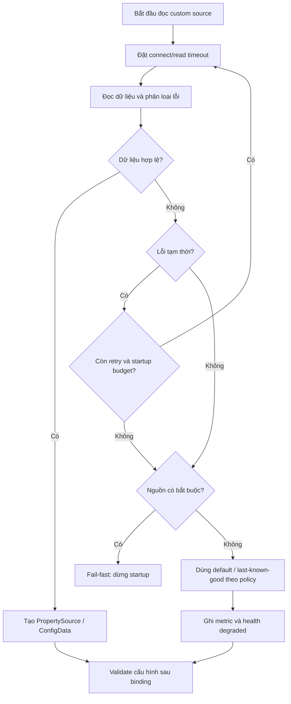

# Timeout, lỗi đọc nguồn và lựa chọn dừng sớm hoặc dùng mặc định

## 1. Bài toán khi ứng dụng đọc cấu hình từ nguồn tùy biến

Một ứng dụng Spring Cloud có thể nạp cấu hình từ Config Server, một dịch vụ quản lý tenant, API nội bộ, cơ sở dữ liệu hoặc kho cấu hình riêng của tổ chức. Khi nguồn đó phản hồi chậm, mất kết nối, trả dữ liệu lỗi hoặc chưa có cấu hình cho ứng dụng, quá trình khởi động phải có một chính sách rõ ràng.

Có hai hướng xử lý chính:

- **Fail fast:** dừng khởi động khi không đọc được nguồn cấu hình bắt buộc. Ứng dụng không đi vào trạng thái phục vụ với cấu hình thiếu hoặc không đáng tin cậy.
- **Fallback:** cho phép khởi động bằng cấu hình mặc định hoặc nguồn dự phòng khi nguồn tùy biến không khả dụng và dữ liệu đó thực sự là tùy chọn.

Không có lựa chọn nào đúng cho mọi hệ thống. Nếu nguồn cung cấp khóa mã hóa, thông tin xác thực hoặc endpoint thanh toán bắt buộc, dùng mặc định có thể gây mất an toàn. Nếu nguồn chỉ cung cấp banner, giới hạn giao diện hoặc một tính năng phụ, việc dừng toàn bộ dịch vụ có thể không cần thiết.

Bài học thuộc chương **Nguồn cấu hình tùy biến** của module **SPRING_CLOUD_CORE**. Module tập trung vào Spring Cloud Commons, Spring Cloud Context, externalized configuration, refresh scope, discovery, service registry, tương thích Spring Boot và cách kiểm thử/vận hành các abstraction chung. Sau bài này, người học có thể:

- Xác định nơi một nguồn tùy biến được nạp trong vòng đời khởi động.
- Phân biệt timeout kết nối, timeout đọc dữ liệu và giới hạn thời gian tổng.
- Thiết kế retry có giới hạn, phân loại lỗi có thể retry và lỗi cấu hình.
- Chọn fail-fast hoặc fallback theo mức độ quan trọng của cấu hình.
- Hiểu cách Spring Cloud Config Client xử lý optional import, fail-fast và retry.
- Kiểm thử tình huống nguồn chậm, nguồn lỗi, dữ liệu sai định dạng và nguồn không tồn tại.
- Quan sát được khi ứng dụng đang dùng cấu hình mặc định hoặc dữ liệu cũ.

## 2. Nguồn cấu hình tùy biến được tích hợp ở đâu?

Spring cung cấp nhiều cách đưa property source vào Environment. Chọn đúng extension point trước khi thiết kế timeout và error handling.

### 2.1. PropertySourceLocator trong legacy bootstrap

Spring Cloud Commons cho phép thêm nguồn cấu hình vào bootstrap context thông qua bean kiểu `PropertySourceLocator`. Locator nhận `Environment` của application context sắp được tạo, sau đó trả về một `PropertySource` chứa các giá trị cần bổ sung.

Ví dụ khung triển khai:

```java
@Configuration(proxyBeanMethods = false)
class TenantBootstrapConfiguration {

    @Bean
    PropertySourceLocator tenantPropertySourceLocator(
            TenantSettingsClient client) {

        return environment -> {
            String application =
                    environment.getProperty("spring.application.name");

            Map<String, Object> values = client.load(application);

            return new MapPropertySource("tenant-settings", values);
        };
    }
}
```

Có thể đăng ký bootstrap configuration trong file `META-INF/spring.factories` của thư viện:

```properties
org.springframework.cloud.bootstrap.BootstrapConfiguration=\
com.example.config.TenantBootstrapConfiguration
```

Lớp bootstrap cần nằm trong package riêng để không bị component scan của application context chính phát hiện ngoài ý muốn. Cơ chế này thuộc **legacy bootstrap**; cần bật bootstrap theo cách phù hợp với phiên bản Spring Cloud đang dùng.

Từ Spring Cloud 2022.0.3, các `PropertySourceLocator` có thể được gọi hai lần: lần đầu không có profile để lấy cấu hình có khả năng kích hoạt profile; lần sau sau khi application context chính bắt đầu để lấy thêm cấu hình theo profile đang active. Vì vậy, không giả định locator chỉ gọi API bên ngoài một lần. Thiết kế thao tác đọc theo hướng idempotent, có cache hợp lý và tính cả hai lượt vào startup budget.

### 2.2. ConfigDataLocationResolver và ConfigDataLoader

Với Spring Boot 2.4 trở lên, Config Data là cơ chế hiện đại để nạp cấu hình qua `spring.config.import`. Nếu xây dựng một location tùy biến như `tenantconfig:...`, extension point phù hợp là:

- `ConfigDataLocationResolver`: nhận diện và phân giải location thành resource.
- `ConfigDataLoader`: đọc resource và tạo `ConfigData` chứa các property source.

Hai SPI này được đăng ký theo cơ chế `spring.factories` của Spring Boot. `ConfigDataLoader.load(...)` có thể trả về `null` khi location cần được bỏ qua; với resource bắt buộc không tìm thấy, loader có thể ném `ConfigDataResourceNotFoundException` để Config Data xử lý theo tính optional của location.

Không nên mặc định `PropertySourceLocator` sẽ tự chạy chỉ vì ứng dụng dùng `spring.config.import`. Hãy chọn đúng mô hình: legacy bootstrap locator hoặc Config Data resolver/loader. Error handling và optional behavior của custom implementation phải được thiết kế theo extension point đó.

### 2.3. Phân biệt nguồn tùy biến và Spring Cloud Config Client

Spring Cloud Config Client có sẵn một số thuộc tính cho request đến Config Server, ví dụ:

- `spring.cloud.config.request-connect-timeout`: giới hạn thời gian chờ kết nối.
- `spring.cloud.config.request-read-timeout`: giới hạn thời gian chờ đọc phản hồi.
- `spring.cloud.config.fail-fast`: điều khiển lỗi kết nối Config Server có làm dừng khởi động trong mô hình tương ứng hay không.
- `spring.cloud.config.retry.*`: cấu hình retry khi retry support được đưa vào classpath.

Các thuộc tính này áp dụng cho **Config Client**. Chúng không tự cấu hình timeout cho một `PropertySourceLocator` tự viết, một client gọi database hoặc một SDK riêng. Custom source phải cấu hình timeout ở HTTP client, JDBC driver, SDK hoặc API mà nó sử dụng.

## 3. Timeout: giới hạn thời gian ở từng chặng

Một lần đọc nguồn từ xa có thể mất thời gian ở nhiều giai đoạn. Chỉ đặt một timeout chung mà không biết nó áp dụng ở đâu sẽ khiến ứng dụng vẫn có thể treo lâu hơn dự kiến.

| Loại timeout | Giới hạn điều gì? | Ví dụ lỗi |
| --- | --- | --- |
| **Connection timeout** | Thời gian thiết lập kết nối TCP/TLS hoặc kết nối đến dịch vụ | DNS chậm, server không mở cổng, network route lỗi |
| **Read/response timeout** | Thời gian chờ dữ liệu phản hồi sau khi kết nối thành công | Server nhận request nhưng xử lý lâu, upstream bị treo |
| **Pool-acquire timeout** | Thời gian chờ lấy một connection từ connection pool | Pool cạn hoặc connection đang bị giữ quá lâu |
| **Overall deadline** | Tổng thời gian cho toàn bộ thao tác, bao gồm các lần retry và backoff | Startup bị kéo dài dù mỗi request riêng lẻ đều có timeout |
| **Database query timeout** | Thời gian cho phép một truy vấn chạy | Truy vấn khóa lâu hoặc database quá tải |

Ví dụ, một HTTP client có connect timeout hai giây và read timeout ba giây. Điều đó không nhất thiết bảo đảm toàn bộ startup chỉ mất tối đa năm giây: DNS, TLS, pool acquire, retry, backoff và các lượt đọc profile bổ sung có thể làm tổng thời gian dài hơn.

**Overall deadline** cần được quản lý ở tầng điều phối. Tổng ngân sách phải bao gồm số lần gọi, thời gian mỗi lần, thời gian backoff và các lần locator được framework gọi.

### 3.1. Cấu hình timeout cho Spring Cloud Config Client

Tài liệu Spring Cloud Config Client cung cấp hai thuộc tính kết nối và đọc. Ví dụ:

```yaml
spring:
  cloud:
    config:
      request-connect-timeout: 2000
      request-read-timeout: 3000
```

Các giá trị ví dụ được tính bằng mili giây theo kiểu thuộc tính của Config Client. Giá trị mặc định được metadata hiện hành ghi nhận là `0`, tức không đặt ngưỡng timeout riêng ở các thuộc tính này; không nên dựa vào mặc định đó cho một dependency quan trọng trong startup.

Nếu dùng Config Server qua `spring.config.import`, các timeout này vẫn là cấu hình của Config Client. Nếu dùng một custom HTTP client khác, phải đặt timeout trực tiếp cho client đó.

### 3.2. Ví dụ timeout cho HTTP client tùy biến

Một custom locator dùng `RestTemplate` có thể cấu hình request factory với timeout riêng:

```java
@Bean
RestTemplate tenantConfigRestTemplate() {
    SimpleClientHttpRequestFactory factory =
            new SimpleClientHttpRequestFactory();

    factory.setConnectTimeout(2_000);
    factory.setReadTimeout(3_000);

    return new RestTemplate(factory);
}
```

Hai ngưỡng trên giới hạn kết nối và đọc phản hồi cho request sử dụng factory này. Khi tích hợp với proxy, TLS, connection pool hoặc client khác, cần kiểm tra timeout tương ứng của từng tầng. Timeout ở HTTP client không thay thế timeout truy vấn database hoặc deadline tổng của quá trình nạp cấu hình.

### 3.3. Chọn timeout từ startup budget

Không nên chọn timeout theo cảm tính hoặc đặt quá lớn để che giấu vấn đề. Hãy bắt đầu từ yêu cầu thời gian khởi động của dịch vụ.

Ví dụ một dịch vụ cần sẵn sàng trong 15 giây:

- Dành tối đa 2 giây để kết nối nguồn.
- Dành tối đa 3 giây để đọc phản hồi mỗi lần gọi.
- Cho phép một số lần retry có giới hạn với backoff ngắn.
- Dành phần ngân sách còn lại cho các bước khởi tạo khác.
- Khi vượt deadline, áp dụng chính sách fail-fast hoặc fallback đã chọn.

Đây chỉ là ví dụ lập ngân sách. Khi nguồn được gọi hai lần theo profile lifecycle hoặc có nhiều nguồn cấu hình, phải tính tổng thời gian của tất cả các lượt, không chỉ một request.

## 4. Lỗi đọc nguồn: phân loại trước khi quyết định

Không phải lỗi nào cũng nên retry. Việc phân loại lỗi giúp tránh lặp lại một request chắc chắn thất bại và tránh fallback che mất lỗi cấu hình.

| Nhóm lỗi | Ví dụ | Hướng xử lý thường phù hợp |
| --- | --- | --- |
| Lỗi mạng tạm thời | Connection reset, connect timeout, read timeout | Retry có giới hạn nếu còn startup budget |
| Dịch vụ tạm quá tải | HTTP 502/503/504 | Có thể retry với backoff; theo dõi retry-after nếu client hỗ trợ |
| Lỗi xác thực/phân quyền | HTTP 401/403, token hết hạn | Thường fail-fast hoặc báo lỗi cấu hình; retry mù không sửa được credential |
| Request không hợp lệ | HTTP 400, sai application/profile/label | Fail-fast và sửa request hoặc metadata |
| Không tìm thấy cấu hình | HTTP 404 hoặc resource không tồn tại | Xác định resource là bắt buộc hay tùy chọn; không mặc định mọi 404 là an toàn để fallback |
| Dữ liệu không hợp lệ | YAML/JSON hỏng, schema sai, thiếu key bắt buộc | Fail-fast; dữ liệu đã nhận nhưng không thể dùng |
| Lỗi lập trình | Null bất ngờ, mapping lỗi, bug trong locator | Không retry vô hạn; làm rõ exception và dừng theo chính sách |

Một mã HTTP không luôn nói hết nguyên nhân. Ví dụ, Config Server có thể trả 404 trong một số tình huống repository phía sau không đọc được. Cần đối chiếu log phía server, application name, profile, label và lỗi gốc thay vì coi mọi 404 là “chưa có cấu hình nên dùng mặc định”.

### 4.1. Retry chỉ dành cho lỗi có khả năng tự hồi phục

Retry phù hợp với lỗi tạm thời như network reset hoặc timeout khi upstream đang khởi động. Retry thường không phù hợp với:

- Sai username/password hoặc token.
- Thiếu quyền truy cập.
- Cấu hình yêu cầu sai application name, profile hoặc label.
- Payload không đúng schema.
- Khóa bắt buộc bị thiếu.
- Lỗi lập trình có tính xác định.

Nếu retry một lỗi xác thực sáu lần, ứng dụng chỉ khởi động chậm hơn và tạo thêm tải. Hãy phân loại exception trước khi đưa nó vào retry policy.

### 4.2. Backoff và jitter

Nếu nhiều instance cùng khởi động sau một lần deploy, retry ngay lập tức có thể tạo một đợt request đồng loạt lên Config Server. Exponential backoff tăng khoảng nghỉ sau mỗi lần thất bại; jitter thêm độ ngẫu nhiên để các instance không đồng bộ retry cùng thời điểm.

Một chính sách minh họa:

```text
attempt 1: gọi ngay
attempt 2: chờ khoảng 250 ms
attempt 3: chờ khoảng 500 ms
attempt 4: chờ khoảng 1000 ms
sau đó: dừng khi hết số lần hoặc startup deadline
```

Các khoảng trên chỉ là ví dụ cho custom source. Cần giới hạn cả số lần retry và tổng thời gian. Không retry lồng nhau ở nhiều tầng (SDK, HTTP client, locator và framework) mà không tính tổng số request; các tầng có thể nhân số lần gọi lên rất nhanh.

## 5. Spring Cloud Config Client: fail-fast, optional và retry

Spring Cloud Config Client đã cung cấp chính sách cho việc kết nối Config Server. Cần phân biệt hai cách nạp cấu hình.

### 5.1. Config Data import: optional hoặc bắt buộc

Với cách hiện đại:

```yaml
spring:
  application:
    name: order-service
  config:
    import: optional:configserver:http://config-server:8888
```

Tiền tố `optional:` cho phép ứng dụng tiếp tục nếu Config Server không khả dụng hoặc không cung cấp resource theo quy tắc Config Data tương ứng. Khi đó, ứng dụng tiếp tục với những nguồn cấu hình còn lại, ví dụ file local và environment variables.

Nếu bỏ `optional:`:

```yaml
spring:
  config:
    import: configserver:http://config-server:8888
```

Config Client sẽ làm cho startup thất bại nếu không thể kết nối hoặc nạp cấu hình bắt buộc. Đây là cách tương đương fail-fast cho Config Data import.

Optional không có nghĩa ứng dụng tự tạo một bộ giá trị mặc định an toàn. Nó chỉ cho phép bỏ qua nguồn import trong trường hợp được phép; các property bắt buộc vẫn phải có ở nguồn khác và cần được validate.

### 5.2. Legacy config-first bootstrap

Trong mô hình bootstrap cũ, có thể bật fail-fast bằng:

```yaml
spring:
  cloud:
    config:
      fail-fast: true
```

Khi Config Client không thể lấy cấu hình từ Config Server, startup sẽ dừng với exception. Metadata hiện hành ghi nhận `spring.cloud.config.fail-fast` mặc định là `false`; hãy đặt rõ `true` nếu nguồn remote bắt buộc. Nếu muốn cho phép khởi động tiếp trong một số tình huống, cần hiểu cấu hình bootstrap và chính sách của client; không nên chỉ đổi fail-fast thành false mà không xác định nguồn local nào sẽ cung cấp các khóa bắt buộc.

Không trộn giả định của bootstrap với Config Data import. Config Data là cách mặc định hiện đại từ Spring Boot 2.4; file `bootstrap.yml` không cần thiết cho cách import này.

### 5.3. Retry của Config Client

Tài liệu Spring Cloud Config mô tả retry khi bật fail-fast và thêm hai dependency `spring-retry` và `spring-boot-starter-aop` vào classpath. Giá trị mặc định hiện hành được tài liệu nêu gồm:

| Thuộc tính | Giá trị mặc định |
| --- | ---: |
| `spring.cloud.config.retry.max-attempts` | 6 |
| `spring.cloud.config.retry.initial-interval` | 1000 ms |
| `spring.cloud.config.retry.multiplier` | 1.1 |
| `spring.cloud.config.retry.max-interval` | 2000 ms |

Có thể cấu hình lại qua nhóm `spring.cloud.config.retry.*`. Với Config Data import đặt trong profile-specific file, retry settings có thể cần được truyền dưới dạng query parameters của URL import theo hướng dẫn Config Client.

Các retry mặc định này thuộc **Config Client**. Một `PropertySourceLocator` tự viết không tự động được Spring Retry bọc quanh; muốn retry phải cấu hình riêng trong client hoặc service mà locator gọi.

Nếu câu lệnh `spring.config.import` nằm trong file theo profile, tài liệu Config Client hướng dẫn truyền retry options trực tiếp dưới dạng query parameters trên URL import. Hãy kiểm tra cú pháp của release train đang dùng; không sao chép nguyên một cấu hình bootstrap cũ sang Config Data import.

## 6. Fail-fast hay fallback: chọn theo mức độ quan trọng

Quyết định nên dựa vào hậu quả nếu ứng dụng tiếp tục với giá trị mặc định.

| Loại cấu hình | Ví dụ | Chính sách thường phù hợp |
| --- | --- | --- |
| Bảo mật bắt buộc | Encryption key, signing key, credential, truststore | Fail-fast nếu không lấy được giá trị hợp lệ |
| Kết nối hạ tầng thiết yếu | Database endpoint, broker, registry endpoint cần cho nghiệp vụ | Fail-fast nếu không có nguồn dự phòng đã được kiểm chứng |
| Chính sách giao dịch | Giới hạn thanh toán, currency, risk rule, feature bảo vệ dữ liệu | Fail-fast hoặc dùng bản cấu hình đã xác thực còn hiệu lực |
| Tính năng phụ | Banner, mô tả giao diện, màu sắc, nội dung trợ giúp | Có thể fallback sang mặc định an toàn |
| Tối ưu không bắt buộc | Cache TTL, batch size có giới hạn hợp lý | Có thể dùng default đã kiểm thử và ghi nhận cảnh báo |
| Cấu hình theo tenant | Quy tắc định giá hoặc quyền truy cập riêng tenant | Không dùng default chung nếu có nguy cơ áp sai dữ liệu giữa tenant |

### 6.1. Khi nên fail-fast

Chọn fail-fast khi:

- Thiếu cấu hình có thể khiến ứng dụng xử lý sai dữ liệu hoặc vi phạm chính sách.
- Giá trị mặc định không thể bảo đảm an toàn.
- Nguồn từ xa là nơi sở hữu duy nhất của cấu hình.
- Dữ liệu đọc được nhưng không qua validation.
- Không thể xác định tenant, profile hoặc phiên bản cấu hình chính xác.

Fail-fast giúp lỗi xuất hiện ngay trong startup thay vì để ứng dụng chạy với cấu hình nửa đúng nửa sai. Tuy nhiên, phải có log rõ source, application, profile, revision và nguyên nhân; tuyệt đối không log credential hoặc payload nhạy cảm.

### 6.2. Khi có thể fallback

Fallback phù hợp khi:

- Nguồn cấu hình chỉ phục vụ tính năng không thiết yếu.
- Local defaults được định nghĩa rõ ràng, có validation và đã được kiểm thử.
- Dịch vụ vẫn hoạt động đúng và an toàn khi dùng default.
- Hệ thống có cách quan sát việc fallback đang được sử dụng.

Fallback nên được xem là một trạng thái vận hành có thể đo lường, không phải một exception bị nuốt đi. Ghi nhận nguồn đã thất bại, thời điểm, loại lỗi, phiên bản default và thời gian sử dụng fallback.

### 6.3. Dùng last-known-good có điều kiện

Một lựa chọn khác là sử dụng bản cấu hình hợp lệ gần nhất đã lưu (last-known-good). Cách này có thể hữu ích khi nguồn cấu hình tạm thời gián đoạn, nhưng phải có điều kiện:

- Lưu kèm revision, thời điểm lấy và profile/tenant tương ứng.
- Xác thực tính toàn vẹn và quyền truy cập dữ liệu lưu.
- Đặt tuổi tối đa cho cấu hình cũ; quá TTL thì fail-fast.
- Không dùng cấu hình của tenant hoặc môi trường khác.
- Có chính sách riêng cho secret, certificate và khóa mã hóa.
- Phát cảnh báo khi chạy bằng dữ liệu cũ.

Không nên tự động dùng cache vô thời hạn chỉ vì nguồn mới không truy cập được.

## 7. Triển khai chính sách trong custom PropertySourceLocator

Một custom locator nên tách ba trách nhiệm:

1. **Client đọc nguồn:** quản lý HTTP/DB/SDK, timeout và trả dữ liệu thô.
2. **Validator:** kiểm tra schema, khóa bắt buộc, version và phạm vi tenant/profile.
3. **Policy:** quyết định fail-fast hay bỏ qua nguồn tùy chọn khi lỗi.

Ví dụ dưới đây minh họa cấu trúc. `TenantSettingsClient` là thành phần do ứng dụng triển khai, chịu trách nhiệm timeout và retry của giao thức cụ thể:

```java
import org.slf4j.Logger;
import org.slf4j.LoggerFactory;

@Configuration(proxyBeanMethods = false)
class TenantSourceBootstrapConfiguration {

    private static final Logger log =
            LoggerFactory.getLogger(TenantSourceBootstrapConfiguration.class);

    @Bean
    PropertySourceLocator tenantSourceLocator(
            TenantSettingsClient client,
            TenantSettingsValidator validator,
            TenantSourcePolicy policy) {

        return environment -> {
            String application =
                    environment.getProperty("spring.application.name");

            try {
                Map<String, Object> values = client.load(application);
                validator.validate(values);

                return new MapPropertySource("tenant-settings", values);
            }
            catch (TransientSourceException ex) {
                if (policy.isRequired()) {
                    throw new IllegalStateException(
                            "Required tenant configuration is unavailable",
                            ex
                    );
                }

                // Không thêm giá trị giả vào source ưu tiên cao.
                // Các default an toàn được khai báo ở application.yml.
                log.warn("Tenant configuration source unavailable; using local defaults. application={}, errorType={}",
                        application, ex.getClass().getSimpleName());
                return new MapPropertySource(
                        "tenant-settings-unavailable",
                        Collections.emptyMap()
                );
            }
        };
    }
}
```

Ví dụ chỉ minh họa nhánh lỗi tạm thời. Trong code thật, cần phân loại lỗi xác thực, dữ liệu sai schema và lỗi lập trình riêng; không gom mọi `RuntimeException` vào cùng một nhánh fallback. Với lỗi cấu hình không hợp lệ hoặc thiếu key bắt buộc, validator nên làm startup thất bại theo policy.

Khi fallback bằng source rỗng, default phải nằm ở một nguồn cấu hình khác và được kiểm tra đầy đủ. Không trả về một Map có giá trị mặc định thiếu kiểm soát từ locator nếu source đó được đặt ở vị trí ưu tiên cao và có thể ghi đè cấu hình môi trường.

## 8. Định nghĩa default và kiểm tra tính hợp lệ

Ví dụ file local chứa cấu hình mặc định cho tính năng không quan trọng:

```yaml
feature:
  help-banner:
    enabled: true
    text: "Welcome"
  cache:
    ttl: 30s
```

Cấu hình từ xa có thể thay đổi các giá trị này khi đọc thành công. Khi nguồn tùy biến không khả dụng và policy cho phép fallback, ứng dụng giữ lại default local.

Đối với cấu hình bắt buộc, nên validate rõ ràng:

```java
@ConfigurationProperties(prefix = "payments")
@Validated
public record PaymentProperties(
        @NotBlank String endpoint,
        @NotBlank String signingKey
) {
}
```

Nếu `endpoint` hoặc `signingKey` không có giá trị hợp lệ, ứng dụng không nên tiếp tục chỉ vì custom source đã trả về một PropertySource rỗng. Validation giúp biến lỗi thiếu cấu hình thành lỗi startup có thể chẩn đoán.

Không nên dùng một default chung cho mọi môi trường hoặc tenant nếu các giá trị có ý nghĩa bảo mật hay nghiệp vụ khác nhau.

## 9. Cấu hình và đo lường trạng thái nguồn

Một nguồn cấu hình tốt cần trả lời được:

- Lần đọc gần nhất thành công lúc nào?
- Đang dùng remote configuration, local default hay last-known-good?
- Revision/profile/tenant nào đang được áp dụng?
- Số lần timeout và retry là bao nhiêu?
- Tổng thời gian đọc nguồn có vượt startup budget không?
- Có lỗi xác thực hoặc lỗi schema lặp lại không?

Các metric nên cân nhắc:

| Metric | Ý nghĩa |
| --- | --- |
| `config_source_fetch_total` | Tổng số lần đọc nguồn theo kết quả |
| `config_source_fetch_duration` | Thời gian đọc nguồn |
| `config_source_retry_total` | Tổng số lần retry |
| `config_source_timeout_total` | Số lần timeout |
| `config_source_fallback_total` | Số lần sử dụng fallback |
| `config_source_last_success_timestamp` | Thời điểm lần đọc thành công gần nhất |

Log nên chứa tên nguồn, application name, profile/tenant, revision, error category và correlation ID. Không ghi nội dung secret hoặc toàn bộ payload cấu hình. Nếu dùng Actuator health indicator, hãy thể hiện trạng thái degraded khi fallback kéo dài hoặc last-known-good quá cũ; tránh báo `UP` như thể nguồn bắt buộc vẫn khỏe.

## 10. Kiểm thử timeout, lỗi và fallback

Không chỉ test trường hợp nguồn trả về dữ liệu đúng. Cần mô phỏng các tình huống khiến policy được kích hoạt.

| Kịch bản | Cách mô phỏng | Kỳ vọng |
| --- | --- | --- |
| Kết nối bị từ chối | Mock server không lắng nghe hoặc port sai | Có connect failure, không chờ vô hạn |
| Kết nối chậm | Delay handshake hoặc chặn cổng | Connect timeout xảy ra trong giới hạn |
| Phản hồi chậm | Server nhận request nhưng trì hoãn body | Read timeout xảy ra trong giới hạn |
| HTTP 503 tạm thời | Trả 503 ở vài lần đầu rồi 200 | Retry đúng số lần và backoff |
| HTTP 401/403 | Trả lỗi xác thực | Không retry mù; báo lỗi credential/permission |
| Payload sai định dạng | Trả JSON/YAML không hợp lệ | Validation/parsing fail theo policy |
| Thiếu key bắt buộc | Trả payload hợp cú pháp nhưng thiếu trường | Startup fail nếu key bắt buộc |
| Nguồn tùy chọn không tồn tại | Trả resource-not-found theo contract | Fallback chỉ khi đã cho phép |
| Hết startup deadline | Giữ nguồn không phản hồi qua mọi lần thử | Dừng hoặc fallback theo policy, không treo vô hạn |
| Locator được gọi hai lượt | Kích hoạt profile và quan sát bootstrap lifecycle | Không tạo request thừa ngoài ngân sách hoặc dữ liệu không nhất quán |

### 10.1. Unit test cho policy

Dùng mock client để xác nhận hành vi:

- Khi client trả dữ liệu hợp lệ, locator tạo property source có đúng tên và khóa.
- Khi lỗi tạm thời và nguồn bắt buộc, locator ném exception để startup thất bại.
- Khi lỗi tạm thời và nguồn tùy chọn, locator không thêm giá trị giả; default local vẫn được sử dụng.
- Khi payload thiếu key bắt buộc, validator làm test thất bại.
- Khi retry đạt giới hạn, không có lần gọi tiếp theo.

### 10.2. Integration test với server giả lập

Dùng mock HTTP server hoặc test container để điều khiển:

- Độ trễ kết nối và phản hồi.
- Mã HTTP.
- Header, body và định dạng payload.
- Trạng thái phục hồi sau một vài lần retry.
- Thời gian tổng từ khi application start đến khi startup hoàn tất hoặc thất bại.

Đo thời gian bằng clock/await có giới hạn; tránh test dùng sleep dài hoặc phụ thuộc timing quá sát khiến test chập chờn.

### 10.3. Kiểm tra cả kết quả và trạng thái vận hành

Test fallback không chỉ kiểm tra ứng dụng “start thành công”. Cần xác nhận:

- Giá trị default thực tế được bind.
- Metric fallback tăng.
- Health/readiness thể hiện degraded nếu policy yêu cầu.
- Log có source name và error category nhưng không có secret.
- Khi nguồn phục hồi, lần khởi động hoặc refresh tiếp theo lấy được revision mới.

## 11. Các lỗi thiết kế thường gặp

| Lỗi | Hậu quả | Cách sửa |
| --- | --- | --- |
| Không đặt connect/read timeout | Startup có thể treo lâu khi upstream không phản hồi | Đặt timeout cho từng giao thức |
| Retry vô hạn | Không còn startup deadline, rollout bị kẹt | Giới hạn attempts, backoff và overall deadline |
| Retry mọi exception | Tốn thời gian với lỗi credential, schema hoặc request | Phân loại transient/permanent |
| Bắt exception rồi trả Map rỗng mà không log | Ứng dụng chạy với cấu hình thiếu, khó tìm nguyên nhân | Ghi nhận fallback và trạng thái degraded |
| Fallback cho secret hoặc khóa bảo mật | Có thể khởi động với cấu hình không an toàn | Fail-fast hoặc dùng secret cache được bảo vệ với TTL rõ |
| Dùng last-known-good vô thời hạn | Cấu hình cũ có thể không còn hợp lệ | Đặt max age, revision và integrity check |
| Dùng timeout của Config Client cho custom locator | Custom HTTP/DB client vẫn không có timeout | Cấu hình ở chính client mà locator sử dụng |
| Không tính locator có thể chạy hai lần | Startup phát sinh nhiều request hơn dự tính | Thiết kế idempotent, cache và ngân sách tổng |
| Coi mọi 404 là không có config | Có thể che lỗi đọc repository hoặc sai endpoint | Xác minh ý nghĩa 404 của provider |
| Dùng optional import cho khóa bắt buộc | App có thể chạy nhưng nghiệp vụ lỗi sau đó | Validate mandatory properties và fail-fast |

## 12. Quy trình ra quyết định



Trình tự áp dụng:

1. Xác định khóa nào bắt buộc và ai sở hữu nguồn cấu hình.
2. Chọn extension point đúng: PropertySourceLocator cho bootstrap hoặc Config Data SPI cho location tùy biến hiện đại.
3. Đặt timeout ở tầng HTTP, database hoặc SDK.
4. Phân loại lỗi và chỉ retry lỗi có thể tự hồi phục.
5. Đặt giới hạn số lần retry và startup deadline.
6. Chọn fail-fast, local default hoặc last-known-good theo mức độ quan trọng.
7. Validate cấu hình trước khi ứng dụng nhận traffic.
8. Đo lường và kiểm thử cả đường thành công lẫn đường lỗi.

## 13. Tài liệu tham khảo chính thức

- [Spring Cloud Commons — Customizing the Bootstrap Property Sources](https://docs.spring.io/spring-cloud-commons/reference/spring-cloud-commons/application-context-services.html): đăng ký `PropertySourceLocator`, bootstrap context và số lần locator được gọi theo phiên bản.
- [Spring Cloud Config Client](https://docs.spring.io/spring-cloud-config/reference/client.html): Config Data import, fail-fast, retry, timeout kết nối và timeout đọc.
- [Spring Boot — Externalized Configuration](https://docs.spring.io/spring-boot/reference/features/external-config.html): optional locations và cơ chế nạp Config Data.
- [Spring Boot — ConfigDataLocationResolver API](https://docs.spring.io/spring-boot/api/java/org/springframework/boot/context/config/ConfigDataLocationResolver.html): phân giải custom config location.
- [Spring Boot — ConfigDataLoader API](https://docs.spring.io/spring-boot/api/java/org/springframework/boot/context/config/ConfigDataLoader.html): tải resource và tạo ConfigData.

**Ghi nhớ:** Timeout giới hạn thời gian chờ; retry xử lý lỗi có khả năng hồi phục; fail-fast bảo vệ ứng dụng khỏi chạy với cấu hình bắt buộc bị thiếu; fallback chỉ phù hợp khi default thực sự an toàn và có thể quan sát. Với custom source, chính implementation phải quản lý timeout, retry, validation và policy của nó.
