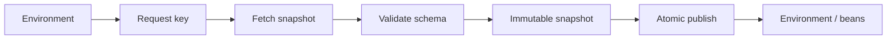
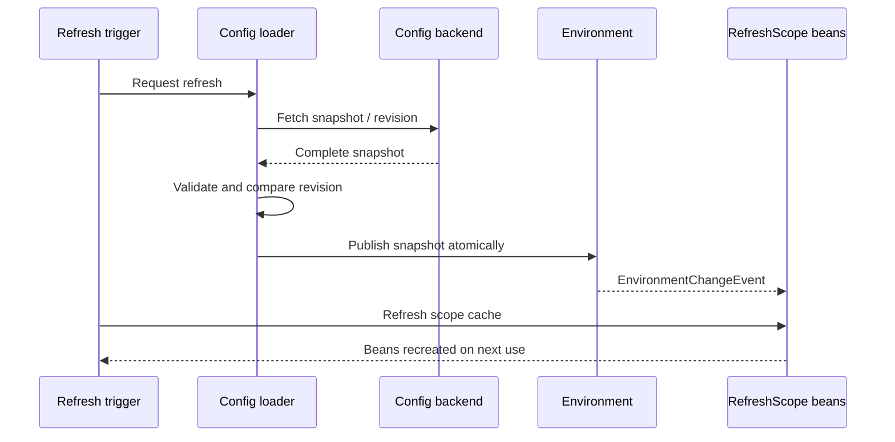

# Thiết kế thao tác nạp có thể lặp lại an toàn khi refresh

Một nguồn cấu hình tùy biến có thể được gọi nhiều lần trong vòng đời ứng dụng: lúc bootstrap, khi profile đã được kích hoạt, hoặc khi môi trường được refresh. Nếu mỗi lần gọi lại thêm một property source mới hay cập nhật từng khóa trực tiếp, ứng dụng có thể tích lũy nguồn trùng lặp và để lộ cấu hình dở dang.

Bài học thuộc chương **Nguồn cấu hình tùy biến** của module **SPRING_CLOUD_CORE**. Trọng tâm là thiết kế thao tác đọc và công bố snapshot sao cho gọi lặp, retry hoặc chạy đồng thời vẫn tạo ra trạng thái ổn định.

## 1. Mục tiêu học tập

- Giải thích idempotency trong thao tác nạp cấu hình.
- Nhận biết các thời điểm Spring Cloud gọi lại `PropertySourceLocator`.
- Tách fetch, validation và publish thành các bước riêng.
- Dùng source name ổn định, snapshot bất biến và atomic replacement.
- Kiểm soát revision cũ, refresh đồng thời và lỗi giữa chừng.
- Kiểm thử gọi lặp, profile thay đổi, snapshot rỗng và last-known-good.

## 2. Idempotent nghĩa là gì?

Một thao tác idempotent là thao tác mà thực hiện nhiều lần với cùng đầu vào vẫn tạo ra cùng trạng thái cuối cùng như thực hiện một lần.

Ví dụ backend trả snapshot revision 42 với hai thuộc tính `catalog.base-url` và `catalog.timeout`. Locator có thể được gọi ba lần, nhưng kết quả cuối cùng vẫn chỉ là một nguồn cấu hình chứa hai giá trị đó. Không tạo ba property source, không tăng revision và không ghi trạng thái phụ vào backend.

Idempotent khác với exactly-once. Request mạng có thể timeout sau khi server đã xử lý; client không biết nên có thể gửi lại. Thiết kế thực tế nên chịu được at-least-once invocation: request có thể lặp, nhưng việc áp dụng cùng snapshot không tạo tác dụng phụ thêm.

| Khái niệm | Ý nghĩa |
| --- | --- |
| Repeatable | Có thể gọi lại nhiều lần |
| Idempotent | Gọi lại cùng đầu vào không làm thay đổi thêm trạng thái |
| Atomic publish | Người đọc chỉ thấy snapshot cũ hoặc snapshot mới hoàn chỉnh |
| Exactly-once | Giả định tác vụ chỉ chạy đúng một lần; không nên dựa vào điều này với request mạng |

## 3. Vì sao locator có thể được gọi nhiều lần?

Spring Cloud cho phép thêm nguồn cấu hình bootstrap bằng bean triển khai `PropertySourceLocator`. Locator nhận `Environment` của ứng dụng sắp được tạo và trả về `PropertySource`.

Từ Spring Cloud 2022.0.3, locator được gọi ở hai lượt: lượt đầu lấy cấu hình chưa phụ thuộc profile để có thể kích hoạt profile; lượt sau lấy cấu hình cho các profile đã hoạt động. Với bootstrap legacy, một số cấu hình còn có thể gọi lại locator trong quy trình dựng môi trường mới. Nhiều instance cũng tự khởi động và refresh độc lập.

Ở các release cũ hơn, locator có thể được chạy trong main application context thay vì bootstrap context. Một số phiên bản cho phép điều chỉnh thời điểm này bằng `spring.cloud.config.initialize-on-context-refresh` trong `bootstrap.yml`. Đây là thiết lập vòng đời bootstrap theo phiên bản, không phải bộ lập lịch polling định kỳ.

Vì vậy, locator phải xem mỗi lần gọi là một lần đọc độc lập. Không dùng số lần gọi để quyết định dữ liệu và không giả định locator chỉ chạy một lần.

## 4. Refresh môi trường và refresh bean

`ContextRefresher.refresh()` trong Spring Cloud Context cập nhật `Environment`, xác định các khóa thay đổi, phát `EnvironmentChangeEvent`, rồi làm mới cache của `RefreshScope`. Bean trong refresh scope được tạo lại khi được truy cập tiếp theo.

`@RefreshScope` không tự gọi backend và không tự phát hiện file cấu hình đã đổi. Nguồn tùy biến phải tham gia đúng đường nạp lại môi trường. Với bootstrap legacy, custom locator có thể được gọi lại khi môi trường được dựng lại. Với Config Data import, việc nạp lại do Config Data refresher đảm nhiệm. Hãy kiểm thử đúng mode và phiên bản đang dùng.

## 5. Tách fetch, validate và publish



- Reader chỉ đọc dữ liệu và trả snapshot; không sửa Environment.
- Validator kiểm tra toàn bộ snapshot.
- Publisher thay thế snapshot đang hoạt động bằng một thao tác nguyên khối.

Không gộp HTTP call, sửa map dùng chung và phát event vào một hàm. Nếu refresh lỗi giữa chừng, cách viết đó dễ để lại trạng thái nửa cũ nửa mới.

Việc thay một property source bằng một snapshot bất biến là một lần publish nguyên khối ở cấp nguồn. Tuy nhiên, một bean đọc nhiều khóa riêng lẻ đúng lúc refresh vẫn có thể bắt đầu đọc trước lần thay thế và kết thúc sau lần thay thế. Nếu nhiều khóa phải nhất quán tuyệt đối với nhau, hãy bind chúng vào một đối tượng cấu hình duy nhất và phối hợp việc tạo lại đối tượng đó theo một revision; không để nhiều consumer tự đọc các khóa rời rạc trong lúc publish.


## 6. Tạo khóa định danh ổn định cho một lần nạp

Một request key cần xác định chính xác bộ cấu hình được yêu cầu. Tùy hệ thống, key có thể gồm:

| Thành phần | Ví dụ | Lý do |
| --- | --- | --- |
| Application | `billing-service` | Tách cấu hình giữa các dịch vụ |
| Tenant | `tenant-a` | Tách dữ liệu theo khách hàng nếu có |
| Profiles | `prod`, `region-eu` | Chọn tập cấu hình theo môi trường |
| Label/revision | `release-42` | Chọn phiên bản cấu hình |
| Namespace | `payment` | Phân vùng dữ liệu nếu backend hỗ trợ |

Ví dụ request key:

```text
application=billing-service
tenant=tenant-a
profiles=[prod, region-eu]
label=release-42
```

Các thành phần phải được lấy từ `Environment` hoặc nguồn bootstrap đã có sẵn. Không lấy profile từ một giá trị chỉ có thể tải sau khi đã kết nối backend nếu điều đó tạo vòng phụ thuộc.

Giữ nguyên thứ tự profile nếu thứ tự đó có ý nghĩa với hệ thống. Nếu backend coi profile là một tập hợp không có thứ tự, hãy chuẩn hóa nhất quán trước khi tạo cache key. Quy tắc chuẩn hóa phải giống nhau ở mọi lần gọi.

## 7. Viết locator theo kiểu đọc thuần và trả snapshot

Ví dụ dưới đây minh họa locator đọc cấu hình từ một dịch vụ riêng. `RemoteConfigReader` thực hiện request chỉ đọc; `ConfigSnapshotValidator` kiểm tra dữ liệu trước khi trả về property source.

### 7.1. Hợp đồng snapshot

```java
import java.util.Map;

public record RemoteConfigSnapshot(
        long revision,
        Map<String, Object> properties
) {
}
```

Revision là số tăng đơn điệu trong phạm vi cấu hình mà backend quản lý. Nếu backend chỉ có ETag hoặc revision dạng chuỗi không thể so sánh thứ tự, không so sánh từ điển; hãy dùng equality/conditional request hoặc serialize việc đọc và công bố.

### 7.2. Hợp đồng đọc và kiểm tra

```java
import java.util.List;

public interface RemoteConfigReader {

    RemoteConfigSnapshot fetch(
        String applicationName,
        List<String> profiles
    );
}
```

```java
import java.util.Map;

public interface ConfigSnapshotValidator {

    Map<String, Object> validate(
        Map<String, Object> properties
    );
}
```

Reader nên dùng thao tác đọc không có side effect, ví dụ HTTP GET hoặc truy vấn SELECT. Một lần đọc không được đánh dấu cấu hình là đã tiêu thụ, xóa dữ liệu ở backend hoặc tăng revision chỉ vì client hỏi lại.

Validator cần kiểm tra:

- Tên khóa nằm trong namespace được phép.
- Giá trị có đúng kiểu và định dạng.
- Các khóa bắt buộc có mặt.
- Giá trị timeout, pool size và giới hạn số lượng nằm trong phạm vi hợp lệ.
- Secret không xuất hiện trong log hoặc thông báo lỗi.
- Các khóa có quan hệ với nhau thỏa điều kiện nhất quán.

### 7.3. Locator trả về tên property source ổn định

```java
import java.util.Arrays;
import java.util.List;
import java.util.Map;

import org.springframework.cloud.bootstrap.config.PropertySourceLocator;
import org.springframework.core.env.Environment;
import org.springframework.core.env.MapPropertySource;
import org.springframework.core.env.PropertySource;

public final class BillingConfigLocator implements PropertySourceLocator {

    private static final String SOURCE_NAME = "custom-billing-config";

    private final RemoteConfigReader reader;
    private final ConfigSnapshotValidator validator;

    public BillingConfigLocator(
            RemoteConfigReader reader,
            ConfigSnapshotValidator validator) {
        this.reader = reader;
        this.validator = validator;
    }

    @Override
    public PropertySource<?> locate(Environment environment) {
        String applicationName = environment.getProperty(
            "spring.application.name", "application");

        List<String> profiles =
            Arrays.asList(environment.getActiveProfiles());

        RemoteConfigSnapshot snapshot =
            reader.fetch(applicationName, profiles);

        Map<String, Object> validated =
            validator.validate(snapshot.properties());

        Map<String, Object> immutableValues = Map.copyOf(validated);

        return new MapPropertySource(SOURCE_NAME, immutableValues);
    }
}
```

Các đặc điểm quan trọng:

- Tên `custom-billing-config` ổn định qua các lần gọi.
- Cùng application/profile/revision trả cùng tập property.
- Map được kiểm tra rồi sao chép thành map bất biến.
- Locator không sửa trực tiếp `Environment` và không phát refresh event.
- Lỗi đọc hoặc validate được truyền về tầng điều phối để áp dụng chính sách fail-fast/last-known-good.

Ví dụ dùng `Map.copyOf` yêu cầu map không chứa khóa hoặc giá trị `null`. Validator nên loại bỏ hoặc từ chối giá trị null theo schema. Nếu cần biểu diễn thao tác xóa khóa, hãy dùng snapshot mới không còn khóa đó và thay toàn bộ source; đừng dùng null làm dấu xóa tùy tiện vì property resolver có thể tiếp tục tìm giá trị ở nguồn thấp hơn.

> Đây là ví dụ cho bootstrap `PropertySourceLocator`. Nếu ứng dụng dùng Config Data import, hãy tích hợp nguồn riêng bằng `ConfigDataLocationResolver` và `ConfigDataLoader` phù hợp phiên bản. Nguyên tắc đọc thuần, snapshot bất biến và công bố an toàn vẫn giữ nguyên.

## 8. Không cộng dồn property source qua mỗi lần refresh

Một lỗi phổ biến là tạo tên mới theo thời gian:

```java
// Không nên: mỗi lần gọi lại tạo một source khác tên.
String sourceName = "custom-config-" + System.nanoTime();
environment.getPropertySources().addFirst(
    new MapPropertySource(sourceName, values)
);
```

Sau nhiều lần refresh, `Environment` có thể chứa nhiều nguồn cũ. Nguồn ở đầu danh sách tiếp tục thắng, trong khi nguồn cũ phía dưới làm người vận hành khó hiểu giá trị nào đang có hiệu lực. Bộ nhớ và thời gian tra cứu cũng có thể tăng theo số lần refresh.

Dùng một tên ổn định cho một nguồn logic. Nếu tự quản lý việc công bố trực tiếp vào `MutablePropertySources`, hãy thay nguồn theo tên:

```java
import java.util.Map;

import org.springframework.core.env.ConfigurableEnvironment;
import org.springframework.core.env.MapPropertySource;
import org.springframework.core.env.MutablePropertySources;
import org.springframework.core.env.PropertySource;

public final class PropertySourcePublisher {

    private final String sourceName;

    public PropertySourcePublisher(String sourceName) {
        this.sourceName = sourceName;
    }

    public void replace(
            ConfigurableEnvironment environment,
            Map<String, Object> values) {

        Map<String, Object> immutable = Map.copyOf(values);
        PropertySource<?> next =
            new MapPropertySource(sourceName, immutable);

        MutablePropertySources sources = environment.getPropertySources();

        synchronized (sources) {
            if (sources.contains(sourceName)) {
                sources.replace(sourceName, next);
            }
            else {
                sources.addFirst(next);
            }
        }
    }
}
```

Publisher này tạo property source mới từ snapshot đã validate rồi thay thế nguồn cùng tên. Khi snapshot mới không còn một khóa cũ, khóa đó biến mất khỏi source mới thay vì tiếp tục nằm trong map cũ.

Chỉ dùng publisher trực tiếp khi ứng dụng thực sự tự quản lý đường công bố. Với `PropertySourceLocator` được Spring Cloud gọi trong bootstrap, hãy trả source cho framework và để cơ chế bootstrap/refresher quản lý việc chèn source. Tránh vừa trả source từ locator vừa tự chèn một bản sao vào Environment.

### 8.1. Snapshot rỗng phải là kết quả hợp lệ có chủ ý

Có ba trường hợp khác nhau:

1. Backend trả về snapshot hợp lệ nhưng không có property nào.
2. Backend báo không tìm thấy cấu hình cho application/profile.
3. Backend không truy cập được hoặc response không hợp lệ.

Không gộp cả ba trường hợp thành `Map.of()`. Một snapshot rỗng có thể là yêu cầu xóa toàn bộ các khóa do nguồn đó quản lý; lỗi network lại có nghĩa là chưa biết cấu hình mới. Nếu lỗi bị chuyển thành map rỗng và publish, ứng dụng có thể vô tình xóa cấu hình đang hoạt động.

Với publisher tự quản lý, snapshot rỗng hợp lệ có thể thay source cũ bằng source rỗng. Với locator được Spring Cloud quản lý, cần xác minh cách phiên bản xử lý locator trả null hoặc property source rỗng; không giả định source cũ luôn được loại bỏ khi không có source mới. Nếu cần semantics xóa khóa chính xác, hãy thiết kế cơ chế công bố có khả năng thay thế rõ ràng và kiểm thử trường hợp rỗng.


## 9. Công bố snapshot nguyên khối

Giả sử cấu hình mới có ba khóa:

```yaml
billing:
  payment:
    base-url: https://payment-v2.internal
    connect-timeout: 2s
    read-timeout: 5s
```

Không cập nhật lần lượt từng khóa vào một map đang được bean khác đọc:

```java
// Không nên: thread khác có thể nhìn thấy cấu hình dở dang.
shared.put("billing.payment.base-url", newBaseUrl);
shared.put("billing.payment.connect-timeout", newConnectTimeout);
shared.put("billing.payment.read-timeout", newReadTimeout);
```

Trong lúc refresh, một request có thể đọc endpoint mới nhưng timeout cũ. Nếu các khóa có quan hệ với nhau, trạng thái trung gian có thể gây lỗi kết nối hoặc vi phạm chính sách.

Thay vào đó:

1. Tải tất cả dữ liệu vào một biến cục bộ.
2. Validate toàn bộ snapshot.
3. Tạo map bất biến mới.
4. Thay property source hoặc tham chiếu snapshot bằng một thao tác publish duy nhất.
5. Sau khi publish thành công, để Spring phát event/rebind/refresh theo cơ chế đã cấu hình.

Khi snapshot có nhiều khóa liên quan, chỉ publish sau khi mọi kiểm tra thành công. Không để một phần khóa mới xuất hiện trước phần còn lại.

## 10. Kiểm soát refresh đồng thời và response đến sai thứ tự

Một ứng dụng có thể nhận hai yêu cầu refresh gần nhau:

- Refresh A bắt đầu trước, đọc revision `41` nhưng backend phản hồi chậm.
- Refresh B bắt đầu sau, đọc revision `42` và hoàn tất trước.
- Nếu A publish sau B, revision `41` có thể ghi đè revision `42`.

Đây là lỗi **stale response**. Chỉ dùng tên property source ổn định chưa đủ; cần kiểm soát phiên bản hoặc serialize thao tác publish.

### 10.1. Serialize trong một instance

Nếu backend cung cấp revision số tăng đơn điệu, publisher có thể từ chối revision cũ:

```java
import java.util.Map;

import org.springframework.core.env.ConfigurableEnvironment;

public final class VersionedConfigPublisher {

    private final ConfigurableEnvironment environment;
    private final PropertySourcePublisher publisher;
    private long lastAppliedRevision = -1;

    public VersionedConfigPublisher(
            ConfigurableEnvironment environment,
            PropertySourcePublisher publisher) {
        this.environment = environment;
        this.publisher = publisher;
    }

    public synchronized boolean publish(
            long revision,
            Map<String, Object> values) {

        if (revision <= lastAppliedRevision) {
            return false;
        }

        publisher.replace(environment, values);
        lastAppliedRevision = revision;
        return true;
    }
}
```

`synchronized` bảo đảm chỉ một thread trong cùng publisher chạy qua đoạn kiểm tra và publish tại một thời điểm. Revision cũ hoặc trùng được bỏ qua. Đây chỉ là khóa trong một JVM; nó không khóa các replica khác.

Trong ứng dụng thật, `lastAppliedRevision` phải được khởi tạo từ revision hiện đang hoạt động khi publisher được tạo. Revision cần có phạm vi so sánh rõ ràng, ví dụ theo application + tenant + profile + label; không so sánh revision của hai request key khác nhau.

Nếu backend dùng revision dạng opaque như ETag, không so sánh chuỗi theo thứ tự. Có thể serialize fetch/publish, dùng conditional request hoặc một generation token do hệ thống quản lý.

### 10.2. Gộp nhiều yêu cầu refresh

Nếu nhiều tín hiệu refresh đến trong lúc một lần tải đang chạy, có thể dùng cơ chế **single-flight**: các caller cùng chờ một lần fetch cho cùng request key thay vì tạo nhiều request trùng lặp.

Quy tắc triển khai:

- Chỉ gộp request có cùng application, tenant, profile và label.
- Request cho profile hoặc tenant khác nhau không được dùng chung snapshot.
- Sau khi lần fetch đang chạy hoàn tất, nếu có tín hiệu mới hơn thì lên lịch một lượt fetch mới.
- Không giữ lock trong lúc chờ mạng nếu lock đó chặn các hoạt động không liên quan.
- Có timeout và giới hạn thời gian chờ cho caller.

`ContextRefresher.refresh()` đồng bộ các lần gọi trên cùng instance theo implementation hiện hành, nhưng điều đó không bảo vệ request do scheduler riêng, endpoint riêng hoặc các replica khác phát ra. Thiết kế loader vẫn phải tự chịu được concurrency.

### 10.3. Nhiều instance không chia sẻ bộ nhớ

Trong Kubernetes hoặc môi trường nhiều replica, mỗi JVM có `Environment` riêng. Một `AtomicReference`, `synchronized` hoặc cache trong một instance không bảo vệ được instance khác.

Có thể dùng:

- Revision bất biến để mọi instance tải cùng một snapshot.
- ETag/conditional GET để giảm tải backend.
- Jitter hoặc rollout theo đợt để tránh tất cả instance fetch cùng một thời điểm.
- Event/bus để báo có revision mới, sau đó mỗi instance tải đúng revision.
- Metric ghi nhận revision đang hoạt động ở từng instance.

Không dùng một khóa phân tán chỉ để bảo đảm “chỉ một instance đọc cấu hình” nếu mọi instance vẫn cần cập nhật Environment riêng. Điều quan trọng là mỗi instance áp dụng cùng một snapshot một cách an toàn.

## 11. Xử lý lỗi và giữ last-known-good

Refresh có thể thất bại do network timeout, backend unavailable, authentication, schema không hợp lệ hoặc revision bị xóa. Chính sách cần phân biệt **không tải được** với **đã tải thành công một snapshot mới nhưng snapshot đó rỗng**.

### 11.1. Không publish dữ liệu một phần

Quy trình sai:

1. Đọc một số khóa.
2. Ghi ngay các khóa đã đọc vào Environment.
3. Đọc tiếp nhưng gặp lỗi.
4. Để lại một phần cấu hình mới và một phần cấu hình cũ.

Quy trình đúng là tải một snapshot hoàn chỉnh, validate rồi publish. Nếu một khóa bắt buộc sai kiểu, từ chối toàn bộ snapshot. Không sửa dữ liệu tùy tiện để cố làm refresh thành công.

### 11.2. Chính sách theo thời điểm

| Tình huống | Hành vi nên cân nhắc |
| --- | --- |
| Khởi động lần đầu, nguồn bắt buộc không truy cập được | Fail fast, không khởi động với cấu hình thiếu |
| Khởi động lần đầu, nguồn optional và có default an toàn | Có thể dùng default đã validate và ghi nhận trạng thái degraded |
| Refresh khi đã có snapshot hợp lệ, backend tạm thời lỗi | Giữ last-known-good, không publish snapshot rỗng |
| Backend trả snapshot mới nhưng validation thất bại | Từ chối toàn bộ snapshot mới, giữ snapshot cũ |
| Backend trả snapshot rỗng hợp lệ theo hợp đồng | Áp dụng chính sách xóa rõ ràng; không coi là lỗi network |
| Revision mới thấp hơn revision đang chạy | Từ chối publish để tránh rollback ngoài dự kiến |

Last-known-good là dữ liệu đã được tải và validate thành công trước đó. Không nên giữ vô thời hạn nếu chính sách bảo mật yêu cầu cấu hình hết hạn; khi đó cần TTL hoặc thời điểm hết hạn rõ ràng, sau thời điểm đó readiness có thể chuyển degraded hoặc DOWN theo mức độ quan trọng.

### 11.3. Retry có giới hạn

Retry phù hợp với lỗi tạm thời như timeout hoặc HTTP 503. Dùng backoff và jitter để tránh tạo đợt request đồng thời. Không retry vô hạn với 401/403, schema sai hoặc revision không tồn tại; cần sửa credential hoặc dữ liệu.

Retry phải giữ nguyên request key và revision mục tiêu. Nếu retry chuyển sang một profile/label khác mà không có chủ ý, kết quả có thể hợp lệ về cú pháp nhưng sai môi trường.

## 12. Cache, ETag và hiệu quả khi fetch lặp lại

Idempotency không bắt buộc phải gọi backend mỗi lần. Có thể giảm tải bằng cache có khóa rõ ràng:

```text
cache key =
  application + tenant + ordered profiles + label
```

Một số cách tối ưu:

- Dùng ETag/If-None-Match hoặc revision để server trả `304 Not Modified` khi cấu hình không đổi.
- Cache snapshot bất biến theo request key và revision.
- Dùng TTL hợp lý; TTL không được dài hơn thời gian cho phép cấu hình cũ tồn tại.
- Có single-flight để nhiều request đồng thời cùng chờ một lần fetch.
- Giới hạn số entry và loại bỏ cache cũ khi application/profile không còn hoạt động.
- Không cache chung giữa tenant hoặc workload có quyền truy cập khác nhau.

Nếu server trả `304`, client giữ snapshot hiện tại và không publish lại nếu không cần. Nếu cache miss hoặc ETag thay đổi, tải và validate snapshot mới rồi publish.

Không dùng cache làm nguồn sự thật duy nhất. Cache trong một instance mất khi process restart; khi khởi động lại, client phải tải hoặc phục hồi snapshot theo chính sách đã thiết kế.


## 13. Tách refresh nguồn cấu hình khỏi refresh bean

Có ba hoạt động cần phân biệt:

1. **Fetch:** đọc snapshot mới từ backend.
2. **Publish:** thay đổi property source trong Environment.
3. **Rebind/recreate:** để bean nhận cấu hình mới.

`PropertySourceLocator` chịu trách nhiệm trả nguồn property trong bootstrap flow. `ContextRefresher` điều phối cập nhật Environment, phát `EnvironmentChangeEvent` và làm mới refresh scope. Không tự gọi cả `ContextRefresher.refresh()` bên trong locator; điều đó có thể tạo vòng lặp refresh hoặc gọi lồng nhau.

Một luồng hợp lý:



Trong Spring Cloud Context, `ContextRefresher.refresh()` đã điều phối các bước update Environment và refresh scope theo thứ tự. Nếu tự xây dựng một refresh coordinator, hãy xác định rõ thành phần nào phát event và thành phần nào gọi refresh scope; tránh phát hai event hoặc refresh hai lần cho cùng một snapshot.

## 14. Thiết kế một refresh coordinator nhỏ

Khi nguồn cấu hình không nằm trong locator bootstrap chuẩn hoặc cần điều phối riêng, có thể tách service chịu trách nhiệm đọc và publish. Ví dụ dưới đây minh họa nguyên tắc, không phải implementation thay thế trực tiếp cho mọi loại Config Data refresher:

```java
import java.util.List;
import java.util.Map;

import org.springframework.core.env.Environment;
import org.springframework.stereotype.Service;

@Service
public class CustomConfigRefreshService {

    private final RemoteConfigReader reader;
    private final ConfigSnapshotValidator validator;
    private final VersionedConfigPublisher publisher;
    private final Environment environment;

    public CustomConfigRefreshService(
            RemoteConfigReader reader,
            ConfigSnapshotValidator validator,
            VersionedConfigPublisher publisher,
            Environment environment) {
        this.reader = reader;
        this.validator = validator;
        this.publisher = publisher;
        this.environment = environment;
    }

    public synchronized boolean reload() {
        String applicationName = environment.getProperty(
            "spring.application.name", "application");
        List<String> profiles =
            List.of(environment.getActiveProfiles());

        RemoteConfigSnapshot snapshot =
            reader.fetch(applicationName, profiles);

        Map<String, Object> validated =
            validator.validate(snapshot.properties());

        return publisher.publish(snapshot.revision(), validated);
    }
}
```

Trong ứng dụng thật, service này còn cần chính sách lỗi, timeout, metrics và cách phát event sau publish. Nếu dùng `ContextRefresher` chuẩn, hãy để refresher sở hữu vòng đời update/rebind thay vì tự tạo một đường refresh song song. Không gọi `ContextRefresher.refresh()` từ bên trong `PropertySourceLocator`.

## 15. Kiểm thử tính lặp lại an toàn

Kiểm thử phải chứng minh cả trạng thái sau nhiều lần gọi lẫn hành vi khi lỗi. Chỉ assert hàm trả về không null là chưa đủ.

### 15.1. Gọi nhiều lần với cùng revision

Giả sử locator nhận cùng snapshot hai lần. Xác nhận:

- Cùng tên property source.
- Cùng tập khóa và giá trị.
- Không tăng số property source trong Environment.
- Không phát sinh thao tác ghi phụ ở backend.
- Không tạo revision mới chỉ vì client đã đọc.

Ví dụ test cho publisher:

```java
import java.util.Map;
import java.util.stream.StreamSupport;

import org.junit.jupiter.api.Test;
import org.springframework.core.env.ConfigurableEnvironment;
import org.springframework.core.env.StandardEnvironment;

import static org.assertj.core.api.Assertions.assertThat;

class PropertySourcePublisherTest {

    @Test
    void replacesTheSameSourceInsteadOfAppendingDuplicates() {
        ConfigurableEnvironment environment = new StandardEnvironment();
        PropertySourcePublisher publisher =
            new PropertySourcePublisher("custom-config");

        publisher.replace(environment, Map.of("feature.a", true));
        publisher.replace(environment, Map.of("feature.a", true));

        long count = StreamSupport.stream(
                environment.getPropertySources().spliterator(), false)
            .filter(source -> source.getName().equals("custom-config"))
            .count();

        assertThat(count).isEqualTo(1);
        assertThat(environment.getProperty("feature.a")).isEqualTo(true);
    }
}
```

### 15.2. Snapshot mới xóa một khóa cũ

Gọi publish lần đầu với hai khóa, lần sau với một khóa:

```java
publisher.replace(environment, Map.of(
    "feature.a", true,
    "feature.b", false
));

publisher.replace(environment, Map.of(
    "feature.a", true
));

assertThat(environment.containsProperty("feature.b")).isFalse();
```

Test này xác nhận source được thay nguyên khối và không giữ khóa đã bị xóa trong snapshot mới.

### 15.3. Gọi đồng thời

Dùng nhiều thread gọi refresh với cùng revision. Xác nhận:

- Backend không nhận các thao tác ghi không cần thiết.
- Publisher chỉ có một source logic.
- Revision đang hoạt động không bị lùi.
- Không có exception do sửa map đồng thời.
- Tất cả caller nhận kết quả nhất quán theo hợp đồng.

Nếu dùng single-flight, kiểm tra nhiều caller cùng request key chỉ kích hoạt một lần fetch trong cửa sổ đang chạy.

### 15.4. Lỗi giữa chừng không làm hỏng cấu hình đang hoạt động

Thiết lập snapshot cũ hợp lệ, giả lập backend timeout hoặc validator từ chối snapshot mới. Sau refresh thất bại, xác nhận:

- Snapshot cũ vẫn được dùng.
- Không có source rỗng được publish nhầm.
- Không có một phần khóa mới xuất hiện.
- Lỗi được ghi nhận bằng metric/log không chứa secret.
- Readiness/health phản ánh đúng chính sách nguồn cấu hình.

### 15.5. Profile thay đổi và nhiều lượt bootstrap

Với các phiên bản Spring Cloud gọi locator ở lượt default profile rồi lượt active profiles, kiểm thử hai request có cùng application nhưng profile khác nhau. Xác nhận locator:

- Không tái sử dụng cache key thiếu profile.
- Không cộng dồn property source trùng.
- Không làm thay đổi trạng thái backend.
- Trả đúng cấu hình theo từng lượt.

### 15.6. Revision cũ đến sau revision mới

Giả lập request A đọc revision 41 và request B đọc revision 42. Cho B hoàn tất trước A. Sau khi cả hai publish, revision hoạt động vẫn phải là 42. Test này bắt lỗi response cũ ghi đè dữ liệu mới.

## 16. Quan sát và vận hành

Một thao tác nạp có thể lặp lại cần có dấu vết để xác định lần refresh nào thành công và snapshot nào đang được sử dụng.

Nên ghi nhận:

- Application, profile và label/request key.
- Revision hoặc ETag đang hoạt động.
- Thời gian fetch, validate và publish.
- Số lần refresh, số lần bỏ qua do revision không đổi.
- Số lỗi timeout, authentication, schema validation và stale revision.
- Thời điểm thành công gần nhất và tuổi của last-known-good snapshot.
- Số instance đã nhận revision mới.

Không log toàn bộ map property. Chỉ log tên nguồn, revision, số khóa và metadata không nhạy cảm. Không đưa secret, token, password hoặc giá trị cấu hình nhạy cảm vào log/metric label.

### 16.1. Alert nên tập trung vào trạng thái thực tế

Một vài tín hiệu hữu ích:

| Tín hiệu | Ý nghĩa |
| --- | --- |
| Fetch failure liên tục | Backend hoặc network đang có vấn đề |
| Last successful revision quá cũ | Instance chưa nhận cấu hình mới |
| Revision lệch giữa replicas | Rollout/refresh chưa đồng bộ |
| Validation failure tăng | Cấu hình mới không đáp ứng schema |
| Refresh duration tăng | Backend chậm hoặc retry quá nhiều |
| Property source count tăng theo refresh | Có nguy cơ append source thay vì replace |

Đừng chỉ alert khi endpoint refresh trả HTTP 200. Cần xác nhận revision đã được publish và bean cần thiết đã nhận cấu hình mới.

## 17. Các lỗi thiết kế cần tránh

| Cách làm | Hậu quả | Thiết kế phù hợp |
| --- | --- | --- |
| Tạo source name mới theo timestamp | Property source tích lũy qua refresh | Tên source ổn định |
| Sửa map dùng chung từng khóa | Request có thể thấy snapshot nửa cũ nửa mới | Validate map mới rồi replace nguyên khối |
| Locator ghi vào database mỗi lần chạy | Gọi lặp tạo side effect | Locator chỉ đọc backend |
| Chuyển mọi exception thành map rỗng | Lỗi tạm thời xóa cấu hình hợp lệ | Phân biệt empty snapshot và fetch failure |
| Dùng cache key chỉ có application | Profile/tenant có thể đọc nhầm cấu hình | Cache key gồm mọi chiều định danh |
| Không kiểm tra revision | Response cũ có thể ghi đè response mới | Monotonic revision hoặc conditional publish |
| Gọi refresh bên trong locator | Có thể tạo vòng lặp hoặc refresh lồng nhau | Tách loader khỏi refresh coordinator |
| Tin rằng `@RefreshScope` tự gọi lại backend | Bean có thể được tạo lại với cấu hình cũ | Cấu hình đường fetch/publish rõ ràng |
| Chỉ test một lần khởi động | Bỏ sót lỗi lặp và cạnh tranh | Test lặp, đồng thời, lỗi và stale response |

## 18. Bài tập vận dụng

Một custom configuration source cung cấp cho `order-service` ba thuộc tính:

```yaml
order:
  payment:
    endpoint: https://payment.internal
    connect-timeout: 2s
    read-timeout: 5s
```

Backend trả về revision số tăng đơn điệu. Trong lúc refresh:

- Instance nhận hai yêu cầu refresh gần nhau.
- Lượt fetch thứ nhất trả revision 41 nhưng chậm.
- Lượt fetch thứ hai trả revision 42 nhanh hơn.
- Revision 42 bỏ khóa `order.payment.read-timeout`.
- Sau đó một request khác bị timeout khi đọc backend.

Hãy thiết kế và kiểm chứng:

1. Request key cần bao gồm những thông tin nào ngoài tên application?
2. Locator được gọi hai lần khi profile được kích hoạt thì phải tránh side effect gì?
3. Làm thế nào để revision 41 không ghi đè revision 42?
4. Làm thế nào để publish snapshot 42 mà khóa `read-timeout` cũ thực sự biến mất?
5. Khi request tiếp theo timeout, vì sao không được publish map rỗng?
6. Nếu dùng `PropertySourceLocator`, cơ chế refresh nào sẽ gọi lại locator trong phiên bản dự án?
7. Viết test cho hai lần gọi cùng revision, hai lần gọi đồng thời, xóa khóa và giữ last-known-good khi fetch lỗi.
8. Đề xuất metric để phát hiện một replica vẫn đang dùng revision 41 trong khi các replica khác đã dùng revision 42.

**Tiêu chí hoàn thành:** cùng một request có thể chạy lại mà không tích lũy property source; snapshot được validate trước khi publish; revision cũ không ghi đè revision mới; lỗi fetch không làm mất cấu hình hợp lệ; hành vi bootstrap/refresh được kiểm thử theo đúng cơ chế của dự án.

## 19. Ghi nhớ

- Spring Cloud có thể gọi custom property source locator nhiều lần; từ các phiên bản phù hợp, locator còn được gọi ở nhiều lượt để xử lý profile.
- Idempotent nghĩa là gọi lại cùng đầu vào không tạo thêm tác dụng phụ hoặc thay đổi trạng thái ngoài dự kiến.
- Đọc cấu hình, validate và publish nên là ba bước tách biệt.
- Dùng request key đầy đủ, revision/ETag và property source name ổn định.
- Tạo snapshot bất biến, validate toàn bộ rồi thay thế nguyên khối.
- Kiểm soát refresh đồng thời và từ chối response cũ; khóa trong một JVM không bảo vệ các replica khác.
- Phân biệt snapshot rỗng hợp lệ với lỗi fetch; khi refresh lỗi, giữ last-known-good theo chính sách.
- `ContextRefresher` cập nhật Environment và refresh scope, nhưng nguồn tùy biến phải tham gia đúng đường nạp lại.
- Kiểm thử gọi lặp, nhiều profile, nhiều thread, stale response, xóa khóa và lỗi giữa chừng.

## 20. Tài liệu tham khảo

- [Spring Cloud Context — Application Context Services](https://docs.spring.io/spring-cloud-commons/reference/spring-cloud-commons/application-context-services.html): bootstrap property sources, `PropertySourceLocator`, nhiều lượt locator và refresh scope.
- [ContextRefresher.java](https://github.com/spring-cloud/spring-cloud-commons/blob/main/spring-cloud-context/src/main/java/org/springframework/cloud/context/refresh/ContextRefresher.java): thứ tự update Environment, phát `EnvironmentChangeEvent` và refresh scope.
- [PropertySourceBootstrapConfiguration.java](https://github.com/spring-cloud/spring-cloud-commons/blob/main/spring-cloud-context/src/main/java/org/springframework/cloud/bootstrap/config/PropertySourceBootstrapConfiguration.java): cách Spring Cloud gọi locator và chèn property sources trong bootstrap.


