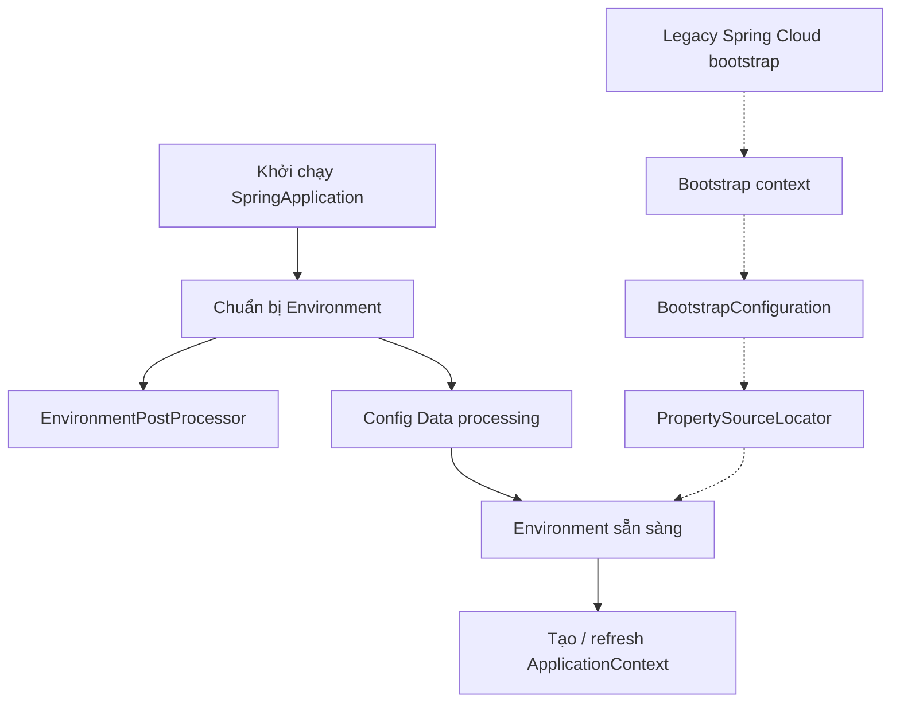

# Phân biệt extension bootstrap với EnvironmentPostProcessor của Spring Boot

Khi ứng dụng cần bổ sung một nguồn cấu hình, Spring có nhiều extension point có vẻ giống nhau vì chúng đều có thể thêm `PropertySource` vào `Environment`. Hai cơ chế thường được nhắc đến trong hệ sinh thái Spring Cloud là **legacy bootstrap extension** và **`EnvironmentPostProcessor` của Spring Boot**. Chọn sai cơ chế có thể khiến cấu hình được nạp quá muộn, xuất hiện trong nhầm context, bị ghi đè ngoài dự kiến hoặc không hoạt động khi chuyển phiên bản Spring Boot/Spring Cloud.

Bài học thuộc chương **Nguồn cấu hình tùy biến** của module `SPRING_CLOUD_CORE`. Trọng tâm là phân biệt vai trò của `BootstrapConfiguration`/`PropertySourceLocator` trong bootstrap context với `EnvironmentPostProcessor` trong quá trình chuẩn bị `Environment` của Spring Boot; hiểu thời điểm chạy, cách đăng ký, quyền truy cập dependency và cách chọn extension phù hợp. Bài cũng đặt hai cơ chế này trong bối cảnh Config Data API hiện đại để tránh mở rộng legacy bootstrap khi không còn cần thiết.

## 1. Vì sao có nhiều extension point để bổ sung cấu hình?

Một ứng dụng Spring Boot có thể lấy cấu hình từ YAML, properties, biến môi trường, tham số dòng lệnh, Config Server hoặc nguồn do tổ chức tự xây dựng. Tất cả cuối cùng đều cần được biểu diễn thành property source để `Environment` và Binder đọc được.

Tuy nhiên, **thời điểm** đưa nguồn cấu hình vào rất quan trọng:

- Nếu cần thay đổi `Environment` trước khi tạo `ApplicationContext`, extension phải chạy trong giai đoạn chuẩn bị môi trường.
- Nếu cần tạo một bootstrap context riêng để truy cập nguồn cấu hình từ xa trước context chính, legacy Spring Cloud bootstrap cung cấp một cơ chế riêng.
- Nếu cần hỗ trợ cú pháp location như `spring.config.import=custom:...`, Config Data API có resolver/loader dành cho việc mở rộng nguồn cấu hình.

Không nên chỉ nhìn thấy một API có thể trả về `PropertySource` rồi chọn nó theo cảm tính. Cần xác định **ai sở hữu lifecycle**, extension được gọi lúc nào, cần dependency gì và ứng dụng đang dùng mô hình bootstrap nào.



Sơ đồ là cách nhìn khái quát. `ConfigDataEnvironmentPostProcessor` cũng tham gia hệ thống `EnvironmentPostProcessor`, và thứ tự thực thi được điều khiển bởi order. Legacy bootstrap có lifecycle riêng, phụ thuộc cách bật và phiên bản Spring Cloud. Vì vậy không thể coi các hộp trên là một chuỗi cố định áp dụng cho mọi phiên bản.

## 2. Legacy Spring Cloud bootstrap extension

### 2.1. Bootstrap context có vai trò gì?

Trong cơ chế truyền thống, Spring Cloud tạo một **bootstrap context** trước `ApplicationContext` chính. Bootstrap context là context cha trong quan hệ phân cấp, dùng để chuẩn bị cấu hình nền và các thành phần cần thiết cho việc nạp cấu hình từ xa. Sau đó, context ứng dụng chính được tạo với `Environment` đã được bổ sung theo cơ chế bootstrap.

Bootstrap extension phù hợp với các tích hợp được thiết kế dựa trên lifecycle này, ví dụ một `PropertySourceLocator` tùy biến cần truy vấn nguồn cấu hình từ xa trước khi bean nghiệp vụ được khởi tạo.

Legacy bootstrap không phải hành vi mặc định cần có ở mọi ứng dụng Spring Cloud hiện đại. Trong nhiều dòng phát hành mới, ứng dụng cần chủ động bật cơ chế này, thường thông qua `spring-cloud-starter-bootstrap` hoặc thiết lập tương ứng được tài liệu phiên bản hỗ trợ. Không nên thêm starter chỉ vì muốn bổ sung một `PropertySource` nếu Spring Boot đã có extension phù hợp hơn.

### 2.2. BootstrapConfiguration

Một lớp cấu hình bootstrap thường được đăng ký qua key `org.springframework.cloud.bootstrap.BootstrapConfiguration` trong `META-INF/spring.factories`:

```java
package com.example.legacyconfig;

import org.springframework.context.annotation.Bean;
import org.springframework.context.annotation.Configuration;
import org.springframework.cloud.bootstrap.config.PropertySourceLocator;

@Configuration(proxyBeanMethods = false)
public class LegacyRemoteConfiguration {
    @Bean
    PropertySourceLocator tenantPropertySourceLocator() {
        return new TenantPropertySourceLocator();
    }
}
```

File `src/main/resources/META-INF/spring.factories`:

```properties
org.springframework.cloud.bootstrap.BootstrapConfiguration=\
com.example.legacyconfig.LegacyRemoteConfiguration
```

Đăng ký này yêu cầu ứng dụng đang bật legacy bootstrap và có các dependency Spring Cloud tương ứng. Chỉ thêm entry vào `spring.factories` không tự tạo bootstrap context nếu cơ chế bootstrap chưa được kích hoạt.

**Chú ý package scan:** lớp `BootstrapConfiguration` nên đặt ở package nằm ngoài phạm vi component scan thông thường của ứng dụng chính. Nếu lớp này bị component scan như một configuration class thông thường, nó có thể được nạp thêm vào context chính ngoài ý muốn, gây tạo bean trùng hoặc hành vi khác nhau giữa bootstrap và application context.

### 2.3. PropertySourceLocator

`PropertySourceLocator` là extension point của Spring Cloud bootstrap để định vị và trả về một `PropertySource` dựa trên `Environment`:

```java
package com.example.legacyconfig;

import java.util.LinkedHashMap;
import java.util.Map;

import org.springframework.core.env.Environment;
import org.springframework.core.env.MapPropertySource;
import org.springframework.core.env.PropertySource;
import org.springframework.cloud.bootstrap.config.PropertySourceLocator;

public class TenantPropertySourceLocator implements PropertySourceLocator {
    @Override
    public PropertySource<?> locate(Environment environment) {
        String tenant = environment.getProperty("deployment.tenant", "default");

        Map<String, Object> values = new LinkedHashMap<>();
        values.put("catalog.tenant", tenant);
        values.put("catalog.feature.enabled", Boolean.TRUE);

        return new MapPropertySource("tenantRemoteProperties", values);
    }
}
```

Ví dụ tạo `MapPropertySource` để minh họa API; trong hệ thống thật, locator có thể gọi một nguồn cấu hình ngoài hoặc adapter nội bộ. Nếu thực hiện I/O, phải có timeout, xử lý lỗi, xác thực, TLS và chính sách retry phù hợp. Không ghi secret vào log hoặc exception.

`Environment` được truyền vào cho phép locator đọc những thông tin bootstrap đã có, chẳng hạn tenant, tên ứng dụng hoặc profile. Nguồn cấu hình được trả về sau đó có thể cung cấp thêm thuộc tính cho context ứng dụng. Thời điểm gọi locator và cách property source được gắn vào môi trường có thể khác theo dòng Spring Cloud; kiểm tra tài liệu đúng release train, đặc biệt nếu dùng các tùy chọn liên quan việc chạy locator trong main context refresh.

### 2.4. Bootstrap extension không phải bean của context chính

Các lớp trong `BootstrapConfiguration` được tạo trong bootstrap context. Chúng không nên mặc định có thể inject mọi bean nghiệp vụ được khai báo ở application context chính, vì context chính chưa được tạo khi bootstrap chạy. Hãy giới hạn dependency vào các thành phần cần thiết cho việc định vị cấu hình.

Nếu locator cần một client HTTP, credential provider hoặc thư viện chuyên dụng, phải khai báo dependency phù hợp trong bootstrap configuration hoặc thiết kế adapter có thể khởi tạo độc lập. Không dùng `@Autowired` để tham chiếu một bean chỉ tồn tại trong context con.

## 3. EnvironmentPostProcessor của Spring Boot

### 3.1. Vị trí trong lifecycle

`EnvironmentPostProcessor` là extension point của Spring Boot, được gọi trong quá trình `SpringApplication` chuẩn bị `Environment`, trước khi `ApplicationContext` được tạo và refresh. Nó nhận:

- `ConfigurableEnvironment`: môi trường có thể được thay đổi bằng cách thêm, xóa hoặc sắp xếp `PropertySource`, kích hoạt profile và thao tác liên quan.
- `SpringApplication`: đối tượng ứng dụng đang được khởi chạy.

Đây là cơ chế phù hợp khi cần bổ sung hoặc điều chỉnh `Environment` sớm bằng một thành phần của Spring Boot mà không cần tạo bootstrap context riêng của Spring Cloud.

Ví dụ:

```java
package com.example.config;

import java.util.LinkedHashMap;
import java.util.Map;

import org.springframework.boot.SpringApplication;
import org.springframework.boot.env.EnvironmentPostProcessor;
import org.springframework.core.Ordered;
import org.springframework.core.env.ConfigurableEnvironment;
import org.springframework.core.env.MapPropertySource;

public class CatalogDefaultsEnvironmentPostProcessor
        implements EnvironmentPostProcessor, Ordered {

    @Override
    public void postProcessEnvironment(
            ConfigurableEnvironment environment,
            SpringApplication application) {

        Map<String, Object> defaults = new LinkedHashMap<>();
        defaults.put("catalog.region", "local");
        defaults.put("catalog.client.enabled", Boolean.FALSE);

        environment.getPropertySources().addLast(
                new MapPropertySource("catalogLocalDefaults", defaults));
    }

    @Override
    public int getOrder() {
        return Ordered.LOWEST_PRECEDENCE;
    }
}
```

Đây là ví dụ về **giá trị mặc định có độ ưu tiên thấp**: `addLast` đặt property source ở cuối danh sách, vì vậy các nguồn có độ ưu tiên cao hơn có thể ghi đè. Nếu mục tiêu là bắt buộc override nguồn khác, phải lựa chọn vị trí và order một cách có chủ đích; không nên đổi sang `addFirst` chỉ để làm cho một test pass.

### 3.2. Đăng ký EnvironmentPostProcessor

Đăng ký extension trong `src/main/resources/META-INF/spring.factories` bằng key của Spring Boot:

```properties
org.springframework.boot.env.EnvironmentPostProcessor=\
com.example.config.CatalogDefaultsEnvironmentPostProcessor
```

Đây là registration key riêng cho `EnvironmentPostProcessor`. Nó khác key `org.springframework.cloud.bootstrap.BootstrapConfiguration` của legacy Spring Cloud bootstrap, dù cả hai thường được khai báo trong file `META-INF/spring.factories`.

`EnvironmentPostProcessor` được Spring Boot tải qua cơ chế factories. Lớp cần có constructor phù hợp để framework khởi tạo; không giả định nó là bean được component scan. Vì vậy, không dùng field injection hoặc constructor injection từ application context như với `@Component` thông thường.

### 3.3. Thứ tự chạy và thứ tự ưu tiên property source

Có hai loại thứ tự cần phân biệt:

1. **Order của EnvironmentPostProcessor:** quyết định processor nào được gọi trước/sau các processor khác. Có thể dùng `Ordered` hoặc `@Order` theo hợp đồng Spring Boot.
2. **Order của PropertySource:** quyết định nguồn nào thắng khi nhiều nguồn cùng có một key. `addFirst` có ưu tiên cao, `addLast` có ưu tiên thấp; `addBefore`/`addAfter` cho phép đặt tương đối với một source đã biết.

Order của processor không tự động quyết định ưu tiên property source. Một processor chạy sau vẫn có thể thêm source ở cuối danh sách, và một processor chạy trước có thể thêm source ở đầu danh sách. Cần xem cả hai khi phân tích giá trị hiệu lực.

Các processor khác của Spring Boot, đặc biệt `ConfigDataEnvironmentPostProcessor`, cũng tham gia quá trình chuẩn bị cấu hình. Nếu processor tùy biến phụ thuộc vào Config Data đã được nạp hay cần ảnh hưởng đến Config Data, phải chọn order và extension point phù hợp. Không hard-code một số order tùy tiện mà không xem hằng số và tài liệu của phiên bản Boot đang dùng.

### 3.4. Giới hạn của EnvironmentPostProcessor

`EnvironmentPostProcessor` chạy trước khi context chính được tạo. Vì vậy:

- Không thể inject trực tiếp `@Service`, repository hoặc bean nghiệp vụ của context chính.
- Không nên khởi tạo executor, listener, scheduler hoặc connection pool sống lâu tại đây.
- Tránh side effect khó lặp lại; processor có thể được gọi trong các lần khởi chạy/context riêng biệt.
- Phải xử lý idempotency nếu logic có thể được thực thi nhiều lần trong cùng quy trình bootstrap mở rộng.
- Chỉ thay đổi `Environment`/property source và các metadata khởi động cần thiết.

Nếu cần một thành phần được quản lý bằng dependency injection, lifecycle, retry và shutdown của Spring, hãy tạo bean ở context phù hợp sau khi `Environment` đã sẵn sàng.

## 4. So sánh trực tiếp hai extension point

| Tiêu chí | Legacy BootstrapConfiguration / PropertySourceLocator | Spring Boot EnvironmentPostProcessor |
| --- | --- | --- |
| Framework sở hữu | Spring Cloud | Spring Boot |
| Mục đích chính | Nạp cấu hình trong lifecycle bootstrap riêng, thường phục vụ nguồn remote | Điều chỉnh `Environment` trong giai đoạn chuẩn bị của `SpringApplication` |
| Context liên quan | Bootstrap context, có quan hệ parent với application context theo legacy model | Chạy trước khi application context được tạo; không phải bean trong context |
| Registration key | `org.springframework.cloud.bootstrap.BootstrapConfiguration` | `org.springframework.boot.env.EnvironmentPostProcessor` |
| API tiêu biểu | `PropertySourceLocator.locate(Environment)` | `postProcessEnvironment(ConfigurableEnvironment, SpringApplication)` |
| Dependency injection | Có thể khai báo bean trong bootstrap context; không inject bean của context chính chưa tồn tại | Không phải bean application; không dùng autowire từ context chính |
| Kích hoạt | Cần legacy bootstrap được bật theo phiên bản/cấu hình | Được Spring Boot gọi qua factories khi được đăng ký |
| Use case | Tích hợp cũ hoặc locator phụ thuộc bootstrap context | Thêm default, phát hiện cấu hình sớm, bổ sung property source đơn giản |
| Hạn chế | Phụ thuộc lifecycle legacy, có thêm context và độ phức tạp | Không có application bean, không thay thế đầy đủ Config Data import/resolver |

**Cả hai đều có thể bổ sung `PropertySource`, nhưng không cùng lifecycle và không thay thế lẫn nhau trong mọi trường hợp.** Chọn extension dựa trên thời điểm cần nạp dữ liệu và các dependency mà extension cần dùng.

## 5. Config Data API hiện đại: khi nào nên dùng resolver/loader?

Spring Boot Config Data API là cơ chế chuẩn để nạp nguồn cấu hình trong các ứng dụng hiện đại. Với nguồn tùy biến cần khai báo theo location, ví dụ:

```properties
spring.config.import=secretsvault:team-a/catalog-service
```

extension phù hợp thường là:

- `ConfigDataLocationResolver`: phân tích location, tạo các resource/location cụ thể và xử lý profile activation theo contract Config Data.
- `ConfigDataLoader`: tải dữ liệu từ resource đã được resolver xác định và trả về `ConfigData` chứa property source.

Hai extension này cho phép nguồn tùy biến tham gia quy trình Config Data thay vì tự xây dựng một cơ chế nạp riêng trong `EnvironmentPostProcessor`. Nếu nguồn cần hỗ trợ import, profile-specific documents, optional location và thứ tự import, Config Data API thường là lựa chọn tự nhiên hơn.

Ví dụ minh họa ý tưởng khai báo:

```properties
spring.config.import=customvault:catalog/production
```

Để hỗ trợ prefix `customvault:`, project cần triển khai resolver/loader theo API của đúng phiên bản Spring Boot và đăng ký theo cơ chế được phiên bản đó yêu cầu. Không chỉ tạo một `EnvironmentPostProcessor` rồi kỳ vọng Spring Boot tự hiểu location mới.

Spring Cloud Config Client hiện đại cũng là ví dụ của cách tiếp cận Config Data: client sử dụng location `configserver:` trong `spring.config.import`. Với ứng dụng mới cần lấy cấu hình từ Spring Cloud Config Server, hãy ưu tiên cơ chế được tài liệu release train hiện tại khuyến nghị, thay vì thêm legacy bootstrap chỉ để có `PropertySourceLocator`.

## 6. Chọn extension nào cho từng yêu cầu?

| Yêu cầu | Lựa chọn thường phù hợp | Lý do |
| --- | --- | --- |
| Thêm giá trị mặc định đơn giản vào Environment trước khi tạo context | `EnvironmentPostProcessor` | Không cần bootstrap context riêng |
| Đọc một tham số môi trường và thêm property source tổng hợp | `EnvironmentPostProcessor` | Logic sớm, nhẹ, không cần bean nghiệp vụ |
| Tiếp tục hỗ trợ locator tùy biến đã viết cho legacy bootstrap | `BootstrapConfiguration` + `PropertySourceLocator` | Giữ tương thích lifecycle cũ khi chưa di trú |
| Tích hợp nguồn cấu hình từ xa theo bootstrap context cũ | Bootstrap extension nếu release train yêu cầu/hỗ trợ | Locator có thể dùng bean bootstrap và property source remote |
| Cung cấp location mới dùng được trong `spring.config.import` | `ConfigDataLocationResolver` + `ConfigDataLoader` | Tích hợp đúng Config Data lifecycle |
| Dùng Spring Cloud Config Server trong ứng dụng hiện đại | Config Client với `configserver:` | Đã có integration tương ứng |
| Cần dùng application bean, retry, health indicator và graceful shutdown | Bean trong context phù hợp | EPP/bootstrap locator không nên quản lý lifecycle nghiệp vụ dài hạn |

Một quy tắc thực tế: **nếu yêu cầu được diễn đạt bằng “nạp location X qua `spring.config.import`”, hãy bắt đầu từ Config Data API**. Nếu yêu cầu là “thêm một số property mặc định trước khi context tạo”, EPP có thể đủ. Nếu đang duy trì ứng dụng legacy có bootstrap context và locator đã tồn tại, hãy giữ extension đó cho tới khi có kế hoạch di trú được kiểm thử.

## 7. Các lỗi thiết kế và cách khắc phục

### 7.1. BootstrapConfiguration bị component scan vào application context

**Triệu chứng:** bean locator hoặc bootstrap configuration được tạo hai lần, property source xuất hiện không như dự kiến hoặc context có bean trùng.

**Nguyên nhân:** package của lớp bootstrap nằm trong phạm vi scan của `@SpringBootApplication`.

**Cách xử lý:** chuyển lớp bootstrap configuration ra ngoài package scan của application context chính hoặc điều chỉnh component scan; giữ registration qua key bootstrap riêng.

### 7.2. EPP cố inject application service

**Triệu chứng:** không thể inject bean hoặc gặp lỗi khởi tạo vì context chưa tồn tại.

**Nguyên nhân:** `EnvironmentPostProcessor` được gọi trước khi Spring tạo application context.

**Cách xử lý:** dùng API và tham số mà processor nhận được; chuyển logic cần bean sang bean lifecycle sau khi context tạo. Nếu nguồn cấu hình cần dependency phức tạp, xem Config Data resolver/loader hoặc một integration chuyên biệt.

### 7.3. EnvironmentPostProcessor thêm property source sai vị trí

**Triệu chứng:** property mới có trong source nhưng giá trị khác vẫn thắng.

**Nguyên nhân:** source được thêm bằng `addLast` trong khi mong muốn override, hoặc processor chạy theo order không phù hợp.

**Cách xử lý:** kiểm tra thứ tự `MutablePropertySources`, processor order và các nguồn khác; chỉ dùng `addFirst`/`addBefore` khi thực sự muốn nguồn mới có ưu tiên cao hơn.

### 7.4. Legacy bootstrap không chạy

**Triệu chứng:** `BootstrapConfiguration` không được nạp hoặc `PropertySourceLocator` không được gọi.

**Nguyên nhân:** legacy bootstrap chưa được bật, thiếu starter phù hợp, sai registration key hoặc đang dùng mô hình Config Data hiện đại.

**Cách xử lý:** xác định Spring Boot/Spring Cloud version, dependency bootstrap, cờ kích hoạt và startup log. Nếu ứng dụng dùng Config Data, chuyển locator sang cơ chế được release train hỗ trợ thay vì kỳ vọng bootstrap context tự xuất hiện.

### 7.5. Nguồn cấu hình bị nạp hai lần

**Triệu chứng:** request tới nguồn cấu hình lặp, property source trùng tên hoặc giá trị cuối cùng khó giải thích.

**Nguyên nhân:** cùng nguồn được nạp bởi legacy bootstrap, EPP tùy biến và Config Data import mà không có phân định.

**Cách xử lý:** chọn một đường nạp chính, xóa extension trùng sau khi kiểm thử, hoặc đặt tên source và quy tắc precedence rõ ràng nếu có lý do duy trì nhiều nguồn.

### 7.6. Dùng EPP để thực hiện I/O không kiểm soát

**Triệu chứng:** startup chậm, timeout khó dự đoán hoặc ứng dụng không khởi động khi server ngoài tạm lỗi.

**Nguyên nhân:** EPP gọi HTTP/database trực tiếp nhưng thiếu timeout, retry, optional policy và quan sát lỗi.

**Cách xử lý:** nếu là Config Data source, triển khai resolver/loader với semantics phù hợp; nếu là remote config chuẩn, dùng Spring Cloud Config Client. Xác định fail-fast/optional, timeout và xác thực theo yêu cầu vận hành.

## 8. Kiểm thử và quan sát extension

Extension chạy trước khi application context hoàn chỉnh nên kiểm thử phải khởi tạo `SpringApplication` hoặc môi trường startup đủ gần với runtime thực tế. Chỉ test một method helper không chứng minh registration và ordering hoạt động.

| Mục tiêu | Cách kiểm thử | Kết quả cần xác nhận |
| --- | --- | --- |
| EPP được đăng ký | Khởi chạy ứng dụng test với processor trong `spring.factories` | Processor được gọi khi chuẩn bị Environment |
| Giá trị mặc định | Không cấp property ở nguồn khác | Giá trị từ source tùy biến được đọc |
| Precedence | Cấp cùng key qua YAML và environment variable | Nguồn có ưu tiên cao hơn thắng như dự kiến |
| Processor order | Thêm hai processor test có order khác nhau | Thứ tự gọi phù hợp thiết kế |
| Bootstrap extension | Bật legacy bootstrap trong test integration | BootstrapConfiguration và locator được nạp |
| PropertySourceLocator | Giả lập remote source | Locator trả source có key/value mong đợi |
| Profile | Chạy với profile khác nhau | Locator/processor dùng đúng thông tin profile đã có tại thời điểm chạy |
| Config Data extension | Import custom location trong test | Resolver/loader được gọi và property source được nạp |
| Lỗi nguồn ngoài | Timeout, 401/403, DNS lỗi hoặc source thiếu | Startup fail/optional theo chính sách |
| Không nạp trùng | Kiểm tra property source names và số lần gọi | Mỗi nguồn được nạp theo thiết kế |

### Gợi ý kiểm thử EnvironmentPostProcessor

Có thể tạo một `SpringApplication` cho test, đăng ký processor qua factories như production, chạy với nguồn cấu hình test và lấy `Environment` từ context sau khi startup. Sau đó assert:

1. Processor đã thêm property source có tên mong đợi.
2. Property mặc định có giá trị khi không có override.
3. Environment variable hoặc command line ghi đè theo vị trí source dự kiến.
4. Profile và các thuộc tính bootstrap vẫn đúng.

Với test cần kiểm tra registration thực tế, tránh chỉ gọi trực tiếp `postProcessEnvironment()` vì cách đó bỏ qua cơ chế factories và thứ tự các processor khác.

### Quan sát trong môi trường chạy

Log nên ghi tên extension, tên property source, thời gian nạp và kết quả thành công/thất bại. Không log giá trị secret hoặc toàn bộ `Environment`. Có thể dùng Actuator `env` khi endpoint được bảo vệ và masking đúng, nhưng cần nhớ endpoint này có thể tiết lộ cấu trúc cấu hình nội bộ.

## 9. Thực hành: thay một default tùy biến bằng extension phù hợp

Giả sử `catalog-service` cần một giá trị mặc định `catalog.region=local`, nhưng deployment có thể ghi đè bằng `CATALOG_REGION` hoặc Config Server.

**Cách dùng EnvironmentPostProcessor:**

1. Tạo `CatalogDefaultsEnvironmentPostProcessor`.
2. Thêm `MapPropertySource` bằng `addLast` để cung cấp default có độ ưu tiên thấp.
3. Đăng ký class dưới key `org.springframework.boot.env.EnvironmentPostProcessor` trong `META-INF/spring.factories`.
4. Khởi động ứng dụng không có override và xác nhận region là `local`.
5. Khởi động lại với `CATALOG_REGION=ap-southeast` và xác nhận giá trị môi trường thắng default.

**Khi yêu cầu thay đổi thành một nguồn remote có location riêng:**

Ví dụ muốn khai báo:

```properties
spring.config.import=tenantconfig:catalog-service
```

Hãy đánh giá Config Data resolver/loader để xử lý location, profile, optional và lỗi nạp. Không mở rộng EPP thành một Config Data loader tự chế nếu muốn tuân theo semantics chuẩn của Spring Boot.

**Khi đang duy trì locator legacy:**

1. Xác định ứng dụng có thực sự bật bootstrap context không.
2. Xác nhận `BootstrapConfiguration` được đăng ký đúng key và nằm ngoài component scan chính.
3. Kiểm tra locator nhận đúng application/profile/label và trả property source mong muốn.
4. Ghi nhận thứ tự property source và hành vi override.
5. Lập kế hoạch chuyển sang Config Data nếu release train và yêu cầu hệ thống cho phép.

### Câu hỏi tự kiểm tra

1. Vì sao `PropertySourceLocator` và `EnvironmentPostProcessor` không thể xem là cùng một extension point?
2. `BootstrapConfiguration` được đăng ký bằng key nào trong `spring.factories`?
3. Vì sao bootstrap configuration nên nằm ngoài package component scan của application context?
4. `EnvironmentPostProcessor` được gọi trước hay sau khi application context được tạo?
5. Vì sao EPP không nên dùng `@Autowired` để lấy application service?
6. `addLast` và `addFirst` ảnh hưởng thế nào đến property precedence?
7. Khi cần location mới trong `spring.config.import`, extension point nào phù hợp?
8. Nếu một ứng dụng đã dùng legacy bootstrap, điều gì cần xác minh trước khi bỏ starter bootstrap?

**Gợi ý đáp án:** (1) Khác framework sở hữu và lifecycle; (2) `org.springframework.cloud.bootstrap.BootstrapConfiguration`; (3) Tránh cấu hình bootstrap bị nạp nhầm vào context chính; (4) Trước khi context được tạo/refresh; (5) Vì application bean chưa tồn tại; (6) `addFirst` ưu tiên cao, `addLast` ưu tiên thấp; (7) `ConfigDataLocationResolver` và `ConfigDataLoader`; (8) Dependency/extension nào còn phụ thuộc bootstrap, Config Server behavior, profile, precedence và test migration.

## 10. Những nguyên tắc cần nhớ

- Legacy Spring Cloud bootstrap tạo lifecycle/context riêng để nạp cấu hình sớm; `BootstrapConfiguration` và `PropertySourceLocator` thuộc mô hình đó.
- `EnvironmentPostProcessor` là extension của Spring Boot, chạy trong giai đoạn chuẩn bị `Environment` trước khi application context được tạo.
- Hai extension có thể cùng thêm `PropertySource` nhưng registration key, context, dependency và lifecycle khác nhau.
- Order của processor và order của property source là hai khái niệm riêng; phải kiểm tra cả hai khi debug precedence.
- Không inject application bean vào EPP hoặc bootstrap locator; các extension này chạy trước khi context chính sẵn sàng.
- Với location tùy biến cần `spring.config.import`, ưu tiên Config Data resolver/loader; với Config Server hiện đại, dùng Config Client và `configserver:`.
- Chỉ duy trì legacy bootstrap khi có yêu cầu tương thích rõ ràng; xác định phiên bản Spring Boot/Spring Cloud trước khi bật hoặc di trú.
- Kiểm thử registration, ordering, precedence, profile, lỗi remote source và việc không nạp trùng.

Phân biệt đúng extension bootstrap với `EnvironmentPostProcessor` giúp ứng dụng Spring Cloud nạp cấu hình đúng giai đoạn, kiểm soát được nguồn và độ ưu tiên, đồng thời giảm phụ thuộc vào lifecycle legacy khi xây dựng các nguồn cấu hình tùy biến.
