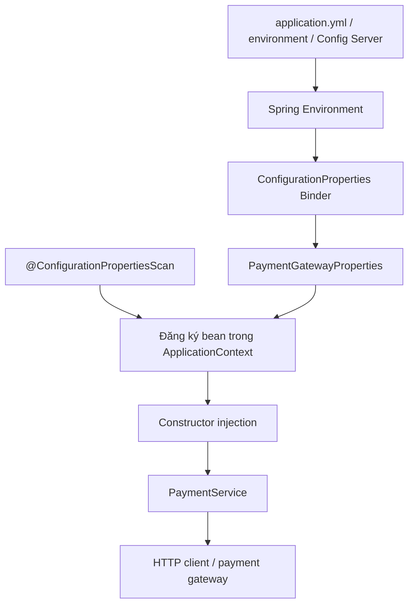

# Khai báo nhóm thuộc tính và đăng ký bean cấu hình

Một ứng dụng Spring Boot thường có nhiều thuộc tính liên quan đến cùng một chức năng: địa chỉ dịch vụ ngoài, thời gian chờ, số lần thử lại, giới hạn kết nối, cờ bật/tắt tính năng và danh sách endpoint. Nếu đọc từng giá trị bằng `@Value`, cấu hình dễ phân tán qua nhiều class và khó kiểm tra tính hợp lệ. Spring Boot cung cấp `@ConfigurationProperties` để gom các property có chung prefix thành một object có kiểu dữ liệu rõ ràng.

Để object này được sử dụng trong ứng dụng, cần **đăng ký nó thành bean trong ApplicationContext**. Hai bước có quan hệ nhưng không đồng nhất: annotation mô tả cách binding, còn cơ chế scan hoặc enable configuration properties quyết định bean có được tạo và quản lý hay không.

Trong module **SPRING_CLOUD_CORE**, cách tổ chức này giúp ứng dụng quản lý externalized configuration có cấu trúc, kết hợp với Spring Cloud Config/Context và kiểm tra cấu hình ngay khi khởi động.

## 1. Vì sao nên gom property thành một nhóm có kiểu dữ liệu?

Giả sử `order-service` gọi một hệ thống thanh toán. Các property liên quan có thể là:

```yaml
payment:
  gateway:
    base-url: https://payments.example.internal
    connect-timeout: 2s
    read-timeout: 5s
    max-attempts: 3
    enabled: true
```

Nếu mỗi class tự đọc một vài key, tên property có thể bị lặp, default rải rác và lỗi cấu hình chỉ xuất hiện khi code đi tới nhánh sử dụng. Một nhóm cấu hình có kiểu dữ liệu giúp:

- Gom các property cùng trách nhiệm vào một nơi.
- Chuyển đổi chuỗi cấu hình thành `Duration`, số, boolean, list, map hoặc object lồng nhau.
- Đặt giá trị mặc định ở một vị trí.
- Kiểm tra dữ liệu bằng Bean Validation.
- Inject một bean cấu hình vào service cần dùng.
- Tạo test cho cấu hình mà không phải kiểm tra từng `@Value` rời rạc.

`@ConfigurationProperties` phù hợp với một nhóm cấu hình có cấu trúc. `@Value` vẫn hữu ích cho một giá trị đơn lẻ hoặc một placeholder ngắn, nhưng không phải lựa chọn thuận tiện nhất cho một object cấu hình lớn. Configuration properties dùng cơ chế Binder và relaxed binding, không đánh giá SpEL expression như `@Value`; nếu cần biểu thức SpEL, đó là một khác biệt cần cân nhắc khi chọn cách inject.

## 2. Khai báo class bằng @ConfigurationProperties

Một class JavaBean có thể dùng `@ConfigurationProperties(prefix = "payment.gateway")` để ánh xạ các property bắt đầu bằng prefix đó.

Ví dụ dưới đây sử dụng Spring Boot 3 và Jakarta Bean Validation:

```java
package com.example.order.config;

import jakarta.validation.constraints.Max;
import jakarta.validation.constraints.Min;
import jakarta.validation.constraints.NotBlank;
import jakarta.validation.constraints.NotNull;

import java.time.Duration;

import org.springframework.boot.context.properties.ConfigurationProperties;
import org.springframework.validation.annotation.Validated;

@Validated
@ConfigurationProperties(prefix = "payment.gateway")
public class PaymentGatewayProperties {

    @NotBlank
    private String baseUrl;

    @NotNull
    private Duration connectTimeout = Duration.ofSeconds(2);

    @NotNull
    private Duration readTimeout = Duration.ofSeconds(5);

    @Min(1)
    @Max(10)
    private int maxAttempts = 3;

    private boolean enabled = true;

    public String getBaseUrl() {
        return baseUrl;
    }

    public void setBaseUrl(String baseUrl) {
        this.baseUrl = baseUrl;
    }

    public Duration getConnectTimeout() {
        return connectTimeout;
    }

    public void setConnectTimeout(Duration connectTimeout) {
        this.connectTimeout = connectTimeout;
    }

    public Duration getReadTimeout() {
        return readTimeout;
    }

    public void setReadTimeout(Duration readTimeout) {
        this.readTimeout = readTimeout;
    }

    public int getMaxAttempts() {
        return maxAttempts;
    }

    public void setMaxAttempts(int maxAttempts) {
        this.maxAttempts = maxAttempts;
    }

    public boolean isEnabled() {
        return enabled;
    }

    public void setEnabled(boolean enabled) {
        this.enabled = enabled;
    }
}
```

Một số điểm cần chú ý:

- `prefix` là `payment.gateway`; các field tương ứng với `base-url`, `connect-timeout`, `read-timeout`, `max-attempts` và `enabled`.
- Các field có giá trị khởi tạo sẽ dùng giá trị đó nếu property tương ứng không được cung cấp.
- `Duration` cho phép biểu diễn khoảng thời gian bằng các hậu tố như `ms`, `s`, `m`; ví dụ `500ms`, `2s`, `1m`.
- `@Validated` kích hoạt validation cho nhóm property khi bean được bind.
- `@NotBlank`, `@NotNull`, `@Min`, `@Max` xác định điều kiện dữ liệu cần thỏa mãn.

Spring Boot hỗ trợ **relaxed binding**, vì vậy tên key trong YAML thường dùng kebab-case còn tên field Java dùng camelCase. Ví dụ `max-attempts` được bind vào `maxAttempts`; biến môi trường theo quy tắc ánh xạ của Spring Boot có thể viết là `PAYMENT_GATEWAY_MAXATTEMPTS` (dấu chấm thành dấu gạch dưới, dấu gạch nối được loại bỏ, sau đó chuyển thành chữ hoa). Dùng dạng kebab-case trong file cấu hình giúp tên property nhất quán và dễ đọc.

Mặc định, `@ConfigurationProperties` bỏ qua một số property không được nhận diện trong prefix. Nếu muốn phát hiện typo như `max-attemts`, có thể đặt `ignoreUnknownFields = false` trên annotation. Chỉ bật chế độ nghiêm ngặt khi nhóm cấu hình có ranh giới rõ và không chủ ý nhận thêm key mở rộng từ integration khác.

Với Spring Boot 3, import validation dùng namespace `jakarta.validation`. Các dự án Spring Boot 2 thường dùng `javax.validation`; hãy dùng đúng namespace theo phiên bản và thêm implementation Bean Validation phù hợp, thường là `spring-boot-starter-validation`.

## 3. Đăng ký bean bằng @ConfigurationPropertiesScan

Sau khi khai báo class, ứng dụng cần tìm và đăng ký nó. Một cách phổ biến là dùng `@ConfigurationPropertiesScan` trên class khởi động:

```java
package com.example.order;

import org.springframework.boot.SpringApplication;
import org.springframework.boot.autoconfigure.SpringBootApplication;
import org.springframework.boot.context.properties.ConfigurationPropertiesScan;

@SpringBootApplication
@ConfigurationPropertiesScan
public class OrderApplication {
    public static void main(String[] args) {
        SpringApplication.run(OrderApplication.class, args);
    }
}
```

Theo mặc định, scan bắt đầu từ package chứa class có `@ConfigurationPropertiesScan` và đi xuống các package con. Nếu class cấu hình nằm ở package khác, có thể chỉ định package cụ thể:

```java
@ConfigurationPropertiesScan(
        basePackages = "com.example.order.config"
)
```

Khi scan phát hiện class có `@ConfigurationProperties`, Spring Boot đăng ký nó làm bean cấu hình và thực hiện binding với Environment.

Ví dụ package:

```text
com.example.order
  ├── OrderApplication.java
  ├── config
  │    └── PaymentGatewayProperties.java
  └── service
       └── PaymentService.java
```

Với cấu trúc này, `@ConfigurationPropertiesScan` đặt ở `OrderApplication` có thể tìm thấy class trong package `config`.

### 3.1. Scan không giống component scan

`@ConfigurationPropertiesScan` chuyên tìm các class cấu hình được đánh dấu `@ConfigurationProperties`. Nó không thay thế `@ComponentScan` dùng cho service, controller, repository và các stereotype bean khác.

Các class được đánh dấu `@Component` bị loại khỏi phạm vi đăng ký của `@ConfigurationPropertiesScan`. Vì vậy, với class cấu hình chuyên biệt, hãy dùng scan hoặc `@EnableConfigurationProperties` thay vì gắn thêm `@Component`. Nên chọn một cách đăng ký rõ ràng để tránh tạo bean trùng hoặc khiến người đọc khó biết bean đến từ đâu.

## 4. Đăng ký tường minh bằng @EnableConfigurationProperties

Nếu muốn bật một số class cấu hình cụ thể, có thể dùng `@EnableConfigurationProperties` trên class `@Configuration` hoặc class khởi động:

```java
import com.example.order.config.PaymentGatewayProperties;
import org.springframework.boot.autoconfigure.SpringBootApplication;
import org.springframework.boot.context.properties.EnableConfigurationProperties;

@SpringBootApplication
@EnableConfigurationProperties(PaymentGatewayProperties.class)
public class OrderApplication {
    // main method
}
```

Cách này phù hợp khi:
- Module chỉ cần một vài nhóm cấu hình xác định.
- Một auto-configuration muốn công khai rõ những properties mà nó hỗ trợ.
- Ứng dụng muốn kiểm soát danh sách class được đăng ký thay vì scan cả package.

Có thể bật nhiều class cùng lúc:

```java
@EnableConfigurationProperties({
        PaymentGatewayProperties.class,
        MessagingProperties.class,
        StorageProperties.class
})
```

**Chọn một cơ chế chính cho mỗi class:** scan hoặc enable tường minh. Không cần vừa scan vừa khai báo enable cùng class nếu không có lý do cụ thể.

## 5. Inject bean cấu hình vào service

Khi bean đã được đăng ký, các thành phần khác có thể inject nó bằng constructor như mọi Spring bean:

```java
package com.example.order.service;

import com.example.order.config.PaymentGatewayProperties;
import org.springframework.stereotype.Service;

@Service
public class PaymentService {

    private final PaymentGatewayProperties properties;

    public PaymentService(PaymentGatewayProperties properties) {
        this.properties = properties;
    }

    public void processPayment() {
        if (!properties.isEnabled()) {
            throw new IllegalStateException("Payment gateway is disabled");
        }

        String endpoint = properties.getBaseUrl();
        // Tạo request bằng endpoint và timeout từ properties.
    }
}
```

Service không phải tự đọc tên key hoặc tự parse chuỗi. Nó phụ thuộc vào object có kiểu dữ liệu rõ ràng. Điều này làm dependency dễ kiểm thử hơn: unit test có thể tạo một instance properties với giá trị mong muốn rồi truyền vào constructor.

Không nên inject `Environment` vào mọi service chỉ để đọc nhiều key rời rạc nếu chúng thực sự tạo thành một nhóm cấu hình ổn định. Hãy đặt nhóm đó trong class cấu hình riêng và inject bean tương ứng.

## 6. Tổ chức cấu hình lồng nhau

Khi một nhóm property có các nhóm con, có thể dùng class lồng nhau để giữ cấu trúc gần với YAML.

Ví dụ:

```yaml
app:
  client:
    base-url: https://api.example.internal
    timeout: 3s
    retry:
      max-attempts: 4
      backoff: 500ms
    security:
      enabled: true
      scopes:
        - orders.read
        - orders.write
```

Class cấu hình:

```java
import java.time.Duration;
import java.util.ArrayList;
import java.util.List;

import org.springframework.boot.context.properties.ConfigurationProperties;

@ConfigurationProperties(prefix = "app.client")
public class ClientProperties {

    private String baseUrl;
    private Duration timeout = Duration.ofSeconds(2);
    private Retry retry = new Retry();
    private Security security = new Security();

    public static class Retry {
        private int maxAttempts = 3;
        private Duration backoff = Duration.ofMillis(200);

        public int getMaxAttempts() {
            return maxAttempts;
        }

        public void setMaxAttempts(int maxAttempts) {
            this.maxAttempts = maxAttempts;
        }

        public Duration getBackoff() {
            return backoff;
        }

        public void setBackoff(Duration backoff) {
            this.backoff = backoff;
        }
    }

    public static class Security {
        private boolean enabled;
        private List<String> scopes = new ArrayList<>();

        public boolean isEnabled() {
            return enabled;
        }

        public void setEnabled(boolean enabled) {
            this.enabled = enabled;
        }

        public List<String> getScopes() {
            return scopes;
        }

        public void setScopes(List<String> scopes) {
            this.scopes = scopes;
        }
    }

    public String getBaseUrl() {
        return baseUrl;
    }

    public void setBaseUrl(String baseUrl) {
        this.baseUrl = baseUrl;
    }

    public Duration getTimeout() {
        return timeout;
    }

    public void setTimeout(Duration timeout) {
        this.timeout = timeout;
    }

    public Retry getRetry() {
        return retry;
    }

    public void setRetry(Retry retry) {
        this.retry = retry;
    }

    public Security getSecurity() {
        return security;
    }

    public void setSecurity(Security security) {
        this.security = security;
    }
}
```

Ở đây:
- `app.client.base-url` ánh xạ tới `baseUrl`.
- `app.client.retry.max-attempts` ánh xạ tới `retry.maxAttempts`.
- `app.client.security.scopes` ánh xạ tới danh sách `scopes`.
- Các object con được khởi tạo sẵn để binder có thể bind vào cấu trúc mutable.

Class ví dụ cần được đăng ký bằng `@ConfigurationPropertiesScan` hoặc `@EnableConfigurationProperties(ClientProperties.class)`, giống phần trước. Nếu dùng validation cho field lồng nhau, cần đánh dấu cascade validation bằng `@Valid` ở field object con và đặt constraint trong class con.

## 7. Danh sách, Map và kiểu dữ liệu chuyên biệt

Configuration Binder hỗ trợ nhiều cấu trúc hơn chuỗi đơn giản.

### 7.1. List

```yaml
app:
  routing:
    trusted-hosts:
      - api.internal
      - payments.internal
      - inventory.internal
```

Có thể bind thành `List<String>`. Danh sách phù hợp với các giá trị có thứ tự như host, topic hoặc scope.

### 7.2. Map

```yaml
app:
  routing:
    endpoints:
      inventory: https://inventory.internal
      payment: https://payment.internal
```

Có thể bind thành `Map<String, String>`, trong đó key là tên logical và value là endpoint. Khi dùng Map, cần xác định rõ key nào được phép, có cần validation URL hay không và hành vi khi thiếu entry.

### 7.3. Duration và DataSize

Các kiểu chuyên biệt giúp tránh tự parse chuỗi:

```yaml
app:
  client:
    timeout: 1500ms
    idle-timeout: 2m
    buffer-size: 10MB
```

Có thể bind thành `Duration` và `DataSize`. Điều này làm code sử dụng cấu hình rõ nghĩa hơn và giảm lỗi đơn vị. Với giá trị số không kèm đơn vị, có thể cấu hình annotation như `@DurationUnit` hoặc `@DataSizeUnit` để quy định đơn vị mặc định phù hợp.

## 8. Constructor binding và cấu hình bất biến

JavaBean mutable với getter/setter dễ dùng và phù hợp khi cần binding theo setter. Trong ứng dụng mới, có thể chọn object bất biến để tránh thay đổi cấu hình ngoài ý muốn sau khi khởi tạo.

Ví dụ record với Spring Boot 3:

```java
import java.time.Duration;
import java.util.List;

import org.springframework.boot.context.properties.ConfigurationProperties;

@ConfigurationProperties(prefix = "app.messaging")
public record MessagingProperties(
        String broker,
        Duration timeout,
        List<String> topics
) {}
```

Record có constructor duy nhất nên Spring Boot 3 có thể dùng constructor binding mà không cần annotation `@ConstructorBinding` trên type. Với class có nhiều constructor hoặc các trường hợp constructor binding phức tạp, cần dùng annotation theo quy tắc của phiên bản Boot đang sử dụng.

Một số khác biệt theo thế hệ:
- Spring Boot 2.2 giới thiệu constructor binding; các dự án cũ có thể cần annotation `@ConstructorBinding` theo package và vị trí áp dụng của phiên bản đó.
- Spring Boot 3 thay đổi một số quy tắc và package annotation; record với một canonical constructor thường không cần đánh dấu riêng.
- Constructor-bound properties cần được đăng ký qua configuration properties scan hoặc `@EnableConfigurationProperties`; không nên coi chúng như một bean JavaBean được tạo tùy ý bằng setter.

Nếu dùng Java 8 hoặc Boot cũ, record không khả dụng; có thể dùng class immutable với constructor và getter theo hướng dẫn phiên bản tương ứng.

## 9. Đăng ký @ConfigurationProperties cho bean bên thứ ba

Đôi khi cần bind property vào một class không do ứng dụng sở hữu, chẳng hạn một client hoặc builder của thư viện. Không thể thêm annotation trực tiếp vào class bên thứ ba. Có thể khai báo một `@Bean` method và đặt `@ConfigurationProperties` trên method đó:

```java
import com.example.vendor.ClientOptions;
import org.springframework.boot.context.properties.ConfigurationProperties;
import org.springframework.context.annotation.Bean;
import org.springframework.context.annotation.Configuration;

@Configuration(proxyBeanMethods = false)
public class VendorClientConfiguration {

    @Bean
    @ConfigurationProperties(prefix = "vendor.client")
    ClientOptions clientOptions() {
        return new ClientOptions();
    }
}
```

Spring Boot bind các property có prefix `vendor.client` vào bean được tạo bởi method. Cách này hữu ích với các class có JavaBean setter và không cần tự viết đoạn đọc Environment rồi gọi từng setter.

Nếu class bên thứ ba không tương thích với JavaBean binding hoặc cần khởi tạo phức tạp, có thể tạo một class `@ConfigurationProperties` riêng của ứng dụng rồi chuyển giá trị sang builder/client bằng code tường minh.

## 10. Validation: phát hiện cấu hình sai ngay khi khởi động

Binding chuyển dữ liệu từ property source sang object. Validation kiểm tra object có đáp ứng các ràng buộc cần thiết hay không. Hai bước bổ sung nhau.

Ví dụ:
- `@NotBlank`: URL hoặc tên không được rỗng.
- `@Min` / `@Max`: giới hạn số lần thử.
- `@NotNull`: giá trị phải hiện diện.
- `@Valid`: chạy validation tiếp vào object con.
- Constraint tùy chỉnh: kiểm tra quy tắc nghiệp vụ phức tạp hơn.

Cấu hình validation cần dependency phù hợp:

```xml
<dependency>
    <groupId>org.springframework.boot</groupId>
    <artifactId>spring-boot-starter-validation</artifactId>
</dependency>
```

Nếu `max-attempts` bằng 0 nhưng class đặt `@Min(1)`, context không nên khởi tạo thành công với bean cấu hình không hợp lệ. Fail fast giúp phát hiện lỗi triển khai trước khi ứng dụng nhận request.

### 10.1. Validation cho nhóm lồng nhau

Ví dụ:

```java
import jakarta.validation.Valid;
import jakarta.validation.constraints.NotBlank;
import jakarta.validation.constraints.NotNull;

@ConfigurationProperties(prefix = "app.client")
@Validated
public class ClientConfigurationProperties {

    @Valid
    @NotNull
    private Security security = new Security();

    public static class Security {
        @NotBlank
        private String issuer;

        // getter và setter
    }

    public Security getSecurity() {
        return security;
    }

    public void setSecurity(Security security) {
        this.security = security;
    }
}
```

`@Valid` yêu cầu Bean Validation tiếp tục kiểm tra object con. Nếu thiếu annotation này, các constraint ở class con có thể không được cascade như mong đợi. Cần bảo đảm validator provider có mặt trên classpath.

## 11. Cấu hình mẫu hoàn chỉnh

File `application.yml`:

```yaml
spring:
  application:
    name: order-service

server:
  port: 8080

payment:
  gateway:
    base-url: https://payments.example.internal
    connect-timeout: 2s
    read-timeout: 5s
    max-attempts: 3
    enabled: true
```

Ứng dụng:
- Đăng ký `PaymentGatewayProperties` bằng `@ConfigurationPropertiesScan`.
- Inject bean vào `PaymentService`.
- Dùng `Duration` trực tiếp khi tạo HTTP client.
- Dùng validation để kiểm tra URL và giới hạn retry.

Sơ đồ:



Sơ đồ thể hiện các trách nhiệm: nguồn cấu hình cung cấp property, Binder ánh xạ vào object, cơ chế đăng ký đưa object thành bean, rồi service sử dụng bean qua dependency injection. Config Server chỉ là một nguồn có thể có; ứng dụng cũng có thể lấy property từ file, biến môi trường hoặc nguồn khác.

## 12. Kiểm thử bean cấu hình

Nên kiểm thử cả binding đúng kiểu và validation thất bại. Spring Boot cung cấp `ApplicationContextRunner` để tạo context nhỏ với property đầu vào có kiểm soát.

Ví dụ kiểm tra binding:

```java
import static org.assertj.core.api.Assertions.assertThat;

import java.time.Duration;

import org.junit.jupiter.api.Test;
import org.springframework.boot.context.properties.EnableConfigurationProperties;
import org.springframework.boot.test.context.runner.ApplicationContextRunner;
import org.springframework.context.annotation.Configuration;

class PaymentGatewayPropertiesTest {

    private final ApplicationContextRunner contextRunner =
            new ApplicationContextRunner()
                    .withUserConfiguration(TestConfiguration.class);

    @Test
    void bindsPropertiesToTypedBean() {
        contextRunner
                .withPropertyValues(
                        "payment.gateway.base-url=https://payments.test",
                        "payment.gateway.connect-timeout=1500ms",
                        "payment.gateway.max-attempts=4"
                )
                .run(context -> {
                    assertThat(context).hasSingleBean(PaymentGatewayProperties.class);

                    PaymentGatewayProperties properties =
                            context.getBean(PaymentGatewayProperties.class);

                    assertThat(properties.getBaseUrl())
                            .isEqualTo("https://payments.test");
                    assertThat(properties.getConnectTimeout())
                            .isEqualTo(Duration.ofMillis(1500));
                    assertThat(properties.getMaxAttempts()).isEqualTo(4);
                });
    }

    @Configuration(proxyBeanMethods = false)
    @EnableConfigurationProperties(PaymentGatewayProperties.class)
    static class TestConfiguration {
    }
}
```

Để kiểm tra validation, truyền một giá trị ngoài giới hạn, ví dụ `payment.gateway.max-attempts=0`, và xác nhận context có startup failure. Test nên kiểm tra loại nguyên nhân hoặc constraint vi phạm thay vì phụ thuộc hoàn toàn vào chuỗi thông báo lỗi cụ thể.

Các ca nên có:
- Giá trị hợp lệ được bind đúng kiểu.
- Property không được cung cấp sử dụng default đã định nghĩa.
- Property bắt buộc bị thiếu làm validation thất bại.
- Giá trị ngoài min/max làm context không khởi động.
- Nested object, list và map được bind đúng cấu trúc.
- Bean được đăng ký đúng một lần trong context.

## 13. Metadata và trải nghiệm phát triển

Spring Boot có thể tạo metadata cho các class `@ConfigurationProperties` để IDE hỗ trợ autocomplete, mô tả property và gợi ý kiểu dữ liệu. Thêm configuration processor vào build ở dạng annotation processor:

Maven:

```xml
<dependency>
    <groupId>org.springframework.boot</groupId>
    <artifactId>spring-boot-configuration-processor</artifactId>
    <optional>true</optional>
</dependency>
```

Gradle:

```groovy
dependencies {
    annotationProcessor "org.springframework.boot:spring-boot-configuration-processor"
}
```

Processor tạo metadata trong quá trình build; nó không phải thư viện runtime cần thiết để Binder hoạt động. Nếu class cấu hình có property phức tạp hoặc kiểu tùy chỉnh, có thể bổ sung metadata mô tả để IDE hiểu rõ hơn.

## 14. Những lỗi thường gặp

| Hiện tượng | Nguyên nhân có thể | Cách xử lý |
| --- | --- | --- |
| Inject `PaymentGatewayProperties` báo không có bean | Class có annotation nhưng chưa được scan/enable | Thêm `@ConfigurationPropertiesScan` hoặc `@EnableConfigurationProperties` |
| Bean được tạo trùng | Vừa đăng ký qua nhiều cơ chế hoặc thêm component registration không cần thiết | Chọn một cách đăng ký rõ ràng |
| Property không được bind | Prefix/key sai, profile không active hoặc nguồn chưa được nạp | Kiểm tra Environment và tên property canonical |
| Giá trị số/Duration sai | Đơn vị không hợp lệ hoặc kiểu không chuyển đổi được | Dùng hậu tố rõ ràng như `ms`, `s`, `m` |
| Nested object không được validation | Thiếu `@Valid` ở field cha | Thêm cascade validation |
| Constraint không chạy | Thiếu `@Validated` hoặc validator implementation | Kiểm tra annotation và dependency validation |
| Record/constructor binding không hoạt động | Quy tắc khác với phiên bản Boot hoặc class đăng ký sai cách | Đối chiếu hướng dẫn constructor binding của phiên bản |
| Property mới không xuất hiện trong bean đang chạy | Bean đã được tạo trước khi Environment đổi | Thiết kế refresh/rebind phù hợp; không giả định bean tự cập nhật |
| IDE không gợi ý property | Chưa thêm configuration processor hoặc build chưa tạo metadata | Cấu hình annotation processor và build lại |

## 15. Nguyên tắc thiết kế nhóm cấu hình

- Mỗi class nên đại diện cho một nhóm cấu hình có trách nhiệm rõ ràng, ví dụ payment gateway, messaging hoặc discovery.
- Prefix nên ổn định, có namespace và dùng dạng kebab-case.
- Dùng kiểu dữ liệu cụ thể như `Duration`, `DataSize`, enum, list và map thay vì giữ mọi thứ dưới dạng String.
- Đặt default chỉ khi có giá trị mặc định an toàn và được hiểu rõ.
- Dùng validation cho property thiết yếu; tránh cho ứng dụng nhận traffic với cấu hình không hợp lệ.
- Đăng ký bean bằng scan hoặc enable tường minh, nhất quán trong module.
- Giữ class cấu hình độc lập với logic nghiệp vụ và inject nó qua constructor.
- Không log secret hoặc toàn bộ nội dung cấu hình trong production.
- Kiểm tra tương thích Java, Spring Boot và Spring Cloud release train trước khi chọn kiểu binding hoặc annotation.

## Ghi nhớ

`@ConfigurationProperties` gom các property cùng prefix thành một object có kiểu dữ liệu, nhưng annotation này cần một cơ chế đăng ký bean để Spring quản lý và inject. Dùng `@ConfigurationPropertiesScan` khi muốn tự động tìm các nhóm cấu hình trong package; dùng `@EnableConfigurationProperties` khi muốn khai báo rõ danh sách class. Kết hợp binding, default, nested object và validation để phát hiện lỗi sớm. Khi cấu hình đến từ Spring Cloud Config hoặc Environment thay đổi, hãy xác định riêng việc nạp property, tạo bean và refresh bean để ứng dụng sử dụng đúng giá trị.
