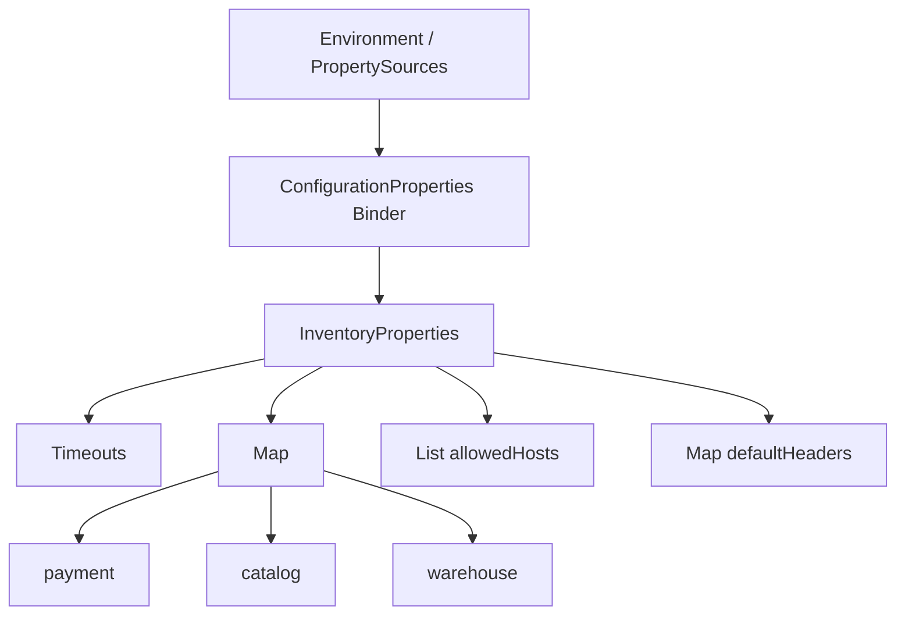

# Binding đối tượng lồng nhau, danh sách và map

Khi ứng dụng chỉ có vài thuộc tính như host, port hoặc timeout, đọc từng giá trị bằng `@Value` có thể đủ dùng. Nhưng một dịch vụ thực tế thường có cấu hình theo nhóm: endpoint của nhiều dịch vụ, chính sách retry, danh sách route, các vùng được phép, header tùy chỉnh và metadata theo từng môi trường. Nếu gom tất cả thành chuỗi rời rạc, code khó kiểm tra, khó mở rộng và dễ nhầm tên property.

Spring Boot cung cấp **`@ConfigurationProperties`** và Binder để chuyển một nhóm property trong `Environment` thành object Java có kiểu dữ liệu. Cấu trúc object có thể chứa object lồng nhau, `List`, `Set`, `Map` và các kiểu như `Duration`, `DataSize`, `URI` hoặc enum. Cơ chế này giúp cấu hình phản ánh đúng mô hình của ứng dụng và có thể được kiểm tra bằng validation.

Bài học thuộc chương **Cấu hình kiểu dữ liệu** của **SPRING_CLOUD_CORE**. Trọng tâm là cách binding đối tượng lồng nhau, danh sách và map; cách biểu diễn cùng cấu trúc bằng YAML, properties và biến môi trường; cách xử lý key động, giá trị mặc định, thứ tự ưu tiên giữa các nguồn cấu hình; và cách kiểm thử dữ liệu được bind trong ứng dụng Spring Boot/Spring Cloud.

## 1. Mục tiêu học tập

Sau bài này, người học có thể:

1. Giải thích quá trình Binder chuyển property thành object có kiểu dữ liệu.
2. Thiết kế class hoặc record chứa nested object và collection.
3. Bind danh sách object, map giá trị đơn và map chứa object.
4. Biểu diễn cùng một cấu trúc bằng YAML, properties và environment variables.
5. Hiểu relaxed binding, canonical property names và bracket notation cho map key.
6. Phân biệt cách merge map với cách thay thế list khi có nhiều property sources.
7. Chọn JavaBean binding hoặc constructor binding phù hợp với vòng đời cấu hình.
8. Áp dụng validation, default values và kiểm thử cấu hình.
9. Chẩn đoán lỗi thiếu phần tử, sai kiểu, key không hợp lệ và cấu hình ghi đè ngoài dự kiến.

## 2. Vì sao cần binding theo cấu trúc?

Giả sử một ứng dụng inventory gọi nhiều dịch vụ và có các yêu cầu: endpoint riêng cho payment, catalog và warehouse; timeout kết nối và timeout đọc khác nhau; danh sách route được bật; header mặc định; host được phép; và retry policy theo từng endpoint.

Nếu inject từng giá trị riêng, cấu hình dễ bị rải rác:

```java
@Value("${app.inventory.payment-url}")
String paymentUrl;

@Value("${app.inventory.catalog-url}")
String catalogUrl;

@Value("${app.inventory.warehouse-url}")
String warehouseUrl;

@Value("${app.inventory.connect-timeout}")
Duration connectTimeout;
```

Khi số lượng endpoint tăng, bean cấu hình ngày càng dài và các thuộc tính không thể hiện rõ quan hệ giữa chúng. Binding vào một object giúp gom dữ liệu theo một namespace:

```yaml
app:
  inventory:
    timeouts:
      connect: 500ms
      read: 2s
    endpoints:
      payment:
        base-url: https://payments.internal
      catalog:
        base-url: https://catalog.internal
      warehouse:
        base-url: https://warehouse.internal
    allowed-hosts:
      - inventory.internal
      - catalog.internal
    default-headers:
      X-Client: inventory-service
      X-Region: ap-southeast-1
```

Cấu trúc trên có thể được biểu diễn bằng object gốc `InventoryProperties`, nested object `Timeouts`, map `endpoints`, list `allowedHosts` và map `defaultHeaders`.



Binder không yêu cầu tất cả giá trị phải nằm trong một file. Các property có thể đến từ file cấu hình, profile, biến môi trường, command line hoặc Config Server, sau đó được kết hợp theo quy tắc precedence của Spring Boot.

## 3. Nền tảng: @ConfigurationProperties và Binder

### 3.1. Khai báo một nhóm property

`@ConfigurationProperties` liên kết một object với prefix:

```java
@ConfigurationProperties(prefix = "app.inventory")
public class InventoryProperties {
    // Các thuộc tính thuộc app.inventory.*
}
```

Property có key `app.inventory.timeouts.connect` sẽ được bind vào thuộc tính tương ứng bên trong object `timeouts`. Prefix giúp tách namespace cấu hình và giảm nguy cơ trùng tên giữa các module.

Tên property nên dùng dạng canonical kebab-case như `app.inventory.allowed-hosts` và `app.inventory.base-url`. Binder hỗ trợ relaxed binding nên tên Java camelCase như `allowedHosts` có thể ánh xạ với dạng canonical này.

### 3.2. Đăng ký configuration properties bean

Có hai cách thường dùng.

**Quét các lớp cấu hình:**

```java
@SpringBootApplication
@ConfigurationPropertiesScan
public class InventoryApplication {
    public static void main(String[] args) {
        SpringApplication.run(InventoryApplication.class, args);
    }
}
```

`@ConfigurationPropertiesScan` tìm các class được đánh dấu `@ConfigurationProperties` trong phạm vi scan được cấu hình. Nếu không chỉ định package, phạm vi mặc định dựa trên package của class khai báo scan.

**Đăng ký tường minh:**

```java
@SpringBootApplication
@EnableConfigurationProperties(InventoryProperties.class)
public class InventoryApplication {
}
```

Cách này phù hợp khi ứng dụng chỉ có một vài properties class hoặc khi một auto-configuration muốn đăng ký rõ các lớp cấu hình mà nó cung cấp.

Không cần đồng thời dùng cả hai cách cho cùng một class nếu điều đó khiến bean được đăng ký trùng. `@ConfigurationProperties` mô tả binding; việc scan hoặc enable mới đưa class vào cơ chế đăng ký của ứng dụng.

### 3.3. Binding không phải component scan thông thường

Một class `@ConfigurationProperties` không cần gắn `@Component` chỉ để Binder nhận diện. Đăng ký qua `@ConfigurationPropertiesScan` hoặc `@EnableConfigurationProperties` giúp Spring Boot quản lý nó đúng vòng đời.

Với **constructor binding**, class phải được đăng ký qua configuration properties scan hoặc enable mechanism tương ứng; không đăng ký nó như một component thông thường chỉ để gọi constructor. Constructor binding không dùng cơ chế setter injection và constructor được chọn cần phù hợp quy tắc của phiên bản Boot đang chạy.

### 3.4. Những kiểu dữ liệu thường được hỗ trợ

Binder và conversion service của Spring Boot có thể chuyển property sang nhiều kiểu thông dụng:

| Kiểu Java | Ví dụ property | Giá trị sau binding |
| --- | --- | --- |
| `String` | `app.name=inventory` | `"inventory"` |
| `boolean` / `Boolean` | `app.enabled=true` | `true` |
| `int`, `long`, `BigDecimal` | `app.pool-size=20` | Số tương ứng |
| `Duration` | `app.timeout=750ms` | 750 mili giây |
| `DataSize` | `app.max-payload=10MB` | Dung lượng tương ứng |
| `URI` / `URL` | `app.endpoint=https://api.example` | Đối tượng URI/URL |
| Enum | `app.mode=READ_ONLY` | Hằng enum phù hợp |
| `List<T>` / `Set<T>` | `app.zones[0]=sg` | Collection phần tử có kiểu |
| `Map<K,V>` | `app.labels.owner=platform` | Map key/value |

Nếu một chuỗi không thể chuyển đổi sang kiểu đích, binding có thể thất bại. Ví dụ `timeout=soon` không phải một biểu diễn `Duration` hợp lệ. Đó là lỗi conversion, khác với lỗi property không tồn tại.

## 4. Thiết kế object lồng nhau

### 4.1. Cấu trúc nested object

YAML có thể biểu diễn object lồng nhau bằng thụt dòng:

```yaml
app:
  inventory:
    timeouts:
      connect: 500ms
      read: 2s
    retry:
      max-attempts: 3
      backoff: 200ms
```

Một properties class tương ứng:

```java
@ConfigurationProperties(prefix = "app.inventory")
public class InventoryProperties {

    private Timeouts timeouts = new Timeouts();
    private Retry retry = new Retry();

    public Timeouts getTimeouts() { return timeouts; }
    public void setTimeouts(Timeouts timeouts) { this.timeouts = timeouts; }

    public Retry getRetry() { return retry; }
    public void setRetry(Retry retry) { this.retry = retry; }

    public static class Timeouts {
        private Duration connect = Duration.ofMillis(500);
        private Duration read = Duration.ofSeconds(2);

        public Duration getConnect() { return connect; }
        public void setConnect(Duration connect) { this.connect = connect; }
        public Duration getRead() { return read; }
        public void setRead(Duration read) { this.read = read; }
    }

    public static class Retry {
        private int maxAttempts = 3;
        private Duration backoff = Duration.ofMillis(200);

        public int getMaxAttempts() { return maxAttempts; }
        public void setMaxAttempts(int maxAttempts) {
            this.maxAttempts = maxAttempts;
        }
        public Duration getBackoff() { return backoff; }
        public void setBackoff(Duration backoff) { this.backoff = backoff; }
    }
}
```

Ví dụ dùng JavaBean binding: các nested object có getter/setter và được khởi tạo sẵn. Khi property tương ứng tồn tại, Binder cập nhật các thuộc tính con.

### 4.2. Khởi tạo nested object hay để null?

Với mutable JavaBean, có thể khởi tạo nested object ngay trong class:

```java
private Retry retry = new Retry();
```

Điều này giúp các giá trị mặc định trong nested object tồn tại ngay cả khi một vài property con không được khai báo. Nếu để `retry` là `null`, code sử dụng phải xử lý trường hợp vắng mặt rõ ràng; cách binding và validation còn phụ thuộc cấu trúc property và object được tạo.

Với constructor-bound record, Binder tạo object theo cấu trúc được khai báo trong constructor. Nếu object lồng nhau là bắt buộc, hãy dùng validation như `@NotNull` và `@Valid`; nếu object được phép vắng mặt, hãy mô hình hóa semantics đó và cung cấp default thích hợp.

### 4.3. Nested type nên phản ánh ranh giới cấu hình

Không nhất thiết tạo một class cho từng property. Hãy tạo nested type khi các giá trị có cùng trách nhiệm hoặc được sử dụng như một nhóm:

- `Timeouts`: các giới hạn thời gian.
- `Retry`: số lần thử và khoảng chờ.
- `Tls`: trust store, key store và cờ bảo mật.
- `Endpoint`: URL, timeout và metadata cho một dịch vụ.

Nếu object chỉ chứa một giá trị đơn giản và không có hành vi/validation riêng, một property phẳng có thể dễ đọc hơn. Cấu trúc quá sâu làm file cấu hình dài và khiến việc override khó theo dõi.

## 5. Binding danh sách (List)

### 5.1. Danh sách giá trị đơn

YAML:

```yaml
app:
  inventory:
    allowed-hosts:
      - inventory.internal
      - catalog.internal
      - warehouse.internal
```

Java:

```java
@ConfigurationProperties(prefix = "app.inventory")
public class InventoryProperties {

    private List<String> allowedHosts = new ArrayList<>();

    public List<String> getAllowedHosts() {
        return allowedHosts;
    }

    public void setAllowedHosts(List<String> allowedHosts) {
        this.allowedHosts = allowedHosts;
    }
}
```

Binder ánh xạ từng phần tử YAML vào vị trí tương ứng trong `List<String>`. Thứ tự phần tử được giữ lại, vì vậy dùng List khi thứ tự có ý nghĩa hoặc cần truy cập theo index.

### 5.2. Danh sách object

Một danh sách route có thể gồm nhiều trường:

```yaml
app:
  gateway:
    routes:
      - id: inventory
        uri: http://inventory-service
        order: 10
        enabled: true
      - id: catalog
        uri: http://catalog-service
        order: 20
        enabled: true
      - id: legacy
        uri: http://legacy-service
        order: 90
        enabled: false
```

Mô hình Java:

```java
@ConfigurationProperties(prefix = "app.gateway")
public class GatewayProperties {

    private List<Route> routes = new ArrayList<>();

    public List<Route> getRoutes() { return routes; }
    public void setRoutes(List<Route> routes) { this.routes = routes; }

    public static class Route {
        private String id;
        private URI uri;
        private int order;
        private boolean enabled;

        public String getId() { return id; }
        public void setId(String id) { this.id = id; }
        public URI getUri() { return uri; }
        public void setUri(URI uri) { this.uri = uri; }
        public int getOrder() { return order; }
        public void setOrder(int order) { this.order = order; }
        public boolean isEnabled() { return enabled; }
        public void setEnabled(boolean enabled) { this.enabled = enabled; }
    }
}
```

Mỗi phần tử list được bind thành một object `Route`. Nếu ứng dụng cần tìm route theo `id` thường xuyên, có thể chuyển sang map keyed by ID hoặc xây dựng index sau khi binding; không nên giả định Binder tự biến list thành map.

### 5.3. Biểu diễn list trong .properties

YAML dùng dấu `-`; file `.properties` thường dùng index:

```properties
app.gateway.routes[0].id=inventory
app.gateway.routes[0].uri=http://inventory-service
app.gateway.routes[0].order=10
app.gateway.routes[0].enabled=true

app.gateway.routes[1].id=catalog
app.gateway.routes[1].uri=http://catalog-service
app.gateway.routes[1].order=20
app.gateway.routes[1].enabled=true
```

Các index bắt đầu từ `0`. Cần bảo đảm các index được khai báo đúng và không nhầm thứ tự. Với cấu hình dài, YAML thường dễ đọc hơn vì nhóm các trường của một phần tử vào cùng block.

### 5.4. Biểu diễn list bằng biến môi trường

Spring Boot hỗ trợ index collection trong tên biến môi trường bằng cách đặt index giữa các dấu gạch dưới:

```bash
APP_GATEWAY_ROUTES_0_ID=inventory
APP_GATEWAY_ROUTES_0_URI=http://inventory-service
APP_GATEWAY_ROUTES_1_ID=catalog
APP_GATEWAY_ROUTES_1_URI=http://catalog-service
```

Cách biểu diễn này hữu ích trong container/orchestrator, nhưng khi list dài hoặc nhiều object lồng nhau, biến môi trường khó đọc và khó review. Có thể để file cấu hình hoặc Config Server quản lý collection, còn environment variables chỉ override các giá trị triển khai cần thiết.

### 5.5. List được thay thế khi có nguồn cấu hình ưu tiên cao hơn

Đây là điểm rất quan trọng khi kết hợp profile hoặc Config Server. **List không được merge từng phần tử giữa các property sources theo cách cộng dồn.** Nguồn có độ ưu tiên cao hơn cung cấp list sẽ thay thế list ở nguồn thấp hơn.

Ví dụ `application.yml` khai báo ba route:

```yaml
app:
  gateway:
    routes:
      - id: inventory
        uri: http://inventory
      - id: catalog
        uri: http://catalog
      - id: warehouse
        uri: http://warehouse
```

Nếu `application-prod.yml` chỉ khai báo:

```yaml
app:
  gateway:
    routes:
      - id: inventory
        uri: https://inventory.prod.internal
```

Kết quả ở profile `prod` là list chỉ có route `inventory`; hai phần tử `catalog` và `warehouse` của nguồn thấp hơn không tự được giữ lại. Nếu muốn giữ cả ba route, profile cần khai báo đầy đủ list cuối cùng.

Điều này khác với map, nơi các entry có thể được kết hợp theo key. Hãy chọn List khi muốn một tập phần tử có thứ tự và có thể được thay thế như một đơn vị.

## 6. Binding Set và các collection khác

`Set<T>` phù hợp khi cần tập giá trị duy nhất và không cần truy cập theo index:

```yaml
app:
  inventory:
    trusted-zones:
      - ap-southeast-1
      - ap-southeast-2
      - ap-southeast-1
```

```java
private Set<String> trustedZones = new LinkedHashSet<>();
```

Sau binding, các giá trị trùng bị loại theo quy tắc `equals`/`hashCode` của phần tử. Không nên dựa vào Set nếu thứ tự là một phần của hợp đồng cấu hình; dùng List trong trường hợp đó.

Các collection có kiểu phần tử phức tạp cũng có thể được bind nếu phần tử có thể được chuyển đổi hoặc cấu trúc object được mô tả rõ. Tuy nhiên, hãy giữ cấu trúc cấu hình đơn giản và có validation phù hợp.

## 7. Binding Map

### 7.1. Map giá trị đơn

Map thích hợp khi key là tên động, ví dụ tên header, nhãn hoặc cờ tính năng:

```yaml
app:
  inventory:
    default-headers:
      X-Client: inventory-service
      X-Region: ap-southeast-1
      X-Environment: staging
```

Java:

```java
private Map<String, String> defaultHeaders = new LinkedHashMap<>();

public Map<String, String> getDefaultHeaders() {
    return defaultHeaders;
}

public void setDefaultHeaders(Map<String, String> defaultHeaders) {
    this.defaultHeaders = defaultHeaders;
}
```

Các key `X-Client`, `X-Region`, `X-Environment` trở thành key trong map; value là chuỗi tương ứng. Đây là lựa chọn phù hợp khi số key không cố định hoặc do người vận hành mở rộng.

### 7.2. Map chứa nested object

Map có thể chứa object cấu hình theo từng service:

```yaml
app:
  inventory:
    endpoints:
      payment:
        base-url: https://payments.internal
        timeout: 1500ms
        enabled: true
      catalog:
        base-url: https://catalog.internal
        timeout: 800ms
        enabled: true
      warehouse:
        base-url: https://warehouse.internal
        timeout: 2s
        enabled: false
```

Java:

```java
@ConfigurationProperties(prefix = "app.inventory")
public class InventoryProperties {

    private Map<String, Endpoint> endpoints = new LinkedHashMap<>();

    public Map<String, Endpoint> getEndpoints() { return endpoints; }
    public void setEndpoints(Map<String, Endpoint> endpoints) {
        this.endpoints = endpoints;
    }

    public static class Endpoint {
        private URI baseUrl;
        private Duration timeout;
        private boolean enabled;

        public URI getBaseUrl() { return baseUrl; }
        public void setBaseUrl(URI baseUrl) { this.baseUrl = baseUrl; }
        public Duration getTimeout() { return timeout; }
        public void setTimeout(Duration timeout) { this.timeout = timeout; }
        public boolean isEnabled() { return enabled; }
        public void setEnabled(boolean enabled) { this.enabled = enabled; }
    }
}
```

Kết quả là một map có key `payment`, `catalog`, `warehouse`; mỗi value là object `Endpoint`. Code có thể lấy `properties.getEndpoints().get("payment")` để đọc cấu hình của payment service.

### 7.3. Map và .properties

Cấu trúc map object có thể biểu diễn bằng dotted keys:

```properties
app.inventory.endpoints.payment.base-url=https://payments.internal
app.inventory.endpoints.payment.timeout=1500ms
app.inventory.endpoints.payment.enabled=true

app.inventory.endpoints.catalog.base-url=https://catalog.internal
app.inventory.endpoints.catalog.timeout=800ms
app.inventory.endpoints.catalog.enabled=true
```

Map scalar:

```properties
app.inventory.default-headers.X-Client=inventory-service
app.inventory.default-headers.X-Region=ap-southeast-1
```

Đây là biểu diễn phù hợp cho file `.properties` và cũng là dạng thường thấy khi override một vài map entry bằng property source khác.

### 7.4. Map key có ký tự đặc biệt: bracket notation

Relaxed binding chuẩn hóa tên property. Với map key chứa ký tự ngoài tập được giữ theo quy tắc binding, ký tự có thể bị loại bỏ nếu không được bảo vệ. Khi cần giữ nguyên một key có dấu `/`, khoảng trắng, dấu `:` hoặc ký tự đặc biệt khác, dùng **bracket notation**.

Ví dụ YAML:

```yaml
app:
  routing:
    metadata:
      "[/internal/v1]": inventory
      "[/external/v2]": gateway
```

Trong `.properties`:

```properties
app.routing.metadata[/internal/v1]=inventory
app.routing.metadata[/external/v2]=gateway
```

Với YAML, key trong ngoặc vuông cần được quote để YAML parser coi toàn bộ biểu thức là một key. Bracket notation giữ nguyên key theo ý định thay vì để relaxed binding loại bỏ ký tự đặc biệt.

Nếu map key chỉ chứa chữ/số, dấu gạch ngang hoặc dấu chấm theo quy tắc phù hợp, không nhất thiết phải dùng bracket notation. Chỉ dùng nó khi cần bảo toàn nguyên văn key.

### 7.5. Map key có dấu chấm

Dấu chấm thường biểu diễn cấp property lồng nhau. Nếu key map cần chứa dấu chấm như một phần của key, bracket notation giúp phân biệt key nguyên vẹn với path:

```yaml
app:
  routing:
    destinations:
      "[legacy.v1]": http://legacy.internal
```

Không có bracket, một key dạng dotted path có thể được hiểu như cấu trúc lồng nhau tùy kiểu value và cách binding. Hãy kiểm thử key thực tế nếu map là một phần của API cấu hình.

### 7.6. Map được merge theo key

Khác list, map có thể nhận entry từ nhiều nguồn cấu hình. Ví dụ:

```yaml
# application.yml
app:
  inventory:
    labels:
      owner: platform
      region: default
      tier: backend
```

```yaml
# application-prod.yml
app:
  inventory:
    labels:
      region: ap-southeast-1
      environment: production
```

Kết quả map trong profile `prod` có thể gồm:

| Key | Giá trị cuối |
| --- | --- |
| `owner` | `platform` |
| `region` | `ap-southeast-1` |
| `tier` | `backend` |
| `environment` | `production` |

Entry cùng key ở nguồn ưu tiên cao hơn ghi đè value của nguồn thấp hơn; key không bị ghi đè có thể vẫn được giữ. Đây là khác biệt quan trọng so với List.

Với map chứa object, các property con cũng cần được kiểm tra theo precedence và binding thực tế. Nếu map entry ở profile chỉ ghi một field, những field khác có thể được giữ từ nguồn thấp hơn tùy cấu trúc property sources. Hãy viết test cho cấu hình merge nếu behavior này ảnh hưởng vận hành.

## 8. Ví dụ tổng hợp: GatewayProperties

Một cấu hình gateway có thể kết hợp nested object, list, map object và map scalar:

```yaml
app:
  gateway:
    public-base-url: https://gateway.example.internal
    timeouts:
      connect: 500ms
      read: 2s
    routes:
      - id: inventory
        uri: http://inventory-service
        order: 10
        enabled: true
      - id: catalog
        uri: http://catalog-service
        order: 20
        enabled: true
    endpoints:
      payment:
        base-url: https://payments.internal
        timeout: 1500ms
      warehouse:
        base-url: https://warehouse.internal
        timeout: 2s
    labels:
      owner: platform-team
      region: ap-southeast-1
    trusted-hosts:
      - gateway.internal
      - inventory.internal
```

Một record theo constructor binding:

```java
import java.net.URI;
import java.time.Duration;
import java.util.List;
import java.util.Map;
import java.util.Set;

import jakarta.validation.Valid;
import jakarta.validation.constraints.NotBlank;
import jakarta.validation.constraints.NotEmpty;
import jakarta.validation.constraints.NotNull;

import org.springframework.boot.context.properties.ConfigurationProperties;
import org.springframework.boot.context.properties.bind.DefaultValue;
import org.springframework.validation.annotation.Validated;

@ConfigurationProperties(prefix = "app.gateway")
@Validated
public record GatewayProperties(
        @NotNull URI publicBaseUrl,
        @Valid @DefaultValue Timeouts timeouts,
        @NotEmpty List<@NotNull @Valid Route> routes,
        Map<String, @NotNull @Valid Endpoint> endpoints,
        Map<String, String> labels,
        Set<String> trustedHosts
) {
    public record Timeouts(
            @DefaultValue("500ms") Duration connect,
            @DefaultValue("2s") Duration read
    ) {}

    public record Route(
            @NotBlank String id,
            @NotNull URI uri,
            int order,
            boolean enabled
    ) {}

    public record Endpoint(
            @NotNull URI baseUrl,
            @NotNull Duration timeout
    ) {}
}
```

Record trên cho thấy cấu trúc type-safe:

- `timeouts` là nested object.
- `routes` là list object có validation.
- `endpoints` là map keyed by service ID, mỗi value là `Endpoint`.
- `labels` là map scalar.
- `trustedHosts` là set giá trị duy nhất.

`@DefaultValue` trên tham số record cho phép cung cấp giá trị mặc định khi property tương ứng không có. Dạng `@DefaultValue` không có chuỗi giá trị trên nested object `Timeouts` yêu cầu Binder tạo object lồng nhau; các thành phần `connect` và `read` có default riêng. Nếu phiên bản Spring Boot mục tiêu khác, hãy kiểm tra API binding tương ứng.

### 8.1. Đăng ký record properties

```java
@SpringBootApplication
@EnableConfigurationProperties(GatewayProperties.class)
public class GatewayApplication {
}
```

Hoặc dùng `@ConfigurationPropertiesScan` ở class ứng dụng. Record có một canonical constructor duy nhất nên Spring Boot có thể dùng constructor binding theo quy tắc hiện hành; không cần thêm `@ConstructorBinding` cho trường hợp thông thường này.

Constructor-bound properties được tạo qua cơ chế configuration properties, không phải component scan thông thường. Không gắn `@Component` chỉ để đăng ký record.

### 8.2. Sử dụng object sau binding

```java
@Service
class GatewayRouteService {

    private final GatewayProperties properties;

    GatewayRouteService(GatewayProperties properties) {
        this.properties = properties;
    }

    List<GatewayProperties.Route> enabledRoutes() {
        return properties.routes().stream()
                .filter(GatewayProperties.Route::enabled)
                .sorted(Comparator.comparingInt(
                    GatewayProperties.Route::order
                ))
                .toList();
    }

    URI paymentEndpoint() {
        return properties.endpoints().get("payment").baseUrl();
    }
}
```

Trong code nghiệp vụ, truy cập object đã bind thay vì gọi Environment rải rác. Nếu map key có thể không tồn tại, phải kiểm tra null hoặc dùng API lookup có kiểm soát trước khi dereference; validation của map không tự đảm bảo mọi key nghiệp vụ bắt buộc đều có mặt trừ khi bạn bổ sung kiểm tra tương ứng.

## 9. Constructor binding và JavaBean binding

Spring Boot hỗ trợ hai phong cách chính.

### 9.1. JavaBean binding

Mutable class sử dụng constructor không tham số, getter/setter và có thể khởi tạo giá trị mặc định:

```java
@ConfigurationProperties(prefix = "app.worker")
public class WorkerProperties {

    private int concurrency = 8;
    private List<String> queues = new ArrayList<>();
    private Map<String, String> tags = new LinkedHashMap<>();

    public int getConcurrency() { return concurrency; }
    public void setConcurrency(int concurrency) {
        this.concurrency = concurrency;
    }

    public List<String> getQueues() { return queues; }
    public void setQueues(List<String> queues) {
        this.queues = queues;
    }

    public Map<String, String> getTags() { return tags; }
    public void setTags(Map<String, String> tags) {
        this.tags = tags;
    }
}
```

Ưu điểm:

- Dễ bổ sung field và setter.
- Có thể khởi tạo collection/nested object bằng giá trị mặc định.
- Phù hợp với cấu hình cần thay đổi theo cơ chế JavaBean binding hoặc tương thích code cũ.

Cần tránh để collection null nếu code phía sau giả định nó luôn tồn tại. Nếu setter cho phép nhận null, hãy quyết định rõ cách xử lý.

### 9.2. Constructor binding với record

Record thích hợp cho cấu hình gần như bất biến:

```java
@ConfigurationProperties(prefix = "app.worker")
public record WorkerProperties(
        int concurrency,
        List<String> queues,
        Map<String, String> tags
) {
}
```

Binder truyền giá trị vào canonical constructor và tạo object hoàn chỉnh. Sau khi tạo, các component của record không thể được gán lại như field mutable thông thường.

Constructor binding giúp tránh object ở trạng thái nửa hoàn chỉnh, đặc biệt khi cấu hình là đầu vào khởi tạo ứng dụng. Tuy nhiên, cần nghĩ rõ default values, collection rỗng và validation khi property thiếu.

### 9.3. Khi nào cần @ConstructorBinding?

Với class chỉ có một constructor phù hợp, Spring Boot hiện đại có thể suy ra constructor binding. Với class có nhiều constructor, có thể cần đánh dấu constructor được chọn bằng `@ConstructorBinding` theo API của phiên bản đang dùng. Annotation này nằm trong package `org.springframework.boot.context.properties.bind`.

Đừng sao chép ví dụ từ phiên bản Boot cũ mà không kiểm tra package và target của annotation. Quy tắc constructor binding đã được đơn giản hóa qua các thế hệ Boot.

### 9.4. Không trộn hai phong cách tùy tiện

Nếu một class được thiết kế cho constructor binding, hãy để constructor mô tả toàn bộ state và tránh kỳ vọng setter sẽ được Binder dùng sau khi tạo object. Nếu dùng JavaBean binding, cung cấp getter/setter đầy đủ và giá trị mặc định có chủ đích.

Chọn một phong cách rõ ràng cho mỗi properties class giúp code dễ đọc, dễ test và ít gây nhầm lẫn khi có nested collection.

## 10. Relaxed binding và quy tắc đặt tên

Spring Boot cho phép một property được biểu diễn bằng một số dạng tên tương đương tùy nguồn cấu hình. Ví dụ property Java `baseUrl` có thể liên kết với dạng canonical `base-url`.

Một số quy ước phổ biến:

| Nguồn | Dạng tên ví dụ |
| --- | --- |
| YAML | `base-url` |
| `.properties` | `base-url` |
| Java field | `baseUrl` |
| Environment variable | `BASEURL` trong prefix tương ứng |

Với prefix `app.gateway`, biến môi trường cho `app.gateway.public-base-url` thường có dạng `APP_GATEWAY_PUBLICBASEURL` theo quy tắc canonical environment variable: thay dấu chấm bằng `_`, bỏ dấu `-`, viết hoa. Hãy xác minh chính xác tên khi cấu hình container hoặc CI/CD; không suy ra bằng cách thay dấu chấm và giữ nguyên gạch ngang.

Đối với list, index được bao bởi dấu gạch dưới trong biến môi trường, ví dụ `APP_GATEWAY_ROUTES_0_ID`. Với map, tên biến môi trường có thể làm thay đổi chữ hoa/thường của key và khó biểu diễn các key có ký tự đặc biệt. Nếu map key phải được giữ nguyên, file YAML hoặc `.properties` với bracket notation thường dễ kiểm soát hơn.

## 11. Thứ tự ưu tiên nguồn và cách collection được kết hợp

Spring Boot có thể nhận cùng prefix từ nhiều nguồn: file mặc định, profile, biến môi trường, command line, Config Data hoặc property source bên ngoài. Binder sử dụng giá trị đã được Environment chọn theo precedence. Ngoài precedence, kiểu collection quyết định cách dữ liệu được kết hợp.

| Kiểu dữ liệu | Hành vi thường gặp khi có nguồn ưu tiên cao hơn |
| --- | --- |
| Scalar property | Giá trị ở nguồn ưu tiên cao hơn ghi đè key tương ứng |
| Nested object | Các property con được kết hợp theo từng key; field không bị ghi đè có thể giữ giá trị nguồn thấp hơn |
| Map | Entry được kết hợp theo key; key trùng được ghi đè bởi nguồn ưu tiên cao hơn |
| List | List ở nguồn ưu tiên cao hơn thay thế list nguồn thấp hơn như một đơn vị |
| Set | Là collection; cần xác định semantics sau binding và tránh dựa vào việc merge từng phần tử qua nguồn |

Ví dụ profile production chỉ override timeout:

```yaml
# application.yml
app:
  gateway:
    timeouts:
      connect: 500ms
      read: 2s
```

```yaml
# application-prod.yml
app:
  gateway:
    timeouts:
      read: 5s
```

Trong profile `prod`, `read` là `5s`, còn `connect` vẫn có thể lấy `500ms` từ nguồn thấp hơn vì đây là các property con của nested object.

Ngược lại, nếu profile chỉ khai báo một phần tử trong `routes`, list kết quả sẽ là list ở nguồn ưu tiên cao hơn; các phần tử còn lại ở nguồn thấp hơn không tự động nối thêm.

Đối với map, nếu profile chỉ override key `region`, các key khác như `owner` có thể được giữ. Nếu key map trùng, value ở nguồn ưu tiên cao hơn thắng.

### 11.1. Vì sao điều này quan trọng với Config Server?

Một nhóm có thể lưu default cấu hình trong repository local, sau đó Config Server cung cấp một số override theo application/profile/label. Nếu hiểu nhầm list là merge, người vận hành có thể vô tình loại bỏ route hoặc zone khi chỉ định một phần list ở remote config.

Đối với map, merge theo key hữu ích cho labels và metadata, nhưng cũng có thể giữ lại key cũ mà người vận hành tưởng đã xóa. Muốn loại bỏ một key, hãy thiết kế cách biểu diễn xóa/override rõ ràng và kiểm thử semantics của nguồn cấu hình thực tế; việc không khai báo key ở nguồn mới không đồng nghĩa xóa key ở nguồn thấp hơn.

## 12. Validation cho nested object, list và map

Binding thành công chỉ có nghĩa dữ liệu chuyển được sang kiểu Java. Nó không đảm bảo giá trị hợp lệ về nghiệp vụ. Ví dụ: `max-attempts` không được âm; `base-url` phải có scheme hợp lệ; list route không được rỗng; mỗi route phải có ID duy nhất; timeout phải lớn hơn 0; map bắt buộc phải có key `payment`.

Bean Validation giúp kiểm tra một phần các điều kiện này.

### 12.1. Validation nested object

```java
@ConfigurationProperties(prefix = "app.gateway")
@Validated
public record GatewayProperties(
        @NotNull URI publicBaseUrl,
        @Valid @NotNull Timeouts timeouts
) {
    public record Timeouts(
            @NotNull Duration connect,
            @NotNull Duration read
    ) {}
}
```

`@Valid` yêu cầu validator đi tiếp vào nested object. Nếu thiếu `@Valid`, các constraint bên trong nested type có thể không được kiểm tra khi validate object gốc.

Cần có implementation Bean Validation trên classpath, thường qua starter validation phù hợp với Spring Boot. Nếu không có provider, annotation constraint có thể không được thực thi như mong muốn.

### 12.2. Validation phần tử collection

Có thể dùng container element constraints:

```java
@Validated
@ConfigurationProperties(prefix = "app.gateway")
public record GatewayProperties(
        @NotEmpty
        List<@NotNull @Valid Route> routes,

        Map<@NotBlank String, @NotNull @Valid Endpoint> endpoints,

        Set<@NotBlank String> trustedHosts
) {
    public record Route(
            @NotBlank String id,
            @NotNull URI uri
    ) {}

    public record Endpoint(
            @NotNull URI baseUrl,
            @NotNull Duration timeout
    ) {}
}
```

Các constraint trên key/value của map và phần tử list/set giúp phát hiện dữ liệu thiếu hoặc sai trước khi bean nghiệp vụ sử dụng. Hãy kiểm tra Bean Validation version và type-use annotation hỗ trợ trong stack mà ứng dụng dùng.

### 12.3. Validation điều kiện và tính duy nhất

Một số quy tắc không thể biểu diễn bằng annotation đơn giản, ví dụ route ID phải duy nhất hoặc map phải có một key bắt buộc. Có thể viết custom validator ở cấp class hoặc kiểm tra sau khi binding bằng một bean khởi tạo/validation service.

Ví dụ kiểm tra ID trùng:

```java
static void validateUniqueRouteIds(List<GatewayProperties.Route> routes) {
    Set<String> ids = new HashSet<>();

    for (GatewayProperties.Route route : routes) {
        if (!ids.add(route.id())) {
            throw new IllegalStateException(
                "Duplicate gateway route id: " + route.id()
            );
        }
    }
}
```

Trong ứng dụng thật, nên tích hợp quy tắc này vào Bean Validation custom constraint hoặc một bước validation cấu hình rõ ràng để lỗi được báo ở thời điểm khởi động.

### 12.4. Không dùng validation để che lỗi binding

Nếu property không chuyển đổi được sang `Duration`, Binder báo lỗi trước khi Bean Validation kiểm tra miền giá trị. Validation chỉ có thể kiểm tra object đã được tạo/bind. Hãy phân biệt:

1. Property không tồn tại hoặc không thể resolve.
2. Chuỗi không chuyển đổi được sang kiểu Java.
3. Object được tạo nhưng vi phạm constraint.
4. Object hợp lệ về cấu trúc nhưng vi phạm quy tắc nghiệp vụ phức tạp.

Thông báo lỗi cần chỉ rõ lớp vấn đề để người vận hành sửa đúng nguồn.

## 13. Metadata và @NestedConfigurationProperty

`@NestedConfigurationProperty` thường xuất hiện trong các ví dụ configuration properties:

```java
public class GatewayProperties {

    @NestedConfigurationProperty
    private TlsProperties tls;

    // getter/setter
}
```

Annotation này chủ yếu là **gợi ý cho configuration metadata processor** rằng thuộc tính là một nhóm cấu hình lồng nhau, đặc biệt trong một số trường hợp type được khai báo ngoài hoặc không được metadata processor suy luận như mong muốn.

Nó **không phải annotation bật binding**. Binder có thể bind nested object dựa trên kiểu dữ liệu và cấu trúc property mà không cần annotation này. Không dùng `@NestedConfigurationProperty` để thay thế getter/setter, constructor binding, `@EnableConfigurationProperties` hoặc validation.

Khi xây dựng starter, metadata giúp IDE gợi ý tên property, type, description và default value. Có thể bổ sung metadata thủ công trong `META-INF/additional-spring-configuration-metadata.json` khi cần mô tả property động hoặc thông tin không suy ra được từ source.

## 14. Map key động và những giới hạn cần nhớ

Map rất tiện cho key động, nhưng cần quy ước key ổn định:

- Nếu key là tên service như `payment`, `catalog`, dùng map là hợp lý.
- Nếu key là tên HTTP header, cân nhắc giữ nguyên chữ hoa/thường khi cần; kiểm thử map key sau binding.
- Nếu key chứa slash, dấu chấm hoặc ký tự đặc biệt, dùng bracket notation.
- Nếu key phải tuân thủ danh sách cố định, enum hoặc nested class có field tường minh có thể an toàn hơn map tùy ý.
- Nếu map value là object, hãy khai báo generic type đầy đủ để Binder biết cách chuyển đổi.

Ví dụ map key dạng route:

```yaml
app:
  gateway:
    route-metadata:
      "[/inventory/**]":
        owner: inventory-team
        exposure: internal
      "[/catalog/**]":
        owner: catalog-team
        exposure: public
```

Map có thể bind thành `Map<String, RouteMetadata>`. Nếu không bảo vệ key chứa slash bằng bracket notation, ký tự có thể bị chuẩn hóa hoặc key không còn giống giá trị dự định.

### 14.1. Không biến mọi cấu trúc thành map

Một map tùy ý làm cấu hình linh hoạt nhưng giảm khả năng phát hiện lỗi tên key khi compile. Nếu ứng dụng chỉ có các nhóm cố định như `timeouts`, `retry`, `security`, hãy dùng class/record có field rõ ràng. Dành map cho những tập key thực sự mở rộng được trong runtime hoặc theo deployment.

## 15. Chẩn đoán lỗi binding

| Triệu chứng | Nguyên nhân có thể | Cách kiểm tra |
| --- | --- | --- |
| Bean properties không xuất hiện | Chưa scan/enable class | Kiểm tra `@ConfigurationPropertiesScan` hoặc `@EnableConfigurationProperties` |
| Nested object null | Chưa khởi tạo JavaBean nested object hoặc property không bind | Kiểm tra getter/setter và cấu trúc prefix |
| List rỗng | Sai index, sai prefix hoặc nguồn cấu hình khác thay thế list | Xem property source hiệu lực |
| Chỉ còn một phần tử list | Profile/remote source đã thay thế list | So sánh toàn bộ list ở nguồn ưu tiên cao |
| Map mất ký tự key | Key chưa dùng bracket notation | Kiểm tra key sau binding và cách quote YAML |
| Map thiếu entry | Key bị ghi đè, tên môi trường không đúng hoặc map key bị chuẩn hóa | Kiểm tra canonical key và precedence |
| `Failed to bind` | Sai kiểu dữ liệu hoặc cấu trúc | Xem property cụ thể và conversion error |
| Validation error | Giá trị đã bind nhưng vi phạm constraint | Đọc field path và constraint |
| Record không được bind | Chưa đăng ký properties type hoặc constructor không phù hợp | Kiểm tra scan/enable và constructor binding |
| Property mới không có tác dụng | Nguồn ưu tiên cao hơn đang ghi đè | Kiểm tra Environment và profile |

### 15.1. Kiểm tra giá trị sau binding

Có thể log những giá trị không nhạy cảm hoặc kiểm tra trong debugger. Tránh in toàn bộ object cấu hình nếu trong đó có password, token, private key hoặc thông tin nhạy cảm.

Actuator `env` có thể hỗ trợ kiểm tra nguồn property nếu endpoint được expose và bảo vệ phù hợp; nó không thay thế việc xem object đã bind. Với map/list, debug object sau binding hoặc viết test là cách trực tiếp để thấy cấu trúc cuối cùng.

### 15.2. Kiểm tra origin và property source

Khi một field có giá trị không như mong đợi:

1. Xác định canonical property key.
2. Kiểm tra profile đang active.
3. Xác định nguồn nào cung cấp key và nguồn nào ghi đè.
4. Kiểm tra index list hoặc map key.
5. Kiểm tra kiểu đích và converter.
6. Kiểm tra validation sau binding.

Nếu dùng Spring Cloud Config, cần xác minh remote property source đã được nạp theo cơ chế Config Data/Config Client của phiên bản hiện tại. Không kết luận Binder sai khi nguồn property chưa xuất hiện trong Environment.

## 16. Kiểm thử binding bằng ApplicationContextRunner

`ApplicationContextRunner` cho phép tạo context nhỏ với property values cụ thể. Đây là cách phù hợp để kiểm tra nested object, list, map và validation mà không cần khởi động toàn bộ ứng dụng.

### 16.1. Cấu hình test

```java
@Configuration(proxyBeanMethods = false)
@EnableConfigurationProperties(GatewayProperties.class)
static class TestConfiguration {
}
```

Runner:

```java
private final ApplicationContextRunner runner =
    new ApplicationContextRunner()
        .withUserConfiguration(TestConfiguration.class);
```

### 16.2. Kiểm thử nested object, list và map

```java
@Test
void bindsNestedCollections() {
    runner
        .withPropertyValues(
            "app.gateway.public-base-url=https://gateway.example",
            "app.gateway.timeouts.connect=500ms",
            "app.gateway.timeouts.read=2s",
            "app.gateway.routes[0].id=inventory",
            "app.gateway.routes[0].uri=http://inventory-service",
            "app.gateway.routes[0].order=10",
            "app.gateway.routes[0].enabled=true",
            "app.gateway.endpoints.payment.base-url=https://payments.internal",
            "app.gateway.endpoints.payment.timeout=1500ms",
            "app.gateway.labels.owner=platform-team",
            "app.gateway.trusted-hosts[0]=gateway.internal"
        )
        .run(context -> {
            assertThat(context).hasNotFailed();

            GatewayProperties properties =
                context.getBean(GatewayProperties.class);

            assertThat(properties.timeouts().connect())
                .isEqualTo(Duration.ofMillis(500));
            assertThat(properties.routes()).hasSize(1);
            assertThat(properties.routes().get(0).id())
                .isEqualTo("inventory");
            assertThat(properties.endpoints())
                .containsKey("payment");
            assertThat(properties.labels().get("owner"))
                .isEqualTo("platform-team");
            assertThat(properties.trustedHosts())
                .contains("gateway.internal");
        });
}
```

Test thể hiện nhiều loại dữ liệu được bind từ cùng prefix. Các property values dùng dạng indexed path cho list và dotted key cho map object.

### 16.3. Kiểm thử bracket notation

```java
@Test
void preservesSpecialMapKey() {
    runner
        .withPropertyValues(
            "app.gateway.public-base-url=https://gateway.example",
            "app.gateway.routes[0].id=inventory",
            "app.gateway.routes[0].uri=http://inventory",
            "app.gateway.routes[0].order=10",
            "app.gateway.endpoints.payment.base-url=https://payments.internal",
            "app.gateway.endpoints.payment.timeout=1s",
            "app.gateway.route-metadata[/inventory/**].owner=inventory-team"
        )
        .run(context -> {
            // Bổ sung RouteMetadata properties vào model của test.
            // Xác nhận key map sau binding giữ nguyên ký tự slash và dấu *.
        });
}
```

Đây là khung test minh họa; cần bổ sung field `routeMetadata` và kiểu `RouteMetadata` vào properties model nếu muốn chạy nguyên test. Với YAML, có thể kiểm tra bracket key được quote đúng trong file cấu hình thực.

### 16.4. Kiểm thử validation

Với `@Validated` và Bean Validation provider trên classpath, có thể truyền dữ liệu không hợp lệ và xác nhận context startup failure:

```java
@Test
void rejectsBlankRouteId() {
    runner
        .withPropertyValues(
            "app.gateway.public-base-url=https://gateway.example",
            "app.gateway.timeouts.read=2s",
            "app.gateway.routes[0].id=",
            "app.gateway.routes[0].uri=http://inventory"
        )
        .run(context -> {
            assertThat(context).hasFailed();
            assertThat(context.getStartupFailure()).isNotNull();
        });
}
```

Test trên thất bại vì `Route.id` có constraint `@NotBlank` và test truyền chuỗi rỗng. Với `Duration` âm, `@NotNull` chỉ kiểm tra giá trị không null, không tự cấm duration âm; cần một custom constraint/validator cho Duration nếu đó là quy tắc nghiệp vụ. `@Positive` được thiết kế cho các kiểu số được Bean Validation hỗ trợ, không áp dụng trực tiếp cho `Duration`.

## 17. Thực hành thiết kế cấu hình có thể bảo trì

**Dùng nested object theo trách nhiệm.** Nhóm timeout, retry, TLS, endpoint và health settings thành các type riêng có tên rõ ràng.

**Dùng List khi thứ tự quan trọng.** Route, pipeline hoặc danh sách ưu tiên thường cần thứ tự. Nhớ rằng list ở nguồn ưu tiên cao thay thế toàn bộ list thấp hơn.

**Dùng Map cho key động.** Endpoint keyed by service name, labels và headers là những trường hợp hợp lý. Với key đặc biệt, dùng bracket notation.

**Dùng Set khi chỉ cần tính duy nhất.** Không dựa vào index hoặc thứ tự nếu collection là Set.

**Ưu tiên canonical kebab-case.** Tên Java camelCase, YAML kebab-case và biến môi trường phải ánh xạ rõ ràng.

**Chọn binding style nhất quán.** Record/constructor binding phù hợp cấu hình bất biến; JavaBean binding phù hợp mutable properties với setter và default values.

**Validate ở ranh giới.** Kiểm tra URL, timeout, danh sách bắt buộc, key map và quan hệ giữa các field ngay khi context khởi động.

**Giữ cấu hình nhạy cảm an toàn.** Secret không nên được lưu trong default, log hoặc metadata cấu hình công khai.

**Kiểm thử merge behavior.** Đặc biệt với list và map qua profile/Config Server, hãy viết test để chứng minh kết quả cuối cùng.

## 18. Những hiểu lầm phổ biến

**“@ConfigurationProperties chỉ bind được field đơn.”** Binder hỗ trợ nested object, collection và map khi type/structure được khai báo phù hợp.

**“List trong profile sẽ nối thêm vào list mặc định.”** List ở nguồn ưu tiên cao hơn thay thế list nguồn thấp hơn; cần khai báo list cuối cùng.

**“Map và List merge giống nhau.”** Map có thể kết hợp entry theo key; list được thay thế như một đơn vị.

**“@NestedConfigurationProperty bật nested binding.”** Annotation chủ yếu phục vụ metadata; Binder suy ra nested type từ cấu trúc và kiểu dữ liệu.

**“Có class properties là Spring tự tạo bean.”** Cần đăng ký bằng `@ConfigurationPropertiesScan` hoặc `@EnableConfigurationProperties`.

**“Binding thành công nghĩa cấu hình hợp lệ.”** Còn cần conversion, Bean Validation và các quy tắc nghiệp vụ như key bắt buộc hoặc ID duy nhất.

**“Map key luôn được giữ nguyên.”** Relaxed binding có thể chuẩn hóa ký tự; dùng bracket notation khi cần bảo toàn key đặc biệt.

**“Record phải luôn có @ConstructorBinding.”** Với một canonical constructor theo quy tắc Spring Boot hiện đại, annotation thường không cần thiết; kiểm tra phiên bản và trường hợp nhiều constructor.

## 19. Bài tập áp dụng

### Bài tập 1. Thiết kế cấu hình cho service client

Một ứng dụng gọi ba service: `inventory`, `payment`, `catalog`. Mỗi service có `base-url`, `connect-timeout`, `read-timeout` và `enabled`. Ứng dụng còn có một list `trusted-hosts` và map `default-headers`.

Hãy thiết kế:

- Một properties class có nested object và `Map<String, Endpoint>`.
- YAML cho ba service.
- Dạng `.properties` cho một service.
- Biến môi trường override timeout của payment.
- Validation cho URL và timeout bắt buộc.

Giải thích vì sao map phù hợp hơn list nếu service được tra cứu bằng tên.

### Bài tập 2. Phân tích list bị thay thế

`application.yml` có bốn route. `application-prod.yml` chỉ có hai route. Hãy xác định list sau binding còn bao nhiêu phần tử và đề xuất cách giữ đủ bốn route nếu profile chỉ muốn thay đổi URL của một route.

### Bài tập 3. Map key đặc biệt

Một ứng dụng lưu metadata cho các route `/inventory/**` và `/catalog/**`. Hãy biểu diễn map bằng YAML với bracket notation, rồi viết một test xác nhận key được giữ nguyên sau binding.

### Bài tập 4. Chọn constructor hay setter binding

Một properties class gồm 12 field, trong đó có 4 nested objects và 3 collections. Hãy so sánh record/constructor binding với JavaBean binding theo các tiêu chí: default values, mutability, validation, testability và khả năng thay đổi cấu hình khi chạy.

### Câu hỏi tự kiểm tra

1. `@ConfigurationPropertiesScan` và `@EnableConfigurationProperties` khác nhau ở cách đăng ký nào?
2. Vì sao nested object thường nên có type riêng?
3. Khi nào dùng List, Set hoặc Map?
4. Cách biểu diễn list trong `.properties` và environment variables là gì?
5. Vì sao map key có slash cần bracket notation?
6. Khi profile override một phần map, key không bị ghi đè có thể còn không? Còn list thì sao?
7. `@Valid` có vai trò gì khi validation nested object?
8. `@NestedConfigurationProperty` có ảnh hưởng trực tiếp đến Binder không?
9. Constructor binding của record được đăng ký như thế nào?
10. Binding error khác validation error ra sao?

## 20. Nguồn tham chiếu

- [Spring Boot Reference — Type-safe Configuration Properties](https://docs.spring.io/spring-boot/reference/features/external-config.html#features.external-config.typesafe-configuration-properties): khai báo và binding cấu hình kiểu dữ liệu.
- [Spring Boot Reference — Relaxed Binding](https://docs.spring.io/spring-boot/reference/features/external-config.html#features.external-config.typesafe-configuration-properties.relaxed-binding): quy tắc ánh xạ tên property.
- [Spring Boot Reference — Merging Complex Types](https://docs.spring.io/spring-boot/reference/features/external-config.html#features.external-config.typesafe-configuration-properties.merging-complex-types): cách merge map và collection qua property sources.
- [Spring Boot Reference — Validation](https://docs.spring.io/spring-boot/reference/features/external-config.html#features.external-config.typesafe-configuration-properties.validation): validation cho configuration properties.
- [Spring Cloud Config Reference](https://docs.spring.io/spring-cloud-config/reference/): nguồn cấu hình bên ngoài và tích hợp Config Client.

## Ghi nhớ

`@ConfigurationProperties` và Binder biến một nhóm property thành object Java có cấu trúc. Nested object mô tả nhóm cấu hình có trách nhiệm riêng; List phù hợp dữ liệu có thứ tự và bị thay thế theo nguồn ưu tiên; Set dùng cho tập giá trị duy nhất; Map phù hợp key động và có thể kết hợp entry theo key. Hãy thống nhất canonical names, dùng bracket notation cho map key đặc biệt, chọn constructor hoặc JavaBean binding có chủ đích, validate dữ liệu ngay khi khởi động và kiểm thử kết quả cuối cùng khi nhiều nguồn cấu hình cùng tham gia.
