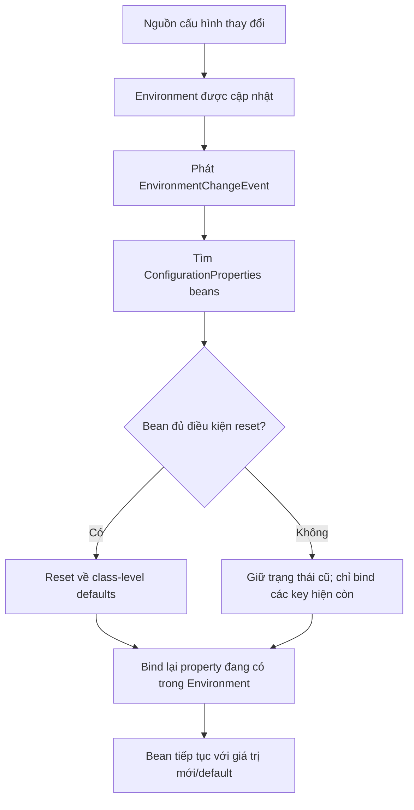

# Giá trị mặc định và xử lý khi thuộc tính bị loại bỏ

## 1. Bài toán

Ứng dụng Spring Boot thường có cấu hình cho timeout, số lần retry, giới hạn kết nối và feature flag. Không phải môi trường nào cũng khai báo đủ mọi khóa, vì vậy lớp cấu hình cần **giá trị mặc định** để ứng dụng hoạt động an toàn khi một property chưa được cung cấp.

Khó khăn xuất hiện khi nguồn cấu hình thay đổi lúc ứng dụng đang chạy. Ví dụ, client timeout ban đầu là 8 giây, sau đó người vận hành xóa khóa khỏi Config Server rồi yêu cầu refresh. Ứng dụng sẽ dùng default 3 giây, giữ giá trị 8 giây cũ hay nhận null? Kết quả phụ thuộc cách khai báo bean, cơ chế refresh và việc khóa có thực sự biến mất khỏi Environment hay không.

Trong Spring Cloud, cần phân biệt hai cơ chế:

- **Rebind ConfigurationProperties:** Spring Cloud nhận EnvironmentChangeEvent và bind lại các bean cấu hình kiểu dữ liệu. Với bean đủ điều kiện, nó reset về class-level defaults trước khi bind lại, giúp property đã bị loại bỏ không giữ giá trị cũ.
- **RefreshScope:** Spring Cloud xóa target khỏi cache; lần gọi sau tạo target mới từ cấu hình hiện hành. Tài liệu Spring Cloud có lưu ý riêng rằng xóa hẳn một property rồi refresh không bảo đảm cập nhật sự hiện diện của property đó.

Bài thuộc chương **Cấu hình kiểu dữ liệu** của mô-đun **SPRING_CLOUD_CORE**. Trọng tâm là thiết kế default value có thể dự đoán và xử lý an toàn khi property không còn được cung cấp.

Sau bài học, người học có thể:

- Phân biệt default trong Environment, default của bean mutable và DefaultValue trong constructor binding.
- Chọn default phù hợp cho boolean, số, thời lượng và object lồng nhau.
- Giải thích cách Spring Cloud rebind ConfigurationProperties khi property bị xóa.
- Nhận diện trường hợp rebinder không thể reset về class-level defaults.
- Phân biệt rebind với RefreshScope và hiểu giới hạn khi property bị loại bỏ.
- Viết kiểm thử cho trạng thái ban đầu, cập nhật, xóa property và quay về default.

## 2. Ba nơi có thể định nghĩa giá trị mặc định

| Vị trí | Ví dụ | Có xuất hiện trong Environment? | Phù hợp khi |
| --- | --- | --- | --- |
| Nguồn cấu hình | client.timeout=3s trong application.yml | Có | Giá trị cần được mọi bean, placeholder hoặc condition nhìn thấy. |
| Khởi tạo field / no-arg constructor | private Duration timeout = Duration.ofSeconds(3); | Không | Default thuộc về một bean cấu hình mutable. |
| Constructor binding với DefaultValue | DefaultValue("3s") Duration timeout | Không | Cấu hình bất biến hoặc Java record. |

### 2.1. Default ở nguồn cấu hình

Ví dụ trong application.yml:

```yaml
client:
  timeout: 3s
  max-attempts: 2
  enabled: true
```

Đây là property thực sự của Environment. Bean có thể bind nó, Value có thể đọc nó và điều kiện cấu hình có thể kiểm tra. Nguồn có độ ưu tiên cao hơn vẫn có thể ghi đè giá trị này.

### 2.2. Default trong bean mutable

Với ConfigurationProperties dùng setter binding, có thể khởi tạo field ngay trong lớp:

```java
@ConfigurationProperties(prefix = "client")
public class ClientProperties {
    private Duration timeout = Duration.ofSeconds(3);
    private int maxAttempts = 2;
    private boolean enabled = true;

    public Duration getTimeout() { return timeout; }
    public void setTimeout(Duration timeout) { this.timeout = timeout; }
    public int getMaxAttempts() { return maxAttempts; }
    public void setMaxAttempts(int maxAttempts) { this.maxAttempts = maxAttempts; }
    public boolean isEnabled() { return enabled; }
    public void setEnabled(boolean enabled) { this.enabled = enabled; }
}
```

Khi không có property tương ứng, field giữ giá trị khởi tạo. Nếu không khởi tạo field, Java dùng default của kiểu dữ liệu: số nguyên là 0, boolean là false, reference là null. Những giá trị đó có thể không phải chính sách mong muốn của ứng dụng.

Lớp cấu hình mutable thường có một no-argument constructor duy nhất (có thể là constructor mặc định do Java sinh ra). Điều này cũng quan trọng đối với cơ chế reset khi rebind của Spring Cloud.

### 2.3. Default với constructor binding và DefaultValue

Nếu cần object bất biến, có thể dùng constructor binding hoặc Java record:

```java
import java.time.Duration;
import java.util.List;
import org.springframework.boot.context.properties.ConfigurationProperties;
import org.springframework.boot.context.properties.bind.DefaultValue;

@ConfigurationProperties(prefix = "client")
public record ClientProperties(
        @DefaultValue("3s") Duration timeout,
        @DefaultValue("2") int maxAttempts,
        @DefaultValue("true") boolean enabled,
        @DefaultValue Retry retry) {

    public record Retry(@DefaultValue("USER") List<String> roles) {
    }
}
```

Spring Boot dùng DefaultValue trên constructor parameter hoặc record component khi property tương ứng không được cung cấp. Conversion service chuyển chuỗi trong annotation sang kiểu đích, nên các giá trị như 3s, 2MB hoặc USER có thể được chuyển đổi theo converter hiện có.

DefaultValue **không làm xuất hiện property trong Environment**. Nó chỉ quyết định giá trị Binder truyền vào constructor. Nếu Environment cần nhìn thấy default, hãy khai báo default trong nguồn cấu hình.

Với object lồng nhau:

- Nếu không có property của object và tham số không có DefaultValue, object có thể là null.
- DefaultValue không có giá trị trên tham số object yêu cầu Binder tạo object đó ngay cả khi không có property con.
- Khi object đã được tạo, default trên tham số con có thể được áp dụng. Ví dụ roles ở trên nhận danh sách USER nếu không có khóa roles.

Khai báo constructor-bound properties bằng EnableConfigurationProperties hoặc configuration property scanning. Không dùng Component hoặc Bean theo cách thông thường để mong Spring tự áp dụng constructor binding cho cùng kiểu đó.

### 2.4. Default trong Value

Value cũng có cú pháp fallback:

```java
@Component
public class ClientCaller {
    private final Duration timeout;

    public ClientCaller(
            @Value("${client.timeout:3s}") Duration timeout) {
        this.timeout = timeout;
    }
}
```

Fallback sau dấu hai chấm chỉ được dùng khi placeholder không tìm thấy property. Nó không tạo property client.timeout trong Environment, và singleton bình thường không tự chạy lại constructor khi cấu hình đổi. Với nhóm cấu hình có nhiều khóa, ConfigurationProperties thường rõ ràng và dễ kiểm thử hơn việc rải Value khắp các service.

## 3. Default phải có ý nghĩa theo kiểu dữ liệu

Không nên chọn default chỉ để ứng dụng khởi động được. Giá trị đó phải an toàn, có đơn vị rõ ràng và phù hợp với hành vi của hệ thống.

| Kiểu dữ liệu | Ví dụ default | Điều cần chú ý |
| --- | --- | --- |
| boolean | enabled = true hoặc false | Chọn theo nguyên tắc an toàn; tính năng có tác động lớn thường nên tắt mặc định. |
| Số nguyên | maxAttempts = 2 | Dùng validation để cấm 0 hoặc số âm nếu không có ý nghĩa. |
| Duration | Duration.ofSeconds(3) | Ghi rõ đơn vị, tránh nhầm milliseconds và seconds. |
| DataSize | DataSize.ofMegabytes(8) | Ghi rõ MB, KB hoặc B. |
| Enum | Mode.STANDARD | Có default ổn định và xử lý rõ giá trị không hợp lệ. |
| Nested object | new RetryProperties() | Quyết định object luôn tồn tại hay có thể null. |
| Collection | new ArrayList<>() | Phân biệt danh sách rỗng với property không được khai báo. |

Ví dụ:

```yaml
client:
  enabled: true
  timeout: 3s
  max-attempts: 2
  retry:
    initial-delay: 200ms
    max-delay: 2s
```

Nếu default cần được condition hoặc một component khác nhìn thấy, đặt nó trong nguồn cấu hình để property hiện diện trong Environment.

## 4. Điều gì xảy ra khi property bị xóa?

Trước khi nói đến refresh, cần xác định "bị xóa" nghĩa là gì. Một khóa có thể bị xóa khỏi một file hoặc Config Server response nhưng vẫn còn giá trị ở nguồn khác.

Ví dụ:

```yaml
# application.yml trong JAR
client:
  timeout: 3s
```

Nguồn cấu hình bên ngoài ban đầu ghi đè:

```yaml
client:
  timeout: 8s
```

Giá trị hiệu lực là 8 giây. Nếu xóa khóa khỏi nguồn bên ngoài, Environment có thể quay về 3 giây từ application.yml. Trong trường hợp này property **không biến mất khỏi Environment**; nó chỉ nhận giá trị từ nguồn có độ ưu tiên thấp hơn.

Chỉ khi khóa không còn trong tất cả property source liên quan thì Binder mới xem nó là không được cung cấp. Xóa một dòng khỏi Config Server không có nghĩa Environment chắc chắn không còn khóa đó.

### 4.1. Vì sao bean có thể giữ giá trị cũ?

Với một bean mutable, giả sử lúc đầu:

```text
class-level default: 3s
remote property:     8s
bean.timeout:        8s
```

Sau khi remote property bị xóa, nếu Binder chỉ ghi các property hiện còn trong Environment lên object đang giữ trạng thái cũ, field timeout có thể vẫn là 8 giây. Binder không thể tự suy ra giá trị cũ trong object từng đến từ nguồn nay đã bị xóa.

Spring Cloud xử lý trường hợp này cho bean ConfigurationProperties đủ điều kiện bằng cách **reset bean về class-level defaults trước khi rebind**.

## 5. Cơ chế reset khi rebind ConfigurationProperties

Khi Spring Cloud nhận EnvironmentChangeEvent, các bean ConfigurationProperties được bind lại. Trong Spring Cloud Commons hiện hành, quá trình rebind có các bước khái quát:

1. Xác định bean cấu hình cần rebind.
2. Reset các thuộc tính về default ở cấp lớp nếu bean đáp ứng điều kiện reset.
3. Bind lại các property đang có trong Environment.
4. Bean tiếp tục được sử dụng với giá trị mới, hoặc default nếu khóa tương ứng không còn được cung cấp.



### 5.1. Điều kiện quan trọng: no-argument constructor duy nhất

Theo tài liệu Spring Cloud Commons hiện hành, reset về class-level defaults chỉ diễn ra khi lớp của bean khai báo **no-argument constructor là constructor duy nhất**.

Ví dụ bean mutable có thể reset:

```java
@ConfigurationProperties("client")
public class ClientProperties {
    private Duration timeout = Duration.ofSeconds(3);
    private int maxAttempts = 2;

    public ClientProperties() {
    }

    // getters và setters
}
```

Ví dụ lớp có no-argument constructor cùng một constructor khác:

```java
@ConfigurationProperties("client")
public class ClientProperties {
    private Duration timeout = Duration.ofSeconds(3);

    public ClientProperties() {
    }

    public ClientProperties(ClientPolicy policy) {
        this.timeout = policy.defaultTimeout();
    }

    // getters và setters
}
```

Ở trường hợp thứ hai, Spring Cloud bỏ qua bước reset vì gọi no-argument constructor không tái tạo được default thực tế đã dùng khi tạo bean. Những property vẫn còn trong Environment được bind lại trên trạng thái bean hiện có; property đã bị xóa có thể giữ giá trị cũ. Vì vậy, không nên thêm constructor phụ vào lớp cấu hình mutable mà không xem xét hành vi refresh.

### 5.2. Property lồng nhau

Reset có thể đi sâu vào object cấu hình lồng nhau, kể cả một số nested object không có setter. Spring Cloud không đi xuyên vào kiểu JDK hoặc kiểu thuộc namespace chuẩn jakarta.* và javax.*, nhằm tránh sửa nhầm object graph bên ngoài cấu hình.

Nếu bean cấu hình giữ tham chiếu tới kiểu thư viện khác có object graph vòng, state nội bộ hoặc không nên bị reset, Spring Cloud Commons hiện hành cung cấp:

```properties
spring.cloud.refresh.never-reset-nested-types=com.example.MyClient,com.acme.sdk.
```

Danh sách nhận tên class đầy đủ hoặc package prefix, phân tách bằng dấu phẩy. Cần kiểm tra tính năng này theo đúng phiên bản Spring Cloud của dự án.

### 5.3. Rebind không thay instance bean

Rebind ConfigurationProperties cập nhật field trên **cùng instance** bean. Các lần rebind chồng lấn của cùng bean được tuần tự hóa, nhưng điều đó không bảo đảm thread khác đọc bean trong lúc rebind sẽ luôn thấy snapshot nhất quán. Reader có thể quan sát trạng thái trung gian khi các field được cập nhật lần lượt.

Nếu một thao tác cần nhìn thấy toàn bộ nhóm cấu hình như một phiên bản nhất quán, hãy cân nhắc RefreshScope hoặc thiết kế snapshot bất biến được thay thế có kiểm soát. Không nên mặc định mọi bean mutable đều an toàn khi đọc đồng thời với refresh.

### 5.4. Constructor binding và Java record

Các object ConfigurationProperties dùng constructor binding, bao gồm Java record, **không được Spring Cloud refresh bằng cơ chế rebind thông thường**.

| Thiết kế | Default khi startup | Rebind sau EnvironmentChangeEvent |
| --- | --- | --- |
| Mutable bean, class-level field initializer, no-arg constructor duy nhất | Field initializer được giữ nếu không có property | Có thể reset về class-level defaults rồi bind lại |
| Mutable bean có nhiều constructor | Giá trị khởi tạo theo cách tạo bean | Reset bị bỏ qua; key còn trong Environment được bind lại |
| Constructor-bound class / record | Dùng giá trị constructor và DefaultValue | Không được rebind theo cơ chế này |

Nếu cần cập nhật cấu hình immutable, hãy thiết kế vòng đời tạo lại object ở abstraction hỗ trợ refresh đã được kiểm thử theo phiên bản cụ thể, hoặc dùng restart/redeploy. Đừng giả định thêm RefreshScope lên mọi kiểu constructor-bound sẽ tự giải quyết; cách đăng ký bean và cơ chế scope cũng ảnh hưởng kết quả.

## 6. RefreshScope và việc xóa property

RefreshScope giải quyết bài toán khác với rebind ConfigurationProperties. Bean trong scope thường được truy cập qua proxy. Khi refresh, Spring Cloud xóa target khỏi cache; lần gọi sau proxy tạo target mới từ cấu hình hiện hành.

```java
@Service
@RefreshScope
public class ClientPolicy {
    private final Duration timeout;

    public ClientPolicy(
            @Value("${client.timeout:3s}") Duration timeout) {
        this.timeout = timeout;
    }

    public Duration timeout() {
        return timeout;
    }
}
```

Đối với bean kiểu này, constructor chạy khi target được tạo. Nhưng tài liệu Spring Cloud cảnh báo rằng **xóa một property rồi thực hiện refresh không cập nhật sự hiện diện của property đó theo cách có thể dựa vào**. Nếu logic ứng dụng phụ thuộc vào việc property có mặt hay không, hãy thiết kế lại điều kiện để dựa trên giá trị rõ ràng hoặc trạng thái vắng mặt theo cách đã kiểm thử.

Ví dụ, thay vì xóa client.enabled để tắt tính năng, hãy cập nhật thành:

```yaml
client:
  enabled: false
```

Giá trị false là thay đổi tường minh, dễ quan sát và kiểm thử. Với cấu hình bật/tắt, không nên dùng sự kiện xóa khóa làm lệnh điều khiển.

### 6.1. Rebind và RefreshScope khác nhau ở đâu?

| Khía cạnh | Rebind ConfigurationProperties | RefreshScope |
| --- | --- | --- |
| Mục tiêu | Cập nhật bean cấu hình kiểu dữ liệu | Tạo lại target bean có state phụ thuộc cấu hình |
| Cách áp dụng | Bind lại trên cùng instance | Xóa target cache; tạo target mới khi được gọi |
| Default khi property bị xóa | Có thể trở về class-level defaults nếu bean đủ điều kiện reset | Không nên dựa vào việc xóa khóa để cập nhật sự hiện diện của property |
| Constructor binding | Không hỗ trợ refresh | Không mặc nhiên giải quyết mọi cách đăng ký constructor-bound properties |
| Tính nhất quán khi đọc | Có thể thấy field đang cập nhật từng phần | Scope tuần tự hóa reads với refresh của target |
| Khi phù hợp | Nhóm cấu hình mutable, có thể bind lại | Bean có state cần khởi tạo lại từ cấu hình |

Một singleton thường không tự nhận giá trị mới chỉ vì file cấu hình đã đổi. Cần có cơ chế cập nhật Environment và phát sự kiện hoặc refresh scope tương ứng.

## 7. Nên biểu diễn việc tắt hoặc loại bỏ cấu hình thế nào?

Xóa property có thể mang nhiều ý nghĩa: quay về default, tắt tính năng, bỏ cấu hình kế thừa hoặc báo rằng một tùy chọn không còn được quản lý. Không nên để một hành động xóa khóa mang nhiều ý nghĩa cùng lúc.

### 7.1. Dùng giá trị tường minh cho feature flag

Thay vì xóa hẳn client.enabled, hãy đặt:

```yaml
client:
  enabled: false
```

Lợi ích:

- Giá trị mới hiện diện trong Environment.
- Có thể kiểm tra qua Environment, ConfigurationProperties hoặc Actuator.
- Thể hiện rõ ý định của người vận hành.
- Ít phụ thuộc vào khác biệt giữa rebind và refresh scope.

### 7.2. Dùng sentinel hoặc trạng thái enum

Với cấu hình có nhiều trạng thái, dùng enum hoặc giá trị rõ nghĩa:

```yaml
client:
  mode: DISABLED
```

Thay vì xóa client.mode, ứng dụng có thể phân biệt STANDARD, READ_ONLY và DISABLED. Cách này hữu ích khi cấu hình được audit hoặc truyền tới nhiều instance.

### 7.3. Dùng default khi muốn quay về chính sách mặc định

Nếu mục tiêu thật sự là quay về class-level default của mutable ConfigurationProperties, có thể xóa khóa khỏi **mọi nguồn có liên quan**, cập nhật Environment và kích hoạt rebind. Sau đó xác minh giá trị bean đã trở về default. Điều này chỉ đáng tin cậy khi bean đáp ứng điều kiện reset và phiên bản Spring Cloud đang dùng có hành vi tương ứng.

Nếu default cần áp dụng cho mọi bean hoặc phải được condition nhìn thấy, đặt default ở application.yml hoặc nguồn cấu hình chuẩn. Khi đó xóa override từ xa sẽ để nguồn local mặc định thắng theo precedence.

### 7.4. Không dùng chuỗi rỗng thay cho mọi kiểu "không có"

Property có thể:

- Không xuất hiện trong bất kỳ property source nào.
- Xuất hiện với chuỗi rỗng.
- Xuất hiện với giá trị null theo format nguồn.
- Xuất hiện với giá trị sentinel như DISABLED.

Các trường hợp này không tương đương. Chuỗi rỗng vẫn là một giá trị được cung cấp; việc chuyển nó sang số, duration, boolean hoặc enum có thể cho kết quả khác nhau hoặc phát lỗi conversion. Chọn một quy ước rõ ràng và viết test cho nó.

## 8. Ví dụ end-to-end: timeout quay về default

Giả sử dịch vụ inventory-client có default timeout 3 giây, nhưng Config Server đang đặt 8 giây.

### 8.1. Lớp cấu hình mutable

```java
import java.time.Duration;
import org.springframework.boot.context.properties.ConfigurationProperties;
import org.springframework.validation.annotation.Validated;
import jakarta.validation.constraints.Min;
import jakarta.validation.constraints.NotNull;

@Validated
@ConfigurationProperties(prefix = "inventory.client")
public class InventoryClientProperties {
    @NotNull
    private Duration timeout = Duration.ofSeconds(3);
    @Min(1)
    private int maxAttempts = 2;
    private boolean enabled = true;

    public Duration getTimeout() { return timeout; }
    public void setTimeout(Duration timeout) { this.timeout = timeout; }
    public int getMaxAttempts() { return maxAttempts; }
    public void setMaxAttempts(int maxAttempts) { this.maxAttempts = maxAttempts; }
    public boolean isEnabled() { return enabled; }
    public void setEnabled(boolean enabled) { this.enabled = enabled; }
}
```

Đăng ký class qua ConfigurationPropertiesScan hoặc EnableConfigurationProperties. Không cần thêm Component chỉ để Binder phát hiện kiểu cấu hình.

### 8.2. Giá trị ban đầu từ Config Server

Config Server trả:

```yaml
inventory:
  client:
    timeout: 8s
    max-attempts: 4
```

Sau khi ứng dụng khởi động, bean có timeout bằng 8 giây, maxAttempts bằng 4, enabled bằng true. Giá trị enabled đến từ class-level default.

### 8.3. Xóa override timeout

Người vận hành xóa inventory.client.timeout khỏi nguồn cấu hình từ xa. Sau khi Config Client tải lại cấu hình, cần xác minh khóa đó thực sự không còn trong Environment hoặc không còn nguồn nào ưu tiên cao hơn cung cấp 8 giây.

Khi rebind được kích hoạt, bean đủ điều kiện reset về:

```text
timeout     = 3s  (class-level default)
maxAttempts = 2   (class-level default, nếu key cũng không còn)
enabled     = true
```

Nếu chỉ xóa timeout nhưng max-attempts vẫn là 4 trong Environment, giá trị maxAttempts sau rebind vẫn là 4. Các property không bị xóa tiếp tục nhận giá trị từ nguồn hiện có.

### 8.4. Kiểm tra kết quả

- Kiểm tra property source và giá trị hiệu lực trong Environment bằng cách chẩn đoán có kiểm soát.
- Kiểm tra bean đã bind qua Actuator configprops nếu endpoint được expose và bảo vệ.
- Ghi nhận trạng thái trước và sau refresh trong integration test.
- Kiểm tra request thật có sử dụng timeout mới; bean được cập nhật không tự bảo đảm mọi client hoặc pool tài nguyên đã thay đổi theo.

## 9. Kiểm thử default và property removal

Một test tốt nên kiểm tra cả trạng thái ban đầu lẫn vòng đời thay đổi. Không chỉ kiểm tra rằng Binder đọc được giá trị có mặt.

| Ca kiểm thử | Đầu vào | Kết quả cần xác minh |
| --- | --- | --- |
| Không có property khi startup | Không có client.timeout | Bean dùng default 3 giây. |
| Có override | client.timeout=8s | Bean dùng 8 giây. |
| Xóa override, có local default | Remote key bị xóa, local client.timeout=3s còn | Bean nhận 3 giây từ Environment. |
| Xóa key khỏi mọi source | Không còn client.timeout | Bean đủ điều kiện reset về class-level default 3 giây. |
| Nested property bị xóa | client.retry.max-attempts bị xóa | Nested configuration đủ điều kiện reset về default của nó. |
| Bean có nhiều constructor | No-arg và constructor có tham số | Xác minh reset bị bỏ qua; không kỳ vọng stale field tự quay về default. |
| Constructor-bound record | Property thay đổi sau startup | Không kỳ vọng rebind record. |
| RefreshScope và xóa key | Key bị xóa trước refresh | Không dựa vào việc xóa key để đổi presence; kiểm tra explicit value thay thế. |
| Property rỗng | client.name= | Kiểm tra conversion và validation riêng; không coi tương đương key vắng mặt. |

### 9.1. Kiểm thử với Environment và Binder

Với mutable bean, có thể viết integration test khởi động application context, đặt một property source thử nghiệm có ưu tiên cao, kiểm tra giá trị đã bind, sau đó thay đổi hoặc loại bỏ khóa trong property source và kích hoạt cơ chế rebind. Test phải dùng cùng loại registration và lifecycle như ứng dụng thật; chỉ gọi Binder độc lập không kiểm chứng được ConfigurationPropertiesRebinder.

Luồng test khái quát:

```text
1. Start context: class default timeout = 3s.
2. Add test PropertySource: client.timeout = 8s.
3. Trigger supported rebind: assert timeout = 8s.
4. Remove client.timeout from that source and ensure no lower source still supplies 8s.
5. Trigger rebind again: assert timeout = 3s.
```

Đừng giả lập việc xóa bằng cách đặt chuỗi rỗng. Đó là đầu vào khác và cần test riêng.

### 9.2. Kiểm thử RefreshScope

Với bean thuộc RefreshScope, kiểm tra proxy được giữ nguyên nhưng target được tạo lại sau khi scope bị refresh. Thay đổi một giá trị từ STANDARD sang DISABLED là ca kiểm thử phù hợp hơn việc chỉ xóa key. Nếu hệ thống yêu cầu hành vi khi key vắng mặt, viết test integration cho đúng Config Client và release train đang triển khai.

### 9.3. Kiểm tra bằng Actuator

Spring Cloud và Spring Boot có các endpoint giúp quan sát:

- /actuator/env: thông tin Environment và property source (cần sanitization và kiểm soát truy cập).
- /actuator/configprops: giá trị đã bind vào ConfigurationProperties.
- /actuator/refresh: tải lại bootstrap/refresh scope theo integration và phiên bản tương ứng.
- /actuator/env POST: cập nhật Environment và rebind property beans khi endpoint được bật đúng cấu hình.

Không expose endpoint quản trị công khai chỉ để debug. Chỉ bật endpoint cần thiết, giới hạn mạng truy cập, xác thực/phân quyền và tránh hiển thị credential.

## 10. Các lỗi thường gặp

| Triệu chứng | Nguyên nhân có thể | Cách xử lý |
| --- | --- | --- |
| Xóa key nhưng bean vẫn giữ giá trị cũ | Bean không đủ điều kiện reset, hoặc key vẫn có ở property source khác | Kiểm tra constructor của bean và toàn bộ nguồn trong Environment. |
| Field quay về 0, false hoặc null ngoài dự kiến | Không khai báo class-level default | Khởi tạo field với default có ý nghĩa và thêm validation. |
| DefaultValue không xuất hiện trong Environment | Default chỉ được áp dụng khi constructor binding | Đặt default trong config source nếu Environment hoặc condition cần nhìn thấy. |
| Record không đổi sau refresh | Constructor-bound properties không được Spring Cloud rebind | Dùng vòng đời tạo lại phù hợp hoặc restart/redeploy; không kỳ vọng rebind mutable. |
| Nested object trở thành null | Nested property không tồn tại và không có default object | Khởi tạo nested object hoặc dùng DefaultValue phù hợp. |
| RefreshScope không phản ứng khi xóa key | Refresh scope có giới hạn về việc cập nhật presence của property bị loại bỏ | Dùng giá trị tường minh như false hoặc DISABLED. |
| Bean có trạng thái trung gian khi refresh | Rebind mutate cùng instance và field được cập nhật lần lượt | Dùng RefreshScope khi cần reads được tuần tự hóa hoặc thiết kế snapshot. |
| Giá trị rỗng gây lỗi conversion | Empty string không giống absent property | Định nghĩa rõ quy ước empty/null/sentinel và test từng kiểu dữ liệu. |
| Test không tái hiện production | Test chỉ gọi Binder, không dùng cùng lifecycle/event | Viết integration test với registration, Environment và refresh mechanism thực tế. |

## 11. Hướng dẫn thiết kế

1. **Đặt default ở đúng tầng.** Nếu default là chính sách toàn ứng dụng, đưa vào config source. Nếu chỉ là default nội bộ của typed bean mutable, field initializer phù hợp. Với constructor-bound object, dùng DefaultValue.
2. **Dùng ConfigurationProperties cho nhóm cấu hình.** Giữ prefix rõ ràng, kiểu dữ liệu cụ thể và validation cho giới hạn.
3. **Nếu muốn property bị xóa quay về default, giữ bean mutable có no-arg constructor duy nhất.** Kiểm tra điều kiện này sau mỗi thay đổi constructor.
4. **Không kỳ vọng constructor-bound record được rebind.** Chọn vòng đời tạo lại hoặc triển khai lại ứng dụng khi cấu hình immutable cần thay đổi.
5. **Dùng giá trị explicit để tắt tính năng.** false, DISABLED, 0 (nếu có ý nghĩa) hoặc trạng thái enum rõ ràng dễ vận hành hơn xóa key.
6. **Không dựa vào RefreshScope để phát hiện việc xóa property.** Kiểm tra behavior theo đúng phiên bản Spring Cloud.
7. **Kiểm thử property source precedence.** Xóa khóa khỏi Config Server không đồng nghĩa nó biến mất khỏi Environment nếu application.yml, environment variable hoặc nguồn khác vẫn định nghĩa nó.
8. **Bảo vệ thao tác refresh.** Thay đổi cấu hình có thể ảnh hưởng kết nối, timeout và hành vi bảo mật; chỉ cho phép người vận hành có quyền thực hiện.

## 12. Câu hỏi tự kiểm tra

1. Khác biệt giữa default trong application.yml, field initializer và DefaultValue là gì?
2. Vì sao default của ConfigurationProperties không tự xuất hiện trong Environment?
3. Khi property bị xóa khỏi Environment, Spring Cloud xử lý mutable ConfigurationProperties bean như thế nào?
4. Điều kiện constructor nào cho phép ConfigurationPropertiesRebinder reset bean về class-level defaults?
5. Vì sao bean có cả no-arg constructor và constructor có tham số có thể giữ lại giá trị cũ sau rebind?
6. Constructor-bound classes và Java records có giới hạn gì khi refresh?
7. RefreshScope khác rebind ConfigurationProperties ở cách cập nhật object và xử lý property bị xóa như thế nào?
8. Vì sao dùng client.enabled=false thường dễ vận hành hơn xóa hẳn client.enabled?
9. Làm thế nào kiểm chứng property thật sự biến mất khỏi tất cả property source có liên quan?
10. Hãy thiết kế integration test xác nhận timeout chuyển từ remote override về class-level default sau khi key bị xóa.

## 13. Tài liệu tham khảo chính thức

- [Spring Cloud Commons — Application Context Services, Environment Changes và Refresh Scope](https://docs.spring.io/spring-cloud-commons/reference/spring-cloud-commons/application-context-services.html)
- [Spring Boot — Externalized Configuration và Configuration Properties Binding](https://docs.spring.io/spring-boot/reference/features/external-config.html)

Hành vi reset và refresh phụ thuộc phiên bản Spring Cloud. Các điều kiện reset no-argument constructor, xử lý nested properties và giới hạn của RefreshScope cần được đối chiếu với release train thực tế.
