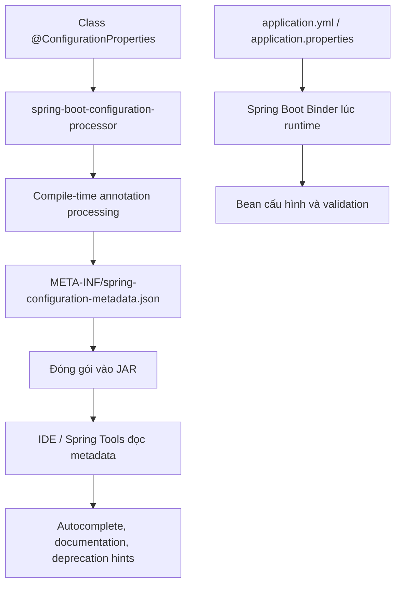

# Configuration metadata và hỗ trợ gợi ý trong IDE

> **Chương:** Cấu hình kiểu dữ liệu  
> **Module:** `SPRING_CLOUD_CORE` — các nền tảng cốt lõi của Spring Cloud trong hệ thống phân tán, đặc biệt Spring Cloud Commons, Context, cấu hình bên ngoài và tương thích phiên bản với Spring Boot. Người học tìm hiểu refresh scope, discovery, service registry, giao tiếp dịch vụ và cách kiểm thử, vận hành các abstraction chung.  
> **Trọng tâm:** Configuration metadata mô tả thuộc tính cấu hình để IDE và công cụ phát triển có thể gợi ý tên, kiểu dữ liệu, giá trị mặc định, mô tả, giá trị hợp lệ và trạng thái deprecated. Metadata giúp người viết cấu hình đúng hơn; việc bind và validate khi ứng dụng chạy vẫn thuộc trách nhiệm của Spring Boot và ứng dụng.

## 1. Vì sao cần configuration metadata?

Một ứng dụng Spring Cloud thường có nhiều thuộc tính cấu hình: tên service, endpoint Config Server, timeout, retry, discovery, registry, logging, feature flag và thông tin kết nối dịch vụ. Người phát triển có thể viết cấu hình trong YAML hoặc properties, nhưng nếu không có mô tả đi kèm, IDE khó biết:

- thuộc tính nào thực sự được hỗ trợ;
- tên chuẩn và kiểu dữ liệu của thuộc tính;
- thuộc tính có giá trị mặc định nào;
- một giá trị có đơn vị milliseconds, seconds hay bytes;
- enum hoặc tập giá trị nào được khuyến nghị;
- thuộc tính đã deprecated và nên thay bằng key nào;
- một nhóm thuộc tính thuộc về component nào.

Ví dụ, với một thư viện nội bộ, người viết có thể nhập nhầm `platform.client.discover.enabled` thành `platform.client.discovery.enabled`. YAML vẫn hợp lệ về cú pháp, nhưng typo có thể khiến thư viện không bật discovery như mong đợi. IDE có configuration metadata có thể gợi ý tên key, hiển thị mô tả và cảnh báo tên đã deprecated ngay trong editor.

**Configuration metadata** là tập dữ liệu mô tả cấu hình, thường được biểu diễn trong file JSON theo định dạng Spring Boot. Metadata được tạo chủ yếu từ các class `@ConfigurationProperties` thông qua annotation processor; nhà phát triển có thể bổ sung thông tin thủ công cho những trường hợp processor không suy ra được.

Metadata được IDE, Spring Tools và các công cụ tương thích đọc để cung cấp autocomplete, quick documentation và cảnh báo. Nó không phải file cấu hình runtime, không tự đăng ký bean và không tự kiểm tra giá trị khi ứng dụng chạy.

### Kết quả học tập

Sau bài này, người học có thể:

1. giải thích mục đích và cấu trúc của Spring configuration metadata;
2. phân biệt generated metadata và additional metadata;
3. cấu hình `spring-boot-configuration-processor` trong Maven hoặc Gradle;
4. tạo metadata từ `@ConfigurationProperties`, property lồng nhau và enum;
5. bổ sung hints, values, providers và mô tả cho IDE;
6. đánh dấu thuộc tính deprecated và hướng người dùng sang thuộc tính thay thế;
7. kiểm tra metadata trong artifact và chẩn đoán khi IDE không gợi ý;
8. phân biệt metadata với runtime binding, conversion và validation.

## 2. Metadata nằm ở đâu trong quá trình cấu hình?

### 2.1. Từ class cấu hình đến IDE

Giả sử một thư viện Spring Cloud nội bộ cung cấp cấu hình cho client gọi dịch vụ. Nhóm phát triển định nghĩa prefix `platform.client` với các thuộc tính `connect-timeout`, `read-timeout`, `retry.max-attempts` và `mode`.

Khi biên dịch module chứa class `@ConfigurationProperties`, Spring Boot configuration processor phân tích annotation và kiểu Java để tạo metadata. Metadata được ghi vào resource `META-INF/spring-configuration-metadata.json` trong output của build. Khi thư viện được đóng gói thành JAR, metadata có thể được đưa vào artifact để IDE của ứng dụng sử dụng. Javadoc trên field hoặc constructor parameter có thể được dùng làm description khi type được compile từ source trong module; type chỉ có dưới dạng dependency đã biên dịch thường không cung cấp đủ thông tin mô tả.



Sơ đồ thể hiện hai luồng liên quan nhưng khác thời điểm:

- **Luồng metadata:** diễn ra khi build và phục vụ công cụ phát triển.
- **Luồng runtime:** diễn ra khi Spring Boot đọc property, bind vào object và kiểm tra điều kiện cấu hình.

Metadata không thay thế Binder và Binder không cần IDE mới hoạt động.

### 2.2. Hai file metadata quan trọng

| File | Nguồn tạo | Mục đích |
| --- | --- | --- |
| `META-INF/spring-configuration-metadata.json` | Thường được annotation processor sinh khi compile | Metadata được suy ra từ các class cấu hình |
| `META-INF/additional-spring-configuration-metadata.json` | Nhà phát triển tạo thủ công trong source resources | Bổ sung hoặc điều chỉnh mô tả, default, deprecation và hints |

File generated thường nằm trong output của module, ví dụ:

- Maven: `target/classes/META-INF/spring-configuration-metadata.json`;
- Gradle: `build/classes/java/main/META-INF/spring-configuration-metadata.json` hoặc output tương ứng của source set.

Đường dẫn chính xác phụ thuộc build tool và cấu hình. Khi đóng gói JAR, kiểm tra resource nằm dưới `META-INF/` trong artifact.

### 2.3. Metadata không phải cấu hình của ứng dụng

Một file metadata có thể mô tả `platform.client.read-timeout` là `java.time.Duration` với default `3s`. Nó không đặt giá trị đó vào Environment và cũng không buộc Binder phải dùng default nếu class cấu hình không khai báo default tương ứng.

Giá trị runtime đến từ các nguồn cấu hình và quy tắc binding của Spring Boot, ví dụ:

- `application.yml` hoặc `application.properties`;
- file cấu hình ngoài và profile;
- biến môi trường;
- system properties và command-line arguments;
- Config Data hoặc Spring Cloud Config;
- giá trị mặc định khai báo trong class cấu hình.

Metadata mô tả hợp đồng cấu hình dành cho người phát triển. Class, Binder, converter và validator mới quyết định hành vi thực tế của ứng dụng.

## 3. Khai báo @ConfigurationProperties làm nguồn metadata

### 3.1. Tạo class cấu hình có kiểu dữ liệu

Ví dụ một client dùng trong nền tảng:

```java
package com.example.platform.client;

import java.time.Duration;

import org.springframework.boot.context.properties.ConfigurationProperties;

@ConfigurationProperties(prefix = "platform.client")
public class PlatformClientProperties {

    private Duration connectTimeout = Duration.ofSeconds(1);
    private Duration readTimeout = Duration.ofSeconds(3);
    private Mode mode = Mode.DIRECT;

    private Retry retry = new Retry();

    public Duration getConnectTimeout() {
        return connectTimeout;
    }

    public void setConnectTimeout(Duration connectTimeout) {
        this.connectTimeout = connectTimeout;
    }

    public Duration getReadTimeout() {
        return readTimeout;
    }

    public void setReadTimeout(Duration readTimeout) {
        this.readTimeout = readTimeout;
    }

    public Mode getMode() {
        return mode;
    }

    public void setMode(Mode mode) {
        this.mode = mode;
    }

    public Retry getRetry() {
        return retry;
    }

    public void setRetry(Retry retry) {
        this.retry = retry;
    }

    public enum Mode {
        DIRECT,
        DISCOVERY
    }

    public static class Retry {
        private int maxAttempts = 3;
        private Duration backoff = Duration.ofMillis(200);

        public int getMaxAttempts() {
            return maxAttempts;
        }

        public void setMaxAttempts(int maxAttempts) {
            this.maxAttempts = maxAttempts;
        }

        public Duration getBackoff() {
            return backoff;
        }

        public void setBackoff(Duration backoff) {
            this.backoff = backoff;
        }
    }
}
```

Đây là JavaBean-style configuration properties để minh họa setter binding. Các thuộc tính có default được khai báo ngay trong class. Processor tự nhận diện inner class `Retry` là nested property; `@NestedConfigurationProperty` không cần thiết trong trường hợp này.

Để Spring Boot tạo bean từ class này, ứng dụng cần đăng ký nó bằng một cơ chế phù hợp, ví dụ:

```java
@SpringBootApplication
@EnableConfigurationProperties(PlatformClientProperties.class)
public class OrderApplication {
    public static void main(String[] args) {
        SpringApplication.run(OrderApplication.class, args);
    }
}
```

Có thể dùng `@ConfigurationPropertiesScan(basePackageClasses = PlatformClientProperties.class)` nếu muốn scan theo package của class cấu hình. **Annotation processor tạo metadata không tự đăng ký bean cấu hình.** Đây là hai nhiệm vụ riêng.

### 3.2. Tên property theo canonical form

Từ prefix và các field, metadata mô tả các key theo dạng kebab-case:

| Java property | Canonical configuration key | Kiểu |
| --- | --- | --- |
| `connectTimeout` | `platform.client.connect-timeout` | `java.time.Duration` |
| `readTimeout` | `platform.client.read-timeout` | `java.time.Duration` |
| `mode` | `platform.client.mode` | Enum |
| `retry.maxAttempts` | `platform.client.retry.max-attempts` | `int` |
| `retry.backoff` | `platform.client.retry.backoff` | `java.time.Duration` |

Spring Boot hỗ trợ relaxed binding cho nhiều dạng tên khi bind. Tuy nhiên, trong tài liệu và file cấu hình, nên dùng canonical kebab-case để thống nhất và giúp IDE nhận diện chính xác.

Ví dụ YAML:

```yaml
platform:
  client:
    connect-timeout: 500ms
    read-timeout: 4s
    mode: DISCOVERY
    retry:
      max-attempts: 4
      backoff: 250ms
```

IDE có metadata sẽ có thể gợi ý các key và enum value khi người dùng nhập cấu hình.

### 3.3. Metadata processor không thay cho ConfigurationPropertiesScan

Cần phân biệt ba bước:

1. `@ConfigurationProperties` xác định type và prefix cấu hình.
2. `@ConfigurationPropertiesScan` hoặc `@EnableConfigurationProperties` đăng ký bean để runtime bind.
3. `spring-boot-configuration-processor` phân tích type ở compile-time để tạo metadata.

Có thể xảy ra trường hợp metadata đã được sinh nhưng bean chưa được đăng ký; IDE gợi ý key đúng, nhưng ứng dụng không có bean nhận cấu hình. Ngược lại, một bean có thể được đăng ký và bind đúng dù metadata không được sinh, nhưng IDE thiếu gợi ý.

## 4. Cài đặt configuration processor

### 4.1. Maven

Thêm processor vào module khai báo các class `@ConfigurationProperties`:

```xml
<dependencies>
    <dependency>
        <groupId>org.springframework.boot</groupId>
        <artifactId>spring-boot-configuration-processor</artifactId>
        <optional>true</optional>
    </dependency>
</dependencies>
```

Dependency được đánh dấu optional để processor không trở thành dependency runtime bắt buộc của các ứng dụng sử dụng thư viện. Phiên bản nên được quản lý bởi Spring Boot parent/BOM tương ứng. Với Maven Compiler Plugin 3.12.0 trở lên, cấu hình processor trong `annotationProcessorPaths` để chỉ rõ processor được chạy khi compile; nếu dự án đã cấu hình annotation processor path riêng, hãy thêm processor vào đúng path đó.

Ví dụ phần cấu hình compiler plugin (giữ các plugin khác của dự án nếu đã có):

```xml
<build>
    <plugins>
        <plugin>
            <groupId>org.apache.maven.plugins</groupId>
            <artifactId>maven-compiler-plugin</artifactId>
            <version>3.12.0</version>
            <configuration>
                <annotationProcessorPaths>
                    <path>
                        <groupId>org.springframework.boot</groupId>
                        <artifactId>spring-boot-configuration-processor</artifactId>
                    </path>
                </annotationProcessorPaths>
            </configuration>
        </plugin>
    </plugins>
</build>
```

Sau khi compile:

```bash
mvn clean compile
```

Kiểm tra file `target/classes/META-INF/spring-configuration-metadata.json` hoặc resource metadata trong JAR sau package.

### 4.2. Gradle

Với Gradle Java plugin, khai báo processor ở configuration `annotationProcessor`:

```groovy
dependencies {
    annotationProcessor 'org.springframework.boot:spring-boot-configuration-processor'

    implementation 'org.springframework.boot:spring-boot-starter'
}
```

Nếu module dùng `additional-spring-configuration-metadata.json`, bảo đảm tài nguyên được xử lý trước khi `compileJava` chạy annotation processor:

```groovy
tasks.named('compileJava') {
    inputs.files(tasks.named('processResources'))
}
```

Sau đó chạy:

```bash
./gradlew clean compileJava
```

Kiểm tra output trong `build/classes/java/main/META-INF/`. Nếu dùng Kotlin, cấu hình processor qua kapt hoặc cơ chế annotation processing mà dự án đã chọn; không mặc định khai báo `annotationProcessor` cho Java là đủ để xử lý Kotlin source.

### 4.3. Đặt processor ở đúng module

Trong dự án multi-module:

- module chứa `@ConfigurationProperties` class là nơi cần chạy processor;
- module ứng dụng tiêu thụ thư viện nhận metadata đã được đóng gói trong dependency JAR;
- nếu class cấu hình nằm trong nhiều module, từng module sở hữu class cần tạo metadata tương ứng;
- không cần thêm processor vào runtime dependency của mọi ứng dụng chỉ để đọc metadata.

Ví dụ:

```text
platform-client/
  src/main/java/com/example/platform/client/
    PlatformClientProperties.java
  target/classes/META-INF/
    spring-configuration-metadata.json

order-service/
  pom.xml
  src/main/java/com/example/order/
    OrderApplication.java
```

Nếu metadata không có trong JAR của `platform-client`, IDE của `order-service` có thể không gợi ý các thuộc tính thư viện dù class cấu hình đã tồn tại.

## 5. Đọc cấu trúc generated metadata JSON

Một metadata document thường có ba nhóm chính và một nhóm tùy chọn:

- `groups`: nhóm hoặc prefix cấu hình;
- `properties`: từng property có thể cấu hình;
- `hints`: gợi ý giá trị hoặc nguồn cung cấp giá trị cho IDE.
- `ignored`: các property được cố ý loại khỏi danh sách metadata được gợi ý.

Ví dụ giản lược:

```json
{
  "groups": [
    {
      "name": "platform.client",
      "type": "com.example.platform.client.PlatformClientProperties",
      "sourceType": "com.example.platform.client.PlatformClientProperties",
      "description": "Cấu hình client giao tiếp dịch vụ."
    }
  ],
  "properties": [
    {
      "name": "platform.client.connect-timeout",
      "type": "java.time.Duration",
      "description": "Thời gian tối đa chờ thiết lập kết nối.",
      "sourceType": "com.example.platform.client.PlatformClientProperties",
      "defaultValue": "PT1S"
    },
    {
      "name": "platform.client.read-timeout",
      "type": "java.time.Duration",
      "description": "Thời gian tối đa chờ đọc phản hồi.",
      "sourceType": "com.example.platform.client.PlatformClientProperties",
      "defaultValue": "PT3S"
    }
  ],
  "hints": []
}
```

Ví dụ minh họa cấu trúc, không phải output cố định của mọi phiên bản processor. Tên class, default value và mô tả thực tế phụ thuộc source code cùng metadata bổ sung.

Metadata format còn có thể dùng `ignored.properties` để loại một key khỏi danh sách gợi ý khi key đó không nên được xem là property cấu hình công khai:

```json
{
  "ignored": {
    "properties": [
      {
        "name": "platform.client.internal-cache-key"
      }
    ]
  }
}
```

Ignored metadata chỉ điều khiển nội dung metadata được công bố cho công cụ; nó không xóa property khỏi Environment và không thay đổi runtime binding.

### 5.1. Groups

Một group thường biểu diễn prefix cấu hình và type sở hữu nó. Các trường thường gặp:

- `name`: tên prefix, ví dụ `platform.client`;
- `type`: kiểu Java đại diện cho nhóm;
- `sourceType`: kiểu khai báo nguồn;
- `description`: mô tả nhóm;
- `sourceMethod`: phương thức nguồn nếu metadata được tạo từ factory method phù hợp.

Group giúp IDE trình bày cấu trúc và mô tả tổng quát. Không phải mọi property đều phải có một group riêng; một property có thể tồn tại độc lập. Processor suy ra group từ các class và cấu trúc cấu hình mà nó nhận diện được.

### 5.2. Properties

Mỗi property có thể chứa:

| Field | Ý nghĩa |
| --- | --- |
| `name` | Tên canonical của property |
| `type` | Kiểu Java hoặc kiểu dữ liệu được mô tả |
| `description` | Giải thích ý nghĩa |
| `sourceType` | Class sở hữu property |
| `defaultValue` | Giá trị mặc định được mô tả |
| `deprecation` | Thông tin deprecated nếu có |
| `sourceMethod` | Method tạo ra property trong một số trường hợp |

Một property `Duration` có thể được mô tả bằng giá trị ISO-8601 hoặc dạng giá trị tương ứng mà processor ghi nhận. Không nên tự sửa generated file để đổi default value: hãy sửa default trong class hoặc dùng additional metadata cho mục đích mô tả phù hợp.

Với primitive, metadata thường biểu diễn kiểu wrapper tương ứng, ví dụ `int` thành `java.lang.Integer`. Default value chỉ được processor suy ra khi nó có thể đọc từ source đang compile và xác định tĩnh; giá trị lấy từ constant bên ngoài hoặc default của collection có thể cần khai báo thủ công.

### 5.3. Hints

Hints cung cấp lựa chọn hoặc provider để IDE gợi ý giá trị. Hai dạng chính:

- `values`: danh sách giá trị tĩnh kèm mô tả;
- `providers`: bộ cung cấp giá trị động hoặc giá trị theo một quy ước đã biết.

Hints giúp editor đưa ra danh sách lựa chọn. Chúng không biến property thành enum ở runtime và không ngăn người dùng nhập giá trị khác.

## 6. Bổ sung mô tả thủ công

### 6.1. Khi nào cần additional metadata?

Annotation processor có thể suy ra tên property, kiểu và một số default value từ class Java. Tuy nhiên, nó không thể tự hiểu mọi ngữ nghĩa nghiệp vụ. Những trường hợp nên bổ sung metadata:

- property được tạo động hoặc đến từ API mà processor không phân tích được;
- muốn viết mô tả rõ hơn cho một property;
- cần gợi ý giá trị được phép hoặc khuyến nghị;
- muốn cung cấp provider như tên profile Spring;
- muốn đánh dấu property deprecated và chỉ ra replacement;
- muốn tài liệu hóa một prefix dùng chung do thư viện cung cấp.

Tạo file `src/main/resources/META-INF/additional-spring-configuration-metadata.json`.

Ví dụ:

```json
{
  "groups": [
    {
      "name": "platform.client",
      "type": "com.example.platform.client.PlatformClientProperties",
      "description": "Cấu hình dùng chung cho client gọi dịch vụ."
    }
  ],
  "properties": [
    {
      "name": "platform.client.connect-timeout",
      "type": "java.time.Duration",
      "description": "Thời gian tối đa để thiết lập kết nối tới dịch vụ.",
      "defaultValue": "1s"
    },
    {
      "name": "platform.client.mode",
      "type": "com.example.platform.client.PlatformClientProperties.Mode",
      "description": "Chọn cách định tuyến request tới dịch vụ."
    }
  ],
  "hints": [
    {
      "name": "platform.client.mode",
      "values": [
        {
          "value": "DIRECT",
          "description": "Gọi endpoint đã cấu hình trực tiếp."
        },
        {
          "value": "DISCOVERY",
          "description": "Tìm instance qua service discovery."
        }
      ]
    }
  ]
}
```

Trong quá trình build, processor tự động merge additional metadata với metadata được suy ra. Nếu khai báo lại property đã được nhận diện, các trường `description`, `defaultValue` và `deprecation` được cung cấp thủ công sẽ ghi đè thông tin tương ứng từ generated metadata. Một property mới trong additional file cũng có thể được thêm vào metadata chính dù không bind trực tiếp vào bean. Đặt file đúng tên và đúng thư mục resource; một file JSON đặt nhầm ở root classpath hoặc sai tên sẽ không được processor nhận theo quy ước.

### 6.2. Mô tả phải giúp người dùng ra quyết định

Một mô tả tốt trả lời property dùng để làm gì, ảnh hưởng tới thành phần nào và đơn vị/giới hạn nào quan trọng. Ví dụ:

- Không rõ: `Timeout configuration.`
- Rõ hơn: `Thời gian tối đa chờ phản hồi từ dịch vụ downstream; giá trị nên nhỏ hơn deadline của request nghiệp vụ.`

Đối với cấu hình Spring Cloud, nên ghi rõ property áp dụng cho Config Client, discovery, load balancer, refresh hoặc logging nào. Điều này giúp tránh nhầm key của ứng dụng với key của một provider cụ thể.

### 6.3. Không biến metadata thành tài liệu bí mật

Metadata thường được đóng gói vào JAR và phân phối cùng thư viện. Không đưa token, password, endpoint nội bộ nhạy cảm hoặc giá trị bí mật vào description/defaultValue. Nếu cần mô tả một secret property, chỉ mô tả mục đích và nguồn cung cấp an toàn, ví dụ secret manager hoặc environment variable.

## 7. Hints: gợi ý giá trị và provider

### 7.1. Static values

Dùng `values` khi property có một tập giá trị hữu hạn hoặc một số lựa chọn được khuyến nghị:

```json
{
  "hints": [
    {
      "name": "platform.client.mode",
      "values": [
        {
          "value": "DIRECT",
          "description": "Gọi trực tiếp tới URI đã cấu hình."
        },
        {
          "value": "DISCOVERY",
          "description": "Chọn instance qua service discovery."
        }
      ]
    }
  ]
}
```

Nếu property là Java enum, processor thường có thể suy ra các giá trị enum. Additional hints vẫn có ích để bổ sung mô tả hoặc gợi ý cho những property không phải enum.

### 7.2. Value providers

Một provider gợi ý các giá trị theo ngữ cảnh mà IDE biết, thay vì liệt kê cố định. Ví dụ:

```json
{
  "hints": [
    {
      "name": "platform.client.profile",
      "providers": [
        {
          "name": "spring-profile-name"
        }
      ]
    }
  ]
}
```

`spring-profile-name` là ví dụ provider cho phép IDE gợi ý profile Spring được nhận diện trong dự án. Các provider khác có thể hỗ trợ class name, logger name hoặc bean reference tùy IDE và metadata consumer.

Không phải IDE nào cũng hỗ trợ mọi provider. Nếu provider không được hỗ trợ, metadata vẫn có thể được đọc nhưng gợi ý động có thể không xuất hiện.

### 7.3. Hints không phải enum hay validator

Giả sử metadata chỉ gợi ý `DIRECT` và `DISCOVERY`. Nếu class runtime dùng kiểu `String`, người dùng vẫn có thể nhập `UNKNOWN` và Binder có thể bind chuỗi đó thành công. Hints không tự chặn giá trị.

Nếu muốn ràng buộc tập giá trị ở runtime:

- dùng enum nếu tập giá trị là cố định;
- dùng custom converter nếu cần ánh xạ chuỗi sang kiểu riêng;
- dùng validation khi điều kiện phụ thuộc giá trị hoặc quan hệ giữa nhiều property;
- kiểm tra nghiệp vụ khi cấu hình được áp dụng.

Không dùng metadata hints làm lớp bảo vệ duy nhất cho endpoint, credential hoặc chế độ bảo mật.

## 8. Đánh dấu property deprecated

### 8.1. Vì sao cần deprecation metadata?

Trong thư viện dùng chung, một property có thể được thay bằng tên rõ nghĩa hơn hoặc cấu trúc mới. Xóa key cũ ngay lập tức có thể làm hỏng cấu hình của nhiều ứng dụng. Deprecation cho phép IDE cảnh báo và chỉ ra cách chuyển đổi trước khi property bị loại bỏ.

Ví dụ, thư viện từng dùng `platform.client.timeout`, nay tách thành `connect-timeout` và `read-timeout`.

```java
import java.time.Duration;

import org.springframework.boot.context.properties.ConfigurationProperties;
import org.springframework.boot.context.properties.DeprecatedConfigurationProperty;

@ConfigurationProperties(prefix = "platform.client")
public class PlatformClientProperties {

    private Duration connectTimeout = Duration.ofSeconds(1);
    private Duration readTimeout = Duration.ofSeconds(3);
    private Duration timeout = Duration.ofSeconds(3);

    public Duration getConnectTimeout() {
        return connectTimeout;
    }

    public void setConnectTimeout(Duration connectTimeout) {
        this.connectTimeout = connectTimeout;
    }

    public Duration getReadTimeout() {
        return readTimeout;
    }

    public void setReadTimeout(Duration readTimeout) {
        this.readTimeout = readTimeout;
    }

    /**
     * @deprecated Use connect-timeout and read-timeout instead.
     */
    @Deprecated
    @DeprecatedConfigurationProperty(
        reason = "Thời gian chờ chung đã được tách theo từng giai đoạn I/O.",
        replacement = "platform.client.connect-timeout"
    )
    public Duration getTimeout() {
        return timeout;
    }

    @Deprecated
    public void setTimeout(Duration timeout) {
        this.timeout = timeout;
    }
}
```

Ví dụ cho thấy cách gắn deprecation metadata lên getter. Trong code thực tế, import `DeprecatedConfigurationProperty` từ package Spring Boot phù hợp với phiên bản đang dùng. Cần bảo đảm property cũ vẫn có semantics tương thích trong giai đoạn chuyển tiếp nếu muốn hỗ trợ cấu hình hiện hữu.

### 8.2. Deprecation trong JSON

Metadata deprecation có thể mô tả mức độ, lý do và property thay thế:

```json
{
  "properties": [
    {
      "name": "platform.client.timeout",
      "type": "java.time.Duration",
      "description": "Thời gian chờ chung cũ.",
      "deprecation": {
        "level": "warning",
        "reason": "Đã tách timeout kết nối và đọc.",
        "replacement": "platform.client.connect-timeout"
      }
    }
  ]
}
```

IDE có thể hiển thị cảnh báo hoặc gạch ngang key cũ và gợi ý replacement. Hành vi trình bày phụ thuộc IDE. Với metadata khai báo thủ công, `warning` có nghĩa property vẫn được bind; `error` có nghĩa property không còn được quản lý và không được bind theo hợp đồng metadata. Annotation `@DeprecatedConfigurationProperty` trên getter chỉ tạo mức `warning`, vì code vẫn xử lý property cũ. Chỉ dùng mức `error` sau khi đã ngừng hỗ trợ key đó và muốn metadata tiếp tục báo cho người dùng biết.

### 8.3. Lộ trình loại bỏ an toàn

1. Giới thiệu property mới và cập nhật tài liệu.
2. Đánh dấu property cũ deprecated, nêu lý do và replacement.
3. Nếu cần, hỗ trợ cả hai key trong một giai đoạn; xác định rõ key nào thắng khi cùng được đặt.
4. Ghi log cảnh báo runtime khi người dùng còn cấu hình key cũ nếu ứng dụng có thể phát hiện.
5. Cập nhật ví dụ, starter và cấu hình mẫu.
6. Chỉ xóa key cũ ở major release phù hợp với chính sách tương thích.

Metadata chỉ hỗ trợ developer nhận ra thay đổi. Logic tương thích ngược phải được triển khai trong code bind hoặc adapter cấu hình.

## 9. Metadata cho property lồng nhau, map và collection

### 9.1. Nested properties

Một class `Retry` lồng trong `PlatformClientProperties` có thể tạo nhóm property con:

```yaml
platform:
  client:
    retry:
      max-attempts: 4
      backoff: 250ms
```

Processor tự nhận diện inner class là nested property. Với một class thông thường được khai báo ở bên ngoài configuration properties class, có thể đánh dấu field hoặc getter bằng `@NestedConfigurationProperty` để metadata processor trình bày các thuộc tính của type đó như một nhóm con. Ví dụ:

```java
@ConfigurationProperties(prefix = "platform.client")
public class PlatformClientProperties {

    @NestedConfigurationProperty
    private RetryProperties retry;

    public RetryProperties getRetry() {
        return retry;
    }

    public void setRetry(RetryProperties retry) {
        this.retry = retry;
    }
}
```

`RetryProperties` trong ví dụ là một class độc lập, không phải inner class. Annotation này chỉ ảnh hưởng cách processor mô tả metadata; nó không bật binding và không thay đổi Binder. Annotation cũng không có tác dụng đặc biệt với collection hoặc map, vì processor tự nhận diện các kiểu đó.

### 9.2. Map

Với map, tên key động thường không thể liệt kê hết trong metadata:

```yaml
platform:
  client:
    headers:
      X-Region: ap-southeast-1
      X-Request-Source: checkout
```

Metadata có thể mô tả property gốc là `Map<String, String>`, nhưng IDE không nhất thiết biết mọi key hợp lệ. Nếu một số key được quy định bởi nghiệp vụ, mô tả rõ chúng trong `description` hoặc tài liệu riêng. Không giả vờ rằng một danh sách hints tĩnh bao phủ mọi key động.

### 9.3. Collection

Với list:

```yaml
platform:
  client:
    trusted-services:
      - inventory-service
      - pricing-service
```

Metadata có thể chỉ ra property là `List<String>`, nhưng không tự xác minh từng phần tử tồn tại trong service registry. Kiểm tra service ID, duplicate và quyền truy cập thuộc logic runtime hoặc validator của ứng dụng.

## 10. Metadata và runtime validation

### 10.1. Bốn cơ chế khác nhau

| Cơ chế | Thời điểm | Vai trò |
| --- | --- | --- |
| Configuration metadata | Build time / IDE editing | Mô tả key, type, default, deprecation, hints |
| ConfigurationProperties binding | Application startup hoặc lúc bind | Chuyển property source thành object có kiểu |
| Type conversion | Khi binding | Chuyển chuỗi thành Duration, DataSize, enum, URI... |
| Bean Validation | Khi khởi tạo/bind nếu được cấu hình | Kiểm tra ràng buộc như not blank, min/max, valid |

Ví dụ metadata mô tả `max-attempts` là integer và gợi ý default `3`. Nếu người dùng cấu hình `max-attempts: -10`, metadata không tự từ chối. Cần runtime validation:

```java
@ConfigurationProperties(prefix = "platform.client")
@Validated
public class PlatformClientProperties {

    @Min(1)
    @Max(10)
    private int maxAttempts = 3;

    public int getMaxAttempts() {
        return maxAttempts;
    }

    public void setMaxAttempts(int maxAttempts) {
        this.maxAttempts = maxAttempts;
    }
}
```

Dự án cần dependency Bean Validation implementation tương ứng, ví dụ starter validation trong ứng dụng Spring Boot, và phải cấu hình validation đúng theo kiểu properties. Khi vi phạm, ứng dụng có thể thất bại lúc bind/khởi tạo thay vì chỉ nhận một cảnh báo từ IDE.

### 10.2. Kiểu dữ liệu và đơn vị

Spring Boot hỗ trợ conversion cho nhiều kiểu phổ biến:

- `Duration` cho khoảng thời gian;
- `DataSize` cho kích thước dữ liệu;
- enum cho tập giá trị cố định;
- URI/URL, boolean, số nguyên và các kiểu cơ bản.

Metadata giúp IDE biết type, nhưng việc parse giá trị vẫn do Binder và converter runtime đảm nhiệm. Ví dụ `read-timeout: 3s` có thể được bind thành `Duration`; nếu giá trị không parse được, lỗi xảy ra khi binding chứ không phải do metadata.

### 10.3. Default value phải nhất quán

Nếu class đặt default `Duration.ofSeconds(3)` nhưng additional metadata ghi `defaultValue: "5s"`, IDE có thể hiển thị giá trị mặc định khác với runtime. Điều này gây nhầm lẫn khi người dùng không khai báo property.

Hãy giữ đồng bộ:

- default trong Java/Kotlin configuration properties;
- `defaultValue` trong metadata bổ sung nếu phải khai báo;
- mô tả trong tài liệu;
- ví dụ cấu hình và test.

Không ghi default giả chỉ để IDE gợi ý một giá trị mà runtime không dùng.

## 11. Kiểm tra metadata được tạo và đóng gói

### 11.1. Quy trình kiểm tra

Sau khi thêm processor:

1. chạy clean compile để tránh đọc file cũ;
2. kiểm tra generated metadata trong output;
3. tìm prefix và key mong đợi;
4. xác nhận type, default, description và nested group;
5. kiểm tra additional metadata có được merge;
6. đóng gói JAR và kiểm tra resource trong `META-INF`;
7. import module/library vào IDE và xác nhận autocomplete.

Maven:

```bash
mvn clean package
jar tf target/platform-client-1.0.0.jar
```

Gradle:

```bash
./gradlew clean build
jar tf build/libs/platform-client-1.0.0.jar
```

Tên JAR phụ thuộc group, artifact và version của dự án. Mục tiêu là xác nhận có resource metadata trong artifact, không phải phụ thuộc chính xác tên file JAR ví dụ.

### 11.2. Khi IDE không gợi ý

| Triệu chứng | Nguyên nhân có thể | Cách kiểm tra |
| --- | --- | --- |
| Không có file generated metadata | Processor chưa chạy hoặc không ở annotation processor path | Maven/Gradle dependency configuration |
| Có generated file nhưng thiếu nested group | Processor không nhận ra nested type hoặc thiếu annotation phù hợp | Class structure và `@NestedConfigurationProperty` |
| Metadata có trong build nhưng không có trong JAR | Resource không được đóng gói hoặc bị exclude | Nội dung JAR dưới `META-INF/` |
| IDE không gợi ý dependency library | JAR không chứa metadata hoặc IDE chưa refresh dependency index | Kiểm tra artifact và reload project |
| Gợi ý sai default value | Additional metadata khác default runtime | So sánh class và JSON |
| Deprecated key không có cảnh báo | Annotation gắn sai method hoặc metadata không có deprecation | Generated JSON và annotation target |
| Hints không xuất hiện | JSON sai cấu trúc hoặc IDE không hỗ trợ provider | Validate JSON, kiểm tra metadata consumer |
| Gợi ý property không có bean runtime | Class chưa được đăng ký hoặc prefix sai | `@ConfigurationPropertiesScan` / `@EnableConfigurationProperties` |

### 11.3. Kiểm thử tự động

Có thể viết test để xác nhận cấu hình bind vào object đúng:

```java
@SpringBootTest(properties = {
    "platform.client.connect-timeout=500ms",
    "platform.client.mode=DISCOVERY",
    "platform.client.retry.max-attempts=4"
})
class PlatformClientPropertiesTest {

    @Autowired
    PlatformClientProperties properties;

    @Test
    void bindsTypedConfiguration() {
        assertThat(properties.getConnectTimeout())
                .isEqualTo(Duration.ofMillis(500));
        assertThat(properties.getMode())
                .isEqualTo(PlatformClientProperties.Mode.DISCOVERY);
        assertThat(properties.getRetry().getMaxAttempts())
                .isEqualTo(4);
    }
}
```

Test này xác minh runtime binding, không xác minh IDE metadata. Để kiểm tra metadata, kiểm tra file generated/additional JSON và nội dung JAR trong build verification hoặc một test tài nguyên phù hợp.

## 12. Configuration metadata trong thư viện Spring Cloud

### 12.1. Vì sao metadata có giá trị với thư viện dùng chung?

Một thư viện cung cấp abstraction như service discovery, load balancing hoặc client giao tiếp dịch vụ có thể có hàng chục property. Người dùng thư viện thường không đọc source code của thư viện khi cấu hình trong ứng dụng.

Metadata giúp thư viện cung cấp trải nghiệm cấu hình tốt:

- prefix rõ ràng theo module;
- mô tả ngắn gọn và chính xác cho từng property;
- type và đơn vị phù hợp;
- default value đúng với implementation;
- hints cho enum hoặc provider;
- deprecation path khi API cấu hình thay đổi.

Ví dụ một thư viện nội bộ có thể cung cấp `platform.discovery.health-check.enabled`, `platform.discovery.refresh-interval` và `platform.loadbalancer.strategy`. IDE có thể hiển thị các property này dù chúng không thuộc Spring Boot core, miễn là metadata được đóng gói trong dependency.

### 12.2. Tránh trùng prefix với Spring Boot/Spring Cloud

Khi thiết kế thư viện, dùng prefix thuộc namespace của tổ chức hoặc module, ví dụ `company.inventory.client`. Tránh tạo property dưới prefix của Spring Boot hoặc Spring Cloud nếu không phải extension chính thức cho namespace đó.

Nếu hai thư viện cùng khai báo một key nhưng type/default khác nhau, metadata và runtime binding có thể mâu thuẫn. Prefix duy nhất giúp tránh xung đột và làm rõ quyền sở hữu cấu hình.

### 12.3. Metadata là một phần của API developer-facing

Khi phát hành thư viện, thay đổi tên property, type hoặc default value có thể ảnh hưởng ứng dụng tiêu thụ. Hãy coi metadata và class `@ConfigurationProperties` là một phần hợp đồng cấu hình:

- đổi tên key cần deprecation hoặc migration note;
- đổi type cần kiểm tra conversion và compatibility;
- đổi default có thể làm thay đổi hành vi production dù không có file cấu hình nào đổi;
- xóa property cần chính sách versioning;
- thay hints cần bảo đảm phù hợp với giá trị runtime thực sự chấp nhận.

## 13. Các hiểu lầm phổ biến

**“Có metadata là Spring tự đọc cấu hình.”**  
Không. Metadata phục vụ IDE và công cụ; runtime đọc Environment và bind vào bean.

**“Configuration processor đăng ký bean `@ConfigurationProperties`.”**  
Không. Cần `@ConfigurationPropertiesScan` hoặc `@EnableConfigurationProperties` để đăng ký bean.

**“IDE gợi ý giá trị thì runtime chỉ chấp nhận các giá trị đó.”**  
Không. Hints chỉ là gợi ý. Dùng enum, converter hoặc validator để ràng buộc runtime.

**“Metadata chỉ dành cho code trong ứng dụng.”**  
Không. Thư viện đóng gói metadata trong JAR có thể cung cấp gợi ý cho ứng dụng tiêu thụ.

**“Sửa generated JSON trực tiếp là đủ.”**  
Không. File generated có thể bị ghi đè ở lần build sau. Sửa source properties hoặc additional metadata.

**“`@NestedConfigurationProperty` bật nested binding.”**  
Không. Nó chủ yếu giúp processor mô tả nested group; binding lồng nhau do Spring Boot Binder thực hiện theo cấu trúc type.

**“Deprecated metadata tự xóa property cũ.”**  
Không. Nó thông báo trạng thái và replacement cho IDE; code phải quyết định cách hỗ trợ tương thích ngược và thời điểm xóa.

**“Metadata default value luôn là default runtime.”**  
Không. Hai nơi có thể lệch nhau; phải duy trì nhất quán giữa class và metadata.

## 14. Bài tập vận dụng

### Bài tập 1 — Thiếu gợi ý trong IDE

Một thư viện có class `@ConfigurationProperties(prefix = "company.catalog")`, nhưng ứng dụng sử dụng thư viện không gợi ý bất kỳ property nào. Hãy kiểm tra dependency processor, generated file, JAR resource và IDE project refresh theo thứ tự.

### Bài tập 2 — Nested properties

Tạo cấu hình `company.catalog.cache` gồm `enabled`, `ttl` và `max-size`. Định nghĩa type phù hợp, default value, nested group metadata và YAML tương ứng. Giải thích vai trò của `@NestedConfigurationProperty`.

### Bài tập 3 — Hints và runtime validation

Một property `company.catalog.strategy` có hai giá trị được IDE gợi ý là `LOCAL` và `REMOTE`, nhưng runtime class dùng String. Hãy chứng minh vì sao người dùng vẫn có thể cấu hình `UNKNOWN`; sau đó chuyển sang enum hoặc validator phù hợp.

### Bài tập 4 — Deprecation

Thư viện có key cũ `company.catalog.timeout`, thay bằng `connect-timeout` và `read-timeout`. Hãy viết metadata deprecated, chỉ ra replacement và thiết kế giai đoạn hỗ trợ cả hai key mà không tạo precedence mơ hồ.

### Bài tập 5 — Generated và additional metadata

Một class đã có default runtime là `2s`, nhưng IDE hiển thị `5s`. Hãy tìm metadata bổ sung đang ghi đè mô tả/default, sửa nguồn có thẩm quyền và thêm kiểm tra build để phát hiện lệch trong lần phát hành sau.

### Tự kiểm tra nhanh

1. Configuration metadata thường được tạo khi nào? **Compile time qua annotation processor.**
2. File generated metadata nằm ở đâu trong artifact? **Trong `META-INF/spring-configuration-metadata.json`.**
3. File bổ sung có tên gì? **`META-INF/additional-spring-configuration-metadata.json`.**
4. Metadata có thay cho `@ConfigurationPropertiesScan` không? **Không.**
5. Hints có validate giá trị runtime không? **Không.**
6. Cần cơ chế nào để giới hạn số lần retry ở runtime? **Enum, converter hoặc Bean Validation/logic kiểm tra phù hợp; metadata chỉ gợi ý.**
7. Vì sao thư viện nên đóng gói metadata? **Để IDE của ứng dụng tiêu thụ có thể gợi ý và mô tả property của thư viện.**

## 15. Checklist phát hành configuration metadata

Trước khi phát hành một module có `@ConfigurationProperties`, kiểm tra:

1. Class properties có prefix rõ ràng, tên field dễ hiểu và type phù hợp.
2. Bean runtime được đăng ký bằng scan hoặc enable configuration properties.
3. Configuration processor được khai báo ở đúng module và đúng annotation processor path.
4. Generated metadata có đủ groups và properties mong đợi.
5. Additional metadata có JSON hợp lệ và đặt đúng `META-INF`.
6. Hints mô tả đúng giá trị mà runtime chấp nhận.
7. Deprecated property có reason và replacement rõ ràng.
8. Default trong metadata trùng với default runtime.
9. Metadata được đóng gói trong JAR và IDE consumer có thể đọc.
10. Runtime binding/validation có test riêng, không dựa vào IDE hints.

**Thông điệp cốt lõi:** Configuration metadata biến các class cấu hình kiểu dữ liệu thành hợp đồng dễ khám phá cho người phát triển. Annotation processor tạo phần lớn metadata từ `@ConfigurationProperties`; additional metadata bổ sung mô tả, hints và deprecation mà code không thể diễn đạt đầy đủ. IDE dùng dữ liệu này để hỗ trợ nhập cấu hình, còn Spring Boot Binder và validation chịu trách nhiệm quyết định cấu hình có bind và hợp lệ khi ứng dụng chạy hay không.

**Tài liệu tham khảo:** [Spring Boot Reference — Configuration Metadata](https://docs.spring.io/spring-boot/reference/configuration-metadata.html), [Spring Boot Reference — Type-safe Configuration Properties](https://docs.spring.io/spring-boot/reference/features/external-config.html#features.external-config.typesafe-configuration-properties), [Spring Boot Configuration Metadata Annotation Processor](https://docs.spring.io/spring-boot/specification/configuration-metadata/annotation-processor.html) và [Spring Cloud](https://spring.io/projects/spring-cloud). Chi tiết processor và IDE consumer có thể thay đổi theo phiên bản; kiểm tra tài liệu của Spring Boot release đang dùng.
