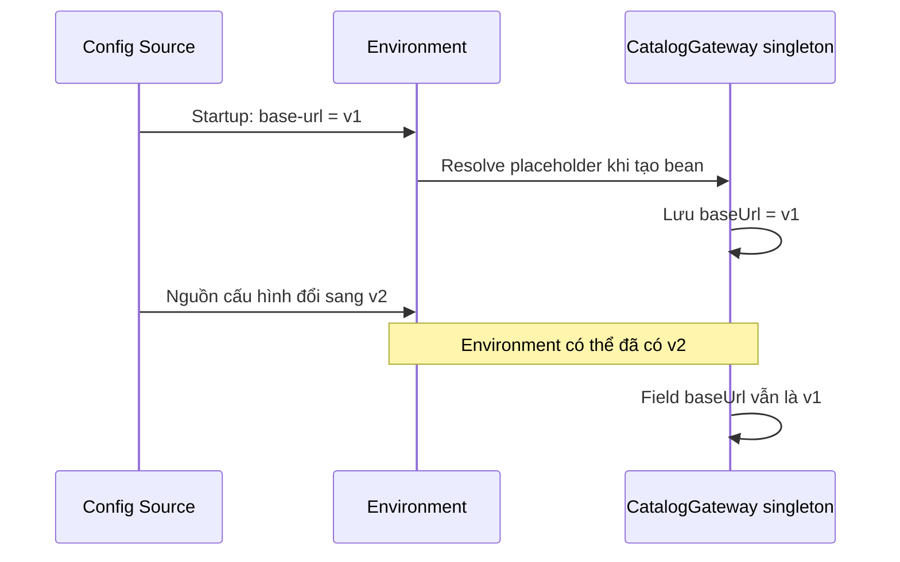
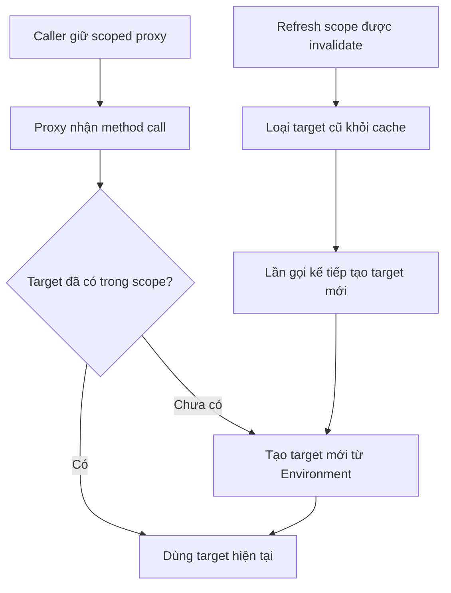

# Bài toán bean giữ cấu hình đã đọc tại thời điểm khởi tạo

Trong một ứng dụng Spring Boot/Spring Cloud, cấu hình thường được nạp từ YAML, biến môi trường, Config Server hoặc một nguồn bên ngoài. Bean có thể đọc cấu hình qua `@Value`, `@ConfigurationProperties` hoặc `Environment` khi được tạo. Nhưng sau khi bean đã khởi tạo, **giá trị được đọc và lưu vào field của object không tự thay đổi chỉ vì nguồn cấu hình đã đổi**.

Đây là vấn đề cốt lõi dẫn đến nhu cầu sử dụng refresh trong Spring Cloud Context. Một ứng dụng có thể nhận được property mới trong `Environment`, nhưng service, HTTP client, cache hay connection pool vẫn tiếp tục dùng giá trị cũ đã capture. Muốn xử lý đúng, cần phân biệt nguồn cấu hình, object properties, bean tiêu thụ và tài nguyên được tạo từ các giá trị đó.

Bài học thuộc chương **Refresh Scope** của module `SPRING_CLOUD_CORE`. Mục tiêu là nhận diện hiện tượng bean giữ snapshot cấu hình tại thời điểm khởi tạo, hiểu vì sao singleton không tự đọc lại property, và chọn chiến lược cập nhật phù hợp: đọc giá trị động, rebind properties, tái tạo bean bằng `@RefreshScope` hoặc restart/rollout có kiểm soát.

## 1. Tình huống: cấu hình đã đổi nhưng service vẫn dùng giá trị cũ

Giả sử một service gọi Catalog API. Ban đầu cấu hình có endpoint:

```yaml
catalog:
  remote:
    base-url: https://catalog-v1.internal
```

Bean đọc endpoint trong constructor và lưu vào field:

```java
import org.springframework.beans.factory.annotation.Value;
import org.springframework.stereotype.Service;

@Service
public class CatalogGateway {
    private final String baseUrl;

    public CatalogGateway(
            @Value("${catalog.remote.base-url}") String baseUrl) {
        this.baseUrl = baseUrl;
    }

    public String endpoint() {
        return baseUrl;
    }
}
```

Khi ứng dụng khởi động, Spring phân giải `${catalog.remote.base-url}` và truyền chuỗi hiện tại vào constructor. `CatalogGateway` giữ chuỗi đó trong `final` field.

Sau đó, Config Server được cập nhật:

```yaml
catalog:
  remote:
    base-url: https://catalog-v2.internal
```

Nếu ứng dụng chỉ nạp cấu hình một lần khi startup, bean vẫn trả về `https://catalog-v1.internal`. Ngay cả khi một cơ chế refresh đã cập nhật `Environment`, field `baseUrl` trong object hiện tại cũng không tự được gán lại.



Hiện tượng này không phải lỗi của `@Value`, `@Service` hay Spring singleton. Spring đã thực hiện đúng hợp đồng: inject giá trị tại thời điểm tạo bean. Object Java sau đó có vòng đời và trạng thái riêng.

## 2. Bốn lớp cần phân biệt

Để tìm đúng nguyên nhân, hãy tách bốn lớp sau:

| Lớp | Ví dụ | Điều gì xảy ra khi cấu hình thay đổi? |
| --- | --- | --- |
| Nguồn cấu hình | Config Server, file, environment variable | Nguồn có thể chứa giá trị mới; chưa chắc ứng dụng đã đọc lại |
| `Environment` / `PropertySource` | `Environment.getProperty(...)` | Chỉ thay đổi khi có cơ chế nạp/cập nhật property source phù hợp |
| Bean properties | `CatalogClientProperties` | Có thể được rebind theo cơ chế cụ thể; không mặc định mọi object đều được cập nhật |
| Bean tiêu thụ / tài nguyên | `CatalogGateway`, HTTP client, pool | Có thể tiếp tục giữ snapshot cũ nếu không đọc lại, rebind hoặc tái tạo |

Một cấu hình mới ở Config Server không tự đi xuyên qua cả bốn lớp. Mỗi bước có một cơ chế và thời điểm riêng.

### 2.1. Nguồn cấu hình thay đổi chưa chắc ứng dụng đã nhận được

Nếu sửa một file hoặc commit mới lên repository mà Config Server sử dụng, instance đang chạy không nhất thiết tự polling và nạp lại. Việc import cấu hình lúc startup và việc refresh runtime là hai quá trình khác nhau.

### 2.2. Environment có giá trị mới chưa chắc bean có giá trị mới

`Environment` là abstraction để đọc property source. Nó không theo dõi mọi field của mọi object Java và không tự gán lại giá trị đã được copy vào constructor hoặc field.

### 2.3. Properties bean cập nhật chưa chắc client được xây dựng lại

Một service có thể inject `CatalogClientProperties`, sau đó tạo HTTP client một lần trong constructor:

```java
@Service
public class CatalogGateway {
    private final CatalogHttpClient client;

    public CatalogGateway(CatalogClientProperties properties) {
        this.client = new CatalogHttpClient(properties.getBaseUrl());
    }
}
```

Ngay cả khi object properties được rebind, `CatalogHttpClient` đã được tạo với endpoint cũ. Muốn đổi endpoint, cần cập nhật/rebuild tài nguyên đó hoặc đọc cấu hình ở thời điểm sử dụng.

### 2.4. Tái tạo bean không đồng nghĩa mọi trạng thái bên trong được phục hồi

Nếu bean giữ cache, bộ đếm, session hoặc dữ liệu đang xử lý, tạo target mới có thể làm mất trạng thái cục bộ. `@RefreshScope` phù hợp với bean có thể tái tạo an toàn; nó không phải công cụ snapshot/restore mọi trạng thái nghiệp vụ.

## 3. Vì sao singleton giữ giá trị cũ?

Scope mặc định của Spring bean là `singleton`: một instance trong một `ApplicationContext`. Khi context khởi tạo singleton, Spring tạo object, inject dependency và chạy callback khởi tạo. Sau đó object được tái sử dụng qua các lần gọi.

Ví dụ:

```java
@Service
public class PaymentPolicy {
    private final int dailyLimit;

    public PaymentPolicy(
            @Value("${payment.daily-limit:100}") int dailyLimit) {
        this.dailyLimit = dailyLimit;
    }

    public boolean canAccept(int amount) {
        return amount <= dailyLimit;
    }
}
```

`dailyLimit` được gán khi Spring tạo `PaymentPolicy`. Vì field là `final`, nó không thể được gán lại sau đó; kể cả field mutable, Spring cũng không tự biết phải gán lại khi một property source thay đổi.

Điều tương tự xảy ra với các kiểu inject khác:

- `@Value` trên field hoặc constructor: placeholder được phân giải khi bean được xử lý/khởi tạo.
- Constructor injection của `@ConfigurationProperties`: bean nhận object properties tại thời điểm tạo.
- Gọi `Environment.getProperty(...)` trong constructor rồi lưu kết quả vào field: field giữ snapshot đã đọc.
- Tạo HTTP client, executor hoặc pool bằng một giá trị cấu hình: tài nguyên có thể giữ giá trị đó trong cấu hình nội bộ.

**Singleton không có nghĩa là cấu hình luôn động.** Nó chỉ nói về số lượng instance bean trong context.

## 4. Mẫu code cho thấy snapshot cấu hình

### 4.1. Đọc từ Environment trong constructor

```java
import org.springframework.core.env.Environment;
import org.springframework.stereotype.Component;

@Component
public class CatalogEndpointSnapshot {
    private final String baseUrl;

    public CatalogEndpointSnapshot(Environment environment) {
        this.baseUrl = environment.getProperty(
                "catalog.remote.base-url", "https://catalog-default.internal");
    }

    public String baseUrl() {
        return baseUrl;
    }
}
```

Đoạn code gọi `getProperty` đúng một lần trong constructor. Những lần gọi `baseUrl()` sau đó chỉ trả field đã lưu. Việc giữ tham chiếu tới `Environment` không giúp ích vì kết quả đã được copy sang `String`.

### 4.2. `@ConfigurationProperties` nhưng consumer vẫn giữ snapshot

```java
@ConfigurationProperties(prefix = "catalog.remote")
public class CatalogRemoteProperties {
    private String baseUrl;

    public String getBaseUrl() { return baseUrl; }
    public void setBaseUrl(String baseUrl) { this.baseUrl = baseUrl; }
}
```

Consumer:

```java
@Service
public class CatalogClientFactory {
    private final String baseUrl;

    public CatalogClientFactory(CatalogRemoteProperties properties) {
        this.baseUrl = properties.getBaseUrl();
    }
}
```

Consumer đã copy chuỗi vào field riêng. Nếu `CatalogRemoteProperties` được cập nhật, `CatalogClientFactory.baseUrl` vẫn không đổi. Đây là điểm thường bị bỏ sót khi nghĩ rằng dùng `@ConfigurationProperties` là tự động có refresh.

### 4.3. Tạo tài nguyên từ cấu hình

```java
@Configuration
public class CatalogClientConfiguration {
    @Bean
    CatalogHttpClient catalogHttpClient(CatalogRemoteProperties properties) {
        return new CatalogHttpClient(properties.getBaseUrl());
    }
}
```

`CatalogHttpClient` thường giữ endpoint, connection pool hoặc route trong object. Cập nhật properties không đồng nghĩa object client đã tạo tự đổi cấu hình. Phải xem API của client có hỗ trợ đổi endpoint an toàn hay cần tạo client mới và đóng client cũ.

## 5. Các chiến lược xử lý cấu hình thay đổi

Không phải mọi thuộc tính đều cần thay đổi ngay khi nguồn cấu hình đổi. Chọn chiến lược theo yêu cầu nghiệp vụ, độ phức tạp của tài nguyên và mức nhất quán mong muốn.

| Chiến lược | Cách hoạt động | Phù hợp khi |
| --- | --- | --- |
| Restart/rollout | Tạo instance mới và nạp cấu hình từ đầu | Thay đổi hiếm, cần hành vi dễ dự đoán hoặc tài nguyên khó tái cấu hình |
| Đọc động từ `Environment`/provider | Đọc giá trị tại thời điểm xử lý | Giá trị đơn giản, cần cập nhật nhanh và không phải tái tạo tài nguyên |
| Đọc từ properties bean mỗi lần dùng | Consumer giữ tham chiếu tới properties và đọc getter khi cần | Properties có cơ chế rebind phù hợp, consumer không tạo snapshot riêng |
| Rebind `@ConfigurationProperties` | Spring Cloud Context cập nhật bean properties theo cơ chế rebinding | Bean properties có thể thay đổi an toàn và consumer dùng trực tiếp giá trị mới |
| `@RefreshScope` | Hủy target hiện tại trong scope; tạo target mới ở lần truy cập tiếp theo | Bean có thể tái tạo từ Environment mới, chẳng hạn client wrapper hoặc policy |
| API tái cấu hình riêng | Bean tự thay đổi cấu hình/tài nguyên bằng phương thức có kiểm soát | Thư viện hỗ trợ cập nhật runtime và cần quản lý chuyển trạng thái rõ ràng |

Không có một lựa chọn đúng cho mọi loại bean. Một timeout số nguyên có thể đọc động đơn giản; một connection pool hoặc client có nhiều socket đang hoạt động cần quy trình chuyển đổi và đóng tài nguyên cẩn thận.

## 6. Đọc giá trị động thay vì lưu snapshot

Nếu giá trị cần thay đổi nhưng không tạo tài nguyên phức tạp, có thể đọc từ một provider tại thời điểm xử lý.

Ví dụ:

```java
import org.springframework.core.env.Environment;
import org.springframework.stereotype.Service;

@Service
public class CatalogRoutingPolicy {
    private final Environment environment;

    public CatalogRoutingPolicy(Environment environment) {
        this.environment = environment;
    }

    public String currentBaseUrl() {
        return environment.getRequiredProperty("catalog.remote.base-url");
    }
}
```

Khác với ví dụ lưu `String` trong constructor, method này truy vấn `Environment` mỗi lần được gọi. Nếu một cơ chế refresh đã cập nhật property source trong cùng Environment, lần gọi sau có thể nhận giá trị mới.

Nhưng cần hiểu giới hạn:

- `Environment` không tự polling Config Server hoặc tự phát hiện file thay đổi.
- Nếu property source chưa được cập nhật, method vẫn trả giá trị cũ.
- Nếu caller đọc giá trị một lần rồi lưu ở nơi khác, snapshot vẫn xuất hiện ở caller đó.
- Đọc động không tự rebuild connection pool hoặc HTTP client đã tạo trước đó.
- Nếu cùng một thao tác đọc nhiều lần trong một request, có thể nhận hai giá trị khác nhau nếu refresh diễn ra giữa chừng.

Đối với một thao tác nghiệp vụ cần dùng cùng một phiên bản cấu hình trong suốt quá trình, có thể đọc một lần ở đầu thao tác và truyền snapshot bất biến xuống các bước tiếp theo. Điều quan trọng là xác định rõ ranh giới snapshot và thời điểm nó được tạo.

## 7. Rebinding `@ConfigurationProperties`

Spring Boot Binder ánh xạ property source vào object `@ConfigurationProperties`. Trong Spring Cloud Context, cơ chế refresh có thể phát sự kiện thay đổi Environment và sử dụng `ConfigurationPropertiesRebinder` để cập nhật các bean properties đủ điều kiện theo cấu hình/phiên bản.

Ví dụ properties mutable:

```java
import java.time.Duration;
import org.springframework.boot.context.properties.ConfigurationProperties;

@ConfigurationProperties(prefix = "catalog.remote")
public class CatalogRemoteProperties {
    private String baseUrl;
    private Duration timeout = Duration.ofSeconds(2);

    public String getBaseUrl() { return baseUrl; }
    public void setBaseUrl(String baseUrl) { this.baseUrl = baseUrl; }
    public Duration getTimeout() { return timeout; }
    public void setTimeout(Duration timeout) { this.timeout = timeout; }
}
```

Consumer đọc properties khi thực hiện thao tác:

```java
@Service
public class CatalogRequestPolicy {
    private final CatalogRemoteProperties properties;

    public CatalogRequestPolicy(CatalogRemoteProperties properties) {
        this.properties = properties;
    }

    public RequestSettings currentSettings() {
        return new RequestSettings(
                properties.getBaseUrl(),
                properties.getTimeout());
    }
}
```

Nếu bean properties được rebind, method đọc getter ở mỗi lần gọi có thể nhìn thấy giá trị mới. Nhưng nếu constructor của `CatalogRequestPolicy` đã copy các getter vào field riêng thì consumer lại giữ snapshot cũ.

Rebinding có giới hạn và phụ thuộc loại bean, binding strategy, version và cách refresh. Không nên giả định mọi bean `@ConfigurationProperties`, đặc biệt kiểu immutable hoặc các object đã được tạo từ nó, đều tự thay đổi theo cùng một cách. Với bean tiêu thụ tài nguyên phức tạp, hãy cân nhắc tái tạo bean hoặc dùng API reconfiguration chuyên dụng.

## 8. `@RefreshScope` giải quyết bài toán bean giữ cấu hình cũ

### 8.1. Cách hoạt động

Spring Cloud Context cung cấp `@RefreshScope` để đặt bean vào một scope có thể làm mới. Bean được truy cập thông qua scoped proxy. Proxy giữ vai trò chuyển lời gọi tới target hiện tại trong scope.

Khi refresh scope được làm mới, target bean hiện tại bị loại khỏi cache của scope. Ở lần gọi tiếp theo qua proxy, target mới được tạo và các dependency/configuration được resolve theo trạng thái hiện hành của context.



Proxy có thể tồn tại lâu dài trong khi target phía sau được thay thế. Vì vậy, bean khác inject proxy vẫn có thể gọi vào target mới sau refresh mà không cần tự inject lại dependency.

### 8.2. Ví dụ với `@RefreshScope`

```java
import org.springframework.beans.factory.annotation.Value;
import org.springframework.cloud.context.config.annotation.RefreshScope;
import org.springframework.stereotype.Component;

@Component
@RefreshScope
public class RefreshableCatalogGateway {
    private final String baseUrl;

    public RefreshableCatalogGateway(
            @Value("${catalog.remote.base-url}") String baseUrl) {
        this.baseUrl = baseUrl;
    }

    public String endpoint() {
        return baseUrl;
    }
}
```

Bean giữ `baseUrl` trong field như ví dụ đầu bài, nhưng target nằm trong refresh scope. Sau khi Environment được cập nhật và scope bị refresh, lần gọi `endpoint()` tiếp theo qua proxy sẽ tạo target mới với property hiện hành.

Một bean khác có thể inject gateway:

```java
@Service
public class CatalogService {
    private final RefreshableCatalogGateway gateway;

    public CatalogService(RefreshableCatalogGateway gateway) {
        this.gateway = gateway;
    }

    public String catalogEndpoint() {
        return gateway.endpoint();
    }
}
```

`CatalogService` giữ tham chiếu tới proxy được inject. Khi target của gateway được thay mới, method call qua proxy sẽ được chuyển tới target mới. Đây là điểm khác với việc `CatalogService` tự copy `baseUrl` vào field riêng.

### 8.3. Dùng với bean khai báo bằng `@Bean`

Có thể đặt `@RefreshScope` trên bean factory method:

```java
@Configuration(proxyBeanMethods = false)
public class CatalogClientConfiguration {
    @Bean
    @RefreshScope
    CatalogHttpClient catalogHttpClient(
            @Value("${catalog.remote.base-url}") String baseUrl) {
        return new CatalogHttpClient(baseUrl);
    }
}
```

Khi target được tạo lại, factory method chạy lại và nhận giá trị cấu hình mới. Cần bảo đảm `CatalogHttpClient` có thể được tạo/hủy lặp lại an toàn; nếu tài nguyên cũ còn request đang sử dụng, cần hiểu semantics close của thư viện.

### 8.4. Khi nào refresh thực sự xảy ra?

`@RefreshScope` không tự phát hiện thay đổi ở Config Server. Ứng dụng cần một quy trình cập nhật Environment và yêu cầu refresh scope. Tùy kiến trúc, có thể dùng:

- Actuator endpoint `POST /actuator/refresh` khi dependency, endpoint exposure và security đã được cấu hình phù hợp.
- Spring Cloud Bus để phát sự kiện refresh tới nhiều instance khi Bus được cài đặt và cấu hình.
- Gọi API `ContextRefresher` từ một thành phần quản trị nội bộ được kiểm soát.
- Restart/rollout instance để nạp cấu hình mới từ đầu.

Trong ứng dụng Config Client, việc thay đổi repository cấu hình không tự động đồng nghĩa tất cả client đã nạp lại. Phải có trigger refresh, polling hoặc rollout theo kiến trúc đã chọn. Không mở công khai endpoint refresh nếu chưa có xác thực, phân quyền và giới hạn truy cập.

## 9. Những điều `@RefreshScope` không làm

`@RefreshScope` giải quyết việc tái tạo target bean, nhưng không phải cơ chế đồng bộ trạng thái tổng quát.

### 9.1. Không cập nhật mọi object đã được tạo

Nếu một bean khác copy giá trị ra field riêng, object đó không tự được tạo lại chỉ vì bean gateway có refresh scope. Phải xác định object nào thực sự chứa cấu hình cần thay đổi và đặt scope/logic cập nhật ở đúng ranh giới.

### 9.2. Không tự cập nhật mọi tài nguyên native

Một HTTP client, connection pool, thread pool hoặc native resource có thể có quy trình khởi tạo và đóng riêng. Tái tạo wrapper bean không nhất thiết đóng đúng resource cũ nếu ownership không rõ. Cần kiểm tra API của resource và bảo đảm destroy callback được thực hiện.

### 9.3. Không bảo đảm mọi bean đều refresh được

Một số bean hoặc loại tài nguyên có giới hạn khi refresh; có thể cần cấu hình `spring.cloud.refresh.extra-refreshable` hoặc `spring.cloud.refresh.never-refreshable` tùy loại và phiên bản. Một số object được thiết kế không thể tái tạo an toàn hoặc phải restart tiến trình. Hãy kiểm tra tài liệu của Spring Cloud Context đang sử dụng.

### 9.4. Không thay thế restart cho mọi loại cấu hình

Các thuộc tính tác động tới cấu trúc context, port server, logging initialization, datasource topology hoặc thành phần chỉ đọc cấu hình lúc startup có thể không đổi hoàn toàn bằng refresh. Với những thay đổi này, rolling restart thường dễ dự đoán hơn.

### 9.5. Không làm nhiều instance thay đổi cùng một thời điểm

Mỗi replica có JVM, `Environment` và refresh scope riêng. Nếu chỉ A nhận refresh, B có thể vẫn dùng cấu hình cũ. Spring Cloud Bus có thể phân phối sự kiện, nhưng không tạo transaction nguyên tử trên toàn cụm. Cần theo dõi trạng thái refresh và version cấu hình theo instance.

## 10. Chọn đúng ranh giới bean cần refresh

Một lỗi thiết kế phổ biến là đặt `@RefreshScope` lên bean không chứa snapshot, trong khi bean thực sự giữ giá trị cũ lại ở nơi khác.

Ví dụ:

```java
@Service
public class CatalogService {
    private final String baseUrl;
    private final CatalogGateway gateway;

    public CatalogService(
            @Value("${catalog.remote.base-url}") String baseUrl,
            CatalogGateway gateway) {
        this.baseUrl = baseUrl;
        this.gateway = gateway;
    }
}
```

Nếu chỉ đặt `@RefreshScope` lên `CatalogGateway`, field `CatalogService.baseUrl` vẫn cũ. Cần hỏi:

1. Bean nào đọc property?
2. Bean nào copy property vào field?
3. Bean nào tạo tài nguyên dựa trên property?
4. Caller nào giữ tham chiếu trực tiếp tới object hay proxy?
5. Khi target bị tạo lại, tài nguyên cũ có được đóng và request đang chạy có an toàn không?

Đặt refresh scope tại ranh giới sở hữu cấu hình và tài nguyên cần tái tạo. Nếu một bean tiêu thụ nhiều dependency có vòng đời khác nhau, có thể tách bean để phần cần refresh nhỏ và dễ kiểm soát hơn.

## 11. Vấn đề concurrency khi refresh

Refresh thường xảy ra trong khi ứng dụng vẫn phục vụ request. Vì vậy cần xem xét chuyển đổi từ target cũ sang target mới.

### 11.1. Request đang chạy

Một request đã gọi vào target cũ có thể tiếp tục sử dụng target đó trong lúc refresh diễn ra, tùy cách proxy và resource hoạt động. Request mới sau khi target bị invalidate có thể kích hoạt target mới. Điều này có nghĩa trong một khoảng thời gian ngắn, hai target có thể cùng tồn tại hoặc tài nguyên cũ vẫn đang được sử dụng.

Không nên đóng resource cũ ngay từ một callback tùy tiện nếu request đang dùng nó. Cần dựa vào lifecycle/close semantics của bean và thư viện cụ thể, hoặc dùng một cơ chế swap tài nguyên có drain.

### 11.2. Cấu hình nhiều trường phải nhất quán

Giả sử endpoint và token phải thay đổi cùng nhau. Nếu chúng được đọc từ hai nguồn hoặc cập nhật không đồng bộ, một request có thể kết hợp endpoint mới với token cũ. Nên nhóm các thuộc tính liên quan vào một object cấu hình/version và tạo target mới từ cùng snapshot đã được bind.

### 11.3. Chuyển phiên bản cấu hình có thể cần kiểm soát

Với cấu hình ảnh hưởng tới business rules, có thể gắn một `configVersion` hoặc revision để quan sát instance đang dùng phiên bản nào. Log/metric nên ghi ID phiên bản, thời điểm refresh và kết quả, không ghi secret hay toàn bộ giá trị cấu hình.

## 12. Kiểm thử bài toán giữ cấu hình cũ

Kiểm thử tốt cần chứng minh cả hai điều: bean thông thường giữ snapshot cũ, và bean được thiết kế refresh thực sự dùng giá trị mới sau trigger hợp lệ.

| Kịch bản | Cách kiểm thử | Kết quả cần xác nhận |
| --- | --- | --- |
| Snapshot constructor | Tạo bean với `base-url=v1`, sau đó thay property source | Bean thường vẫn trả v1 |
| Environment đọc động | Thay property source rồi gọi lại `Environment.getProperty` | Lần đọc sau trả giá trị mới |
| Properties rebind | Thực hiện refresh/rebind theo cơ chế Spring Cloud Context | Properties bean đủ điều kiện nhận giá trị mới |
| Consumer copy field | Rebind properties nhưng consumer đã copy giá trị vào final field | Consumer vẫn giữ snapshot cũ |
| RefreshScope | Tạo target với v1, cập nhật Environment và refresh scope | Lần gọi qua proxy tiếp theo tạo target với v2 |
| Tài nguyên cũ | Theo dõi create/close của client | Resource được đóng theo ownership/lifecycle đã thiết kế |
| Nhiều instance | Refresh A, giữ B chưa refresh | A và B có thể khác config version tạm thời |
| Refresh lỗi | Nguồn cấu hình lỗi hoặc target mới tạo thất bại | Ứng dụng báo lỗi và giữ hành vi an toàn theo thiết kế |

### 12.1. Kiểm thử snapshot bằng unit test

Một test đơn giản có thể chứng minh constructor đã capture giá trị:

```java
import org.junit.jupiter.api.Test;
import org.springframework.mock.env.MockEnvironment;

class CatalogEndpointSnapshotTest {
    @Test
    void keepsValueCapturedAtConstruction() {
        MockEnvironment environment = new MockEnvironment()
                .withProperty("catalog.remote.base-url", "https://v1.internal");

        CatalogEndpointSnapshot bean = new CatalogEndpointSnapshot(environment);
        environment.setProperty("catalog.remote.base-url", "https://v2.internal");

        // Assert bean.baseUrl() vẫn là https://v1.internal.
        // Assert environment.getProperty(...) là https://v2.internal.
    }
}
```

Test này không cần khởi tạo toàn bộ Spring context vì đang kiểm tra hành vi Java: object lưu snapshot tại constructor. Nó giúp phân biệt rõ việc Environment đổi với việc field trong bean đổi.

### 12.2. Kiểm thử RefreshScope ở cấp context

Với `@RefreshScope`, cần integration test có Spring Cloud Context và một trigger refresh phù hợp. Một cách kiểm thử là:

1. Khởi động context với `catalog.remote.base-url=https://v1.internal`.
2. Gọi method qua bean proxy và xác nhận target dùng v1.
3. Cập nhật nguồn cấu hình trong test context theo cơ chế hỗ trợ.
4. Gọi refresh scope hoặc `ContextRefresher` theo đúng API của phiên bản.
5. Gọi lại qua proxy và xác nhận target mới dùng v2.
6. Xác nhận callback destroy của target cũ được gọi và tài nguyên được giải phóng đúng cách.

Không chỉ assert `Environment.getProperty()` trả v2; phải gọi bean qua proxy để xác nhận target thực sự được tạo lại. Tránh viết test dựa trên `Thread.sleep()`; dùng sự kiện, latch hoặc assertion có timeout khi cần đợi xử lý bất đồng bộ.

## 13. Chẩn đoán khi cấu hình mới không có hiệu lực

| Triệu chứng | Nguyên nhân có thể | Hướng kiểm tra |
| --- | --- | --- |
| Config Server đã đổi nhưng Environment vẫn cũ | Chưa có trigger nạp lại hoặc client không lấy nguồn mới | Kiểm tra Config Client, refresh event và property source |
| Environment mới nhưng `@Value` field vẫn cũ | Bean đã capture giá trị lúc khởi tạo | Kiểm tra bean có refresh scope hay cơ chế cập nhật riêng không |
| Properties bean mới nhưng HTTP client vẫn dùng endpoint cũ | Client được tạo một lần từ snapshot properties | Xác định resource cần rebuild/reconfigure |
| Một service vẫn trả policy cũ | Service copy property vào field riêng | Kiểm tra ranh giới sở hữu snapshot |
| Refresh endpoint trả thành công nhưng bean không đổi | Bean không nằm trong scope hoặc không được rebind | Xác nhận proxy, scope, loại bean và log refresh |
| Chỉ một số replica dùng cấu hình mới | Chỉ một số instance nhận refresh | So sánh instance ID và config version |
| Sau refresh resource bị lỗi | Tái tạo/đóng resource không đúng lifecycle | Kiểm tra destroy callback, in-flight request và API close |
| Refresh không thay đổi port hoặc cấu trúc context | Thuộc tính chỉ được áp dụng lúc startup | Dùng restart/rollout nếu thành phần không hỗ trợ runtime refresh |

Trình tự kiểm tra đề xuất:

1. Xác minh nguồn cấu hình đã chứa giá trị mới.
2. Xác minh instance đã nạp giá trị mới vào `Environment`.
3. Xác định bean nào đã đọc property và thời điểm đọc.
4. Tìm các field hoặc tài nguyên đã capture giá trị đó.
5. Kiểm tra bean có `@RefreshScope`, rebinding hoặc API reconfigure phù hợp không.
6. Gọi refresh theo cơ chế được cấu hình và kiểm tra log/sự kiện.
7. Gọi lại qua đúng proxy/caller để xác nhận giá trị thực tế.
8. Kiểm tra các replica còn lại và trạng thái resource cũ.

## 14. Thực hành: chuyển endpoint của Catalog API từ v1 sang v2

Giả sử `catalog-service` dùng endpoint remote có thể đổi theo môi trường.

**Bước 1 — Tạo cấu hình ban đầu:**

```yaml
catalog:
  remote:
    base-url: https://catalog-v1.internal
```

**Bước 2 — Tạo bean giữ snapshot:** dùng `@Value` trong constructor như ví dụ `CatalogGateway` đầu bài và gọi endpoint method.

**Bước 3 — Đổi nguồn cấu hình:** cập nhật Config Server thành `https://catalog-v2.internal`.

**Bước 4 — Quan sát:** xác minh nguồn từ xa và Environment của instance. Nếu chỉ nạp Config Data lúc startup, bean và Environment có thể vẫn ở v1 cho tới khi có quy trình refresh/restart.

**Bước 5 — Chọn giải pháp:**

- Nếu endpoint chỉ đổi khi deploy, dùng rolling restart để mỗi instance khởi động với cấu hình mới.
- Nếu cần thay đổi runtime và gateway có thể tái tạo, đặt `@RefreshScope` trên gateway hoặc bean sở hữu client.
- Nếu chỉ cần đọc một URL đơn giản mỗi request, dùng provider đọc động từ Environment sau khi Environment được refresh.
- Nếu client có connection pool hoặc request đang chạy, thiết kế chuyển đổi và đóng resource cũ an toàn.

**Bước 6 — Kiểm thử nhiều replica:** refresh A trước, xác nhận A dùng v2 và B có thể vẫn dùng v1; sau khi B nhận trigger hoặc được rollout, xác nhận cả hai cùng version cấu hình mong muốn.

### Câu hỏi tự kiểm tra

1. Vì sao một bean singleton giữ giá trị `@Value` cũ sau khi property source thay đổi?
2. `Environment` có tự phát hiện Config Server repository thay đổi không?
3. Nếu `@ConfigurationProperties` được rebind, vì sao HTTP client tạo từ nó vẫn có thể dùng endpoint cũ?
4. Đọc `Environment.getProperty()` trong mỗi method khác gì đọc trong constructor rồi lưu field?
5. `@RefreshScope` giữ proxy hay giữ target bean cố định cho toàn bộ vòng đời context?
6. Điều gì xảy ra khi target bị invalidate và caller gọi method qua proxy lần tiếp theo?
7. Vì sao không nên đặt refresh scope cho mọi bean hoặc mọi connection pool?
8. Refresh một replica có bảo đảm tất cả replica dùng cấu hình mới cùng lúc không?
9. Khi nào rolling restart là lựa chọn dễ dự đoán hơn refresh runtime?

**Gợi ý đáp án:** (1) Giá trị được phân giải và gán khi bean khởi tạo; (2) Không, cần cơ chế nạp/refresh; (3) Client đã copy giá trị vào cấu hình nội bộ lúc tạo; (4) Constructor tạo snapshot, method đọc động truy vấn Environment mỗi lần; (5) Proxy đại diện cho target theo scope; (6) Scope tạo target mới khi cần; (7) Vì resource có lifecycle và trạng thái đang dùng, tái tạo có thể gây gián đoạn; (8) Không, mỗi instance có Environment/scope riêng; (9) Khi cấu hình ảnh hưởng cấu trúc startup hoặc resource khó refresh an toàn.

## 15. Những nguyên tắc cần nhớ

- `@Value`, constructor injection và `Environment.getProperty()` trong constructor thường tạo ra snapshot tại thời điểm bean được khởi tạo nếu kết quả được lưu vào field.
- Thay đổi nguồn cấu hình không đồng nghĩa Environment đã được cập nhật; Environment cập nhật cũng không đồng nghĩa mọi bean đã thay đổi.
- `@ConfigurationProperties` có thể được rebind theo cơ chế Spring Cloud Context, nhưng consumer đã copy giá trị hoặc tài nguyên đã tạo từ snapshot vẫn có thể cũ.
- `@RefreshScope` giữ scoped proxy và cho phép tạo lại target khi scope được refresh; lần gọi sau qua proxy sẽ sử dụng target mới.
- Refresh scope cần một trigger cập nhật Environment và refresh bean; nó không tự polling Config Server hoặc tự đồng bộ nhiều instance.
- Chọn ranh giới refresh ở bean thực sự sở hữu snapshot/tài nguyên; kiểm soát việc đóng resource cũ và request đang chạy.
- Dùng đọc động cho giá trị đơn giản, rebind cho properties phù hợp, refresh scope cho bean tái tạo được, và restart/rollout cho thay đổi chỉ áp dụng lúc startup.
- Kiểm thử riêng nguồn cấu hình, Environment, properties bean, consumer và target sau refresh; xác minh từng replica trong môi trường nhiều instance.

Khi hiểu vì sao bean giữ cấu hình đã đọc tại thời điểm khởi tạo, người học có thể phân biệt lỗi nạp cấu hình với lỗi vòng đời object, chọn đúng cơ chế refresh và tránh để một hệ thống Spring Cloud chạy với các giá trị cũ ngoài dự kiến.
