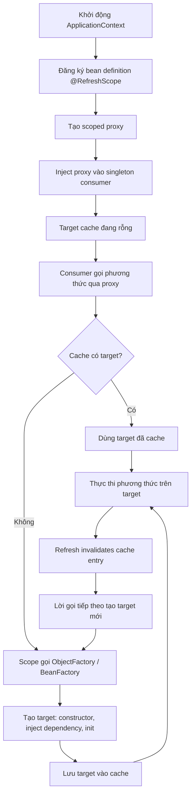
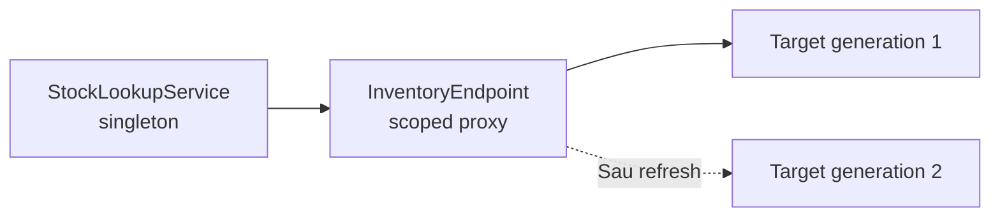
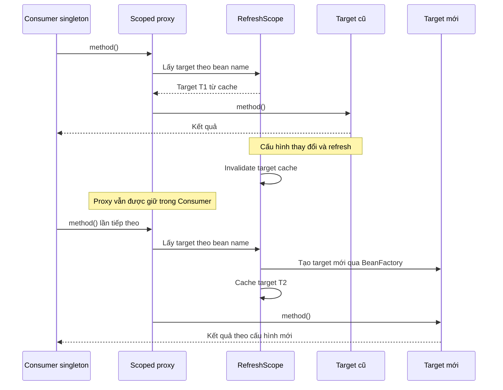

# Khởi tạo target khi có lời gọi đầu tiên trong Spring Cloud Refresh Scope

## 1. Proxy được tạo trước, target được tạo khi cần

Khi đánh dấu một bean bằng `@RefreshScope`, Spring Cloud công bố bean đó thông qua một **scoped proxy**. Proxy có thể được inject vào các singleton ngay trong lúc application context khởi động, còn instance thật phía sau proxy — gọi là **target** — được tạo lười khi có lời gọi đầu tiên cần sử dụng target.

Đây là điểm cốt lõi của đề bài:

- **Proxy** là đối tượng đại diện mà các bean khác giữ tham chiếu. Proxy thường đã có sẵn sau khi application context khởi động.
- **Target** là instance thật chứa trạng thái, thuộc tính cấu hình và logic nghiệp vụ của bean refresh-scoped.
- **Refresh scope** quản lý cache target theo tên bean. Khi cache chưa có target, scope tạo instance thông qua bean factory rồi lưu lại. Những lời gọi sau dùng lại target đã tạo.
- Khi refresh làm mất hiệu lực cache, proxy vẫn được giữ nguyên. Lời gọi tiếp theo khiến scope tạo một target mới với cấu hình hiện tại.

Vì vậy, inject proxy không đồng nghĩa constructor của target đã chạy. Một singleton nhận bean `@RefreshScope` qua constructor có thể được tạo ngay khi ứng dụng khởi động mà target vẫn chưa tồn tại.

Sau bài học, người đọc có thể theo dõi thời điểm proxy và target được tạo, giải thích cache của refresh scope, dự đoán hành vi sau refresh và viết kiểm thử xác nhận target chỉ được khởi tạo khi được gọi.

## 2. Phân biệt bean proxy và target

Giả sử `order-service` có bean `InventoryEndpoint` giữ URL của `inventory-service`. URL được inject khi bean khởi tạo. Nếu URL thay đổi trong `Environment`, instance đã được tạo vẫn giữ giá trị cũ. `@RefreshScope` giải quyết trường hợp này bằng cách đặt target sau một proxy có thể thay target khi refresh.

| Đối tượng | Được tạo khi nào? | Vai trò |
| --- | --- | --- |
| Bean definition và scoped proxy | Trong quá trình dựng application context | Cung cấp đối tượng có thể inject vào bean khác |
| Target của bean refresh-scoped | Lần đầu proxy cần target và cache chưa có instance | Chứa trạng thái và thực thi logic thật |
| Target đã được cache | Sau khi tạo thành công | Được dùng lại cho những lời gọi tiếp theo |
| Target mới sau refresh | Lần gọi tiếp theo sau khi cache entry bị invalidated | Nhận cấu hình tại thời điểm tạo mới |

Proxy là điểm tham chiếu ổn định. Target có thể thay đổi qua các chu kỳ refresh. Một consumer singleton thường không cần tạo lại chỉ vì target thay đổi, bởi nó tiếp tục gọi qua cùng proxy.

### 2.1. Sơ đồ vòng đời



“Lời gọi đầu tiên” là lần đầu target thực sự được yêu cầu, không nhất thiết là HTTP request đầu tiên từ bên ngoài. Nếu mã khởi động gọi phương thức của proxy trước request đầu tiên, target sẽ được tạo sớm hơn.

## 3. Điều gì xảy ra khi application context khởi động?

Spring tạo bean definition cho bean có scope `refresh`. `@RefreshScope` kết hợp scope này với cơ chế scoped proxy. Vì proxy là đối tượng được inject, những singleton phụ thuộc bean đó có thể được khởi tạo bình thường mà không buộc target phải được khởi tạo ngay.

Ví dụ, `StockLookupService` cần `InventoryEndpoint`:

```java
@Service
public class StockLookupService {

    private final InventoryEndpoint inventoryEndpoint;

    public StockLookupService(InventoryEndpoint inventoryEndpoint) {
        this.inventoryEndpoint = inventoryEndpoint;
    }

    public String inventoryBaseUrl() {
        return inventoryEndpoint.baseUrl();
    }
}
```

Khi Spring tạo `StockLookupService`, tham số `inventoryEndpoint` được giải quyết thành proxy. Constructor của `StockLookupService` có thể chạy xong mà constructor của target `InventoryEndpoint` chưa chạy.

Với singleton eager mặc định, Spring thường tạo instance trong giai đoạn khởi tạo context. Với refresh-scoped bean, proxy được tạo để đáp ứng việc inject, còn target được scope quản lý theo nhu cầu.

### 3.1. Không nhầm với @Lazy

`@Lazy` của Spring Framework trì hoãn việc tạo một bean cho tới khi bean đó được yêu cầu. `@RefreshScope` còn có thêm cache target và khả năng invalidation để tạo lại target sau refresh.

| Cơ chế | Proxy đại diện | Cache target theo scope | Tạo lại sau refresh |
| --- | --- | --- | --- |
| Singleton thông thường | Không bắt buộc | Cache singleton của container | Không tự tạo lại |
| `@Lazy` singleton | Không nhất thiết có proxy nếu không được inject theo kiểu lazy proxy | Không có refresh target cache riêng | Không tự tạo lại chỉ vì cấu hình đổi |
| `@RefreshScope` | Có scoped proxy | Có cache target | Có; sau khi cache entry bị invalidated và target được gọi lại |

Không thay `@RefreshScope` bằng `@Lazy` nếu mục tiêu là thay instance sau khi cấu hình thay đổi.

## 4. Target được tạo trong lần gọi đầu tiên như thế nào?

Khi consumer gọi một phương thức nghiệp vụ trên proxy, proxy yêu cầu target source cung cấp instance thật. Refresh scope tìm target theo tên bean trong cache:

1. Nếu cache đã có target, scope trả target hiện tại.
2. Nếu cache chưa có target, scope dùng factory mà container cung cấp để tạo bean theo bean definition ban đầu.
3. Spring thực hiện quá trình tạo bean bình thường: gọi constructor hoặc factory method, inject dependency, xử lý các bước khởi tạo và callback lifecycle.
4. Target mới được lưu vào cache của refresh scope.
5. Proxy chuyển tiếp lời gọi tới target đó và trả kết quả cho consumer.

Ở lần gọi thứ hai, cache có target nên constructor và các callback khởi tạo không chạy lại. Target được dùng lại cho đến khi scope invalidates entry.

### 4.1. Ví dụ target có cấu hình trong constructor

```yaml
inventory:
  client:
    base-url: https://inventory.internal
```

```java
import org.springframework.beans.factory.annotation.Value;
import org.springframework.cloud.context.config.annotation.RefreshScope;
import org.springframework.stereotype.Component;

@Component
@RefreshScope
public class InventoryEndpoint {

    private final String baseUrl;

    public InventoryEndpoint(
            @Value("${inventory.client.base-url}") String baseUrl) {
        this.baseUrl = baseUrl;
        System.out.println("InventoryEndpoint target initialized");
    }

    public String baseUrl() {
        return baseUrl;
    }
}
```

`System.out.println` chỉ để quan sát ví dụ. Trong ứng dụng thực tế nên dùng logger và không ghi thông tin bí mật như token, mật khẩu hoặc URL chứa credential.

Khi application context khởi động, Spring tạo proxy để inject. Dòng log trong constructor target chỉ xuất hiện khi có lời gọi đầu tiên qua proxy, chẳng hạn:

```java
String url = stockLookupService.inventoryBaseUrl();
```

Tại thời điểm đó, scope mới tạo `InventoryEndpoint`, đọc `inventory.client.base-url` từ `Environment`, lưu target và thực hiện `baseUrl()`.

### 4.2. Dependency của target cũng được giải quyết lúc target tạo

Nếu constructor của target nhận thêm một dependency, dependency đó được giải quyết khi target được tạo. Tuy nhiên, một dependency singleton có thể đã tồn tại từ trước; scope không tự tạo lại mọi dependency chỉ vì target được tạo mới.

```java
@Component
@RefreshScope
public class InventoryEndpoint {

    private final InventoryHttpClient httpClient;
    private final String baseUrl;

    public InventoryEndpoint(
            InventoryHttpClient httpClient,
            @Value("${inventory.client.base-url}") String baseUrl) {
        this.httpClient = httpClient;
        this.baseUrl = baseUrl;
    }

    public InventoryResponse find(String sku) {
        return httpClient.get(baseUrl + "/api/stocks/" + sku);
    }
}
```

Trong ví dụ này, `InventoryEndpoint` là target refresh-scoped. `InventoryHttpClient` chỉ được tạo lại nếu chính bean đó có scope hoặc lifecycle tương ứng. Nếu nó là singleton, target mới sẽ nhận lại cùng singleton instance.

`InventoryHttpClient` và `InventoryResponse` ở đây là các kiểu do ứng dụng cung cấp; đoạn mã chỉ minh họa rằng dependency được inject vào target tại thời điểm target được tạo.

## 5. Consumer singleton tiếp tục giữ proxy

Một lợi ích quan trọng của scoped proxy là bean tiêu thụ không cần biết target đã thay đổi. Ví dụ `StockLookupService` được tạo một lần và giữ tham chiếu tới proxy:



Trước refresh, proxy chuyển lời gọi tới target generation 1. Sau khi cache bị xóa, proxy vẫn là đối tượng mà `StockLookupService` đang giữ, nhưng lần gọi tiếp theo được chuyển tới target generation 2.

Điều này chỉ hoạt động nếu consumer tiếp tục gọi qua proxy. Nếu consumer lấy một giá trị từ target rồi lưu vào field riêng, chẳng hạn lưu URL hoặc một object con vào constructor, field đó không tự được cập nhật chỉ vì target được refresh.

### 5.1. Tránh giữ bản sao state từ target

Thiết kế sau làm mất lợi ích của proxy:

```java
@Service
public class StockLookupService {

    private final String cachedBaseUrl;

    public StockLookupService(InventoryEndpoint endpoint) {
        // Lưu lại một giá trị từ target tại thời điểm khởi tạo consumer.
        this.cachedBaseUrl = endpoint.baseUrl();
    }
}
```

Lời gọi `endpoint.baseUrl()` ngay trong constructor có thể kích hoạt target sớm. Sau refresh, `cachedBaseUrl` vẫn giữ chuỗi cũ vì đó là field của singleton consumer.

Hãy giữ proxy và gọi phương thức khi cần:

```java
@Service
public class StockLookupService {

    private final InventoryEndpoint endpoint;

    public StockLookupService(InventoryEndpoint endpoint) {
        this.endpoint = endpoint;
    }

    public String currentBaseUrl() {
        return endpoint.baseUrl();
    }
}
```

## 6. Refresh invalidates cache, không tạo target ngay

Refresh scope là một cache các target đã khởi tạo. Khi gọi `RefreshScope.refresh(beanName)` hoặc `refreshAll()`, scope invalidates target cache tương ứng. Thao tác này không cần tạo target thay thế ngay lập tức.

Luồng phổ biến:

1. Cấu hình trong `Environment` được cập nhật bởi cơ chế refresh.
2. Refresh scope xóa cache target theo tên bean hoặc xóa toàn bộ target cache.
3. Scoped proxy vẫn tồn tại và vẫn được inject trong các consumer.
4. Lần gọi tiếp theo đi qua proxy, cache miss nên scope tạo target mới.
5. Constructor và quá trình khởi tạo target chạy với giá trị cấu hình hiện tại.



### 6.1. Refresh từng bean

Có thể inject `RefreshScope` để invalidates một target cụ thể:

```java
import org.springframework.cloud.context.scope.refresh.RefreshScope;
import org.springframework.stereotype.Service;

@Service
public class ConfigurationRefreshService {

    private final RefreshScope refreshScope;

    public ConfigurationRefreshService(RefreshScope refreshScope) {
        this.refreshScope = refreshScope;
    }

    public void refreshInventoryEndpoint() {
        refreshScope.refresh("inventoryEndpoint");
    }
}
```

Tên mặc định của bean component `InventoryEndpoint` là `inventoryEndpoint`. Nếu khai báo tên khác bằng `@Component("...")` hoặc `@Bean(name = "...")`, phải truyền đúng bean name.

`refresh(String)` chỉ invalidates cache entry. Nó không đảm bảo target mới đã được tạo xong trước khi phương thức trả về. Target được tạo khi proxy được gọi ở lần kế tiếp.

### 6.2. Refresh toàn bộ target

```java
refreshScope.refreshAll();
```

`refreshAll()` xóa target cache của refresh scope. Những bean refresh-scoped đã được sử dụng sẽ được tạo lại theo nhu cầu. Bean chưa từng được gọi và chưa có target trong cache vẫn chưa cần khởi tạo.

### 6.3. Truy cập đồng thời trong lúc refresh

Refresh scope điều phối việc đọc các bean trong scope với thao tác refresh để một caller không quan sát quá trình thay target theo cách thiếu nhất quán. Tuy nhiên, điều đó không làm cho state mà consumer đã sao chép ra field riêng trở nên tự cập nhật, cũng không bảo đảm an toàn luồng cho các object dùng chung nằm ngoài target. Các tài nguyên và state bên ngoài scope vẫn cần chính sách đồng bộ riêng.

### 6.4. Qua Actuator endpoint

Trong ứng dụng có Spring Boot Actuator và Spring Cloud Context phù hợp, có thể expose endpoint refresh:

```yaml
management:
  endpoints:
    web:
      exposure:
        include: refresh
```

Endpoint thường được gọi bằng `POST /actuator/refresh`. Quy trình refresh có thể cập nhật `Environment`, sau đó refresh các bean trong scope. Chỉ expose endpoint này qua mạng quản trị được bảo vệ bằng xác thực, phân quyền và network policy phù hợp; không công khai endpoint thay đổi cấu hình ra Internet.

Nếu chạy nhiều instance, refresh trên một instance không tự động có nghĩa tất cả instance khác đã refresh. Có thể dùng Spring Cloud Bus hoặc cơ chế điều phối phù hợp để phát tán sự kiện tới các instance cần cập nhật.

## 7. Lifecycle của target

Target được tạo theo quy trình bean thông thường, nên các bước lifecycle gắn với target diễn ra khi target được tạo chứ không phải khi proxy được inject:

| Sự kiện | Thời điểm |
| --- | --- |
| Constructor hoặc `@Bean` factory method | Khi scope cần tạo target lần đầu |
| Dependency injection | Trong quá trình tạo target |
| `@PostConstruct` / `InitializingBean` / init method | Sau khi dependency được inject và trước khi target được sử dụng |
| Lời gọi nghiệp vụ | Sau khi target được tạo và đưa vào cache |
| Destruction callback (`@PreDestroy`, `DisposableBean`, destroy method) | Khi target bị loại khỏi scope và callback được đăng ký |
| Tạo target mới | Lần gọi tiếp theo sau khi cache entry bị invalidated |

Điều này quan trọng với bean mở kết nối, tạo client hoặc khởi tạo tài nguyên. Constructor và callback khởi tạo phải có thể chạy lại sau mỗi lần refresh. Không đặt side effect không thể lặp trong quá trình tạo target nếu refresh có thể xảy ra nhiều lần.

### 7.1. Lỗi khởi tạo có thể xuất hiện ở request đầu tiên

Vì target được tạo lười, lỗi constructor, thiếu thuộc tính bắt buộc hoặc lỗi kết nối có thể không xuất hiện lúc application context khởi động. Nó có thể xuất hiện ở lần đầu một request gọi bean.

Với bean quan trọng cho khả năng phục vụ, cần cân nhắc kiểm tra readiness hoặc thực hiện một bước warm-up có chủ đích sau khi ứng dụng khởi động. Warm-up gọi proxy sẽ tạo target sớm; khi đó vẫn giữ được cơ chế refresh về sau nhưng không còn trì hoãn lần tạo đầu tiên tới request nghiệp vụ.

## 8. Điều gì không tự động được refresh?

`@RefreshScope` áp dụng cho bean được đặt trong scope. Nó không tự biến mọi bean trong application context thành refresh-scoped.

### 8.1. Đánh dấu @Configuration không làm mọi @Bean thành refresh-scoped

Ví dụ:

```java
@Configuration
@RefreshScope
public class ClientConfiguration {

    @Bean
    public InventoryHttpClient inventoryHttpClient() {
        return new InventoryHttpClient();
    }
}
```

Đánh dấu lớp cấu hình bằng `@RefreshScope` không có nghĩa tất cả bean do các phương thức `@Bean` khai báo đều tự thuộc refresh scope. Nếu một bean cần được thay target, hãy đặt scope trên chính bean đó hoặc thiết kế lại ranh giới phụ thuộc.

### 8.2. Phân biệt với rebinding của @ConfigurationProperties

Spring Cloud có thể rebind các bean `@ConfigurationProperties` khi nhận `EnvironmentChangeEvent`. Rebinding cập nhật thuộc tính trên cùng instance. Refresh scope thay target bằng cách xóa cache và tạo instance mới khi được gọi.

| Cơ chế | Cách cập nhật | Đặc điểm |
| --- | --- | --- |
| `@ConfigurationProperties` rebind | Bind lại trường trên instance hiện có | Object identity giữ nguyên; quá trình cập nhật có thể khiến reader đồng thời quan sát trạng thái trung gian |
| `@RefreshScope` | Invalidate target và tạo target mới khi cần | Consumer gọi qua proxy nhận target mới; scope điều phối đọc với refresh |

Nếu cần một snapshot cấu hình nhất quán trong lúc đọc, refresh scope là lựa chọn phù hợp cho bean có state được tạo từ cấu hình. Không phải mọi `@ConfigurationProperties` đều có thể refresh; ví dụ constructor-bound properties, bao gồm Java record, có giới hạn riêng theo tài liệu Spring Cloud.

## 9. Giới hạn và lưu ý khi dùng scoped proxy

1. **Lớp phải proxy được.** Cấu hình mặc định dùng proxy theo lớp; tránh khai báo target class là `final` hoặc phương thức cần intercept là `final`.
2. **Không tự tạo target bằng `new`.** Đối tượng tự tạo nằm ngoài bean factory và refresh scope, nên không được proxy quản lý.
3. **Không gọi target sớm ngoài ý muốn.** `@PostConstruct` của consumer, startup runner hoặc health check có thể gọi proxy và khiến target khởi tạo trước request đầu tiên.
4. **Không giữ bản sao trạng thái từ target.** Giữ proxy trong consumer; tránh cache giá trị lấy từ target nếu muốn nhận giá trị sau refresh.
5. **Constructor và init callback phải lặp an toàn.** Target có thể được tạo nhiều lần trong vòng đời ứng dụng.
6. **Không phải loại bean nào cũng refresh được.** Theo cấu hình mặc định hiện hành, `HikariDataSource` nằm trong nhóm không refreshable (`spring.cloud.refresh.never-refreshable`). Cần đọc danh sách `never-refreshable` và `extra-refreshable` trước khi kỳ vọng một loại bean cụ thể được thay thế.
7. **AOT và native image có giới hạn.** Context refresh không được hỗ trợ cho Spring AOT transformations và native images theo tài liệu hiện hành; cần cấu hình `spring.cloud.refresh.enabled=false` trong trường hợp đó.
8. **Refresh không thay thế rollout.** Nếu thay đổi cần đồng bộ tài nguyên ngoài, schema database hoặc trạng thái nhiều instance, phải thiết kế quy trình triển khai và phối hợp riêng.

## 10. Kiểm thử thời điểm tạo target

Một kiểm thử tích hợp có thể dùng bộ đếm để xác nhận proxy không tạo target ngay khi được inject, target được cache sau lần gọi đầu, và target mới được tạo sau khi refresh:

```java
import static org.assertj.core.api.Assertions.assertThat;

import java.util.concurrent.atomic.AtomicInteger;

import org.junit.jupiter.api.Test;
import org.springframework.beans.factory.annotation.Autowired;
import org.springframework.boot.test.context.SpringBootTest;
import org.springframework.boot.test.context.TestConfiguration;
import org.springframework.context.annotation.Bean;
import org.springframework.cloud.context.config.annotation.RefreshScope;
import org.springframework.cloud.context.scope.refresh.RefreshScope;

@SpringBootTest
class RefreshScopeLazyTargetTests {

    private static final AtomicInteger CREATIONS = new AtomicInteger();

    @TestConfiguration
    static class TestBeans {

        @Bean
        @RefreshScope
        Target target() {
            return new Target(CREATIONS.incrementAndGet());
        }
    }

    static class Target {
        private final int generation;

        Target(int generation) {
            this.generation = generation;
        }

        int generation() {
            return generation;
        }
    }

    @Autowired
    private Target target;

    @Autowired
    private RefreshScope refreshScope;

    @Test
    void createsTargetOnFirstCallAndAgainAfterRefresh() {
        int before = CREATIONS.get();

        int firstGeneration = target.generation();
        assertThat(CREATIONS.get()).isEqualTo(before + 1);

        assertThat(target.generation()).isEqualTo(firstGeneration);
        assertThat(CREATIONS.get()).isEqualTo(before + 1);

        refreshScope.refresh("target");
        assertThat(CREATIONS.get()).isEqualTo(before + 1);

        int nextGeneration = target.generation();
        assertThat(nextGeneration).isEqualTo(before + 2);
        assertThat(CREATIONS.get()).isEqualTo(before + 2);
    }
}
```

Ví dụ giả định test application đã nạp Spring Cloud Context và refresh scope auto-configuration. Bộ đếm dùng giá trị nền `before` để tránh phụ thuộc vào số lần test context được tạo trước đó. Việc inject field `target` chỉ lấy proxy; lần gọi `generation()` mới yêu cầu target thật.

### 10.1. Các ca kiểm thử nên có

| Ca | Thao tác | Kết quả mong đợi |
| --- | --- | --- |
| Chỉ khởi động context | Inject proxy vào singleton, chưa gọi phương thức target | Target chưa được tạo |
| Lần gọi đầu | Gọi một phương thức qua proxy | Constructor/factory method chạy một lần |
| Lần gọi tiếp | Gọi thêm phương thức qua proxy | Dùng cùng target đã cache |
| Refresh một bean | Gọi `refresh(beanName)` | Cache entry bị invalidated, chưa cần tạo target ngay |
| Gọi sau refresh | Gọi phương thức qua proxy | Tạo target mới và dùng cấu hình hiện tại |
| Refresh toàn bộ | Gọi `refreshAll()` | Các target đã cache được invalidated |
| Consumer singleton | Giữ proxy qua nhiều lần refresh | Consumer vẫn gọi được target hiện hành |
| Khởi tạo thất bại | Cấu hình bắt buộc sai hoặc thiếu | Lỗi xuất hiện khi target được yêu cầu tạo |
| Startup gọi proxy | `@PostConstruct` hoặc runner gọi target | Target được tạo sớm hơn request đầu tiên |

## 11. Chẩn đoán lỗi thường gặp

| Triệu chứng | Nguyên nhân có thể | Hướng kiểm tra |
| --- | --- | --- |
| Constructor target chạy ngay khi startup | Có bean khác gọi proxy trong quá trình khởi động | Tìm `@PostConstruct`, runner, health check hoặc factory gọi phương thức target |
| Constructor target không chạy dù bean đã được inject | Mới chỉ inject proxy, chưa có lời gọi cần target | Kiểm tra đường đi request và điểm gọi phương thức |
| Target không được tạo lại sau refresh | Gọi sai bean name, bean không thuộc refresh scope hoặc refresh chưa diễn ra | Kiểm tra scope, tên bean và cache invalidation |
| Consumer vẫn dùng cấu hình cũ | Consumer đã copy giá trị từ target vào field riêng | Giữ proxy và đọc qua proxy khi cần |
| Bean tùy chỉnh không được proxy | Bean bị tạo thủ công hoặc khai báo ngoài Spring container | Đăng ký bean qua component scan hoặc `@Bean` |
| Lỗi proxy với class/method final | Proxy theo lớp không thể override class/method final | Dùng lớp và phương thức có thể proxy |
| Lỗi khởi tạo chỉ xuất hiện ở request đầu | Target được tạo lười nên constructor/init chưa chạy lúc startup | Kiểm tra log target initialization và readiness/warm-up |
| Bean trong cấu hình không refresh như mong đợi | Chỉ đánh dấu `@Configuration` class | Đánh dấu bean cần refresh hoặc thiết kế lại phụ thuộc |
| HikariDataSource không được thay target | Bean thuộc `never-refreshable` mặc định | Kiểm tra `spring.cloud.refresh.never-refreshable` và tài liệu datasource |

Khi điều tra, nên ghi log riêng cho constructor và destruction callback của target, nhưng chỉ ghi thông tin định danh an toàn. Có thể thêm một generation ID trong môi trường test để quan sát proxy đang chuyển tiếp tới target nào.

## 12. Tài liệu tham khảo

- [Spring Cloud Commons — Spring Cloud Context: Application Context Services](https://docs.spring.io/spring-cloud-commons/reference/spring-cloud-commons/application-context-services.html): phần Refresh Scope mô tả lazy proxy, target cache, `refreshAll()`, `refresh(String)` và các giới hạn.
- [Spring Framework — Scoped Beans](https://docs.spring.io/spring-framework/reference/core/beans/factory-scopes.html): các scope của bean và cách container quản lý vòng đời.
- [Spring Framework — Lazy-initialized Beans](https://docs.spring.io/spring-framework/reference/core/beans/dependencies/factory-lazy-init.html): phân biệt lazy singleton với scoped proxy.

Điểm cần nhớ là **proxy có thể được inject ngay khi application context khởi động, còn target chỉ được tạo khi proxy cần một instance thật**. Refresh scope lưu target đã khởi tạo trong cache; refresh invalidates cache chứ không bắt buộc tạo target mới ngay. Lần gọi kế tiếp qua proxy mới kích hoạt quá trình tạo target mới, nhờ đó consumer singleton có thể tiếp tục hoạt động với cấu hình đã được cập nhật.
