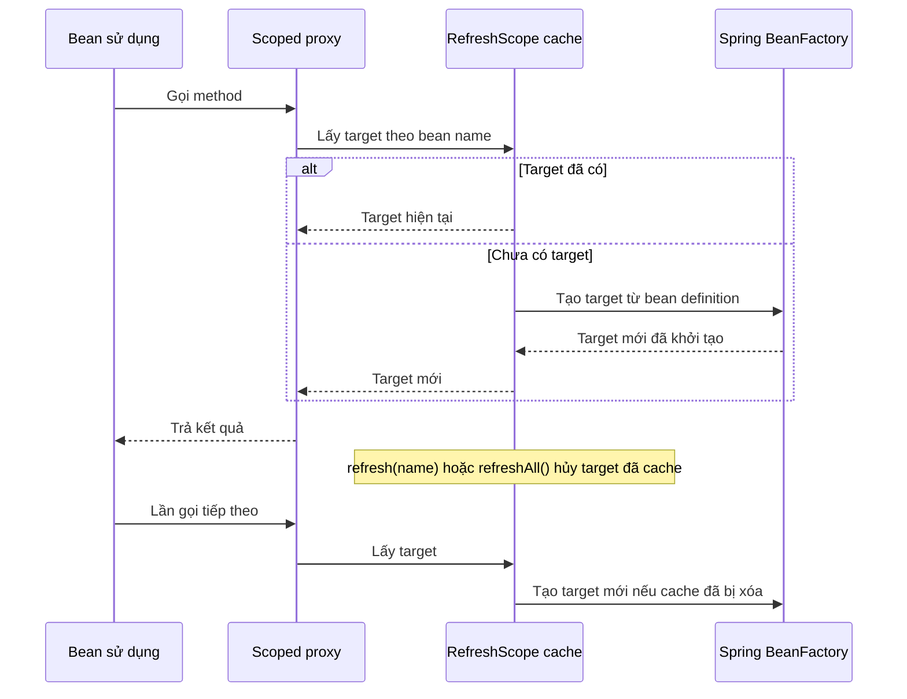
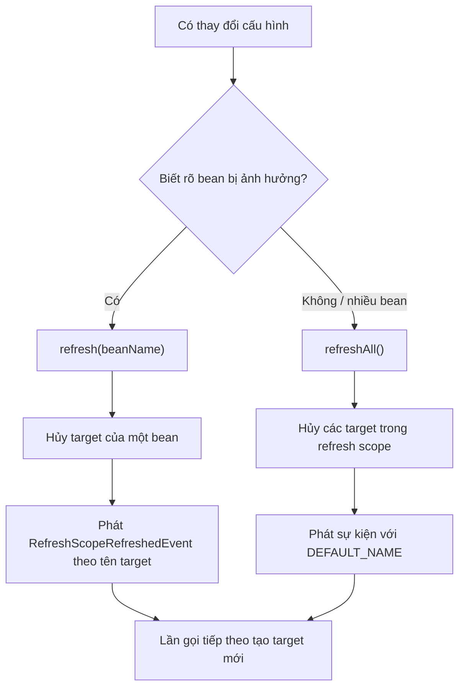

# RefreshScope.refresh theo tên và refreshAll

## 1. Khi nào cần làm mới một bean?

Trong ứng dụng Spring, bean singleton thường được tạo một lần trong vòng đời của application context. Nếu bean đọc cấu hình qua constructor hoặc `@Value` lúc khởi tạo, việc thay đổi `Environment` không tự thay object đã được tạo. Spring Cloud Context cung cấp **refresh scope** để một số bean có thể được hủy instance hiện tại và tạo instance mới khi cần.

`RefreshScope` có hai thao tác trực tiếp:

- `refresh(String name)`: làm mới một bean trong refresh scope theo tên bean.
- `refreshAll()`: làm mới tất cả bean thuộc refresh scope.

Cả hai thao tác đều tác động lên **cache instance của refresh scope**. Chúng hủy target hiện tại và buộc scope tạo target mới ở lần truy cập tiếp theo. Chúng không tự truy vấn Config Server, không tự tải file cấu hình mới và không thay đổi `Environment`.

Bài học thuộc chương **Refresh Scope** của module **SPRING_CLOUD_CORE**. Module giúp người học hiểu Spring Cloud Commons, Spring Cloud Context, externalized configuration, refresh scope, discovery, service registry, tương thích Spring Boot và cách kiểm thử/vận hành các abstraction chung.

Sau bài này, người học có thể:

- Giải thích refresh scope lưu target bean và chuyển lời gọi qua scoped proxy như thế nào.
- Gọi `refresh(String)` đúng tên bean và diễn giải giá trị boolean trả về.
- Gọi `refreshAll()` và hiểu phạm vi bean bị ảnh hưởng.
- Phân biệt refresh một bean, refresh toàn scope và refresh toàn bộ Environment.
- Theo dõi `RefreshScopeRefreshedEvent` và các callback vòng đời.
- Thiết kế kiểm thử để xác nhận instance cũ bị hủy, instance mới được tạo và cấu hình mới được đọc.
- Tránh làm mới nhầm bean, làm mới quá rộng hoặc để thao tác refresh gây tác động ngoài dự kiến.

## 2. RefreshScope hoạt động như thế nào?

### 2.1. Refresh scope là một cache có vòng đời riêng

Spring Cloud Context đăng ký scope có tên `refresh`. Một bean được đánh dấu bằng `@RefreshScope` sẽ được Spring tạo scoped proxy. Các bean khác inject proxy này; proxy chuyển lời gọi đến target instance đang được scope quản lý.

Có thể hình dung:

1. Spring tạo proxy và đăng ký bean definition.
2. Khi ứng dụng gọi một phương thức qua proxy, refresh scope lấy target từ cache; nếu chưa có target, scope tạo target từ bean definition.
3. Target được inject dependency, resolve placeholder và chạy initialization callbacks.
4. Khi refresh, target hiện tại bị loại khỏi cache và các destruction callbacks được gọi.
5. Lần gọi tiếp theo qua proxy tạo target mới; các dependency và property placeholder được resolve lại theo `Environment` tại thời điểm tạo.



Điểm quan trọng là proxy có thể giữ nguyên trong các bean phụ thuộc, còn target bên trong proxy được thay thế. Vì vậy, một `OrderService` đã inject `PricingPolicy` proxy vẫn có thể gọi đến instance `PricingPolicy` mới mà không phải tạo lại `OrderService`.

### 2.2. Đánh dấu bean bằng @RefreshScope

Annotation thuộc package:

- `org.springframework.cloud.context.config.annotation.RefreshScope`

Ví dụ một bean đọc tỷ lệ chiết khấu từ cấu hình:

```java
import java.math.BigDecimal;

import org.springframework.beans.factory.annotation.Value;
import org.springframework.cloud.context.config.annotation.RefreshScope;
import org.springframework.context.annotation.Bean;
import org.springframework.context.annotation.Configuration;

@Configuration(proxyBeanMethods = false)
class PricingConfiguration {

    @Bean("pricingPolicy")
    @RefreshScope
    PricingPolicy pricingPolicy(
            @Value("${pricing.discount:0.05}") BigDecimal discount) {

        return new PricingPolicy(discount);
    }
}

class PricingPolicy {

    private final BigDecimal discount;

    PricingPolicy(BigDecimal discount) {
        this.discount = discount;
    }

    BigDecimal discount() {
        return discount;
    }
}
```

Tên bean được khai báo tường minh là `pricingPolicy`. Đây là tên dùng khi gọi `refresh("pricingPolicy")`.

### 2.3. Không phải mọi bean đều tự động thuộc refresh scope

Chỉ bean được đánh dấu `@RefreshScope` hoặc được cấu hình rõ ràng để tham gia scope mới chịu tác động của `RefreshScope.refresh...`.

- Bean singleton thông thường không bị `refreshAll()` thay thế.
- `@RefreshScope` trên một lớp `@Configuration` không làm cho tất cả bean được khai báo bằng `@Bean` bên trong lớp đó tự động thuộc refresh scope.
- Một bean phụ thuộc vào refresh-scoped proxy có thể tiếp tục dùng proxy ổn định; nếu nó lưu một bản sao giá trị hoặc một resource riêng, bản sao/resource đó không tự cập nhật.
- Một số loại bean có giới hạn refresh riêng. Tài liệu Spring Cloud hiện hành ghi nhận `HikariDataSource` nằm trong danh sách `spring.cloud.refresh.never-refreshable` mặc định.

Hãy chọn bean có trạng thái được khởi tạo từ cấu hình và có thể tái tạo an toàn. Tránh đánh dấu toàn bộ tầng nghiệp vụ vào refresh scope nếu không có nhu cầu rõ ràng.


## 3. refresh(String name): làm mới đúng một bean

### 3.1. Cú pháp và ý nghĩa tham số

API:

```java
boolean refresh(String name)
```

`name` là **Spring bean name** của bean thuộc refresh scope. Đây không phải tên class, tên property, tên profile hoặc tên service trong registry.

Với ví dụ trước, gọi:

```java
refreshScope.refresh("pricingPolicy");
```

Spring Cloud xử lý tên bean qua `ScopedProxyUtils`. Nếu truyền tên proxy thông thường, `RefreshScope` chuyển nó sang tên target nội bộ (`scopedTarget.<beanName>`) trước khi xóa cache. Vì vậy, ứng dụng thường truyền tên bean công khai `pricingPolicy`, không cần tự ghép tiền tố `scopedTarget.`.

### 3.2. Điều gì xảy ra khi gọi refresh(name)?

Khi gọi `refresh("pricingPolicy")`, luồng xử lý khái quát là:

1. Chuẩn hóa tên thành tên target của scoped proxy nếu cần.
2. Yêu cầu scope hủy target hiện tại trong cache.
3. Chạy destruction callbacks đã đăng ký cho target hiện tại nếu có.
4. Nếu thao tác hủy thành công, phát `RefreshScopeRefreshedEvent` mang tên target và trả về `true`.
5. Nếu không có target tương ứng để hủy hoặc thao tác destroy không thành công, trả về `false`.
6. Khi proxy được gọi lần tiếp theo, scope tạo target mới từ bean definition.

Giá trị trả về cần được diễn giải chính xác:

| Kết quả | Ý nghĩa | Bước tiếp theo |
| --- | --- | --- |
| `true` | Scope đã hủy target cache tương ứng và phát sự kiện làm mới | Gọi bean qua proxy để kích hoạt tạo target mới |
| `false` | Không hủy được target cache theo tên đã truyền | Kiểm tra tên bean, scope và trạng thái cache |

`true` **không có nghĩa** target mới đã được tạo thành công. Việc tạo target mới xảy ra ở lần truy cập tiếp theo và có thể phát sinh lỗi khởi tạo nếu cấu hình mới không hợp lệ, dependency không sẵn sàng hoặc resource không thể mở.

### 3.3. Đóng gói thao tác refresh theo tên

Không nên để nhiều nơi trong mã nghiệp vụ tự ghép tên bean. Có thể gom thao tác vào một service quản trị:

```java
import org.springframework.stereotype.Service;
import org.springframework.cloud.context.scope.refresh.RefreshScope;

@Service
class RefreshOperations {

    private final RefreshScope refreshScope;

    RefreshOperations(RefreshScope refreshScope) {
        this.refreshScope = refreshScope;
    }

    boolean refreshPricingPolicy() {
        return refreshScope.refresh("pricingPolicy");
    }
}
```

Lưu ý có hai kiểu mang tên `RefreshScope`:

- Annotation `org.springframework.cloud.context.config.annotation.RefreshScope` dùng để đánh dấu bean.
- Class `org.springframework.cloud.context.scope.refresh.RefreshScope` cung cấp các thao tác `refresh` và `refreshAll`.

Khi import cả hai trong cùng một file Java, cần dùng tên đầy đủ hoặc chỉ import một kiểu để tránh nhầm lẫn.

### 3.4. Khi nào nên dùng refresh theo tên?

Dùng `refresh(name)` khi biết chính xác bean nào chịu ảnh hưởng của thay đổi cấu hình:

- Chỉ chính sách giá của một nhóm chức năng thay đổi.
- Một client tích hợp đối tác có endpoint hoặc timeout riêng được cập nhật.
- Một bộ lọc hoặc adapter chỉ dùng cho một luồng nghiệp vụ cần khởi tạo lại.
- Một thành phần tạo resource từ property mới và có thể hủy resource cũ an toàn.

Cách này giúp giới hạn phạm vi hủy target, giảm số bean phải khởi tạo lại và dễ truy vết sự kiện hơn. Tuy nhiên, nếu một bean khác giữ trạng thái được tính trước từ bean vừa refresh, cần xem xét refresh cả bean phụ thuộc hoặc thiết kế lại để nó truy cập proxy thay vì giữ bản sao trạng thái cũ.

## 4. refreshAll(): làm mới toàn bộ refresh scope

### 4.1. Cú pháp và phạm vi

API:

```java
void refreshAll()
```

`refreshAll()` yêu cầu scope hủy toàn bộ target instance hiện có trong cache của **refresh scope**. Nó không xóa mọi bean trong application context.

Các singleton thông thường, prototype bean và các bean thuộc scope khác không bị xóa chỉ vì gọi `refreshAll()`.

### 4.2. Luồng xử lý

Khi gọi `refreshAll()`:

1. Scope hủy các target đang được quản lý trong refresh-scope cache.
2. Destruction callbacks của các target hiện tại được thực thi.
3. Scope phát một `RefreshScopeRefreshedEvent` dùng tên mặc định `RefreshScopeRefreshedEvent.DEFAULT_NAME`.
4. Phương thức kết thúc mà không trả số lượng bean đã bị hủy.
5. Các proxy tiếp tục tồn tại; target mới được tạo khi từng proxy được sử dụng lại.

Khác với `refresh(String)`, `refreshAll()` có kiểu trả về `void`. Muốn biết bean nào được tạo lại, hãy theo dõi lifecycle log, metric hoặc các sự kiện khởi tạo của chính ứng dụng.

### 4.3. Ví dụ gọi refreshAll

```java
import org.springframework.cloud.context.scope.refresh.RefreshScope;
import org.springframework.stereotype.Service;

@Service
class ConfigurationRefreshOperations {

    private final RefreshScope refreshScope;

    ConfigurationRefreshOperations(RefreshScope refreshScope) {
        this.refreshScope = refreshScope;
    }

    void refreshAllRefreshScopedBeans() {
        refreshScope.refreshAll();
    }
}
```

Giả sử ứng dụng có các bean `pricingPolicy`, `inventoryClient` và `notificationSettings` đều thuộc refresh scope. Lệnh trên hủy target hiện tại của cả ba. Khi từng bean được gọi lại, target tương ứng được tạo mới theo cấu hình và dependency hiện tại.

Nếu một bean chưa có target trong cache, không có instance cũ để chạy destruction callback. Dù vậy, `refreshAll()` vẫn phát sự kiện toàn scope theo triển khai của Spring Cloud.

### 4.4. Khi nào nên dùng refreshAll?

Chọn `refreshAll()` khi:

- Nhiều bean refresh-scoped cùng phụ thuộc một nhóm cấu hình vừa thay đổi.
- Một sự kiện thay đổi cấu hình cần làm mới toàn bộ nhóm component có thể tái tạo.
- Hệ thống vừa tải lại Environment và cần các target refresh-scoped đọc lại giá trị mới.
- Không thể xác định chính xác tập bean bị ảnh hưởng hoặc chính sách vận hành yêu cầu làm mới toàn scope.

Không dùng `refreshAll()` như cách thay thế restart ứng dụng. Nó chỉ tác động đến cache của refresh scope; các thiết lập startup-only, cấu trúc bean definition và trạng thái trong singleton thông thường vẫn giữ nguyên.

## 5. So sánh hai thao tác

| Tiêu chí | `refresh(String name)` | `refreshAll()` |
| --- | --- | --- |
| Phạm vi | Một target bean theo tên | Tất cả target trong refresh-scope cache |
| Tham số | Spring bean name | Không có |
| Giá trị trả về | `boolean` | `void` |
| Hủy instance hiện tại | Có, nếu target tương ứng được tìm thấy và destroy thành công | Có, cho các target đang được cache |
| Tạo instance mới ngay trong method? | Không | Không |
| Thời điểm tạo target mới | Lần gọi tiếp theo qua proxy | Lần gọi tiếp theo của từng proxy |
| Sự kiện | `RefreshScopeRefreshedEvent` mang tên target | `RefreshScopeRefreshedEvent.DEFAULT_NAME` |
| Phạm vi singleton thông thường | Không bị ảnh hưởng | Không bị ảnh hưởng |
| Trường hợp phù hợp | Thay đổi cục bộ, biết bean chịu ảnh hưởng | Thay đổi liên quan nhiều refresh-scoped bean |



Một quy tắc lựa chọn dễ nhớ: **biết đúng bean thì refresh theo tên; cần làm mới toàn bộ refresh scope thì dùng refreshAll**.


## 6. Ví dụ hoàn chỉnh: thay đổi chính sách giá

Giả sử ứng dụng có cấu hình:

```yaml
pricing:
  discount: 0.05
```

Bean `pricingPolicy` đọc giá trị lúc tạo target:

```java
@Configuration(proxyBeanMethods = false)
class PricingConfiguration {

    @Bean("pricingPolicy")
    @RefreshScope
    PricingPolicy pricingPolicy(
            @Value("${pricing.discount:0.05}") BigDecimal discount) {
        return new PricingPolicy(discount);
    }
}
```

Một service gọi bean:

```java
@Service
class CheckoutService {

    private final PricingPolicy pricingPolicy;

    CheckoutService(PricingPolicy pricingPolicy) {
        this.pricingPolicy = pricingPolicy;
    }

    BigDecimal discountForCheckout() {
        return pricingPolicy.discount();
    }
}
```

Giả sử cấu hình trong Environment được cập nhật từ `0.05` thành `0.10`. Trước khi refresh, target đang tồn tại vẫn giữ giá trị `0.05`, vì constructor đã chạy với giá trị cũ.

Làm mới riêng bean:

```java
boolean refreshed = refreshScope.refresh("pricingPolicy");

if (!refreshed) {
    throw new IllegalStateException(
            "Could not invalidate pricingPolicy refresh target"
    );
}
```

Lần gọi tiếp theo:

```java
BigDecimal currentDiscount = checkoutService.discountForCheckout();
```

Proxy chuyển lời gọi đến target mới. Khi Spring tạo target, placeholder `pricing.discount` được resolve lại và bean nhận giá trị `0.10`.

Nếu cùng một thay đổi ảnh hưởng đến `pricingPolicy`, `inventoryClient` và `notificationSettings`, có thể gọi:

```java
refreshScope.refreshAll();
```

Sau đó, mỗi target được tạo lại ở lần truy cập tiếp theo. Không phải tất cả target được tạo đồng thời ngay trong lệnh `refreshAll()`.

## 7. Sự kiện RefreshScopeRefreshedEvent

### 7.1. Sự kiện được phát khi nào?

`RefreshScope` phát `RefreshScopeRefreshedEvent` sau khi thao tác hủy target thành công:

- `refresh(name)` phát event có tên target bean.
- `refreshAll()` phát event dùng tên mặc định `RefreshScopeRefreshedEvent.DEFAULT_NAME` để biểu thị thao tác toàn scope.

Event cho biết scope đã thực hiện thao tác invalidation. Nó không chứng minh target mới đã được khởi tạo thành công; target mới chỉ được tạo ở lần gọi tiếp theo.

### 7.2. Lắng nghe sự kiện

Có thể dùng event listener để ghi nhận thao tác hoặc yêu cầu một thành phần phụ cập nhật cache riêng:

```java
import org.springframework.cloud.context.scope.refresh.RefreshScopeRefreshedEvent;
import org.springframework.context.event.EventListener;
import org.springframework.stereotype.Component;
import org.slf4j.Logger;
import org.slf4j.LoggerFactory;

@Component
class RefreshAuditListener {

    private static final Logger log =
            LoggerFactory.getLogger(RefreshAuditListener.class);

    @EventListener
    void onRefreshScopeRefreshed(RefreshScopeRefreshedEvent event) {
        if (RefreshScopeRefreshedEvent.DEFAULT_NAME.equals(event.getName())) {
            log.info("Refresh scope cache was invalidated");
        }
        else {
            log.info("Refresh target invalidated: {}", event.getName());
        }
    }
}
```

Không dùng event này như tín hiệu rằng toàn bộ cấu hình từ xa đã tải thành công. Nếu cần ghi nhận kết quả tải cấu hình, hãy theo dõi `ContextRefresher`, Config Client hoặc nguồn cấu hình tương ứng.

### 7.3. Tác động của listener

Một số thành phần Spring Cloud có thể phản ứng với `RefreshScopeRefreshedEvent`. Ví dụ, listener của Spring Cloud Gateway có thể dùng sự kiện để làm mới route cache. Điều đó giúp các module tích hợp cập nhật dữ liệu phụ thuộc khi một refresh xảy ra.

Nếu tự viết listener:

- Giữ xử lý ngắn và idempotent.
- Không gọi `refreshAll()` vô điều kiện bên trong listener đang nhận chính event refresh, vì có thể tạo vòng lặp.
- Phân biệt event của một bean với event toàn scope.
- Ghi log tên bean hoặc revision, tránh log dữ liệu cấu hình nhạy cảm.

## 8. Phân biệt refresh scope với ContextRefresher và Actuator

Ba API sau thường bị gọi chung là “refresh”, nhưng trách nhiệm khác nhau:

| API / cơ chế | Trách nhiệm chính |
| --- | --- |
| `RefreshScope.refresh(name)` | Hủy target cache của một refresh-scoped bean |
| `RefreshScope.refreshAll()` | Hủy target cache của toàn bộ refresh scope |
| `ContextRefresher.refresh()` | Cập nhật Environment, xác định các key thay đổi, phát `EnvironmentChangeEvent` và gọi `refreshAll()` |

Trong cấu hình Spring Cloud có Actuator, endpoint `POST /actuator/refresh` gọi quy trình refresh ở cấp context: tải lại cấu hình theo cơ chế đang dùng, cập nhật Environment và làm mới refresh-scoped beans.

Ví dụ expose endpoint:

```yaml
management:
  endpoints:
    web:
      exposure:
        include: health,info,refresh
```

Endpoint này cần được bảo vệ bằng authentication/authorization và giới hạn network access. Không expose thao tác thay đổi cấu hình cho người dùng công khai.

Nếu ứng dụng đã cập nhật Environment bằng một cơ chế riêng và chỉ muốn thay target của một bean, gọi `refresh(name)` là thao tác trực tiếp hơn. Nếu cần tải lại nguồn cấu hình rồi áp dụng cho tất cả bean, dùng `ContextRefresher` hoặc endpoint refresh theo cách tích hợp của ứng dụng.

## 9. Vòng đời, đồng thời và tài nguyên bên ngoài

### 9.1. Destruction và initialization callbacks

Khi target bị hủy, Spring chạy các destruction callbacks đã đăng ký, chẳng hạn:

- `@PreDestroy`.
- `DisposableBean.destroy()`.
- Destruction method khai báo trong bean definition.

Target mới chạy các bước khởi tạo thông thường, gồm dependency injection, `@PostConstruct`, `InitializingBean.afterPropertiesSet()` và initialization method nếu được khai báo.

Hãy bảo đảm callback đóng resource cũ đúng cách. Nếu bean quản lý connection, executor, scheduler, file handle hoặc subscription, callback phải giải phóng chúng trước khi target mới được tạo.

### 9.2. Proxy và các lời gọi đang diễn ra

Các bean khác thường giữ scoped proxy thay vì giữ trực tiếp target. Cơ chế proxy giúp scope điều phối việc truy cập target và việc refresh theo từng bean.

Tuy nhiên, không nên xem refresh là một transaction bao trùm mọi bean trong ứng dụng. `refreshAll()` làm mới cache của nhiều target, nhưng các target có thể được tạo lại ở những thời điểm khác nhau khi chúng được gọi. Nếu một nghiệp vụ cần một snapshot cấu hình nhất quán qua nhiều bean, hãy thiết kế một object cấu hình/version chung hoặc quy trình chuyển đổi có kiểm soát.

### 9.3. Resource ngoài không tự thay đổi chỉ vì cache bị xóa

Ví dụ, refresh một bean chứa `DataSource` có thể đóng target cũ và tạo target mới. Điều đó không tự bảo đảm mọi connection đang được ứng dụng khác giữ sẽ được chuyển đổi an toàn. Cần hiểu lifecycle của pool, request đang chạy và callback đóng resource.

Tài liệu Spring Cloud hiện hành lưu ý `HikariDataSource` nằm trong danh sách `spring.cloud.refresh.never-refreshable` mặc định. Nếu cần làm mới một loại DataSource, phải kiểm tra implementation, cấu hình `spring.cloud.refresh.never-refreshable` và giới hạn thực tế của connection pool. Không nên loại một class khỏi danh sách bảo vệ chỉ để ép refresh mà chưa đánh giá an toàn.


## 10. Kiểm thử refresh theo tên và refreshAll

Một bài test có ý nghĩa nên kiểm tra cả giá trị trước/sau, số lần khởi tạo, destruction callback và sự kiện.

### 10.1. Test refresh theo tên

Giả sử test có `MapPropertySource` tên `testOverrides` chứa `pricing.discount`. Có thể thay giá trị trong map, gọi `refresh("pricingPolicy")` và xác nhận target mới đọc giá trị mới:

```java
import java.math.BigDecimal;
import java.util.Map;
import java.util.concurrent.ConcurrentHashMap;

import org.junit.jupiter.api.Test;
import org.springframework.beans.factory.annotation.Autowired;
import org.springframework.boot.test.context.SpringBootTest;
import org.springframework.cloud.context.scope.refresh.RefreshScope;
import org.springframework.context.ApplicationContextInitializer;
import org.springframework.context.ConfigurableApplicationContext;
import org.springframework.core.env.MapPropertySource;
import org.springframework.test.context.ContextConfiguration;
import org.springframework.test.annotation.DirtiesContext;

import static org.assertj.core.api.Assertions.assertThat;

@SpringBootTest
@ContextConfiguration(initializers = PricingRefreshTest.PropertySourceInitializer.class)
@DirtiesContext
class PricingRefreshTest {

    private static final Map<String, Object> OVERRIDES =
            new ConcurrentHashMap<>();

    static class PropertySourceInitializer
            implements ApplicationContextInitializer<ConfigurableApplicationContext> {

        @Override
        public void initialize(ConfigurableApplicationContext context) {
            OVERRIDES.clear();
            OVERRIDES.put("pricing.discount", new BigDecimal("0.05"));
            context.getEnvironment().getPropertySources().addFirst(
                    new MapPropertySource("testOverrides", OVERRIDES)
            );
        }
    }

    @Autowired
    RefreshScope refreshScope;

    @Autowired
    CheckoutService checkoutService;

    @Test
    void refreshesOnlyTheNamedBean() {
        assertThat(checkoutService.discountForCheckout())
                .isEqualByComparingTo("0.05");

        OVERRIDES.put("pricing.discount", new BigDecimal("0.10"));

        assertThat(refreshScope.refresh("pricingPolicy")).isTrue();

        assertThat(checkoutService.discountForCheckout())
                .isEqualByComparingTo("0.10");
    }
}
```

Test này minh họa ba điều: thay property source chưa làm target hiện tại đổi giá trị; refresh theo tên invalidates target; lần gọi qua proxy tạo target mới và đọc property hiện tại.

Để test độc lập, cần bảo đảm bean `pricingPolicy` đã được tạo trước khi thay property source. Nếu target chưa tồn tại, không có instance cũ để chứng minh destruction callback.

### 10.2. Test refreshAll

Tạo ít nhất hai bean thuộc refresh scope, đọc giá trị từ hai khóa khác nhau. Thay cả hai giá trị trong test property source rồi gọi `refreshAll()`.

Xác nhận:

- Cả hai bean trả giá trị mới ở lần truy cập tiếp theo.
- Mỗi target cũ đã chạy destruction callback nếu trước đó được khởi tạo.
- Mỗi target mới chạy initialization callback khi được truy cập.
- Event được phát với `RefreshScopeRefreshedEvent.DEFAULT_NAME`.
- Bean singleton không thuộc refresh scope vẫn giữ instance của nó.

### 10.3. Test trường hợp lỗi

| Trường hợp | Kỳ vọng |
| --- | --- |
| Tên bean đúng và target đã cache | `refresh(name)` trả `true`; lần gọi tiếp theo tạo target mới |
| Tên bean không tồn tại trong cache | Kết quả có thể là `false`; không kết luận đã tạo target mới |
| Tên bean tồn tại nhưng không thuộc refresh scope | Không dùng API này để làm mới singleton thông thường |
| Target mới thiếu property bắt buộc | Refresh có thể hủy target cũ thành công, nhưng lần tạo target mới phát sinh lỗi |
| Gọi `refreshAll()` khi cache trống | Method vẫn hoàn thành và phát event toàn scope; không có target cũ để destroy |
| Nhiều request đồng thời gọi proxy | Kiểm tra behavior theo từng bean và bảo đảm resource cũ được đóng đúng cách |
| Listener xử lý event | Event bean-name và event toàn scope được phân biệt đúng |

Không chỉ assert giá trị trả về của `refresh(name)`. Cần gọi qua proxy và xác minh target mới thực sự được tạo, vì return `true` phản ánh thao tác hủy target cache chứ không phải kết quả khởi tạo target mới.

## 11. Lỗi thường gặp và cách xử lý

| Triệu chứng | Nguyên nhân thường gặp | Hướng xử lý |
| --- | --- | --- |
| Gọi `refresh("PricingPolicy")` nhưng trả `false` | Truyền class name thay vì bean name hoặc sai chữ hoa/thường | Kiểm tra tên bean trong `@Bean` hoặc component name |
| Refresh thành công nhưng giá trị vẫn cũ | Environment chưa nhận giá trị mới hoặc bean không đọc lại property khi khởi tạo | Kiểm tra property source trước, sau đó kiểm tra target được tạo mới |
| Bean phụ thuộc vẫn giữ trạng thái cũ | Bean phụ thuộc đã copy dữ liệu hoặc giữ resource riêng | Inject proxy, refresh bean phụ thuộc hoặc thiết kế lại quan hệ trạng thái |
| `refreshAll()` không làm mới singleton | Singleton không thuộc refresh scope | Chỉ kỳ vọng target thuộc refresh scope bị thay thế |
| Event listener không thấy tên bean như mong đợi | Event dùng tên target nội bộ của scoped proxy | So sánh với tên event thực tế và `DEFAULT_NAME` |
| `refresh(name)` trả `true` nhưng request sau lỗi | Target mới không khởi tạo được hoặc dependency/resource không sẵn sàng | Kiểm tra exception khi target được tạo ở lần truy cập tiếp theo |
| Cấu hình mới từ Config Server không xuất hiện | Chỉ gọi `RefreshScope.refresh...`, chưa cập nhật Environment | Dùng cơ chế tải lại cấu hình như ContextRefresher hoặc `/actuator/refresh` |
| `@Configuration` refresh nhưng các bean bên trong không đổi | Annotation trên configuration class không tự đưa mọi bean method vào refresh scope | Đánh dấu từng bean cần làm mới bằng `@RefreshScope` |
| Refresh DataSource không có hiệu lực | Implementation thuộc danh sách không refresh được hoặc có giới hạn riêng | Kiểm tra `never-refreshable` và lifecycle của pool |

## 12. Checklist vận hành

Trước khi cho phép một thành phần được refresh trong production, hãy xác nhận:

1. Bean có thực sự thuộc refresh scope không?
2. Bean name được dùng trong `refresh(name)` có đúng và ổn định không?
3. Property source đã được cập nhật trước khi invalidation chưa?
4. Destruction callback có đóng resource an toàn không?
5. Target mới có thể được tạo với cấu hình hiện hành không?
6. Các bean phụ thuộc có giữ proxy hay giữ bản sao trạng thái cũ?
7. Chỉ cần refresh một bean hay phải refresh toàn scope?
8. Listener có phân biệt event theo tên bean và event toàn scope?
9. Actuator endpoint có được bảo vệ và giới hạn quyền truy cập?
10. Có metric/log cho số lần refresh, lỗi khởi tạo target mới và thời gian phục hồi không?
11. Có phương án rollback nếu target mới không khởi tạo được?
12. Có kiểm thử với request đồng thời và resource ngoài như connection pool không?

## 13. Tài liệu tham khảo chính thức

- [Spring Cloud Context — Refresh Scope](https://docs.spring.io/spring-cloud-commons/reference/spring-cloud-commons/application-context-services.html#refresh-scope): cách refresh scope hoạt động, `refresh(String)`, `refreshAll()`, scoped proxy và các giới hạn.
- [RefreshScope.java — Spring Cloud Commons](https://github.com/spring-cloud/spring-cloud-commons/blob/main/spring-cloud-context/src/main/java/org/springframework/cloud/context/scope/refresh/RefreshScope.java): triển khai chuyển tên proxy sang target, destroy, publish event và return semantics.
- [@RefreshScope annotation — Spring Cloud Commons](https://github.com/spring-cloud/spring-cloud-commons/blob/main/spring-cloud-context/src/main/java/org/springframework/cloud/context/config/annotation/RefreshScope.java): annotation đánh dấu bean thuộc scope `refresh`.
- [RefreshScope integration tests](https://github.com/spring-cloud/spring-cloud-commons/blob/main/spring-cloud-context/src/test/java/org/springframework/cloud/context/scope/refresh/RefreshScopeLazyIntegrationTests.java): ví dụ test `refresh(name)`, `refreshAll()`, lifecycle callbacks và event.
- [ContextRefresher.java — Spring Cloud Commons](https://github.com/spring-cloud/spring-cloud-commons/blob/main/spring-cloud-context/src/main/java/org/springframework/cloud/context/refresh/ContextRefresher.java): quy trình cập nhật Environment, phát `EnvironmentChangeEvent` và gọi `refreshAll()`.

**Ghi nhớ:** `refresh(name)` xóa target của một bean khỏi refresh-scope cache; `refreshAll()` xóa target của toàn bộ refresh scope. Cả hai giữ nguyên proxy và chỉ tạo target mới ở lần truy cập tiếp theo. Muốn đọc cấu hình mới từ nguồn bên ngoài, trước hết phải cập nhật Environment bằng cơ chế tương ứng; sau đó mới dùng refresh scope để thay các bean cần tái khởi tạo.
