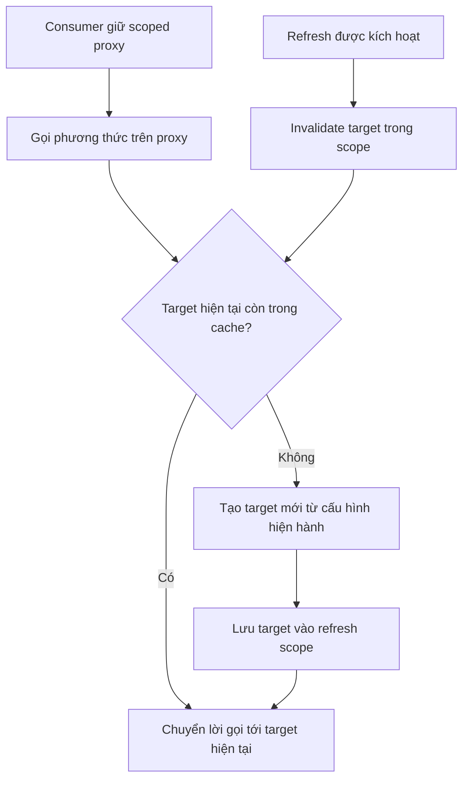
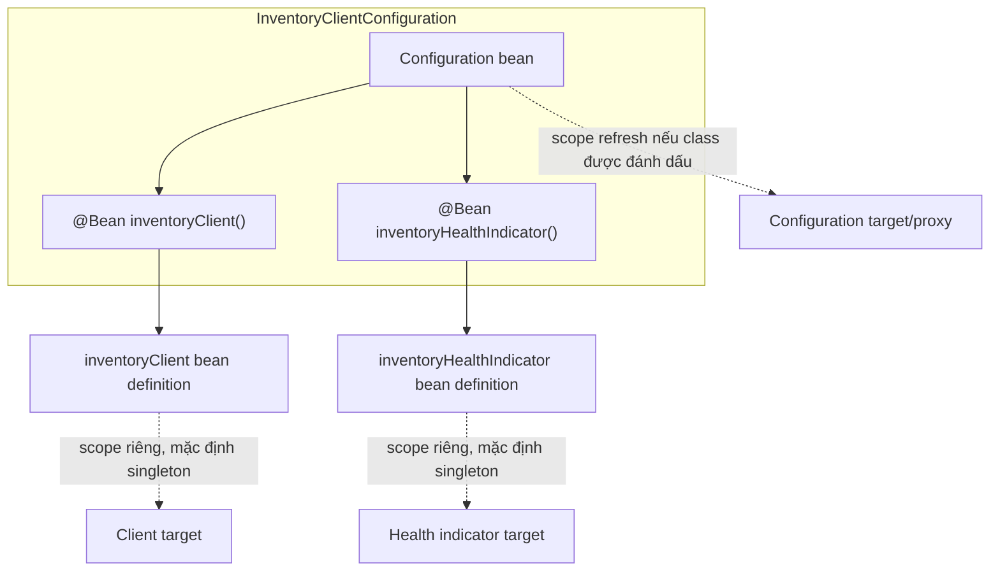

# @RefreshScope trên @Configuration và phạm vi các @Bean bên trong

Trong Spring, một lớp `@Configuration` thường khai báo nhiều phương thức `@Bean`. Khi cấu hình bên ngoài thay đổi, đôi khi ta muốn tạo lại cấu hình client, pool hoặc adapter mà không khởi động lại toàn bộ ứng dụng. `@RefreshScope` của Spring Cloud Context hỗ trợ việc đó bằng một scope có proxy và cache target.

Điểm cần hiểu chính xác là **đặt `@RefreshScope` trên lớp `@Configuration` không tự động đặt mọi bean do các phương thức `@Bean` trong lớp đó khai báo vào refresh scope**. Annotation trên lớp cấu hình quản lý bean cấu hình; từng bean sản phẩm vẫn có scope riêng theo định nghĩa của nó. Vì vậy, nếu một client cụ thể cần được tạo lại sau refresh, hãy đánh dấu chính phương thức `@Bean` tạo client hoặc lớp bean tương ứng.

Bài học thuộc chương **Refresh Scope** của **SPRING_CLOUD_CORE**. Nội dung tập trung vào phạm vi áp dụng annotation, quan hệ giữa configuration bean và bean sản phẩm, cách dependency giữ tham chiếu tới proxy/target, cùng cách kiểm thử để tránh kỳ vọng sai khi thay đổi cấu hình.

## 1. Mục tiêu học tập

Sau bài này, bạn có thể:

- Giải thích `@RefreshScope` tạo scoped proxy và quản lý target bean như thế nào.
- Phân biệt scope của bean `@Configuration` với scope của các bean được khai báo bằng `@Bean`.
- Nhận diện vì sao `@RefreshScope` trên lớp cấu hình không lan truyền tới các phương thức `@Bean`.
- Đặt annotation đúng trên từng bean cần được tạo lại.
- Phân biệt bean tiêu thụ proxy refresh-scoped với bean giữ tham chiếu trực tiếp tới singleton cũ.
- Hiểu khi nào bean phụ thuộc cũng cần refresh scope để được tạo lại và tiêm dependency lần nữa.
- Kích hoạt refresh sau khi `Environment` đã nhận cấu hình mới.
- Kiểm thử lifecycle bằng cách đếm số lần tạo target và xác minh giá trị cấu hình.
- Nhận diện giới hạn của refresh scope với resource, proxy, constructor binding và môi trường native.

## 2. Refresh scope hoạt động như thế nào?

`@RefreshScope` là annotation gắn với scope có tên `refresh`. Spring Cloud Context đăng ký scope này vào container và tạo proxy cho bean được đánh dấu. Proxy là đối tượng mà các thành phần khác thường nhận được khi tiêm dependency.

Refresh scope duy trì target instance đã được tạo. Khi có thao tác refresh, target tương ứng bị invalidate và được hủy theo lifecycle callback phù hợp. Lần gọi tiếp theo qua proxy sẽ yêu cầu scope tạo target mới, rồi cache target đó cho những lần sử dụng sau.



Refresh scope **không tự phát hiện** file hoặc Config Server đã thay đổi. Một cơ chế khác phải cập nhật `Environment` và kích hoạt refresh. Scope chỉ chịu trách nhiệm quản lý target của những bean đã được đưa vào scope đó.

### 2.1. Proxy và target là hai đối tượng khác nhau

Giả sử một `InventoryClient` được đánh dấu `@RefreshScope`:

- Consumer được tiêm proxy do Spring tạo.
- Target `InventoryClient` thực tế được quản lý trong refresh scope.
- Khi refresh invalidate target, consumer vẫn giữ proxy.
- Lần gọi tiếp theo qua proxy sẽ lấy target mới.

Vì consumer giữ proxy ổn định, không cần tiêm lại dependency vào consumer chỉ để thay target của chính bean refresh-scoped đó.

### 2.2. Refresh scope không phải prototype

| Đặc điểm | `prototype` | `refresh` |
| --- | --- | --- |
| Khi lấy bean từ container | Thường tạo instance mới mỗi lần yêu cầu bean | Scope cache target và sử dụng lại |
| Cách dùng phổ biến | Đối tượng cần tạo mới theo từng lần lấy | Bean cần giữ ổn định giữa các lần gọi nhưng có thể thay target sau refresh |
| Cơ chế thay target | Yêu cầu một instance mới | Invalidate cache, proxy tạo/lấy target mới ở lần sử dụng kế tiếp |
| Tác động của refresh event | Không có cơ chế refresh mặc định | Refresh scope được yêu cầu xóa target cache |

Refresh scope phù hợp cho bean có cấu hình được đọc khi khởi tạo, ví dụ client hoặc adapter cần tái tạo khi endpoint thay đổi. Không dùng nó như cách thay thế mọi scope khác.

## 3. Ranh giới quan trọng: @Configuration và các @Bean

Một lớp `@Configuration` là một bean trong container. Các phương thức `@Bean` bên trong lớp đó lại định nghĩa những bean khác. Chúng có bean definition, tên và scope riêng.

Ví dụ:

```java
@Configuration
@RefreshScope
public class InventoryClientConfiguration {

    @Bean
    public InventoryClient inventoryClient(InventoryProperties properties) {
        return new InventoryClient(
                properties.baseUrl(),
                properties.timeout());
    }

    @Bean
    public InventoryHealthIndicator inventoryHealthIndicator(
            InventoryClient inventoryClient) {
        return new InventoryHealthIndicator(inventoryClient);
    }
}
```

Trong ví dụ này:

- `InventoryClientConfiguration` là bean cấu hình được đánh dấu `@RefreshScope`.
- `inventoryClient` là bean do phương thức `@Bean` tạo ra; phương thức này **không có `@RefreshScope`**, vì vậy không tự động trở thành refresh-scoped.
- `inventoryHealthIndicator` cũng có scope riêng; annotation trên lớp cấu hình không tự động áp dụng lên nó.

Đây là điểm dễ gây nhầm lẫn nhất: **scope của configuration class không phải scope mặc định cho các bean sản phẩm**.

### 3.1. Điều gì xảy ra khi refresh lớp @Configuration?

Spring Cloud cho phép đặt `@RefreshScope` trên lớp `@Configuration`, nhưng tài liệu chính thức cảnh báo cách này có thể dẫn tới hành vi bất ngờ:

1. Bean configuration class có target riêng trong refresh scope.
2. Các bean được khai báo bởi `@Bean` vẫn có scope được xác định riêng trong bean definition của từng bean.
3. Một bean khác phụ thuộc vào những bean sản phẩm đó không thể mặc định kỳ vọng các dependency sẽ được thay thế chỉ vì configuration class được refresh.
4. Nếu bean tiêu thụ cũng nằm trong `@RefreshScope`, nó có thể được tạo lại sau refresh và dependency được tiêm lại từ cấu hình đã được làm mới.

Vì vậy, không nên suy luận rằng “refresh configuration class” đồng nghĩa “rebuild toàn bộ object graph được khai báo trong class”. Hãy đánh dấu scope ở đúng bean cần thay target và kiểm thử quan hệ dependency.

### 3.2. Sơ đồ scope của cấu hình và bean sản phẩm



Sơ đồ cho thấy annotation trên class cấu hình chỉ xác định scope của bean cấu hình. Mỗi phương thức `@Bean` tạo một bean definition riêng; muốn target của bean đó được quản lý trong refresh scope, hãy cấu hình scope cho chính bean đó.

## 4. Cách khuyến nghị: đặt @RefreshScope trên phương thức @Bean

Nếu `InventoryClient` cần được tạo lại khi `inventory.base-url` hoặc `inventory.timeout` thay đổi, hãy đánh dấu phương thức tạo client:

```java
@Configuration(proxyBeanMethods = false)
public class InventoryClientConfiguration {

    @Bean
    @RefreshScope
    public InventoryClient inventoryClient(
            InventoryProperties properties) {
        return new InventoryClient(
                properties.baseUrl(),
                properties.timeout());
    }
}
```

Ở đây:

- `InventoryClientConfiguration` vẫn là configuration bean thông thường.
- Chỉ bean `inventoryClient` được đưa vào refresh scope.
- Các consumer tiêm `InventoryClient` sẽ nhận scoped proxy theo cơ chế proxy của scope.
- Sau refresh, target client cũ bị invalidate; lần gọi tiếp theo qua proxy sẽ tạo client mới từ dependency/configuration hiện hành.

### 4.1. Consumer có thể vẫn là singleton

```java
@Service
public class CheckoutService {

    private final InventoryClient inventoryClient;

    public CheckoutService(InventoryClient inventoryClient) {
        this.inventoryClient = inventoryClient;
    }

    public StockView getStock(String sku) {
        return inventoryClient.getStock(sku);
    }
}
```

`CheckoutService` có thể là singleton. Nó giữ proxy `InventoryClient`; khi target của `InventoryClient` được refresh, proxy tiếp tục chuyển lời gọi sang target mới. Không cần đánh dấu `CheckoutService` refresh scope chỉ vì nó sử dụng một dependency đã được proxy đúng cách.

### 4.2. Khi nào consumer cũng cần refresh scope?

Nếu consumer giữ một dependency **không phải refresh-scoped** nhưng dependency đó cần được tạo lại theo cấu hình mới, consumer có thể tiếp tục giữ tham chiếu cũ. Trong trường hợp đó, có thể:

- Đặt `@RefreshScope` trên chính bean dependency cần thay target; hoặc
- Đặt `@RefreshScope` trên consumer nếu muốn consumer được tạo lại và các dependency được tiêm lại sau refresh; hoặc
- Thiết kế một abstraction/provider để lấy dependency hiện hành khi cần.

Chọn phương án dựa trên vòng đời thực tế. Không đánh dấu toàn bộ service layer refresh-scoped nếu chỉ một HTTP client cần thay target.

## 5. Khi nào nên đặt @RefreshScope trên @Configuration?

Có thể có trường hợp muốn chính bean cấu hình được tạo lại, chẳng hạn nó giữ trạng thái hoặc tính toán cấu hình khi khởi tạo và các bean tiêu thụ cũng được thiết kế để nhận lại dependency sau refresh.

```java
@Configuration
@RefreshScope
public class RemoteAdapterConfiguration {

    @Bean
    public RemoteAdapter remoteAdapter(RemoteProperties properties) {
        return new RemoteAdapter(
                properties.endpoint(),
                properties.connectTimeout());
    }
}
```

Cách này chỉ scope `RemoteAdapterConfiguration`. Nó **không scope `remoteAdapter`**. Nếu mục tiêu là thay target của `RemoteAdapter`, cấu hình rõ ràng hơn là:

```java
@Configuration(proxyBeanMethods = false)
public class RemoteAdapterConfiguration {

    @Bean
    @RefreshScope
    public RemoteAdapter remoteAdapter(RemoteProperties properties) {
        return new RemoteAdapter(
                properties.endpoint(),
                properties.connectTimeout());
    }
}
```

### 5.1. Nếu vẫn cần refresh cả configuration bean

Khi thực sự có lý do để refresh configuration class, hãy xác định rõ:

- Configuration class có state hoặc logic khởi tạo nào cần được tạo lại?
- Các bean sản phẩm nào phải thay target?
- Các bean nào đang giữ reference tới bean sản phẩm?
- Những consumer nào cần được tạo lại để re-inject dependency?
- Các bean sản phẩm có cần scope riêng không?

Nếu không trả lời được các câu hỏi này, annotation trên `@Configuration` thường chỉ làm tăng độ phức tạp mà không đem lại hành vi mong muốn.

## 6. Ví dụ hoàn chỉnh: đổi endpoint của InventoryClient

Ta xây dựng ví dụ một service gọi `inventory-service`. Endpoint và timeout lấy từ `InventoryProperties`.

### 6.1. Kiểu cấu hình

```java
@ConfigurationProperties(prefix = "inventory")
@Validated
public record InventoryProperties(
        @NotNull URI baseUrl,
        @NotNull Duration timeout) {
}
```

Đăng ký cấu hình:

```java
@SpringBootApplication
@ConfigurationPropertiesScan
public class CheckoutApplication {
    public static void main(String[] args) {
        SpringApplication.run(CheckoutApplication.class, args);
    }
}
```

### 6.2. Bean client được refresh

```java
@Configuration(proxyBeanMethods = false)
public class InventoryClientConfiguration {

    @Bean
    @RefreshScope
    public InventoryClient inventoryClient(
            InventoryProperties properties) {
        return new InventoryClient(
                properties.baseUrl(),
                properties.timeout());
    }
}
```

Ví dụ `InventoryClient` đơn giản:

```java
public class InventoryClient {

    private final URI baseUrl;
    private final Duration timeout;

    public InventoryClient(URI baseUrl, Duration timeout) {
        this.baseUrl = baseUrl;
        this.timeout = timeout;
    }

    public URI baseUrl() {
        return baseUrl;
    }

    public Duration timeout() {
        return timeout;
    }
}
```

Client thực tế có thể giữ `WebClient`, HTTP connection provider hoặc một tài nguyên khác. Ví dụ rút gọn chỉ thể hiện rằng endpoint và timeout được đọc khi target được tạo.

### 6.3. Consumer giữ proxy

```java
@Service
public class InventoryFacade {

    private final InventoryClient inventoryClient;

    public InventoryFacade(InventoryClient inventoryClient) {
        this.inventoryClient = inventoryClient;
    }

    public URI currentInventoryEndpoint() {
        return inventoryClient.baseUrl();
    }
}
```

`InventoryFacade` không cần biết refresh scope. Nó gọi dependency thông qua proxy do Spring tiêm.

### 6.4. Cấu hình ban đầu

```yaml
inventory:
  base-url: https://inventory-v1.internal
  timeout: 1s
```

Sau khi ứng dụng khởi động và target được tạo, `InventoryClient` sử dụng endpoint `inventory-v1.internal`.

### 6.5. Cập nhật cấu hình và refresh

Giả sử nguồn cấu hình bên ngoài được cập nhật:

```yaml
inventory:
  base-url: https://inventory-v2.internal
  timeout: 700ms
```

Quy trình:

1. Nguồn cấu hình mới được nạp vào `Environment` bằng cơ chế phù hợp, ví dụ Config Client.
2. Một thao tác refresh được kích hoạt.
3. Refresh scope invalidate target hiện tại của `inventoryClient`.
4. `InventoryFacade` vẫn giữ proxy `inventoryClient`.
5. Lần gọi tiếp theo qua proxy tạo target mới với `InventoryProperties` hiện hành.
6. Những request đã bắt đầu trước refresh cần được xử lý theo lifecycle và khả năng an toàn của client/resource cũ.

Điểm quan trọng là refresh scope không tự tải dữ liệu từ Config Server. Bước nạp cấu hình và bước invalidate scope phải được thực hiện bởi cơ chế refresh của ứng dụng.

## 7. Tạo refresh scope ở cấp component

Không bắt buộc bean phải được khai báo bằng `@Bean`. Có thể đặt `@RefreshScope` trực tiếp trên component:

```java
@Component
@RefreshScope
public class ExternalEndpointResolver {

    private final URI endpoint;

    public ExternalEndpointResolver(
            @Value("${external.endpoint}") URI endpoint) {
        this.endpoint = endpoint;
    }

    public URI endpoint() {
        return endpoint;
    }
}
```

Khi refresh được kích hoạt, target của `ExternalEndpointResolver` có thể được tạo lại với property hiện hành. Consumer tiêm proxy sẽ tiếp tục sử dụng proxy đó.

Với component được tạo bởi component scan, annotation trên class xác định scope của chính bean component. Với bean được tạo qua phương thức `@Bean`, annotation trên method xác định scope của bean sản phẩm đó.

## 8. Phạm vi của nhiều bean trong cùng một cấu hình

Một lớp cấu hình có thể khai báo nhiều bean với yêu cầu vòng đời khác nhau:

```java
@Configuration(proxyBeanMethods = false)
public class IntegrationConfiguration {

    @Bean
    @RefreshScope
    public InventoryClient inventoryClient(InventoryProperties properties) {
        return new InventoryClient(
                properties.baseUrl(),
                properties.timeout());
    }

    @Bean
    public MetricsRegistry metricsRegistry() {
        return new MetricsRegistry();
    }

    @Bean
    @RefreshScope
    public PartnerTokenProvider partnerTokenProvider(
            PartnerProperties properties) {
        return new PartnerTokenProvider(properties.token());
    }
}
```

Trong ví dụ:

| Bean | Scope | Lý do |
| --- | --- | --- |
| `inventoryClient` | `refresh` | Endpoint/timeout có thể đổi và client cần được tạo lại |
| `metricsRegistry` | `singleton` mặc định | Không phụ thuộc cấu hình cần refresh trong ví dụ |
| `partnerTokenProvider` | `refresh` | Token provider cần nạp target mới khi cấu hình token thay đổi |

Việc đặt annotation riêng cho từng method thể hiện rõ bean nào được refresh. Các bean còn lại giữ lifecycle thông thường, giảm việc tái tạo resource không cần thiết.

## 9. RefreshScope, Environment và @ConfigurationProperties

Ba cơ chế này có trách nhiệm khác nhau:

| Thành phần | Vai trò |
| --- | --- |
| `Environment` | Cung cấp property hiện hành từ các `PropertySource` |
| `@ConfigurationProperties` | Bind một nhóm property vào object có kiểu |
| `@RefreshScope` | Quản lý target bean và tạo lại target sau khi scope bị invalidate |

Một thay đổi property trong `Environment` không tự động làm mọi field trong singleton thay đổi. Spring Cloud Context còn có cơ chế rebinding cho một số bean `@ConfigurationProperties`, nhưng cách đó khác với việc tạo target mới trong refresh scope.

Nếu cần một view cấu hình nhất quán trong suốt vòng đời của một thao tác, refresh-scoped bean có thể phù hợp hơn so với rebind trực tiếp một object mutable đang được nhiều thread đọc. Dù vậy, consumer vẫn cần hiểu proxy và resource được thay thế ở thời điểm nào.

### 9.1. Constructor-bound record

Các object `@ConfigurationProperties` dùng constructor binding, bao gồm Java record, không thể được refresh theo cách rebind mutable field thông thường. Nếu cần cấu hình constructor-bound thay đổi runtime, cân nhắc đặt bean tiêu thụ trong refresh scope hoặc tạo một bean refresh-scoped dùng dữ liệu cấu hình để xây dựng object mới.

### 9.2. Xóa property không giống đổi giá trị

Theo tài liệu Spring Cloud Context, xóa một key khỏi nguồn cấu hình rồi refresh không nhất thiết làm sự hiện diện của property bị cập nhật như mong đợi. Nếu logic phụ thuộc vào việc key biến mất, hãy thiết kế rõ hành vi khi không có giá trị hoặc dùng một giá trị trạng thái thay thế có quy ước.

## 10. Kích hoạt refresh

`RefreshScope` cung cấp thao tác xóa target cache. Spring Cloud Context tích hợp thao tác này với cơ chế refresh của context. Trong một ứng dụng có Actuator và endpoint refresh được bật, có thể expose endpoint quản trị:

```yaml
management:
  endpoints:
    web:
      exposure:
        include: refresh
```

Endpoint refresh có thể được gọi theo đường dẫn Actuator đã cấu hình, thường là `POST /actuator/refresh` với base path mặc định. Đường dẫn thực tế phụ thuộc `management.endpoints.web.base-path`.

Trước khi refresh scope, ứng dụng phải nạp cấu hình mới vào `Environment`. Nếu chỉ gọi refresh mà nguồn property không thay đổi, target mới có thể được tạo lại với cùng giá trị cũ.

### 10.1. Bảo vệ endpoint

Refresh endpoint có thể làm thay đổi hành vi của client, kết nối hoặc adapter trong ứng dụng. Chỉ expose khi cần và bảo vệ bằng:

- Authentication và authorization.
- Network policy hoặc management port riêng nếu phù hợp.
- Quyền gọi endpoint giới hạn cho hệ thống vận hành.
- Audit log cho các lần refresh.
- Cơ chế rollout/refresh đồng bộ khi có nhiều replica.

Không mở endpoint quản trị ra Internet chỉ để tiện thử nghiệm.

## 11. Những bean không nên refresh tùy tiện

Không phải mọi object đều an toàn khi bị hủy và tạo lại.

| Loại bean | Điều cần cân nhắc |
| --- | --- |
| HTTP client stateless | Thường có thể tạo lại nếu resource cũ được đóng đúng cách |
| Connection pool | Cần xử lý connection đang được sử dụng, drain request và đóng pool cũ |
| DataSource | Một số implementation bị loại khỏi refresh mặc định; HikariDataSource là trường hợp không refreshable mặc định trong cấu hình Spring Cloud hiện hành |
| Thread pool | Cần tránh mất task đang chạy hoặc tạo hai pool đồng thời ngoài ý muốn |
| Bean giữ state nghiệp vụ | Có thể mất state khi target cũ bị hủy; nên tách state khỏi cấu hình |
| Singleton không proxy | Consumer có thể giữ tham chiếu cũ sau khi nguồn cấu hình thay đổi |

Spring Cloud có thuộc tính như `spring.cloud.refresh.never-refreshable` và `spring.cloud.refresh.extra-refreshable` để điều chỉnh danh sách bean đặc biệt theo tài liệu phiên bản. Không thêm class vào danh sách refreshable nếu chưa hiểu lifecycle và khả năng proxy của nó.

Refresh context không được hỗ trợ cho Spring AOT transformations và native images theo tài liệu Spring Cloud hiện hành. Với các ứng dụng đó, cần tắt refresh bằng cấu hình được tài liệu chỉ dẫn và chọn chiến lược cấu hình phù hợp.

## 12. Kiểm thử phạm vi @RefreshScope

Kiểm thử quan trọng nhất cho chủ đề này là chứng minh annotation trên `@Configuration` không tự lan sang bean sản phẩm, trong khi annotation trên method `@Bean` tạo refresh scope cho bean đó.

### 12.1. Kiểm tra bean sản phẩm không tự refresh-scoped

Giả sử:

```java
@Configuration
@RefreshScope
class ScopedConfiguration {

    @Bean
    ExampleClient exampleClient() {
        return new ExampleClient();
    }
}
```

Bean `scopedConfiguration` nằm trong refresh scope; bean `exampleClient` vẫn có scope mặc định của nó. Test nên kiểm tra bean definition hoặc hành vi tạo instance thay vì chỉ nhìn annotation trên class cấu hình.

### 12.2. Kiểm tra bean sản phẩm có refresh scope

```java
@Configuration(proxyBeanMethods = false)
class ScopedClientConfiguration {

    @Bean
    @RefreshScope
    ExampleClient exampleClient() {
        return new ExampleClient();
    }
}
```

Khi refresh scope được invalidate, proxy `exampleClient` vẫn là reference consumer đang giữ; target phía sau proxy được tạo lại ở lần gọi kế tiếp.

### 12.3. Dùng bộ đếm để xác minh target được tạo lại

Một ví dụ test rút gọn:

```java
class ExampleClient {
    static final AtomicInteger CREATED = new AtomicInteger();
    private final int instanceId = CREATED.incrementAndGet();

    int instanceId() {
        return instanceId;
    }
}
```

Sau khi lấy proxy và gọi `instanceId()`, lưu ID đầu. Gọi `RefreshScope.refresh("exampleClient")` hoặc refresh toàn bộ scope, sau đó gọi proxy lần nữa. ID target mới phải khác ID cũ. Khi test, cần dùng đúng tên bean và context đã đăng ký refresh scope.

Không kiểm tra bằng `assertThat(proxy).isNotSameAs(...)` để kết luận target đã đổi: proxy thường vẫn là cùng một object. Hãy gọi một phương thức trả về thông tin định danh của target.

### 12.4. Kiểm tra configuration class và consumer

Một integration test có thể tạo ba bean:

1. Configuration class có `@RefreshScope`.
2. Bean sản phẩm không có `@RefreshScope`.
3. Bean sản phẩm có `@RefreshScope`.

Ghi lại số lần tạo từng object trước và sau refresh. Kết quả giúp xác nhận annotation trên configuration class không tự làm bean sản phẩm singleton được tạo lại.

Nếu consumer cũng được đánh dấu `@RefreshScope`, ghi nhận số lần tạo consumer và xác minh dependency được tiêm lại. Không suy ra kết quả chỉ từ việc `Environment` đã có property mới.

## 13. Tình huống thực tế: cấu hình lớp được refresh nhưng client không đổi

Một nhóm khai báo:

```java
@Configuration
@RefreshScope
class PaymentClientConfiguration {

    @Bean
    PaymentClient paymentClient(PaymentProperties properties) {
        return new PaymentClient(properties.endpoint());
    }
}
```

Sau khi cập nhật `payment.endpoint` và gọi refresh, request vẫn gửi tới endpoint cũ.

Phân tích:

1. `PaymentClientConfiguration` có refresh scope, nhưng `paymentClient` không có annotation scope riêng.
2. `paymentClient` vẫn là singleton theo bean definition.
3. Consumer singleton đã giữ reference tới `PaymentClient` cũ.
4. Refresh configuration class không tự thay thế product bean hoặc reference đã tiêm vào consumer.

Sửa theo mục tiêu:

```java
@Configuration(proxyBeanMethods = false)
class PaymentClientConfiguration {

    @Bean
    @RefreshScope
    PaymentClient paymentClient(PaymentProperties properties) {
        return new PaymentClient(properties.endpoint());
    }
}
```

Giờ bean `paymentClient` có scoped proxy. Consumer giữ proxy đó, target được tạo lại sau refresh và lần gọi tiếp theo dùng endpoint hiện hành.

Nếu một consumer còn giữ những dependency singleton khác được xây dựng từ cấu hình cũ, hãy đánh giá riêng các dependency đó. Có thể cần scope cho chính chúng hoặc tạo lại consumer; không nên mặc định một annotation refresh ở một vị trí sẽ làm mới toàn bộ dependency graph.

## 14. Các lỗi thường gặp

| Triệu chứng | Nguyên nhân thường gặp | Hướng xử lý |
| --- | --- | --- |
| Đặt `@RefreshScope` trên `@Configuration` nhưng `@Bean` vẫn cũ | Annotation không lan xuống bean sản phẩm | Đặt `@RefreshScope` trên từng method `@Bean` cần refresh |
| Consumer vẫn dùng object cũ | Consumer giữ reference singleton không proxy | Scope bean dependency hoặc thiết kế lại consumer/provider |
| Gọi refresh nhưng giá trị không đổi | Environment chưa được cập nhật | Kiểm tra nguồn property và quy trình refresh |
| Proxy không tạo target mới | Bean không thuộc refresh scope hoặc sai tên khi refresh riêng | Kiểm tra bean definition, scope và bean name |
| Target mới tạo nhưng request lỗi | Cấu hình mới sai hoặc resource mới không kết nối được | Validate config và kiểm thử connectivity |
| Refresh gây mất request | Resource cũ bị đóng khi vẫn còn hoạt động | Thiết kế drain/close lifecycle và timeout |
| Bean final không proxy được | Proxy mode hoặc giới hạn subclassing | Dùng kiểu proxy tương thích hoặc thiết kế bean có thể proxy |
| Hikari pool không được tạo lại | Bean thuộc nhóm never-refreshable mặc định | Đánh giá implementation và chính sách refresh được hỗ trợ |
| Ứng dụng native không hỗ trợ refresh | Context refresh không hỗ trợ AOT/native theo tài liệu | Tắt refresh và dùng rollout/restart |
| Consumer refresh rồi vẫn nhận dependency cũ | Dependency sản phẩm không có scope phù hợp hoặc singleton được giữ lại | Kiểm tra từng bean definition và test re-injection |

## 15. Nguyên tắc thiết kế

- Đặt `@RefreshScope` trên bean thực sự cần thay target, không mặc định đặt trên toàn bộ lớp cấu hình.
- Với bean khai báo bằng `@Bean`, đặt annotation ngay trên method tạo bean.
- Dùng scoped proxy để consumer giữ reference ổn định trong khi target được thay thế.
- Chỉ scope consumer nếu bản thân consumer hoặc các dependency không proxy của nó cần được tạo lại.
- Tách state nghiệp vụ khỏi bean có vòng đời refresh.
- Đảm bảo cấu hình mới đã vào Environment trước khi invalidate scope.
- Validate cấu hình trước khi đưa target mới vào sử dụng.
- Kiểm tra lifecycle của connection, pool, executor và resource khi target cũ bị hủy.
- Bảo vệ endpoint refresh và quan sát kết quả trên tất cả replica.
- Kiểm thử target identity và số lần tạo bean; không chỉ kiểm tra identity của proxy.

## 16. Tổng kết

`@RefreshScope` quản lý target bean thông qua scoped proxy và cache. Khi refresh được kích hoạt, target trong scope bị invalidate; lần gọi tiếp theo qua proxy sẽ tạo target mới theo cấu hình hiện hành.

`@RefreshScope` trên một lớp `@Configuration` chỉ đặt scope cho bean cấu hình. Nó **không tự động đặt scope cho các bean do những phương thức `@Bean` trong lớp đó tạo ra**. Nếu `InventoryClient`, `PaymentClient` hoặc adapter cụ thể cần được tạo lại, hãy đánh dấu chính phương thức `@Bean` tạo bean đó hoặc lớp component tương ứng.

Consumer singleton có thể giữ proxy của bean refresh-scoped và tiếp tục gọi target mới. Nếu consumer giữ reference trực tiếp tới một singleton không refresh-scoped, reference đó không tự thay đổi; cần đánh giá scope của dependency hoặc vòng đời của consumer. Thiết kế đúng phạm vi và kiểm thử từng bean definition giúp refresh có hành vi dự đoán được, tránh tạo kỳ vọng rằng một annotation trên configuration class sẽ làm mới toàn bộ object graph.

## 17. Tài liệu tham khảo

- [Spring Cloud Commons — Spring Cloud Context: Refresh Scope](https://docs.spring.io/spring-cloud-commons/reference/spring-cloud-commons/application-context-services.html#refresh-scope)
- [Spring Cloud Commons — Application Context Services](https://docs.spring.io/spring-cloud-commons/reference/spring-cloud-commons/application-context-services.html)
- [Spring Cloud Commons — RefreshScope API](https://docs.spring.io/spring-cloud-commons/docs/current/javadoc-api/org/springframework/cloud/context/scope/refresh/RefreshScope.html)
- [Spring Cloud Commons — RefreshScope source](https://github.com/spring-cloud/spring-cloud-commons/blob/main/spring-cloud-context/src/main/java/org/springframework/cloud/context/scope/refresh/RefreshScope.java)
