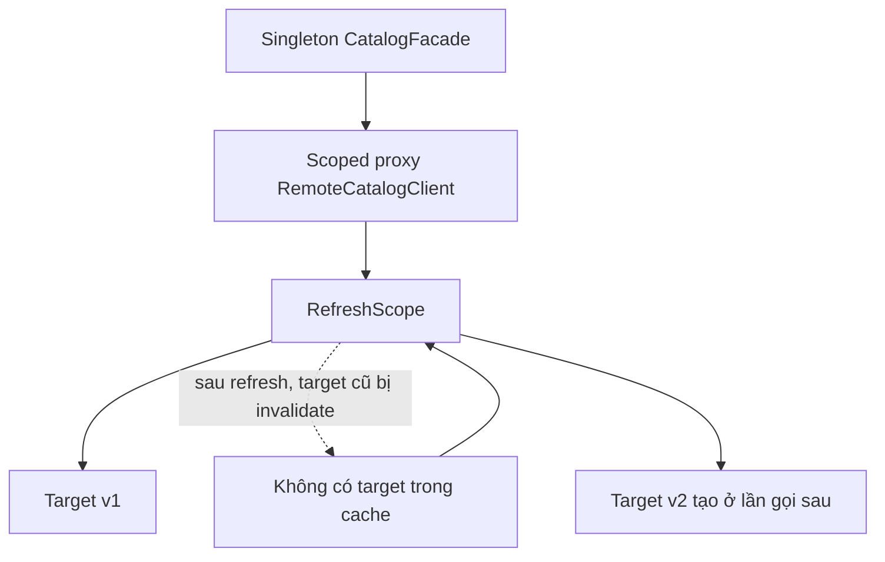

# Bean phụ thuộc giữ tham chiếu cũ và giới hạn của proxy

`@RefreshScope` giúp một bean có thể được tạo lại khi cấu hình thay đổi. Tuy nhiên, trong ứng dụng Spring, bean thường được inject vào các bean khác và các bean phụ thuộc có thể tiếp tục giữ tham chiếu hoặc dữ liệu đã lấy từ bean đó. Muốn hiểu refresh có hiệu lực đến đâu, cần phân biệt **tham chiếu tới scoped proxy**, **tham chiếu trực tiếp tới target object** và **giá trị/object mà caller đã lấy ra rồi lưu riêng**.

Một singleton phụ thuộc có thể giữ proxy ổn định và nhận target mới ở những lần gọi tiếp theo. Nhưng proxy không thể tự sửa field mà singleton đó đã copy, không thể thay thế object con đã được caller lưu lại, và không thể chặn mọi lời gọi nội bộ bên trong target. Những giới hạn này rất quan trọng khi refresh một HTTP client, policy, connection pool hoặc bean có trạng thái trong Spring Cloud Context.

Bài học thuộc chương **Refresh Scope** của module `SPRING_CLOUD_CORE`. Mục tiêu là xác định chính xác nơi tham chiếu cũ được giữ, hiểu proxy chuyển lời gọi như thế nào, nhận diện self-invocation và object bị unwrap, đồng thời thiết kế lifecycle và kiểm thử để refresh không tạo ra hành vi bất ngờ.

## 1. Tham chiếu tới proxy khác tham chiếu tới target

Giả sử một bean `RemoteCatalogClient` được đánh dấu `@RefreshScope`. Spring đăng ký bean này dưới dạng **scoped proxy**. Bean khác được inject thường nhận proxy đại diện cho bean, không nhận target object cố định.



Proxy có thể tồn tại trong suốt vòng đời của `CatalogFacade`. Khi caller gọi method qua proxy, proxy tra cứu target hiện hành trong scope và chuyển lời gọi tới target đó. Sau khi scope được refresh, target cũ bị loại khỏi cache; lần gọi kế tiếp có thể tạo target mới từ cấu hình hiện tại.

Vì vậy, câu “bean phụ thuộc giữ tham chiếu cũ” cần được làm rõ:

- Nếu bean phụ thuộc giữ **tham chiếu tới proxy**, lời gọi tiếp theo qua proxy có thể đến target mới.
- Nếu bean phụ thuộc giữ **tham chiếu trực tiếp tới target**, nó tiếp tục gọi object cũ.
- Nếu bean phụ thuộc copy **giá trị trả về** từ target vào field riêng, field đó không được proxy cập nhật.
- Nếu caller giữ một object con, callback hoặc resource được trả về từ target, object đó có thể sống lâu hơn target và trở thành tham chiếu cũ.

Đây là khác biệt quan trọng nhất khi chẩn đoán vấn đề refresh.

## 2. Trường hợp đúng: singleton giữ scoped proxy

Ví dụ bean client:

```java
import org.springframework.beans.factory.annotation.Value;
import org.springframework.cloud.context.config.annotation.RefreshScope;
import org.springframework.stereotype.Component;

@Component
@RefreshScope
public class RemoteCatalogClient {
    private final String baseUrl;

    public RemoteCatalogClient(
            @Value("${catalog.remote.base-url}") String baseUrl) {
        this.baseUrl = baseUrl;
    }

    public String currentEndpoint() {
        return baseUrl;
    }

    public CatalogItem find(String id) {
        // Gọi endpoint dựa trên baseUrl của target hiện tại.
        return new CatalogItem(id, baseUrl);
    }
}
```

Bean phụ thuộc:

```java
import org.springframework.stereotype.Service;

@Service
public class CatalogFacade {
    private final RemoteCatalogClient client;

    public CatalogFacade(RemoteCatalogClient client) {
        this.client = client;
    }

    public CatalogItem find(String id) {
        return client.find(id);
    }
}
```

`CatalogFacade` là singleton và giữ một field `client` trong suốt vòng đời của nó. Field đó tham chiếu đến scoped proxy. Khi refresh scope invalidate target cũ, `CatalogFacade` không cần được tạo lại; lần gọi `client.find(id)` tiếp theo vẫn đi qua proxy và có thể dùng target mới.

Luồng ví dụ:

| Thời điểm | `CatalogFacade.client` | Target trong RefreshScope | Kết quả |
| --- | --- | --- | --- |
| Khởi động, trước lần gọi đầu | Proxy P | Chưa tạo | Chưa có target |
| Lần gọi đầu | Proxy P | Tạo T1 với URL v1 | Caller dùng v1 |
| Refresh scope | Vẫn proxy P | T1 bị invalidate/hủy theo lifecycle | Proxy không đổi |
| Lần gọi sau refresh | Vẫn proxy P | Tạo T2 với URL v2 | Caller dùng v2 |

Proxy giải quyết việc **giữ tham chiếu ổn định tới bean có target thay đổi**. Nó không có nghĩa mọi dữ liệu do bean đó từng trả về cũng thay đổi.

## 3. Trường hợp sai: bean phụ thuộc copy giá trị từ proxy

Xét một facade lưu endpoint trong constructor:

```java
@Service
public class CatalogFacade {
    private final RemoteCatalogClient client;
    private final String endpointSnapshot;

    public CatalogFacade(RemoteCatalogClient client) {
        this.client = client;
        this.endpointSnapshot = client.currentEndpoint();
    }

    public String endpoint() {
        return endpointSnapshot;
    }
}
```

Trong constructor, lời gọi `client.currentEndpoint()` đi qua proxy và có thể tạo target T1. Giá trị chuỗi v1 được trả về rồi copy vào `endpointSnapshot`. Sau refresh, proxy `client` vẫn có thể chuyển lời gọi sang T2, nhưng `endpointSnapshot` vẫn là v1.

Sửa bằng cách chỉ giữ proxy và đọc qua proxy tại thời điểm cần:

```java
@Service
public class CatalogFacade {
    private final RemoteCatalogClient client;

    public CatalogFacade(RemoteCatalogClient client) {
        this.client = client;
    }

    public String endpoint() {
        return client.currentEndpoint();
    }
}
```

Nếu caller cần một snapshot nhất quán cho toàn bộ một thao tác, hãy tạo snapshot ở ranh giới thao tác đó và chấp nhận rằng snapshot tồn tại tới khi thao tác hoàn tất. Đừng lưu snapshot vào singleton nếu mục tiêu là mỗi lần gọi phải quan sát target mới.

## 4. Tham chiếu tới target đã bị unwrap

Trong dependency injection thông thường, Spring inject scoped proxy theo định nghĩa bean. Nhưng code tùy biến hoặc thư viện có thể lấy target object bên trong proxy, lưu lại và tiếp tục dùng nó sau refresh.

Một số cách có thể làm mất lớp proxy:

- Tự tạo object bằng `new` thay vì lấy bean từ container.
- Gọi factory method trực tiếp hoặc giữ object được tạo bên ngoài lifecycle của Spring.
- Dùng API nội bộ/test utility để unwrap proxy rồi lưu target vào field.
- Lấy delegate/client bên trong target và truyền object đó cho một bean khác.
- Đăng ký callback hoặc listener gắn trực tiếp với target cũ.

Ví dụ minh họa lỗi về ownership:

```java
@Service
public class LegacyCatalogAdapter {
    private final CatalogTransport transport;

    public LegacyCatalogAdapter(RemoteCatalogClient client) {
        // Giả sử API này trả về delegate nội bộ của target.
        // Delegate được lưu trực tiếp nên không còn đi qua scoped proxy.
        this.transport = client.unwrapTransport();
    }

    public void call() {
        transport.execute();
    }
}
```

`unwrapTransport()` chỉ là API giả định để minh họa, không phải method của Spring. Nếu code thật có API trả về delegate nội bộ, cần xác định delegate thuộc lifecycle của target nào. Khi target bị refresh, delegate cũ không tự được thay thế.

Thiết kế an toàn hơn là giữ reference tới bean proxy và gọi API công khai của nó. Nếu cần chia sẻ một transport riêng, hãy để transport có bean ownership và lifecycle độc lập, hoặc tạo factory/provider để lấy resource hiện hành thay vì trích target nội bộ rồi lưu lâu dài.

## 5. Proxy không sửa được object con đã được caller giữ

Ngay cả khi mọi lời gọi tới bean chính đều qua proxy, method của bean vẫn có thể trả về object con. Caller có thể giữ object đó sau refresh.

Ví dụ:

```java
@Component
@RefreshScope
public class CatalogRuntimeSettings {
    private final CatalogOptions options;

    public CatalogRuntimeSettings(
            @Value("${catalog.remote.base-url}") String baseUrl) {
        this.options = new CatalogOptions(baseUrl);
    }

    public CatalogOptions options() {
        return options;
    }
}
```

Caller:

```java
@Service
public class CatalogFacade {
    private final CatalogOptions cachedOptions;

    public CatalogFacade(CatalogRuntimeSettings settings) {
        this.cachedOptions = settings.options();
    }
}
```

`settings` là proxy, nhưng `cachedOptions` là object con được trả về từ target T1. Khi target T1 bị invalidate, `cachedOptions` vẫn tham chiếu object con cũ. Proxy chỉ chặn method call đi qua chính proxy; nó không thể theo dõi mọi object đã thoát khỏi target.

Có ba cách thiết kế thường gặp:

1. Không trả object mutable/nội bộ ra ngoài; cung cấp method thực hiện thao tác qua proxy.
2. Trả một snapshot bất biến và yêu cầu caller chỉ dùng snapshot trong một thao tác có thời hạn rõ ràng.
3. Trả một provider/proxy riêng có lifecycle được quản lý, để mỗi lần truy cập lấy trạng thái hiện hành.

Không nên để caller giữ trực tiếp cấu trúc nội bộ mà target có thể thay thế hoặc giải phóng.

## 6. Giới hạn của self-invocation

Scoped proxy chỉ có thể chuyển tiếp những lời gọi **đi qua proxy**. Khi một method bên trong target gọi method khác trên cùng object bằng `this`, lời gọi đó không quay lại proxy.

Ví dụ:

```java
@Component
@RefreshScope
public class CatalogPolicy {
    private final String region;

    public CatalogPolicy(@Value("${catalog.region}") String region) {
        this.region = region;
    }

    public String currentRegion() {
        return region;
    }

    public String describe() {
        // Self-invocation trên cùng target object.
        return "region=" + this.currentRegion();
    }
}
```

Khi caller gọi `proxy.describe()`, proxy chọn target T1 và gọi `describe()` trên T1. Bên trong T1, `this.currentRegion()` gọi trực tiếp trên T1; không có lần tra cứu target mới giữa hai method. Đây thường là điều mong muốn trong một lần thực thi method: cả hai method cùng quan sát một target.

Điều cần tránh là kỳ vọng self-invocation sẽ tạo một lần chuyển proxy hoặc tự refresh target giữa hai method. Nếu cần ranh giới proxy riêng, tách logic sang một bean khác được inject qua proxy hoặc gọi từ caller qua proxy ở ranh giới phù hợp.

Self-invocation cũng là giới hạn quen thuộc của proxy-based AOP như `@Transactional`. Không nên cố khắc phục bằng cách lấy proxy hiện tại một cách tùy tiện; tách trách nhiệm giữa các bean thường rõ ràng và dễ kiểm thử hơn.

## 7. Giới hạn của proxy theo kiểu class và method

`@RefreshScope` sử dụng scoped proxy để chuyển tiếp method call. Với cấu hình proxy class-based thường dùng, Spring cần tạo subclass proxy. Vì vậy, các lớp `final` hoặc method `final` có thể không được proxy theo cách mong muốn.

Ví dụ không phù hợp với class-based proxy:

```java
@Component
@RefreshScope
public final class FinalCatalogClient {
    public final String endpoint() {
        return "https://catalog.internal";
    }
}
```

Class `final` không thể được subclass; method `final` không thể được override để chặn lời gọi. Tránh đánh dấu lớp/method cần proxy là `final` nếu đang dùng class-based proxy mặc định. Với Kotlin, cần chú ý plugin all-open hoặc cách khai báo class tương ứng.

Một số cấu hình proxy có thể dùng interface-based proxy, nhưng cần bảo đảm kiểu được inject phù hợp với interface và proxy mode thực tế. Không suy ra proxy mode chỉ từ việc bean có implement interface; kiểm tra annotation, scope configuration và runtime type khi gặp lỗi cast hoặc không thể tạo proxy.

Ngoài ra:

- Method được gọi phải có thể được proxy intercept theo loại proxy đang dùng.
- Không ép cast proxy thành implementation class nếu proxy mode không bảo đảm kiểu đó.
- Không dùng `==` để suy luận target có được thay thế hay không; proxy có thể giữ identity ổn định trong khi target thay đổi.
- Không dựa vào `toString()`, `equals()` hoặc `hashCode()` để kiểm tra target hiện tại; semantics của các method này có thể phụ thuộc proxy implementation.

## 8. Bean phụ thuộc khác vẫn có thể giữ trạng thái cũ

Đặt `@RefreshScope` trên một bean không tự động đặt tất cả dependency của nó vào refresh scope.

Ví dụ:

```java
@Component
public class ApiTokenProvider {
    private final String token;

    public ApiTokenProvider(@Value("${catalog.api-token}") String token) {
        this.token = token;
    }

    public String token() {
        return token;
    }
}

@Component
@RefreshScope
public class RemoteCatalogClient {
    private final ApiTokenProvider tokenProvider;

    public RemoteCatalogClient(ApiTokenProvider tokenProvider) {
        this.tokenProvider = tokenProvider;
    }

    public String currentToken() {
        return tokenProvider.token();
    }
}
```

Khi `RemoteCatalogClient` được tạo lại, nó vẫn nhận `ApiTokenProvider` singleton hiện có. Nếu token provider đã capture token cũ và không được rebind/refresh, target client mới cũng đọc token cũ.

Muốn target mới dùng token mới, phải xử lý đúng bean sở hữu token: cho provider đọc động từ nguồn đã cập nhật, hỗ trợ rebinding theo cơ chế phù hợp hoặc đặt provider vào scope có thể refresh nếu lifecycle của nó cho phép. Chỉ refresh bean ở tầng trên không làm thay đổi dependency singleton đã tồn tại.

## 9. Target bị invalidate và resource cũ

Refresh scope hoạt động như một cache target. Khi scope được làm mới, target đang cache bị loại bỏ và destruction callback của target được thực hiện theo lifecycle của scope. Lần gọi sau mới tạo target mới. Điều này có hệ quả quan trọng với resource:

- Target cũ có thể sở hữu HTTP client, connection pool, executor hoặc file handle.
- Caller có thể đang thực hiện request bằng target cũ trong khi refresh diễn ra.
- Destroy callback có thể đóng resource cũ trong lúc có thao tác đang dùng nó nếu thiết kế không có cơ chế drain.
- Target mới được tạo lazy; lỗi cấu hình hoặc lỗi kết nối có thể chỉ xuất hiện ở lần gọi đầu sau refresh.

Không nên giả định refresh scope tự thực hiện một quy trình swap tài nguyên nguyên tử hoặc chờ mọi request đang chạy. Hành vi an toàn phụ thuộc implementation và lifecycle của resource. Với client có request dài, cần thiết kế timeout, drain, connection management và xử lý lỗi rõ ràng.

Ví dụ bean sở hữu resource:

```java
import jakarta.annotation.PreDestroy;
import org.springframework.beans.factory.annotation.Value;
import org.springframework.cloud.context.config.annotation.RefreshScope;
import org.springframework.stereotype.Component;

@Component
@RefreshScope
public class CatalogTransport {
    private final HttpTransport delegate;

    public CatalogTransport(
            @Value("${catalog.remote.base-url}") String baseUrl) {
        this.delegate = HttpTransport.connect(baseUrl);
    }

    public Response execute(Request request) {
        return delegate.execute(request);
    }

    @PreDestroy
    public void close() {
        delegate.close();
    }
}
```

`HttpTransport` là API minh họa. Trong thư viện thực tế, hãy kiểm tra `close()` có chờ request đang chạy không, có thread-safe không và có cho phép đóng lặp lại không. Nếu cần graceful handover, có thể cần một resource manager riêng quản lý phiên bản client và số request đang sử dụng từng phiên bản.

## 10. Lưu ý khi dùng `@RefreshScope` với `@Bean` và configuration class

Có thể đánh dấu bean factory method:

```java
@Configuration(proxyBeanMethods = false)
public class CatalogClientConfiguration {
    @Bean
    @RefreshScope
    CatalogTransport catalogTransport(
            @Value("${catalog.remote.base-url}") String baseUrl) {
        return new CatalogTransport(baseUrl);
    }
}
```

Trong trường hợp này, bean được tạo bởi factory method là bean có refresh scope. Những bean khác inject `CatalogTransport` qua container sẽ nhận proxy theo scope.

Nếu đánh dấu cả `@Configuration` class bằng `@RefreshScope`, cần đọc đúng semantics của Spring Cloud version đang dùng và xác định chính xác bean nào được đặt trong scope. Không mặc định rằng mọi object được tạo thủ công bên trong method hoặc mọi dependency của configuration class đều tự trở thành refresh scoped. Cách rõ ràng nhất khi cần kiểm soát là đánh dấu trực tiếp các bean factory method thực sự cần tái tạo.

Một số cấu hình có thể gặp lỗi khi proxy class-based được áp dụng lên configuration class hoặc các kiểu không phù hợp. Nên giữ configuration class tập trung vào khai báo bean và đặt refresh scope trên bean target cụ thể.

## 11. Refresh trigger và trạng thái của proxy

`@RefreshScope` không tự phát hiện Config Server thay đổi. Một quy trình refresh thường cần:

1. Lấy cấu hình mới từ nguồn bên ngoài hoặc cập nhật property source trong `Environment`.
2. Phát sự kiện refresh/rebind phù hợp.
3. Invalidate target cache của refresh scope.
4. Cho các lần gọi sau qua proxy tạo target mới.

Các trigger thường gặp gồm endpoint `POST /actuator/refresh` khi được expose và bảo vệ đúng cách, `ContextRefresher` trong thành phần quản trị nội bộ, hoặc Spring Cloud Bus để phát sự kiện đến nhiều instance. Cơ chế và dependency cụ thể phụ thuộc release train.

Refresh scope không có nghĩa target mới được khởi tạo ngay tại thời điểm refresh. Vì target thường được tạo lazy, lỗi constructor hoặc lỗi khởi tạo resource có thể xảy ra khi có request đầu tiên sau refresh. Nếu cần phát hiện lỗi trước khi nhận traffic, phải có bước validation/probe chủ động và chính sách readiness phù hợp.

## 12. Các mẫu thiết kế giúp tránh tham chiếu cũ

### 12.1. Giữ proxy, không giữ target

Inject bean refresh-scoped qua Spring và giữ tham chiếu proxy. Không unwrap target hoặc lưu delegate nội bộ vào singleton khác.

### 12.2. Không copy cấu hình vào singleton nếu cần giá trị động

Nếu giá trị cần thay đổi, đọc qua proxy/provider tại thời điểm dùng hoặc tạo snapshot có thời hạn trong phạm vi một request/job. Tránh giữ `String`, `URI`, `Duration` hay object settings trong field singleton mà không có quy trình cập nhật.

### 12.3. Không để object nội bộ thoát khỏi target

Expose method thực hiện thao tác hoặc trả về DTO/snapshot bất biến. Tránh trả collection mutable, delegate, connection hoặc object con có vòng đời gắn với target.

### 12.4. Tách bean theo quyền sở hữu resource

Nếu client có nhiều resource, tách factory/manager và target service sao cho owner lifecycle rõ. Khi target được tạo lại, resource cũ phải được đóng đúng cách; caller không được giữ resource sau khi owner đã đóng.

### 12.5. Thiết kế dependency graph có chủ đích

Nếu target mới cần một dependency cũng chứa cấu hình thay đổi, hãy đảm bảo dependency đó đọc động, rebind hoặc cũng có lifecycle refresh phù hợp. Refresh ở tầng trên không tự thay thế singleton dependency cũ.

## 13. Kiểm thử giới hạn proxy và tham chiếu cũ

Một test chỉ xác nhận Environment có giá trị mới là chưa đủ. Cần xác minh reference nào đang được giữ và method call có đi qua proxy hay không.

| Kịch bản | Cách kiểm thử | Kết quả cần xác nhận |
| --- | --- | --- |
| Singleton giữ proxy | Inject refresh-scoped bean vào singleton, gọi trước/sau refresh | Reference proxy ổn định; target sau refresh thay đổi |
| Copy giá trị | Constructor gọi proxy rồi lưu chuỗi vào field | Field snapshot vẫn là giá trị cũ |
| Unwrap target | Lấy target/delegate trong test và giữ reference | Reference trực tiếp không tự chuyển sang target mới |
| Return object con | Lấy object từ target rồi giữ ở caller | Object con vẫn là object cũ sau refresh |
| Self-invocation | Target method gọi `this.otherMethod()` | Lời gọi nội bộ không đi qua scoped proxy lần nữa |
| Dependency singleton stale | Target refresh-scoped inject provider singleton đã capture config | Target mới vẫn nhận provider singleton cũ nếu provider không cập nhật |
| Final class/method | Thử proxy với kiểu không thể subclass/override | Xác định lỗi proxy và điều chỉnh kiểu/proxy strategy |
| Resource destroy | Theo dõi create/close khi refresh | Target cũ giải phóng resource theo lifecycle đã thiết kế |
| Lazy recreation | Cập nhật cấu hình, invalidate scope nhưng chưa gọi bean | Target mới chỉ được tạo khi có truy cập phù hợp |
| Multi-instance | Refresh một instance trước instance khác | Mỗi instance có thể dùng target/config version khác nhau tạm thời |

### 13.1. Kiểm thử reference proxy ổn định

Có thể tạo một bean test refresh-scoped trả về một version string được inject từ property. Test integration thực hiện:

1. Khởi động context với `demo.version=v1`.
2. Lấy proxy từ context và giữ reference đó.
3. Gọi method, xác nhận target trả `v1`.
4. Thay property source theo cách test context hỗ trợ và kích hoạt refresh scope.
5. Gọi lại qua cùng reference proxy.
6. Xác nhận target mới trả `v2`.

Điểm quan trọng là **dùng cùng reference proxy** ở bước 2 và bước 5. Nếu test lấy lại bean từ context sau refresh, nó có thể không chứng minh singleton phụ thuộc cũ vẫn giữ đúng proxy.

### 13.2. Kiểm thử snapshot và object con

Tạo một singleton phụ thuộc có hai field: một field giữ proxy và một field giữ giá trị được đọc từ proxy ở constructor. Sau refresh, assert:

- Lời gọi qua proxy trả giá trị mới.
- Field snapshot vẫn trả giá trị cũ.
- Nếu constructor lưu object con được trả về, object con vẫn mang dữ liệu cũ.

Test này làm rõ ranh giới giữa proxy và dữ liệu đã thoát khỏi proxy.

### 13.3. Kiểm thử resource đang được sử dụng

Dùng fake transport có counter create/close và latch để mô phỏng request đang chạy. Refresh trong lúc request giữ target cũ, sau đó xác nhận:

- Target cũ bị invalidate theo semantics của scope.
- Callback destroy được gọi theo lifecycle thực tế.
- Target mới được tạo khi proxy được gọi lại.
- Hành vi khi resource cũ bị đóng trong lúc request đang chạy đúng policy đã thiết kế.

Không dùng `Thread.sleep()` để suy luận thứ tự. Dùng `CountDownLatch`, `CompletableFuture` hoặc công cụ đồng bộ trong test để điều khiển chính xác thời điểm.

## 14. Chẩn đoán khi dependent bean vẫn dùng tham chiếu cũ

| Triệu chứng | Nguyên nhân có thể | Hướng kiểm tra |
| --- | --- | --- |
| Proxy call trả dữ liệu mới nhưng field facade vẫn cũ | Facade đã copy giá trị từ proxy vào field | Tìm field snapshot và chuyển sang gọi proxy/provider khi cần |
| Một collaborator vẫn dùng endpoint cũ | Collaborator lưu delegate/target đã unwrap | Kiểm tra nơi lấy target hoặc API trả object nội bộ |
| Bean refresh-scoped mới vẫn dùng token cũ | Token provider là singleton đã capture token | Rebind/refresh provider hoặc đọc token động |
| Method A dùng target mới nhưng method B trong cùng target vẫn cũ | Self-invocation chạy trên cùng target | Tách bean hoặc đặt proxy boundary ở caller |
| Object trả về vẫn chứa config cũ | Caller giữ object con từ target trước | Trả DTO snapshot có thời hạn hoặc giữ provider/proxy |
| Refresh lỗi với final class | Class-based proxy không thể subclass | Bỏ `final` hoặc thiết kế proxy/interface phù hợp |
| Target mới được tạo nhưng resource cũ còn chạy | Lifecycle/resource ownership chưa có drain | Thiết kế shutdown/drain và đóng resource an toàn |
| Không thấy target mới ngay sau refresh | Target được tạo lazy khi proxy được gọi | Gọi qua proxy và kiểm tra target sau truy cập |

Trình tự chẩn đoán:

1. Xác nhận instance đã nhận cấu hình mới vào Environment.
2. Xác nhận refresh scope đã invalidate target.
3. Xác định field trong bean phụ thuộc đang giữ proxy, target hay giá trị đã copy.
4. Kiểm tra object trả về từ target có bị lưu lâu dài không.
5. Tìm self-invocation và method reference/callback có capture object cũ.
6. Kiểm tra dependency singleton bên trong target có trạng thái cấu hình cũ không.
7. Kiểm tra proxy mode, final class/method và kiểu được inject.
8. Kiểm tra destroy callback, request đang chạy và tài nguyên cũ.
9. Lặp lại xác minh trên từng replica nếu ứng dụng chạy nhiều instance.

## 15. Thực hành: refresh endpoint mà facade vẫn sống

Giả sử `catalog-service` cần đổi endpoint từ v1 sang v2 mà không restart toàn bộ context.

**Bước 1 — Tạo bean target có refresh scope:**

```java
@Component
@RefreshScope
public class CatalogEndpointProvider {
    private final URI endpoint;

    public CatalogEndpointProvider(
            @Value("${catalog.remote.base-url}") URI endpoint) {
        this.endpoint = endpoint;
    }

    public URI currentEndpoint() {
        return endpoint;
    }
}
```

**Bước 2 — Tạo facade giữ proxy:**

```java
@Service
public class CatalogFacade {
    private final CatalogEndpointProvider provider;

    public CatalogFacade(CatalogEndpointProvider provider) {
        this.provider = provider;
    }

    public URI endpoint() {
        return provider.currentEndpoint();
    }
}
```

**Bước 3 — Kiểm thử ban đầu:** cấu hình `catalog.remote.base-url=https://catalog-v1.internal`; gọi facade và xác nhận v1.

**Bước 4 — Refresh:** cập nhật Environment theo cơ chế của ứng dụng, sau đó invalidate refresh scope bằng trigger được hỗ trợ. Không chỉ sửa file/repository rồi giả định target đã đổi.

**Bước 5 — Gọi lại qua cùng facade:** `CatalogFacade` vẫn là singleton cũ và giữ cùng proxy; lần gọi tiếp theo qua proxy phải tạo/đọc target mới với v2.

**Bước 6 — Thử anti-pattern:** thêm field `private final URI snapshot` được gán từ `provider.currentEndpoint()` trong constructor của facade. Xác nhận field snapshot vẫn là v1 sau refresh trong khi method gọi qua proxy trả v2.

**Bước 7 — Mở rộng sang resource:** thay endpoint provider bằng HTTP client thực, thêm callback close và test request đang chạy để xác định chính sách drain.

### Câu hỏi tự kiểm tra

1. Khi singleton inject một bean `@RefreshScope`, nó thường giữ target hay scoped proxy?
2. Vì sao proxy có thể giữ identity ổn định trong khi target thay đổi?
3. Nếu constructor của dependent bean gọi method proxy rồi lưu kết quả vào `final String`, field đó có tự cập nhật không?
4. Vì sao object con được trả về từ target có thể trở thành tham chiếu cũ?
5. Self-invocation có đi qua scoped proxy lần nữa không?
6. Vì sao refresh target không tự làm mới singleton dependency mà target đang inject?
7. Những giới hạn nào cần chú ý với class-based proxy và `final` class/method?
8. Vì sao không thể giả định refresh scope chờ mọi request đang chạy trước khi đóng target cũ?
9. Làm sao chứng minh dependent singleton cũ vẫn hoạt động với target mới?

**Gợi ý đáp án:** (1) Thường giữ scoped proxy; (2) Proxy tra cứu target hiện tại trong scope cho mỗi lời gọi phù hợp; (3) Không, đó là snapshot; (4) Caller giữ trực tiếp object con, không còn gọi qua proxy; (5) Không, lời gọi `this.method()` ở trong target không quay lại proxy; (6) Dependency singleton vẫn là instance cũ nếu nó không rebind/refresh; (7) Class-based proxy không thể subclass class `final` hoặc override method `final`; (8) Refresh scope không phải cơ chế drain giao dịch/resource tổng quát; (9) Giữ cùng reference proxy trước và sau refresh, gọi method ở cả hai thời điểm và so sánh target/version.

## 16. Những nguyên tắc cần nhớ

- Bean phụ thuộc được inject refresh-scoped bean thường giữ **scoped proxy**; proxy có thể chuyển lời gọi sau refresh tới target mới.
- Giá trị được copy từ proxy, target đã unwrap, delegate, object con hoặc callback gắn với target cũ không tự được thay thế.
- Self-invocation bên trong target không quay lại proxy; các method nội bộ chạy trên cùng target của lần gọi hiện tại.
- Refresh một bean không tự refresh các singleton dependency mà bean đó đang sử dụng.
- Class-based proxy cần kiểu có thể subclass/override; kiểm tra `final` class, `final` method và kiểu inject.
- Target thường được tạo lazy sau khi scope invalidate; lỗi khởi tạo có thể xuất hiện ở lần gọi đầu tiên sau refresh.
- Tái tạo target có thể đóng resource cũ; phải quản lý request đang chạy, drain và quyền sở hữu tài nguyên.
- Kiểm thử bằng cùng reference proxy trước/sau refresh, đồng thời kiểm tra snapshot, object con, self-invocation và từng replica.

Hiểu giới hạn của proxy giúp thiết kế đúng ranh giới giữa bean phụ thuộc và target có thể refresh. Khi caller giữ proxy và mọi thao tác cần cập nhật đều đi qua proxy, Spring Cloud Context có thể thay target theo scope; còn snapshot, delegate và resource đã thoát khỏi target cần một chiến lược lifecycle riêng.
