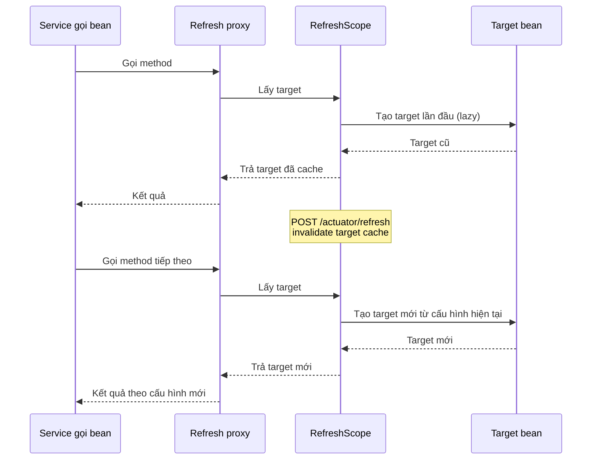
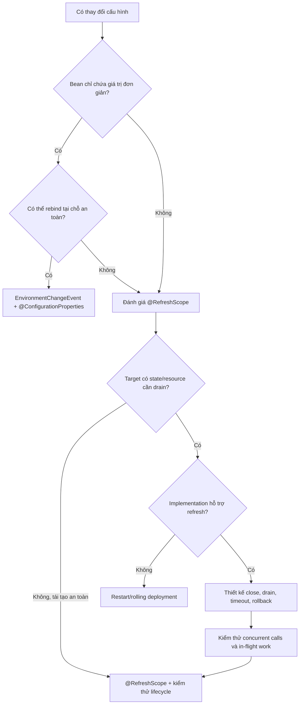

# Giới hạn làm mới đối với tài nguyên có trạng thái và xử lý đồng thời

## 1. Vì sao refresh có thể gây rủi ro?

Spring Cloud Context hỗ trợ cập nhật cấu hình khi ứng dụng đang chạy. Nhờ `@RefreshScope`, một bean có thể được tạo lại để sử dụng giá trị cấu hình mới mà không cần khởi động lại toàn bộ JVM. Điều này hữu ích với endpoint, timeout, policy hoặc client cần khởi tạo lại theo cấu hình mới.

Tuy nhiên, nhiều bean không chỉ chứa vài giá trị đơn giản. Chúng còn quản lý **tài nguyên có trạng thái** như connection pool, HTTP client, thread pool, cache, message consumer, file handle hoặc phiên kết nối dài hạn. Khi bean bị refresh, target cũ bị loại khỏi cache và target mới được tạo ở lần truy cập tiếp theo. Nếu không quản lý vòng đời tài nguyên, refresh có thể làm mất state, ngắt công việc đang diễn ra hoặc tạo ra hai thế hệ tài nguyên hoạt động chồng lấn.

Bài học thuộc chương **Refresh Scope** của **SPRING_CLOUD_CORE**. Trọng tâm là hiểu giới hạn khi làm mới tài nguyên có trạng thái, cách Spring Cloud xử lý truy cập đồng thời, và cách thiết kế refresh an toàn trong một instance cũng như trong cụm nhiều instance.

Cần phân biệt ba cơ chế:

| Cơ chế | Hành vi | Khi phù hợp |
| --- | --- | --- |
| Rebind `@ConfigurationProperties` | Cập nhật các field trên **cùng một bean instance** | Cấu hình mutable đơn giản, chấp nhận được việc cập nhật tại chỗ |
| `@RefreshScope` | Dùng proxy và cache target; refresh xóa target cũ để lần gọi sau tạo target mới | Bean cần khởi tạo lại từ cấu hình mới, cần góc nhìn nhất quán hơn trong lúc refresh |
| Restart/rollout ứng dụng | Tạo process/context mới theo vòng đời triển khai | Thay đổi ảnh hưởng hạ tầng hoặc cần chuyển đổi tài nguyên có kiểm soát |

Không có một lựa chọn duy nhất đúng cho mọi bean. Cần phân loại tài nguyên, xác định công việc nào có thể đang chạy, và kiểm tra hành vi thực tế của thư viện quản lý tài nguyên trước khi bật refresh.

## 2. `@RefreshScope` hoạt động như thế nào?

Một bean được đánh dấu `@RefreshScope` được Spring đưa vào một **scope có proxy**. Proxy được inject vào các bean khác; target thực tế được tạo khi proxy được sử dụng lần đầu. Scope lưu target trong cache.

Khi refresh:

1. Spring Cloud invalidates target cache của bean trong refresh scope.
2. Destruction callback của target cũ được gọi theo lifecycle của bean.
3. Proxy vẫn là đối tượng được các bean khác tham chiếu.
4. Ở lần gọi method tiếp theo, scope tạo target mới từ `Environment` hiện tại rồi cache target đó.



Ví dụ bean policy đơn giản:

```java
import java.math.BigDecimal;

import org.springframework.beans.factory.annotation.Value;
import org.springframework.cloud.context.config.annotation.RefreshScope;
import org.springframework.stereotype.Component;

@Component
@RefreshScope
public class ShippingPolicy {

    private final BigDecimal freeShippingThreshold;

    public ShippingPolicy(
            @Value("${app.shipping.free-shipping-threshold:300000}")
            BigDecimal freeShippingThreshold) {
        this.freeShippingThreshold = freeShippingThreshold;
    }

    public boolean isFreeShipping(BigDecimal orderTotal) {
        return orderTotal.compareTo(freeShippingThreshold) >= 0;
    }

    public BigDecimal threshold() {
        return freeShippingThreshold;
    }
}
```

Khi target `ShippingPolicy` được tạo, constructor nhận giá trị hiện có trong `Environment`. Sau khi property được cập nhật và target bị refresh, lần gọi tiếp theo sẽ tạo `ShippingPolicy` mới với ngưỡng mới.

**Proxy không phải target.** Các service khác giữ tham chiếu đến proxy nên không cần tự tìm bean mới sau mỗi lần refresh. Nhưng nếu code lấy target rồi lưu trực tiếp vào một biến hoặc truyền tài nguyên nội bộ ra ngoài proxy, phần tham chiếu đã thoát khỏi proxy có thể không đi qua cơ chế refresh nữa.

### 2.1. `refreshAll()` và refresh một bean

`RefreshScope` cung cấp hai thao tác chính:

- `refreshAll()` xóa cache target của tất cả bean thuộc refresh scope trong context.
- `refresh(String beanName)` xóa cache target của bean theo tên.

Endpoint Actuator `/actuator/refresh` gọi cơ chế refresh scope trong context. Đây là thao tác **invalidate cache**, không phải đồng thời khởi tạo lại mọi target ngay lập tức. Target được tạo lại khi có lời gọi tiếp theo đến proxy.

Ví dụ cấu hình expose endpoint:

```yaml
management:
  endpoints:
    web:
      exposure:
        include: health,info,refresh
```

Gọi refresh:

```bash
curl -X POST http://localhost:8080/actuator/refresh
```

Chỉ expose endpoint khi thực sự cần. Trong production, cần bảo vệ bằng xác thực, phân quyền, giới hạn mạng và audit thao tác quản trị. Không để endpoint refresh công khai cho client bên ngoài.

### 2.2. Không phải mọi bean trong một `@Configuration` đều tự thuộc refresh scope

Đánh dấu một class `@Configuration` bằng `@RefreshScope` không có nghĩa mọi bean được khai báo bằng `@Bean` trong class đó tự động trở thành refresh-scoped. Các bean phụ thuộc vào chúng cũng không mặc nhiên được tạo lại khi refresh.

Nếu một bean phụ thuộc cần nhận dependency mới sau refresh, bean phụ thuộc đó cũng cần được thiết kế với scope/lifecycle phù hợp. Cách rõ ràng hơn thường là đánh dấu trực tiếp bean cần refresh:

```java
import java.net.URI;
import java.time.Duration;

import org.springframework.beans.factory.annotation.Value;
import org.springframework.cloud.context.config.annotation.RefreshScope;
import org.springframework.context.annotation.Bean;
import org.springframework.context.annotation.Configuration;

@Configuration(proxyBeanMethods = false)
public class PricingClientConfiguration {

    @Bean(destroyMethod = "close")
    @RefreshScope
    PricingClient pricingClient(
            @Value("${app.pricing.base-url}") URI baseUrl,
            @Value("${app.pricing.timeout:2s}") Duration timeout) {
        return new PricingClient(baseUrl, timeout);
    }
}
```

Ví dụ giả định `PricingClient` là client do ứng dụng sở hữu và có phương thức `close()` để giải phóng tài nguyên. Khi target bị invalidated, Spring gọi destroy method theo lifecycle bean. Lần gọi tiếp theo sẽ tạo client mới từ URL và timeout hiện tại.

Nếu client được tạo thủ công bằng `new` bên ngoài Spring hoặc được giữ trong static field, Spring không thể tự quản lý vòng đời refresh của đối tượng đó.

## 3. Rebind `@ConfigurationProperties` khác với `@RefreshScope`

Spring Cloud Context lắng nghe `EnvironmentChangeEvent`. Khi event được phát, các bean `@ConfigurationProperties` trong context có thể được rebind; các logger có key `logging.level.*` cũng có thể được cập nhật.

Rebind thông thường **sửa field trên cùng instance**. Nó không thay thế object bằng một instance mới. Việc rebind cùng một bean được serialize nội bộ, nhưng thread khác đọc bean trong khi rebind vẫn có thể nhìn thấy trạng thái trung gian: một field đã reset về giá trị mặc định trong khi field khác chưa nhận giá trị mới.

Ví dụ một cấu hình mutable có hai giới hạn liên quan:

```java
import java.math.BigDecimal;

import org.springframework.boot.context.properties.ConfigurationProperties;

@ConfigurationProperties(prefix = "app.checkout")
public class CheckoutLimits {

    private BigDecimal minimumTotal = BigDecimal.ZERO;
    private BigDecimal maximumDiscountRate = BigDecimal.ZERO;

    public BigDecimal getMinimumTotal() {
        return minimumTotal;
    }

    public void setMinimumTotal(BigDecimal value) {
        this.minimumTotal = value;
    }

    public BigDecimal getMaximumDiscountRate() {
        return maximumDiscountRate;
    }

    public void setMaximumDiscountRate(BigDecimal value) {
        this.maximumDiscountRate = value;
    }
}
```

Nếu một request đọc `minimumTotal`, rồi một refresh rebind xảy ra, sau đó request đọc `maximumDiscountRate`, nó có thể quan sát hai giá trị thuộc hai thời điểm khác nhau. Với policy cần tính nhất quán, điều đó có thể tạo quyết định sai.

Spring Cloud khuyến nghị dùng `@RefreshScope` khi ứng dụng cần một góc nhìn nhất quán của bean trong lúc refresh. Với bean thuộc scope này, cơ chế scope serialize việc truy cập qua proxy với refresh. Tuy vậy, điều đó không tạo ra một transaction phân tán bao trùm mọi bean, mọi request và mọi instance.

Spring Cloud mô tả `@RefreshScope` là lựa chọn cho trường hợp cần thay đổi có tính nguyên tử ở phạm vi `ApplicationContext`. Phạm vi này là các bean thực sự thuộc refresh scope trong context đó; bean không thuộc scope, công việc đã chuyển sang hệ thống bên ngoài và các JVM khác vẫn cần lifecycle/điều phối riêng.

### 3.1. Constructor binding và Java record

Các object `@ConfigurationProperties` dùng constructor binding, bao gồm Java record, không được refresh/rebind theo cơ chế Spring Cloud Context này.

Ví dụ:

```java
@ConfigurationProperties(prefix = "app.checkout")
public record CheckoutPolicyProperties(
        BigDecimal minimumTotal,
        BigDecimal maximumDiscountRate
) {
}
```

Record phù hợp với cấu hình immutable được xác định khi khởi tạo. Nếu yêu cầu thay đổi policy runtime, hãy chọn một thiết kế hỗ trợ refresh rõ ràng: mutable properties bean có validation phù hợp, hoặc một bean refresh-scoped đọc cấu hình mới khi target được tạo lại. Không giả định chỉ cần đặt `@RefreshScope` lên record là constructor binding sẽ được chạy lại.

## 4. Tài nguyên có trạng thái và giới hạn khi làm mới

Một target bean có thể sở hữu tài nguyên bên ngoài JVM. Refresh chỉ quản lý vòng đời target theo Spring scope; cách tài nguyên thực sự được đóng, drain, khởi tạo và chuyển giao phụ thuộc implementation.

| Tài nguyên | Trạng thái có thể bị ảnh hưởng | Rủi ro khi refresh | Hướng xử lý |
| --- | --- | --- | --- |
| Database connection pool | Connection đang mượn, transaction, pool statistics | Đóng pool quá sớm, lỗi transaction đang chạy hoặc không tạo được pool mới | Dùng implementation hỗ trợ refresh; quản lý borrower và shutdown; kiểm thử connection lifecycle |
| HTTP client / connection pool | Connection keep-alive, TLS session, request đang chạy | Request lỗi giữa chừng, mất connection reuse, tăng latency khi tạo lại | Tạo client mới có kiểm soát, drain client cũ, timeout và retry có giới hạn |
| Thread pool / executor | Task đang chạy, queue, worker thread | Mất task trong queue, trùng worker hoặc thread leak | Dừng nhận task mới, drain queue, chờ task kết thúc rồi shutdown |
| Message consumer | Consumer session, offset, in-flight message | Xử lý lặp, mất quyền sở hữu partition hoặc re-delivery | Pause/stop consumer theo protocol, commit/ack đúng lúc và khởi động lại có kiểm soát |
| In-memory cache | Entry và trạng thái cache local | Cache lạnh, tăng tải backend, mất dữ liệu chưa ghi bền vững | Dùng cache có thể tái tạo hoặc externalize state |
| WebSocket / streaming session | Session đang mở, buffer và state theo kết nối | Ngắt kết nối dài hạn, mất phiên hoặc dữ liệu đang truyền | Drain kết nối, hỗ trợ reconnect/resume hoặc giữ session ngoài bean refreshable |
| Scheduler / background worker | Lịch chạy và công việc đang thực hiện | Hai job chạy chồng hoặc job bị dừng giữa chừng | Pause, drain và bảo đảm idempotency/leader coordination |

### 4.1. State trong bộ nhớ sẽ mất khi target được tạo lại

Nếu bean giữ counter, session map, cache không được tái tạo từ nguồn ngoài hoặc trạng thái xử lý chưa ghi bền vững, target mới không tự kế thừa state của target cũ.

Ví dụ:

```java
@Component
@RefreshScope
public class LocalCounter {

    private final AtomicLong counter = new AtomicLong();

    public long next() {
        return counter.incrementAndGet();
    }
}
```

Sau refresh, target mới có một `AtomicLong` mới bắt đầu từ giá trị khởi tạo. Nếu counter biểu diễn số đơn hàng, số lần xử lý hoặc dữ liệu cần bảo toàn, đây là thiết kế không phù hợp.

Hãy lưu state có ý nghĩa nghiệp vụ vào database, distributed cache, event log hoặc một kho bền vững phù hợp. Bean refreshable nên giữ cấu hình và tài nguyên có thể tái tạo, không nên là nơi duy nhất giữ dữ liệu quan trọng.

### 4.2. Destruction callback không thay thế quy trình drain

Spring gọi destruction callback của target cũ khi scope invalidates target. Điều đó giúp đóng resource nếu bean khai báo đúng lifecycle (`close`, `shutdown`, `@PreDestroy`, `DisposableBean` hoặc destroy method của `@Bean`).

Tuy nhiên, việc gọi `close()` không tự đảm bảo mọi implementation đều chờ các thao tác bên ngoài hoàn tất. Một HTTP request đã gửi, một JDBC connection đã được mượn hoặc một message đã được nhận có thể có lifecycle riêng. Hãy xác định:

- Có ngừng nhận công việc mới trước khi đóng không?
- Task/request đang chạy được chờ bao lâu?
- Connection đang mượn được trả về hay bị đóng ngay?
- Timeout drain là bao nhiêu?
- Khi drain thất bại, hệ thống retry, hủy thao tác hay chuyển sang rollout?
- Việc tạo resource mới có hoàn tất trước khi hệ thống nhận traffic lớn không?

Đối với transaction, không nên cắt ngang connection đang có transaction chỉ vì cấu hình URL đã thay đổi. Cần kiểm tra cách pool và transaction manager xử lý connection cũ.

## 5. Giới hạn đặc biệt với `HikariDataSource`

Spring Cloud Context hiện đánh dấu `com.zaxxer.hikari.HikariDataSource` là **never-refreshable** mặc định. Nếu ứng dụng dùng Hikari làm `DataSource`, không thể kỳ vọng `@RefreshScope` làm mới datasource đó như một bean thông thường.

Khi cần thay database URL hoặc credential của Hikari, thường nên chọn một trong các hướng:

1. Thực hiện rollout/restart có kiểm soát để process mới tạo pool với cấu hình mới.
2. Thiết kế một lớp quản lý datasource/pool có lifecycle và khả năng chuyển đổi rõ ràng, đã kiểm thử với transaction và connection đang mượn.
3. Chọn implementation datasource khác nếu yêu cầu kiến trúc thực sự cần refresh theo cơ chế được hỗ trợ.

Thuộc tính `spring.cloud.refresh.never-refreshable` mặc định chứa Hikari. Nếu tự khai báo lại danh sách này trong cấu hình, phải giữ `com.zaxxer.hikari.HikariDataSource` trong danh sách nếu ứng dụng vẫn dùng Hikari để tránh xử lý refresh ngoài dự kiến. Không nên bỏ Hikari khỏi danh sách chỉ để ép refresh chạy; hãy chọn chiến lược pool phù hợp và kiểm thử đầy đủ.

`spring.cloud.refresh.extra-refreshable` có thể khai báo thêm class hoặc bean cần được post-process vào refresh scope trong những trường hợp đặc biệt. Đây không phải cơ chế biến mọi resource thành an toàn khi refresh và không thay thế lifecycle management.

## 6. Xử lý đồng thời trong một bean refresh-scoped

Có hai hoạt động có thể xảy ra cùng lúc:

- Thread A gọi method thông qua proxy `@RefreshScope`.
- Thread B thực hiện refresh và invalidates target cache.

Spring Cloud RefreshScope quản lý việc truy cập qua proxy và serialize reads với refresh cho các bean trong scope. Điều này giúp caller không đọc một bean đang bị thay đổi field từng phần như trường hợp rebind mutable `@ConfigurationProperties`.

Tuy nhiên, phạm vi bảo vệ này có giới hạn:

- Chỉ các truy cập đi qua proxy Spring mới được quản lý bởi scope.
- Một object hoặc resource nội bộ đã được trả ra ngoài proxy có thể tiếp tục được caller sử dụng theo lifecycle riêng.
- Một request đã bắt đầu thao tác với hệ thống bên ngoài vẫn phải tuân theo timeout, transaction, cancellation và shutdown semantics của resource đó.
- Scope không tạo transaction phân tán cho nhiều bean hoặc nhiều service.
- Các instance JVM khác nhau có cache target riêng; refresh một instance không tự refresh instance còn lại.

Ví dụ một bean có thể trả ra một resource nội bộ:

```java
import java.net.URI;

import jakarta.annotation.PreDestroy;

import org.springframework.beans.factory.annotation.Value;
import org.springframework.cloud.context.config.annotation.RefreshScope;
import org.springframework.stereotype.Component;

@Component
@RefreshScope
public class ClientHolder {

    private final PricingClient client;

    public ClientHolder(
            @Value("${app.pricing.base-url}") URI baseUrl) {
        this.client = new PricingClient(baseUrl);
    }

    public PricingClient client() {
        return client;
    }

    @PreDestroy
    void close() {
        client.close();
    }
}
```

Caller có thể lưu kết quả `clientHolder.client()` vào field của chính nó. Khi `ClientHolder` được refresh, caller vẫn giữ reference tới client cũ. Thiết kế an toàn hơn là cung cấp method nghiệp vụ qua proxy thay vì trả resource nội bộ để các component khác lưu giữ:

```java
import java.net.URI;

import jakarta.annotation.PreDestroy;

import org.springframework.beans.factory.annotation.Value;
import org.springframework.cloud.context.config.annotation.RefreshScope;
import org.springframework.stereotype.Component;

@Component
@RefreshScope
public class PricingGateway {

    private final PricingClient client;

    public PricingGateway(
            @Value("${app.pricing.base-url}") URI baseUrl) {
        this.client = new PricingClient(baseUrl);
    }

    public Price quote(String sku) {
        return client.quote(sku);
    }

    @PreDestroy
    void close() {
        client.close();
    }
}
```

Các caller inject `PricingGateway` proxy và gọi `quote()`. Resource được giữ bên trong target; scope có cơ hội quản lý vòng đời của target. Bean thực tế vẫn cần đóng client đúng cách khi target bị hủy.

## 7. Nhất quán khi nhiều bean cùng phụ thuộc một bộ cấu hình

Giả sử một ứng dụng có hai bean refresh-scoped:

- `ShippingPolicy` giữ ngưỡng miễn phí vận chuyển.
- `DiscountPolicy` giữ tỷ lệ giảm giá tối đa.

Một refresh có thể invalidate cache của cả hai. Vì target được tạo lazy khi từng bean được gọi, chúng có thể được khởi tạo lại ở các thời điểm khác nhau. Một request gọi hai proxy ở hai thời điểm nằm hai phía của refresh có thể dùng hai thế hệ policy khác nhau.

Nếu hai giá trị phải được áp dụng như một chính sách thống nhất, hãy gom chúng vào **một snapshot**:

```java
import java.math.BigDecimal;

public record CheckoutPolicySnapshot(
        BigDecimal freeShippingThreshold,
        BigDecimal maximumDiscountRate,
        String version
) {
}
```

Một bean refresh-scoped đọc toàn bộ thuộc tính và tạo snapshot trong constructor:

```java
import java.math.BigDecimal;

import org.springframework.beans.factory.annotation.Value;
import org.springframework.cloud.context.config.annotation.RefreshScope;
import org.springframework.stereotype.Component;

@Component
@RefreshScope
public class CheckoutPolicyProvider {

    private final CheckoutPolicySnapshot snapshot;

    public CheckoutPolicyProvider(
            @Value("${app.checkout.free-shipping-threshold}") BigDecimal threshold,
            @Value("${app.checkout.maximum-discount-rate}") BigDecimal discountRate,
            @Value("${app.checkout.policy-version}") String version) {
        this.snapshot = new CheckoutPolicySnapshot(
                threshold,
                discountRate,
                version
        );
    }

    public CheckoutPolicySnapshot current() {
        return snapshot;
    }
}
```

Ở đầu mỗi thao tác nghiệp vụ, service đọc snapshot một lần rồi truyền snapshot đó qua các bước xử lý:

```java
public CheckoutResult checkout(Order order) {
    CheckoutPolicySnapshot policy = policyProvider.current();

    return checkoutCalculator.calculate(order, policy);
}
```

Như vậy một lần checkout sử dụng cùng một bộ ngưỡng và cùng một policy version, ngay cả khi refresh xảy ra giữa lúc xử lý. Request tiếp theo có thể nhận snapshot mới sau khi proxy tạo target mới.

Nếu nghiệp vụ yêu cầu mọi request trong cả cụm chuyển sang version mới tại cùng một thời điểm, `@RefreshScope` không đủ để bảo đảm điều đó. Cần một giao thức rollout/versioning hoặc policy service có khả năng điều phối hiệu lực.

## 8. Refresh nhiều instance không phải thao tác nguyên tử toàn cụm

Mỗi JVM có ApplicationContext, Environment và refresh scope riêng. Khi gọi:

```bash
curl -X POST http://instance-a:8080/actuator/refresh
```

thì chỉ instance nhận request thực hiện refresh. Những instance khác vẫn có thể giữ target cũ cho đến khi chúng nhận tín hiệu hoặc được restart/rollout.

Trong ứng dụng nhiều instance:

1. Cập nhật nguồn cấu hình trung tâm.
2. Phát sự kiện refresh đến tất cả instance hoặc triển khai rolling restart.
3. Mỗi instance nạp cấu hình mới và invalidate target cache của mình.
4. Xác nhận health, policy version và kết nối resource trên từng instance.
5. Chỉ hoàn tất rollout khi các instance đã hội tụ theo version mong muốn.

Spring Cloud Bus có thể broadcast `EnvironmentChangeEvent` hoặc sự kiện refresh đến nhiều instance. Nếu không dùng Bus, có thể điều phối từng instance bằng nền tảng triển khai hoặc hệ thống quản trị. Không nên chỉ gọi endpoint trên một node rồi giả định toàn bộ cụm đã cập nhật.

Spring Cloud Config Client không mặc định polling Config Server để phát hiện thay đổi. Vì vậy, thay đổi trên server không tự làm mọi JVM refresh. Hãy chủ động phát sự kiện bằng Spring Cloud Bus hoặc điều phối refresh/rollout qua nền tảng triển khai.

Đối với thay đổi nhạy cảm như database credential, certificate hoặc endpoint registry, có thể cần quy trình chuyển đổi hai giai đoạn: cho phép credential mới hoạt động song song, rollout các instance, xác nhận kết nối mới, sau đó mới thu hồi credential cũ. Việc thu hồi quá sớm có thể làm các instance chưa refresh mất kết nối.

## 9. Các giới hạn khác của refresh

### 9.1. Xóa key khỏi cấu hình không giống thay đổi giá trị

Tài liệu Spring Cloud lưu ý rằng xóa một configuration value rồi refresh không nhất thiết cập nhật sự hiện diện của property như mong đợi. Property cần vẫn hiện diện để cập nhật giá trị sau refresh.

Nếu logic phụ thuộc việc key có tồn tại hay không, hãy thiết kế theo một giá trị trạng thái tường minh, ví dụ `feature.enabled=false`, thay vì dựa vào việc xóa key. Cũng có thể thiết kế logic dựa vào giá trị mới thay vì sự vắng mặt của property.

### 9.2. AOT và native image

Context Refresh không được hỗ trợ cho Spring AOT transformations và native images. Với ứng dụng AOT/native, tài liệu yêu cầu đặt:

```yaml
spring:
  cloud:
    refresh:
      enabled: false
```

Nếu ứng dụng cần thay đổi cấu hình runtime trong môi trường native, phải chọn một kiến trúc khác được hỗ trợ và kiểm tra theo phiên bản thực tế.

### 9.3. RefreshScope health indicator

Spring Cloud có thể tự cấu hình `RefreshScopeHealthIndicator`. Nếu bean không thể khởi tạo lại hoặc cấu hình properties không thể rebind sau context refresh, health indicator chuyển sang `DOWN` và cung cấp chi tiết exception liên quan.

Có thể tắt indicator bằng:

```yaml
management:
  health:
    refresh:
      enabled: false
```

Trong production, nên giữ health signal này nếu refresh là một phần của quy trình vận hành, đồng thời cấu hình monitoring và alert để phát hiện target mới không thể khởi tạo.

### 9.4. Refresh khi JVM restart/checkpoint restore

Một số phiên bản Spring Cloud cung cấp `RefreshScopeLifecycle` để kích hoạt context refresh khi JVM restart, hữu ích với môi trường checkpoint/restore như Project CRaC. Hành vi này có thể tắt bằng `spring.cloud.refresh.on-restart.enabled=false`.

Đây là một lifecycle riêng của phiên bản và runtime tương ứng. Không nhầm nó với việc tự động theo dõi file cấu hình hoặc polling Config Server trong suốt thời gian ứng dụng chạy.

## 10. Endpoint và trình tự cập nhật cấu hình

Có hai endpoint Actuator thường bị nhầm:

| Endpoint | Tác dụng | Lưu ý |
| --- | --- | --- |
| `POST /actuator/env` | Cập nhật Environment, rebind `@ConfigurationProperties` và log levels | Cần bật POST, giới hạn key được phép cập nhật và bảo vệ quyền truy cập |
| `POST /actuator/refresh` | Nạp lại nguồn cấu hình phù hợp và refresh các bean `@RefreshScope` | Cần expose endpoint và bảo vệ quản trị |

Ví dụ cấu hình expose refresh:

```yaml
management:
  endpoints:
    web:
      exposure:
        include: health,info,refresh
```

Nếu bật POST cho `env`, cần cấu hình rõ:

```yaml
management:
  endpoint:
    env:
      post:
        enabled: true
        valid-keys-regex: "app\.(checkout|pricing)\..*"
```

Endpoint `env` có thể thay đổi cấu hình lúc runtime nên cần allowlist key và security policy chặt chẽ. Không expose rộng tất cả management endpoint ra mạng công khai. Nên giới hạn đường dẫn quản trị ở network nội bộ, dùng authentication/authorization, audit ai đã refresh và theo dõi kết quả sau thao tác.

Một quy trình thực tế:

1. Cập nhật property source hoặc gửi thay đổi qua cơ chế cấu hình được kiểm soát.
2. Kiểm tra giá trị mới có hợp lệ và có mặt trong Environment.
3. Phát event/reload để cập nhật Environment.
4. Gọi refresh để invalidate target của bean cần tạo lại.
5. Chạy health check và xác nhận resource mới khởi tạo thành công.
6. Theo dõi lỗi kết nối, request latency và các thao tác đang drain.
7. Rollback hoặc restart nếu target mới không thể khởi tạo ổn định.

## 11. Kiểm thử refresh và xử lý đồng thời

Không nên chỉ kiểm tra endpoint trả HTTP 200. Cần xác minh target mới thực sự được tạo, tài nguyên cũ được đóng, và request đồng thời không quan sát trạng thái không hợp lệ.

### 11.1. Kiểm tra target được tạo lại

Ví dụ test cập nhật property source trong Environment và gọi `RefreshScope.refresh()`:

```java
import java.util.Map;

import org.junit.jupiter.api.Test;
import org.springframework.beans.factory.annotation.Autowired;
import org.springframework.boot.test.context.SpringBootTest;
import org.springframework.cloud.context.scope.refresh.RefreshScope;
import org.springframework.core.env.ConfigurableEnvironment;
import org.springframework.core.env.MapPropertySource;

import static org.assertj.core.api.Assertions.assertThat;

@SpringBootTest(properties = {
        "app.shipping.free-shipping-threshold=300000"
})
class ShippingPolicyRefreshTest {

    @Autowired
    ConfigurableEnvironment environment;

    @Autowired
    RefreshScope refreshScope;

    @Autowired
    ShippingPolicy shippingPolicy;

    @Test
    void createsTargetWithUpdatedConfiguration() {
        assertThat(shippingPolicy.threshold())
                .isEqualByComparingTo("300000");

        environment.getPropertySources().addFirst(
                new MapPropertySource(
                        "testOverride",
                        Map.of(
                                "app.shipping.free-shipping-threshold",
                                "500000"
                        )
                )
        );

        refreshScope.refresh("shippingPolicy");

        assertThat(shippingPolicy.threshold())
                .isEqualByComparingTo("500000");
    }
}
```

Test minh họa giả định `ShippingPolicy` được đăng ký với bean name `shippingPolicy` và là refresh-scoped. Cần có dependency Spring Boot Test và Spring Cloud Context phù hợp với release train của dự án.

### 11.2. Kiểm tra destruction callback

Với resource có `close()`:

- Tạo target lần đầu và xác nhận resource được mở.
- Gọi refresh bean.
- Xác nhận destroy callback của target cũ được gọi.
- Gọi proxy lần tiếp theo và xác nhận resource mới được tạo.
- Xác nhận resource mới dùng endpoint/credential mới.
- Kiểm tra không còn thread, socket hoặc file handle của target cũ bị rò rỉ.

Có thể dùng fake client với bộ đếm `createdCount` và `closedCount` để kiểm tra lifecycle trong unit/integration test mà không cần phụ thuộc hệ thống bên ngoài.

### 11.3. Kiểm tra concurrency

Thiết kế test với nhiều thread gọi bean qua proxy trong khi một thread thay property và refresh:

- Mỗi kết quả phải thuộc một policy version hợp lệ.
- Không có kết quả kết hợp nửa giá trị cũ và nửa giá trị mới trong cùng snapshot.
- Resource cũ không bị đóng trước khi thao tác được thiết kế để drain hoàn tất.
- Sau refresh, các lần gọi mới dùng target mới.
- Refresh liên tiếp không tạo resource leak hoặc nhiều pool/worker cùng hoạt động ngoài ý muốn.

Với một request gọi nhiều bean, hãy test cả trường hợp refresh xảy ra giữa hai lần gọi proxy. Nếu cần một policy thống nhất, dùng snapshot được đọc một lần ở đầu thao tác như phần trước.

### 11.4. Kiểm tra nhiều instance

Trong môi trường tích hợp, khởi động ít nhất hai instance với cùng service name nhưng có instance ID khác nhau. Cập nhật policy version, gửi refresh event và xác minh từng instance:

- Nhận đúng version.
- Tạo target mới thành công.
- Báo health phù hợp.
- Không còn instance giữ version cũ sau khi quy trình hoàn tất.
- Không có hai thế hệ consumer hoặc scheduler cùng thực hiện một công việc ngoài dự kiến.

## 12. Checklist trước khi bật refresh trong production

| Hạng mục | Câu hỏi cần trả lời |
| --- | --- |
| Phạm vi bean | Bean nào thật sự cần refresh? Bean phụ thuộc nào phải được tạo lại cùng lúc? |
| Proxy | Mọi caller có truy cập qua Spring proxy không? Có reference target/resource nào bị giữ bên ngoài không? |
| State | Target có giữ state nghiệp vụ hoặc dữ liệu chưa ghi bền vững không? |
| Lifecycle | Destroy callback có đóng resource đúng cách và idempotent không? |
| In-flight work | Request, transaction, task hoặc message đang chạy được drain/finish thế nào? |
| Concurrency | Request có thể đọc nhiều policy bean qua ranh giới refresh không? Có cần snapshot/version không? |
| Pool/client | Implementation có hỗ trợ refresh không? Có giới hạn như HikariDataSource không? |
| Multi-instance | Sự kiện đến mọi instance bằng cách nào? Làm sao xác nhận version đã hội tụ? |
| Rollback | Nếu target mới khởi tạo thất bại, có thể quay lại cấu hình cũ hoặc restart không? |
| Security | Endpoint refresh/env được bảo vệ, giới hạn mạng và audit chưa? |
| Runtime | Có dùng AOT/native image không? Có hỗ trợ Context Refresh không? |
| Observability | Health indicator, log, metric và alert có phát hiện lỗi refresh không? |

## 13. Những nhầm lẫn thường gặp

| Nhầm lẫn | Thực tế |
| --- | --- |
| “Refresh chỉ thay vài field.” | `@RefreshScope` invalidate target và tạo lại bean khi proxy được gọi; tài nguyên và state của target có thể thay đổi. |
| “Refresh xong tất cả target lập tức được tạo lại.” | Cache bị xóa; target được tạo lazy ở lần truy cập tiếp theo. |
| “Rebind `@ConfigurationProperties` là atomic.” | Rebind sửa cùng instance; thread đọc có thể thấy trạng thái trung gian. |
| “`@RefreshScope` bảo đảm toàn bộ cụm cùng version.” | Mỗi JVM có scope riêng; cần broadcast hoặc rollout và xác nhận từng instance. |
| “`HikariDataSource` tự refresh theo `@RefreshScope`.” | HikariDataSource nằm trong danh sách never-refreshable mặc định. |
| “Đánh dấu `@Configuration` là mọi `@Bean` đều refresh.” | Mỗi bean phụ thuộc cần được scope/lifecycle phù hợp; annotation trên configuration không tự bao phủ tất cả bean. |
| “Xóa property rồi refresh sẽ làm property biến mất ở mọi bean.” | Việc xóa key có giới hạn; nên thiết kế giá trị trạng thái tường minh. |
| “Target cũ bị thay là mọi request cũ đều tự an toàn.” | Resource đã được mượn hoặc thao tác bên ngoài có lifecycle riêng; phải thiết kế drain và shutdown. |

## 14. Quy trình quyết định: refresh hay restart?



Có thể dùng `@RefreshScope` khi target có thể tái tạo, resource có lifecycle rõ ràng, state quan trọng đã được externalize và ứng dụng chấp nhận cơ chế lazy recreation. Nên chọn restart/rollout khi thay đổi liên quan đến server port, cấu trúc kết nối phức tạp, resource không hỗ trợ refresh hoặc cần một lần chuyển đổi có kiểm soát toàn process.

## 15. Câu hỏi tự kiểm tra

1. Vì sao `@RefreshScope` sử dụng proxy và lazy target thay vì sửa trực tiếp mọi field?
2. `refreshAll()` khác việc target được tạo lại ngay lập tức như thế nào?
3. Rebind một mutable `@ConfigurationProperties` bean có thể gây vấn đề gì với thread đọc đồng thời?
4. Vì sao `@RefreshScope` phù hợp hơn khi cần một góc nhìn nhất quán của bean trong lúc refresh?
5. Một bean giữ counter hoặc session map trong bộ nhớ sẽ ra sao sau khi target bị invalidated?
6. Vì sao HikariDataSource không được refresh theo mặc định?
7. Khi một request đang mượn JDBC connection, cần quan tâm điều gì trước khi đóng pool cũ?
8. Vì sao một request gọi hai refresh-scoped bean có thể cần đọc một policy snapshot duy nhất?
9. `POST /actuator/refresh` trên một instance có cập nhật các JVM còn lại không?
10. Vì sao refresh runtime không được hỗ trợ cho Spring AOT/native images?
11. Khi nào nên dùng restart/rolling deployment thay cho refresh scope?
12. Cần kiểm thử những gì ngoài việc endpoint refresh trả HTTP thành công?

## 16. Tài liệu tham khảo chính thức

- [Spring Cloud Context — Application Context Services](https://docs.spring.io/spring-cloud-commons/reference/spring-cloud-commons/application-context-services.html) — `EnvironmentChangeEvent`, rebind, `@RefreshScope`, HikariDataSource, endpoint refresh và giới hạn AOT/native.
- [Spring Cloud Commons — Configuration Properties](https://docs.spring.io/spring-cloud-commons/reference/configprops.html) — các thuộc tính `spring.cloud.refresh.enabled`, `extra-refreshable`, `never-refreshable` và health indicator.
- [Spring Boot — Actuator Endpoints](https://docs.spring.io/spring-boot/reference/actuator/endpoints.html) — expose và bảo vệ endpoint quản trị.
- [Spring Cloud Bus](https://docs.spring.io/spring-cloud-bus/reference/) — truyền sự kiện cấu hình giữa nhiều instance.
- [Spring Boot — Graceful Shutdown](https://docs.spring.io/spring-boot/reference/web/graceful-shutdown.html) — hành vi shutdown có kiểm soát đối với web server.

*Tài liệu tập trung vào giới hạn của refresh trong cùng một ApplicationContext và khi triển khai nhiều instance. Hành vi drain/close của connection pool, HTTP client, consumer và executor phụ thuộc implementation; cần kiểm thử với đúng thư viện và phiên bản đang chạy trước khi áp dụng production.*
