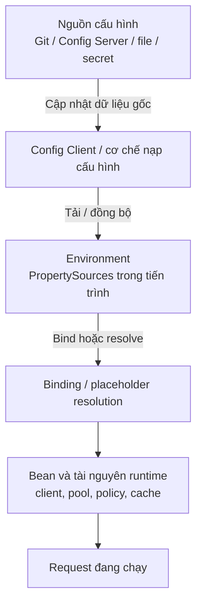
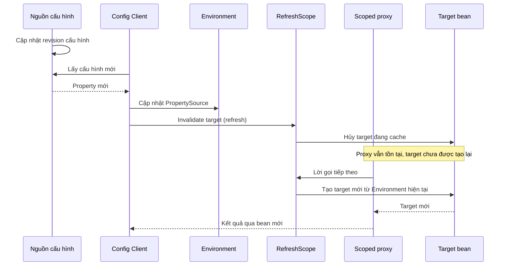

# Phân biệt cập nhật nguồn cấu hình, Environment và bean

Trong một ứng dụng Spring Cloud, thay đổi cấu hình có thể bắt đầu ở Git, Config Server, biến môi trường hoặc một hệ thống quản lý secret. Tuy nhiên, việc thay đổi dữ liệu ở nơi lưu trữ không đồng nghĩa ứng dụng đang chạy đã nhận được giá trị mới; và việc Environment đã có giá trị mới cũng không bảo đảm mọi bean đang sử dụng giá trị đó đều thay đổi.

Để hiểu chính xác quá trình làm mới cấu hình, cần phân biệt ba tầng:

1. **Nguồn cấu hình (configuration source):** nơi lưu hoặc cung cấp giá trị gốc, ví dụ Git repository, Config Server, file, secret store hoặc biến môi trường.
2. **Environment và PropertySource:** bản cấu hình mà một tiến trình Spring đang dùng để tra cứu property tại thời điểm hiện tại.
3. **Bean và tài nguyên runtime:** object đã được tạo, bind hoặc inject từ cấu hình; có thể giữ giá trị trong field, cache, connection pool hay client đã khởi tạo.

Đây là ba trạng thái có vòng đời khác nhau. Một thay đổi chỉ tác động đến tầng tiếp theo khi có cơ chế truyền và áp dụng rõ ràng. Bài học thuộc chương **Làm mới cấu hình** của module **SPRING_CLOUD_CORE**, tập trung vào Spring Cloud Context, externalized configuration, Config Client và cách kiểm thử refresh an toàn.

## 1. Ba tầng cấu hình trong một ứng dụng đang chạy

Ví dụ `order-service` dùng địa chỉ catalog và timeout:

```yaml
catalog:
  api:
    base-url: https://catalog-v1.internal
    timeout: 2s
```

Giá trị này có thể được lưu trong Git, được Config Server phục vụ, được Config Client nạp vào Environment và cuối cùng được dùng để tạo một HTTP client.



Mỗi mũi tên là một bước cần được thực hiện:

- Sửa file trong Git chỉ thay đổi nguồn gốc; Config Server có thể cần nhận commit hoặc refresh repository.
- Config Server có giá trị mới chưa có nghĩa mọi client đã tải nó.
- Config Client tải được giá trị mới chưa chắc mọi Environment của mọi replica đã được cập nhật.
- Environment có giá trị mới chưa chắc bean đã bind/inject trước đó được tạo lại.
- Bean mới được tạo chưa chắc request đang thực thi trên bean cũ đã chuyển sang bean mới.

Không nên dùng từ “refresh” cho cả chuỗi mà không nói rõ đang refresh tầng nào.

## 2. Tầng 1: cập nhật nguồn cấu hình

Nguồn cấu hình là nơi quản lý giá trị gốc. Tùy kiến trúc, nguồn có thể là:

| Nguồn | Ví dụ thay đổi | Thành phần có thể cần đồng bộ |
| --- | --- | --- |
| Git repository | Commit thay đổi timeout hoặc endpoint | Config Server hoặc watcher/pipeline |
| Spring Cloud Config Server | Cập nhật repository/backend được server phục vụ | Config Server backend/cache và Config Client |
| File trên filesystem | Ghi nội dung file mới | Cơ chế reload file hoặc lần khởi động/nạp tiếp theo |
| Environment variable | Thay giá trị trong môi trường triển khai | Thường cần tạo lại process/container để process nhận môi trường mới |
| Secret manager | Tạo version secret mới | Secret integration/agent và ứng dụng |
| Database cấu hình | Cập nhật một bản ghi | Adapter/poller hoặc sự kiện đồng bộ |

**Nguồn thay đổi là thay đổi dữ liệu gốc**, chưa phải thay đổi trạng thái của JVM đang chạy.

Ví dụ, khi sửa `catalog.api.base-url` trong Git:
1. Commit mới được tạo.
2. Config Server cần phục vụ revision mới theo backend và cách cấu hình của nó.
3. Client cần yêu cầu hoặc nhận thông báo để tải cấu hình.
4. Environment trong từng tiến trình cần được cập nhật.
5. Bean sử dụng endpoint cần được rebind hoặc tạo lại.

Nếu dừng ở bước 1, ứng dụng đang chạy không tự biết có commit mới. Nếu Config Server chưa nhìn thấy revision mới, client có thể tải lại nhưng vẫn nhận giá trị cũ.

### 2.1. Config Server và Config Client có trách nhiệm khác nhau

- **Config Server** cung cấp cấu hình cho ứng dụng theo application name, profile và label/backend được yêu cầu.
- **Config Client** chạy trong tiến trình ứng dụng, kết nối tới Config Server và nạp property vào môi trường của ứng dụng.
- **Spring Environment** giữ các PropertySource mà ứng dụng đang tra cứu sau khi nạp.

Config Server không trực tiếp thay đổi object Java trong JVM của client. Nó chỉ phục vụ dữ liệu. Client phải thực hiện việc lấy và áp dụng dữ liệu đó.

Với Spring Boot Config Data, ứng dụng có thể khai báo nguồn Config Server qua `spring.config.import=configserver:`. Các dự án dùng bootstrap legacy có cơ chế khởi tạo khác. Cách nạp ban đầu và cách refresh runtime cần tuân theo phiên bản Spring Boot/Spring Cloud đang dùng.

## 3. Tầng 2: Environment và PropertySource

`Environment` là API trong tiến trình để đọc property và profile. Các giá trị đến từ nhiều `PropertySource` được tra cứu theo thứ tự ưu tiên. Environment không phải Config Server và cũng không phải bean cấu hình; nó là nơi ứng dụng lấy giá trị hiệu lực.

Ví dụ:

```java
import org.springframework.core.env.Environment;
import org.springframework.stereotype.Component;

@Component
public class CatalogDiagnostics {
    private final Environment environment;

    public CatalogDiagnostics(Environment environment) {
        this.environment = environment;
    }

    public String currentBaseUrl() {
        return environment.getProperty("catalog.api.base-url");
    }
}
```

Mỗi lần gọi `getProperty`, code tra cứu giá trị trong các PropertySource hiện có. Nếu một PropertySource được cập nhật hoặc thay thế, lần tra cứu tiếp theo có thể thấy giá trị mới.

### 3.1. Environment có thể đổi mà không thay bean

Giả sử một bean được tạo với:

```java
@Value("${catalog.api.base-url}")
private String baseUrl;
```

Placeholder thường được resolve khi bean được khởi tạo và giá trị được gán vào field. Nếu sau đó PropertySource đổi, field `baseUrl` không tự động được gán lại chỉ vì Environment có giá trị mới.

Tương tự, một bean đã bind `@ConfigurationProperties` có thể giữ object chứa các field đã bind. Cơ chế cập nhật object phụ thuộc integration và phiên bản; không nên giả định mọi bean cấu hình tự thay đổi khi PropertySource đổi.

Điều này tạo ra hai kết quả có thể cùng tồn tại:
- `environment.getProperty("catalog.api.base-url")` trả URL mới.
- Một bean cũ vẫn trả URL cũ vì nó giữ giá trị đã inject trước đó.

Đây không phải mâu thuẫn. Hai API đang đọc hai tầng trạng thái khác nhau.

### 3.2. Thứ tự PropertySource vẫn có ý nghĩa

Khi cập nhật Environment, cần đảm bảo PropertySource mới thực sự được thêm hoặc thay thế ở vị trí mong muốn. Nếu một nguồn có precedence cao hơn vẫn chứa key cũ, giá trị mới ở nguồn thấp hơn có thể không trở thành giá trị hiệu lực.

Ví dụ:

```text
1. commandLineArgs
     catalog.api.timeout = 5s
2. remoteConfig
     catalog.api.timeout = 3s
3. applicationConfig
     catalog.api.timeout = 2s
```

Trong cấu trúc này, nguồn đầu có thể tiếp tục thắng. Vì vậy, khi refresh, hãy kiểm tra cả **giá trị trong nguồn mới** lẫn **thứ tự nguồn trong Environment**.

Không nên log toàn bộ property hoặc secret để debug. Có thể ghi tên source, revision và một số key không nhạy cảm; với credential cần masking hoặc bỏ qua.

## 4. Tầng 3: bean đã tạo và trạng thái runtime

Bean là object được Spring quản lý trong ApplicationContext. Khi bean khởi tạo, nó có thể nhận cấu hình qua:
- Constructor argument.
- `@Value`.
- `@ConfigurationProperties`.
- Một factory method đọc Environment.
- Một client/builder được tạo từ các giá trị cấu hình.

Sau khi khởi tạo, bean có thể giữ giá trị hoặc tài nguyên riêng. Ví dụ:
- HTTP client đã tạo với base URL và timeout.
- Connection pool đã mở với cấu hình ban đầu.
- Cache đã lưu kết quả theo endpoint cũ.
- Policy object đã được tính từ một nhóm property.
- Scheduler đã tạo lịch chạy.

Cập nhật Environment không tự sửa mọi object này. Cần chọn cơ chế phù hợp:
- Rebind object cấu hình nếu integration hỗ trợ.
- Invalidate và tạo lại bean qua refresh scope.
- Cập nhật một thành phần có API thay đổi runtime.
- Restart/redeploy nếu property được dùng khi khởi tạo tài nguyên không thể thay đổi an toàn.

### 4.1. Ví dụ bean giữ giá trị cũ

```java
import org.springframework.beans.factory.annotation.Value;
import org.springframework.stereotype.Component;

@Component
public class FixedCatalogClient {
    private final String baseUrl;

    public FixedCatalogClient(
            @Value("${catalog.api.base-url}") String baseUrl) {
        this.baseUrl = baseUrl;
    }

    public String endpoint() {
        return baseUrl;
    }
}
```

Nếu Environment đổi sau khi bean được tạo, `endpoint()` vẫn trả giá trị constructor đã nhận. Đây là hành vi bình thường của object Java; Spring không tự gọi lại constructor của mọi singleton khi property thay đổi.

### 4.2. Bean cấu hình có kiểu dữ liệu

```java
import java.time.Duration;
import org.springframework.boot.context.properties.ConfigurationProperties;

@ConfigurationProperties(prefix = "catalog.api")
public class CatalogApiProperties {
    private String baseUrl;
    private Duration timeout = Duration.ofSeconds(2);

    public String getBaseUrl() {
        return baseUrl;
    }

    public void setBaseUrl(String baseUrl) {
        this.baseUrl = baseUrl;
    }

    public Duration getTimeout() {
        return timeout;
    }

    public void setTimeout(Duration timeout) {
        this.timeout = timeout;
    }
}
```

Đăng ký class này thành bean bằng `@ConfigurationPropertiesScan` trên class ứng dụng hoặc `@EnableConfigurationProperties(CatalogApiProperties.class)` trên một class cấu hình. Nếu không đăng ký, chỉ có annotation trên class chưa đủ để inject object vào `CatalogClientConfiguration`.

Bean này gom property thành một object có kiểu dữ liệu. Trong Spring Cloud Context, các cơ chế như `EnvironmentChangeEvent` và `ConfigurationPropertiesRebinder` có thể được dùng để cập nhật các bean `@ConfigurationProperties` khi Environment thay đổi. Cách đăng ký, phạm vi bean và hành vi chính xác phụ thuộc release train và cấu hình ứng dụng.

Đừng suy luận rằng chỉ cần có `@ConfigurationProperties` là mọi field được cập nhật trong mọi tình huống. Hãy kiểm tra integration đang dùng và viết test xác nhận giá trị bean sau refresh.

## 5. Ba loại thao tác không thể thay thế cho nhau

| Thao tác | Tác động trực tiếp | Không tự làm |
| --- | --- | --- |
| Cập nhật nguồn | Thay dữ liệu ở nơi quản lý cấu hình | Không tự cập nhật Environment của JVM |
| Cập nhật Environment | Thay/đưa PropertySource mới vào tiến trình | Không tự sửa mọi field hoặc tài nguyên bean |
| Refresh bean/target | Rebind hoặc tạo lại object theo cơ chế tương ứng | Không tự lấy cấu hình mới từ nguồn bên ngoài |

Một quy trình refresh đầy đủ cần nối đúng các thao tác theo thứ tự. Với một bean dùng `@RefreshScope`, luồng khái quát là:



Sơ đồ minh họa trách nhiệm. Trong Spring Cloud Context, `ContextRefresher` điều phối việc cập nhật Environment và refresh scope theo cơ chế của phiên bản; không phải mọi ứng dụng đều tự viết từng bước như sơ đồ.

## 6. ContextRefresher và EnvironmentChangeEvent

Spring Cloud Context cung cấp cơ chế để ứng dụng làm mới cấu hình trong runtime. Một thành phần quan trọng là `ContextRefresher`. Trong cấu hình có hỗ trợ, gọi `refresh()` sẽ:
1. Cập nhật Environment bằng cách nạp lại các nguồn được tích hợp.
2. Xác định các key có thay đổi theo cơ chế so sánh của phiên bản.
3. Phát `EnvironmentChangeEvent` để các listener liên quan phản ứng.
4. Yêu cầu refresh scope làm mới các target đang cache.

Ví dụ gọi từ một service quản trị nội bộ:

```java
import java.util.Set;

import org.springframework.cloud.context.refresh.ContextRefresher;
import org.springframework.stereotype.Component;

@Component
public class ConfigurationRefreshService {
    private final ContextRefresher contextRefresher;

    public ConfigurationRefreshService(ContextRefresher contextRefresher) {
        this.contextRefresher = contextRefresher;
    }

    public Set<String> refreshConfiguration() {
        return contextRefresher.refresh();
    }
}
```

API và cách cung cấp bean `ContextRefresher` phụ thuộc phiên bản Spring Cloud Config/Context và cơ chế bootstrap/config data của ứng dụng. Đoạn code minh họa việc gọi refresh; nó không thay thế cấu hình Config Client, không tự cập nhật backend và không tự gửi trigger tới mọi replica.

### 6.1. EnvironmentChangeEvent dùng để làm gì?

`EnvironmentChangeEvent` thông báo rằng một tập key trong Environment đã thay đổi. Các listener có thể phản ứng theo phạm vi của chúng, ví dụ:
- Rebind bean cấu hình có hỗ trợ.
- Cập nhật logging level trong các integration tương ứng.
- Thực hiện logic nội bộ khi một property cụ thể đổi.
- Ghi nhận sự kiện để quan sát hoặc audit.

Event không tự biết mọi object nào đang giữ một giá trị cũ. Mỗi listener phải có logic phù hợp. Nếu bean tạo connection pool hoặc client riêng, ứng dụng cần xác định rõ cách cập nhật hoặc thay thế tài nguyên đó.

### 6.2. Rebind và RefreshScope khác nhau

- **Rebind:** cập nhật object cấu hình hiện có bằng các giá trị mới theo cơ chế binder/rebinder.
- **RefreshScope:** invalidates target cache; proxy sẽ lấy target mới ở lần gọi tiếp theo.
- **EnvironmentChangeEvent:** thông báo thay đổi property, để listener có thể rebind hoặc thực hiện hành động liên quan.

Ba cơ chế có thể phối hợp trong một lần refresh nhưng không đồng nghĩa. Không phải bean nào cũng refresh-scoped; không phải bean nào cũng có thể rebind an toàn.

## 7. RefreshScope: tạo lại target từ Environment mới

Với bean cần được tạo lại khi cấu hình thay đổi, có thể dùng `@RefreshScope`. Consumer giữ scoped proxy; target phía sau proxy được quản lý bởi scope.

Ví dụ:

```java
import org.springframework.cloud.context.config.annotation.RefreshScope;
import org.springframework.context.annotation.Bean;
import org.springframework.context.annotation.Configuration;

@Configuration(proxyBeanMethods = false)
public class CatalogClientConfiguration {

    @Bean
    @RefreshScope
    CatalogClient catalogClient(CatalogApiProperties properties) {
        return new CatalogClient(
                properties.getBaseUrl(),
                properties.getTimeout()
        );
    }
}
```

Khi target bị invalidated, proxy vẫn được inject trong consumer. Lần gọi kế tiếp qua proxy sẽ tạo target mới, đọc các giá trị hiện có trong Environment/bound properties theo cách cấu hình bean đang dùng.

Lưu ý: nếu `CatalogApiProperties` vẫn chứa giá trị cũ vì chưa được rebind, target mới cũng có thể nhận giá trị cũ. Vì thế cần kiểm tra cả object cấu hình và target sau refresh.

### 7.1. Target không được tạo lại ngay lập tức

Refresh scope thường xóa target khỏi cache và trì hoãn việc tạo mới tới lần gọi tiếp theo. Điều đó có nghĩa:
- Lệnh refresh có thể hoàn tất khi target mới chưa tồn tại.
- Request đầu tiên sau refresh có thể chịu chi phí khởi tạo.
- Nếu cấu hình mới không hợp lệ, lỗi có thể xuất hiện khi target mới được tạo.
- Proxy ổn định, target thay đổi; không nên lưu reference target cũ ở nơi khác.

### 7.2. Tài nguyên có thể cần restart

Không phải mọi cấu hình đều thích hợp với refresh scope. Ví dụ, thay đổi cổng web server sau khi socket đã bind không thể chỉ bằng cách tạo lại một bean thông thường. Một số connection pool hoặc resource có lifecycle phức tạp cần quy trình thay thế riêng. Một số bean, như datasource Hikari, có thể được loại khỏi refresh mặc định theo cấu hình/version.

Phải phân loại property:
- Có thể đọc lại trực tiếp từ Environment.
- Có thể rebind bean.
- Có thể tạo lại target an toàn.
- Cần đóng/mở tài nguyên theo quy trình riêng.
- Cần restart/redeploy.

## 8. Ví dụ thực hành: endpoint đổi từ v1 sang v2

Giả sử ban đầu nguồn cấu hình chứa:

```yaml
catalog:
  api:
    base-url: https://catalog-v1.internal
    timeout: 2s
```

Sau khi cập nhật nguồn:

```yaml
catalog:
  api:
    base-url: https://catalog-v2.internal
    timeout: 3s
```

Ta có thể kiểm tra lần lượt:

| Bước | Điều quan sát | Kết quả cần thấy |
| --- | --- | --- |
| 1. Cập nhật nguồn | Revision/backend của Config Server | Giá trị v2 đã được lưu và server phục vụ |
| 2. Nạp lại cấu hình | Log/response Config Client | Client nhận property v2 |
| 3. Kiểm tra Environment | `Environment.getProperty` | Trả endpoint v2 và timeout 3s |
| 4. Kiểm tra bean properties | `CatalogApiProperties` | Giá trị đã rebind hoặc được tạo lại theo cơ chế đã chọn |
| 5. Invalidate target | RefreshScope | Target cũ bị hủy |
| 6. Gọi qua proxy | Request tiếp theo | Target mới dùng endpoint v2 |

Nếu bước 3 đúng nhưng bước 4 vẫn v1, vấn đề nằm ở rebind/bean configuration. Nếu bước 4 đúng nhưng request vẫn tới v1, có thể target cũ chưa được invalidated hoặc consumer giữ reference trực tiếp. Nếu request v2 thất bại, kiểm tra endpoint, DNS, network, credential và readiness của dịch vụ mới.

## 9. Cập nhật cấu hình trên nhiều replica

Mỗi replica của microservice là một tiến trình riêng, có Environment và bean instance riêng. Cập nhật nguồn cấu hình tập trung không tự đồng bộ ngay lập tức đến tất cả JVM.

Ví dụ:

```text
Config Server
   |
   +--> order-service instance A
   |       Environment A
   |       Bean/target A
   |
   +--> order-service instance B
   |       Environment B
   |       Bean/target B
   |
   +--> order-service instance C
           Environment C
           Bean/target C
```

Mỗi instance cần nhận được cấu hình mới và chạy quy trình refresh của chính nó. Một lệnh gọi endpoint refresh trên instance A thường chỉ tác động tới A, trừ khi có cơ chế phân phối sự kiện.

Spring Cloud Bus có thể dùng để truyền event refresh giữa các ứng dụng thông qua message broker. Khi dùng bus, cần cấu hình broker, định danh instance, bảo mật và phạm vi event. Không nên giả định chỉ thêm dependency bus là mọi instance tự đồng bộ nếu broker hoặc endpoint chưa được cấu hình.

Các chiến lược phổ biến:
- Gọi refresh có điều phối tới từng instance.
- Phát event qua Spring Cloud Bus để các instance nhận và refresh.
- Dùng rolling restart/redeploy nếu thay đổi cần khởi động lại.
- Dùng orchestration để giới hạn số instance thay đổi cùng lúc.

Cần quan sát revision cấu hình trên từng instance để phát hiện trạng thái lệch phiên bản.

## 10. Tính nhất quán và rollback khi refresh

Một thay đổi có thể ảnh hưởng nhiều bean cùng lúc. Nếu một bean được rebind, một bean khác được refresh scope, còn một bean thứ ba chỉ đọc giá trị khi startup, ứng dụng có thể tạm thời hoạt động với các phiên bản cấu hình khác nhau.

Trước khi áp dụng:
- Nhóm các property có quan hệ phụ thuộc vào cùng một revision.
- Kiểm tra cấu hình mới trước khi phát tán.
- Xác định bean nào cần rebind, bean nào cần tạo lại và thành phần nào cần restart.
- Có chiến lược rollback về revision trước.
- Tránh cập nhật nhiều property liên quan qua nhiều thao tác rời rạc khiến request đọc trạng thái nửa cũ nửa mới.

Ví dụ, đổi base URL nhưng giữ credential của endpoint cũ có thể làm request thất bại. Cấu hình endpoint, credential reference và timeout nên được phát hành như một bộ nhất quán.

Refresh không tự bảo đảm transaction phân tán trên toàn bộ replica. Nếu một instance refresh thành công và instance khác thất bại, hệ thống có thể có trạng thái hỗn hợp. Cần ghi nhận revision, kết quả và có hành động khôi phục rõ ràng.

## 11. Kiểm thử ba tầng riêng biệt

Một test chỉ xác nhận Config Server trả dữ liệu không chứng minh bean trong ứng dụng đã dùng giá trị mới. Nên tách kiểm thử theo tầng:

| Loại test | Mục tiêu | Ví dụ |
| --- | --- | --- |
| Source test | Nguồn có revision/giá trị mong muốn | Kiểm tra Config Server hoặc backend test |
| Environment test | Tiến trình đã nạp PropertySource mới | Đọc `Environment.getProperty` sau refresh |
| Rebind test | Bean cấu hình nhận giá trị mới | Kiểm tra `@ConfigurationProperties` sau EnvironmentChangeEvent |
| Scope test | Target cũ bị invalidated và target mới được tạo | Đếm generation/factory invocation |
| Integration test | Request thật dùng cấu hình mới | Gọi endpoint qua proxy và xác minh endpoint đích |
| Multi-instance test | Mọi replica nhận cùng revision | Kiểm tra trạng thái từng instance sau bus/rollout |

### 11.1. Test Environment thay đổi

Có thể tạo một `MapPropertySource` mutable trong test và thay giá trị để kiểm tra lần đọc Environment tiếp theo. Cần nhớ test này chỉ kiểm tra Environment, không tự xác nhận bean đã rebind.

```java
import static org.assertj.core.api.Assertions.assertThat;

import java.util.Map;
import java.util.concurrent.ConcurrentHashMap;

import org.junit.jupiter.api.Test;
import org.springframework.core.env.MapPropertySource;
import org.springframework.core.env.StandardEnvironment;

class EnvironmentUpdateTest {

    @Test
    void environmentReadsUpdatedPropertyFromMutableSource() {
        Map<String, Object> values = new ConcurrentHashMap<>();
        values.put("catalog.api.base-url", "https://catalog-v1.internal");

        StandardEnvironment environment = new StandardEnvironment();
        environment.getPropertySources().addFirst(
                new MapPropertySource("testOverrides", values)
        );

        assertThat(environment.getProperty("catalog.api.base-url"))
                .isEqualTo("https://catalog-v1.internal");

        values.put("catalog.api.base-url", "https://catalog-v2.internal");

        assertThat(environment.getProperty("catalog.api.base-url"))
                .isEqualTo("https://catalog-v2.internal");
    }
}
```

Test dùng một map mutable để minh họa PropertySource đọc giá trị mới. Trong ứng dụng thực, Config Client có thể thay thế PropertySource hoặc tạo Environment mới theo cơ chế riêng; không nên dùng cách sửa map trực tiếp này làm cơ chế refresh production.

### 11.2. Test bean/target sau refresh

Với bean refresh-scoped, dùng factory counter hoặc một thuộc tính generation để xác nhận target được tạo lại sau invalidation. Test cần gọi qua proxy, không gọi target đã unwrap.

Ngoài ra nên kiểm tra:
- Target cũ nhận destruction callback.
- Target mới đọc đúng property mới.
- Request đang chạy không bị giả định chuyển giữa chừng.
- Lỗi khởi tạo target mới được quan sát rõ.
- Lần refresh liên tiếp không làm rò rỉ tài nguyên.

### 11.3. Test thất bại và rollback

Không chỉ test đường thành công. Hãy mô phỏng:
- Config Server không truy cập được.
- Property bắt buộc bị thiếu.
- Property sai kiểu hoặc sai định dạng.
- Target mới không thể khởi tạo.
- Một replica nhận refresh còn replica khác không nhận.
- Revision mới được áp dụng nhưng request health check thất bại.

Khi refresh thất bại, cần biết tầng nào thất bại: nguồn, tải cấu hình, cập nhật Environment, rebind hay tạo target. Không nên báo “refresh thành công” chỉ vì endpoint trả HTTP 200 nếu bean thực tế chưa sử dụng revision mới.

## 12. Quan sát và bảo mật

Một quy trình refresh tốt nên có log/metric để trả lời:
- Revision hoặc version cấu hình nào đang được instance sử dụng?
- Nguồn cấu hình nào được tải thành công?
- Những key nào thay đổi (chỉ tên key không nhạy cảm)?
- Environment đã cập nhật lúc nào?
- Bean nào được rebind hoặc target nào bị invalidated?
- Target mới có được tạo thành công không?
- Bao nhiêu replica đã áp dụng revision?
- Request sau refresh có tăng lỗi hoặc latency không?

Các endpoint quản trị như Actuator refresh cần được expose có chủ đích, bảo vệ bằng authentication/authorization và giới hạn network. Không công khai endpoint có thể thay đổi cấu hình runtime. Không ghi token, password, private key hoặc secret vào log/audit.

Nếu refresh được phát tán qua message broker, bảo vệ broker và quyền publish/consume event. Một event refresh không chứa secret vẫn có thể kích hoạt thay đổi hành vi ứng dụng, nên phải kiểm soát ai được phép phát event.

## 13. Những nhầm lẫn thường gặp

**Sửa Config Server là ứng dụng đang chạy tự đổi.** Không đúng. Client cần lấy hoặc nhận thông báo về cấu hình mới.

**Config Client tải được giá trị mới thì mọi bean đã đổi.** Không đúng. Environment có thể đã mới trong khi object đã bind/inject vẫn giữ giá trị cũ.

**Environment.getProperty trả giá trị mới nghĩa là HTTP client đã dùng URL mới.** Không nhất thiết. Client có thể đã được tạo với URL cũ và giữ endpoint trong field.

**Gọi RefreshScope.refreshAll() sẽ tải lại Config Server.** Không đúng. Refresh scope invalidates target cache; việc cập nhật nguồn và Environment là bước khác.

**Rebind và RefreshScope là một.** Không đúng. Rebind cập nhật object cấu hình hiện có theo cơ chế hỗ trợ; RefreshScope tạo lại target khi được truy cập qua proxy.

**Một instance refresh thì cả cluster refresh.** Không đúng. Mỗi replica có Environment và bean riêng; cần bus hoặc orchestration để phân phối trigger.

**Mọi property đều có thể hot reload.** Không đúng. Một số property chỉ có ý nghĩa lúc khởi động hoặc gắn với resource cần restart/redeploy.

**Refresh thành công nghĩa là request đang chạy dùng cấu hình mới.** Không đúng. Request đã bắt đầu có thể tiếp tục dùng target cũ; lần gọi sau qua proxy mới phân giải target mới.

## 14. Quy trình thực hành đề xuất

Khi cần thay đổi endpoint của một client đang chạy, hãy thực hiện theo thứ tự:

1. Cập nhật revision tại nguồn cấu hình và xác nhận Config Server phục vụ đúng revision.
2. Yêu cầu Config Client/ContextRefresher tải cấu hình mới.
3. Đọc giá trị hiệu lực trong Environment để xác nhận property source và precedence.
4. Xác nhận bean `@ConfigurationProperties` được rebind hoặc chọn cơ chế tạo lại bean phù hợp.
5. Invalidate target refresh-scoped nếu client được thiết kế theo proxy/target.
6. Gửi một request kiểm tra qua proxy và xác nhận endpoint mới được sử dụng.
7. Quan sát lỗi, latency và tài nguyên của target cũ.
8. Phát tán refresh tới các replica còn lại hoặc dùng rollout theo kế hoạch.
9. Ghi revision đã áp dụng và giữ khả năng rollback nếu health check thất bại.

Nếu property thay đổi không hỗ trợ hot reload, hãy dùng restart/redeploy có kiểm soát thay vì cố ép refresh scope xử lý.

## Ghi nhớ

Nguồn cấu hình, Environment và bean là ba tầng trạng thái riêng. **Nguồn** lưu giá trị gốc; **Environment** giữ các PropertySource mà một tiến trình đang dùng; **bean** có thể đã giữ giá trị hoặc tài nguyên được tạo từ cấu hình trước đó. Muốn thay đổi có hiệu lực, cần cập nhật nguồn, tải giá trị vào Environment, rồi rebind hoặc tạo lại đúng bean/resource. Spring Cloud Context cung cấp event, rebinder, ContextRefresher và RefreshScope để hỗ trợ các bước này, nhưng ứng dụng vẫn phải xác định property nào có thể refresh, kiểm tra từng replica và chuẩn bị rollback.
