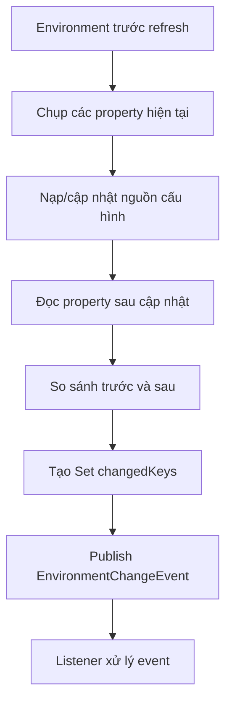
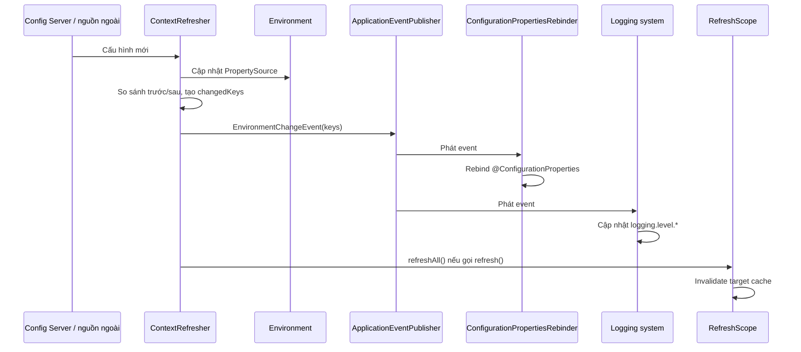
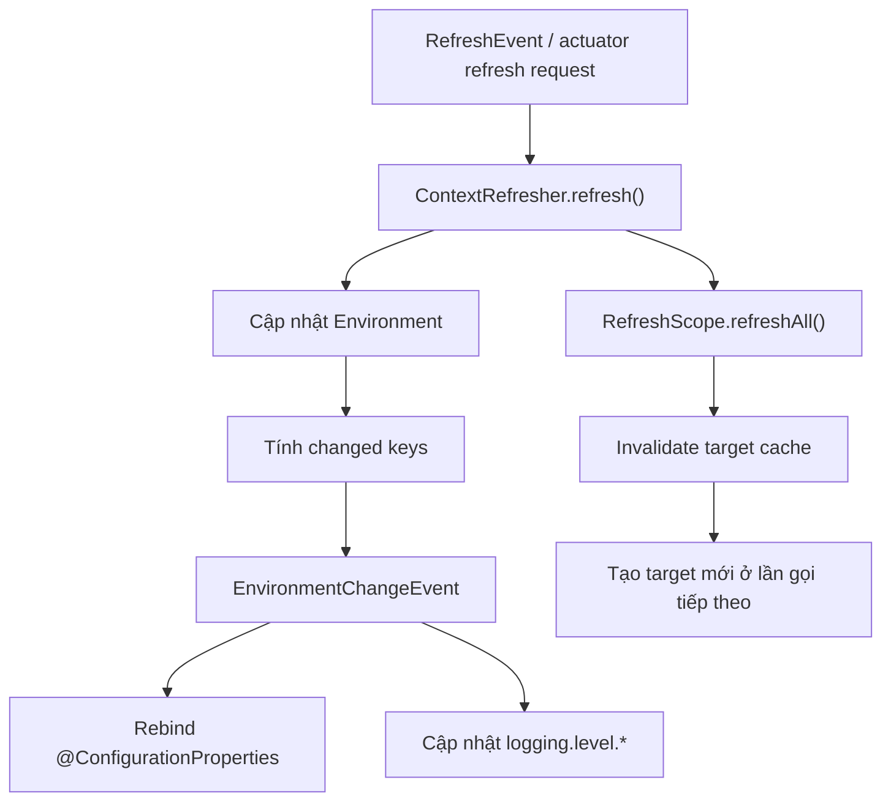

# EnvironmentChangeEvent và tập khóa thay đổi

Trong một ứng dụng Spring Cloud, cấu hình có thể thay đổi khi ứng dụng đang chạy: timeout gọi dịch vụ được điều chỉnh, giới hạn kết nối được tăng, một feature flag được bật hoặc mức log được đổi để chẩn đoán sự cố. Sau khi `Environment` nhận các giá trị mới, ứng dụng cần biết **những property nào đã thay đổi** và thực hiện hành động phù hợp.

`EnvironmentChangeEvent` là sự kiện Spring Cloud Context dùng để thông báo rằng Environment đã thay đổi. Điểm dữ liệu trung tâm của event là một tập `Set<String>` chứa tên các khóa được xem là đã thay đổi. Những listener đăng ký trong application context có thể sử dụng tập khóa này để phản ứng; các listener chuẩn của Spring Cloud hỗ trợ rebind `@ConfigurationProperties` và cập nhật logger level cho các khóa `logging.level.*`.

Với **SPRING_CLOUD_CORE**, hiểu đúng event và tập khóa giúp xây dựng quy trình refresh có kiểm soát cho cấu hình bên ngoài, Spring Cloud Config, discovery, service registry và giao tiếp giữa dịch vụ. Bài học thuộc chương **Làm mới cấu hình**, tập trung vào cấu trúc event, cách tính tập khóa, thứ tự cập nhật Environment và giới hạn của việc rebind bean.

## 1. Mục tiêu học tập

Sau bài này, bạn có thể:

- Giải thích vai trò của `EnvironmentChangeEvent` trong Spring Cloud Context.
- Đọc tập khóa thay đổi qua `getKeys()` và phân biệt nó với giá trị property.
- Phân biệt khóa được thêm, thay đổi và bị xóa.
- Mô tả cách `ContextRefresher` so sánh cấu hình trước và sau refresh.
- Giải thích vì sao Environment phải được cập nhật trước khi event được phát.
- Hiểu cách `ConfigurationPropertiesRebinder` và cơ chế logging phản ứng với event.
- Phân biệt `EnvironmentChangeEvent`, `RefreshEvent` và việc invalidate `@RefreshScope`.
- Viết listener tùy chỉnh chỉ xử lý nhóm key mà nó quan tâm.
- Thiết kế kiểm thử cho tập khóa, rebind và refresh.
- Vận hành refresh trên nhiều instance bằng cơ chế broadcast phù hợp.

## 2. EnvironmentChangeEvent là gì?

`org.springframework.cloud.context.environment.EnvironmentChangeEvent` là một Spring `ApplicationEvent`. Nó biểu diễn thông báo rằng một tập property trong Environment đã thay đổi.

API cốt lõi có thể hiểu qua ví dụ:

```java
Set<String> changedKeys = Set.of(
        "inventory.timeout",
        "inventory.max-attempts",
        "logging.level.com.example.checkout");

EnvironmentChangeEvent event =
        new EnvironmentChangeEvent(applicationContext, changedKeys);
```

Event chứa:

- **Source:** đối tượng phát sự kiện, thường là `ApplicationContext` tương ứng.
- **Keys:** tập tên property được xác định là đã thay đổi.

Có thể lấy tập khóa bằng:

```java
Set<String> keys = event.getKeys();
```

Event không chứa bản đồ giá trị cũ/mới. Nó cũng không tự cập nhật `Environment`. Nguồn cấu hình phải được thay đổi trước; sau đó event được phát để các listener thực hiện công việc tiếp theo.

### 2.1. Tập khóa có ý nghĩa gì?

Ví dụ, trước refresh:

```yaml
inventory:
  timeout: 2s
  max-attempts: 2
```

Sau refresh:

```yaml
inventory:
  timeout: 800ms
  max-attempts: 3
```

Tập khóa thay đổi có thể là:

```text
inventory.timeout
inventory.max-attempts
```

Listener có thể kiểm tra key nào thuộc prefix `inventory.` để quyết định có cần cập nhật metric, cache hoặc trạng thái tích hợp liên quan hay không.

### 2.2. Event không phải là bản sao của Environment

`EnvironmentChangeEvent` chỉ là tín hiệu và metadata về các key thay đổi. Nó không mang:

- Toàn bộ `PropertySource`.
- Giá trị trước khi thay đổi.
- Giá trị sau khi thay đổi.
- Profile đang active.
- Danh sách bean cần tạo lại.
- Kết quả validation của cấu hình mới.

Nếu listener cần giá trị mới, nó phải đọc lại từ `Environment` sau khi nguồn cấu hình đã được cập nhật:

```java
String timeout = environment.getProperty("inventory.timeout");
```

Không nên lấy tập key từ event rồi tự giả định giá trị mới sẽ luôn có mặt hoặc đã được bind vào tất cả bean.

## 3. Khóa được thêm, thay đổi và bị xóa

Trong quá trình so sánh hai trạng thái cấu hình, có ba trường hợp:

| Trạng thái | Trước refresh | Sau refresh | Có mặt trong tập khóa? |
| --- | --- | --- | --- |
| Thêm mới | Không có key | Có giá trị | Có |
| Thay đổi | Có giá trị A | Có giá trị B khác A | Có |
| Bị xóa | Có giá trị A | Không còn key | Có |
| Không đổi | Có giá trị A | Vẫn là A | Không |

Ví dụ:

```yaml
# Trước
inventory:
  timeout: 2s
  max-attempts: 2
  legacy-mode: true
```

```yaml
# Sau
inventory:
  timeout: 800ms
  max-attempts: 2
  region: ap-southeast-1
```

Các khóa thay đổi là:

```text
inventory.timeout
inventory.legacy-mode
inventory.region
```

`inventory.max-attempts` không nằm trong tập khóa vì giá trị không đổi.

Một điểm quan trọng: **khóa bị xóa vẫn là khóa thay đổi**. Khi tính diff, hệ thống có thể ghi nhận key bị xóa với giá trị mới là `null`, rồi đưa tên key vào tập `Set<String>`. Listener chỉ nhận tên key nên cần đọc Environment hiện tại để biết key còn tồn tại hay không.

### 3.1. Tập khóa không phải tập prefix

Event thường chứa tên đầy đủ của property:

```text
inventory.timeout
inventory.retry.max-attempts
logging.level.com.example.checkout
```

Không nên phát event với một prefix chung như `inventory` rồi kỳ vọng mọi listener chuẩn hiểu đó là toàn bộ nhóm property `inventory.*`. Nếu tự tạo event, hãy truyền tên key thực tế đã thay đổi.

### 3.2. Tập khóa rỗng

Một lần refresh có thể không phát hiện khác biệt nào. Khi đó tập khóa có thể rỗng:

```java
Set<String> changedKeys = Set.of();
```

Điều này không nhất thiết chứng minh quy trình refresh chưa chạy. Nó có thể có nghĩa nguồn cấu hình được tải lại nhưng các giá trị mà cơ chế so sánh quan sát được không thay đổi.

Không nên dùng việc event đã phát làm bằng chứng duy nhất rằng cấu hình mới khác cấu hình cũ. Hãy kiểm tra tập khóa và giá trị cuối cùng trong Environment.

## 4. ContextRefresher tính tập khóa như thế nào?

Trong quy trình refresh thông thường của Spring Cloud Context, `ContextRefresher` chịu trách nhiệm:

1. Ghi nhận các property hiện tại.
2. Nạp/cập nhật nguồn cấu hình theo cơ chế đang dùng.
3. Đọc lại các property sau cập nhật.
4. So sánh hai trạng thái.
5. Tạo tập khóa thay đổi.
6. Phát `EnvironmentChangeEvent`.

Mô hình:



### 4.1. Phân biệt refreshEnvironment() và refresh()

`ContextRefresher` có hai thao tác quan trọng:

| Phương thức | Công việc |
| --- | --- |
| `refreshEnvironment()` | Cập nhật Environment, tính tập key thay đổi, phát `EnvironmentChangeEvent` và trả về tập key |
| `refresh()` | Gọi `refreshEnvironment()`, sau đó yêu cầu `RefreshScope` làm mới các target đã cache |

Vì vậy, chỉ gọi `refreshEnvironment()` không đồng nghĩa với việc các bean trong `@RefreshScope` đã bị invalidate. Phương thức `refresh()` thực hiện thêm bước refresh scope.

### 4.2. So sánh cấu hình trước và sau

Trong implementation hiện hành, `ContextRefresher` trích xuất property từ các nguồn có thể liệt kê key, bao gồm `EnumerablePropertySource` và các thành phần của `CompositePropertySource`. Nó xây dựng trạng thái trước/sau rồi so sánh:

- Key chỉ xuất hiện sau cập nhật: key mới.
- Key có ở cả hai nhưng giá trị khác: key thay đổi.
- Key chỉ xuất hiện trước cập nhật: key bị xóa.
- Key có giá trị giống nhau: bỏ qua.

Không phải mọi nguồn tùy chỉnh đều có thể liệt kê tên property. Một `PropertySource` không hỗ trợ enumeration có thể không tham gia đầy đủ vào phép tính diff tự động. Nếu ứng dụng tự quản lý một nguồn kiểu này, cần xác định rõ cách phát event và danh sách key.

### 4.3. Tập khóa không phải là bộ lọc bean mặc định

`Set<String>` rất hữu ích cho listener tùy chỉnh biết property nào đã thay đổi. Tuy nhiên, không nên giả định `ConfigurationPropertiesRebinder` luôn ánh xạ từng key tới đúng một bean rồi chỉ rebind bean đó.

Trong implementation hiện hành, khi nhận event hợp lệ từ application context, `ConfigurationPropertiesRebinder` gọi quy trình rebind trên các bean `@ConfigurationProperties` được nó theo dõi. Tập key của event là thông tin về thay đổi; nó không phải cam kết rằng built-in rebinder chỉ xử lý bean có prefix trùng key.

Nếu cần hành vi chọn lọc theo prefix hoặc key, hãy viết listener/handler riêng và kiểm thử điều kiện lọc đó.

## 5. Trình tự cập nhật Environment và phát event

Thứ tự xử lý rất quan trọng. Listener phải đọc được giá trị mới khi nhận event.



Sơ đồ mô tả quy trình chuẩn ở mức khái niệm. Event listener có thể được gọi theo thứ tự đăng ký/ordering của Spring; không nên dựa vào một listener tùy chỉnh luôn chạy sau mọi listener khác nếu chưa khai báo và kiểm thử thứ tự.

### 5.1. Nếu phát event trước khi cập nhật Environment

Nếu listener chạy khi Environment vẫn chứa giá trị cũ, nó sẽ đọc cấu hình cũ và có thể rebind bean về giá trị cũ. Khi nguồn được cập nhật sau đó mà không có event thứ hai, bean có thể tiếp tục giữ trạng thái không mong muốn.

Quy tắc vận hành:

1. Cập nhật `PropertySource` hoặc nạp nguồn mới.
2. Tính các key đã thay đổi.
3. Phát event với tập key đó.
4. Để listener đọc giá trị mới và thực hiện hành động tương ứng.

### 5.2. Phát event không tự thay đổi nguồn dữ liệu

Đoạn mã sau chỉ phát tín hiệu:

```java
context.publishEvent(new EnvironmentChangeEvent(
        context,
        Set.of("inventory.timeout")));
```

Nó không tự tải Config Server, sửa file YAML, thêm property source hoặc thay đổi biến môi trường. Nếu không cập nhật Environment trước đó, listener có thể chỉ rebind lại giá trị cũ.

## 6. Các listener chuẩn của Spring Cloud

Spring Cloud Context có thể phản ứng với `EnvironmentChangeEvent` theo một số cách phổ biến:

| Listener/cơ chế | Phản ứng |
| --- | --- |
| `ConfigurationPropertiesRebinder` | Rebind các bean `@ConfigurationProperties` được quản lý |
| Logging rebinding | Cập nhật mức log cho property thuộc `logging.level.*` |
| Listener do ứng dụng khai báo | Phản ứng với nhóm key mà ứng dụng quan tâm |

### 6.1. Rebind @ConfigurationProperties

Ví dụ bean cấu hình:

```java
@ConfigurationProperties(prefix = "inventory")
@Validated
public class InventoryProperties {

    @NotNull
    private Duration timeout = Duration.ofSeconds(2);

    @Min(1)
    private int maxAttempts = 3;

    public Duration getTimeout() {
        return timeout;
    }

    public void setTimeout(Duration timeout) {
        this.timeout = timeout;
    }

    public int getMaxAttempts() {
        return maxAttempts;
    }

    public void setMaxAttempts(int maxAttempts) {
        this.maxAttempts = maxAttempts;
    }
}
```

Khi event được phát sau khi Environment đã cập nhật, rebinder có thể bind lại giá trị của bean. Các thành phần đang sử dụng bean này có thể nhìn thấy cấu hình đã được cập nhật.

### 6.2. Reset về giá trị mặc định khi property bị xóa

Nếu một property đã bị xóa khỏi Environment, việc rebind không nên giữ mãi giá trị cũ trong field. Theo cơ chế reset của Spring Cloud Context, các thuộc tính của bean `@ConfigurationProperties` được reset về defaults ở cấp class trước khi bind lại; thao tác này cũng có thể đi sâu vào object cấu hình lồng nhau.

Ví dụ:

```java
private Duration timeout = Duration.ofSeconds(2);
```

Nếu `inventory.timeout` bị xóa, giá trị có thể trở về `2s` thay vì tiếp tục giữ giá trị runtime cũ. Chi tiết reset phụ thuộc cấu trúc constructor của bean và các quy tắc của phiên bản Spring Cloud đang sử dụng.

### 6.3. Giới hạn với constructor binding và Java record

Các bean `@ConfigurationProperties` dùng constructor binding, bao gồm Java record, không được refresh bằng cơ chế rebind mutable field thông thường. Nếu cấu hình cần thay đổi trong runtime, hãy cân nhắc một bean mutable phù hợp, một bean `@RefreshScope` tạo target mới hoặc một chiến lược cập nhật riêng.

### 6.4. Rebind không thay instance

Rebinding thông thường cập nhật các field của cùng bean instance. Nó không nhất thiết hủy object cũ và thay bằng object mới.

Trong implementation hiện hành, các lần rebind đồng thời của cùng bean được serialize với nhau. Tuy vậy, việc serialize hai thao tác rebind không làm các thread đọc bean an toàn trong suốt lúc rebind. Vì object được cập nhật tại chỗ, một reader đồng thời có thể quan sát trạng thái trung gian khi một số field đã reset/cập nhật còn field khác chưa hoàn tất.

Nếu ứng dụng cần một góc nhìn cấu hình nhất quán trong lúc refresh, hãy đánh giá `@RefreshScope` cho bean thích hợp. Refresh scope quản lý target/proxy và đồng bộ việc đọc với refresh theo cơ chế riêng.

## 7. Cập nhật logging.level.*

Spring Cloud Context hỗ trợ thay đổi log level khi các key `logging.level.*` thay đổi.

Ví dụ cấu hình:

```yaml
logging:
  level:
    com.example.checkout: INFO
    org.springframework.cloud: WARN
```

Nếu `logging.level.com.example.checkout` thay đổi thành `DEBUG` và EnvironmentChangeEvent được phát, cơ chế logging rebinding có thể cập nhật logger tương ứng mà không cần khởi động lại ứng dụng.

Tập key có thể chứa:

```text
logging.level.com.example.checkout
```

Listener tùy chỉnh có thể bỏ qua key `logging.level.*` nếu không có trách nhiệm quản lý logging, vì Spring Cloud đã cung cấp hành vi chuẩn.

Lưu ý: cấu hình logging khởi động sớm có những quy tắc riêng. Không phải mọi thuộc tính logging đều có thể đổi runtime qua event; phần này tập trung vào logger level.

## 8. Viết listener tùy chỉnh theo tập khóa

Ứng dụng có thể đăng ký listener để chỉ xử lý những nhóm property liên quan đến chức năng của nó.

### 8.1. Listener bằng @EventListener

```java
import java.util.Set;

import org.springframework.cloud.context.environment.EnvironmentChangeEvent;
import org.springframework.context.event.EventListener;
import org.springframework.core.env.Environment;
import org.springframework.stereotype.Component;

@Component
public class InventoryConfigurationListener {

    private final Environment environment;

    public InventoryConfigurationListener(Environment environment) {
        this.environment = environment;
    }

    @EventListener
    public void onEnvironmentChange(EnvironmentChangeEvent event) {
        Set<String> keys = event.getKeys();

        boolean inventoryChanged = keys.stream()
                .anyMatch(key -> key.startsWith("inventory."));

        if (!inventoryChanged) {
            return;
        }

        String timeout = environment.getProperty("inventory.timeout");
        // Record a safe diagnostic or trigger application-specific work.
    }
}
```

Listener kiểm tra prefix `inventory.`. Nếu không có key nào thuộc nhóm này, nó kết thúc sớm. Nếu có, nó đọc lại giá trị từ Environment.

Không nên ghi toàn bộ cấu hình ra log. Nếu cần quan sát, hãy log tên key hoặc một giá trị đã được xác định là không nhạy cảm.

### 8.2. Listener bằng ApplicationListener

Có thể triển khai trực tiếp:

```java
@Component
public class LoggingConfigurationAuditListener
        implements ApplicationListener<EnvironmentChangeEvent> {

    @Override
    public void onApplicationEvent(EnvironmentChangeEvent event) {
        event.getKeys().stream()
                .filter(key -> key.startsWith("logging.level."))
                .forEach(key -> {
                    // Audit the changed logger name, not the full configuration.
                });
    }
}
```

`@EventListener` phù hợp cho handler nhỏ, còn `ApplicationListener` hữu ích khi muốn thể hiện rõ type event trong chữ ký class.

### 8.3. Không dùng event listener để thay thế configuration binding

Nếu mục tiêu chỉ là nhận giá trị cấu hình mới, nên để `@ConfigurationProperties` và cơ chế rebinding chuẩn xử lý. Listener tùy chỉnh chỉ nên thực hiện công việc thực sự cần thiết, ví dụ:

- Xóa cache được xây dựng từ cấu hình.
- Phát metric hoặc audit event.
- Làm mới một adapter không được quản lý bởi Spring Cloud.
- Báo trạng thái cho một thành phần nghiệp vụ.

Tránh tự bind lại toàn bộ cấu hình trong listener nếu không có yêu cầu cụ thể; điều đó có thể trùng với `ConfigurationPropertiesRebinder`.

## 9. Tự cập nhật PropertySource rồi phát event

Trong một ứng dụng cần cập nhật một giá trị runtime do chính ứng dụng quản lý, có thể thay thế một `MapPropertySource` rồi phát event.

Ví dụ service rút gọn:

```java
import java.time.Duration;
import java.util.HashMap;
import java.util.Map;
import java.util.Set;

import org.springframework.cloud.context.environment.EnvironmentChangeEvent;
import org.springframework.context.ConfigurableApplicationContext;
import org.springframework.core.env.ConfigurableEnvironment;
import org.springframework.core.env.MapPropertySource;
import org.springframework.core.env.MutablePropertySources;
import org.springframework.stereotype.Service;

@Service
public class RuntimeInventorySettings {

    private static final String SOURCE_NAME = "runtimeInventoryOverrides";

    private final ConfigurableApplicationContext context;
    private final ConfigurableEnvironment environment;

    public RuntimeInventorySettings(
            ConfigurableApplicationContext context,
            ConfigurableEnvironment environment) {
        this.context = context;
        this.environment = environment;
    }

    public void updateTimeout(Duration timeout) {
        Map<String, Object> values = new HashMap<>();
        values.put("inventory.timeout", timeout);

        MutablePropertySources sources = environment.getPropertySources();
        MapPropertySource replacement =
                new MapPropertySource(SOURCE_NAME, values);

        if (sources.contains(SOURCE_NAME)) {
            sources.replace(SOURCE_NAME, replacement);
        }
        else {
            sources.addFirst(replacement);
        }

        context.publishEvent(new EnvironmentChangeEvent(
                context,
                Set.of("inventory.timeout")));
    }
}
```

Ví dụ minh họa các bước quan trọng:

1. Tạo nguồn override chứa giá trị mới.
2. Thay hoặc thêm nguồn vào Environment.
3. Phát event với đúng tên key đã thay đổi.
4. Listener đọc lại property và rebind bean phù hợp.

### 9.1. Chọn precedence có chủ đích

Trong ví dụ, `addFirst` đặt nguồn runtime lên đầu Environment. Đây là quyết định có thể ghi đè file cấu hình, biến môi trường hoặc nguồn remote có ưu tiên thấp hơn trong tập hiện tại. Chỉ dùng khi chính sách ứng dụng thực sự cho phép.

Nếu nguồn chỉ là defaults, có thể dùng `addLast`. Nếu cần đặt nguồn tương đối với một nguồn đã biết, dùng `addBefore` hoặc `addAfter` và kiểm tra tên nguồn tham chiếu.

### 9.2. Tập key phải phản ánh thay đổi thực tế

Không phát `inventory.timeout` nếu thao tác chỉ thay `inventory.max-attempts`. Nếu nhiều key được cập nhật, đưa tất cả key thực tế vào cùng tập:

```java
Set<String> changedKeys = Set.of(
        "inventory.timeout",
        "inventory.max-attempts");
```

Event là thông tin mà listener dựa vào để quyết định hành động. Tập key sai hoặc thiếu có thể khiến listener tùy chỉnh bỏ qua một thay đổi quan trọng.

### 9.3. Đồng bộ cập nhật nhiều key

Nếu nhiều property phải thay đổi như một nhóm logic, hãy cập nhật chúng trong cùng một lần thay nguồn rồi phát một event chứa toàn bộ key. Tránh phát nhiều event riêng lẻ giữa lúc cấu hình mới chỉ được cập nhật một phần, vì listener có thể quan sát trạng thái trung gian.

Với yêu cầu cập nhật atomic trên nhiều bean, cần đánh giá `@RefreshScope` hoặc một thiết kế snapshot cấu hình bất biến thay vì dựa vào nhiều lần mutate field.

## 10. Phân biệt EnvironmentChangeEvent, RefreshEvent và RefreshScope

Ba khái niệm có liên quan nhưng không thay thế nhau.

| Thành phần | Ý nghĩa | Tác động chính |
| --- | --- | --- |
| `EnvironmentChangeEvent` | Environment đã thay đổi; kèm tập key | Listener rebind cấu hình, cập nhật log level hoặc xử lý tùy chỉnh |
| `RefreshEvent` | Yêu cầu thực hiện một quy trình refresh | `RefreshEventListener` có thể gọi `ContextRefresher.refresh()` khi ứng dụng đã sẵn sàng |
| `RefreshScope` | Scope quản lý target bean qua proxy/cache | Invalidate target và tạo lại ở lần truy cập tiếp theo |

Luồng thường gặp:



Phát `EnvironmentChangeEvent` trực tiếp không tự động gọi `RefreshScope.refreshAll()`. Nếu cần cả rebind lẫn invalidate refresh-scoped beans, dùng quy trình refresh phù hợp như `ContextRefresher.refresh()` hoặc cơ chế quản trị tương ứng.

## 11. Spring Cloud Config và Spring Cloud Bus

Spring Cloud Config Client không tự động polling Config Server để tìm mọi thay đổi sau khi ứng dụng đã khởi động. Cần một cơ chế kích hoạt refresh:

- Gọi endpoint quản trị phù hợp trên một instance.
- Phát event nội bộ khi nguồn cấu hình được cập nhật.
- Sử dụng Spring Cloud Bus để truyền thông báo refresh tới nhiều instance.

### 11.1. Vì sao polling từng instance không lý tưởng?

Giả sử có 20 replica của `checkout-service`. Nếu mỗi replica tự polling Config Server:

- Có thể tạo nhiều request lặp lại.
- Các instance có thể phát hiện thay đổi ở thời điểm khác nhau.
- Có thể tạo tải đột biến lên Config Server.
- Khó phối hợp trạng thái rollout và quan sát phiên bản cấu hình.

Spring Cloud Bus cho phép broadcast sự kiện tới các instance đã tham gia bus, giúp chúng thực hiện quy trình refresh theo cơ chế được cấu hình.

### 11.2. Event trên một instance không tự lan sang toàn cluster

`ApplicationEventPublisher` phát event trong phạm vi context của ứng dụng hiện tại. Nó không tự gửi event tới các JVM khác.

Với nhiều instance, cần cơ chế truyền tin như Spring Cloud Bus hoặc orchestration riêng. Sau khi mỗi instance nhận thông báo, instance đó vẫn cần cập nhật Environment và xử lý event tại chỗ.

### 11.3. Theo dõi kết quả sau broadcast

Không nên coi việc Bus nhận event là bằng chứng mọi replica đã áp dụng cấu hình thành công. Cần quan sát:

- Số instance đã nhận refresh.
- Số instance hoàn thành rebind/refresh.
- Lỗi validation hoặc lỗi tạo lại bean.
- Giá trị cấu hình đang hoạt động ở từng instance.
- Readiness và tỷ lệ request thành công sau refresh.

## 12. Bảo vệ endpoint và quy trình vận hành

Spring Boot Actuator có thể cung cấp endpoint phục vụ việc cập nhật Environment và refresh tùy dependency/version/cấu hình. Một số thao tác thường gặp:

| Endpoint | Công việc khái quát |
| --- | --- |
| `POST /actuator/env` | Cập nhật Environment và kích hoạt xử lý thay đổi theo cấu hình endpoint |
| `POST /actuator/refresh` | Thực hiện refresh Environment và refresh scope theo cơ chế Spring Cloud |
| `POST /actuator/busrefresh` | Khi dùng Spring Cloud Bus, yêu cầu refresh được phát tới các instance phù hợp |

Đường dẫn và khả năng có mặt phụ thuộc phiên bản, module Actuator/Bus và cấu hình exposure. Không mặc định rằng mọi endpoint đều được bật.

### 12.1. Giới hạn key được phép cập nhật

Nếu bật endpoint cho phép ghi property, cần giới hạn key được phép cập nhật bằng cấu hình phù hợp, ví dụ biểu thức regular expression cho phép các nhóm property an toàn. Không cho phép một client không đáng tin cậy thay đổi tùy ý:

- `spring.datasource.*`.
- Thông tin xác thực.
- Cấu hình bảo mật.
- Địa chỉ registry hoặc endpoint nội bộ.
- Các property điều khiển logging hoặc actuator ngoài phạm vi vận hành.

### 12.2. Bảo vệ endpoint

- Bật authentication và authorization.
- Giới hạn network exposure hoặc dùng management port riêng.
- Ghi audit cho người/tiến trình yêu cầu refresh.
- Kiểm tra dữ liệu mới trước khi phát tán.
- Giám sát lỗi rebind và refresh scope.
- Có kế hoạch rollback khi một nhóm instance không áp dụng được cấu hình.

Tập key thay đổi có thể chứa tên property nhạy cảm dù không chứa giá trị. Không nên gửi event keys ra hệ thống log công khai nếu tên key cũng tiết lộ thông tin nội bộ.

## 13. Kiểm thử EnvironmentChangeEvent

Kiểm thử nên xác minh cả dữ liệu của event lẫn hành vi của listener.

### 13.1. Kiểm tra tập khóa

```java
@Test
void eventContainsChangedKeys() {
    Set<String> keys = Set.of(
            "inventory.timeout",
            "inventory.max-attempts");

    EnvironmentChangeEvent event =
            new EnvironmentChangeEvent(context, keys);

    assertThat(event.getKeys())
            .containsExactlyInAnyOrder(
                    "inventory.timeout",
                    "inventory.max-attempts");
}
```

Test này xác minh event giữ tập key được truyền vào. Nó không kiểm tra `ContextRefresher` có tính diff đúng từ hai Environment hay không.

### 13.2. Kiểm tra listener chỉ phản ứng với prefix cần thiết

```java
@Test
void inventoryListenerIgnoresUnrelatedKeys() {
    Set<String> keys = Set.of("logging.level.com.example");
    EnvironmentChangeEvent event =
            new EnvironmentChangeEvent(context, keys);

    listener.onEnvironmentChange(event);

    assertThat(inventoryRefreshCounter.get()).isZero();
}
```

Với key thuộc `inventory.`, kiểm tra listener thực hiện hành động mong đợi đúng một lần.

### 13.3. Kiểm tra key bị xóa

Tạo hai trạng thái property source:

```text
Trước: inventory.legacy-mode = true
Sau:   không có inventory.legacy-mode
```

Xác minh tập key chứa `inventory.legacy-mode`. Sau đó kiểm tra bean `@ConfigurationProperties` trở về default phù hợp hoặc ứng dụng xử lý sự vắng mặt theo thiết kế.

### 13.4. Kiểm thử rebind bean cấu hình

Một integration test nên:

1. Khởi tạo context với `inventory.timeout=2s`.
2. Lấy bean `InventoryProperties` và xác nhận giá trị ban đầu.
3. Thay property source thành `inventory.timeout=800ms`.
4. Phát `EnvironmentChangeEvent` từ đúng application context.
5. Xác minh bean cấu hình nhận giá trị mới.

Test cần dùng đúng cách đăng ký `@ConfigurationProperties` và validation của ứng dụng. Nếu chỉ tạo `EnvironmentChangeEvent` mà không thay Environment, giá trị mới không thể tự xuất hiện.

### 13.5. Kiểm thử refresh scope riêng biệt

Nếu ứng dụng còn có bean `@RefreshScope`, hãy kiểm thử riêng rằng:

- `EnvironmentChangeEvent` làm rebind những bean cấu hình được theo dõi.
- Quy trình `ContextRefresher.refresh()` còn invalidate refresh scope.
- Proxy vẫn ổn định nhưng target được tạo lại ở lần gọi tiếp theo.

Không kết luận refresh scope đã chạy chỉ vì `@ConfigurationProperties` đã nhận giá trị mới.

## 14. Chẩn đoán khi event đã phát nhưng cấu hình không đổi

| Triệu chứng | Nguyên nhân có thể | Cách kiểm tra |
| --- | --- | --- |
| `getKeys()` rỗng | Không phát hiện khác biệt giữa trạng thái trước/sau | Kiểm tra giá trị nguồn và thuật toán diff |
| Listener không được gọi | Listener không nằm trong context hoặc event được phát ở context khác | Kiểm tra đăng ký bean và event source |
| Listener nhận key nhưng đọc giá trị cũ | Event được phát trước khi cập nhật Environment | Kiểm tra thứ tự cập nhật source và publish event |
| `@ConfigurationProperties` không đổi | Bean không được rebinder theo dõi hoặc binding thất bại | Kiểm tra bean registration, validation và lỗi rebinder |
| Chỉ một số field thay đổi | Property thiếu, tên key sai hoặc conversion/validation lỗi | Kiểm tra từng key và trạng thái binding |
| Bean cấu hình đổi nhưng client vẫn dùng giá trị cũ | Client đã giữ giá trị trong constructor hoặc không refresh-scoped | Kiểm tra lifecycle và proxy của client |
| `@RefreshScope` không đổi | Chỉ phát `EnvironmentChangeEvent`, chưa invalidate scope | Dùng quy trình refresh có `refreshAll()` |
| Một số replica vẫn dùng cấu hình cũ | Event chỉ phát trong một JVM hoặc broadcast chưa tới đủ instance | Kiểm tra Spring Cloud Bus và trạng thái từng replica |
| Property bị xóa nhưng bean giữ giá trị cũ | Reset/rebind không phù hợp cấu trúc bean hoặc key không được xử lý như dự kiến | Kiểm tra default, constructor và log rebinder |

### 14.1. Kiểm tra nguồn và giá trị trước khi kiểm tra listener

Nếu listener không nhận được kết quả mong đợi, hãy đi theo thứ tự:

1. Xác nhận property source mới đã được thêm hoặc thay thế.
2. Đọc giá trị mới qua `Environment`.
3. Xác nhận tập key chứa đúng tên property.
4. Xác nhận event được phát từ application context đang quản lý bean.
5. Kiểm tra listener đã được đăng ký trong context đó.
6. Kiểm tra rebind hoặc hành động tùy chỉnh có lỗi hay không.
7. Kiểm tra bean tiêu thụ có giữ reference cũ hay cần refresh scope.

Không nên bắt đầu bằng cách tăng số lần retry hoặc phát event lặp lại; event lặp không sửa được một Environment chưa cập nhật.

## 15. Tình huống thực tế: thay timeout và số lần retry của Inventory

`checkout-service` gọi `inventory-service` với cấu hình:

```yaml
inventory:
  timeout: 2s
  max-attempts: 2
  region: local
```

Nhóm vận hành cập nhật:

```yaml
inventory:
  timeout: 800ms
  max-attempts: 3
  region: local
```

### 15.1. Tập khóa thay đổi

Sau khi ContextRefresher so sánh trạng thái trước/sau:

```text
inventory.timeout
inventory.max-attempts
```

`inventory.region` không được đưa vào tập vì giá trị không đổi.

### 15.2. Phản ứng của ứng dụng

- `ConfigurationPropertiesRebinder` nhận event và thực hiện rebind các bean cấu hình được theo dõi.
- Listener tùy chỉnh có thể phát metric cho thay đổi thuộc prefix `inventory.`.
- Nếu HTTP client giữ timeout trong constructor và cần tạo lại, bean client có thể được đặt `@RefreshScope`.
- Các instance khác trong cluster cần nhận thông báo refresh qua cơ chế broadcast.

### 15.3. Kiểm tra sau refresh

- `Environment#getProperty("inventory.timeout")` trả về `800ms`.
- `InventoryProperties` phản ánh timeout và max-attempts mới.
- Client được thiết kế refresh-scoped sử dụng target mới ở lần gọi kế tiếp.
- Metrics ghi nhận refresh thành công.
- Các replica đã áp dụng cấu hình và không có lỗi validation.

Nếu chỉ phát event mà không cập nhật property source, mọi bước sau có thể vẫn dùng giá trị cũ. Nếu chỉ rebind `InventoryProperties` nhưng client không đọc lại property và cũng không refresh, client có thể tiếp tục giữ timeout cũ.

## 16. Nguyên tắc thiết kế

- Cập nhật Environment trước khi phát `EnvironmentChangeEvent`.
- Truyền tên key đầy đủ, phản ánh đúng những property đã thêm, đổi hoặc xóa.
- Xem `getKeys()` là metadata về thay đổi, không phải giá trị cấu hình.
- Để `ConfigurationPropertiesRebinder` xử lý rebind chuẩn; listener tùy chỉnh chỉ xử lý phần việc riêng.
- Không giả định tập key mặc định lọc chính xác bean được rebind.
- Phân biệt `refreshEnvironment()` với `refresh()` và invalidate `RefreshScope`.
- Kiểm tra constructor-bound properties, nested properties và lỗi validation khi rebind.
- Không dựa vào polling Config Client mặc định; dùng cơ chế trigger/broadcast phù hợp.
- Với nhiều instance, xác minh từng replica đã nhận và áp dụng refresh.
- Bảo vệ endpoint quản trị, giới hạn key có thể cập nhật và không log dữ liệu nhạy cảm.

## 17. Tổng kết

`EnvironmentChangeEvent` là thông báo Spring Cloud Context dùng để báo rằng Environment đã thay đổi. Nó mang tập `Set<String>` gồm các tên property được xác định là đã thêm, thay đổi hoặc bị xóa. Event không mang giá trị cũ/mới và không tự cập nhật Environment.

`ContextRefresher` thường chụp trạng thái property trước và sau khi nạp cấu hình, tính tập khóa thay đổi rồi phát event. Các listener chuẩn có thể rebind `@ConfigurationProperties` và cập nhật logger level cho `logging.level.*`. Tập khóa cũng cho phép listener tùy chỉnh phản ứng theo nhóm cấu hình; tuy nhiên, không nên giả định built-in rebinder chỉ rebind bean khớp từng key.

`EnvironmentChangeEvent` và `RefreshScope` giải quyết hai phần khác nhau. Event hỗ trợ rebind và xử lý thay đổi cấu hình; `ContextRefresher.refresh()` còn invalidate target cache của refresh scope. Khi triển khai trên nhiều replica, cần broadcast sự kiện và kiểm tra trạng thái từng instance. Nắm rõ tập khóa, thứ tự cập nhật và vòng đời bean giúp quy trình refresh có thể quan sát, kiểm thử và vận hành an toàn.

## 18. Tài liệu tham khảo

- [Spring Cloud Commons — Environment Changes](https://docs.spring.io/spring-cloud-commons/reference/spring-cloud-commons/application-context-services.html#environment-changes)
- [Spring Cloud Commons — ContextRefresher source](https://github.com/spring-cloud/spring-cloud-commons/blob/main/spring-cloud-context/src/main/java/org/springframework/cloud/context/refresh/ContextRefresher.java)
- [Spring Cloud Commons — EnvironmentChangeEvent source](https://github.com/spring-cloud/spring-cloud-commons/blob/main/spring-cloud-context/src/main/java/org/springframework/cloud/context/environment/EnvironmentChangeEvent.java)
- [Spring Cloud Commons — ConfigurationPropertiesRebinder source](https://github.com/spring-cloud/spring-cloud-commons/blob/main/spring-cloud-context/src/main/java/org/springframework/cloud/context/properties/ConfigurationPropertiesRebinder.java)
- [Spring Cloud Commons — Refresh Scope](https://docs.spring.io/spring-cloud-commons/reference/spring-cloud-commons/application-context-services.html#refresh-scope)
- [Spring Cloud Bus — Reference Documentation](https://docs.spring.io/spring-cloud-bus/reference/)
- [Spring Boot Actuator — Configuration Properties Endpoint](https://docs.spring.io/spring-boot/reference/actuator/endpoints.html)
