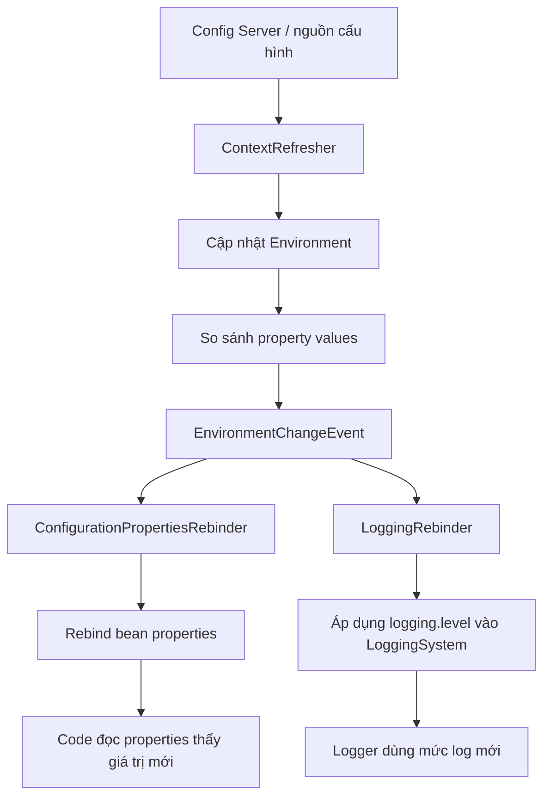
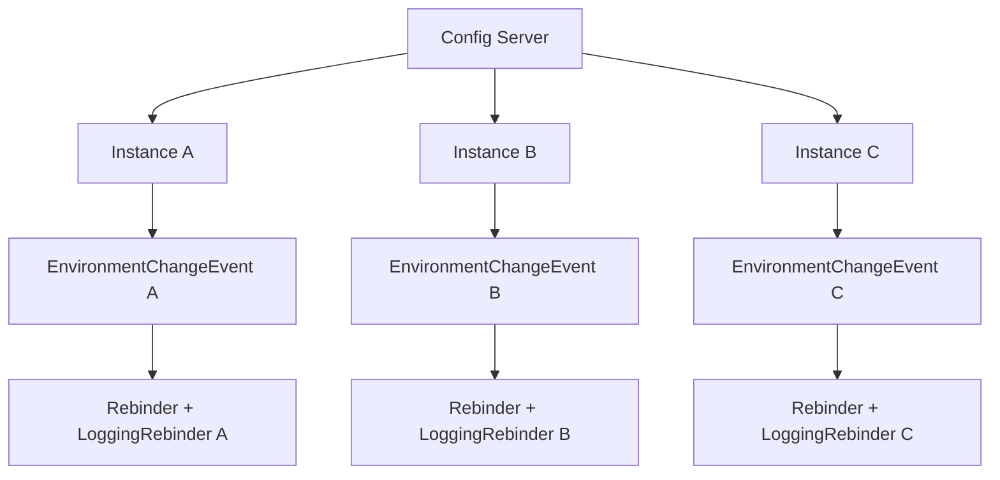

# Rebind `@ConfigurationProperties` và cập nhật `logging.level`

Khi cấu hình bên ngoài thay đổi, ứng dụng Spring Cloud cần làm cho các thành phần đang chạy nhận được giá trị mới. Spring Cloud Context cung cấp cơ chế phát hiện thay đổi trong `Environment`, phát `EnvironmentChangeEvent` và kết nối sự kiện đó với các thành phần như **`ConfigurationPropertiesRebinder`** và **`LoggingRebinder`**. Nhờ vậy, một số bean cấu hình có thể được bind lại và mức log có thể được thay đổi khi ứng dụng vẫn đang chạy.

Hai hành vi này có liên quan nhưng khác nhau. `@ConfigurationProperties` mô tả cách ánh xạ cấu hình vào object Java; rebinder cập nhật bean thuộc nhóm này khi nhận sự kiện phù hợp. `logging.level` được áp dụng vào logging system thông qua `LoggingRebinder`, không phải chỉ là một field trong bean properties. Hiểu luồng sự kiện giúp tránh nhầm rằng thay file cấu hình là mọi object tự đổi ngay lập tức.

Bài học thuộc chương **Làm mới cấu hình** của module `SPRING_CLOUD_CORE`. Nội dung tập trung vào vòng đời rebind, cách cập nhật `logging.level` từ nguồn cấu hình ngoài, precedence, giới hạn, bảo mật Actuator và cách kiểm thử thay đổi runtime.

## 1. Từ thay đổi cấu hình đến hành vi mới

Giả sử một service có cấu hình số lần retry và mức log:

```yaml
catalog:
  retry:
    max-attempts: 3
    backoff: 500ms

logging:
  level:
    root: INFO
    com.example.catalog: INFO
```

Trong lúc ứng dụng đang chạy, đội vận hành muốn tăng `max-attempts` lên `5` và bật `DEBUG` cho package `com.example.catalog` để điều tra sự cố. Nếu các giá trị này đến từ Config Server, việc commit thay đổi vào repository cấu hình mới chỉ cập nhật **nguồn dữ liệu**. Instance đang chạy còn cần nạp lại cấu hình và xử lý sự kiện thay đổi.

Luồng tổng quát:



Trong luồng này:

1. Một cơ chế refresh lấy cấu hình mới và cập nhật `Environment` của instance.
2. Spring Cloud Context xác định các key có giá trị thay đổi và phát `EnvironmentChangeEvent`.
3. `ConfigurationPropertiesRebinder` xử lý các bean `@ConfigurationProperties` đủ điều kiện.
4. `LoggingRebinder` xử lý các thay đổi thuộc nhóm logging và cập nhật mức log qua logging system.

`EnvironmentChangeEvent` là tín hiệu về **những key đã thay đổi**. Nó không tự đi lấy cấu hình từ Config Server. Nếu chỉ tự phát event mà chưa cập nhật `Environment`, các listener sẽ xử lý những giá trị hiện có, không tự biết giá trị mới nằm ở đâu.

## 2. `EnvironmentChangeEvent` và vai trò của Spring Cloud Context

### 2.1. Event biểu diễn điều gì?

`EnvironmentChangeEvent` mang theo tập tên property được xác định là đã thay đổi trong `Environment`. Các listener có thể dựa vào danh sách key để quyết định cần cập nhật thành phần nào.

Ví dụ tập key có thể gồm:

```text
catalog.retry.max-attempts
catalog.retry.backoff
logging.level.com.example.catalog
```

Sự kiện không có nghĩa toàn bộ bean trong context bị hủy và tạo lại. Mỗi listener có phạm vi riêng: rebinder xử lý nhóm bean cấu hình, logging rebinder xử lý logging, còn refresh scope có cơ chế invalidate target riêng.

### 2.2. ContextRefresher

Trong ứng dụng Spring Cloud Context, `ContextRefresher` là thành phần điều phối refresh Environment. Với cấu hình remote được hỗ trợ, nó thực hiện việc nạp/cập nhật các nguồn cấu hình, xác định các property thay đổi và phát event tương ứng. Endpoint Actuator `/actuator/refresh` thường gọi cơ chế này.

Một thao tác refresh không nên được hiểu đơn giản là “đọc lại một file YAML”. Tùy phiên bản và cách tích hợp Config Client, quy trình có thể xử lý Config Data, property source từ xa, profile và các nguồn cấu hình khác. Hãy dùng đúng dependency và release train của ứng dụng.

### 2.3. Event và refresh scope là hai nhánh xử lý khác nhau

`ConfigurationPropertiesRebinder` và `LoggingRebinder` xử lý `EnvironmentChangeEvent`. `@RefreshScope` sử dụng scope có thể làm mới để invalidate target bean và tạo target mới ở lần truy cập tiếp theo. Hai cơ chế thường được kích hoạt trong cùng quy trình refresh của Spring Cloud Context, nhưng không nên đồng nhất chúng:

| Cơ chế | Đối tượng tác động | Kết quả |
| --- | --- | --- |
| `EnvironmentChangeEvent` + rebinder | Bean `@ConfigurationProperties` đủ điều kiện | Bean properties được bind lại theo cơ chế rebinder |
| `EnvironmentChangeEvent` + `LoggingRebinder` | Logging configuration | Logging system nhận mức log mới |
| Refresh scope invalidation | Target bean nằm trong `@RefreshScope` | Target cũ bị invalidate; target mới được tạo khi proxy được gọi |

Không phải mọi bean cần `@RefreshScope`. Nếu một bean properties mutable được rebinder cập nhật và service đọc getter hiện hành, có thể không cần tái tạo service. Nếu một bean tạo resource từ cấu hình và resource cần được dựng lại, refresh scope hoặc API reconfiguration có thể phù hợp hơn.

## 3. Rebind `@ConfigurationProperties` hoạt động thế nào?

### 3.1. Bean properties phải được đăng ký

Trước hết, lớp cấu hình cần được Spring quản lý qua `@ConfigurationPropertiesScan` hoặc `@EnableConfigurationProperties`.

```java
import java.time.Duration;
import jakarta.validation.constraints.Min;
import jakarta.validation.constraints.NotNull;
import org.springframework.boot.context.properties.ConfigurationProperties;
import org.springframework.validation.annotation.Validated;

@Validated
@ConfigurationProperties(prefix = "catalog.retry")
public class CatalogRetryProperties {
    @Min(1)
    private int maxAttempts = 3;

    @NotNull
    private Duration backoff = Duration.ofMillis(500);

    public int getMaxAttempts() {
        return maxAttempts;
    }

    public void setMaxAttempts(int maxAttempts) {
        this.maxAttempts = maxAttempts;
    }

    public Duration getBackoff() {
        return backoff;
    }

    public void setBackoff(Duration backoff) {
        this.backoff = backoff;
    }
}
```

Đăng ký lớp properties:

```java
import org.springframework.boot.SpringApplication;
import org.springframework.boot.autoconfigure.SpringBootApplication;
import org.springframework.boot.context.properties.ConfigurationPropertiesScan;

@SpringBootApplication
@ConfigurationPropertiesScan
public class CatalogApplication {
    public static void main(String[] args) {
        SpringApplication.run(CatalogApplication.class, args);
    }
}
```

Ví dụ dùng `jakarta.validation`; dự án Spring Boot cũ có thể cần namespace validation khác. Để các annotation validation hoạt động, classpath phải có Bean Validation provider phù hợp.

### 3.2. ConfigurationPropertiesRebinder

Spring Cloud Context cung cấp `ConfigurationPropertiesRebinder` để xử lý các bean cấu hình khi có thay đổi Environment. Khi nhận `EnvironmentChangeEvent`, rebinder xác định các bean được quản lý dưới dạng configuration properties và thực hiện quy trình rebind theo lifecycle mà phiên bản Spring Cloud hỗ trợ.

Về mặt sử dụng, điều quan trọng là bean `CatalogRetryProperties` được cập nhật theo giá trị mới đã có trong `Environment`. Một service giữ tham chiếu tới bean properties và đọc getter khi thực hiện công việc có thể thấy giá trị đã rebind:

```java
import java.time.Duration;
import org.springframework.stereotype.Service;

@Service
public class CatalogRetryPolicy {
    private final CatalogRetryProperties properties;

    public CatalogRetryPolicy(CatalogRetryProperties properties) {
        this.properties = properties;
    }

    public boolean shouldRetry(int attempt) {
        return attempt < properties.getMaxAttempts();
    }

    public Duration currentBackoff() {
        return properties.getBackoff();
    }
}
```

`CatalogRetryPolicy` không copy `maxAttempts` vào một field riêng trong constructor. Mỗi lần quyết định retry, nó đọc getter từ bean properties đang được Spring quản lý. Nhờ vậy, khi rebinder cập nhật object theo cơ chế của context, policy có thể sử dụng giá trị mới.

### 3.3. Rebind không cập nhật mọi object đã lấy snapshot

Nếu service copy giá trị ngay khi khởi tạo:

```java
@Service
public class FixedRetryPolicy {
    private final int maxAttempts;

    public FixedRetryPolicy(CatalogRetryProperties properties) {
        this.maxAttempts = properties.getMaxAttempts();
    }
}
```

thì `maxAttempts` vẫn là snapshot. Rebinding bean properties không tự tìm mọi field ở mọi bean khác rồi gán lại. Cần đọc từ properties bean khi dùng, đặt bean tiêu thụ vào scope có thể refresh nếu phù hợp, hoặc triển khai một API reconfiguration rõ ràng.

### 3.4. Mutable và immutable configuration properties

Rebinding phù hợp nhất với bean properties có cách bind lại được hỗ trợ, thường là JavaBean mutable có setter. Với kiểu constructor-bound, record hoặc object immutable, không nên mặc định rằng rebinder có thể cập nhật field đã `final` như một bean mutable.

Nếu cấu hình cần immutable:

- Có thể đặt bean tiêu thụ cấu hình vào `@RefreshScope` để target mới được tạo từ Environment mới, nếu dependency và lifecycle cho phép.
- Có thể dùng provider/factory tạo một object settings bất biến mới theo phiên bản cấu hình.
- Có thể chọn restart/rollout nếu thay đổi chỉ nên áp dụng lúc khởi động.

Hành vi cụ thể của rebinder với các dạng binding phụ thuộc phiên bản Spring Boot/Spring Cloud. Kiểm thử trên đúng release train trước khi dựa vào immutable properties trong quy trình refresh production.

## 4. Những giới hạn và lưu ý khi rebind

Rebind là cơ chế cập nhật bean cấu hình, không phải phép biến đổi toàn bộ trạng thái ứng dụng.

### 4.1. Bean phải nằm trong phạm vi quản lý phù hợp

Một object được tạo bằng `new CatalogRetryProperties()` và lưu trong static field không tự được rebinder quản lý. Tương tự, bean không được đăng ký đúng cách hoặc không được nhận diện là configuration properties có thể không được cập nhật.

### 4.2. Consumer có thể đã copy giá trị

Nếu service lưu `int`, `String`, `URI` hoặc `Duration` từ properties vào field, field đó vẫn là giá trị đã copy. Nên giữ tham chiếu tới properties và đọc getter ở thời điểm cần, hoặc dùng một chiến lược tái tạo rõ ràng.

### 4.3. Resource được tạo từ properties không tự thay đổi

Ví dụ một bean tạo HTTP client từ `base-url` hoặc connection pool từ `max-size`. Rebind properties không tự cấu hình lại client/pool đã được tạo trước đó. Phải kiểm tra API của resource có hỗ trợ cập nhật runtime không, hoặc tạo resource mới và đóng resource cũ theo lifecycle an toàn.

### 4.4. Validation và lỗi binding

Giá trị mới có thể không hợp lệ. Ví dụ `max-attempts=0` vi phạm `@Min(1)`, hoặc `backoff` không chuyển đổi được thành `Duration`. Cần quan sát log và trạng thái refresh, kiểm thử lỗi trước khi triển khai và có quy trình rollback. Không giả định refresh thành công chỉ vì endpoint trả về phản hồi HTTP.

### 4.5. Thay đổi cấu hình không đồng nghĩa transaction nghiệp vụ

Nếu nhiều thuộc tính liên quan cần thay đổi cùng nhau, nên gom chúng vào một cấu trúc cấu hình/version và kiểm thử snapshot được tiêu thụ. Một request đang chạy có thể đã đọc giá trị cũ trước khi rebind hoàn tất; xác định rõ request hiện tại được phép dùng phiên bản cũ hay phải kiểm tra version mới.

## 5. Cập nhật `logging.level` khi ứng dụng đang chạy

### 5.1. Khai báo mức log trong cấu hình

Spring Boot hỗ trợ cấu hình mức log theo root logger hoặc logger name:

```yaml
logging:
  level:
    root: INFO
    com.example.catalog: INFO
    com.example.catalog.client: WARN
```

Các mức thường dùng:

| Mức | Ý nghĩa |
| --- | --- |
| `TRACE` | Chi tiết rất sâu, thường dùng để chẩn đoán ngắn hạn |
| `DEBUG` | Thông tin phục vụ debug |
| `INFO` | Sự kiện vận hành thông thường |
| `WARN` | Tình huống cần chú ý nhưng ứng dụng có thể tiếp tục |
| `ERROR` | Lỗi cần xử lý hoặc điều tra |
| `OFF` | Tắt log ở logger tương ứng |

Logger con thường kế thừa mức hiệu lực từ logger cha nếu không có mức cấu hình riêng. Ví dụ `com.example.catalog.client` có thể dùng `WARN` trong khi phần còn lại của `com.example.catalog` dùng `INFO`.

### 5.2. LoggingRebinder

Spring Cloud Context có `LoggingRebinder` lắng nghe thay đổi Environment liên quan đến logging. Khi key thuộc nhóm `logging.*` thay đổi trong event refresh, thành phần này cập nhật mức log thông qua `LoggingSystem` của Spring Boot.

Ví dụ Config Server trả cấu hình mới:

```yaml
logging:
  level:
    root: INFO
    com.example.catalog: DEBUG
    com.example.catalog.client: TRACE
```

Sau khi instance nạp được các property mới và phát `EnvironmentChangeEvent`, `LoggingRebinder` có thể áp dụng mức log mới cho logging system mà không cần khởi động lại toàn bộ JVM.

Đây là cơ chế riêng cho logging. `logging.level.*` không cần được bind vào một bean `@ConfigurationProperties` do ứng dụng tự viết rồi gọi setter thủ công. Logging system là nơi áp dụng cấu hình mức log.

### 5.3. Mức log hiệu lực và cấu hình nguồn

Khi logger có cấu hình riêng, mức log hiệu lực có thể khác mức root. Cần phân biệt:

- **Configured level:** mức được cấu hình trực tiếp cho logger.
- **Effective level:** mức logger thực sự sử dụng sau khi xét cấu hình kế thừa từ logger cha.

Ví dụ, root là `INFO`, package `com.example.catalog` không có mức riêng thì logger thuộc package đó thường hiệu lực ở `INFO`. Nếu đặt package thành `DEBUG`, logger trong package có thể phát thêm debug log.

Mức log cũng có thể bị ghi đè bởi một nguồn có độ ưu tiên cao hơn Config Server, ví dụ biến môi trường, `SPRING_APPLICATION_JSON` hoặc tham số dòng lệnh. Nếu remote config đổi `logging.level.com.example.catalog` nhưng giá trị hiệu lực không đổi, hãy kiểm tra property source precedence trước khi kết luận LoggingRebinder lỗi.

## 6. Hai cách điều khiển logging runtime

Có hai cách thường gặp để thay đổi mức log khi ứng dụng đang chạy. Chúng phục vụ mục đích khác nhau.

### 6.1. Thay đổi qua cấu hình và refresh

Đây là cách phù hợp khi muốn thay đổi mức log có nguồn gốc từ cấu hình quản lý tập trung:

1. Cập nhật `logging.level.*` trong Config Server hoặc nguồn cấu hình được ứng dụng sử dụng.
2. Kích hoạt refresh cho instance.
3. `Environment` nhận giá trị mới.
4. `EnvironmentChangeEvent` được phát.
5. `LoggingRebinder` áp dụng mức log mới.
6. Kiểm tra logger và log output thực tế.

Ưu điểm là cấu hình có thể được quản lý, review và version hóa cùng các thuộc tính khác. Khi restart hoặc refresh lại, nguồn cấu hình tiếp tục là cơ sở để áp dụng.

### 6.2. Dùng Actuator Loggers endpoint

Spring Boot Actuator cung cấp endpoint `loggers` để đọc và thay đổi mức log runtime. Ví dụ đọc trạng thái logger:

```http
GET /actuator/loggers/com.example.catalog
```

Thay đổi mức log:

```http
POST /actuator/loggers/com.example.catalog
Content-Type: application/json

{"configuredLevel":"DEBUG"}
```

Có thể đặt `configuredLevel` về `null` để bỏ cấu hình riêng và cho logger kế thừa từ cha, theo semantics của endpoint. Endpoint này tác động trực tiếp vào logging system của instance đang nhận request.

Điểm khác biệt quan trọng: thay đổi qua `/actuator/loggers` không nhất thiết ghi ngược vào Config Server hoặc tệp cấu hình. Vì vậy, thay đổi thủ công có thể bị ghi đè khi refresh/restart hoặc khi cấu hình nguồn được áp dụng lại. Nếu cần thay đổi có kiểm soát và đồng nhất giữa các instance, hãy cập nhật nguồn cấu hình trung tâm rồi refresh/rollout theo quy trình.

### 6.3. So sánh hai cách

| Tiêu chí | Config source + refresh | Actuator `loggers` |
| --- | --- | --- |
| Nơi lưu quyết định | Nguồn cấu hình được quản lý | Logging system của instance |
| Phạm vi | Từng instance nhận refresh; có thể điều phối nhiều instance | Instance nhận request |
| Có version/review cấu hình | Có, nếu nguồn cấu hình được quản lý | Không tự động |
| Có thể bị ghi đè khi refresh | Theo precedence của property source | Có thể bị cấu hình nguồn áp dụng lại |
| Phù hợp | Thay đổi cấu hình có chủ đích, cần tái lập | Chẩn đoán nhanh hoặc điều chỉnh tạm thời |

## 7. Bật và bảo vệ Actuator endpoint

Để dùng endpoint refresh và loggers qua HTTP, ứng dụng cần các dependency Actuator và Spring Cloud Context phù hợp. Endpoint phải được expose và được bảo vệ bằng cơ chế authentication/authorization của hệ thống.

Ví dụ cấu hình exposure:

```yaml
management:
  endpoints:
    web:
      exposure:
        include: health,info,refresh,loggers
```

Danh sách trên chỉ minh họa exposure; trong production nên expose đúng endpoint cần thiết. Không mở tất cả endpoint quản trị ra mạng công khai.

Ví dụ gọi refresh:

```bash
curl -X POST \
  -H "Authorization: Bearer <access-token>" \
  http://localhost:8080/actuator/refresh
```

Response thường là danh sách key được phát hiện thay đổi, chẳng hạn:

```json
[
  "catalog.retry.max-attempts",
  "catalog.retry.backoff",
  "logging.level.com.example.catalog"
]
```

Gọi kiểm tra mức log:

```bash
curl \
  -H "Authorization: Bearer <access-token>" \
  http://localhost:8080/actuator/loggers/com.example.catalog
```

Thay đổi logger:

```bash
curl -X POST \
  -H "Authorization: Bearer <access-token>" \
  -H "Content-Type: application/json" \
  -d '{"configuredLevel":"DEBUG"}' \
  http://localhost:8080/actuator/loggers/com.example.catalog
```

Các lệnh dùng token placeholder; không commit token hoặc ghi token thật vào lịch sử shell. Endpoint refresh có thể thay đổi hành vi ứng dụng; endpoint loggers có thể làm tăng lượng log và lộ dữ liệu nhạy cảm nếu bật TRACE/DEBUG. Cần giới hạn quyền, audit thao tác và đặt thời gian đưa mức log về bình thường.

## 8. Precedence: vì sao cấu hình remote đổi nhưng giá trị vẫn cũ?

Spring Boot kết hợp nhiều property source. Một key từ Config Server có thể bị nguồn ưu tiên cao hơn ghi đè, chẳng hạn:

- Environment variable của container.
- Java system property.
- `SPRING_APPLICATION_JSON`.
- Tham số dòng lệnh.
- Test property hoặc nguồn đặc biệt khác trong môi trường test.

Ví dụ Config Server đặt:

```yaml
logging:
  level:
    com.example.catalog: DEBUG
```

Nhưng container có biến môi trường hoặc command line đặt logger đó thành `INFO`. Khi refresh, giá trị hiệu lực vẫn có thể là `INFO`. Điều tương tự xảy ra với `catalog.retry.max-attempts`.

Khi chẩn đoán, cần kiểm tra **giá trị hiệu lực**, không chỉ kiểm tra giá trị trong Git. Actuator `env` có thể cho biết nguồn property nếu endpoint được expose và bảo vệ; cần chú ý masking vì thông tin cấu hình có thể nhạy cảm.

## 9. Nhiều instance và giới hạn nhất quán

`EnvironmentChangeEvent`, `ConfigurationPropertiesRebinder` và `LoggingRebinder` hoạt động trong phạm vi application context của một JVM. Refresh instance A không tự phát event trong instance B.

Nếu ứng dụng có ba replica:



Mỗi instance cần nhận trigger refresh hoặc được rollout/restart. Spring Cloud Bus có thể truyền sự kiện refresh tới các instance khi broker và Bus được cấu hình, nhưng event delivery không phải transaction nguyên tử toàn cụm. Trong một khoảng thời gian, các replica có thể dùng mức log hoặc retry policy khác nhau.

Với thay đổi có ảnh hưởng tới quyết định nghiệp vụ, nên theo dõi config version và refresh status theo instance. Với logging, có thể chấp nhận cập nhật lệch vài giây trong quá trình điều tra; với giới hạn thanh toán hoặc bảo vệ dữ liệu, cần xác định rõ yêu cầu nhất quán và rollout policy.

## 10. Kiểm thử rebind và logging level

Không nên chỉ kiểm tra endpoint trả HTTP 200. Cần xác nhận bean thực sự nhận giá trị mới và logging system đã áp dụng mức log tương ứng.

| Mục tiêu | Cách kiểm thử | Điều cần xác nhận |
| --- | --- | --- |
| Rebind mutable properties | Cập nhật property source và phát event refresh trong test context | Getter của properties trả giá trị mới |
| Service đọc properties động | Gọi service trước/sau rebind | Quyết định nghiệp vụ dùng giá trị hiện hành |
| Consumer copy snapshot | Lưu giá trị vào field trong constructor | Field snapshot vẫn cũ; test phát hiện anti-pattern |
| Validation khi rebind | Cấp giá trị không hợp lệ | Lỗi được ghi nhận rõ và ứng dụng có chính sách an toàn |
| LoggingRebinder | Đổi `logging.level.<logger>` rồi refresh | Configured/effective level được cập nhật |
| Actuator loggers | GET/POST endpoint trong test integration | Logger đúng instance nhận mức log mới |
| Property precedence | Cùng key có remote và env override | Giá trị hiệu lực khớp nguồn ưu tiên cao hơn |
| Multi-instance | Refresh A trước B | A và B có thể khác trạng thái cho tới khi B nhận event |
| Security | Gọi endpoint không có quyền | Request bị từ chối theo chính sách |

### 10.1. Kiểm thử EnvironmentChangeEvent

Trong integration test, có thể dùng một `MapPropertySource` riêng, cập nhật giá trị trong map rồi phát `EnvironmentChangeEvent` qua `ApplicationEventPublisher` để kiểm tra rebinder đã được đăng ký và hoạt động trong context:

```java
Map<String, Object> values = new HashMap<>();
values.put("catalog.retry.max-attempts", 3);

MapPropertySource source = new MapPropertySource("testOverrides", values);
environment.getPropertySources().addFirst(source);

// Bean properties đã được đăng ký trong test context.
values.put("catalog.retry.max-attempts", 5);
publisher.publishEvent(new EnvironmentChangeEvent(
        this, Set.of("catalog.retry.max-attempts")));

// Assert properties.getMaxAttempts() == 5.
```

Đây là đoạn minh họa ý tưởng test; cần inject `ConfigurableEnvironment`, `ApplicationEventPublisher` và `CatalogRetryProperties` từ cùng context. Đối với kiểm thử refresh đầy đủ, nên dùng `ContextRefresher` hoặc endpoint thật trong test integration để bao phủ cả bước cập nhật nguồn cấu hình và tạo event. Phát event thủ công chỉ kiểm tra nhánh xử lý event, không chứng minh Config Server đã được truy vấn.

### 10.2. Kiểm thử logging level

Có thể xác nhận mức log qua Actuator `loggers` endpoint hoặc `LoggingSystem` tương ứng. Test nên kiểm tra logger cụ thể, không chỉ root logger, vì logger con có thể có configured level riêng hoặc kế thừa mức từ cha.

Một bài kiểm thử đầy đủ:

1. Khởi động context với `com.example.catalog=INFO`.
2. Xác nhận configured/effective level ban đầu.
3. Cập nhật property source thành `DEBUG` và kích hoạt refresh event.
4. Đọc lại logger qua Actuator hoặc LoggingSystem.
5. Xác nhận mức log mới có hiệu lực.
6. Đặt lại mức cũ để test khác không bị ảnh hưởng.

Không nên dùng log output đơn lẻ làm assertion duy nhất nếu logger appender/async logging khiến output bị trễ. Có thể kết hợp kiểm tra cấu hình logger và một test appender phù hợp.

## 11. Chẩn đoán lỗi thường gặp

| Triệu chứng | Nguyên nhân có thể | Hướng kiểm tra |
| --- | --- | --- |
| Environment đổi nhưng properties bean vẫn cũ | Bean không được đăng ký/nhận diện hoặc event không tới rebinder | Kiểm tra `@ConfigurationPropertiesScan`, dependency Spring Cloud Context và event |
| Properties bean mới nhưng service vẫn dùng giá trị cũ | Service copy giá trị vào field | Đọc getter tại thời điểm sử dụng hoặc tái tạo bean phù hợp |
| HTTP client vẫn gọi endpoint cũ | Client được tạo từ snapshot và không hỗ trợ reconfigure | Tái tạo client/target, kiểm tra lifecycle resource |
| `/actuator/refresh` không tồn tại | Thiếu dependency, endpoint chưa được expose hoặc phiên bản không hỗ trợ như dự kiến | Kiểm tra Actuator, Spring Cloud Context và endpoint exposure |
| Refresh trả danh sách rỗng | Giá trị hiệu lực không đổi, nguồn chưa cập nhật hoặc key bị override | Kiểm tra property sources và precedence |
| `logging.level` không đổi | Logger key sai, property không đổi, override hoặc logging integration khác | Kiểm tra key chính xác, configured/effective level và LoggingSystem |
| Actuator logger đổi nhưng refresh lại quay về mức cũ | Thay đổi thủ công không được ghi vào config source | Cập nhật nguồn cấu hình trung tâm nếu cần duy trì |
| Một replica đổi, replica khác không đổi | Chỉ một instance nhận refresh | Kiểm tra Bus/event delivery và trạng thái từng replica |
| Rebind thất bại với giá trị mới | Sai kiểu, validation fail hoặc bean không hỗ trợ rebind | Kiểm tra log binding, constraint và thiết kế immutable/mutable |
| DEBUG không xuất hiện | Logger con có cấu hình riêng, appender/filter hoặc profile khác | Kiểm tra logger cụ thể và logging backend |

Trình tự chẩn đoán:

1. Xác nhận Config Server/nguồn cấu hình đã có giá trị mới.
2. Xác nhận instance đã nạp giá trị vào `Environment`.
3. Kiểm tra danh sách key trong `EnvironmentChangeEvent` hoặc response refresh.
4. Xác nhận bean properties được đăng ký và rebinder xử lý.
5. Kiểm tra service có đọc getter hiện hành hay giữ snapshot.
6. Kiểm tra `logging.level.*` có bị nguồn ưu tiên cao hơn ghi đè không.
7. Đọc configured/effective logger level qua công cụ quản trị phù hợp.
8. Lặp lại trên từng instance và ghi nhận config version.

## 12. Thực hành: đổi retry policy và bật DEBUG có kiểm soát

Giả sử Config Server đang cung cấp:

```yaml
catalog:
  retry:
    max-attempts: 3
    backoff: 500ms

logging:
  level:
    root: INFO
    com.example.catalog: INFO
```

### Bước 1 — Đảm bảo bean properties có thể rebind

Đăng ký `CatalogRetryProperties` bằng `@ConfigurationPropertiesScan`, dùng setter cho các trường cần cập nhật và validation cho giá trị quan trọng. Service đọc getter khi quyết định retry, không copy số lần retry vào field constructor.

### Bước 2 — Cập nhật cấu hình trên nguồn quản lý

```yaml
catalog:
  retry:
    max-attempts: 5
    backoff: 250ms

logging:
  level:
    root: INFO
    com.example.catalog: DEBUG
```

### Bước 3 — Refresh instance

Gọi `POST /actuator/refresh` trên instance cần cập nhật, hoặc phát sự kiện qua Spring Cloud Bus nếu kiến trúc đã cấu hình. Xác nhận các key thay đổi được nhận diện.

### Bước 4 — Xác minh properties

Gọi một thao tác nghiệp vụ hoặc kiểm tra bean properties trong môi trường test/quản trị để xác nhận `maxAttempts=5` và `backoff=250ms`. Không log secret hoặc toàn bộ object cấu hình.

### Bước 5 — Xác minh logging

Đọc `GET /actuator/loggers/com.example.catalog` và xác nhận configured/effective level là `DEBUG`. Quan sát log trong khoảng thời gian cần thiết, sau đó đưa về `INFO` bằng nguồn cấu hình quản lý và refresh lại.

### Bước 6 — Xác minh toàn cụm

Nếu service có nhiều replica, kiểm tra từng instance đã nhận cấu hình mới. Một request refresh thành công ở Pod A không chứng minh Pod B/C cũng đã cập nhật.

### Câu hỏi tự kiểm tra

1. `EnvironmentChangeEvent` mang thông tin gì và có tự truy vấn Config Server không?
2. Vai trò của `ConfigurationPropertiesRebinder` khác `LoggingRebinder` như thế nào?
3. Vì sao service nên đọc getter từ properties bean thay vì copy giá trị vào field constructor?
4. Vì sao immutable/constructor-bound properties cần được kiểm thử riêng khi dùng refresh?
5. `logging.level.com.example.catalog=DEBUG` được áp dụng vào thành phần nào?
6. Config Server đổi `logging.level` nhưng mức log vẫn cũ; cần kiểm tra điều gì trước?
7. Actuator `/loggers` khác cập nhật `logging.level` trong Config Server như thế nào?
8. Vì sao refresh một instance không tự cập nhật toàn bộ replica?
9. Nếu giá trị mới vi phạm validation, cần có chính sách vận hành nào?

**Gợi ý đáp án:** (1) Tập property key được phát hiện thay đổi; (2) Rebinder cập nhật bean properties, LoggingRebinder cập nhật logging system; (3) Tránh giữ snapshot cũ; (4) Vì object immutable không thể cập nhật field như JavaBean mutable và hành vi phụ thuộc phiên bản; (5) LoggingSystem của instance; (6) Property precedence, key chính xác và event refresh; (7) Loggers endpoint chỉnh trực tiếp logging system của instance, không tự lưu vào nguồn cấu hình; (8) Mỗi JVM/context có Environment và event riêng; (9) Validation, rollback, readiness và theo dõi trạng thái từng instance.

## 13. Những nguyên tắc cần nhớ

- `EnvironmentChangeEvent` thông báo các property key đã thay đổi; nó không tự lấy dữ liệu mới từ nguồn cấu hình.
- `ConfigurationPropertiesRebinder` xử lý các bean `@ConfigurationProperties` đủ điều kiện khi nhận event; service vẫn có thể giữ snapshot nếu copy giá trị ra field riêng.
- Mutable JavaBean properties phù hợp hơn với rebind thông thường; constructor-bound/immutable properties và resource được tạo từ cấu hình cần chiến lược riêng.
- `LoggingRebinder` áp dụng các thay đổi `logging.*` vào logging system; không cần tạo bean properties riêng để thay mức log.
- `logging.level` có thể được quản lý qua Config Server và refresh, hoặc thay đổi trực tiếp qua Actuator `loggers`; hai cách có phạm vi và tính bền vững khác nhau.
- Kiểm tra property source precedence, configured/effective logger level và trạng thái từng replica khi giá trị không đổi như mong đợi.
- Bảo vệ Actuator refresh/loggers, audit thao tác và giới hạn thời gian bật mức DEBUG/TRACE.
- Kiểm thử cả rebind, logging system, validation lỗi, snapshot của consumer và cập nhật nhiều instance.

Nắm được cách rebind `@ConfigurationProperties` và cập nhật `logging.level` giúp người vận hành thay đổi một số hành vi runtime có kiểm soát. Khi hiểu rõ event, rebinder, logging system và giới hạn snapshot, ứng dụng Spring Cloud có thể tiếp nhận cấu hình mới mà không nhầm refresh với việc tự động thay đổi mọi object trong JVM.
