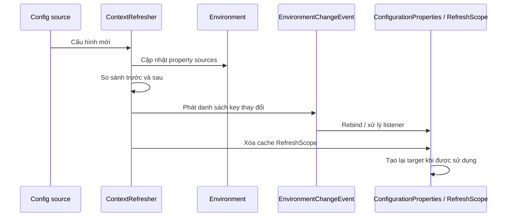

# Hành vi thêm, đổi và xóa thuộc tính theo phiên bản

Trong ứng dụng Spring Boot có Spring Cloud Context, cấu hình không nhất thiết chỉ được đọc một lần khi khởi động. Khi một nguồn cấu hình được cập nhật và ứng dụng thực hiện refresh, Spring có thể phát hiện các khóa mới, khóa đổi giá trị và khóa không còn xuất hiện trong môi trường cấu hình. Tùy loại bean và phiên bản Spring Cloud, những thay đổi đó được áp dụng theo các cách khác nhau.

Điểm cần hiểu rõ là **thay đổi một property source**, **thay đổi giá trị hiệu lực trong Environment** và **thay đổi trạng thái của bean đang chạy** là ba việc liên quan nhưng không đồng nhất. Xóa một khóa khỏi file remote chưa chắc làm ứng dụng mất giá trị đó: một property source có độ ưu tiên thấp hơn vẫn có thể cung cấp cùng khóa; bean cũng có thể giữ trạng thái đã khởi tạo cho tới khi được rebind hoặc tạo lại.

Bài học thuộc chương **Làm mới cấu hình** của module **SPRING_CLOUD_CORE**. Nội dung giải thích luồng refresh, sự khác nhau giữa thêm/đổi/xóa, hành vi của ConfigurationProperties và RefreshScope, các mốc phiên bản đáng chú ý, cùng cách kiểm thử và vận hành.

## 1. Mục tiêu học tập

Sau bài học, người học có thể:

- Mô tả cách Spring Cloud Context so sánh Environment trước và sau refresh.
- Phân biệt property source được thêm, property được đổi giá trị và property bị loại khỏi nguồn.
- Giải thích EnvironmentChangeEvent và các listener chuẩn của Spring Cloud.
- Biết khi nào ConfigurationProperties được rebind và khi nào bean được tạo lại qua RefreshScope.
- Hiểu vì sao xóa một khóa khỏi remote source không nhất thiết làm khóa biến mất khỏi giá trị hiệu lực.
- Nhận biết giới hạn của constructor binding, Java record, nested properties và các bean giữ tài nguyên.
- Đối chiếu hành vi với mốc Spring Boot 2.4, Spring Cloud 2022.0.3 và các giới hạn của Spring Cloud hiện hành.
- Viết kiểm thử cho add, update, delete, refresh failure và nhiều instance.

## 2. Ba lớp cần phân biệt khi nói về thay đổi cấu hình

Giả sử ứng dụng có khóa catalog.timeout được cung cấp từ Config Server:

| Lớp | Câu hỏi cần trả lời | Ví dụ |
| --- | --- | --- |
| Property source | Nguồn cấu hình nào đang chứa khóa? | remote-config có catalog.timeout=2s |
| Environment | Khi tra cứu khóa, giá trị nào đang có hiệu lực? | Remote trả 2s, local file có 5s; kết quả phụ thuộc precedence |
| Bean/runtime | Đối tượng đang chạy đã nhận giá trị mới chưa? | CatalogProperties đã rebind hoặc client đã được tạo lại |

Một commit mới trên Git chỉ thay đổi dữ liệu ở backend. Config Client không mặc định polling để phát hiện commit đó. Ứng dụng phải nhận được một yêu cầu refresh, tải lại nguồn cấu hình, cập nhật Environment, rồi áp dụng thay đổi vào bean theo cơ chế tương ứng.

Luồng tổng quát:



Trong ContextRefresher, thao tác refresh gọi refreshEnvironment trước, sau đó gọi RefreshScope.refreshAll. Vì thế, việc cập nhật môi trường và việc tạo lại bean thuộc refresh scope có thứ tự xác định trong quy trình chuẩn.

## 3. Spring Cloud phát hiện key nào đã thay đổi?

Ở mức khái niệm, ContextRefresher lấy một snapshot các property có thể liệt kê trong Environment, gọi cơ chế cập nhật môi trường, rồi so sánh snapshot mới với snapshot cũ.

Có ba trường hợp:

| Trạng thái trước | Trạng thái sau | Kết quả diff |
| --- | --- | --- |
| Không có khóa | Có khóa với giá trị true | Khóa mới được ghi nhận |
| Có khóa timeout=2s | Có khóa timeout=5s | Khóa thay đổi được ghi nhận |
| Có khóa endpoint | Không còn khóa trong snapshot | Khóa bị loại được ghi nhận với giá trị diff null |

EnvironmentChangeEvent mang danh sách tên khóa thay đổi. Listener có thể dùng các tên khóa này để quyết định có cần rebind, cập nhật cache hay thực hiện hành động phụ hay không.

Ví dụ listener chỉ quan tâm namespace catalog:

```java
import org.springframework.cloud.context.environment.EnvironmentChangeEvent;
import org.springframework.context.event.EventListener;
import org.springframework.stereotype.Component;

@Component
public class CatalogChangeListener {

    private final CatalogCache catalogCache;

    public CatalogChangeListener(CatalogCache catalogCache) {
        this.catalogCache = catalogCache;
    }

    @EventListener
    public void onEnvironmentChange(EnvironmentChangeEvent event) {
        boolean catalogChanged = event.getKeys().stream()
            .anyMatch(key -> key.startsWith("catalog."));

        if (catalogChanged) {
            catalogCache.invalidate();
        }
    }
}
```

Event chỉ cho biết **tên khóa** thay đổi; listener nên đọc lại giá trị hiệu lực từ Environment hoặc bean properties khi cần. Không giả định event chứa đầy đủ cặp giá trị cũ/mới. Nếu khóa bị xóa khỏi một source nhưng vẫn tồn tại ở source thấp hơn, khi đọc lại Environment có thể nhận giá trị fallback thay vì null.

### 3.1. Property source cần hỗ trợ liệt kê khóa

Cơ chế diff chuẩn phải biết tên các khóa để so sánh. Với custom source, nên dùng loại có thể liệt kê tên khóa, chẳng hạn EnumerablePropertySource hoặc MapPropertySource. Một nguồn chỉ triển khai lookup getProperty nhưng không cung cấp danh sách tên khóa có thể không được trích xuất đầy đủ trong bước so sánh chuẩn.

Nếu nguồn tùy biến không thể liệt kê khóa, hãy thiết kế event/diff riêng hoặc bảo đảm nguồn phát ra một tín hiệu thay đổi rõ ràng. Đừng dựa vào việc ContextRefresher luôn phát hiện mọi thay đổi của mọi implementation PropertySource.

## 4. Khi thêm thuộc tính mới

Giả sử phiên bản cấu hình cũ chưa có catalog.retry.enabled, còn cấu hình mới bổ sung:

```yaml
catalog:
  base-url: https://catalog.internal
  timeout: 2s
  retry:
    enabled: true
```

Sau refresh, nếu property source mới được đưa vào Environment và khóa chưa tồn tại ở nguồn khác, catalog.retry.enabled trở thành một khóa mới. EnvironmentChangeEvent bao gồm tên khóa đó. Một bean ConfigurationProperties có trường tương ứng có thể nhận giá trị sau khi rebind.

Ví dụ:

```java
import java.time.Duration;
import org.springframework.boot.context.properties.ConfigurationProperties;

@ConfigurationProperties(prefix = "catalog")
public class CatalogProperties {

    private String baseUrl = "http://localhost:8080";
    private Duration timeout = Duration.ofSeconds(2);
    private Retry retry = new Retry();

    public static class Retry {
        private boolean enabled = false;

        public boolean isEnabled() {
            return enabled;
        }

        public void setEnabled(boolean enabled) {
            this.enabled = enabled;
        }
    }

    public String getBaseUrl() {
        return baseUrl;
    }

    public void setBaseUrl(String baseUrl) {
        this.baseUrl = baseUrl;
    }

    public Duration getTimeout() {
        return timeout;
    }

    public void setTimeout(Duration timeout) {
        this.timeout = timeout;
    }

    public Retry getRetry() {
        return retry;
    }

    public void setRetry(Retry retry) {
        this.retry = retry;
    }
}
```

Đây là dạng mutable JavaBean có constructor không tham số và giá trị mặc định ở cấp lớp. Nó phù hợp để minh họa cơ chế rebind của ConfigurationProperties.

Trong ứng dụng, đăng ký lớp này bằng ConfigurationPropertiesScan hoặc EnableConfigurationProperties(CatalogProperties.class) để Spring tạo bean properties.

Khi thêm một khóa, cần kiểm tra:

- Prefix và tên khóa đã bind đúng chưa.
- Kiểu dữ liệu có chuyển đổi được không.
- Bean properties đã được đăng ký trong context chưa.
- Có validation nào khiến refresh thất bại khi giá trị mới không hợp lệ không.
- Logic tiêu thụ cấu hình có thực sự đọc lại giá trị sau refresh hay đang giữ một bản sao cũ trong field khác.

Thêm property vào Environment không tự động tạo bean mới hoặc tự bật một tính năng nếu ứng dụng không có code đọc thuộc tính đó.

## 5. Khi đổi giá trị của thuộc tính

Giả sử catalog.timeout chuyển từ 2s thành 5s:

```yaml
catalog:
  timeout: 5s
```

Nếu giá trị hiệu lực trong Environment thay đổi, ContextRefresher ghi nhận khóa catalog.timeout trong diff và phát EnvironmentChangeEvent.

Spring Cloud xử lý hai trường hợp phổ biến:

1. Các bean ConfigurationProperties được rebind.
2. Các logger có khóa thuộc dạng logging.level.* được cập nhật mức log.

Việc rebind có thể thay đổi field của bean đang tồn tại. Nó không đồng nghĩa với việc Spring tạo một instance mới cho mọi bean phụ thuộc vào properties.

Ví dụ một service giữ tham chiếu tới CatalogProperties:

```java
@Service
public class CatalogService {

    private final CatalogProperties properties;

    public CatalogService(CatalogProperties properties) {
        this.properties = properties;
    }

    public Duration timeout() {
        return properties.getTimeout();
    }
}
```

Nếu bean properties được rebind tại chỗ, service vẫn giữ cùng tham chiếu và lần gọi tiếp theo đọc được field mới. Nhưng nếu service đã sao chép giá trị sang một field riêng trong constructor, field đó không tự đổi:

```java
@Service
public class CatalogClient {

    private final Duration timeout;

    public CatalogClient(CatalogProperties properties) {
        this.timeout = properties.getTimeout();
    }

    public Duration timeout() {
        return timeout;
    }
}
```

CatalogClient ở ví dụ thứ hai giữ timeout tại thời điểm tạo. Muốn nó nhận giá trị mới, cần thiết kế lại để đọc properties khi sử dụng hoặc đặt bean cần tạo lại trong refresh scope.

### 5.1. Rebind không bảo đảm đọc nhất quán trong lúc cập nhật

Rebind ConfigurationProperties thay đổi field trên cùng instance. Việc rebind cùng bean được tuần tự hóa nội bộ, nhưng thread khác đang đọc bean có thể nhìn thấy trạng thái trung gian: một field đã về default trong lúc field khác chưa nhận giá trị mới.

Nếu nhiều trường cần nhất quán như một bộ cấu hình nguyên tử, hãy cân nhắc RefreshScope cho bean tiêu thụ chúng hoặc xây dựng một immutable snapshot mới rồi thay thế tham chiếu theo một thao tác nguyên khối.

## 6. Khi xóa thuộc tính khỏi nguồn cấu hình

Xóa là trường hợp dễ gây hiểu nhầm nhất. Giả sử remote source từng có:

```yaml
catalog:
  endpoint: https://catalog-v1.internal
```

Sau đó file remote bỏ khóa catalog.endpoint.

Điều đó chỉ nói rằng **remote source không còn khai báo khóa**. Giá trị hiệu lực trong Environment còn phụ thuộc các property source khác:

- Nếu application.yml local cũng khai báo catalog.endpoint, giá trị local có thể trở thành fallback.
- Nếu biến môi trường hoặc command-line argument có cùng khóa, chúng vẫn có thể cung cấp giá trị.
- Nếu không còn nguồn nào cung cấp khóa, Environment.getProperty có thể trả về null; code có default thì nhận default đó.
- Nếu bean đã copy giá trị vào field riêng, field có thể vẫn giữ giá trị cũ cho tới khi bean được rebind hoặc tạo lại.

Vì vậy, không nên xem việc xóa một dòng trong Git là một lệnh vô hiệu hóa có hiệu lực giống nhau ở mọi ứng dụng.

### 6.1. Diff có thể ghi nhận khóa bị loại, nhưng event không phải tombstone

Trong implementation ContextRefresher, nếu một khóa có trong snapshot trước mà không còn trong snapshot sau, diff nội bộ ghi nhận khóa đó với giá trị null. EnvironmentChangeEvent công bố tập tên khóa thay đổi. Listener nhận được tên khóa, nhưng không nhận một chỉ thị tombstone bền vững cho mọi bean hoặc mọi property source.

Một property source thấp hơn có thể tiếp tục cung cấp khóa đó. Một bean có default cũng có thể nhận default sau khi được rebind hoặc tạo lại. Vì vậy, hãy phân biệt:

- Khóa bị xóa khỏi một remote source.
- Khóa không còn được resolve từ toàn bộ Environment.
- Bean đã áp dụng trạng thái vắng mặt của khóa.

Ba điều kiện này không tự động đồng thời xảy ra.

### 6.2. Rebind ConfigurationProperties và giá trị bị xóa

Spring Cloud hiện hành reset các field của bean ConfigurationProperties về giá trị mặc định ở cấp lớp trước khi bind lại, nhằm tránh giữ giá trị cũ của các property đã bị loại khỏi Environment. Cơ chế reset này có điều kiện:

- Bean có constructor không tham số là constructor duy nhất.
- Các nested ConfigurationProperties cũng được reset đệ quy theo quy tắc hỗ trợ.
- Một số kiểu thư viện hoặc kiểu JDK/Jakarta/Javax không bị reset đệ quy.
- Nếu có constructor tham số bên cạnh constructor không tham số, quá trình reset toàn bộ có thể bị bỏ qua vì constructor mặc định không tái tạo đúng giá trị khởi tạo thực tế.

Ví dụ CatalogProperties ở phần trước có timeout mặc định 2s. Nếu catalog.timeout bị xóa khỏi mọi nguồn và bean đủ điều kiện reset, lần rebind có thể đưa field về 2s. Nếu remote bị xóa nhưng local file vẫn khai báo 5s, giá trị hiệu lực vẫn có thể là 5s.

### 6.3. Xóa khóa không phải cách tốt để biểu diễn một lệnh nghiệp vụ

Nếu ứng dụng cần biết một tính năng đã bị tắt, nên dùng một thuộc tính trạng thái tường minh:

```yaml
catalog:
  retry:
    enabled: false
```

Cách này khác với xóa hẳn catalog.retry.enabled. Giá trị false là một trạng thái có thể kiểm tra, truyền qua event và bind rõ ràng. Khi cần nhiều trạng thái hơn, dùng enum:

```yaml
catalog:
  mode: DISABLED
```

Các giá trị như ENABLED, DISABLED, READ_ONLY hoặc MAINTENANCE thường rõ nghĩa hơn việc suy luận từ việc một property có tồn tại hay không.

## 7. ConfigurationProperties và RefreshScope xử lý thay đổi khác nhau

| Đặc điểm | ConfigurationProperties rebind | RefreshScope |
| --- | --- | --- |
| Cách áp dụng | Bind lại field trên instance hiện tại | Xóa cache target của scope |
| Khi nào object đổi? | Cùng instance được cập nhật | Target mới được tạo ở lần sử dụng tiếp theo |
| Giá trị default | Có thể reset về class defaults khi property bị xóa và bean đủ điều kiện | Target mới đọc Environment tại thời điểm tạo |
| Tính nhất quán khi đọc | Thread khác có thể thấy trạng thái rebind trung gian | Scope đồng bộ việc truy cập target với refresh |
| Phù hợp | Cấu hình mutable, bind trực tiếp | Bean stateful cần khởi tạo lại theo cấu hình |
| Giới hạn | Constructor-bound/record không refresh được | Không tự refresh mọi dependency hoặc mọi resource |

### 7.1. Dùng RefreshScope cho bean cần tạo lại

Ví dụ tạo HTTP client từ cấu hình:

```java
@Configuration(proxyBeanMethods = false)
public class CatalogClientConfiguration {

    @Bean
    @RefreshScope
    CatalogHttpClient catalogHttpClient(CatalogProperties properties) {
        return new CatalogHttpClient(
            URI.create(properties.getBaseUrl()),
            properties.getTimeout()
        );
    }
}
```

Khi refresh scope được làm mới, target CatalogHttpClient bị loại khỏi cache. Lần gọi tiếp theo qua proxy sẽ tạo target mới và inject cấu hình hiện tại.

Gắn RefreshScope lên lớp Configuration không có nghĩa mọi bean được khai báo bên trong tự động thuộc refresh scope. Hãy đánh dấu trực tiếp bean cần tạo lại hoặc bảo đảm dependency consumer cũng được tạo lại.

Tài liệu Spring Cloud cũng cảnh báo rằng bỏ hẳn một property rồi refresh không phải cơ chế đáng tin cậy để thay đổi trạng thái hiện diện của property trong mọi bean. Nếu logic nghiệp vụ cần phân biệt enabled/disabled, hãy cập nhật một giá trị trạng thái tường minh thay vì dùng việc xóa khóa như một tombstone.

### 7.2. Bean giữ tài nguyên cần có vòng đời riêng

Đổi endpoint hoặc credential có thể yêu cầu đóng connection cũ, tạo connection mới và xử lý request đang chạy. Không phải bean nào cũng có thể refresh an toàn.

Ví dụ, một pool kết nối có connection đang được sử dụng cần chính sách graceful replacement. Một số loại DataSource, trong đó HikariDataSource theo mặc định được đánh dấu không refreshable trong Spring Cloud hiện hành, không thể được tạo lại theo cách đơn giản bằng refresh scope. Hãy kiểm tra tài liệu của phiên bản và chọn phương án thay thế/rollout phù hợp.

RefreshScope cũng không biến việc đổi cấu hình thành một giao dịch nguyên tử trên toàn bộ ApplicationContext. Nó điều phối cache của bean trong scope; các singleton ngoài scope và tài nguyên bên ngoài vẫn có vòng đời riêng.


## 8. Những mốc phiên bản ảnh hưởng đến cách refresh

Các hành vi refresh cần được đọc theo cả phiên bản Spring Boot lẫn Spring Cloud. Không có một thay đổi duy nhất làm mọi ứng dụng từ một phiên bản trở lên xử lý add/update/delete giống nhau.

| Mốc | Thay đổi đáng chú ý | Ảnh hưởng khi triển khai |
| --- | --- | --- |
| Spring Boot 2.4 | Giới thiệu Config Data API và spring.config.import | Config Server có cách nạp cấu hình hiện đại; bootstrap legacy không còn là cách mặc định cho ứng dụng mới |
| Spring Cloud 2022.0.3 | PropertySourceLocator được gọi hai lượt trong bootstrap flow | Lượt đầu lấy cấu hình không gắn profile để có thể kích hoạt profile; lượt sau lấy cấu hình theo active profiles |
| Trước Spring Cloud 2022.0.3 | Locator thường chạy trong main application context | Có thể cấu hình spring.cloud.config.initialize-on-context-refresh=true trong bootstrap file để chạy locator trong bootstrap context theo hướng dẫn phiên bản |
| Spring Cloud hiện hành | Rebind, refresh scope, health indicator và các giới hạn AOT được mô tả rõ trong tài liệu Context | Phải kiểm tra constructor binding, reset defaults, bean không refreshable và native-image constraints |

### 8.1. Config Data không đồng nghĩa với bootstrap legacy

Từ Spring Boot 2.4, Config Data import là cơ chế mặc định được khuyến nghị để lấy cấu hình từ Config Server. Ví dụ:

```yaml
spring:
  config:
    import: "configserver:http://config-server:8888"
```

Cơ chế bootstrap legacy cần được bật rõ bằng system property/environment hoặc starter bootstrap. Hai mode có vòng đời nạp cấu hình khác nhau; khi đọc log refresh, hãy xác định ứng dụng đang dùng mode nào.

Phiên bản Spring Cloud phải thuộc release train tương thích với Spring Boot đang dùng. Hãy kiểm tra compatibility matrix và BOM trước khi nâng cấp; mốc Spring Boot 2.4 chỉ nói về Config Data API, không có nghĩa mọi phiên bản Spring Cloud đều tương thích với mọi bản Boot 2.4 trở lên.

Không lấy hành vi hai lượt của PropertySourceLocator trong bootstrap rồi áp dụng nguyên xi cho mọi Config Data resolver/loader. Với nguồn tùy biến dùng Config Data, hãy kiểm tra API resolver/loader và refresher tương ứng của release train đang triển khai.

### 8.2. Hai lượt locator từ Spring Cloud 2022.0.3

Từ Spring Cloud 2022.0.3, locator có thể được gọi lần đầu khi chưa có active profile để lấy các giá trị cơ sở, trong đó có thể có spring.profiles.active. Sau khi application context chính bắt đầu, locator được gọi lần nữa với các profile đã kích hoạt.

Do đó, cùng một locator có thể nhận hai Environment khác nhau trong một lần startup. Nếu cache chỉ dùng application name mà bỏ profile, locator có thể trả nhầm snapshot. Hãy đưa các chiều ảnh hưởng kết quả vào cache key và bảo đảm thao tác đọc không tạo side effect.

### 8.3. Constructor binding và Java record

Trong Spring Cloud hiện hành, bean ConfigurationProperties dùng constructor binding, bao gồm Java record, không được refresh theo cơ chế rebind thông thường. Nếu cấu hình cần cập nhật động, có thể:

- Dùng mutable JavaBean properties phù hợp với rebind.
- Đưa component cần khởi tạo lại vào RefreshScope.
- Hoặc thay đổi cấu trúc để tạo một snapshot immutable mới và thay thế tham chiếu theo cơ chế riêng.

Không đổi record thành mutable class chỉ để làm cho một test pass; hãy chọn mô hình dựa trên yêu cầu nhất quán và vòng đời của object.

### 8.4. AOT và native image

Context refresh hiện không được hỗ trợ cho Spring AOT transformations và native images theo tài liệu Spring Cloud hiện hành. Với ứng dụng AOT/native, cần đặt:

```yaml
spring:
  cloud:
    refresh:
      enabled: false
```

Trong môi trường đó, dùng restart/rollout để áp dụng cấu hình mới thay vì phụ thuộc vào refresh runtime.


## 9. Nguồn cấu hình và cách refresh theo từng mode

### 9.1. Config Client không tự polling mặc định

Spring Cloud Config Client không mặc định kiểm tra Config Server theo chu kỳ để tìm thay đổi. Commit mới trong repository không tự phát EnvironmentChangeEvent tới mọi instance.

Có thể thiết kế polling bằng scheduler, nhưng cần kiểm soát tần suất, timeout, jitter và cách tránh nhiều replica cùng tải cấu hình. Với hệ thống nhiều instance, Spring Cloud Bus thường phù hợp hơn để phát tín hiệu refresh tới các node.

### 9.2. Refresh qua Actuator

Trong ứng dụng có Actuator và Spring Cloud Context, endpoint refresh có thể được expose để yêu cầu tải lại bootstrap configuration và refresh các bean thuộc refresh scope.

Ví dụ chỉ expose endpoint cần dùng:

```yaml
management:
  endpoints:
    web:
      exposure:
        include: health,refresh
```

Sau đó gửi POST tới endpoint refresh theo base path và cổng management của ứng dụng. Hành động này có thể làm thay đổi cấu hình runtime, nên cần xác thực, phân quyền, giới hạn network và audit. Không mở endpoint quản trị ra Internet chỉ để tiện thao tác.

Endpoint POST /actuator/env có thể cập nhật Environment và rebind properties trong những phiên bản/cấu hình hỗ trợ. Nếu dùng, cần bật rõ endpoint và giới hạn khóa được phép cập nhật bằng regular expression. Đây là quyền thay đổi cấu hình trực tiếp, cần được bảo vệ nghiêm ngặt.

### 9.3. Phân phối refresh tới nhiều instance

Một instance refresh thành công không có nghĩa mọi replica đã nhận cấu hình mới. Có thể dùng Spring Cloud Bus để phát thông báo refresh qua broker. Mỗi instance xử lý tín hiệu và cập nhật Environment của chính nó.

Quy trình nên theo dõi revision ở từng instance:

1. Config repository tạo revision mới.
2. Tác nhân phát hành yêu cầu refresh hoặc sự kiện Bus.
3. Mỗi instance tải/áp dụng cấu hình.
4. Instance ghi nhận revision đã áp dụng.
5. Hệ thống so sánh revision giữa các replica và cảnh báo nếu có node bị lệch.

Không chỉ dựa vào HTTP 200 của một endpoint Bus hoặc endpoint refresh. Cần xác nhận instance đã thực sự áp dụng cấu hình và bean quan trọng đã được tạo lại/rebind thành công.

## 10. Thiết kế hành vi khi property bị xóa

Hãy xác định rõ ý nghĩa nghiệp vụ của thao tác xóa:

| Ý định | Cách biểu diễn nên cân nhắc |
| --- | --- |
| Dùng giá trị mặc định | Xóa property khỏi mọi nguồn hoặc khai báo giá trị default rõ ràng |
| Tắt một tính năng | Đặt feature.enabled=false |
| Vô hiệu hóa endpoint | Dùng trạng thái endpoint-mode: DISABLED hoặc một giá trị sentinel được validate |
| Xóa cache | Phát event/command riêng; không dùng việc xóa một property làm side effect ngầm |
| Thu hồi credential | Cập nhật secret theo quy trình quản lý secret, sau đó refresh/restart tài nguyên sử dụng nó |

### 10.1. Phân biệt null, empty và missing

Ba trạng thái này không giống nhau:

- **Missing:** khóa không tồn tại trong property source.
- **Null:** một nguồn có thể trả về null hoặc diff đánh dấu khóa bị loại; resolver có thể tiếp tục tìm nguồn thấp hơn.
- **Empty:** khóa tồn tại nhưng giá trị là chuỗi rỗng hoặc collection rỗng.

Ví dụ:

```yaml
catalog:
  endpoint: ""
```

khác với việc không khai báo catalog.endpoint. Với một số property, chuỗi rỗng vẫn là một giá trị hợp lệ; với property khác, validation có thể từ chối nó. Hãy định nghĩa rõ schema và ý nghĩa của từng trạng thái.

### 10.2. Không để fallback che lỗi xóa

Nếu remote source bỏ catalog.endpoint nhưng local application.yml vẫn có endpoint dev, production có thể vô tình quay về địa chỉ local. Với property bắt buộc, nên validate giá trị theo profile và fail fast khi không có endpoint hợp lệ.

Một default tốt cho local development chưa chắc là fallback an toàn cho production. Hãy tránh default có thể trỏ request thật sang sandbox hoặc localhost khi nguồn remote bị thiếu.


## 11. Kiểm thử add, update và delete

Kiểm thử refresh nên xác nhận cả ba lớp: property source, giá trị Environment và bean/runtime. Một test chỉ kiểm tra endpoint refresh trả HTTP 200 chưa đủ.

### 11.1. Ma trận kiểm thử cơ bản

| Ca kiểm thử | Thay đổi đầu vào | Kết quả cần xác nhận |
| --- | --- | --- |
| Add | Thêm khóa mới vào remote source | Environment resolve được khóa; event chứa tên khóa; bean properties nhận giá trị |
| Update | Đổi catalog.timeout từ 2s sang 5s | Giá trị hiệu lực và consumer sử dụng giá trị mới |
| Delete khỏi remote | Bỏ khóa trong remote source nhưng giữ local fallback | Giá trị local trở thành giá trị hiệu lực nếu precedence cho phép |
| Delete khỏi mọi source | Bỏ khóa khỏi remote và local | Environment không còn resolve khóa; bean về default/null theo cơ chế đã chọn |
| Explicit disable | Đặt catalog.retry.enabled=false | Listener và consumer áp dụng trạng thái disabled |
| Invalid update | Gửi timeout âm hoặc URL sai định dạng | Validation từ chối; hệ thống giữ hành vi an toàn đã thiết kế |
| Refresh lặp | Gửi cùng một revision nhiều lần | Không nhân đôi source hoặc tạo side effect lặp |
| Multi-instance | Chỉ một replica nhận event | Monitoring phát hiện revision lệch giữa các node |

### 11.2. Kiểm tra EnvironmentChangeEvent

Có thể viết listener test để xác nhận event chỉ chứa những key cần quan tâm. Với một nguồn có thể liệt kê khóa, hãy kiểm tra cả add, update và delete. Khi test delete, xác nhận khóa bị loại khỏi tất cả source liên quan; nếu một source khác vẫn chứa khóa, test phải kỳ vọng fallback thay vì null.

### 11.3. Kiểm tra ConfigurationProperties reset

Tạo một bean mutable có default ở cấp lớp và constructor không tham số là constructor duy nhất. Nạp property remote, xác nhận field nhận giá trị remote, sau đó loại property khỏi Environment và kích hoạt rebind. Kiểm tra field trở về default.

Lặp lại với một bean constructor-bound/record để xác nhận nó không được rebind theo cơ chế này. Nếu cần cập nhật dạng immutable, kiểm thử đường tạo lại bean hoặc snapshot thay thế.

### 11.4. Kiểm tra RefreshScope

Đặt bean được đánh dấu refresh scope để nó giữ giá trị cấu hình tại thời điểm tạo. Gọi bean, thay nguồn cấu hình, thực hiện refresh, rồi gọi lại qua proxy. Xác nhận target mới dùng giá trị mới.

Kiểm thử thêm trường hợp property bị xóa: nếu có fallback ở source khác, target mới vẫn nhận fallback. Nếu ứng dụng cần phân biệt missing với disabled, dùng thuộc tính trạng thái tường minh và kiểm thử trạng thái đó.

### 11.5. Kiểm tra lỗi và cạnh tranh

- Config Server timeout: xác nhận ứng dụng giữ cấu hình đang hoạt động hoặc fail theo chính sách.
- Response mới sai schema: không publish một phần cấu hình.
- Hai refresh đồng thời: không để response cũ ghi đè revision mới.
- Refresh scope bean tạo lại thất bại: kiểm tra refresh health indicator và readiness.
- Một replica bỏ lỡ Bus event: xác nhận có cơ chế phát hiện và đồng bộ lại.

## 12. Chẩn đoán sự cố thường gặp

| Triệu chứng | Nguyên nhân có thể | Cách kiểm tra |
| --- | --- | --- |
| File remote đã xóa khóa nhưng ứng dụng vẫn thấy giá trị | Local file, environment hoặc system property vẫn cung cấp khóa | Kiểm tra toàn bộ PropertySource và origin của giá trị |
| Event không có tên khóa vừa đổi | PropertySource không enumerable hoặc nguồn không nằm trong diff snapshot | Kiểm tra implementation source và danh sách key |
| ConfigurationProperties vẫn giữ giá trị cũ | Bean không đủ điều kiện reset, source cũ chưa bị thay hoặc rebind không chạy | Kiểm tra constructor, property source name và event |
| Record không nhận giá trị mới | Constructor binding không hỗ trợ rebind refresh | Dùng refresh scope hoặc snapshot thay thế |
| Bean dùng timeout cũ sau refresh | Bean đã copy giá trị vào field khi khởi tạo | Đọc properties tại thời điểm dùng hoặc tạo lại bean |
| RefreshScope bean không được tạo lại | Bean chưa được proxy trong scope hoặc refresh chưa gọi refreshAll | Kiểm tra annotation và endpoint/event |
| Một số bean vẫn dùng dependency cũ | Chỉ bean được đánh dấu refresh scope được tạo lại | Kiểm tra dependency graph và phạm vi refresh |
| Một replica dùng cấu hình cũ | Instance không nhận refresh event hoặc request fetch thất bại | So sánh revision và health từng replica |
| Native image không refresh được | Context refresh không được hỗ trợ trong AOT/native | Dùng restart/rollout và tắt refresh theo hướng dẫn |

Khi chẩn đoán, đi theo thứ tự: xác nhận request refresh, xác nhận nguồn được tải lại, xác nhận Environment thay đổi, xác nhận event chứa key, rồi kiểm tra bean nhận thay đổi. Cách này giúp khoanh vùng lỗi ở đúng lớp.

## 13. Lựa chọn chiến lược production

- Với giá trị đơn giản, có thể dùng ConfigurationProperties mutable và default rõ ràng.
- Với bean giữ state hoặc client được tạo từ endpoint/credential, cân nhắc RefreshScope và lifecycle đóng tài nguyên.
- Với trạng thái bật/tắt, dùng property boolean hoặc enum tường minh thay cho việc xóa khóa.
- Với cấu hình bắt buộc, validate và fail fast khi giá trị không còn hợp lệ.
- Với nhiều replica, dùng Bus hoặc rollout có kiểm soát và theo dõi revision của từng instance.
- Với thay đổi ảnh hưởng connection pool, TLS hoặc tài nguyên không refreshable, rolling restart có thể dễ dự đoán hơn refresh nóng.
- Với AOT/native image, không dựa vào Context Refresh; áp dụng cấu hình mới qua restart/rollout.

Một thay đổi cấu hình production cần được review như thay đổi mã nguồn: có người chịu trách nhiệm, revision có thể truy vết, kiểm thử trước khi promote và phương án rollback.

## 14. Bài tập vận dụng

Một dịch vụ catalog nhận các thuộc tính:

```yaml
catalog:
  endpoint: https://catalog-v1.internal
  timeout: 2s
  retry:
    enabled: true
```

Sau đó nhóm vận hành phát hành lần lượt ba revision:

- Revision A thêm catalog.retry.max-attempts: 3.
- Revision B đổi catalog.endpoint sang endpoint v2 và catalog.timeout thành 5s.
- Revision C xóa catalog.endpoint khỏi remote source, nhưng local application.yml vẫn có endpoint dev.

Hãy thực hiện:

1. Xác định key nào xuất hiện trong EnvironmentChangeEvent ở từng revision.
2. Giải thích vì sao sau revision C, ứng dụng có thể resolve endpoint dev thay vì null.
3. Viết bean ConfigurationProperties mutable có default và kiểm thử việc rebind sau khi xóa khóa khỏi mọi source.
4. Viết bean RefreshScope tạo HTTP client và kiểm thử target mới sau revision B.
5. Thay thao tác xóa endpoint bằng trạng thái endpoint-mode: DISABLED; giải thích lợi ích với logic nghiệp vụ.
6. Thử một bean constructor-bound/record và mô tả cách áp dụng cấu hình mới cho nó.
7. Mô phỏng hai replica: một replica nhận refresh event, một replica bỏ lỡ event. Đề xuất metric và quy trình đồng bộ lại.
8. Đề xuất phương án rollout khi cấu hình thay đổi connection pool hoặc credential của dịch vụ phụ thuộc.

**Tiêu chí hoàn thành:** phân biệt được source-level deletion với effective property absence; hiểu diff event; chọn đúng rebind hoặc refresh scope; có test cho add/update/delete và fallback; nêu được giới hạn theo phiên bản và phương án vận hành phù hợp.

## 15. Ghi nhớ

- ContextRefresher so sánh Environment trước và sau khi cập nhật nguồn, sau đó phát EnvironmentChangeEvent với các key thay đổi.
- Add, update và delete có thể xuất hiện trong diff, nhưng xóa khỏi một source không bảo đảm khóa biến mất khỏi toàn bộ Environment.
- ConfigurationProperties mutable có thể được rebind; Spring Cloud hiện hành reset class defaults khi khóa bị loại nếu bean đáp ứng điều kiện constructor.
- Constructor-bound properties và Java records không được refresh bằng cơ chế rebind thông thường.
- RefreshScope xóa cache target và tạo bean mới ở lần sử dụng tiếp theo; nó không tự làm mới mọi dependency hoặc resource.
- Dùng explicit boolean/enum để biểu diễn disabled thay vì dựa vào việc xóa khóa.
- Config Client không mặc định polling; nhiều instance cần Bus hoặc rollout có kiểm soát.
- Hành vi locator thay đổi ở Spring Cloud 2022.0.3; Config Data import được giới thiệu từ Spring Boot 2.4.
- Kiểm tra đúng cặp Spring Boot/Spring Cloud, đọc release notes và test lại semantics trước khi nâng cấp.

## 16. Tài liệu tham khảo

- [Spring Cloud Context — Application Context Services](https://docs.spring.io/spring-cloud-commons/reference/spring-cloud-commons/application-context-services.html): EnvironmentChangeEvent, rebind, reset defaults, RefreshScope, giới hạn AOT và Actuator endpoints.
- [Spring Cloud Config Client Reference](https://docs.spring.io/spring-cloud-config/reference/client.html): Config Data import và bootstrap legacy.
- [ContextRefresher.java](https://github.com/spring-cloud/spring-cloud-commons/blob/main/spring-cloud-context/src/main/java/org/springframework/cloud/context/refresh/ContextRefresher.java): diff giữa snapshot Environment trước/sau và thứ tự phát event/refresh scope.
- [EnvironmentChangeEvent.java](https://github.com/spring-cloud/spring-cloud-commons/blob/main/spring-cloud-context/src/main/java/org/springframework/cloud/context/environment/EnvironmentChangeEvent.java): hợp đồng event chứa tập key thay đổi.


