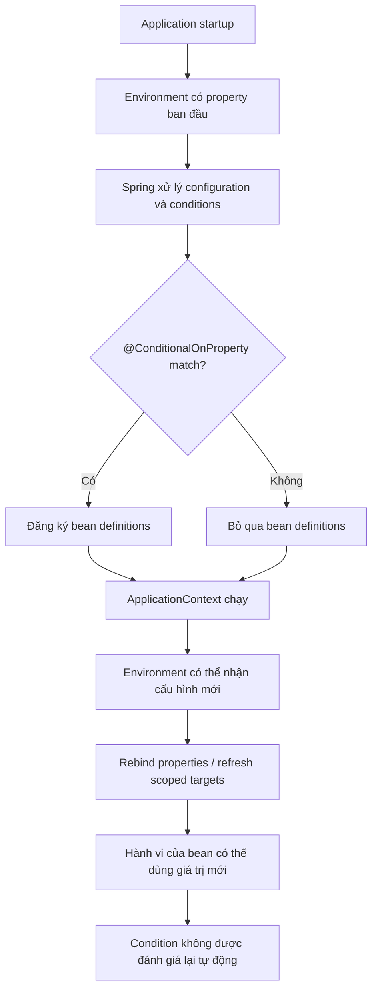
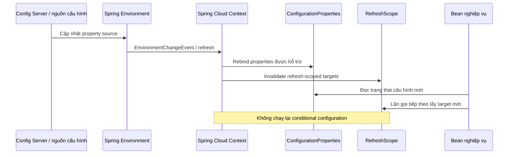

# Giới hạn cập nhật điều kiện @ConditionalOnProperty lúc chạy

Một ứng dụng Spring Cloud có thể dùng property để quyết định một tính năng có được cấu hình hay không. Ví dụ, app.inventory.enabled=true cho phép Spring Boot đăng ký client và các bean tích hợp inventory; đặt giá trị thành false có thể khiến cấu hình tự động đó bị bỏ qua khi ứng dụng khởi động.

Điều dễ nhầm là thay đổi property trong lúc ứng dụng đang chạy **không làm Spring đánh giá lại @ConditionalOnProperty**. Annotation này là một điều kiện xây dựng ApplicationContext. Nó quyết định bean definition có được đăng ký hay không trong quá trình xử lý cấu hình. Các cơ chế refresh của Spring Cloud có thể cập nhật Environment, rebind configuration properties hoặc tạo lại target của bean thuộc refresh scope, nhưng chúng không chạy lại quy trình phân tích cấu hình để thêm hoặc xóa bean definition theo condition.

Bài học thuộc chương **Làm mới cấu hình** của **SPRING_CLOUD_CORE**. Chúng ta sẽ phân biệt điều kiện cấu trúc với cờ tính năng runtime, xem xét hai chiều thay đổi true → false và false → true, hiểu giới hạn của @RefreshScope, và thiết kế cách kiểm soát tính năng có thể thay đổi mà không nhầm refresh bean với việc tái cấu trúc ApplicationContext.

## 1. Mục tiêu học tập

Sau bài này, người học có thể:

1. Giải thích thời điểm Spring đánh giá @ConditionalOnProperty.
2. Phân biệt property được cập nhật trong Environment với bean definition được đăng ký trong context.
3. Mô tả điều gì xảy ra khi property chuyển true → false hoặc false → true sau startup.
4. Giải thích vì sao /actuator/refresh và @RefreshScope không tự đánh giá lại conditional configuration.
5. Chọn giữa conditional auto-configuration, runtime feature gate và quản lý vòng đời bean tường minh.
6. Dùng @ConfigurationProperties và Spring Cloud Context để cập nhật hành vi runtime phù hợp.
7. Kiểm thử cả điều kiện lúc khởi động và giới hạn của condition sau khi context đã chạy.

## 2. Hai loại quyết định khác nhau

Một ứng dụng có hai câu hỏi cần được tách biệt:

- **Cấu trúc context:** Bean nào tồn tại? Những dependency nào được đăng ký? Integration nào được đưa vào ApplicationContext?
- **Hành vi runtime:** Một bean đã tồn tại có nên thực hiện một chức năng ở thời điểm hiện tại hay không?

@ConditionalOnProperty phù hợp với câu hỏi thứ nhất. Một runtime feature gate phù hợp với câu hỏi thứ hai.

Ví dụ, nếu thư viện inventory là dependency tùy chọn và chỉ muốn đăng ký adapter khi ứng dụng có bật integration lúc khởi động, conditional auto-configuration là lựa chọn phù hợp. Nếu doanh nghiệp muốn bật/tắt thao tác đồng bộ inventory theo từng môi trường hoặc thay đổi trong giờ vận hành, ứng dụng cần một cơ chế đọc trạng thái tính năng tại runtime.



Cần nhớ: thay đổi Environment là thay đổi dữ liệu cấu hình; thay đổi bean registry là thay đổi cấu trúc container. Hai việc có vòng đời và cơ chế riêng.

## 3. @ConditionalOnProperty được đánh giá khi nào?

### 3.1. Condition là một phần của quá trình xây dựng context

Ví dụ:

```java
@AutoConfiguration
@ConditionalOnProperty(
    prefix = "app.inventory",
    name = "enabled",
    havingValue = "true",
    matchIfMissing = false
)
public class InventoryAutoConfiguration {

    @Bean
    InventoryClient inventoryClient(InventoryProperties properties) {
        return new InventoryClient(properties);
    }
}
```

Trong lúc Spring Boot xử lý các configuration class và bean methods, condition đọc property từ Environment. Nếu property match, cấu hình hoặc bean definition được đưa vào registry theo phạm vi annotation. Nếu không match, phần cấu hình bị bỏ qua.

Điều kiện có thể nằm trên class @Configuration/@AutoConfiguration hoặc trên một method @Bean. Condition ở class-level ảnh hưởng đến cả cấu hình; condition ở method-level quyết định bean method tương ứng.

Việc đánh giá diễn ra trong quá trình xử lý bean definitions trước khi các singleton thông thường được khởi tạo. Một số loại condition được xử lý ở các phase khác nhau của quá trình parse/register configuration, nhưng chúng đều thuộc quy trình xây dựng context.

### 3.2. Condition không phải listener theo dõi property

@ConditionalOnProperty không đăng ký listener cho key. Nó không tự lắng nghe EnvironmentChangeEvent, không theo dõi file YAML và không quan sát Config Server để thêm hoặc xóa bean.

Sau khi condition đã được xử lý:

- Nếu match, bean definition có thể tồn tại trong registry và bean được tạo theo vòng đời thông thường.
- Nếu không match, bean definition đó không được đăng ký từ cấu hình đang xét.
- Khi Environment đổi giá trị, Spring không tự chạy lại ConfigurationClassPostProcessor để đánh giá lại toàn bộ cấu hình.
- Condition Evaluation Report phản ánh quyết định trong lần xây dựng context tương ứng; nó không phải bảng trạng thái trực tiếp của feature flag.

### 3.3. Giá trị mặc định không làm condition trở thành động

Các thuộc tính havingValue và matchIfMissing chỉ quy định cách condition đánh giá giá trị tại thời điểm xây dựng context:

```java
@ConditionalOnProperty(
    prefix = "app.inventory",
    name = "enabled",
    havingValue = "true",
    matchIfMissing = false
)
```

Ở đây, property thiếu hoặc khác chuỗi true sẽ làm condition không match. Đổi matchIfMissing=true chỉ thay đổi kết quả khi property không tồn tại lúc condition được đánh giá; nó không tạo ra hành vi tự cập nhật sau startup.

## 4. Điều gì xảy ra khi property đổi lúc runtime?

Giả sử cấu hình ban đầu:

```yaml
app:
  inventory:
    enabled: true
```

Auto-configuration được kích hoạt và InventoryClient được đăng ký.

### 4.1. Chuyển từ true sang false

Khi Config Server hoặc một nguồn cấu hình runtime cập nhật app.inventory.enabled=false, Environment có thể nhận giá trị mới sau một quy trình refresh hợp lệ. Tuy nhiên:

- Bean definition InventoryClient vẫn nằm trong registry.
- Bean đã được khởi tạo không tự bị xóa.
- Nếu bean thuộc @RefreshScope, target có thể bị loại khỏi cache và tạo lại ở lần truy cập tiếp theo.
- Condition ban đầu vẫn là quyết định đã dùng khi context được xây dựng; Spring không tự gỡ bean vì property mới là false.

Vì vậy, nếu code chỉ dựa vào sự tồn tại của InventoryClient, tính năng có thể tiếp tục được gọi dù cờ cấu hình mới đã tắt. Bean cần có runtime gate hoặc một cơ chế quản lý lifecycle thực sự.

### 4.2. Chuyển từ false sang true

Giả sử ứng dụng khởi động với:

```yaml
app:
  inventory:
    enabled: false
```

Do condition không match, InventoryClient không được đăng ký từ auto-configuration đó. Sau khi property đổi thành true:

- Environment có thể trả về giá trị true.
- @ConfigurationProperties có thể được rebind nếu Spring Cloud Context xử lý event phù hợp.
- Các bean refresh-scope đã tồn tại có thể được tạo lại.
- Nhưng bean definition InventoryClient bị bỏ qua lúc startup không tự xuất hiện.

Không có bean proxy hoặc definition nào để refresh trong trường hợp này. Muốn có integration sau đó, phải có một cơ chế tạo bean động được thiết kế riêng hoặc xây dựng lại ApplicationContext/khởi động lại ứng dụng.

### 4.3. Bảng kết quả

| Giá trị lúc startup | Giá trị runtime mới | Kết quả đối với condition và bean |
| --- | --- | --- |
| true | false | Condition đã match; bean definition vẫn tồn tại |
| false | true | Condition đã không match; bean definition không tự được thêm |
| true | true | Không thay đổi quyết định cấu trúc ban đầu |
| false | false | Bean vẫn không được đăng ký từ cấu hình đó |

Đây là lý do không nên dùng @ConditionalOnProperty như một công tắc runtime.

## 5. Refresh cập nhật những gì?

Spring Cloud Context cung cấp các cơ chế để làm mới cấu hình và bean. Cần phân biệt rõ các thành phần được cập nhật.

| Thành phần | Có thể thay đổi khi refresh? | Ý nghĩa |
| --- | --- | --- |
| Environment / property sources | Có, nếu nguồn cấu hình được nạp/cập nhật bởi quy trình refresh | Giá trị property hiệu lực có thể thay đổi |
| @ConfigurationProperties bean | Có thể được rebind khi xử lý thay đổi Environment theo cơ chế Spring Cloud Context | Field cấu hình mutable có thể nhận giá trị mới |
| Bean thuộc @RefreshScope | Target có thể bị loại khỏi cache và tạo lại khi được dùng | Bean đọc lại cấu hình khi target mới được tạo |
| Singleton thông thường có @Value constructor | Không tự thay giá trị đã inject | Instance giữ state đã nhận lúc tạo |
| Bean definition bị condition bỏ qua | Không | Refresh không tự đăng ký definition mới |
| Bean definition đã đăng ký do condition match | Không tự bị xóa | Refresh không tự gỡ definition khỏi registry |

Refresh không phải một lần chạy lại toàn bộ quy trình khởi động. Nó tác động lên các phần được hỗ trợ của Environment và bean lifecycle.

## 6. Vì sao @RefreshScope không đánh giá lại condition?

@RefreshScope là một scope đặc biệt của Spring Cloud Context. Bean thuộc scope này thường được truy cập qua proxy. Khi scope được làm mới, target hiện tại bị loại khỏi cache; lần gọi tiếp theo sẽ tạo target mới và inject các dependency/giá trị hiện hành theo cách tạo bean.

Ví dụ:

```java
@Bean
@RefreshScope
InventoryClient inventoryClient(InventoryProperties properties) {
    return new InventoryClient(properties);
}
```

Nếu bean này được đăng ký từ đầu, refresh có thể làm target InventoryClient được tạo lại. Nhưng scope chỉ quản lý target của bean đã có definition; nó không điều khiển quá trình parse configuration class.

Nếu method trên nằm trong một class bị @ConditionalOnProperty loại bỏ lúc startup, method chưa tạo bean definition. @RefreshScope không thể làm cho một bean chưa được đăng ký tự xuất hiện.

### 6.1. Refresh target không đồng nghĩa xóa bean

Khi target bị refresh, proxy và bean definition vẫn có thể tồn tại. Vì vậy, @RefreshScope không phải cách xóa bean khỏi context khi feature flag chuyển sang false.

Một bean refresh-scope có thể được tạo lại với property mới, nhưng nếu constructor vẫn tạo một client hoạt động bình thường bất kể enabled=false, client vẫn tồn tại. Code cần xử lý giá trị enabled hoặc lifecycle cần được quản lý tường minh.

### 6.2. Không đặt @RefreshScope lên class cấu hình rồi giả định mọi bean con đều refresh

@RefreshScope trên một class @Configuration không tự động biến mọi bean method bên trong thành refresh-scoped bean. Nếu một bean cụ thể cần target được tạo lại, hãy áp dụng scope đúng vào bean đó theo hướng dẫn của phiên bản Spring Cloud đang dùng.

## 7. Thiết kế runtime feature gate

Nếu mục tiêu là bật/tắt hành vi mà không thêm/xóa bean, hãy để bean cần thiết tồn tại và kiểm tra trạng thái tính năng tại thời điểm sử dụng.

### 7.1. Khai báo cấu hình có kiểu dữ liệu

```java
@ConfigurationProperties(prefix = "app.inventory")
public class InventoryFeatureProperties {

    private boolean enabled;

    public boolean isEnabled() {
        return enabled;
    }

    public void setEnabled(boolean enabled) {
        this.enabled = enabled;
    }
}
```

Đăng ký properties bean:

```java
@Configuration(proxyBeanMethods = false)
@EnableConfigurationProperties(InventoryFeatureProperties.class)
class InventoryFeatureConfiguration {
}
```

Trong Spring Cloud Context, các @ConfigurationProperties bean được quản lý bởi cơ chế rebinding khi Environment thay đổi được xử lý. Với nhu cầu rebind runtime, mutable JavaBean properties là lựa chọn dễ quan sát và kiểm thử; với record/constructor-bound properties, hãy xác minh hỗ trợ của phiên bản đang dùng và chọn cơ chế tạo lại phù hợp.

### 7.2. Kiểm tra cờ ở thời điểm gọi

```java
@Component
class InventoryFeatureGate {

    private final InventoryFeatureProperties properties;

    InventoryFeatureGate(InventoryFeatureProperties properties) {
        this.properties = properties;
    }

    boolean isEnabled() {
        return properties.isEnabled();
    }
}
```

Bean nghiệp vụ dùng gate trước khi gọi integration:

```java
@Service
class InventorySyncService {

    private final InventoryFeatureGate gate;
    private final InventoryClient client;

    InventorySyncService(
            InventoryFeatureGate gate,
            InventoryClient client) {
        this.gate = gate;
        this.client = client;
    }

    void synchronize() {
        if (!gate.isEnabled()) {
            return;
        }

        client.synchronize();
    }
}
```

InventoryClient được đăng ký theo cấu hình cấu trúc phù hợp; InventoryFeatureGate điều khiển việc có thực hiện thao tác hay không. Khi property được cập nhật và properties bean được rebind, lần gọi tiếp theo đọc trạng thái mới.

Cách này giữ nguyên cấu trúc dependency graph. Nó đặc biệt phù hợp với tính năng có thể bật/tắt theo request hoặc theo chu kỳ xử lý.

### 7.3. Đọc trực tiếp từ Environment khi cần

Một lựa chọn khác là truy vấn Environment tại thời điểm sử dụng:

```java
@Component
class InventoryFeatureGate {

    private final Environment environment;

    InventoryFeatureGate(Environment environment) {
        this.environment = environment;
    }

    boolean isEnabled() {
        return environment.getProperty(
            "app.inventory.enabled",
            Boolean.class,
            false
        );
    }
}
```

Cách này đọc giá trị hiện tại từ Environment mỗi lần gọi. Nó hữu ích khi chỉ cần một cờ đơn giản và không cần object cấu hình lớn. Cần tránh đọc property theo cách rải rác khắp codebase; gom việc đọc vào một gate giúp kiểm thử và quan sát dễ hơn.

Việc gọi getProperty không tự làm nguồn cấu hình được cập nhật. Vẫn cần một nguồn/property refresh mechanism đưa giá trị mới vào Environment.

## 8. Kết hợp conditional auto-configuration với runtime gate

Hai cơ chế có thể phối hợp khi mỗi cơ chế chịu trách nhiệm cho một quyết định khác nhau.

Ví dụ:

```java
@AutoConfiguration
@ConditionalOnClass(InventoryClient.class)
@ConditionalOnProperty(
    prefix = "app.inventory",
    name = "integration-installed",
    havingValue = "true"
)
@EnableConfigurationProperties(InventoryFeatureProperties.class)
public class InventoryIntegrationAutoConfiguration {

    @Bean
    @ConditionalOnMissingBean
    InventoryClient inventoryClient(InventoryFeatureProperties properties) {
        return new InventoryClient(properties);
    }

    @Bean
    @ConditionalOnMissingBean
    InventoryFeatureGate inventoryFeatureGate(
            InventoryFeatureProperties properties) {
        return new InventoryFeatureGate(properties);
    }
}
```

Trong ví dụ này:

- @ConditionalOnClass xác định API có mặt trong runtime classpath.
- integration-installed là quyết định cấu trúc tại startup, cho biết ứng dụng có cài integration hay không.
- app.inventory.enabled trong InventoryFeatureProperties là cờ hành vi có thể được cập nhật theo runtime refresh mechanism.
- @ConditionalOnMissingBean cho phép ứng dụng thay bean mặc định lúc context được xây dựng.

Tách hai property giúp người vận hành hiểu rõ: một property chọn thành phần nào được đưa vào ứng dụng; property còn lại điều khiển hành vi của thành phần đã có.

Nếu integration không bao giờ được cài trong một môi trường, có thể để condition loại nó ngay từ startup. Nếu integration được cài nhưng cần bật/tắt linh hoạt, hãy giữ bean cần thiết và dùng runtime gate.

## 9. Khi nào cần tạo hoặc hủy bean thật sự?

Runtime gate chỉ ngăn hành vi nghiệp vụ; nó không đảm bảo giải phóng resource. Ví dụ, nếu một client tạo thread nền, connection pool hoặc scheduler, đặt enabled=false trong gate không tự đóng những tài nguyên đó.

Nếu yêu cầu là bật/tắt resource thật sự trong runtime, cần một thành phần quản lý lifecycle:

- Theo dõi trạng thái mong muốn từ configuration/event.
- Tạo resource khi trạng thái chuyển sang enabled.
- Dừng nhận công việc và đóng resource khi trạng thái chuyển sang disabled.
- Bảo đảm thao tác chuyển trạng thái có tính đồng bộ và idempotent.
- Xử lý lỗi khi khởi tạo hoặc đóng resource.
- Đảm bảo shutdown của ApplicationContext vẫn giải phóng resource còn hoạt động.

Có thể dùng factory, registry, SmartLifecycle, hoặc một abstraction quản lý client theo vòng đời ứng dụng. Việc lựa chọn phụ thuộc loại resource và yêu cầu nhất quán. Không nên tự sửa BeanDefinitionRegistry trong một event listener để mô phỏng việc condition được chạy lại; cách đó dễ tạo context ở trạng thái khó dự đoán và vượt qua lifecycle chuẩn của Spring.

Nếu thay đổi làm thay đổi rộng dependency graph, auto-configuration hoặc hạ tầng cốt lõi, rolling restart/recreate ApplicationContext thường dễ vận hành và dễ kiểm chứng hơn.

## 10. Quy trình refresh trong Spring Cloud

Một quy trình refresh điển hình có thể gồm:

1. Cấu hình mới được cập nhật ở nguồn bên ngoài hoặc nguồn runtime.
2. Config Client/Environment nhận property source mới theo cơ chế được ứng dụng cấu hình.
3. Spring Cloud Context phát tín hiệu thay đổi Environment.
4. Các @ConfigurationProperties bean được xử lý rebinding theo cơ chế hỗ trợ.
5. Refresh scope invalidates target cache của các bean thuộc scope.
6. Lần truy cập tiếp theo tạo target mới với giá trị cấu hình hiện hành.



Chi tiết endpoint và trigger phụ thuộc dependency, release train và cách triển khai. Ví dụ, Spring Cloud Config Client có thể cung cấp /actuator/refresh khi Actuator endpoint được bật; Spring Cloud Bus có thể truyền tín hiệu refresh đến nhiều instance. Các endpoint quản trị phải được bảo vệ bằng xác thực, phân quyền và network policy.

Không giả định chỉ sửa file trên Config Server là mọi instance tự nhận cấu hình mới. Cần có cơ chế client refresh, event/bus hoặc restart tương ứng.

## 11. Cấu hình immutable và những giới hạn cần xét

Constructor-bound record là lựa chọn tốt cho cấu hình bất biến lúc khởi động. Nhưng nhu cầu thay đổi runtime đòi hỏi kiểm tra cách framework có thể cập nhật object đó.

Một record không có setter để rebinder thay field như JavaBean mutable. Tùy phiên bản Boot/Cloud và cách đăng ký properties, constructor-bound properties có thể cần được tạo lại thông qua cơ chế khác. Vì vậy:

- Dùng JavaBean properties khi cần rebinding mutable state được Spring Cloud Context hỗ trợ.
- Với record, cân nhắc đặt consumer trong @RefreshScope để target được tạo lại sau khi Environment cập nhật, nếu bean lifecycle phù hợp.
- Hoặc dùng một provider/gate đọc Environment ở thời điểm sử dụng.
- Kiểm thử đúng phiên bản Boot/Cloud đang chạy thay vì suy luận chỉ từ việc record có thể bind lúc startup.

Ngoài ra, refresh có thể bị giới hạn hoặc vô hiệu hóa trong một số môi trường triển khai. Ví dụ, một số native image/AOT scenarios không hỗ trợ refresh theo cách của JVM thông thường; cần xem tài liệu tương thích của phiên bản đang dùng.

## 12. Kiểm thử điều kiện lúc startup

Dùng ApplicationContextRunner để xác nhận condition hoạt động đúng với property ban đầu.

```java
class InventoryAutoConfigurationTests {

    private final ApplicationContextRunner runner =
        new ApplicationContextRunner()
            .withConfiguration(
                AutoConfigurations.of(
                    InventoryAutoConfiguration.class
                )
            );

    @Test
    void createsClientWhenEnabledAtStartup() {
        runner
            .withPropertyValues("app.inventory.enabled=true")
            .run(context -> {
                assertThat(context)
                    .hasSingleBean(InventoryClient.class);
            });
    }

    @Test
    void skipsClientWhenDisabledAtStartup() {
        runner
            .withPropertyValues("app.inventory.enabled=false")
            .run(context -> {
                assertThat(context)
                    .doesNotHaveBean(InventoryClient.class);
            });
    }
}
```

Hai test này xác nhận quyết định cấu trúc lúc context được tạo. Chúng không chứng minh condition có thể đổi theo runtime.

## 13. Kiểm thử chứng minh condition không được đánh giá lại

Có thể thay đổi Environment của context sau khi nó đã khởi động rồi kiểm tra bean definition vẫn giữ nguyên.

### 13.1. true chuyển thành false

```java
@Test
void changingPropertyToFalseDoesNotRemoveExistingBean() {
    runner
        .withPropertyValues("app.inventory.enabled=true")
        .run(context -> {
            assertThat(context)
                .hasSingleBean(InventoryClient.class);

            Map<String, Object> changed = Map.of(
                "app.inventory.enabled", false
            );

            context.getEnvironment()
                .getPropertySources()
                .addFirst(new MapPropertySource("runtime-test", changed));

            assertThat(context.getEnvironment()
                .getProperty("app.inventory.enabled", Boolean.class))
                .isFalse();

            assertThat(context)
                .hasSingleBean(InventoryClient.class);
        });
}
```

Test cho thấy Environment đọc false nhưng bean đã được đăng ký vẫn còn. Việc thêm MapPropertySource ở đây chỉ minh họa thay đổi giá trị; nó không tự phát EnvironmentChangeEvent và không kiểm tra rebinding hay refresh scope.

### 13.2. false chuyển thành true

```java
@Test
void changingPropertyToTrueDoesNotRegisterMissingBean() {
    runner
        .withPropertyValues("app.inventory.enabled=false")
        .run(context -> {
            assertThat(context)
                .doesNotHaveBean(InventoryClient.class);

            Map<String, Object> changed = Map.of(
                "app.inventory.enabled", true
            );

            context.getEnvironment()
                .getPropertySources()
                .addFirst(new MapPropertySource("runtime-test", changed));

            assertThat(context.getEnvironment()
                .getProperty("app.inventory.enabled", Boolean.class))
                .isTrue();

            assertThat(context)
                .doesNotHaveBean(InventoryClient.class);
        });
}
```

Test này chứng minh bean bị bỏ qua lúc startup không tự xuất hiện khi property đổi thành true. Cả hai test là regression test cho ranh giới giữa Environment và bean registry.

## 14. Kiểm thử runtime feature gate và refresh

Ngoài test condition, cần kiểm thử bean thực sự đọc trạng thái runtime mới sau khi Spring Cloud Context xử lý thay đổi cấu hình.

Một test cho InventoryFeatureGate có thể thay đổi properties bean trực tiếp để kiểm tra hành vi của gate:

```java
@Test
void gateUsesCurrentPropertiesValue() {
    InventoryFeatureProperties properties =
        new InventoryFeatureProperties();

    InventoryFeatureGate gate =
        new InventoryFeatureGate(properties);

    assertThat(gate.isEnabled()).isFalse();

    properties.setEnabled(true);

    assertThat(gate.isEnabled()).isTrue();
}
```

Đây là unit test cho gate, chưa phải integration test của rebinder. Integration test cần tạo context có Spring Cloud Context, cập nhật property source theo cơ chế được hỗ trợ, phát event/refresh tương ứng và xác nhận properties bean được rebind.

Với bean thuộc @RefreshScope, test cần kiểm tra target được tạo lại sau refresh và target mới nhìn thấy giá trị hiện hành. Không dùng test ApplicationContextRunner đơn thuần để khẳng định toàn bộ Config Client/Actuator refresh pipeline đã hoạt động.

## 15. Những lỗi thiết kế thường gặp

**Dùng @ConditionalOnProperty làm feature flag runtime.** Condition chỉ quyết định bean definition lúc context được xây dựng; chuyển sang runtime gate nếu cần thay đổi hành vi.

**Cho rằng /actuator/refresh sẽ tạo bean bị thiếu.** Refresh không tự chạy lại auto-configuration; bean không được đăng ký từ đầu vẫn không tồn tại.

**Cho rằng property false sẽ xóa bean.** Condition đã match không tự bị đảo ngược khi Environment đổi; bean definition và instance vẫn có thể còn.

**Đặt @RefreshScope lên bean nhưng không có logic kiểm tra enabled.** Target được tạo lại không đồng nghĩa feature tự tắt hoặc resource được giải phóng.

**Đọc @Value trong singleton rồi mong field tự đổi.** Giá trị đã inject vào instance thông thường không tự cập nhật; dùng properties rebinding, refresh-scoped target hoặc provider đọc Environment.

**Dùng refresh scope cho resource có lifecycle phức tạp mà không kiểm tra shutdown.** Client, scheduler và pool cần đóng tài nguyên đúng cách khi target bị refresh hoặc context dừng.

**Coi việc sửa file Config Server là broadcast tự động.** Phải có trigger refresh, bus hoặc cơ chế triển khai tương ứng để instance nhận cấu hình mới.

**Thay đổi bean registry trực tiếp trong event listener.** Cách làm này bỏ qua lifecycle chuẩn và dễ gây trạng thái context không nhất quán; dùng factory/lifecycle manager hoặc restart.

## 16. Checklist lựa chọn cơ chế

| Nhu cầu | Cơ chế nên cân nhắc |
| --- | --- |
| Dependency tùy chọn, chỉ quyết định khi startup | @ConditionalOnClass |
| Chỉ đăng ký bean nếu property bật lúc startup | @ConditionalOnProperty |
| Cho phép ứng dụng thay bean mặc định | @ConditionalOnMissingBean |
| Bật/tắt thao tác nghiệp vụ khi chạy | Runtime feature gate + @ConfigurationProperties |
| Đọc giá trị Environment mới ở mỗi lần gọi | Provider/gate truy vấn Environment |
| Tạo lại target bean khi cấu hình đổi | @RefreshScope |
| Rebind nhóm cấu hình mutable | @ConfigurationProperties + Spring Cloud Context |
| Tạo/hủy resource thật sự khi trạng thái đổi | Factory/registry/SmartLifecycle quản lý lifecycle |
| Thay đổi cấu trúc dependency graph lớn | Recreate ApplicationContext hoặc rolling restart |

Trước khi chọn, hãy trả lời ba câu hỏi:

1. Property thay đổi có chỉ ảnh hưởng hành vi, hay cần thay đổi sự tồn tại của bean?
2. Bean có thể tồn tại nhưng không hoạt động khi feature tắt không?
3. Khi tắt tính năng, có cần đóng resource, hủy listener hoặc dừng scheduler không?

Câu trả lời sẽ quyết định nên dùng runtime gate, refresh scope hay lifecycle manager.

## 17. Bài tập áp dụng

### Bài tập 1. Phân tích hai chiều thay đổi

Một ứng dụng có:

```java
@AutoConfiguration
@ConditionalOnProperty(
    prefix = "app.report",
    name = "enabled",
    havingValue = "true"
)
class ReportAutoConfiguration {

    @Bean
    @RefreshScope
    ReportClient reportClient(ReportProperties properties) {
        return new ReportClient(properties);
    }
}
```

Hãy giải thích:

1. Điều gì xảy ra khi startup với enabled=true, sau đó chuyển thành false?
2. Điều gì xảy ra khi startup với enabled=false, sau đó chuyển thành true?
3. @RefreshScope thay đổi phần nào trong hai tình huống?
4. Cần bổ sung cơ chế nào để report client thực sự ngừng gửi báo cáo khi feature bị tắt?

### Bài tập 2. Thiết kế runtime feature gate

Một service đồng bộ dữ liệu catalog cần bật/tắt trong giờ vận hành. Hãy thiết kế:

- CatalogFeatureProperties dùng @ConfigurationProperties.
- CatalogFeatureGate đọc trạng thái hiện tại.
- CatalogSyncService kiểm tra gate trước khi gọi client.
- Một test xác nhận gate phản ánh giá trị properties mới.
- Một integration test xác nhận Spring Cloud Context rebind properties sau refresh.

Giải thích vì sao không nên dùng @ConditionalOnProperty để điều khiển mỗi lần chạy đồng bộ.

### Bài tập 3. Quản lý resource

Một integration tạo connection pool và scheduler. Khi enabled=false, yêu cầu là không còn thread nền và mọi connection được đóng.

Hãy đề xuất lifecycle manager sử dụng factory/registry hoặc SmartLifecycle. Mô tả cách xử lý chuyển trạng thái đồng thời, lỗi khởi tạo, lỗi đóng resource và shutdown toàn ứng dụng.

### Câu hỏi tự kiểm tra

1. @ConditionalOnProperty được đánh giá trong giai đoạn nào?
2. Vì sao thay Environment không làm condition được chạy lại?
3. Khi true → false, bean definition đã đăng ký có tự biến mất không?
4. Khi false → true, refresh có tạo bean bị bỏ qua lúc startup không?
5. @RefreshScope invalidates thành phần nào?
6. Vì sao singleton có @Value trong constructor không tự nhận giá trị mới?
7. Khi nào nên dùng mutable @ConfigurationProperties và khi nào cần kiểm tra lại constructor binding?
8. Runtime gate khác conditional auto-configuration ở quyết định nào?
9. Khi nào phải dùng lifecycle manager thay vì chỉ kiểm tra boolean?
10. Vì sao cần integration test riêng cho Spring Cloud refresh pipeline?

## 18. Nguồn tham chiếu

- [Spring Boot Reference — Auto-configuration](https://docs.spring.io/spring-boot/reference/using/auto-configuration.html): cách Spring Boot áp dụng auto-configuration dựa trên classpath và điều kiện.
- [Spring Boot Reference — Developing Auto-configuration](https://docs.spring.io/spring-boot/reference/features/developing-auto-configuration.html): condition annotations, bean conditions và kiểm thử auto-configuration.
- [Spring Cloud Commons Reference — Application Context Services](https://docs.spring.io/spring-cloud-commons/reference/spring-cloud-commons/application-context-services.html): Environment changes, refresh scope và context services.
- [Spring Cloud Config Reference — Client](https://docs.spring.io/spring-cloud-config/reference/client.html): Config Client và cách lấy cấu hình bên ngoài.
- [Spring Boot Actuator Reference](https://docs.spring.io/spring-boot/reference/actuator/endpoints.html): endpoint quản trị và cách cấu hình expose/bảo vệ.

## Ghi nhớ

@ConditionalOnProperty quyết định cấu trúc ApplicationContext trong lúc Spring xử lý cấu hình. Sau startup, thay đổi Environment không tự thêm hoặc xóa bean definition. @RefreshScope có thể tạo lại target của bean đã tồn tại; @ConfigurationProperties có thể được rebind theo cơ chế Spring Cloud Context. Nếu muốn bật/tắt hành vi runtime, hãy dùng feature gate đọc trạng thái mới. Nếu cần tạo hoặc hủy resource thật sự, hãy quản lý lifecycle tường minh hoặc tái tạo context theo một quy trình triển khai có kiểm soát.
