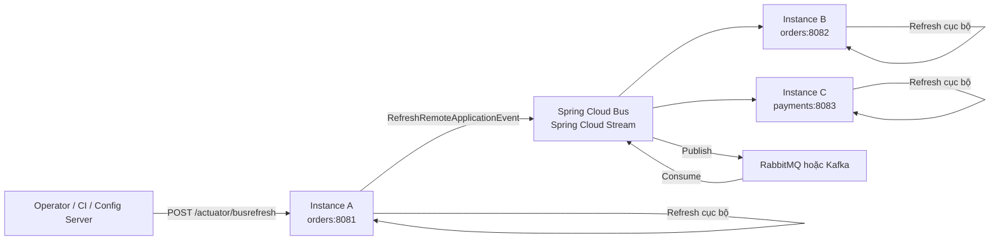
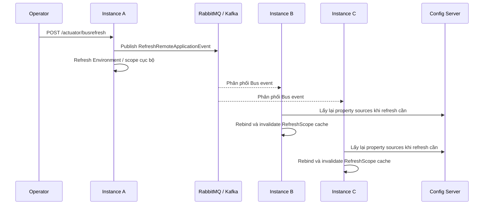
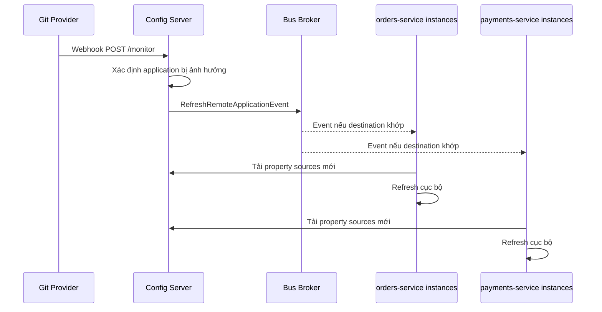

# Quan hệ với Spring Cloud Bus trong phát tán yêu cầu refresh

## 1. Vì sao cần Spring Cloud Bus?

Spring Cloud Context cung cấp cơ chế làm mới cấu hình trong **một application instance**. Khi gọi endpoint `POST /actuator/refresh`, instance đó cập nhật `Environment`, rebind các bean `@ConfigurationProperties` phù hợp và làm mới target của `@RefreshScope`.

Trong hệ thống có nhiều instance chạy cùng một dịch vụ, gọi endpoint này ở một instance không tự động làm mới các instance còn lại. Nếu triển khai thủ công, hệ thống quản trị phải biết địa chỉ của từng instance và gửi yêu cầu riêng tới từng địa chỉ. Cách đó khó mở rộng khi số lượng instance thay đổi theo autoscaling hoặc rolling deployment.

**Spring Cloud Bus** bổ sung một kênh phát tán sự kiện quản trị qua message broker. Một instance gửi yêu cầu refresh lên Bus; các instance tham gia Bus nhận sự kiện, kiểm tra đích nhận và thực hiện quy trình refresh cục bộ. Nhờ đó, một thao tác có thể thông báo tới toàn bộ cụm hoặc một nhóm instance theo service ID.

Điểm quan trọng là Bus **phát tán yêu cầu**, còn mỗi ứng dụng vẫn tự làm mới `Environment`, rebind cấu hình và invalidates cache refresh scope của chính nó. Bus không thay thế Config Server và không tự biến nội dung file cấu hình thành trạng thái đồng bộ tức thời trên mọi node.

Sau bài học, người đọc có thể phân biệt `/actuator/refresh` với `/actuator/busrefresh`, mô tả luồng sự kiện qua broker, chọn phạm vi phát tán, cấu hình Bus cho RabbitMQ/Kafka, theo dõi kết quả và xử lý sự cố khi một số instance chưa refresh.

## 2. Refresh cục bộ và refresh qua Bus

Hai endpoint có mục đích liên quan nhưng phạm vi khác nhau:

| Endpoint | Phạm vi | Hành vi |
| --- | --- | --- |
| `POST /actuator/refresh` | Một instance nhận HTTP request | Làm mới cấu hình trong instance đó |
| `POST /actuator/busrefresh` | Các instance nhận được Bus event phù hợp | Phát tán yêu cầu để từng instance refresh cục bộ |
| `POST /actuator/busrefresh/{destination}` | Instance hoặc nhóm instance khớp destination | Chỉ các node có Bus ID khớp mới xử lý sự kiện |

Trong Spring Cloud Bus hiện hành, endpoint được đặt tên `busrefresh`. Một số release train cũ dùng dạng có dấu gạch nối như `bus-refresh`; cần dùng đúng endpoint ID của phiên bản Spring Cloud đang chạy.

`/actuator/busrefresh` thực hiện các công việc tương ứng với refresh ở từng node: xóa cache `RefreshScope` và rebind `@ConfigurationProperties`. Endpoint này cần được expose qua cấu hình Actuator:

```yaml
management:
  endpoints:
    web:
      exposure:
        include:
          - health
          - busrefresh
```

Ví dụ chỉ mở endpoint `busrefresh` cùng `health`. Nếu ứng dụng cần gọi endpoint cục bộ `refresh` để chẩn đoán hoặc vận hành riêng, hãy expose endpoint đó theo nhu cầu và chính sách bảo mật.

## 3. Kiến trúc phát tán yêu cầu refresh

Spring Cloud Bus liên kết các node của hệ thống phân tán bằng một message broker nhẹ. Bus sử dụng Spring Cloud Stream để gửi và nhận sự kiện. Các binder phổ biến được cung cấp cho RabbitMQ (AMQP) và Kafka.



Sơ đồ mô tả các node cùng tham gia một Bus destination. Khi một node phát sự kiện, broker phân phối thông điệp tới các subscriber. Mỗi node dùng Bus ID và destination của sự kiện để quyết định có xử lý hay bỏ qua. Nếu sự kiện nhắm tới tất cả node, các ứng dụng phù hợp đều thực hiện refresh cục bộ.

### 3.1. Vai trò của từng thành phần

| Thành phần | Trách nhiệm |
| --- | --- |
| Spring Cloud Context | Thực hiện refresh trong một application context: cập nhật Environment, phát sự kiện thay đổi cấu hình, rebind và refresh scoped bean |
| Spring Cloud Bus | Đóng gói yêu cầu quản trị thành remote application event và phát tán qua broker |
| Spring Cloud Stream | Cung cấp abstraction binder để publish/consume message |
| RabbitMQ hoặc Kafka | Vận chuyển message giữa các instance |
| Spring Cloud Config Server (nếu có) | Lưu và cung cấp property sources; có thể phát sự kiện khi nhận thông báo thay đổi cấu hình |
| Actuator Bus endpoint | Điểm HTTP để người vận hành yêu cầu Bus thực hiện refresh |

Bus không phải một registry lưu trạng thái cấu hình. Nó là kênh truyền sự kiện. Giá trị cấu hình vẫn đến từ các nguồn của từng ứng dụng, ví dụ Config Server, Config Data, biến môi trường hoặc file cấu hình.

## 4. Luồng xử lý khi gọi busrefresh

Giả sử có ba instance của `orders-service` cùng dùng cấu hình từ Config Server. Một quản trị viên gọi `POST /actuator/busrefresh` trên instance A.



Trình tự chi tiết có thể khác theo loại Config Client và phiên bản Spring Cloud. Ý nghĩa của luồng là:

1. Endpoint Bus nhận HTTP request và tạo sự kiện refresh từ instance phát lệnh.
2. Bus gửi sự kiện qua Spring Cloud Stream binder tới broker.
3. Các node đang lắng nghe destination nhận message.
4. Mỗi node kiểm tra origin và destination; node không thuộc phạm vi thì bỏ qua.
5. Node được chọn thực hiện refresh trong context của chính nó. Các bean `@ConfigurationProperties` được rebind; cache target của `@RefreshScope` bị xóa.
6. Target refresh-scoped được tạo lại theo nhu cầu ở lần gọi tiếp theo qua proxy.

Sự kiện Bus là thông báo điều phối, không phải bản sao đầy đủ của tất cả file cấu hình. Khi dùng Config Server, từng Config Client cần kết nối tới Config Server và tải cấu hình theo tên ứng dụng, profile, label của nó trong quy trình refresh.

### 4.1. Refresh không đồng nghĩa tạo lại target ngay

Bus refresh làm mất hiệu lực cache của `RefreshScope` trên các node nhận sự kiện. Nó không bắt buộc tạo ngay target mới. Khi một request tiếp theo gọi bean qua scoped proxy, scope mới tạo target với cấu hình đã được cập nhật.

Điều này có nghĩa một node có thể đã xử lý refresh event nhưng constructor của target chưa chạy lại vì chưa có lời gọi nào cần target. Khi kiểm tra kết quả, không nên chỉ dựa vào log constructor; cần quan sát cả sự kiện refresh và hành vi sử dụng cấu hình sau đó.

## 5. Đưa Spring Cloud Bus vào ứng dụng

### 5.1. Thêm dependency

Có thể chọn starter AMQP hoặc Kafka. Ví dụ Maven với RabbitMQ:

```xml
<dependency>
    <groupId>org.springframework.cloud</groupId>
    <artifactId>spring-cloud-starter-bus-amqp</artifactId>
</dependency>
```

Hoặc Kafka:

```xml
<dependency>
    <groupId>org.springframework.cloud</groupId>
    <artifactId>spring-cloud-starter-bus-kafka</artifactId>
</dependency>
```

Để Spring Cloud BOM quản lý version của starter và các module Spring Cloud. Không trộn version Bus, Stream binder và release train một cách tùy tiện. Sau khi thêm dependency, Boot auto-configuration phát hiện Bus trên classpath; broker tương ứng phải có sẵn và được cấu hình.

### 5.2. Cấu hình RabbitMQ

Ví dụ cấu hình kết nối broker bằng các thuộc tính Spring Boot:

```yaml
spring:
  application:
    name: orders-service
  rabbitmq:
    host: rabbitmq.internal
    port: 5672
    username: ${RABBITMQ_USERNAME}
    password: ${RABBITMQ_PASSWORD}
  cloud:
    bus:
      enabled: true
      destination: springCloudBus
```

Tên destination là kênh/topic mà các instance dùng chung để gửi và nhận Bus message. Mặc định thường đủ dùng; chỉ đổi khi có yêu cầu phân vùng hoặc tách môi trường rõ ràng. Không commit credential của broker vào repository.

### 5.3. Cấu hình Kafka

Với Kafka, cấu hình bootstrap servers và Bus destination:

```yaml
spring:
  application:
    name: orders-service
  kafka:
    bootstrap-servers: kafka-1.internal:9092,kafka-2.internal:9092
  cloud:
    bus:
      enabled: true
      destination: springCloudBus
```

Các thiết lập bảo mật Kafka như SASL, TLS, truststore và ACL cần theo hạ tầng thực tế. Bus dựa trên binder của Spring Cloud Stream, vì vậy cấu hình chi tiết về broker được thực hiện theo tài liệu binder tương ứng.

### 5.4. Các thuộc tính Bus thường gặp

| Thuộc tính | Ý nghĩa |
| --- | --- |
| `spring.cloud.bus.enabled` | Bật/tắt Bus |
| `spring.cloud.bus.destination` | Destination của Bus trên middleware |
| `spring.cloud.bus.id` | Định danh duy nhất của instance trên Bus |
| `spring.cloud.bus.refresh.enabled` | Bật/tắt xử lý refresh event |
| `spring.cloud.bus.env.enabled` | Bật/tắt xử lý sự kiện thay đổi Environment |
| `spring.cloud.bus.ack.enabled` | Bật/tắt acknowledgement event |
| `spring.cloud.bus.trace.enabled` | Bật tracing sự kiện và acknowledgement |

Các giá trị mặc định có thể thay đổi theo phiên bản. Kiểm tra configuration properties của release train đang dùng trước khi đưa vào cấu hình production.

## 6. Chọn phạm vi instance nhận refresh

Spring Cloud Bus hỗ trợ gửi sự kiện tới toàn bộ node đang lắng nghe hoặc một node/nhóm node cụ thể. Mỗi instance có một Bus ID, thường được tạo từ `spring.application.name`, port hoặc index và một định danh instance.

Ví dụ các endpoint:

```bash
# Gửi refresh tới tất cả instance trên Bus
curl -X POST http://localhost:8081/actuator/busrefresh

# Chỉ nhắm một instance có Bus ID tương ứng
curl -X POST http://localhost:8081/actuator/busrefresh/orders-service:8082

# Nhắm mọi instance của orders-service
curl -X POST http://localhost:8081/actuator/busrefresh/orders-service:**
```

Destination được so khớp bằng `PathMatcher`, dùng dấu `:` làm dấu phân cách trong Bus ID. Mẫu `orders-service:**` có thể nhắm tất cả instance của service đó, bất kể phần định danh phía sau.

### 6.1. Đảm bảo Bus ID duy nhất

Bus ID mặc định được xây dựng từ thông tin ứng dụng và instance. Khi chạy ngoài Cloud Foundry hoặc môi trường có index tự cấp, hãy bảo đảm mỗi instance có ID khác nhau. Có thể cấu hình `spring.application.index` hoặc đặt `spring.cloud.bus.id` riêng cho từng node.

Nếu nhiều instance dùng cùng Bus ID, Bus có thể nhận nhầm sự kiện do chính instance phát ra là sự kiện của mình và bỏ qua; các node trùng ID cũng không được phân biệt đúng khi định tuyến. Đây là lỗi thường gặp khi chạy nhiều bản sao local hoặc trong môi trường container tự cấu hình ID.

### 6.2. Chọn broadcast hay destination cụ thể?

| Nhu cầu | Destination phù hợp |
| --- | --- |
| Cập nhật cấu hình chung ảnh hưởng mọi service | Bỏ destination để phát tán toàn Bus |
| Chỉ thay đổi cấu hình của `orders-service` | `orders-service:**` |
| Kiểm tra một instance gặp lỗi | Bus ID chính xác của instance |
| Triển khai canary hoặc kiểm chứng trước | Destination của nhóm instance canary |

Khi dùng destination cụ thể, phải xác nhận Bus ID của các node được đặt đúng. Nếu pattern không khớp, message vẫn có thể được broker phân phối nhưng node không thực hiện refresh.

## 7. Spring Cloud Config Server kết hợp với Bus

Một mô hình thường gặp là cấu hình nằm trong Git repository, Config Server phục vụ cấu hình, các ứng dụng là Config Client và tất cả cùng tham gia Bus.

### 7.1. Luồng cập nhật từ Git webhook

Spring Cloud Config có thể nhận webhook từ GitHub, GitLab, Gitea, Gitee, Gogs hoặc Bitbucket. Khi thêm dependency `spring-cloud-config-monitor` và kích hoạt Bus trên Config Server, endpoint `/monitor` được cung cấp.



Theo mặc định, Config Server so khớp tên file thay đổi với tên ứng dụng. Ví dụ, file `orders-service.yml` hướng tới `orders-service`; file `application.yml` là cấu hình dùng chung nên có thể hướng tới tất cả ứng dụng. Có thể tùy chỉnh chiến lược xác định ứng dụng từ đường dẫn bằng `PropertyPathNotificationExtractor`.

Sự kiện `RefreshRemoteApplicationEvent` từ Config Server chỉ được truyền khi Spring Cloud Bus được kích hoạt ở **cả Config Server và ứng dụng client**. Nếu chỉ client có Bus hoặc chỉ Config Server có Bus, webhook có thể được nhận nhưng yêu cầu refresh không được phát tán theo luồng này.

### 7.2. Cấu hình dependency cho Config Server

Config Server cần có Bus starter và `spring-cloud-config-monitor`:

```xml
<dependency>
    <groupId>org.springframework.cloud</groupId>
    <artifactId>spring-cloud-starter-bus-amqp</artifactId>
</dependency>
<dependency>
    <groupId>org.springframework.cloud</groupId>
    <artifactId>spring-cloud-config-monitor</artifactId>
</dependency>
```

Các client cần Bus starter tương ứng và Config Client. Cả server và client phải cùng kết nối tới hạ tầng Bus phù hợp, cùng destination và có quyền publish/consume theo thiết kế.

### 7.3. Bảo vệ webhook

Webhook là một đầu vào có thể kích hoạt refresh cấu hình. Config Server hỗ trợ xác thực chữ ký hoặc token của nhà cung cấp Git thông qua webhook secret. Nếu chưa cấu hình secret, endpoint monitor từ chối webhook theo mặc định ở phiên bản tài liệu hiện hành.

Không tắt xác thực webhook trong production chỉ để xử lý lỗi tích hợp. Hãy cấu hình secret đúng với Git provider, kiểm tra header chữ ký và giới hạn mạng truy cập Config Server.

## 8. Phân biệt busrefresh, busenv và refresh cục bộ

Các endpoint này có tác động khác nhau:

| Endpoint | Mục đích | Phạm vi |
| --- | --- | --- |
| `/actuator/refresh` | Refresh context của instance hiện tại | Cục bộ |
| `/actuator/busrefresh` | Phát tán refresh event; node nhận sẽ xóa RefreshScope cache và rebind properties | Một hoặc nhiều instance qua Bus |
| `/actuator/busenv` | Gửi cặp key/value để cập nhật Environment của các node nhận | Một hoặc nhiều instance qua Bus |
| `/actuator/env` | Cập nhật Environment của instance hiện tại theo endpoint Actuator tương ứng | Cục bộ |

`busrefresh` không mang theo một map cấu hình tùy ý trong request. Nó thông báo cho node thực hiện quy trình refresh của mình. `busenv` mới là endpoint gửi một key/value cụ thể qua Bus; không nên dùng `busenv` thay Config Server làm kho cấu hình lâu dài.

## 9. Theo dõi event và xác nhận node đã nhận

### 9.1. Bật Bus tracing

Có thể bật tracing:

```yaml
spring:
  cloud:
    bus:
      trace:
        enabled: true
```

Khi tracing được bật và `TraceRepository` của Spring Boot có sẵn, trace có thể ghi nhận event đã gửi và acknowledgement từ các instance. Các tín hiệu thường gặp gồm:

- `spring.cloud.bus.sent`: instance phát event.
- `spring.cloud.bus.ack`: một instance xác nhận đã nhận event.
- `RefreshRemoteApplicationEvent`: loại event dùng để yêu cầu refresh.

Có thể lắng nghe `SentApplicationEvent` và `AckRemoteApplicationEvent` bằng `@EventListener` nếu cần xây dựng giám sát riêng. Cách quan sát cụ thể phụ thuộc phiên bản và cấu hình tracing.

### 9.2. Ack không đồng nghĩa mọi thao tác nghiệp vụ đã thành công

Ack cho biết node đã nhận/xử lý tín hiệu Bus theo cơ chế acknowledgement. Nó không thay thế việc kiểm tra rằng:

- Config Client đã tải được cấu hình mới.
- Giá trị cấu hình mới hợp lệ.
- Bean `@ConfigurationProperties` đã bind thành công.
- Target `@RefreshScope` được tạo lại thành công ở lần gọi sau.
- Request nghiệp vụ thực tế đang sử dụng giá trị mới.

Vì vậy, nên kết hợp Bus trace với log refresh của từng instance, refresh scope health indicator, metrics và kiểm tra hành vi sau refresh.

### 9.3. Các trường trace cần quan sát

| Trường | Ý nghĩa |
| --- | --- |
| `type` | Loại event, ví dụ `RefreshRemoteApplicationEvent` |
| `id` | ID của event |
| `origin` | Bus ID của instance phát event |
| `destination` | Phạm vi nhận event |
| `signal` | Event đã gửi hay acknowledgement |

Khi một số node không có ack, kiểm tra broker connectivity, consumer subscription, Bus ID, destination pattern và quyền truy cập broker trước khi kết luận refresh logic bị lỗi.

## 10. Độ tin cậy, tính nhất quán và giới hạn vận hành

Spring Cloud Bus giúp giảm số lượng lời gọi HTTP cần điều phối, nhưng không tạo ra một giao dịch refresh nguyên tử trên toàn cụm.

- **Bất đồng bộ:** các node nhận và xử lý message theo thời điểm khác nhau. Trong một khoảng ngắn, một số node có thể đã refresh trong khi node khác chưa xử lý event.
- **Broker là phụ thuộc vận hành:** nếu broker mất kết nối hoặc consumer dừng, việc phát tán bị gián đoạn.
- **Refresh có thể thất bại cục bộ:** một node có thể không tải được cấu hình, không bind được kiểu dữ liệu hoặc không tạo lại target.
- **Cấu hình có thể khác theo profile/label:** cùng một event không bảo đảm mọi service nhận cùng một bộ property; mỗi client tải cấu hình theo application name, profile và label riêng.
- **Event có thể bị bỏ qua theo destination:** broker đã nhận message không có nghĩa mọi node đều được chọn để xử lý.
- **Bus ID phải duy nhất:** ID trùng có thể làm sai định tuyến hoặc xử lý event.

Nếu cần rollout theo từng nhóm, hãy dùng destination pattern và quy trình kiểm tra sau mỗi nhóm. Nếu thay đổi cấu hình có nguy cơ phá vỡ tương thích giữa các service, nên triển khai theo trình tự backward-compatible thay vì broadcast đồng thời một thay đổi không tương thích.

## 11. Bảo mật endpoint và broker

`busrefresh` là thao tác quản trị trên nhiều instance. Người không có quyền gọi endpoint có thể buộc cả cụm tải lại cấu hình hoặc tạo lại bean. Khi triển khai:

1. Chỉ expose `busrefresh` trên management interface cần thiết.
2. Bảo vệ endpoint bằng xác thực và phân quyền quản trị.
3. Giới hạn mạng truy cập management port; không công khai endpoint Bus ra Internet.
4. Bật TLS và credential phù hợp cho RabbitMQ/Kafka.
5. Dùng broker ACL để giới hạn producer/consumer theo ứng dụng và destination.
6. Bảo vệ webhook `/monitor` bằng secret/signature và giới hạn nguồn gửi.
7. Không ghi credential broker hoặc secret cấu hình vào log.

Việc expose endpoint trong `management.endpoints.web.exposure.include` chỉ làm endpoint khả dụng qua web; nó không tự cấu hình xác thực hoặc authorization.

## 12. Kiểm thử quan hệ giữa Bus và refresh

Nên chia kiểm thử thành ba tầng để tìm lỗi đúng vị trí.

### 12.1. Kiểm thử refresh cục bộ

Trước hết xác nhận một instance xử lý refresh đúng khi gọi `POST /actuator/refresh`:

1. Nạp một giá trị cấu hình ban đầu.
2. Tạo target `@RefreshScope` và gọi qua proxy để cache target.
3. Thay đổi property source hoặc Config Server.
4. Gọi endpoint refresh cục bộ.
5. Gọi lại proxy và xác nhận target mới dùng giá trị mới.

Tầng này kiểm tra Spring Cloud Context, chưa kiểm tra broker hoặc Bus.

### 12.2. Kiểm thử Bus giữa hai instance

Chạy hai instance của cùng service với Bus ID duy nhất và cùng broker:

```yaml
spring:
  application:
    name: orders-service
  cloud:
    bus:
      id: orders-service:${INSTANCE_INDEX}:${server.port}
      destination: springCloudBus
```

Sau đó:

1. Đưa hai instance vào cùng destination của Bus.
2. Cấu hình mỗi instance đọc cùng một thuộc tính từ Config Server.
3. Gọi `POST /actuator/busrefresh` ở instance thứ nhất.
4. Theo dõi event sent/ack ở cả hai instance.
5. Gọi một bean refresh-scoped ở từng instance và xác nhận mỗi instance dùng target được tạo theo cấu hình mới.

Nếu chỉ instance gửi lệnh refresh, hãy kiểm tra binder, broker, destination và Bus ID của instance còn lại.

### 12.3. Kiểm thử định tuyến

Thử ba trường hợp:

| Request | Kết quả mong đợi |
| --- | --- |
| `/actuator/busrefresh` | Tất cả instance phù hợp trên Bus xử lý |
| `/actuator/busrefresh/orders-service:**` | Các instance thuộc orders-service xử lý |
| `/actuator/busrefresh/orders-service:8082` | Chỉ instance có Bus ID khớp xử lý |

Không chỉ xác nhận HTTP response của node gửi lệnh. Hãy kiểm tra event trace và hành vi cấu hình trên từng node mục tiêu.

### 12.4. Kiểm thử Config Server webhook

Với mô hình Git webhook:

1. Kích hoạt Bus ở Config Server và tất cả Config Client cần nhận thông báo.
2. Thêm `spring-cloud-config-monitor` vào Config Server.
3. Cấu hình webhook secret tại Git provider và Config Server.
4. Thay đổi file cấu hình trong repository.
5. Xác nhận Config Server nhận `/monitor` và phát `RefreshRemoteApplicationEvent`.
6. Xác nhận event có destination phù hợp và các client nhận ack.
7. Kiểm tra từng client đã tải property source mới và hoạt động với cấu hình mới.

## 13. Lỗi thường gặp và cách chẩn đoán

| Triệu chứng | Nguyên nhân có thể | Hướng xử lý |
| --- | --- | --- |
| `POST /actuator/busrefresh` trả 404 | Chưa thêm Bus starter hoặc chưa expose endpoint | Kiểm tra dependency, auto-configuration và `management.endpoints.web.exposure.include` |
| HTTP endpoint trả thành công nhưng node khác không refresh | Node không kết nối broker hoặc không subscribe cùng destination | Kiểm tra binder, broker connectivity và `spring.cloud.bus.destination` |
| Một số node không có ack | Node tắt, consumer lỗi, Bus ID trùng hoặc destination không khớp | Kiểm tra service ID, trace, broker consumer và destination pattern |
| Mọi node nhận event nhưng vẫn dùng cấu hình cũ | Config Server chưa có giá trị mới hoặc client không tải được remote property source | Kiểm tra Git revision, Config Server response và log Config Client |
| Bus event được gửi nhưng một service không xử lý | `spring.cloud.bus.refresh.enabled=false` hoặc ứng dụng không có Bus Context phù hợp | Kiểm tra Bus properties và dependency của service |
| Refresh cục bộ chạy nhưng Bus không chạy | Spring Cloud Context có nhưng Bus/binder chưa được cấu hình | Thêm Bus starter, cấu hình broker và kiểm tra binder |
| Một node refresh nhiều lần hoặc không xử lý event | Bus ID không duy nhất | Đặt ID duy nhất cho từng instance |
| Webhook Git nhận 403 | Secret/signature không khớp hoặc chưa cấu hình | Cấu hình webhook secret theo đúng provider |
| Config Server nhận webhook nhưng không broadcast | Bus chưa bật ở Config Server hoặc client | Bật Bus ở cả hai phía và kiểm tra broker |
| Destination theo service không khớp | `spring.application.name` hoặc Bus ID khác mẫu | Kiểm tra ID thực tế và quy tắc PathMatcher |
| Sau refresh bean lỗi khi request đến | Target lazy được tạo lại nhưng cấu hình mới không hợp lệ | Kiểm tra lỗi bind, constructor, validation và refresh scope health |

## 14. Nguyên tắc thiết kế khi phát tán refresh

1. Dùng `/actuator/refresh` để refresh một instance; dùng `/actuator/busrefresh` khi cần phát tán yêu cầu qua Bus.
2. Để Bus truyền sự kiện; để từng instance thực hiện refresh cục bộ và tải cấu hình theo nguồn của nó.
3. Đặt Bus ID duy nhất và chọn destination rõ ràng.
4. Dùng cùng broker destination và cấu hình binder tương thích ở các node cần giao tiếp.
5. Theo dõi sent/ack, log refresh và kết quả sử dụng cấu hình sau refresh.
6. Xử lý refresh như một quy trình bất đồng bộ, không giả định toàn cụm đổi trạng thái cùng một thời điểm.
7. Bảo vệ management endpoint, broker và webhook bằng xác thực, phân quyền, TLS và ACL.
8. Kiểm thử cả refresh cục bộ, phát tán Bus, định tuyến và Config Server webhook.

## 15. Tài liệu tham khảo

- [Spring Cloud Bus — Introduction](https://docs.spring.io/spring-cloud-bus/reference/): vai trò Bus như distributed actuator và cơ chế truyền qua broker.
- [Spring Cloud Bus — Bus Endpoints](https://docs.spring.io/spring-cloud-bus/reference/spring-cloud-bus/bus-endpoints.html): hành vi `/actuator/busrefresh`, `/actuator/busenv` và cách expose endpoint.
- [Spring Cloud Bus — Configuration](https://docs.spring.io/spring-cloud-bus/reference/spring-cloud-bus/configuration.html): binder, broker destination, tracing và acknowledgement.
- [Spring Cloud Bus — Addressing Instances](https://docs.spring.io/spring-cloud-bus/reference/spring-cloud-bus/addressing.html): Bus ID, destination pattern và yêu cầu ID duy nhất.
- [Spring Cloud Config — Push Notifications and Spring Cloud Bus](https://docs.spring.io/spring-cloud-config/reference/server/push-notifications-and-bus.html): webhook `/monitor`, `RefreshRemoteApplicationEvent` và bảo vệ webhook.
- [Spring Cloud Config Client](https://docs.spring.io/spring-cloud-config/reference/client.html): cách Config Client nạp property sources từ Config Server.

Spring Cloud Bus mở rộng refresh từ phạm vi một application context sang phạm vi nhiều instance bằng cách phát tán remote event. Mỗi node nhận event phù hợp vẫn tự cập nhật Environment, rebind cấu hình và invalidates refresh-scope cache của nó. Hiểu rõ ranh giới giữa **nguồn cấu hình**, **sự kiện Bus**, **broker** và **quy trình refresh cục bộ** giúp vận hành cập nhật cấu hình có kiểm soát trong hệ thống phân tán.
