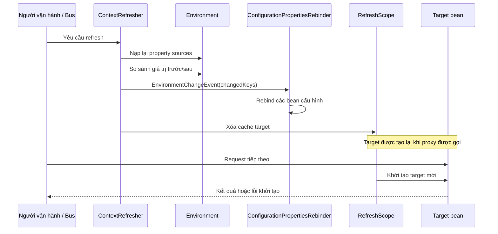
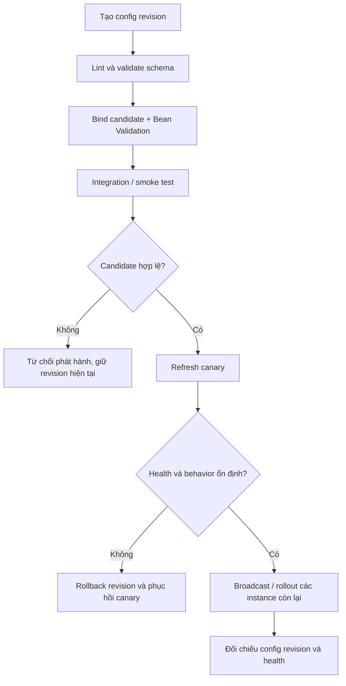

# Xử lý refresh lặp lại, lỗi giữa chừng và cấu hình không hợp lệ

> **Chương:** Làm mới cấu hình  
> **Module:** `SPRING_CLOUD_CORE` — các nền tảng cốt lõi của Spring Cloud trong hệ thống phân tán, đặc biệt Spring Cloud Commons, Context, cấu hình bên ngoài và tương thích phiên bản với Spring Boot. Người học tìm hiểu refresh scope, discovery, service registry, giao tiếp dịch vụ và cách kiểm thử, vận hành các abstraction chung.  
> **Trọng tâm:** Làm mới cấu hình tác động đến Environment, bean cấu hình, target của refresh scope và tài nguyên đang phục vụ request. Bài học tập trung vào refresh nhiều lần, lỗi giữa chừng, cấu hình không hợp lệ và cách khôi phục trạng thái an toàn.

## 1. Vì sao refresh cần có chiến lược xử lý lỗi?

Một ứng dụng Spring Cloud có thể thay đổi cấu hình khi cập nhật Config Server, điều chỉnh timeout, đổi endpoint downstream, thay feature flag hoặc cập nhật log level. Spring Cloud Context cung cấp cơ chế cập nhật Environment, rebind các bean cấu hình và làm mới bean thuộc refresh scope.

Cơ chế này thuận tiện nhưng không phải một giao dịch có rollback toàn bộ ứng dụng. Một lần refresh có thể:

- đọc được nguồn cấu hình mới nhưng một property không bind được;
- rebind thành công một số bean rồi thất bại ở bean khác;
- xóa cache của refresh scope, nhưng target mới chỉ được tạo khi có request tiếp theo;
- tạo lại bean thành công ở instance này nhưng thất bại ở instance khác;
- nhận cùng một cấu hình nhiều lần do thao tác thủ công, retry hoặc sự kiện từ Spring Cloud Bus;
- để lại trạng thái khác nhau giữa Environment, bean cấu hình và tài nguyên bên ngoài.

Vì vậy, cần phân biệt ba câu hỏi:

1. **Nguồn cấu hình đã thay đổi chưa?** Environment có property source và giá trị mới hay chưa?
2. **Ứng dụng đã áp dụng cấu hình chưa?** Các bean cấu hình và target trong refresh scope đã được cập nhật thành công chưa?
3. **Hành vi nghiệp vụ đã ổn định chưa?** Kết nối database, HTTP client, consumer, scheduler và downstream có thực sự hoạt động với cấu hình mới không?

Một HTTP response thành công từ endpoint refresh không thay thế việc xác nhận sức khỏe của từng thành phần và từng instance.

### Kết quả học tập

Sau bài này, người học có thể:

1. mô tả các bước chính khi Spring Cloud làm mới Environment;
2. giải thích tác động của refresh lặp lại và refresh khi không có key thay đổi;
3. phân biệt rebind ConfigurationProperties với làm mới RefreshScope;
4. nhận diện rủi ro khi bean bind hoặc khởi tạo target mới thất bại;
5. thiết kế validation để chặn cấu hình sai trước khi phát hành;
6. xây dựng chiến lược rollback và khôi phục sau refresh thất bại;
7. kiểm soát refresh đồng thời, refresh lặp lại và refresh trên nhiều instance;
8. kiểm thử cấu hình hợp lệ, không hợp lệ, thiếu key và lỗi giữa chừng.

## 2. Quy trình refresh ở mức khái niệm

### 2.1. Các bước chính

Với cơ chế refresh của Spring Cloud Context, có thể hình dung một lần refresh qua các bước:

1. **Lấy cấu hình mới:** ContextRefresher cập nhật các nguồn cấu hình theo cách ứng dụng đang sử dụng, chẳng hạn bootstrap property sources hoặc Config Data.
2. **So sánh Environment:** framework so sánh giá trị trước và sau để xác định các key thay đổi.
3. **Phát EnvironmentChangeEvent:** event mang danh sách key thay đổi được gửi trong context.
4. **Rebind cấu hình:** các listener của Spring Cloud cập nhật bean ConfigurationProperties và xử lý log level thuộc logging.level.*.
5. **Làm mới refresh scope:** cache target của RefreshScope được xóa. Khi proxy được gọi lần tiếp theo, target mới được tạo và inject dependency theo Environment hiện hành.
6. **Quan sát kết quả:** ứng dụng ghi nhận key thay đổi, lỗi bind/khởi tạo và trạng thái health.



Đây là mô hình để hiểu các trách nhiệm, không phải cam kết rằng mọi listener và callback luôn chạy đồng bộ theo cùng thứ tự trong mọi cấu hình. Nếu ứng dụng dùng event multicaster bất đồng bộ hoặc listener tùy chỉnh, cần kiểm tra thứ tự và cách exception được chuyển tới caller.

### 2.2. Endpoint và sự kiện

Với Spring Boot Actuator, endpoint thường dùng là POST /actuator/refresh. Endpoint cần được expose rõ ràng:

```yaml
management:
  endpoints:
    web:
      exposure:
        include:
          - health
          - info
          - refresh
```

Endpoint chỉ hoạt động khi ứng dụng có dependency và auto-configuration refresh phù hợp. Không nên expose endpoint này ra mạng công cộng. Cần giới hạn bằng Spring Security, network policy, authentication/authorization và audit log.

EnvironmentChangeEvent cũng có thể được phát khi ứng dụng chủ động thay đổi Environment. Spring Cloud phản ứng với event này để rebind các ConfigurationProperties bean và cập nhật log level. Tuy nhiên, chỉ phát event không tự tải lại cấu hình từ Config Server; nguồn cấu hình phải được cập nhật trước.

### 2.3. Refresh không đồng nghĩa restart

Refresh không tạo lại toàn bộ ApplicationContext. Nó không tự:

- tải lại class hoặc dependency JAR;
- cập nhật phiên bản Spring Boot/Spring Cloud;
- chạy lại toàn bộ startup lifecycle;
- thay mọi singleton bean;
- khởi tạo lại bean không thuộc cơ chế refresh;
- đảo ngược request đang chạy hoặc giao dịch đã commit.

Nếu một cấu hình chỉ có ý nghĩa khi startup, hoặc một thư viện không hỗ trợ reconfigure, cần restart/redeploy theo quy trình phù hợp.

## 3. Refresh lặp lại và tính idempotent

### 3.1. Điều gì xảy ra khi cùng một refresh được gửi nhiều lần?

Giả sử Config Server trả cùng giá trị catalog.client.read-timeout=3s trong ba lần refresh liên tiếp.

- Lần đầu, Environment có thể ghi nhận key thay đổi và phát event với key đó.
- Lần tiếp theo, nếu giá trị hiệu lực không đổi, tập key thay đổi có thể rỗng.
- Dù không có key thay đổi, thao tác refresh vẫn có thể xóa cache của RefreshScope, khiến target được tạo lại ở lần gọi proxy tiếp theo.

Do đó, **không nên dùng endpoint refresh như một lệnh kiểm tra sức khỏe hoặc một thao tác polling tùy tiện**. Một lần refresh không cần thiết vẫn có thể làm target scoped bean bị hủy và khởi tạo lại.

### 3.2. Idempotent ở giá trị không có nghĩa side effect an toàn

Một thao tác được xem là idempotent khi thực hiện lặp lại với cùng đầu vào không làm trạng thái cuối khác đi so với thực hiện một lần. Cấu hình mới có thể giống nhau, nhưng constructor hoặc lifecycle callback của bean được refresh có thể tạo side effect mỗi lần:

- mở thêm connection hoặc thread mà không đóng tài nguyên cũ;
- đăng ký listener hoặc consumer trùng lặp;
- tạo scheduler mới trong khi scheduler cũ vẫn chạy;
- gọi API downstream để tạo tài nguyên từ xa;
- ghi một bản ghi audit hoặc kích hoạt workflow ngoài ý muốn.

Với RefreshScope, Spring áp dụng destruction callback của target cũ khi cache bị xóa; target mới được tạo khi proxy được dùng tiếp. Hãy đăng ký cleanup qua PreDestroy, DisposableBean hoặc lifecycle phù hợp và làm cho thao tác khởi tạo có thể lặp lại an toàn.

Ví dụ minh họa:

```java
@Component
@RefreshScope
public class RemoteCatalogClient {

    private final HttpClient client;

    public RemoteCatalogClient(RemoteCatalogProperties properties) {
        this.client = HttpClient.newBuilder()
                .connectTimeout(properties.getConnectTimeout())
                .build();
    }

    public CatalogResponse fetch(String id) {
        // Sử dụng client đã được tạo từ cấu hình hiện hành.
        return callRemoteCatalog(id);
    }
}
```

Ví dụ cho thấy target được dựng từ property hiện hành. Nếu bean giữ thread pool, connection pool hoặc tài nguyên có vòng đời riêng, cần quản lý việc đóng tài nguyên khi target cũ bị hủy. Không đặt thao tác không thể lặp lại như tạo subscription bên ngoài hoặc ghi dữ liệu nghiệp vụ trong constructor chỉ vì bean thuộc refresh scope.

### 3.3. Refresh lặp lại có thể tạo khoảng trống phục vụ

Khi cache target bị xóa, proxy vẫn tồn tại nhưng target cũ đã bị dispose. Lần gọi tiếp theo phải khởi tạo target mới. Nếu constructor hoặc initialization callback thất bại, request chạm vào proxy có thể thất bại.

Với bean giữ tài nguyên quan trọng, cần:

- giới hạn số lần refresh trong một khoảng thời gian;
- tránh refresh đồng thời do nhiều nguồn trigger;
- kiểm tra cấu hình trước khi refresh;
- có timeout và retry hợp lý khi khởi tạo tài nguyên;
- theo dõi lỗi khởi tạo target và refresh health;
- cân nhắc canary hoặc rolling restart nếu không thể chuyển đổi an toàn.

### 3.4. Kiểm soát refresh đồng thời

Spring Cloud đồng bộ một số thao tác refresh/rebind nội bộ. Rebind cùng một ConfigurationProperties bean được tuần tự hóa với các lần rebind đồng thời khác. RefreshScope cũng điều phối việc đọc target với quá trình refresh đối với bean trong scope.

Tuy nhiên, điều đó không biến toàn bộ ApplicationContext thành một giao dịch nguyên tử. Các bean không thuộc refresh scope, listener tùy chỉnh, request đang chạy và side effect ngoài JVM vẫn cần được thiết kế riêng.

Ở tầng vận hành, nên coalesce các trigger gần nhau thành một đợt cập nhật cấu hình, gắn mỗi đợt với một revision/version rõ ràng và tránh gửi cùng một lệnh từ nhiều pipeline độc lập.

## 4. Rebind và RefreshScope: hai cơ chế khác nhau

### 4.1. Rebind ConfigurationProperties

Khi nhận EnvironmentChangeEvent, Spring Cloud có thể rebind các bean ConfigurationProperties.

Ví dụ:

```java
import java.time.Duration;

import org.springframework.boot.context.properties.ConfigurationProperties;
import org.springframework.validation.annotation.Validated;

import jakarta.validation.constraints.Max;
import jakarta.validation.constraints.Min;
import jakarta.validation.constraints.NotBlank;
import jakarta.validation.constraints.NotNull;

@ConfigurationProperties(prefix = "catalog.client")
@Validated
public class CatalogClientProperties {

    @NotBlank
    private String baseUrl;

    @Min(1)
    @Max(10)
    private int maxAttempts = 3;

    @NotNull
    private Duration readTimeout = Duration.ofSeconds(2);

    public String getBaseUrl() {
        return baseUrl;
    }

    public void setBaseUrl(String baseUrl) {
        this.baseUrl = baseUrl;
    }

    public int getMaxAttempts() {
        return maxAttempts;
    }

    public void setMaxAttempts(int maxAttempts) {
        this.maxAttempts = maxAttempts;
    }

    public Duration getReadTimeout() {
        return readTimeout;
    }

    public void setReadTimeout(Duration readTimeout) {
        this.readTimeout = readTimeout;
    }
}
```

Cấu hình YAML tương ứng:

```yaml
catalog:
  client:
    base-url: https://catalog.internal
    max-attempts: 3
    read-timeout: 2s
```

Rebind cập nhật field trên cùng instance bean. Với class chỉ có no-argument constructor, Spring Cloud reset property về default ở cấp class trước khi bind lại, để property đã bị loại khỏi Environment không giữ giá trị cũ ngoài ý muốn. Cơ chế reset còn xử lý các object cấu hình lồng nhau theo quy tắc của phiên bản Spring Cloud.

Điều này có nghĩa một thread khác có thể đọc bean trong lúc các field đang được cập nhật và nhìn thấy trạng thái trung gian. Framework tuần tự hóa các lần rebind cùng bean, nhưng việc đó không tự bảo đảm thread đọc thông thường nhìn thấy một snapshot nhất quán.

Các object dùng constructor binding, bao gồm Java Record được đánh dấu ConfigurationProperties, không hỗ trợ refresh theo cơ chế rebind này. Cần kiểm tra cách khai báo properties khi thiết kế một bean cần thay đổi lúc runtime.

### 4.2. RefreshScope

RefreshScope đặt bean trong một scope có proxy. Target được tạo khi proxy được sử dụng và cache lại. Khi refresh, cache target bị xóa; target cũ được dispose theo lifecycle, và target mới được khởi tạo ở lần gọi sau.

Ví dụ:

```java
@Component
@RefreshScope
public class CatalogGateway {

    private final CatalogClient client;

    public CatalogGateway(CatalogClientProperties properties) {
        this.client = CatalogClient.create(
                properties.getBaseUrl(),
                properties.getReadTimeout()
        );
    }

    public CatalogResponse get(String id) {
        return client.get(id);
    }
}
```

Proxy giúp các component khác giữ một reference ổn định tới bean, trong khi target có thể được thay sau refresh. Nếu một component phụ thuộc trực tiếp vào trạng thái được tính trong constructor, chính component đó cũng cần một chiến lược cập nhật phù hợp.

### 4.3. Chọn cơ chế nào?

| Nhu cầu | Cơ chế phù hợp | Điểm cần lưu ý |
| --- | --- | --- |
| Thay đổi field cấu hình đơn giản | Rebind ConfigurationProperties | Bean bị mutate tại chỗ; reader đồng thời có thể thấy trạng thái trung gian |
| Cần snapshot nhất quán cho một bean | RefreshScope | Target mới được tạo lazy; request đầu sau refresh có thể gặp lỗi khởi tạo |
| Thay đổi nhiều dependency được tạo cùng nhau | Đặt facade/bean có trạng thái trong refresh scope | Phải xác định rõ các dependency nào cũng cần được tạo lại |
| Bean dùng constructor binding hoặc Java Record | Thiết kế lại cách cập nhật hoặc restart | Constructor-bound properties không refresh bằng rebind |
| Thay class/dependency hoặc cấu trúc ApplicationContext | Restart/redeploy | Refresh không thay thế startup lifecycle |

### 4.4. Những trường hợp đặc biệt

- HikariDataSource nằm trong danh sách spring.cloud.refresh.never-refreshable mặc định. Không nên kỳ vọng datasource này được thay mới bằng cách chỉ thêm RefreshScope; hãy chọn chiến lược datasource/pool phù hợp với yêu cầu hoặc restart ứng dụng khi cần.
- spring.cloud.refresh.extra-refreshable cho phép khai báo thêm class/bean cần đưa vào refresh scope trong những trường hợp phù hợp.
- spring.cloud.refresh.never-refreshable khai báo những bean không được refresh/rebind theo cơ chế đó. Không xóa một class khỏi danh sách bảo vệ nếu chưa hiểu lifecycle và khả năng dispose.
- Đặt RefreshScope trên một class Configuration không tự động đặt mọi Bean được khai báo trong class đó vào refresh scope. Bean phụ thuộc vào các bean này có thể vẫn giữ dependency cũ nếu chính chúng không được làm mới.

## 5. Cấu hình không hợp lệ: phát hiện trước khi áp dụng

### 5.1. Các nhóm lỗi thường gặp

Một cấu hình mới có thể sai theo nhiều cách:

| Nhóm lỗi | Ví dụ | Nơi phát hiện phù hợp |
| --- | --- | --- |
| Sai cú pháp/định dạng | YAML sai indentation, giá trị không parse được | CI, Config Server, Config Data loading |
| Sai kiểu | read-timeout: tomorrow | Binder/type conversion |
| Thiếu giá trị bắt buộc | base-url rỗng | Bean Validation |
| Ngoài miền hợp lệ | max-attempts: 0 | @Min, @Max hoặc validator |
| Không tương thích giữa các field | connect-timeout lớn hơn request deadline | Class-level/custom validation |
| Không tương thích môi trường | URI đúng cú pháp nhưng DNS/TLS/credential sai | Integration/smoke test |
| Tương thích phiên bản | Property không còn được hỗ trợ ở release train hiện tại | Compatibility test và tài liệu version |

Không phải lỗi nào cũng có thể phát hiện bằng metadata hoặc parse YAML. Một URI có thể đúng cú pháp nhưng endpoint không tồn tại; một timeout có thể dương nhưng lớn hơn deadline của hệ thống.

### 5.2. Dùng Bean Validation cho ràng buộc cơ bản

Ví dụ Validated, NotBlank, Min, Max và NotNull trong class CatalogClientProperties giúp từ chối các giá trị không hợp lệ khi binding. Với object lồng nhau, dùng Valid để kích hoạt validation cho nested object:

```java
import java.time.Duration;

import org.springframework.boot.context.properties.ConfigurationProperties;
import org.springframework.validation.annotation.Validated;

import jakarta.validation.Valid;
import jakarta.validation.constraints.Max;
import jakarta.validation.constraints.Min;
import jakarta.validation.constraints.NotBlank;
import jakarta.validation.constraints.NotNull;

@ConfigurationProperties(prefix = "catalog.client")
@Validated
public class CatalogClientProperties {

    @NotBlank
    private String baseUrl;

    @Valid
    @NotNull
    private Retry retry = new Retry();

    public Retry getRetry() {
        return retry;
    }

    public void setRetry(Retry retry) {
        this.retry = retry;
    }

    public static class Retry {

        @Min(1)
        @Max(10)
        private int maxAttempts = 3;

        @NotNull
        private Duration backoff = Duration.ofMillis(200);

        public int getMaxAttempts() {
            return maxAttempts;
        }

        public void setMaxAttempts(int maxAttempts) {
            this.maxAttempts = maxAttempts;
        }

        public Duration getBackoff() {
            return backoff;
        }

        public void setBackoff(Duration backoff) {
            this.backoff = backoff;
        }
    }
}
```

Ứng dụng cần có Bean Validation provider phù hợp, ví dụ dependency validation của Spring Boot. Ràng buộc tùy chỉnh nên được dùng khi điều kiện liên quan nhiều field hoặc cần kiểm tra ngữ nghĩa nghiệp vụ.

### 5.3. Kiểm tra điều kiện liên trường

Giả sử request có deadline 2 giây. Tổng connect timeout và read timeout không nên vượt quá deadline này:

```java
import java.time.Duration;

import jakarta.validation.constraints.AssertTrue;
import jakarta.validation.constraints.NotNull;

public class CatalogClientSettings {

    @NotNull
    private Duration connectTimeout;

    @NotNull
    private Duration readTimeout;

    @NotNull
    private Duration requestDeadline = Duration.ofSeconds(2);

    @AssertTrue(message = "Tổng timeout không được vượt request deadline")
    public boolean isTimeoutBudgetValid() {
        return connectTimeout != null
                && readTimeout != null
                && requestDeadline != null
                && connectTimeout.plus(readTimeout)
                        .compareTo(requestDeadline) <= 0;
    }

    public Duration getConnectTimeout() {
        return connectTimeout;
    }

    public void setConnectTimeout(Duration connectTimeout) {
        this.connectTimeout = connectTimeout;
    }

    public Duration getReadTimeout() {
        return readTimeout;
    }

    public void setReadTimeout(Duration readTimeout) {
        this.readTimeout = readTimeout;
    }

    public Duration getRequestDeadline() {
        return requestDeadline;
    }

    public void setRequestDeadline(Duration requestDeadline) {
        this.requestDeadline = requestDeadline;
    }
}
```

Đoạn code minh họa một kiểm tra đơn giản; trong hệ thống thực tế có thể dùng custom class-level constraint để báo lỗi rõ hơn và tránh logic validation phụ thuộc getter theo quy ước JavaBeans. Cần xác định default value, đơn vị và deadline của upstream để phép so sánh có ý nghĩa.

### 5.4. Kiểm tra cấu hình trước khi trigger refresh

Không nên chờ request production đầu tiên mới biết cấu hình sai. Có thể kiểm tra cấu hình mới trong pipeline hoặc một bước preflight riêng:

1. lấy candidate configuration theo đúng application/profile/label;
2. bind vào một object candidate độc lập;
3. chạy Bean Validation và kiểm tra nghiệp vụ;
4. kiểm tra endpoint/credential bằng smoke test có giới hạn;
5. chỉ phát hành revision đã qua kiểm tra;
6. refresh canary trước khi broadcast đến toàn bộ instance.

Ví dụ bind một candidate từ Environment:

```java
import java.util.Set;

import org.springframework.boot.context.properties.bind.Bindable;
import org.springframework.boot.context.properties.bind.Binder;

import jakarta.validation.ConstraintViolation;
import jakarta.validation.ConstraintViolationException;
import jakarta.validation.Validator;

Binder binder = Binder.get(environment);

CatalogClientSettings candidate = binder
        .bind("catalog.client", Bindable.of(CatalogClientSettings.class))
        .orElseThrow(() ->
                new IllegalStateException("Thiếu catalog.client"));

Set<ConstraintViolation<CatalogClientSettings>> violations =
        validator.validate(candidate);

if (!violations.isEmpty()) {
    throw new ConstraintViolationException(violations);
}
```

Đây là bước preflight minh họa. CatalogClientSettings nên là object candidate riêng, không phải bean singleton đang được request thread sử dụng. Validator phải được cấu hình với các constraint tương ứng. Nếu cần xác minh kết nối thực tế, hãy bổ sung smoke test có timeout và quyền truy cập giới hạn.

## 6. Lỗi giữa chừng: điều gì có thể đã thay đổi?

### 6.1. Refresh không có rollback toàn context

Giả sử Environment đã nhận property source mới. Spring Cloud phát EnvironmentChangeEvent, một số bean đã được rebind, nhưng một bean khác ném exception vì giá trị không hợp lệ.

Không nên mặc định ứng dụng tự quay lại trạng thái cũ. Environment đã có thể chứa giá trị mới; bean được xử lý trước đó có thể đã cập nhật; bean gặp lỗi có thể giữ một phần trạng thái cũ hoặc trạng thái trung gian tùy điểm lỗi; các listener khác có thể đã thực hiện side effect.

Refresh không cung cấp transaction rollback bao trùm toàn bộ:

- property source;
- tất cả ConfigurationProperties bean;
- target của RefreshScope;
- tài nguyên kết nối;
- request đang chạy;
- các side effect ở hệ thống ngoài.

Vì vậy, khi refresh thất bại, phải xác định trạng thái thực tế trước khi gửi refresh tiếp theo.

### 6.2. Trạng thái sau lỗi phụ thuộc điểm thất bại

| Điểm lỗi | Trạng thái có thể gặp | Hành động |
| --- | --- | --- |
| Không lấy được cấu hình mới | Environment có thể giữ nguồn cũ, tùy Config Client/Config Data và nguồn server | Kiểm tra log fetch và property source |
| Nạp nguồn mới nhưng bind thất bại | Environment có thể đã đổi; một số bean có thể đã rebind | Kiểm tra key thay đổi, exception và configprops |
| Target RefreshScope khởi tạo thất bại | Cache đã bị xóa; proxy tồn tại nhưng lần gọi target mới thất bại | Kiểm tra exception khởi tạo, refresh health và dependency |
| Listener tùy chỉnh thất bại | Listener khác có thể đã chạy trước đó; thứ tự tùy event multicaster | Kiểm tra listener order và side effect |
| Chỉ một instance trong cluster thất bại | Các instance có thể đang chạy revision khác nhau | Kiểm tra từng instance, bus event và config revision |

Bảng mô tả các khả năng, không phải bảo đảm mọi phiên bản đều có cùng kết quả cho mọi điểm lỗi. Đọc stack trace và trạng thái Environment thực tế trước khi kết luận.

### 6.3. Health indicator của refresh scope

Spring Cloud cung cấp RefreshScopeHealthIndicator. Nếu một bean không thể được khởi tạo lại hoặc rebind sau context refresh, health indicator có thể chuyển sang DOWN và cung cấp exception liên quan.

Có thể kiểm tra qua Actuator health nếu component đã được expose:

```yaml
management:
  endpoint:
    health:
      show-details: when_authorized
  endpoints:
    web:
      exposure:
        include:
          - health
          - refresh
```

Không nên tắt refresh health indicator chỉ để pipeline luôn thấy ứng dụng UP. Nếu health check chuyển DOWN, cần xử lý nguyên nhân hoặc quyết định restart/rollback theo chính sách của service.

## 7. Chiến lược phục hồi và rollback

### 7.1. Dừng phát thêm refresh khi trạng thái chưa rõ

Khi một đợt refresh thất bại:

1. tạm dừng các trigger tự động hoặc thao tác thủ công tiếp theo;
2. ghi lại config revision, instance ID, thời gian và changed keys;
3. kiểm tra Environment và /actuator/configprops ở instance lỗi;
4. kiểm tra refresh health và log của bean rebind/target initialization;
5. xác định instance nào đã áp dụng cấu hình mới;
6. quyết định sửa cấu hình, rollback revision hoặc restart.

Nếu tiếp tục gửi refresh liên tục, mỗi lần có thể xóa cache target và tạo thêm lần khởi tạo tài nguyên, khiến việc điều tra khó hơn.

### 7.2. Rollback bằng revision cấu hình đã biết tốt

Với Config Server dùng Git backend, nên quản lý cấu hình theo commit/tag/label có thể truy vết. Khi revision mới không hợp lệ:

- khôi phục file cấu hình về commit đã biết tốt hoặc phát hành revision rollback mới;
- xác nhận Config Server trả lại đúng application/profile/label;
- kiểm tra candidate config bằng preflight;
- refresh canary và quan sát;
- chỉ sau khi canary ổn định mới broadcast đến các instance còn lại.

Rollback cấu hình và refresh lại có thể đưa Environment về giá trị cũ, nhưng không tự hoàn tác side effect đã xảy ra. Ví dụ, một consumer đã xử lý message bằng endpoint mới hoặc một scheduler đã gửi lệnh ra ngoài thì việc đổi property trở lại không đảo ngược hành động đó.

### 7.3. Khi nào nên restart?

Nên cân nhắc restart/redeploy khi:

- bean không hỗ trợ refresh hoặc dùng constructor-bound properties;
- tài nguyên không thể thay thế an toàn trong process;
- trạng thái bean đã bị mutate một phần và không thể xác nhận tính nhất quán;
- dependency hoặc classpath cần thay đổi;
- refresh scope target liên tục thất bại dù cấu hình đã sửa;
- ứng dụng không có cách xác minh và khôi phục trạng thái runtime.

Restart cũng cần readiness gate, graceful shutdown và rollout strategy để tránh dừng toàn bộ replica cùng lúc.

### 7.4. Tách bước prepare và apply

Một quy trình cấu hình an toàn có thể chia thành:



Quy trình này không biến refresh thành transaction, nhưng giảm khả năng một cấu hình sai được phát tán đồng loạt.

## 8. Refresh trên nhiều instance với Spring Cloud Bus

### 8.1. Vì sao cần broadcast?

Config Client không tự polling Config Server để tìm thay đổi theo mặc định. Với hệ thống có nhiều replica, nếu mỗi instance tự refresh theo lịch riêng, chúng có thể cập nhật ở thời điểm khác nhau và tạo tải không cần thiết.

Spring Cloud Bus cho phép broadcast refresh event qua broker mà ứng dụng đã cấu hình. Endpoint thường dùng là POST /actuator/busrefresh; endpoint tương ứng ở cấp instance là POST /actuator/refresh.

Cấu hình expose:

```yaml
management:
  endpoints:
    web:
      exposure:
        include:
          - health
          - busrefresh
```

Bus refresh xóa cache RefreshScope và rebind ConfigurationProperties ở các instance nhận event. Cần có broker và cấu hình Spring Cloud Bus phù hợp.

### 8.2. Bus không phải giao dịch cluster-wide

Khi broadcast:

- message có thể đến các instance ở thời điểm khác nhau;
- một instance có thể bind thành công trong khi instance khác thất bại;
- broker hoặc network có thể chậm/mất kết nối;
- instance mới khởi động có thể nhận revision khác nếu nguồn cấu hình thay đổi giữa các lần fetch.

Không nên giả định toàn bộ cluster chuyển revision trong cùng một thời điểm hoặc cùng một transaction. Hãy gắn config revision vào log/metric, theo dõi từng instance và có chính sách xử lý instance không xác nhận thành công.

### 8.3. Chọn canary hay broadcast?

| Tình huống | Chiến lược |
| --- | --- |
| Thay đổi nhỏ, đã kiểm thử đầy đủ | Có thể broadcast theo quy trình chuẩn |
| Đổi endpoint/credential/database | Refresh canary, smoke test rồi rollout |
| Thay đổi ảnh hưởng traffic routing | Chia đợt, theo dõi lỗi downstream và latency |
| Có bean khởi tạo tài nguyên nặng | Giới hạn số instance refresh đồng thời |
| Revision vừa rollback | Xác nhận một instance trước khi broadcast lại |
| Một instance đang lỗi health | Cô lập/điều tra instance đó, không gửi refresh lặp lại mù quáng |

## 9. Những giới hạn cần biết

### 9.1. Xóa property khỏi nguồn cấu hình

Spring Cloud có giới hạn khi xử lý việc xóa hẳn một property khỏi nguồn cấu hình rồi refresh: trạng thái “property có tồn tại hay không” không phải lúc nào cũng được cập nhật như kỳ vọng cho mọi use case.

Nếu nghiệp vụ phụ thuộc vào sự hiện diện của key, nên thiết kế rõ giá trị mặc định hoặc một cờ trạng thái tường minh, thay vì dựa vào việc xóa key từ xa. Ví dụ, thay vì xóa feature.new-flow, đặt feature.new-flow.enabled=false để thể hiện trạng thái tắt một cách rõ ràng.

### 9.2. Không phải bean nào cũng refresh được

- Bean singleton thông thường không tự tạo lại chỉ vì Environment đổi.
- ConfigurationProperties dùng constructor binding, bao gồm Java Record, không được rebind bằng cơ chế refresh thông thường.
- Một số bean nằm trong danh sách never-refreshable.
- Bean phụ thuộc vào một bean scoped có thể vẫn giữ trạng thái đã tính từ trước nếu chính nó không được làm mới.
- RefreshScope trên Configuration không có nghĩa mọi bean do class đó khai báo đều nằm trong scope.

Hãy kiểm tra object graph và dependency lifecycle thay vì chỉ thêm annotation vào một class gốc.

### 9.3. AOT và native image

Context refresh không được hỗ trợ cho Spring AOT transformations và native images theo tài liệu Spring Cloud hiện hành. Với AOT/native image, cần đặt spring.cloud.refresh.enabled=false và dùng chiến lược cấu hình phù hợp với mô hình triển khai, thường là restart/rollout hoặc cơ chế runtime được hỗ trợ riêng.

### 9.4. Refresh không thay thế quản lý secret

Nếu refresh thay credential hoặc secret:

- lấy secret từ nguồn quản lý chuyên dụng;
- tránh ghi secret vào log hoặc endpoint env;
- kiểm tra thời gian overlap của credential cũ và mới;
- xác minh client/pool đã chuyển sang credential mới;
- có kế hoạch rollback hoặc rotation nếu kết nối mới thất bại.

## 10. Quan sát và ghi nhận một đợt refresh

Một đợt refresh cần có đủ thông tin để trả lời: ai kích hoạt, revision nào, instance nào đã nhận, key nào thay đổi và bean nào gặp lỗi.

### 10.1. Dữ liệu nên ghi nhận

| Dữ liệu | Mục đích |
| --- | --- |
| config.revision hoặc commit ID | Xác định chính xác phiên bản cấu hình |
| application.name và instance ID | Phân biệt service/replica |
| Refresh trigger | Phân biệt thao tác thủ công, Bus, pipeline hoặc event |
| Timestamp bắt đầu/kết thúc | Đo thời gian và phát hiện refresh chồng lấn |
| Changed keys | Biết phạm vi thay đổi; không ghi giá trị secret |
| Rebind/target initialization result | Xác định bean nào áp dụng thành công |
| Refresh health | Phát hiện lỗi sau khi làm mới |
| Downstream smoke-test result | Xác nhận hành vi thực tế sau refresh |

Không log toàn bộ Environment hoặc giá trị cấu hình có thể chứa credential. Chỉ ghi tên key và metadata cần thiết.

### 10.2. Kiểm tra bằng Actuator

- /actuator/health: trạng thái tổng thể và refresh health nếu được expose.
- /actuator/configprops: xem các bean ConfigurationProperties đã bind.
- /actuator/env: xem property source và giá trị hiệu lực khi endpoint được bảo vệ và masking đúng.
- /actuator/refresh: kích hoạt refresh ở một instance.
- /actuator/busrefresh: phát refresh đến các instance qua Bus.

Các endpoint phải được bật/expose theo cấu hình Actuator và được bảo vệ bằng authorization phù hợp. Không bật rộng các endpoint quản trị trong production chỉ để debug thuận tiện.

### 10.3. Đo hành vi thay vì chỉ đo endpoint

Sau refresh, chạy kiểm tra chức năng phù hợp:

- mở kết nối tới downstream bằng cấu hình mới;
- gọi health/readiness probe của dependency;
- kiểm tra consumer đã dùng endpoint/topic mới;
- kiểm tra scheduler chỉ còn một lịch chạy;
- kiểm tra metric connection pool và lỗi timeout;
- xác nhận feature flag đang có hiệu lực ở đúng instance.

Nếu endpoint refresh trả về thành công nhưng request nghiệp vụ tiếp theo thất bại, vấn đề nằm ở giai đoạn khởi tạo hoặc sử dụng target mới, không chỉ ở bước nạp property source.

## 11. Kiểm thử refresh lặp lại, lỗi và cấu hình sai

### 11.1. Ma trận kiểm thử

| Kịch bản | Cách kiểm tra | Kết quả mong đợi |
| --- | --- | --- |
| Refresh lần đầu với config hợp lệ | Đổi một property rồi gọi refresh | Key thay đổi và bean áp dụng giá trị mới |
| Refresh lặp lại cùng revision | Gọi refresh lần nữa không đổi nguồn | Không tạo sai lệch giá trị; scoped target có thể bị tạo lại |
| Refresh không có changed keys | Giữ nguyên property source | Changed-key set rỗng; kiểm tra side effect của target recreation |
| Hai refresh gần nhau | Gửi trigger đồng thời trong test | Không có interleave không kiểm soát; log revision xác định được |
| Sai kiểu dữ liệu | Đặt duration/string không parse được | Bind thất bại rõ ràng, không coi là refresh thành công |
| Vi phạm Bean Validation | Đặt max-attempts ngoài miền | Có validation error và health phản ánh lỗi |
| Thiếu key bắt buộc | Xóa hoặc để rỗng base URL | Preflight/validation phát hiện trước khi rollout |
| Target scoped bean tạo lỗi | Constructor kết nối endpoint sai | Lần gọi proxy thất bại và refresh health báo lỗi |
| Listener tùy chỉnh ném exception | Làm listener test chủ động fail | Quan sát điểm lỗi và trạng thái các bean đã xử lý |
| Config Server không truy cập được | Tắt backend trong môi trường test | Xác nhận chính sách optional/required và giá trị đang giữ |
| Một node trong Bus không nhận event | Cô lập một instance | Phát hiện revision lệch và có quy trình catch-up |
| Rollback revision | Trả lại cấu hình đã biết tốt rồi refresh | Xác nhận giá trị cũ được áp dụng và downstream phục hồi |

### 11.2. Test runtime binding và validation

Có thể dùng ApplicationContextRunner hoặc integration test để kiểm tra cấu hình hợp lệ/không hợp lệ. Ví dụ với Spring Boot test:

```java
import java.time.Duration;

import org.junit.jupiter.api.Test;
import org.springframework.beans.factory.annotation.Autowired;
import org.springframework.boot.test.context.SpringBootTest;

import static org.assertj.core.api.Assertions.assertThat;

@SpringBootTest(properties = {
    "catalog.client.base-url=https://catalog.internal",
    "catalog.client.max-attempts=3",
    "catalog.client.read-timeout=2s"
})
class CatalogClientPropertiesTest {

    @Autowired
    CatalogClientProperties properties;

    @Test
    void bindsValidConfiguration() {
        assertThat(properties.getMaxAttempts()).isEqualTo(3);
        assertThat(properties.getReadTimeout())
                .isEqualTo(Duration.ofSeconds(2));
    }
}
```

Một test riêng nên khởi tạo context với max-attempts=0 và xác nhận startup/binding thất bại do validation. Đây là test cho binding; nó chưa chứng minh refresh runtime có thể phục hồi sau lỗi.

### 11.3. Test refresh scope

Với một bean scoped có counter hoặc target ID, có thể kiểm tra:

1. gọi proxy lần đầu và ghi target ID;
2. trigger refresh;
3. gọi proxy lần nữa;
4. xác nhận target ID mới;
5. xác nhận destruction callback của target cũ đã chạy;
6. đặt cấu hình sai để target mới thất bại và xác nhận health/error;
7. sửa cấu hình và thử phục hồi theo chiến lược được thiết kế.

Test cần kiểm soát rõ cách Environment được cập nhật và event nào được phát. Không dùng sleep dài hoặc dựa vào timing ngẫu nhiên để kết luận refresh đã hoàn tất.

### 11.4. Test failure giữa chừng

Có thể tạo test listener hoặc bean test cố ý ném exception khi nhận giá trị không hợp lệ. Sau khi refresh thất bại, test nên đọc:

- Environment đang giữ giá trị nào;
- các ConfigurationProperties bean nào đã rebind;
- target refresh scope đã bị invalidate chưa;
- health indicator báo gì;
- lần refresh tiếp theo sau khi sửa cấu hình có thành công không.

Mục tiêu là xác nhận ứng dụng có thể phát hiện trạng thái không nhất quán và phục hồi theo runbook. Không viết test giả định mọi bean tự rollback về snapshot trước refresh nếu ứng dụng không có cơ chế rollback đó.

## 12. Runbook xử lý refresh thất bại

Khi nhận cảnh báo refresh không thành công, thực hiện theo thứ tự:

1. **Ghi nhận revision:** xác định commit/config version, service, instance và trigger.
2. **Ngăn refresh chồng lấn:** tạm dừng pipeline hoặc trigger tự động trong khi điều tra.
3. **Kiểm tra nguồn:** xác nhận Config Server trả đúng application/profile/label và property source.
4. **Đọc lỗi bind:** tìm BindException, BindValidationException, lỗi conversion hoặc exception trong listener.
5. **Kiểm tra target:** nếu lỗi xuất hiện khi gọi bean proxy, kiểm tra constructor, dependency, resource và destruction callback.
6. **Kiểm tra health:** xem refresh health, readiness và trạng thái downstream.
7. **Chọn phục hồi:** sửa candidate config, rollback revision hoặc restart/redeploy nếu bean không thể phục hồi bằng refresh.
8. **Thử canary:** xác nhận một instance hoạt động với revision đã sửa.
9. **Rollout phần còn lại:** broadcast/refresh từng đợt và đối chiếu revision.
10. **Đóng sự cố:** ghi lại key gây lỗi, nguyên nhân, thời gian ảnh hưởng và test phòng ngừa.

Không gửi lặp lại cùng một refresh request với hy vọng lỗi tự biến mất khi chưa xác định điểm thất bại.

## 13. Những sai lầm thường gặp

**“Gọi refresh nhiều lần không có tác dụng phụ nếu giá trị không đổi.”**  
Không chính xác. Changed-key set có thể rỗng nhưng cache RefreshScope vẫn có thể bị xóa và target được tạo lại ở lần gọi sau.

**“Refresh thất bại thì Spring tự rollback mọi bean.”**  
Không. Environment và một số bean có thể đã thay đổi trước khi lỗi xuất hiện. Cần kiểm tra trạng thái thực tế.

**“ConfigurationProperties luôn được thay bằng instance mới.”**  
Không. Rebind thường mutate cùng instance; reader đồng thời có thể thấy trạng thái trung gian. Dùng refresh scope nếu cần consistency cho bean.

**“Đánh dấu RefreshScope trên configuration class là mọi bean con đều được refresh.”**  
Không. Các bean được khai báo trong class không tự động thuộc refresh scope; dependency cần cập nhật cũng phải có lifecycle phù hợp.

**“Mọi DataSource đều refresh được.”**  
Không. HikariDataSource nằm trong danh sách never-refreshable mặc định của Spring Cloud.

**“Config Client tự polling Config Server.”**  
Không theo mặc định. Dùng cơ chế trigger rõ ràng hoặc Spring Cloud Bus cho nhiều instance.

**“Bus refresh là atomic trên cả cluster.”**  
Không. Mỗi instance xử lý event riêng và có thể thành công/thất bại khác nhau.

**“Xóa key khỏi Config Server là cách reset mọi property.”**  
Không nên dựa vào việc xóa key để điều khiển sự hiện diện của cấu hình. Dùng default hoặc cờ trạng thái tường minh.

**“Refresh scope phù hợp với mọi bean.”**  
Không. Bean không thể tạo lại an toàn, bean có side effect không kiểm soát hoặc resource có lifecycle phức tạp cần chiến lược riêng.

## 14. Bài tập vận dụng

### Bài tập 1 — Refresh lặp lại

Một pipeline gửi ba yêu cầu refresh trong vòng vài giây. Cả ba lần Config Server trả cùng revision. Một client trong RefreshScope bị tạo lại ba lần và làm tăng số kết nối ngắn hạn.

Hãy giải thích vì sao changed-key set rỗng không đảm bảo target không bị tạo lại. Đề xuất debounce/coalesce trigger, quản lý revision và cleanup target cũ.

### Bài tập 2 — Một bean bind thất bại

Config Server thay catalog.client.max-attempts từ 3 thành 0. Một số bean đã rebind trước khi validation thất bại.

Hãy mô tả trạng thái Environment và bean có thể tồn tại, chỉ ra vì sao không thể giả định rollback, và đề xuất bước kiểm tra trước khi gửi refresh tiếp.

### Bài tập 3 — Target mới không khởi tạo được

RefreshScope client đọc URL mới nhưng DNS không phân giải được. Endpoint refresh đã xóa cache; request tiếp theo thất bại khi proxy tạo target mới.

Hãy phân biệt lỗi fetch config với lỗi target initialization, xác định health indicator cần kiểm tra và thiết kế rollback/restart.

### Bài tập 4 — Cấu hình hợp lệ về cú pháp nhưng sai nghiệp vụ

YAML parse thành công, read-timeout là 5s, nhưng deadline request chỉ là 2s. Hãy viết validation liên trường và nêu cách chạy preflight trước khi phát hành revision.

### Bài tập 5 — Bus refresh không đồng đều

Trong 10 replica, 9 replica nhận revision mới; một replica mất kết nối broker và vẫn chạy revision cũ.

Hãy đề xuất cách ghi nhận revision trên từng instance, phát hiện lệch cấu hình, xử lý node lỗi và rollout bù.

### Bài tập 6 — Rollback sau side effect

Một refresh thay endpoint của consumer và consumer đã gửi message tới hệ thống mới. Sau đó phát hiện endpoint sai và rollback Config Server về revision trước.

Giải thích vì sao rollback property không đảo ngược message đã gửi. Đề xuất idempotency key, outbox/audit và cách xử lý message nếu cần.

### Tự kiểm tra nhanh

1. Refresh có tạo lại toàn bộ ApplicationContext không? **Không.**
2. Rebind ConfigurationProperties mutate bean hiện tại hay thay instance? **Thông thường mutate cùng instance.**
3. RefreshScope làm gì khi refresh? **Xóa cache target; target mới được tạo khi proxy được gọi tiếp.**
4. Refresh cùng revision có thể tạo lại target không? **Có.**
5. Refresh là transaction có rollback toàn context không? **Không.**
6. Cấu hình sai nên được phát hiện ở đâu? **Preflight/CI, Binder và Bean Validation trước khi rollout.**
7. Bean dùng constructor binding có được refresh bằng rebind thông thường không? **Không.**
8. HikariDataSource có refresh mặc định không? **Không, nó thuộc never-refreshable mặc định.**
9. Bus refresh có bảo đảm mọi instance cập nhật cùng lúc không? **Không.**
10. Cần làm gì sau một lần refresh thất bại? **Dừng trigger chồng lấn, kiểm tra revision/Environment/bean/health, rồi sửa, rollback hoặc restart theo trạng thái thực tế.**

## 15. Checklist thiết kế refresh an toàn

Trước khi cho phép refresh cấu hình trong production, hãy xác nhận:

1. Các property runtime có type và validation rõ ràng.
2. Candidate config được lint, bind và kiểm tra nghiệp vụ trước khi phát hành.
3. Có config revision hoặc commit ID để truy vết.
4. Các bean thuộc refresh scope có constructor/init side effect an toàn khi chạy lại.
5. Destruction callback giải phóng connection, thread, scheduler và listener cũ.
6. Bean cần snapshot nhất quán được chọn cơ chế phù hợp giữa rebind và refresh scope.
7. Các bean không hỗ trợ refresh được nhận diện rõ.
8. Refresh trigger có debounce/coalesce và không chạy lặp không cần thiết.
9. Refresh endpoint được bảo vệ và audit.
10. Có refresh health, readiness và downstream smoke test.
11. Có canary/rolling strategy khi thay đổi có ảnh hưởng lớn.
12. Có revision tốt gần nhất và quy trình rollback/restart đã được diễn tập.
13. Mỗi instance có thể báo revision đang áp dụng.
14. Có test cho refresh hợp lệ, lặp lại, invalid config, partial failure và recovery.
15. Không giả định refresh có thể thay thế việc restart khi classpath, constructor-bound config hoặc resource lifecycle yêu cầu startup mới.

**Thông điệp cốt lõi:** Refresh là quá trình cập nhật nhiều lớp trạng thái trong một ứng dụng đang chạy. Cùng một revision có thể được gửi nhiều lần và vẫn làm target scoped bean được tạo lại; một lỗi bind có thể xảy ra sau khi Environment đã thay đổi; một node có thể thành công trong khi node khác thất bại. Hãy validate candidate trước khi áp dụng, kiểm soát trigger, quan sát revision trên từng instance và chuẩn bị đường phục hồi bằng sửa cấu hình, rollback hoặc restart.

**Tài liệu tham khảo:** [Spring Cloud Commons — Application Context Services, Environment Changes và Refresh Scope](https://docs.spring.io/spring-cloud-commons/reference/spring-cloud-commons/application-context-services.html), [Spring Cloud Bus — Bus Refresh Endpoint](https://docs.spring.io/spring-cloud-bus/reference/spring-cloud-bus/bus-endpoints.html), [Spring Cloud Config — Git Backend và hành vi khi refresh](https://docs.spring.io/spring-cloud-config/reference/server/environment-repository/git-backend.html) và [Spring Cloud Commons — Configuration Properties](https://docs.spring.io/spring-cloud-commons/reference/configprops.html). Các chi tiết lifecycle và giới hạn có thể thay đổi theo release train; đối chiếu tài liệu đúng phiên bản Spring Boot/Spring Cloud của ứng dụng.
