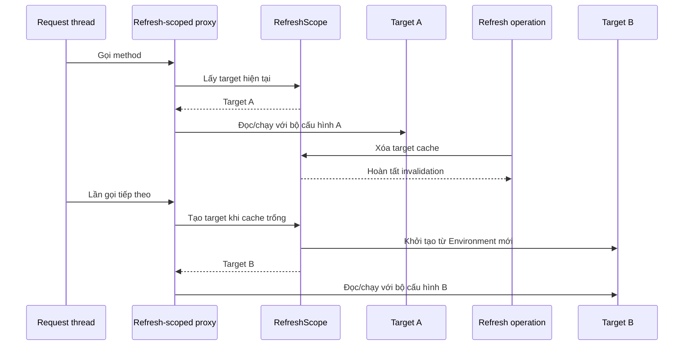
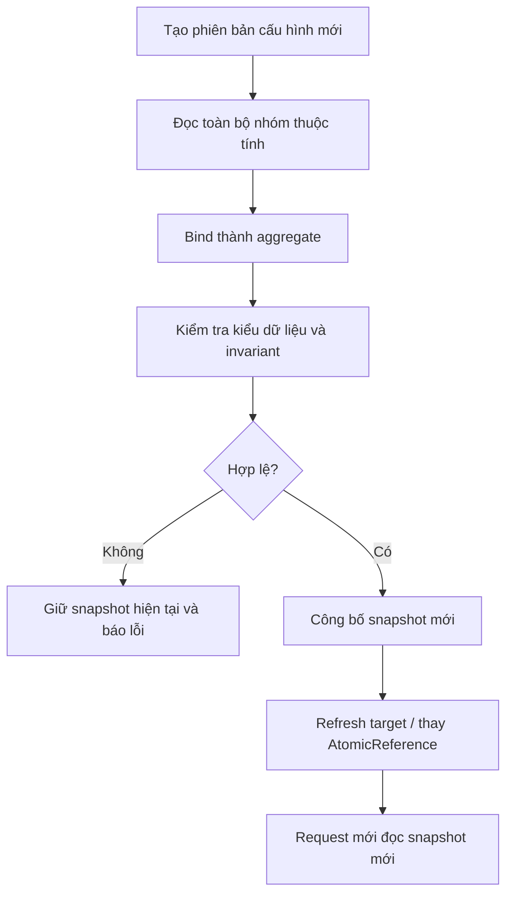

# Bảo toàn góc nhìn nhất quán khi thay nhiều thuộc tính liên quan

## 1. Bài toán

Trong ứng dụng phân tán, nhiều thuộc tính cấu hình tạo thành một bộ quy tắc phải được sử dụng cùng nhau. Ví dụ, một HTTP client có URL chính, URL dự phòng, connect timeout, read timeout và số lần retry. Một luồng định tuyến có thể phụ thuộc đồng thời vào thuật toán, trọng số và danh sách instance. Một pool kết nối có thể cần cập nhật giới hạn, thời gian chờ và chính sách thu hồi theo cùng một lần thay đổi.

Giả sử cấu hình đang dùng bộ giá trị A:

```text
primary-uri      = https://api-a.internal
fallback-uri     = https://api-b.internal
connect-timeout  = 300ms
read-timeout     = 2s
max-attempts     = 3
```

Người vận hành thay toàn bộ nhóm này sang bộ giá trị B. Nếu một request đọc từng field trong lúc ứng dụng đang bind lại bean, request đó có thể thấy URL mới nhưng timeout cũ, hoặc danh sách mới trong khi giới hạn retry chưa đổi. Những tổ hợp chưa từng được kiểm thử có thể gây lỗi khó tái hiện.

Vấn đề là **tính nhất quán của góc nhìn cấu hình**: một thao tác nghiệp vụ cần sử dụng một bộ giá trị thuộc cùng một phiên bản, thay vì đọc từng thuộc tính độc lập ở các thời điểm khác nhau.

Bài thuộc chương **Làm mới cấu hình** của mô-đun **SPRING_CLOUD_CORE**. Mô-đun này giúp người học hiểu Spring Cloud Commons, Spring Cloud Context, cấu hình ngoài, refresh scope, tương thích Spring Boot, kiểm thử và vận hành các abstraction chung.

Sau bài học, người học có thể:

- Giải thích vì sao rebind `@ConfigurationProperties` không bảo đảm góc nhìn nhất quán khi nhiều field đổi cùng lúc.
- Nhận diện rủi ro với `List` và `Set` trong lúc bind lại.
- Dùng `@RefreshScope` để đồng bộ việc đọc với quá trình refresh của bean trong scope.
- Gom thuộc tính liên quan thành snapshot bất biến và đọc snapshot một lần cho mỗi thao tác.
- Kiểm tra tính hợp lệ trước khi công bố cấu hình mới.
- Phân biệt tính nhất quán trong một instance với việc nhiều instance trong cluster cùng chuyển phiên bản cấu hình.

## 2. Có nhiều mức độ nhất quán

| Phạm vi | Câu hỏi | Cách tiếp cận |
| --- | --- | --- |
| Một thuộc tính | Một field có được cập nhật đúng giá trị không? | Binding và conversion đúng kiểu. |
| Một bean cấu hình | Reader có thể thấy field cũ và field mới trộn lẫn không? | `@RefreshScope` hoặc snapshot bất biến. |
| Một thao tác nghiệp vụ | Các thuộc tính liên quan trong một request có cùng phiên bản không? | Đọc một aggregate snapshot rồi giữ nó trong suốt thao tác. |
| Một application instance | Các thành phần trong process có cùng chuyển đổi chính sách không? | Một nguồn snapshot dùng chung, tránh nhiều bean độc lập cập nhật lệch nhịp. |
| Cả cluster | Tất cả instance có đổi cấu hình cùng thời điểm không? | Phân phối sự kiện, versioning và điều phối cutover; refresh đơn lẻ không tạo giao dịch toàn cluster. |

Một cơ chế bảo vệ reader trong một bean không tự động giải quyết tính nhất quán giữa nhiều bean hoặc giữa nhiều instance. Phải chọn phạm vi rõ ràng rồi tổ chức cấu hình theo phạm vi đó.

## 3. Vì sao rebind @ConfigurationProperties có thể tạo góc nhìn hỗn hợp?

Spring Cloud lắng nghe `EnvironmentChangeEvent`. Khi sự kiện được phát sau khi `Environment` thay đổi, các bean `@ConfigurationProperties` được bind lại. Cơ chế này phù hợp với nhiều thay đổi cấu hình thông thường, nhưng có đặc điểm quan trọng: **rebind cập nhật field trên cùng instance bean**.

Spring Cloud tuần tự hóa các lần rebind đồng thời của cùng bean. Khi cần reset về class-level defaults, framework tạo và bind một instance mới trước rồi copy giá trị lên bean đang được sử dụng. Cách làm này tránh để reader nhìn thấy một field vừa bị reset tạm thời về `null`, `0` hoặc giá trị mặc định trước khi được bind lại.

Tuy vậy, việc copy nhiều field vẫn không phải một lần thay thế nguyên tử toàn bộ object. Một thread khác có thể đọc giữa quá trình cập nhật và thấy một số field đã mang giá trị mới, một số field vẫn còn giá trị cũ.

Ví dụ:

```java
@ConfigurationProperties(prefix = "routing")
public class RoutingProperties {
    private URI primaryUri;
    private URI fallbackUri;
    private Duration connectTimeout;
    private Duration readTimeout;
    private int maxAttempts;

    // getters và setters
}
```

Giả sử rebind đang chuyển từ bộ cấu hình A sang B. Một request có thể đọc:

| Thuộc tính | Giá trị request nhìn thấy |
| --- | --- |
| `primaryUri` | Giá trị mới của B |
| `fallbackUri` | Giá trị mới của B |
| `connectTimeout` | Giá trị cũ của A |
| `readTimeout` | Giá trị mới của B |
| `maxAttempts` | Giá trị cũ của A |

Tổ hợp này có thể không hợp lệ dù cả A và B đều hợp lệ khi được kiểm tra riêng.

### 3.1. Rủi ro riêng của collection

Tài liệu Spring Cloud Commons hiện hành nêu một giới hạn cụ thể: `Collection` như `List` hoặc `Set` có thể tạm thời rỗng trong lúc rebind. Sau khi giá trị mới được copy lên bean, Binder của Spring Boot cập nhật collection có thể sửa đổi bằng cách xóa phần tử hiện tại rồi thêm phần tử mới. Reader đồng thời có thể quan sát collection rỗng trong khoảng thời gian ngắn đó.

`Map` không gặp đúng hành vi này vì Binder thêm entry vào map hiện có mà không xóa toàn bộ map trước. Dù vậy, điều này không làm cho toàn bộ bean chứa map trở thành snapshot nguyên tử.

Nếu một request cần danh sách route, rule hoặc quyền truy cập không bao giờ được quan sát ở trạng thái rỗng giữa refresh, không nên dựa vào rebind trực tiếp của collection trên một singleton mutable.

### 3.2. Khi nào rebind vẫn phù hợp?

Rebind thường phù hợp khi các thuộc tính độc lập, reader chỉ dùng một thuộc tính tại một thời điểm, trạng thái trung gian không ảnh hưởng tính đúng đắn và bean chịu được cập nhật field tại chỗ. Nếu nhiều field có quan hệ bất biến với nhau, cần một cách công bố toàn bộ bộ giá trị như một đơn vị.

## 4. Dùng @RefreshScope để bảo vệ góc nhìn của bean

`@RefreshScope` tạo một scoped proxy cho bean. Target thực tế được khởi tạo khi proxy được sử dụng và được giữ trong cache của scope. Khi refresh, cache target bị xóa; lần gọi phương thức sau tạo target mới từ cấu hình hiện hành.

Spring Cloud Commons nêu rõ: nếu ứng dụng cần một góc nhìn nhất quán đối với các thuộc tính của bean trong lúc refresh, hãy dùng `@RefreshScope`. Scope tuần tự hóa các lần đọc đối với quá trình refresh của những bean trong scope đó.

Luồng khái quát:



Một request đang sử dụng target A có thể hoàn tất với A. Sau refresh, lần gọi tiếp theo đi qua proxy sẽ dùng target B. Nhờ đó một lần gọi phương thức trên bean refresh-scoped không quan sát các field của cùng target đang bị rebind từng phần.

### 4.1. Ví dụ bean có state phụ thuộc nhiều thuộc tính

```java
import java.net.URI;
import java.time.Duration;

import org.springframework.cloud.context.config.annotation.RefreshScope;
import org.springframework.core.env.Environment;
import org.springframework.stereotype.Component;

@Component
@RefreshScope
public class RoutingClientPolicy {

    private final URI primaryUri;
    private final URI fallbackUri;
    private final Duration connectTimeout;
    private final Duration readTimeout;
    private final int maxAttempts;

    public RoutingClientPolicy(Environment environment) {
        this.primaryUri = URI.create(
                environment.getRequiredProperty("routing.primary-uri"));
        this.fallbackUri = URI.create(
                environment.getRequiredProperty("routing.fallback-uri"));
        this.connectTimeout = environment.getRequiredProperty(
                "routing.connect-timeout", Duration.class);
        this.readTimeout = environment.getRequiredProperty(
                "routing.read-timeout", Duration.class);
        this.maxAttempts = environment.getRequiredProperty(
                "routing.max-attempts", Integer.class);
        validate();
    }

    private void validate() {
        if (connectTimeout.isZero() || connectTimeout.isNegative()) {
            throw new IllegalArgumentException("connect-timeout must be positive");
        }
        if (readTimeout.isZero() || readTimeout.isNegative()) {
            throw new IllegalArgumentException("read-timeout must be positive");
        }
        if (maxAttempts < 1) {
            throw new IllegalArgumentException("max-attempts must be at least 1");
        }
        if (primaryUri.equals(fallbackUri)) {
            throw new IllegalArgumentException("primary and fallback URI must differ");
        }
    }

    public Snapshot snapshot() {
        return new Snapshot(
                primaryUri, fallbackUri, connectTimeout, readTimeout, maxAttempts);
    }

    public record Snapshot(
            URI primaryUri,
            URI fallbackUri,
            Duration connectTimeout,
            Duration readTimeout,
            int maxAttempts) {
    }
}
```

Lớp trên là ví dụ minh họa. Trong dự án thực tế, nên dùng Binder hoặc một object cấu hình đã được bind để giảm việc đọc property thủ công, đồng thời giữ toàn bộ bước tạo và kiểm tra target trong cùng một lần khởi tạo.

Các field là final, được gán trong constructor rồi không thay đổi. Consumer gọi `snapshot()` đúng một lần và nhận về một record bất biến; nếu refresh xảy ra sau đó, request đang chạy vẫn giữ snapshot vừa nhận. Không gọi nhiều getter riêng qua proxy, vì các lời gọi proxy tách biệt có thể nằm ở hai phía của ranh giới refresh. Không đặt `@RefreshScope` lên interface client hoặc một lớp `@Configuration` rồi giả định tất cả bean được khai báo bên trong tự động thuộc scope; mỗi bean cần refresh phải được đăng ký đúng cách.

### 4.2. Giới hạn của @RefreshScope

- Target mới được tạo **lazy** khi có lần gọi tiếp theo; refresh không nhất thiết dựng lại ngay tất cả target.
- Chỉ bean thuộc refresh scope được bảo vệ theo cơ chế scope. Các singleton không nằm trong scope vẫn có thể giữ dependency hoặc state cũ.
- Nếu một nghiệp vụ gọi nhiều proxy độc lập ở nhiều thời điểm, các lần gọi có thể nằm ở hai phía của ranh giới refresh.
- Việc xóa hẳn một property rồi refresh không bảo đảm cập nhật sự hiện diện của property. Với feature flag, nên gửi giá trị tường minh như `false` hoặc `DISABLED`.
- Một số bean cụ thể không thể refresh. Ví dụ `HikariDataSource` nằm trong danh sách `spring.cloud.refresh.never-refreshable` mặc định.
- Context refresh không được hỗ trợ cho Spring AOT transformations và native images; ở các trường hợp đó cần đặt `spring.cloud.refresh.enabled=false`.

Vì vậy, `@RefreshScope` là một phần của thiết kế nhất quán, không thay thế việc gom các thuộc tính liên quan và kiểm tra tính hợp lệ của bộ giá trị mới.

## 5. Gom thuộc tính liên quan thành một snapshot bất biến

Một cách thiết kế rõ ràng là gom tất cả thuộc tính tạo thành một chính sách vào một object bất biến. Mỗi request lấy snapshot đúng một lần rồi truyền snapshot đó cho các bước xử lý tiếp theo.

Ví dụ cấu hình:

```yaml
routing:
  revision: 42
  primary-uri: https://api-a.internal
  fallback-uri: https://api-b.internal
  connect-timeout: 300ms
  read-timeout: 2s
  max-attempts: 3
```

Khai báo kiểu dữ liệu:

```java
import java.net.URI;
import java.time.Duration;

public record RoutingSettings(
        long revision,
        URI primaryUri,
        URI fallbackUri,
        Duration connectTimeout,
        Duration readTimeout,
        int maxAttempts) {
}
```

Tạo provider refresh-scoped. Ví dụ này dùng Binder để bind record từ Environment mỗi khi target mới được tạo:

```java
import org.springframework.boot.context.properties.bind.Bindable;
import org.springframework.boot.context.properties.bind.Binder;
import org.springframework.cloud.context.config.annotation.RefreshScope;
import org.springframework.core.env.Environment;
import org.springframework.stereotype.Component;

@Component
@RefreshScope
public class RoutingSettingsProvider {

    private final RoutingSettings snapshot;

    public RoutingSettingsProvider(Environment environment) {
        RoutingSettings loaded = Binder.get(environment)
                .bind("routing", Bindable.of(RoutingSettings.class))
                .orElseThrow(() ->
                        new IllegalStateException("Missing routing configuration"));
        validate(loaded);
        this.snapshot = loaded;
    }

    public RoutingSettings snapshot() {
        return snapshot;
    }

    private void validate(RoutingSettings settings) {
        if (settings.primaryUri() == null || settings.fallbackUri() == null) {
            throw new IllegalArgumentException("Both routing URIs are required");
        }
        if (settings.connectTimeout() == null
                || settings.connectTimeout().isZero()
                || settings.connectTimeout().isNegative()) {
            throw new IllegalArgumentException("connect-timeout must be positive");
        }
        if (settings.readTimeout() == null
                || settings.readTimeout().isZero()
                || settings.readTimeout().isNegative()) {
            throw new IllegalArgumentException("read-timeout must be positive");
        }
        if (settings.maxAttempts() < 1) {
            throw new IllegalArgumentException("max-attempts must be at least 1");
        }
        if (settings.primaryUri().equals(settings.fallbackUri())) {
            throw new IllegalArgumentException("Routing URIs must differ");
        }
    }
}
```

Trong ví dụ, `RoutingSettings` là record bất biến được Binder tạo bên trong target. Record không được đăng ký như một bean `@ConfigurationProperties` cần rebind; nó là snapshot được tạo lại khi provider refresh. Lớp provider phải là lớp có thể proxy và không nên khai báo final.

Consumer đọc snapshot một lần:

```java
@Service
public class OrderForwarder {

    private final RoutingSettingsProvider settingsProvider;
    private final RoutingGateway gateway;

    public OrderForwarder(
            RoutingSettingsProvider settingsProvider,
            RoutingGateway gateway) {
        this.settingsProvider = settingsProvider;
        this.gateway = gateway;
    }

    public Response forward(OrderRequest request) {
        RoutingSettings settings = settingsProvider.snapshot();
        return gateway.send(
                request,
                settings.primaryUri(),
                settings.fallbackUri(),
                settings.connectTimeout(),
                settings.readTimeout(),
                settings.maxAttempts());
    }
}
```

Điểm quan trọng là `snapshot()` chỉ được gọi **một lần** cho mỗi thao tác. Request giữ tham chiếu tới record bất biến đó trong suốt quá trình xử lý. Nếu refresh xảy ra sau khi request lấy snapshot, request đang chạy tiếp tục dùng phiên bản cũ; request tiếp theo sẽ nhận phiên bản mới.

Nếu snapshot có collection hoặc map, cần bảo đảm bất biến sâu: copy collection khi tạo bằng `List.copyOf` hoặc `Map.copyOf` và không để lộ reference có thể sửa đổi. Một record chứa List mutable vẫn chưa phải snapshot bất biến hoàn toàn.

## 6. Công bố snapshot nguyên tử bằng AtomicReference

Với hệ thống cần kiểm soát chặt hơn hoặc không muốn dùng `@RefreshScope`, có thể tự quản lý một snapshot qua `AtomicReference`.

Nguyên tắc:

1. Đọc tất cả property từ Environment hoặc nguồn cấu hình đã được cập nhật.
2. Bind thành object mới.
3. Kiểm tra đầy đủ các ràng buộc liên thuộc tính.
4. Chỉ khi mọi bước thành công, thay reference hiện tại bằng snapshot mới qua một thao tác set.
5. Mỗi request gọi get một lần và giữ snapshot đó.

```java
import java.util.concurrent.atomic.AtomicReference;
import org.springframework.core.env.Environment;
import org.springframework.stereotype.Component;

@Component
public class RoutingSettingsRegistry {

    private final AtomicReference<RoutingSettings> current;
    private final Environment environment;

    public RoutingSettingsRegistry(Environment environment) {
        this.environment = environment;
        this.current = new AtomicReference<>(loadAndValidate(environment));
    }

    public RoutingSettings snapshot() {
        return current.get();
    }

    public void reload() {
        RoutingSettings next = loadAndValidate(environment);
        current.set(next);
    }
}
```

Đây là khung minh họa; `loadAndValidate` cần dùng Binder và toàn bộ validation như ví dụ trước. Có thể gọi `reload()` từ listener nhận sự kiện sau khi Environment đã được cập nhật.

Ưu điểm:

- `AtomicReference.set` thay toàn bộ snapshot tại một điểm công bố.
- Request đang giữ reference cũ tiếp tục dùng bộ giá trị cũ hoàn chỉnh.
- Request mới lấy reference mới sau khi swap.
- Nếu bind hoặc validation thất bại trước set, snapshot cũ vẫn được giữ nguyên.

Không cập nhật từng field trong một object dùng chung rồi mới hy vọng reader nhận được một bộ nhất quán. Hãy tạo object mới hoàn chỉnh, kiểm tra nó và thay reference đúng một lần.

### 6.1. Chọn @RefreshScope hay AtomicReference?

| Tiêu chí | `@RefreshScope` với aggregate snapshot | `AtomicReference` |
| --- | --- | --- |
| Cơ chế thay đổi | Invalidate target; proxy tạo target mới khi được gọi | Tự bind/validate rồi swap reference |
| Đồng bộ đọc với refresh | Scope tuần tự hóa reads với refresh cho bean trong scope | Reader lấy snapshot bằng một lần get |
| Công sức triển khai | Tận dụng lifecycle Spring Cloud | Phải tự quản lý listener, lỗi và trạng thái reload |
| Khi validation thất bại | Target mới có thể lỗi khi được khởi tạo; cần theo dõi refresh health | Không swap; giữ snapshot cũ và ghi nhận lỗi |
| Kiểm soát thời điểm công bố | Theo lifecycle của RefreshScope | Chủ động quyết định khi nào gọi set |
| Phù hợp | Bean stateful cần được tạo lại theo Spring Cloud refresh | Cần snapshot có version và quy trình publish riêng |

Hai cách không cần được áp dụng đồng thời cho cùng một snapshot. Chọn một nơi chịu trách nhiệm công bố cấu hình để tránh hai cơ chế refresh cạnh tranh.

## 7. Kiểm tra toàn bộ bộ cấu hình trước khi công bố

Tính nhất quán không chỉ là đồng bộ bộ nhớ. Một snapshot mới phải hợp lệ về mặt nghiệp vụ trước khi request được phép sử dụng.

Ví dụ các ràng buộc:

- Connect timeout và read timeout phải lớn hơn 0.
- Số lần retry phải nằm trong giới hạn cho phép.
- URI chính và URI dự phòng phải khác nhau.
- Nếu dùng pool, minimum-idle không được lớn hơn maximum-size.
- Nếu có min-weight và max-weight, min không được vượt max.
- Nếu có thời gian hiệu lực, not-before phải trước expires-at.
- Nếu thay certificate và private key, chúng phải thuộc cùng một cặp.

Quy trình thay đổi:



Không nên cập nhật từng thuộc tính liên quan qua nhiều thao tác quản trị riêng biệt nếu trong khoảng giữa các thao tác ứng dụng có thể nhận traffic. Hãy cập nhật một tài liệu cấu hình hoặc một revision có thể nhận diện, xác minh toàn bộ rồi phát một lần refresh.

### 7.1. Gắn revision vào snapshot

Một trường revision hoặc version giúp quan sát request đang dùng bộ cấu hình nào:

```yaml
routing:
  revision: 43
  primary-uri: https://api-c.internal
  fallback-uri: https://api-d.internal
  connect-timeout: 250ms
  read-timeout: 1500ms
  max-attempts: 2
```

Khi log hoặc metric, có thể ghi revision và tên chính sách. Không log toàn bộ cấu hình nếu có endpoint, token hoặc dữ liệu nhạy cảm. Revision cũng giúp xác định instance nào chưa nhận bản cập nhật.

### 7.2. Giữ snapshot cũ khi cấu hình mới lỗi

Nếu một URI sai định dạng hoặc một invariant bị vi phạm, không công bố snapshot mới. Với `AtomicReference`, chỉ gọi set sau validation. Với `@RefreshScope`, quá trình tạo target mới phải validate trong constructor hoặc factory; lỗi cần được phát hiện qua log và `RefreshScopeHealthIndicator`.

Trong cả hai trường hợp, cần có cảnh báo vận hành khi cấu hình mới không thể được áp dụng. Việc giữ snapshot cũ có thể duy trì dịch vụ, nhưng người vận hành phải biết instance chưa chuyển sang revision mới.

## 8. Một bean hay nhiều bean refresh-scoped?

Giả sử `RoutingSettings`, `RetrySettings` và `EndpointSettings` được đăng ký thành ba bean refresh-scoped riêng. Nếu một request gọi proxy thứ nhất, sau đó refresh xảy ra, rồi gọi proxy thứ hai, request có thể sử dụng hai target thuộc hai thời điểm khác nhau.

Khi các giá trị tạo thành một chính sách duy nhất, nên gom chúng vào một aggregate:

```text
RoutingPolicySnapshot
  ├── endpoint chính và dự phòng
  ├── timeout
  ├── retry
  ├── load-balancing mode
  └── revision
```

Một request lấy aggregate một lần. Những service con nhận aggregate đó qua tham số thay vì tự gọi các proxy cấu hình riêng lẻ.

Nếu một cấu hình thực sự thuộc nhiều miền độc lập, có thể tách snapshot theo miền. Nhưng cần xác định rõ thao tác nào cần kết hợp nhiều miền và cách lấy một phiên bản nhất quán cho thao tác đó.

`@RefreshScope` trên một lớp `@Configuration` không làm cho tất cả bean được khai báo trong lớp tự động thuộc refresh scope. Bean phụ thuộc vào các bean đó cũng không mặc nhiên được cập nhật. Nếu cần một object được dựng lại cùng chính sách, hãy đặt scope ở bean thực sự cần refresh và kiểm tra dependency graph.

## 9. Nhất quán giữa nhiều instance trong cluster

Một snapshot có thể được công bố nguyên tử trong một process, nhưng cluster gồm nhiều instance. Mỗi instance có thể nhận sự kiện và refresh tại thời điểm khác nhau.

Spring Cloud Config Client không mặc định polling để phát hiện thay đổi Environment. Với ứng dụng scale-out, Spring Cloud khuyến nghị broadcast `EnvironmentChangeEvent` tới các instance, ví dụ bằng Spring Cloud Bus.

Tuy nhiên, broadcast event **không phải giao dịch commit đồng thời trên toàn cluster**. Trong một khoảng chuyển tiếp:

- Instance A có thể đang dùng revision 43.
- Instance B vẫn đang dùng revision 42.
- Instance C có thể đang khởi tạo target mới và chưa sẵn sàng.

Nếu yêu cầu nghiệp vụ chấp nhận chuyển đổi dần, revision giúp theo dõi tiến độ hội tụ. Nếu cần cutover có điều phối, hãy thiết kế thêm bước rollout/acknowledgement, readiness gate hoặc blue-green deployment. Không giả định một lần POST `/actuator/refresh` ở một instance sẽ đổi cấu hình của toàn bộ cluster.

### 9.1. Quy trình rollout có version

1. Đưa revision mới vào Config Server hoặc nguồn cấu hình trung tâm.
2. Kiểm tra tài liệu cấu hình và các invariant trước khi gửi refresh.
3. Phát refresh event qua cơ chế phân phối đã chọn.
4. Mỗi instance bind, validate và công bố snapshot mới.
5. Thu thập revision hiện tại từ health/metrics hoặc telemetry của từng instance.
6. Chỉ chuyển bước triển khai tiếp theo khi số instance đạt revision yêu cầu theo chính sách rollout.

Với thay đổi không tương thích ngược, có thể cần hỗ trợ đồng thời hai revision trong một khoảng thời gian hoặc triển khai consumer tương thích trước khi chuyển nguồn cấu hình.

## 10. Kiểm thử tính nhất quán

Một bài test chỉ kiểm tra rằng từng property nhận giá trị mới là chưa đủ. Cần kiểm tra những tổ hợp mà request thực sự sử dụng.

| Ca kiểm thử | Thiết lập | Điều cần xác minh |
| --- | --- | --- |
| Rebind nhiều field | Reader chạy đồng thời với EnvironmentChangeEvent | Có thể quan sát trạng thái field hỗn hợp; test chứng minh vì sao không dùng cho snapshot cần nhất quán. |
| Collection trong rebind | List được thay bằng danh sách mới | Rebind có thể làm collection tạm rỗng; consumer không được dựa vào tính nguyên tử của collection mutable. |
| RefreshScope | Nhiều request gọi một bean khi refresh | Mỗi lần gọi target được đồng bộ với refresh; request đã có snapshot cũ tiếp tục dùng snapshot cũ. |
| Aggregate snapshot | Một request lấy snapshot đúng một lần | Tất cả tham số gửi xuống gateway cùng revision. |
| Validation thất bại | URI hoặc timeout mới không hợp lệ | Snapshot mới không được công bố; trạng thái lỗi được quan sát. |
| AtomicReference | Nhiều reader cùng gọi get trong lúc swap | Mỗi reader nhận toàn bộ snapshot cũ hoặc toàn bộ snapshot mới. |
| Refresh lặp | Hai refresh gần nhau | Không có target hoặc snapshot bị ghi đè bởi dữ liệu cũ; revision cuối cùng đúng. |
| Nhiều instance | Các node nhận event ở thời điểm khác nhau | Theo dõi được revision từng node và thời gian hội tụ. |

### 10.1. Test request chỉ dùng một revision

Trong test của `OrderForwarder`, tạo provider trả snapshot revision 42. Xác minh gateway nhận toàn bộ URI, timeout và retry từ revision đó. Sau đó đổi provider sang revision 43 trong khi request đang xử lý; request cũ phải tiếp tục dùng revision 42, request mới dùng revision 43.

Không viết test chỉ gọi từng getter riêng lẻ rồi khẳng định tính nhất quán. Cần kiểm tra đường đi thật của request, nơi snapshot được lấy và truyền xuống các thành phần.

### 10.2. Test reader trong lúc refresh

Với `@RefreshScope`, có thể dùng latch hoặc barrier trong test để giữ một method call đang chạy, kích hoạt refresh ở thread khác và xác minh hành vi đồng bộ. Test nên dùng đúng bean proxy được Spring tạo trong application context; tự tạo object bằng new sẽ bỏ qua scope và không kiểm tra được cơ chế cần xác minh.

Với `AtomicReference`, chạy nhiều reader lặp lại `snapshot()` trong khi thread khác công bố hai snapshot có revision và cặp URI tương ứng. Mỗi lần đọc phải khớp hoàn toàn một bộ, không được có cặp URI trộn giữa hai revision.

## 11. Quan sát và vận hành

Một quy trình refresh có thể thất bại khi lấy cấu hình, bind, validate hoặc khởi tạo target. Cần phân biệt các giai đoạn đó trong log và metric.

Nên quan sát:

- Revision hiện tại của snapshot trên mỗi instance.
- Thời điểm bắt đầu và kết thúc refresh.
- Số lần bind/refresh thất bại.
- Thời gian tạo target mới.
- Lỗi validation theo tên thuộc tính, không ghi giá trị bí mật.
- Số instance đã nhận revision mới và số instance còn revision cũ.

Spring Cloud cung cấp `RefreshScopeHealthIndicator`. Nếu bean không thể khởi tạo lại hoặc rebind sau context refresh, health indicator có thể chuyển sang DOWN và đưa ra chi tiết exception liên quan.

Các endpoint quản trị thường dùng:

| Endpoint | Vai trò |
| --- | --- |
| `POST /actuator/refresh` | Nạp lại bootstrap context và refresh các bean `@RefreshScope` theo integration đang dùng. |
| `POST /actuator/env` | Cập nhật Environment và rebind `@ConfigurationProperties` khi endpoint được bật. |
| `/actuator/configprops` | Quan sát giá trị đã bind vào các bean cấu hình kiểu dữ liệu. |
| `/actuator/health` | Kiểm tra health indicator, bao gồm refresh scope nếu được bật. |

Không expose endpoint quản trị ra mạng công cộng. Bảo vệ bằng xác thực, phân quyền và giới hạn mạng; với `/actuator/env` POST, cần giới hạn các key được phép cập nhật bằng cấu hình phù hợp. Tránh ghi toàn bộ Environment hoặc snapshot có chứa secret vào log.

## 12. Lỗi thiết kế thường gặp

| Cách làm | Rủi ro | Cách sửa |
| --- | --- | --- |
| Rebind một bean mutable chứa nhiều field liên quan rồi đọc trực tiếp | Reader có thể thấy field cũ và mới trộn lẫn | Dùng refresh-scoped aggregate hoặc snapshot bất biến. |
| Dùng collection mutable trong bean được rebind | Reader có thể thấy collection tạm rỗng | Dùng snapshot bất biến hoặc RefreshScope. |
| Mỗi service đọc một property riêng từ proxy khác nhau | Một request có thể đi qua ranh giới refresh giữa các lần đọc | Lấy một aggregate snapshot và truyền xuống các service. |
| Refresh nhiều bean rời rạc rồi giả định cả context đổi đồng thời | Dependency có thể giữ state cũ hoặc target được tạo ở các thời điểm khác nhau | Gom thuộc tính liên quan và dependency phụ thuộc vào cùng aggregate. |
| Công bố cấu hình trước khi validate | Ứng dụng có thể dùng bộ giá trị không hợp lệ | Bind, validate rồi mới publish. |
| Cập nhật từng key qua nhiều lần gọi quản trị | Request có thể nhìn thấy trạng thái trung gian giữa các lần cập nhật | Cập nhật một revision hoàn chỉnh rồi phát một refresh event. |
| Giả định Bus làm cluster đổi cùng một thời điểm | Các instance có thể hội tụ lệch thời gian | Theo dõi revision và dùng rollout/acknowledgement khi cần cutover nghiêm ngặt. |
| Log toàn bộ cấu hình khi refresh lỗi | Có thể lộ secret hoặc thông tin kết nối | Log revision, tên key và loại lỗi đã được làm sạch. |

## 13. Hướng dẫn lựa chọn

- Nếu các thuộc tính độc lập và reader không cần snapshot, rebind `@ConfigurationProperties` có thể đủ.
- Nếu một bean có nhiều thuộc tính liên quan và cần tránh reader thấy trạng thái giữa chừng, dùng `@RefreshScope`.
- Nếu nhiều thuộc tính phải luôn đi cùng nhau trong một thao tác, gom chúng thành một aggregate bất biến và đọc đúng một lần.
- Nếu cần kiểm soát chính xác điểm công bố trong một process, dùng `AtomicReference` hoặc cơ chế snapshot tương đương sau khi bind và validate hoàn chỉnh.
- Nếu cần nhiều instance chuyển sang cùng revision, bổ sung phân phối sự kiện, quan sát revision và điều phối rollout.

Không có một annotation nào tự tạo giao dịch nguyên tử cho toàn bộ cluster. Tính nhất quán phải được thiết kế từ cách nhóm property, cách đọc snapshot và quy trình phân phối thay đổi.

## 14. Câu hỏi tự kiểm tra

1. Vì sao ConfigurationPropertiesRebinder có thể khiến reader thấy một số field cũ và một số field mới?
2. Tại sao một List có thể tạm rỗng trong lúc rebind dù giá trị cũ và mới đều không rỗng?
3. RefreshScope đồng bộ việc đọc với refresh của bean trong scope như thế nào?
4. Vì sao một request nên lấy aggregate snapshot đúng một lần thay vì gọi nhiều proxy cấu hình riêng lẻ?
5. Snapshot bất biến cần điều kiện gì để thực sự bất biến sâu khi có collection hoặc map?
6. Khác biệt giữa thay target bằng RefreshScope và swap AtomicReference là gì?
7. Vì sao phải bind và validate toàn bộ nhóm property trước khi công bố revision mới?
8. Spring Cloud Bus giúp phân phối refresh event ra cluster như thế nào, và vì sao nó không bảo đảm cutover toàn cluster cùng thời điểm?
9. Cần quan sát những thông tin nào để biết instance đã chuyển sang revision cấu hình mới?
10. Hãy thiết kế một test chứng minh request đang chạy giữ revision cũ trong khi request mới dùng revision mới.

## 15. Tài liệu tham khảo chính thức

- [Spring Cloud Commons — Environment Changes và Refresh Scope](https://docs.spring.io/spring-cloud-commons/reference/spring-cloud-commons/application-context-services.html)
- [Spring Cloud Bus — Broadcasting Configuration Changes](https://docs.spring.io/spring-cloud-bus/reference/)
- [Spring Boot — Externalized Configuration](https://docs.spring.io/spring-boot/reference/features/external-config.html)

Hành vi rebind, refresh scope và endpoint có thể thay đổi theo release train. Đối chiếu tài liệu của đúng phiên bản Spring Boot/Spring Cloud trước khi dựa vào các chi tiết lifecycle trong production.
