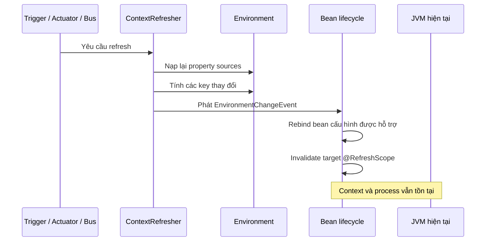
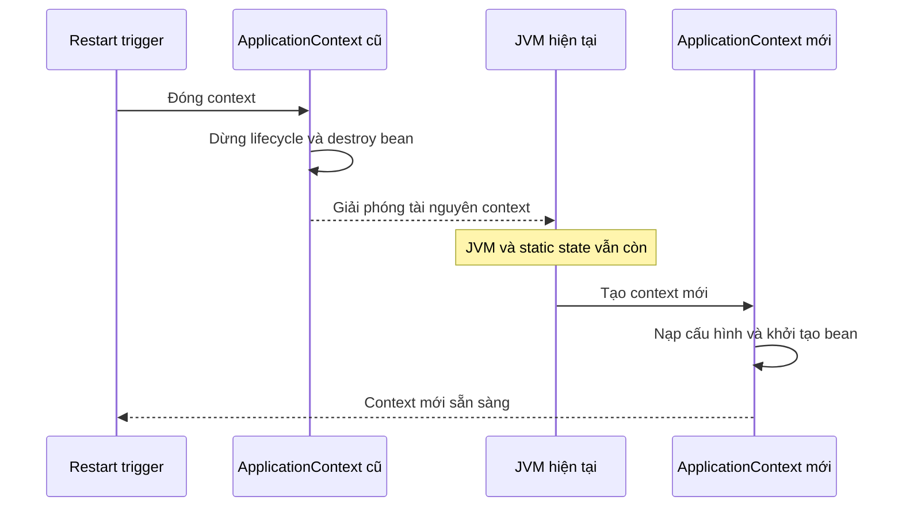
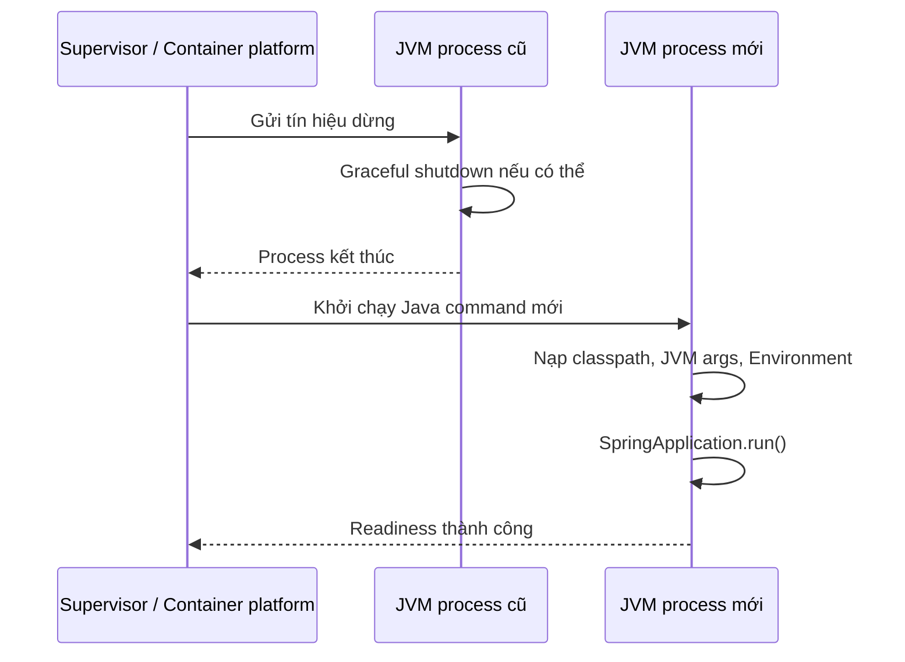

# Phân biệt refresh context, restart tiến trình và restart ApplicationContext

## 1. Vì sao cần phân biệt ba thao tác?

Trong ứng dụng Spring Boot, thay đổi cấu hình không phải lúc nào cũng cần khởi động lại cả dịch vụ. Có trường hợp chỉ cần cập nhật `Environment` và làm mới một số bean; có trường hợp cần đóng rồi tạo lại `ApplicationContext`; cũng có trường hợp phải kết thúc JVM và khởi chạy một tiến trình mới.

Ba thao tác có phạm vi tác động và chi phí khác nhau:

- **Refresh cấu hình theo Spring Cloud Context:** cập nhật nguồn thuộc tính trong `Environment`, phát sự kiện thay đổi, bind lại một số bean cấu hình và làm mới các bean thuộc `@RefreshScope`.
- **Restart ApplicationContext:** đóng context hiện tại, hủy các bean và tài nguyên do context quản lý, sau đó tạo một context mới trong cùng tiến trình JVM.
- **Restart tiến trình:** kết thúc tiến trình Java hiện tại rồi khởi chạy một JVM mới; toàn bộ context, thread, static state và tài nguyên trong process cũ kết thúc.

Cần làm rõ một tên API dễ gây nhầm: `ConfigurableApplicationContext.refresh()` là thao tác lifecycle để khởi tạo context. Nó không đồng nghĩa với `ContextRefresher.refresh()` của Spring Cloud và cũng không phải lệnh restart ứng dụng có thể gọi tùy ý sau khi chạy.

Bài học thuộc chương **Vòng đời ứng dụng** của module **SPRING_CLOUD_CORE**. Module tập trung vào Spring Cloud Commons, Spring Cloud Context, cấu hình ngoài, tương thích Spring Boot, refresh scope, discovery, service registry, giao tiếp dịch vụ và cách kiểm thử/vận hành các abstraction chung.

Sau bài này, người học có thể:

- Phân biệt Spring Cloud refresh, `ApplicationContext.refresh()`, restart context và restart JVM.
- Giải thích dữ liệu nào được cập nhật, bean nào được tạo lại và trạng thái nào vẫn còn sau mỗi thao tác.
- Chọn cách xử lý phù hợp khi thay cấu hình, thay bean/resource, cập nhật class hoặc JVM options.
- Hiểu vai trò của Actuator `/refresh`, `/restart`, Spring Cloud Bus và bộ điều phối container.
- Thiết kế graceful shutdown, readiness và rollout để hạn chế gián đoạn.
- Kiểm thử bằng Environment, bean identity, context lifecycle và process identity.

## 2. Bốn khái niệm thường bị gọi chung là “refresh”

### 2.1. Refresh cấu hình với Spring Cloud Context

Spring Cloud Context cung cấp cơ chế làm mới cấu hình ở runtime. Khi `ContextRefresher.refresh()` được gọi theo integration đang dùng, ứng dụng có thể:

1. Nạp lại property sources theo cơ chế cấu hình hiện tại.
2. So sánh các khóa trước và sau khi refresh.
3. Cập nhật `Environment` và phát `EnvironmentChangeEvent`.
4. Re-bind các bean `@ConfigurationProperties` được hỗ trợ và cập nhật logger level cho `logging.level.*`.
5. Làm mới cache của các bean `@RefreshScope` để chúng được tạo lại ở lần truy cập tiếp theo.

Đây là một **quy trình cập nhật cấu hình trong context đang chạy**. Nó không thay thế application context, không khởi tạo lại JVM và không tải class mới từ một JAR vừa được thay trên đĩa.

Spring Cloud Config Client không mặc định polling Config Server liên tục để phát hiện thay đổi. Hệ thống phải có trigger phù hợp, ví dụ Actuator `/refresh`, một lời gọi nội bộ có kiểm soát hoặc Spring Cloud Bus để thông báo đến nhiều instance.

### 2.2. ConfigurableApplicationContext.refresh()

`refresh()` của Spring Framework là bước lifecycle dùng để đưa một context vào trạng thái sẵn sàng:

- Chuẩn bị context và Environment.
- Tạo hoặc chuẩn bị `BeanFactory`.
- Chạy `BeanFactoryPostProcessor` và `BeanPostProcessor`.
- Đăng ký listener và các infrastructure bean.
- Tạo các singleton không lazy.
- Khởi động các thành phần lifecycle và phát các sự kiện tương ứng.

Spring Boot gọi quy trình refresh trong quá trình `SpringApplication.run(...)`. Đây là bước xây dựng application context ban đầu.

Không nên dùng `ConfigurableApplicationContext.refresh()` như API reload cấu hình runtime. Khả năng refresh lại còn phụ thuộc implementation của context. Ví dụ, `GenericApplicationContext` chỉ cho phép gọi `refresh()` một lần; nhiều context Boot dựa trên kiểu này. Một số implementation khác có thể xây lại `BeanFactory`, nhưng đó không phải cam kết chung cho mọi `ApplicationContext`.

### 2.3. Restart ApplicationContext

Restart context là một quy trình cấp cao hơn:

1. Ngừng tiếp nhận công việc mới hoặc rút instance khỏi traffic nếu kiến trúc yêu cầu.
2. Đóng context hiện tại.
3. Chạy destruction callbacks, dừng các bean lifecycle và giải phóng tài nguyên do context quản lý.
4. Tạo một context mới từ cấu hình khởi chạy.
5. Nạp lại bean definitions, tạo singleton và khởi động các thành phần cần thiết.
6. Kiểm tra readiness rồi đưa instance trở lại phục vụ.

Trong quá trình này, **JVM vẫn là tiến trình cũ**. Static field, thread không do context quản lý, class đã load, system properties và một số tài nguyên cấp process có thể vẫn còn. Vì vậy, restart context không tương đương restart JVM.

Spring Cloud Context có endpoint Actuator `/restart` để đóng và khởi động lại `ApplicationContext`; endpoint này bị tắt theo mặc định. Khả năng và cách sử dụng cần được kiểm tra theo phiên bản Spring Cloud và cấu hình Actuator của ứng dụng.

### 2.4. Restart tiến trình Java

Restart tiến trình có phạm vi rộng nhất:

1. Gửi tín hiệu dừng đến process hoặc yêu cầu bộ điều phối kết thúc container.
2. Ứng dụng có thể thực hiện graceful shutdown nếu nhận được tín hiệu phù hợp và còn thời gian.
3. JVM kết thúc; mọi context trong process đó đóng hoặc bị kết thúc cùng process.
4. Supervisor, systemd, Docker, Kubernetes hoặc nền tảng triển khai khởi chạy process/container mới.
5. JVM mới nạp classpath, system properties, environment variables, command-line arguments và khởi tạo application context từ đầu.

Static state, thread và classloader của JVM cũ không được chuyển sang JVM mới. Đây là lựa chọn cần thiết khi thay JAR/classpath, JVM options, biến môi trường chỉ đọc lúc startup, Java agent hoặc trạng thái cấp process.

## 3. So sánh phạm vi tác động

| Tiêu chí | Spring Cloud refresh | Restart ApplicationContext | Restart JVM/process |
| --- | --- | --- | --- |
| Đối tượng chính | `Environment`, `@ConfigurationProperties`, `@RefreshScope` và listener liên quan | Toàn bộ bean/resource do context quản lý | Toàn bộ process Java và mọi context bên trong |
| PID của JVM | Giữ nguyên | Giữ nguyên | Process mới được khởi chạy; PID có thể được hệ điều hành tái sử dụng về sau |
| ApplicationContext | Giữ context hiện tại | Đóng context cũ, tạo context mới | Tạo context mới trong JVM mới |
| Singleton thông thường | Thường giữ instance; bean cấu hình được hỗ trợ có thể rebind | Được hủy và tạo lại | Được tạo lại trong process mới |
| `@RefreshScope` | Target cache bị invalidation và tạo lại khi truy cập | Bean được tạo lại cùng context mới | Bean được tạo lại cùng JVM mới |
| Static field | Giữ nguyên | Giữ nguyên | Khởi tạo lại theo class trong JVM mới |
| Class/JAR đã load | Không nạp lại class | Không tự nạp class mới nếu vẫn dùng cùng classloader | Nạp lại từ classpath/artifact của process mới |
| JVM options / system properties | Không thay | Không thay | Được lấy lại từ lệnh khởi chạy mới |
| Thời gian và ảnh hưởng | Thường nhỏ nhất, tùy số bean và nguồn config | Lớn hơn, phải dựng lại context | Lớn nhất, phụ thuộc startup và điều phối |
| Trường hợp điển hình | Thay timeout, feature flag hoặc chính sách được thiết kế để refresh | Tái tạo toàn bộ bean/resource khi cần | Deploy phiên bản code mới, đổi JVM args hoặc xử lý trạng thái cấp process |

Bảng trên mô tả hành vi khái quát. Bean cụ thể có thể có giới hạn riêng: ví dụ constructor-bound `@ConfigurationProperties` và Java record không được refresh bằng cơ chế rebind; một số loại resource bị loại khỏi refresh scope mặc định.

## 4. Sơ đồ ba quy trình

### 4.1. Spring Cloud refresh: cùng process, cùng context



### 4.2. Restart ApplicationContext: cùng process, context mới



### 4.3. Restart process: JVM mới



Ba sơ đồ cho thấy điểm khác biệt chính là ranh giới bị thay thế: chỉ target/configuration, toàn bộ context, hay cả process.

## 5. Spring Cloud refresh cập nhật những gì?

### 5.1. EnvironmentChangeEvent và rebind

Khi một `EnvironmentChangeEvent` được phát với danh sách khóa thay đổi, Spring Cloud có thể thực hiện các hành động tiêu chuẩn:

- Re-bind các bean `@ConfigurationProperties` được hỗ trợ.
- Cập nhật logger level tương ứng với `logging.level.*`.
- Cho phép listener tùy chỉnh phản ứng với các khóa đã thay đổi.

Rebind một bean cấu hình có thể cập nhật chính instance hiện có, tức là object không nhất thiết bị thay thế. Trong lúc rebind, các thread khác có thể quan sát trạng thái chưa hoàn tất nếu bean được đọc đồng thời. Nếu cần một snapshot nhất quán khi đọc cấu hình, cân nhắc `@RefreshScope` để thay target qua proxy.

Các object dùng constructor binding, bao gồm Java record được đánh dấu `@ConfigurationProperties`, không thể được refresh bằng cơ chế rebind thông thường. Hãy xác định rõ kiểu binding trước khi cam kết rằng property sẽ cập nhật tại runtime.

### 5.2. RefreshScope

Bean `@RefreshScope` được bọc bởi scoped proxy. Scope lưu target đã khởi tạo trong cache. Khi refresh, target hiện tại bị invalidation; lần gọi tiếp theo tạo target mới và resolve property theo Environment lúc đó.

Ví dụ:

```java
@Configuration(proxyBeanMethods = false)
class ClientConfiguration {

    @Bean
    @RefreshScope
    PartnerClient partnerClient(Environment environment) {
        String baseUrl = environment.getRequiredProperty("partner.base-url");
        return new PartnerClient(baseUrl);
    }
}
```

Thay đổi `partner.base-url` trong Environment chưa tự làm object `PartnerClient` hiện tại đổi field. Quy trình refresh làm target bị thay thế; lần gọi qua proxy tiếp theo mới tạo client với URL mới.

Không phải mọi bean đều tự thuộc refresh scope. Đặt `@RefreshScope` trên lớp `@Configuration` cũng không tự động đặt tất cả bean được khai báo bằng `@Bean` bên trong vào scope này. Ngoài ra, `HikariDataSource` là một loại DataSource không refreshable theo mặc định trong cấu hình Spring Cloud hiện hành; cần xem tài liệu và giới hạn resource trước khi thay đổi chính sách.

### 5.3. Refresh không tự phát hiện thay đổi từ xa

Nếu file trong Config Server hoặc Git repository thay đổi, client không mặc định tự polling liên tục để tải giá trị mới. Một cơ chế trigger phải đưa cấu hình mới vào `Environment`.

Trong một instance, có thể dùng Actuator `/actuator/refresh` nếu endpoint đã được expose và bảo vệ. Trong nhiều instance, Spring Cloud Bus có thể broadcast sự kiện refresh để các instance cập nhật đồng bộ hơn. Nếu chỉ gọi refresh trên một pod, các pod khác không tự nhận cùng thay đổi trừ khi có cơ chế truyền thông báo.

## 6. ConfigurableApplicationContext.refresh() khác gì ContextRefresher?

Hai API cùng có từ “refresh” nhưng mục đích hoàn toàn khác nhau:

| API | Thuộc thành phần | Ý nghĩa |
| --- | --- | --- |
| `ConfigurableApplicationContext.refresh()` | Spring Framework | Khởi tạo hoặc refresh lifecycle của context theo khả năng implementation |
| `ContextRefresher.refresh()` | Spring Cloud Context | Tải lại cấu hình theo integration, cập nhật Environment và phát sự kiện thay đổi |
| `RefreshScope.refresh(name)` | Spring Cloud Context | Invalidate target cache của một bean refresh-scoped |
| `RefreshScope.refreshAll()` | Spring Cloud Context | Invalidate target cache của toàn bộ refresh scope |
| `ApplicationContext.close()` | Spring Framework | Đóng context, dừng lifecycle và hủy singleton/resource do context quản lý |

Ví dụ khởi tạo context thủ công:

```java
try (AnnotationConfigApplicationContext context =
             new AnnotationConfigApplicationContext()) {
    context.register(ApplicationConfiguration.class);
    context.refresh();

    MyService service = context.getBean(MyService.class);
    service.execute();
}
```

Trong ví dụ, `refresh()` được gọi để hoàn tất khởi tạo context sau khi đăng ký cấu hình. Khi khối `try` kết thúc, context được đóng. Đây không phải cách reload một ứng dụng Boot đang chạy.

`GenericApplicationContext` chỉ cho phép gọi `refresh()` một lần. Với ứng dụng Boot thông thường, hãy để `SpringApplication.run()` quản lý lifecycle khởi tạo; nếu cần thay context, thực hiện một quy trình restart context được hỗ trợ hoặc tạo một context mới.

## 7. Restart ApplicationContext trong cùng JVM

### 7.1. Đóng context có nghĩa gì?

`ConfigurableApplicationContext.close()` đóng context hiện tại. Spring dừng các bean triển khai `Lifecycle`/`SmartLifecycle`, gọi destruction callbacks như `@PreDestroy` hoặc `DisposableBean.destroy()`, đóng các tài nguyên do bean quản lý và phát sự kiện đóng context.

Sau khi context đóng:

- Các bean của context không còn được sử dụng như trước.
- Các scoped proxy và singleton thuộc context cũ không tự chuyển sang context mới.
- Các thread/resource tự tạo mà bean không quản lý đúng lifecycle có thể vẫn tồn tại.
- JVM, static field và class đã load vẫn tồn tại nếu process chưa kết thúc.

Không nên đóng context chính từ một request nghiệp vụ bình thường nếu ứng dụng không có quy trình điều phối restart. Đóng context có thể làm server ngừng phục vụ và các dependency không còn sẵn sàng.

### 7.2. Tạo context mới

Một cách khái niệm để restart là giữ cấu hình khởi chạy rồi tạo context mới:

```java
ConfigurableApplicationContext first =
        new SpringApplication(Application.class).run(args);

// Khi có cơ chế quản trị phù hợp:
first.close();

ConfigurableApplicationContext second =
        new SpringApplication(Application.class).run(args);
```

Đây là ví dụ minh họa lifecycle, không phải đoạn code nên gắn trực tiếp vào controller production. Ứng dụng thật cần kiểm soát đồng thời, shutdown timeout, listener, parent context, external resources và trạng thái readiness. Tùy cách cấu hình `SpringApplication`, mỗi lần run có thể tạo Environment/context khác; không giả định mọi state ngoài context tự được chia sẻ hay tự cập nhật.

Spring Cloud Commons cung cấp Actuator `/restart` để đóng và restart `ApplicationContext`; endpoint này bị disabled mặc định. Khi sử dụng, cần kiểm tra khả năng tương thích theo phiên bản, cấu hình endpoint, quyền truy cập và cách restart được triển khai trong ứng dụng.

### 7.3. Khi nào restart context hữu ích?

Restart context có thể phù hợp khi cần tạo lại toàn bộ bean graph trong khi vẫn giữ JVM:

- Một nhóm bean singleton không được thiết kế để refresh riêng lẻ.
- Một số resource được tạo ở cấp context cần được đóng và mở lại.
- Cần nạp lại cấu hình khởi tạo và chạy lại toàn bộ bean lifecycle.
- Ứng dụng được triển khai với một cơ chế restart context có giám sát và đã kiểm thử.

Tuy nhiên, nếu thay code/JAR, Java agent, JVM options, static state hoặc classloader, restart context thường không đủ. Class cũ vẫn nằm trong JVM và không tự được thay bằng bytecode mới.

## 8. Restart tiến trình và graceful shutdown

### 8.1. Ranh giới process

Restart process thường do môi trường chạy quyết định, chẳng hạn:

- Kubernetes thay Pod trong rollout hoặc restart container.
- Docker restart container theo policy.
- systemd hoặc một process supervisor khởi chạy lại service.
- Một script deploy dừng Java process cũ và chạy artifact mới.

Khi process mới khởi động, nó nhận lại classpath, environment variables, JVM arguments và command-line arguments từ cấu hình triển khai. Vì vậy, đây là cách phù hợp để áp dụng thay đổi thuộc về JVM hoặc artifact.

### 8.2. Graceful shutdown

Khi nhận tín hiệu dừng phù hợp, Spring Boot đóng application context. Với embedded web server được hỗ trợ, graceful shutdown dừng nhận request mới và dành một khoảng thời gian cho request đang chạy hoàn tất. Có thể cấu hình timeout theo shutdown phase:

```yaml
server:
  shutdown: graceful

spring:
  lifecycle:
    timeout-per-shutdown-phase: 20s
```

Giá trị 20 giây chỉ là ví dụ; phải chọn theo thời gian xử lý request, timeout upstream và termination grace period của nền tảng. Nếu process bị kill cưỡng bức hoặc hết thời gian grace period, shutdown hooks và destruction callbacks có thể không hoàn tất.

### 8.3. Phối hợp với readiness và service discovery

Trong hệ thống nhiều instance, restart process nên phối hợp với traffic routing:

1. Đưa instance vào trạng thái không nhận traffic mới hoặc rút khỏi tập endpoint phù hợp.
2. Chờ propagation đến load balancer, service registry hoặc proxy theo cơ chế triển khai.
3. Cho request đang chạy hoàn tất trong shutdown grace period.
4. Đóng context và kết thúc JVM.
5. Khởi chạy instance mới, kiểm tra readiness và chỉ đưa vào traffic khi sẵn sàng.

Không giả định `ApplicationContext.close()` tự deregister tức thời khỏi mọi service registry. Cần kiểm tra integration discovery và hành vi của nền tảng triển khai.

## 9. Chọn thao tác theo loại thay đổi

| Thay đổi | Cách xử lý thường phù hợp | Lý do |
| --- | --- | --- |
| Timeout hoặc feature flag được thiết kế hỗ trợ runtime update | Spring Cloud refresh | Cập nhật Environment/rebind hoặc refresh bean có liên quan |
| Giá trị của bean `@RefreshScope` thay đổi | Refresh sau khi Environment đã có giá trị mới | Target mới đọc cấu hình hiện hành |
| Bean singleton thường giữ resource cần tạo lại | Đánh giá refresh scope hoặc restart context | Rebind đơn thuần không thay thế object |
| Thay đổi nhiều bean không được thiết kế refresh riêng | Restart ApplicationContext nếu ứng dụng hỗ trợ an toàn | Chạy lại toàn bộ bean lifecycle trong JVM hiện tại |
| Thay file JAR hoặc class | Restart process | JVM hiện tại đã load class cũ |
| Thay Java system properties hoặc JVM options | Restart process | Các giá trị này được thiết lập lúc khởi chạy JVM |
| Thay biến môi trường container | Tạo process/container mới | Process hiện tại không tự nhận environment mới từ orchestrator |
| Cần xóa static state hoặc thread không thuộc context | Restart process | Restart context không reset trạng thái cấp JVM |
| Thay cấu trúc bean definition hoặc dependency classpath | Restart process thường là lựa chọn rõ ràng nhất | Cần xây dựng lại từ artifact/classpath mới |

## 10. Ví dụ thực tế: thay endpoint đối tác

Giả sử `order-service` gọi `partner-api` qua một bean `PartnerClient`. Endpoint ban đầu là `https://partner-v1.example`.

Nếu `PartnerClient` được đánh dấu `@RefreshScope`, có thể thực hiện:

1. Đưa endpoint mới vào nguồn cấu hình.
2. Gọi cơ chế refresh để Environment nhận `partner.base-url` mới.
3. Refresh scope invalidates target `PartnerClient`.
4. Request tiếp theo đi qua proxy và tạo target mới với endpoint mới.

JVM, application context và các bean singleton không liên quan vẫn tiếp tục hoạt động.

Nếu `PartnerClient` không thuộc refresh scope và giữ URL trong field final được inject qua constructor, chỉ thay Environment sẽ không thay object hiện tại. Có thể thiết kế lại bean để hỗ trợ refresh, hoặc restart context nếu cần tái tạo toàn bộ dependency graph.

Nếu phiên bản thư viện HTTP client mới được đóng gói trong JAR và cần áp dụng, restart context vẫn không nạp class mới. Cần deploy artifact mới và restart process.

## 11. Kiểm thử và quan sát ba mức lifecycle

Không nên chỉ kiểm tra HTTP endpoint vẫn trả 200. Cần xác minh đúng ranh giới đã được thay đổi.

### 11.1. Tín hiệu cần ghi nhận

| Tín hiệu | Cách quan sát | Ý nghĩa |
| --- | --- | --- |
| Process identity | PID, process start time hoặc JVM uptime | Xác định JVM có mới hay không |
| Context lifecycle | `ContextRefreshedEvent`, `ContextClosedEvent`, startup date | Theo dõi context được tạo/đóng |
| Bean identity | `System.identityHashCode(bean)` trong test hoặc ID do bean sinh | Xác nhận target/bean instance có thay đổi |
| Environment | `Environment.getProperty(...)` | Xác nhận giá trị cấu hình hiện hành |
| Refresh scope | Log/metric và lỗi khởi tạo target sau refresh | Xác nhận target bị invalidation và tạo lại |
| Traffic/readiness | Health/readiness, endpoint và lỗi request | Xác nhận instance đã sẵn sàng phục vụ |
| Shutdown | Log `SmartLifecycle`, destruction callbacks và process exit | Xác nhận cleanup có hoàn tất |

PID có thể được hệ điều hành tái sử dụng sau này; khi kiểm thử restart process, nên kết hợp PID với process start time hoặc JVM uptime. Không dùng riêng context ID vì ứng dụng có thể đặt lại cùng một ID ở lần khởi tạo mới.

### 11.2. Ma trận kiểm thử

| Kịch bản | Kết quả cần xác nhận |
| --- | --- |
| Gọi Spring Cloud refresh | Cùng PID, cùng ApplicationContext; Environment đổi; bean cấu hình được hỗ trợ rebind; refresh-scoped target được tạo lại khi truy cập |
| Chỉ gọi `RefreshScope.refreshAll()` | Cùng PID/context và Environment; chỉ target refresh scope bị invalidation |
| Gọi `ApplicationContext.close()` rồi tạo context mới | Cùng PID; context cũ phát close và context mới chạy startup; singleton thuộc context mới có identity khác |
| Gọi `ConfigurableApplicationContext.refresh()` lần nữa trên `GenericApplicationContext` | Phát sinh lỗi vì implementation chỉ cho phép refresh một lần |
| Restart process qua supervisor | Process start time/PID mới; context và singleton được tạo lại; static state của JVM cũ không còn |
| Shutdown bị timeout hoặc kill cưỡng bức | Có thể thiếu destruction callbacks; cần kiểm tra resource bên ngoài và phục hồi của nền tảng |

### 11.3. Kiểm thử Spring Cloud refresh

Một integration test có thể:

1. Tạo `MapPropertySource` trước khi context hoàn tất startup.
2. Đọc giá trị cấu hình và ghi nhận identity của refresh-scoped bean.
3. Thay giá trị trong map.
4. Gọi `ContextRefresher.refresh()` hoặc kiểm tra endpoint/trigger đang dùng.
5. Xác nhận Environment trả giá trị mới.
6. Gọi qua scoped proxy và xác nhận target mới nhận giá trị mới.
7. Xác nhận PID và context không bị thay thế.

Test này cần phân biệt bean `@ConfigurationProperties` rebind tại chỗ với bean `@RefreshScope` được tạo target mới.

### 11.4. Kiểm thử restart context và process

- Với context restart, dùng một lifecycle coordinator hoặc integration endpoint đã bật trong môi trường test. Theo dõi close/start event và xác nhận process identity không đổi.
- Với process restart, để supervisor hoặc test harness khởi chạy một process mới. Ghi process start time, kiểm tra startup log, readiness và trạng thái static.
- Không mô phỏng process restart chỉ bằng cách gọi `context.close()`; thao tác đó không kết thúc JVM.

## 12. Lỗi và ngộ nhận thường gặp

| Triệu chứng / ngộ nhận | Nguyên nhân | Cách xử lý |
| --- | --- | --- |
| Gọi `/actuator/refresh` nhưng class Java mới không được nạp | Refresh chỉ xử lý cấu hình và bean theo cơ chế hỗ trợ | Deploy artifact và restart process |
| Gọi `ApplicationContext.refresh()` để reload property | Nhầm lifecycle initialization với Spring Cloud configuration refresh | Dùng ContextRefresher hoặc cơ chế refresh phù hợp |
| Refresh thành công nhưng bean vẫn dùng giá trị cũ | Bean singleton đã giữ giá trị ở thời điểm khởi tạo | Rebind phù hợp hoặc đánh dấu bean cần tái tạo bằng `@RefreshScope` |
| `@ConfigurationProperties` record không đổi sau refresh | Constructor binding không hỗ trợ rebind theo cơ chế này | Thiết kế kiểu cấu hình phù hợp hoặc restart context/process |
| Restart context nhưng static field vẫn giữ giá trị cũ | Static state thuộc JVM/classloader, không thuộc context | Restart process nếu cần reset |
| Đóng context nhưng process vẫn chạy | Thread, executor hoặc resource không do context quản lý vẫn còn | Quản lý lifecycle đầy đủ hoặc kết thúc JVM qua supervisor |
| `/actuator/restart` không có mặt | Endpoint bị disabled mặc định hoặc chưa expose | Kiểm tra endpoint enablement/exposure và phiên bản |
| Một pod refresh nhưng pod khác không đổi | Refresh là thao tác cục bộ nếu không có cơ chế broadcast | Dùng Spring Cloud Bus hoặc trigger tất cả instance |
| Rollout làm rơi request | Không drain traffic hoặc grace period quá ngắn | Phối hợp readiness, discovery và graceful shutdown |
| Refresh target mới lỗi nhưng thao tác invalidation đã thành công | Target chỉ được tạo ở lần gọi proxy tiếp theo | Theo dõi lỗi lazy initialization và refresh health indicator |

## 13. Checklist chọn và vận hành lifecycle

Trước khi thực hiện thay đổi, hãy trả lời:

1. Thay đổi chỉ là property runtime hay có thay đổi class/JAR/JVM options?
2. Environment đã nhận cấu hình mới chưa?
3. Bean tiêu thụ cấu hình là `@ConfigurationProperties`, singleton thông thường hay `@RefreshScope`?
4. Có cần tạo lại một target, toàn bộ bean graph hay toàn JVM?
5. Các bean có destruction callbacks và resource lifecycle rõ ràng không?
6. Có thread hoặc static state nằm ngoài ApplicationContext không?
7. Có nhiều instance cần nhận cùng sự kiện refresh không?
8. Readiness và discovery có được cập nhật trước khi dừng instance không?
9. Graceful shutdown timeout có đủ cho request đang xử lý không?
10. Actuator refresh/restart có được expose và bảo vệ đúng cách không?
11. Có kiểm thử xác nhận PID, context identity, bean identity và giá trị Environment không?
12. Có phương án rollback nếu context mới hoặc process mới không đạt readiness không?

## 14. Tài liệu tham khảo chính thức

- [Spring Cloud Context — Application Context Services](https://docs.spring.io/spring-cloud-commons/reference/spring-cloud-commons/application-context-services.html): EnvironmentChangeEvent, rebind, refresh scope, Actuator refresh và restart.
- [Spring Framework — GenericApplicationContext Javadoc](https://docs.spring.io/spring-framework/docs/current/javadoc-api/org/springframework/context/support/GenericApplicationContext.html): giới hạn refresh chỉ được gọi một lần trên GenericApplicationContext.
- [Spring Framework — ApplicationContext lifecycle](https://docs.spring.io/spring-framework/reference/core/beans/factory-nature.html): lifecycle, initialization và destruction của bean.
- [Spring Boot — Graceful Shutdown](https://docs.spring.io/spring-boot/reference/web/graceful-shutdown.html): dừng nhận request mới, thời gian chờ request đang chạy và cấu hình shutdown phase.
- [Spring Boot — Application Events and Listeners](https://docs.spring.io/spring-boot/reference/features/spring-application.html): sự kiện trong quá trình khởi tạo ứng dụng.

**Ghi nhớ:** Spring Cloud refresh cập nhật cấu hình và làm mới các bean được hỗ trợ trong context hiện tại; restart ApplicationContext hủy rồi tạo lại bean graph trong cùng JVM; restart tiến trình kết thúc JVM cũ và khởi chạy JVM mới. `ConfigurableApplicationContext.refresh()` là thao tác lifecycle lúc khởi tạo context, không phải một cách thay thế cho ba quy trình trên.
