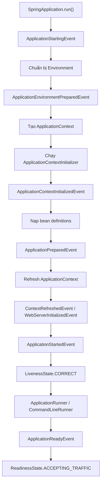

# Các sự kiện khởi động và vị trí listener tùy biến

Khi một ứng dụng Spring Boot khởi động, nhiều thành phần phải hoàn tất theo một trình tự: chuẩn bị `Environment`, tạo `ApplicationContext`, nạp bean definition, refresh container, mở web server, chạy các tác vụ khởi động và cuối cùng chuyển ứng dụng sang trạng thái sẵn sàng nhận traffic. Spring phát các **application event** tại những mốc quan trọng để thành phần khác có thể quan sát hoặc phản ứng.

Với **SPRING_CLOUD_CORE**, các sự kiện này đặc biệt hữu ích khi tích hợp cấu hình bên ngoài, discovery, service registry, HTTP client, refresh scope và các abstraction chung. Tuy nhiên, vị trí đăng ký listener quyết định listener có nhận được event hay không: event phát trước khi context được tạo không thể được bắt bởi một bean `@EventListener` chỉ xuất hiện sau đó.

Bài học thuộc chương **Vòng đời ứng dụng**, tập trung vào thứ tự sự kiện của `SpringApplication`, các mốc của `ApplicationContext`, cách đăng ký listener sớm và muộn, cùng cách chọn extension point phù hợp cho từng công việc.

## 1. Mục tiêu học tập

Sau bài này, bạn có thể:

- Mô tả các mốc sự kiện chính trong vòng đời `SpringApplication`.
- Phân biệt event trước khi tạo context, trước refresh và sau refresh.
- Chọn giữa `ApplicationListener`, `@EventListener`, `SpringApplication.addListeners` và `SpringApplicationRunListener`.
- Đăng ký listener sớm bằng `META-INF/spring.factories`.
- Hiểu vai trò của `ApplicationContextInitializer`, `ApplicationRunner`, `CommandLineRunner` và `SmartLifecycle`.
- Giải thích event propagation trong context hierarchy và cách tránh xử lý trùng.
- Hiểu listener đồng bộ có thể ảnh hưởng thời gian startup như thế nào.
- Liên hệ sự kiện khởi động với bootstrap/configuration loading trong Spring Cloud.
- Kiểm thử thứ tự event và hành vi listener trong ứng dụng.

## 2. Bức tranh tổng quát về vòng đời SpringApplication

`SpringApplication.run(...)` điều phối việc khởi động ứng dụng. Trong quá trình này, Spring Boot phát các `SpringApplicationEvent` và một số event của Spring Framework.



Sơ đồ mô tả luồng khởi động thành công. `ApplicationFailedEvent` là nhánh phát sinh khi có lỗi trong quá trình startup, không phải một bước tiếp theo của luồng thành công. `ContextClosedEvent` xuất hiện khi context được đóng, thường trong quá trình shutdown.

### 2.1. Bảng thứ tự sự kiện chính

| Thứ tự | Event | Thời điểm | Có thể dùng bean của context? |
| ---: | --- | --- | --- |
| 1 | `ApplicationStartingEvent` | Bắt đầu `run`, sau khi listener và initializer được đăng ký, trước các xử lý startup khác | Chưa có context |
| 2 | `ApplicationEnvironmentPreparedEvent` | Environment đã sẵn sàng, context chưa được tạo | Chưa có context |
| 3 | `ApplicationContextInitializedEvent` | Context đã được tạo và initializer đã chạy, trước khi nạp bean definitions | Context có nhưng bean definitions chưa được nạp |
| 4 | `ApplicationPreparedEvent` | Bean definitions đã được nạp, ngay trước khi refresh | Context chưa refresh |
| 5 | `ContextRefreshedEvent` | Context đã refresh | Có |
| 6 | `WebServerInitializedEvent` | Web server đã sẵn sàng; có thể là servlet hoặc reactive variant | Có |
| 7 | `ApplicationStartedEvent` | Context đã refresh, trước runners | Có |
| 8 | `AvailabilityChangeEvent` với `LivenessState.CORRECT` | Ngay sau `ApplicationStartedEvent` | Có |
| 9 | `ApplicationReadyEvent` | Sau khi mọi application/command-line runner hoàn tất | Có |
| 10 | `AvailabilityChangeEvent` với `ReadinessState.ACCEPTING_TRAFFIC` | Ngay sau `ApplicationReadyEvent` | Có |

`ContextRefreshedEvent` và `WebServerInitializedEvent` đều xuất hiện sau `ApplicationPreparedEvent` và trước `ApplicationStartedEvent`; không nên dựa vào một thứ tự cố định giữa hai event này cho mọi loại ứng dụng.

`ApplicationFailedEvent` được phát khi startup thất bại. Nếu lỗi xảy ra rất sớm, context truyền vào event có thể chưa tồn tại (`null`).

## 3. Hiểu từng mốc quan trọng

### 3.1. ApplicationStartingEvent

Event này được phát ngay khi `SpringApplication` bắt đầu chạy, sau khi listener và initializer đã được đăng ký nhưng trước khi Environment hoặc ApplicationContext sẵn sàng.

Có thể dùng cho:

- Ghi nhận dấu mốc startup rất sớm.
- Khởi tạo bộ quan sát độc lập với Spring bean.
- Thu thập metadata tiến trình không phụ thuộc Environment.

Không nên dùng để lấy `Environment`, gọi `getBean()` hoặc truy cập cấu hình đã được nạp vào context, vì các thành phần đó chưa sẵn sàng.

### 3.2. ApplicationEnvironmentPreparedEvent

Event này được phát sau khi Environment dùng cho ứng dụng đã được chuẩn bị, nhưng trước khi ApplicationContext được tạo.

Listener có thể:

- Đọc profile và property đã có.
- Bổ sung hoặc điều chỉnh `PropertySource` nếu đúng trách nhiệm.
- Ghi nhận cấu hình runtime ở mức không nhạy cảm.
- Phối hợp với cơ chế nạp cấu hình sớm.

Trong Spring Cloud legacy bootstrap, `BootstrapApplicationListener` tham gia ở giai đoạn Environment prepared để tạo bootstrap context và chuẩn bị cấu hình bootstrap khi cơ chế đó được bật. Với Config Data hiện đại, Spring Boot xử lý `spring.config.import` trong quy trình Config Data; không nên mặc định mọi ứng dụng Spring Cloud đều cần bootstrap context.

### 3.3. ApplicationContextInitializedEvent

Event được phát khi ApplicationContext đã được tạo và các `ApplicationContextInitializer` đã được gọi, nhưng bean definitions chưa được nạp.

Đây là mốc hữu ích để quan sát kết quả của initializer. Tuy nhiên, không nên giả định các bean nghiệp vụ đã tồn tại. Nếu cần thêm property source hoặc tùy chỉnh context, thường thực hiện trong initializer trước event này.

### 3.4. ApplicationPreparedEvent

Event này được phát sau khi các bean definitions đã được nạp nhưng ngay trước khi context refresh bắt đầu.

Có thể dùng để quan sát trạng thái cấu hình và nguồn bean definitions. Đây vẫn là thời điểm trước khi các singleton eager được tạo đầy đủ. Tránh gọi bean nghiệp vụ chỉ để kiểm tra vì thao tác đó có thể kích hoạt khởi tạo sớm ngoài dự kiến.

### 3.5. ContextRefreshedEvent

`ContextRefreshedEvent` thuộc Spring Framework, được phát khi một `ApplicationContext` hoàn tất refresh. Trong ứng dụng Boot thông thường, đây là dấu mốc container đã hoàn tất quá trình refresh.

Có thể dùng để:

- Ghi nhận context đã refresh.
- Bắt đầu một tác vụ phụ thuộc vào bean đã được tạo.
- Quan sát trạng thái context trong các ứng dụng có context hierarchy.

Nếu cần thực hiện tác vụ startup có thể làm ứng dụng chưa sẵn sàng nhận traffic, `ApplicationRunner` hoặc `CommandLineRunner` thường thể hiện ý định rõ hơn và có vị trí rõ trong thứ tự trước `ApplicationReadyEvent`.

### 3.6. WebServerInitializedEvent

Với ứng dụng web, Spring Boot phát event khi web server đã sẵn sàng. Các kiểu cụ thể gồm:

- `ServletWebServerInitializedEvent`.
- `ReactiveWebServerInitializedEvent`.

Event có thể cung cấp thông tin về web server và cổng thực tế. Điều này hữu ích khi dùng cổng ngẫu nhiên trong test hoặc khi cần đăng ký metadata sau khi server đã mở.

Không nên dùng event này làm bằng chứng duy nhất rằng mọi dependency ngoài như database, registry hoặc Config Server đều sẵn sàng.

### 3.7. ApplicationStartedEvent và ApplicationReadyEvent

Hai event này khác nhau ở vị trí của runners:

| Event | Ý nghĩa |
| --- | --- |
| `ApplicationStartedEvent` | Context đã refresh, ứng dụng đã bắt đầu; runners chưa chạy |
| `ApplicationReadyEvent` | Tất cả `ApplicationRunner` và `CommandLineRunner` đã hoàn tất; ứng dụng được xem là sẵn sàng |

Nếu cần khởi tạo cache, kiểm tra dữ liệu ban đầu hoặc thực hiện tác vụ một lần trước khi readiness chuyển sang accepting traffic, hãy cân nhắc runner thay vì đặt công việc dài trong `ApplicationReadyEvent`.

### 3.8. AvailabilityChangeEvent

Spring Boot phát availability event để biểu diễn trạng thái vận hành:

- `LivenessState.CORRECT`: ứng dụng đã qua mốc startup và được xem là còn sống.
- `ReadinessState.ACCEPTING_TRAFFIC`: ứng dụng đã sẵn sàng nhận traffic.

Liveness và readiness là hai tín hiệu khác nhau. Một ứng dụng có thể còn sống nhưng chưa sẵn sàng phục vụ request. Hệ thống điều phối như Kubernetes có thể sử dụng health indicator tương ứng để quyết định restart hoặc gửi traffic.

### 3.9. ApplicationFailedEvent và ContextClosedEvent

`ApplicationFailedEvent` được phát khi quá trình khởi động thất bại. Listener nên chịu được trường hợp context chưa được tạo và không giả định mọi bean đều có mặt.

`ContextClosedEvent` được phát khi ApplicationContext đóng. Có thể dùng để quan sát shutdown hoặc giải phóng tài nguyên phụ thuộc vào context. Với tài nguyên do Spring quản lý, ưu tiên lifecycle callback như `@PreDestroy`, `DisposableBean` hoặc `SmartLifecycle` khi phù hợp.

## 4. Đăng ký listener sớm và listener trong ApplicationContext

Đây là quyết định quan trọng nhất khi viết listener tùy biến.

### 4.1. Event sớm không thể bắt bằng @Bean

`ApplicationStartingEvent` và `ApplicationEnvironmentPreparedEvent` được phát trước khi ApplicationContext được tạo. Vì vậy, một bean được khai báo bằng `@Component` hoặc `@Bean` không thể nhận các event này: bean chưa tồn tại.

Với event sớm, đăng ký listener trực tiếp trước khi gọi `run()`:

```java
public static void main(String[] args) {
    SpringApplication application =
            new SpringApplication(CheckoutApplication.class);

    application.addListeners(new EarlyStartupListener());
    application.run(args);
}
```

Hoặc đăng ký listener tự động qua `META-INF/spring.factories`:

```properties
org.springframework.context.ApplicationListener=\
com.example.checkout.lifecycle.EarlyStartupListener
```

Đây là key dành cho `ApplicationListener`, không phải key `BootstrapConfiguration`. Hai cơ chế có mục đích khác nhau.

### 4.2. Listener triển khai ApplicationListener

Ví dụ bắt Environment đã chuẩn bị:

```java
package com.example.checkout.lifecycle;

import org.springframework.boot.context.event.ApplicationEnvironmentPreparedEvent;
import org.springframework.context.ApplicationListener;

public class EarlyStartupListener
        implements ApplicationListener<ApplicationEnvironmentPreparedEvent> {

    @Override
    public void onApplicationEvent(ApplicationEnvironmentPreparedEvent event) {
        String[] profiles = event.getEnvironment().getActiveProfiles();
        // Record safe startup metadata or inspect required properties.
    }
}
```

Listener nhận trực tiếp event đúng kiểu, vì vậy không cần ép kiểu từ `ApplicationEvent`. Tránh log toàn bộ Environment vì có thể chứa token, mật khẩu hoặc endpoint nhạy cảm.

### 4.3. Listener bean cho event sau khi context tồn tại

Với các event sau khi bean được đăng ký, có thể dùng `ApplicationListener` như một bean:

```java
@Component
public class ReadyListener
        implements ApplicationListener<ApplicationReadyEvent> {

    @Override
    public void onApplicationEvent(ApplicationReadyEvent event) {
        // Record readiness or publish a lightweight metric.
    }
}
```

Hoặc dùng `@EventListener`:

```java
@Component
public class ApplicationLifecycleEvents {

    @EventListener
    public void onStarted(ApplicationStartedEvent event) {
        // Context refreshed; runners have not executed yet.
    }

    @EventListener
    public void onReady(ApplicationReadyEvent event) {
        // Runners have completed.
    }
}
```

`@EventListener` thường gọn hơn khi một bean cần xử lý nhiều event. Spring đăng ký các method này khi xử lý bean listener trong quá trình context refresh.

### 4.4. Khi nào dùng SpringApplicationRunListener?

`SpringApplicationRunListener` là extension point cấp thấp cho toàn bộ quá trình `SpringApplication.run()`. Nó được nạp qua `SpringFactoriesLoader` và cần constructor public nhận `SpringApplication` cùng `String[] args`.

Một implementation có thể nhận các callback:

- `starting(...)`.
- `environmentPrepared(...)`.
- `contextPrepared(...)`.
- `contextLoaded(...)`.
- `started(...)`.
- `ready(...)`.
- `failed(...)`.

Đăng ký trong `META-INF/spring.factories` bằng key:

```properties
org.springframework.boot.SpringApplicationRunListener=\
com.example.checkout.lifecycle.CheckoutRunListener
```

Extension point này phù hợp cho thư viện hoặc tích hợp cần quan sát nhiều mốc của run lifecycle. Với logic ứng dụng thông thường, `ApplicationListener` và `@EventListener` dễ hiểu và dễ kiểm thử hơn.

## 5. Phân biệt thứ tự event và thứ tự listener

Có hai loại thứ tự riêng:

1. **Thứ tự event:** Spring Boot quyết định mốc nào được phát trước/sau trong quá trình startup.
2. **Thứ tự listener:** khi một event được phát, nhiều listener có thể cùng nhận event đó; `Ordered` hoặc `@Order` có thể điều khiển thứ tự gọi giữa các listener.

`@Order` không thay đổi thời điểm `ApplicationReadyEvent` được phát và cũng không khiến listener nhận được event đã phát trước khi listener được đăng ký.

Ví dụ:

```java
@Component
public class StartupListeners {

    @EventListener
    @Order(10)
    public void first(ApplicationReadyEvent event) {
        // Runs before other listeners with a larger order value.
    }

    @EventListener
    @Order(20)
    public void second(ApplicationReadyEvent event) {
        // Runs after the listener above.
    }
}
```

Giá trị order nhỏ hơn được ưu tiên trước. Nếu nhiều listener cùng order, không nên dựa vào thứ tự tình cờ của component scan hoặc classpath.

## 6. Listener mặc định chạy đồng bộ

Spring application event thường được dispatch đồng bộ bởi event multicaster mặc định. Listener chạy trong cùng luồng phát event; nếu listener mất nhiều giây, quá trình startup hoặc thao tác phát event có thể bị kéo dài tương ứng.

Ví dụ không nên làm trong listener startup:

```java
@EventListener
public void onReady(ApplicationReadyEvent event) {
    // Avoid blocking here for a long-running remote migration.
}
```

Nếu công việc phải hoàn tất trước khi ứng dụng được xem là ready, hãy dùng `ApplicationRunner` hoặc `CommandLineRunner`. Spring Boot chạy các runner sau `ApplicationStartedEvent` và trước `ApplicationReadyEvent`.

Nếu công việc không nằm trên critical path, có thể chuyển sang executor/background worker có quản lý vòng đời, nhưng cần xử lý lỗi, shutdown và trạng thái sẵn sàng rõ ràng. Chỉ thêm `@Async` không tự giải quyết các vấn đề đó; nó còn làm thay đổi thứ tự hoàn tất và cách quan sát lỗi.

### 6.1. ApplicationRunner và CommandLineRunner

```java
@Component
public class StartupChecks implements ApplicationRunner {

    @Override
    public void run(ApplicationArguments args) {
        // Validate initial data or warm up required application state.
    }
}
```

Runner thích hợp cho công việc cần truy cập bean đã được tạo và phải hoàn tất trước khi ứng dụng chuyển sang readiness accepting traffic.

### 6.2. SmartLifecycle cho thành phần có start/stop

Nếu một thành phần cần được khởi động và dừng theo lifecycle của context, `SmartLifecycle` có thể phù hợp hơn event listener. Nó hỗ trợ thứ tự phase, start/stop và callback khi dừng.

Ví dụ use case:

- Consumer message cần bắt đầu sau khi dependency đã sẵn sàng.
- Background scheduler cần dừng trước khi connection bị đóng.
- Thành phần quản lý tài nguyên cần tham gia graceful shutdown.

Không dùng `ContextRefreshedEvent` thay cho lifecycle contract nếu thành phần thực sự cần quản lý start/stop.

## 7. Context hierarchy và event propagation

Một ứng dụng có thể có parent/child ApplicationContext, ví dụ khi dùng context phân cấp hoặc một số tích hợp theo tên dịch vụ.

Spring event được phát trong child context có thể được chuyển tiếp tới listener ở các ancestor context. Vì vậy, một listener ở parent có thể nhận nhiều event cùng kiểu nếu có nhiều child context.

Nếu listener chỉ muốn xử lý event của context mà chính nó thuộc về, hãy so sánh context của event với context được inject:

```java
@Component
public class ContextReadyListener implements ApplicationListener<ContextRefreshedEvent>,
        ApplicationContextAware {

    private ApplicationContext ownContext;

    @Override
    public void setApplicationContext(ApplicationContext applicationContext) {
        this.ownContext = applicationContext;
    }

    @Override
    public void onApplicationEvent(ContextRefreshedEvent event) {
        if (event.getApplicationContext() != ownContext) {
            return;
        }
        // Handle refresh for this exact context only.
    }
}
```

Kiểm tra context giúp tránh chạy cùng một công việc nhiều lần khi ứng dụng có hierarchy. Đặc biệt, listener đăng ký ở parent không nên giả định mọi event nó nhận đều thuộc chính parent.

## 8. Liên hệ với Spring Cloud

Spring Cloud sử dụng một số mốc khởi động để chuẩn bị cấu hình và tích hợp nền tảng.

| Thành phần Spring Cloud | Mốc/lifecycle liên quan | Vai trò |
| --- | --- | --- |
| Legacy `BootstrapApplicationListener` | `ApplicationEnvironmentPreparedEvent` | Tạo bootstrap context khi legacy bootstrap được bật |
| Spring Boot Config Data | Trước khi ApplicationContext được tạo/refresh | Nạp `spring.config.import` và các nguồn Config Data |
| `ApplicationContextInitializer` | Sau khi context được tạo, trước khi bean definitions được nạp/refresh | Tùy chỉnh Environment hoặc context sớm |
| Discovery client auto-configuration | Trong quá trình tạo/refresh context | Đăng ký bean discovery khi điều kiện phù hợp |
| Spring Cloud LoadBalancer | Trong quá trình tạo bean | Cung cấp các thành phần chọn instance và tích hợp client |
| Spring Cloud Context refresh | Khi refresh được kích hoạt sau startup | Cập nhật Environment, phát event và làm mới scope theo cơ chế tương ứng |

### 8.1. Legacy bootstrap và Config Data

Trong các ứng dụng dùng legacy bootstrap, `BootstrapApplicationListener` phản ứng với giai đoạn Environment prepared để tạo bootstrap context. Cơ chế này gắn với `spring-cloud-starter-bootstrap` hoặc cờ bootstrap được bật đủ sớm.

Trong ứng dụng hiện đại dùng:

```yaml
spring:
  config:
    import: optional:configserver:http://config-server:8888
```

Spring Boot xử lý nguồn Config Server qua Config Data API. Không nên mặc định cần `bootstrap.yml` hoặc một bootstrap context cho mọi Config Client.

### 8.2. Event startup không thay thế health check

`ApplicationReadyEvent` báo rằng quá trình startup và runners đã hoàn tất theo lifecycle của Spring Boot. Nó không bảo đảm mọi downstream service, registry hoặc message broker sẽ luôn sẵn sàng về sau.

Với hệ thống phân tán, cần kết hợp:

- Startup validation cho cấu hình bắt buộc.
- Readiness/liveness health indicator phù hợp.
- Retry và timeout cho giao tiếp dịch vụ.
- Discovery và service registry theo provider.
- Metrics/log để theo dõi lỗi sau khi ứng dụng đã ready.

## 9. Phát event tùy chỉnh

Ngoài các event có sẵn, ứng dụng có thể phát event domain riêng để các thành phần tách rời phản ứng.

Ví dụ định nghĩa event:

```java
public record TenantCatalogLoadedEvent(
        String tenantId,
        int loadedEntries) {
}
```

Phát event:

```java
@Service
public class TenantCatalogLoader {

    private final ApplicationEventPublisher publisher;

    public TenantCatalogLoader(ApplicationEventPublisher publisher) {
        this.publisher = publisher;
    }

    public void publishLoaded(String tenantId, int count) {
        publisher.publishEvent(
                new TenantCatalogLoadedEvent(tenantId, count));
    }
}
```

Lắng nghe:

```java
@Component
public class TenantCatalogMetrics {

    @EventListener
    public void onCatalogLoaded(TenantCatalogLoadedEvent event) {
        // Update metrics for the tenant catalog load.
    }
}
```

Spring hỗ trợ publish object event thông qua `ApplicationEventPublisher`; không bắt buộc mọi event tùy chỉnh phải kế thừa `ApplicationEvent`. Nên đặt tên event theo sự kiện đã xảy ra, truyền payload tối thiểu và tránh đưa dữ liệu nhạy cảm không cần thiết.

### 9.1. Event không phải command

Event biểu diễn một việc đã xảy ra, ví dụ `TenantCatalogLoadedEvent`. Nếu muốn yêu cầu một thành phần thực hiện hành động, có thể dùng service method, command handler hoặc message command rõ ràng.

Không nên dùng event như lời gọi hàm gián tiếp cho mọi thao tác đồng bộ cần kết quả trả về. Publisher mặc định không nhận kết quả nghiệp vụ từ tất cả listener.

## 10. Kiểm thử thứ tự event và listener

Kiểm thử cần phân biệt:

- Listener có được đăng ký không?
- Listener có nhận event đúng kiểu không?
- Event có đến ở mốc lifecycle mong đợi không?
- Listener có chạy quá sớm hoặc quá muộn không?
- Có nhận trùng event do context hierarchy không?

### 10.1. Kiểm thử listener sau khi context refresh

Có thể tạo một listener test thu thập các event:

```java
class RecordingListener implements ApplicationListener<ApplicationEvent> {

    private final List<Class<?>> events = new CopyOnWriteArrayList<>();

    @Override
    public void onApplicationEvent(ApplicationEvent event) {
        events.add(event.getClass());
    }

    List<Class<?>> events() {
        return List.copyOf(events);
    }
}
```

Đăng ký listener trước khi chạy:

```java
SpringApplication application =
        new SpringApplication(CheckoutApplication.class);
application.setWebApplicationType(WebApplicationType.NONE);

RecordingListener listener = new RecordingListener();
application.addListeners(listener);

ConfigurableApplicationContext context = application.run();
try {
    assertThat(listener.events())
            .contains(ApplicationStartedEvent.class)
            .contains(ApplicationReadyEvent.class);
}
finally {
    context.close();
}
```

Ví dụ kiểm tra các event xuất hiện trong quá trình startup. Với test thực tế, nên lọc theo kiểu event và kiểm tra thứ tự các mốc cần thiết thay vì phụ thuộc toàn bộ danh sách event nội bộ của framework.

### 10.2. Kiểm thử listener bean

Với listener `@EventListener`, có thể khởi tạo context test, publish một event tùy chỉnh qua `ApplicationEventPublisher` và xác minh listener được gọi. Cách này cô lập logic handler mà không cần chạy toàn bộ lifecycle startup.

### 10.3. Kiểm thử event sớm

Để kiểm thử `ApplicationStartingEvent` hoặc `ApplicationEnvironmentPreparedEvent`, listener phải được đăng ký trước `SpringApplication.run()`, ví dụ qua `addListeners`. Một bean `@Component` không đủ để kiểm thử các mốc trước context.

### 10.4. Kiểm thử context hierarchy

Tạo parent và child context, phát event từ child, rồi xác minh listener ở parent nhận event. Nếu listener có filter theo context, xác minh nó chỉ thực hiện hành động với context mà nó quản lý.

## 11. Các lỗi thường gặp

| Triệu chứng | Nguyên nhân | Cách xử lý |
| --- | --- | --- |
| `@EventListener` không nhận `ApplicationStartingEvent` | Bean chưa tồn tại khi event phát | Đăng ký listener trước run qua `addListeners` hoặc `spring.factories` |
| Listener không đọc được Environment | Đăng ký ở mốc trước Environment prepared | Chọn `ApplicationEnvironmentPreparedEvent` hoặc mốc muộn hơn |
| Listener gọi `getBean()` quá sớm | Context chưa refresh hoặc bean definitions chưa được nạp | Dời công việc sang runner hoặc event sau refresh |
| Tác vụ startup làm ứng dụng ready chậm | Listener đồng bộ thực hiện công việc dài | Dùng runner nếu phải chặn readiness; background lifecycle nếu không |
| Cùng một listener chạy nhiều lần | Event từ child context được propagate tới parent | So sánh `event.getApplicationContext()` với context sở hữu |
| Nhầm ApplicationStarted với ApplicationReady | Runners chưa chạy tại ApplicationStarted | Dùng ApplicationReady hoặc runner theo yêu cầu |
| Web server đã mở nhưng readiness chưa accepting | Runners chưa hoàn tất hoặc readiness state chưa chuyển | Kiểm tra `ApplicationReadyEvent` và AvailabilityChangeEvent |
| ApplicationFailedEvent có context null | Lỗi xảy ra trước khi context được tạo | Xử lý context nullable và chỉ log thông tin an toàn |
| `@Order` không làm listener nhận event sớm hơn | Nhầm thứ tự listener với thứ tự event | Đăng ký listener sớm đúng cách; order chỉ sắp xếp listener cùng event |
| Event listener không chạy trên instance khác | Spring event chỉ nằm trong JVM/context hiện tại | Dùng message broker/Spring Cloud Bus cho truyền tin liên instance |

## 12. Chọn đúng extension point

| Mục tiêu | Cơ chế phù hợp |
| --- | --- |
| Quan sát ngay khi `SpringApplication` bắt đầu | `ApplicationStartingEvent` listener đăng ký sớm hoặc `SpringApplicationRunListener` |
| Thêm property source sau khi Environment chuẩn bị | `EnvironmentPostProcessor` hoặc listener tại Environment prepared, tùy nhu cầu |
| Tùy chỉnh context trước refresh | `ApplicationContextInitializer` |
| Xử lý event sau khi bean đã tồn tại | `@EventListener` hoặc `ApplicationListener` bean |
| Chạy tác vụ cần hoàn tất trước readiness | `ApplicationRunner` hoặc `CommandLineRunner` |
| Quản lý start/stop một thành phần nền | `SmartLifecycle` |
| Phản ứng khi context đóng | `ContextClosedEvent`, `@PreDestroy`, `DisposableBean` hoặc `SmartLifecycle` |
| Gửi thông báo giữa nhiều JVM | Spring Cloud Bus hoặc hệ thống messaging phù hợp |

Không nên chọn event chỉ vì nó có tên gần với công việc cần làm. Hãy xác định rõ bean đã tồn tại chưa, Environment đã chuẩn bị chưa, context đã refresh chưa và công việc có phải hoàn tất trước readiness không.

## 13. Nguyên tắc thiết kế listener

- Đăng ký listener ở thời điểm phù hợp với event cần nhận.
- Dùng `ApplicationListener` hoặc `@EventListener` theo nhu cầu; không dùng bean listener cho event trước khi context tồn tại.
- Phân biệt thứ tự event với thứ tự listener.
- Giữ listener ngắn, tránh I/O mạng hoặc tác vụ dài trên luồng startup mặc định.
- Dùng runner cho tác vụ phải hoàn tất trước readiness.
- Dùng `SmartLifecycle` cho thành phần cần start/stop có quản lý.
- Kiểm tra context identity khi ứng dụng có parent/child context.
- Xử lý `ApplicationFailedEvent` với context nullable.
- Không log toàn bộ Environment, command line hoặc payload có secret.
- Không giả định event nội bộ tự lan tới JVM khác; dùng bus/message broker khi cần.
- Viết test cho mốc lifecycle thực sự quan trọng thay vì phụ thuộc toàn bộ thứ tự nội bộ.

## 14. Tổng kết

Spring Boot phát các application event theo vòng đời của `SpringApplication`: từ `ApplicationStartingEvent`, `ApplicationEnvironmentPreparedEvent`, `ApplicationContextInitializedEvent`, `ApplicationPreparedEvent`, qua refresh context, rồi `ApplicationStartedEvent`, runners và `ApplicationReadyEvent`. Availability events phân biệt liveness với readiness; `ApplicationFailedEvent` thể hiện nhánh startup thất bại.

Vị trí đăng ký listener quyết định event nào có thể được nhận. Event trước khi context được tạo cần listener đăng ký sớm qua `SpringApplication.addListeners` hoặc `META-INF/spring.factories`. Event sau khi bean đã tồn tại có thể xử lý bằng `ApplicationListener` bean hoặc `@EventListener`. `SpringApplicationRunListener` dành cho tích hợp cần quan sát toàn bộ run lifecycle.

Trong Spring Cloud, các listener sớm có thể tham gia bootstrap legacy, trong khi Config Data hiện đại xử lý cấu hình từ xa trước khi context được tạo. Hãy chọn extension point dựa trên thời điểm cần can thiệp, giữ listener ngắn và kiểm thử context hierarchy để vòng đời ứng dụng có thể dự đoán và vận hành an toàn.

## 15. Tài liệu tham khảo

- [Spring Boot Reference — Application Events and Listeners](https://docs.spring.io/spring-boot/reference/features/spring-application.html#features.spring-application.application-events-and-listeners)
- [Spring Boot API — Application Events](https://docs.spring.io/spring-boot/api/java/org/springframework/boot/context/event/package-summary.html)
- [Spring Boot API — SpringApplicationRunListener](https://docs.spring.io/spring-boot/api/java/org/springframework/boot/SpringApplicationRunListener.html)
- [Spring Boot How-to — Customize the Environment or ApplicationContext](https://docs.spring.io/spring-boot/how-to/application.html#howto.application.customize-the-environment-or-application-context-before-it-starts)
- [Spring Framework — Application Events and Listeners](https://docs.spring.io/spring-framework/reference/core/beans/context-introduction.html#context-functionality-events)
- [Spring Cloud Commons — Application Context Services](https://docs.spring.io/spring-cloud-commons/reference/spring-cloud-commons/application-context-services.html)
- [Spring Cloud Config — Config Data Import](https://docs.spring.io/spring-cloud-config/reference/client.html)
