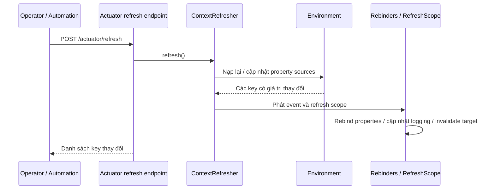
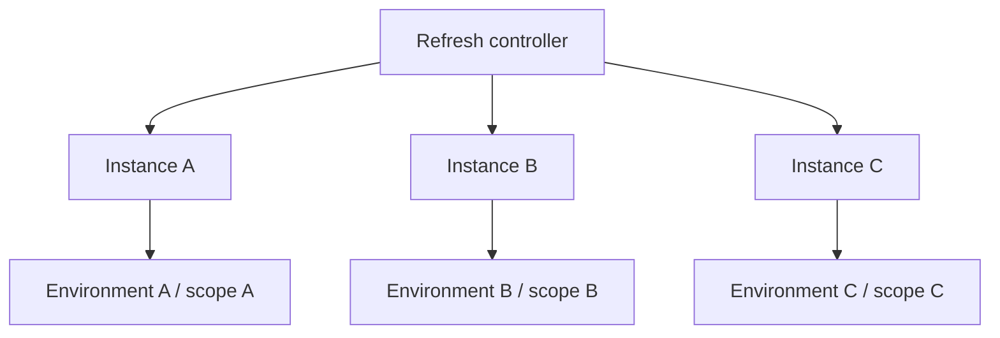

# Endpoint refresh và điều kiện hoạt động

Một ứng dụng Spring Cloud có thể nhận cấu hình từ Config Server hoặc nguồn bên ngoài khác. Khi cấu hình thay đổi, người vận hành cần một cách yêu cầu instance đang chạy nạp lại giá trị và cập nhật những thành phần hỗ trợ refresh. Spring Cloud Context cung cấp endpoint Actuator **`POST /actuator/refresh`** cho mục đích này.

Endpoint chỉ hoạt động khi ứng dụng có các thành phần phù hợp, được cấu hình expose và được bảo vệ đúng cách. Việc gọi endpoint cũng có phạm vi rõ ràng: nó điều phối refresh trong **instance nhận request**, không tự restart JVM, không tự polling Config Server liên tục và không tự đồng bộ toàn bộ replica.

Bài học thuộc chương **Vòng đời ứng dụng** của module `SPRING_CLOUD_CORE`. Nội dung tập trung vào điều kiện để endpoint refresh xuất hiện, cách request được xử lý, tác động tới `Environment`, `@ConfigurationProperties`, `@RefreshScope`, giới hạn vận hành, bảo mật và kiểm thử.

## 1. Endpoint refresh giải quyết vấn đề gì?

Giả sử service đang chạy với cấu hình:

```yaml
catalog:
  remote:
    base-url: https://catalog-v1.internal
  retry:
    max-attempts: 3
```

Đội vận hành cập nhật nguồn cấu hình thành:

```yaml
catalog:
  remote:
    base-url: https://catalog-v2.internal
  retry:
    max-attempts: 5
```

Thay đổi trong repository cấu hình hoặc Config Server chưa tự làm instance đang chạy nhận giá trị mới. Instance cần một trigger để nạp lại các nguồn cấu hình và áp dụng những thay đổi có thể refresh. Trong ứng dụng có Spring Cloud Context và Actuator, endpoint refresh cung cấp trigger qua HTTP.



Endpoint là **lệnh refresh cho một application context**. Nó không phải API chỉnh sửa Config Server. Muốn thay đổi có hiệu lực, nguồn cấu hình phải được cập nhật trước hoặc phải có cơ chế khác cung cấp giá trị mới cho `Environment`.

## 2. Điều kiện để endpoint hoạt động

Để gọi được `POST /actuator/refresh`, cần kiểm tra nhiều điều kiện. Chỉ thêm một dòng `management.endpoints.web.exposure.include` không đủ nếu ứng dụng thiếu endpoint implementation hoặc thiếu cơ chế refresh.

### 2.1. Có Spring Boot Actuator

Actuator cung cấp hạ tầng endpoint quản trị và HTTP/JMX exposure. Với Maven, ứng dụng thường cần:

```xml
<dependency>
    <groupId>org.springframework.boot</groupId>
    <artifactId>spring-boot-starter-actuator</artifactId>
</dependency>
```

Gradle:

```groovy
dependencies {
    implementation "org.springframework.boot:spring-boot-starter-actuator"
}
```

Actuator cung cấp hạ tầng quản trị, nhưng riêng endpoint `refresh` đến từ Spring Cloud Context. Có Actuator mà không có phần Spring Cloud phù hợp thì không thể mặc định endpoint này sẽ tồn tại.

### 2.2. Có Spring Cloud Context tương thích

Spring Cloud Context cung cấp các thành phần như `ContextRefresher`, refresh scope và endpoint refresh. Trong nhiều ứng dụng, dependency này được đưa vào theo starter Spring Cloud đang sử dụng, ví dụ Config Client hoặc starter nền tảng tương ứng. Cần kiểm tra dependency tree để xác nhận `org.springframework.cloud:spring-cloud-context` thực sự có trong runtime classpath.

Nếu khai báo trực tiếp, version nên được quản lý qua Spring Cloud BOM tương thích với Spring Boot đang dùng. Không tự chọn một version Spring Cloud Context độc lập chỉ để làm endpoint xuất hiện; tổ hợp Boot/Cloud không tương thích có thể gây lỗi khởi động hoặc hành vi runtime không đúng.

### 2.3. Có cơ chế refresh Environment

Endpoint cần một `ContextRefresher` phù hợp để điều phối việc cập nhật Environment. Với ứng dụng lấy cấu hình từ Spring Cloud Config, cần Config Client được cấu hình đúng, nguồn cấu hình truy cập được và application/profile/label phù hợp.

Nếu ứng dụng chỉ dùng cấu hình local cố định và không có cơ chế nạp lại nguồn, gọi endpoint không thể tự tìm ra một cấu hình mới chưa được cung cấp cho tiến trình. Endpoint không tự theo dõi Git repository hoặc filesystem.

### 2.4. Endpoint được expose qua HTTP

Actuator không mặc định expose mọi endpoint ra HTTP. Trong cấu hình tiêu chuẩn, chỉ một số endpoint, thường có `health`, được expose mặc định. Cần đưa `refresh` vào danh sách endpoint được expose nếu muốn gọi qua web.

Ví dụ:

```yaml
management:
  endpoints:
    web:
      exposure:
        include: health,info,refresh
```

Đây là cấu hình exposure, không phải cấu hình xác thực. Endpoint vẫn cần được bảo vệ bằng Spring Security, network policy hoặc cơ chế kiểm soát truy cập của môi trường.

### 2.5. Endpoint không bị vô hiệu hóa bởi cấu hình ứng dụng

Kiểm tra cấu hình endpoint và refresh của đúng phiên bản Spring Boot/Spring Cloud. Các dòng Spring Boot mới có thêm mô hình endpoint access; các dòng cũ có thể sử dụng thuộc tính `management.endpoint.<id>.enabled`. Spring Cloud cũng có thuộc tính điều khiển refresh support. Không sao chép cấu hình từ một phiên bản khác mà không đối chiếu tài liệu release train đang chạy.

## 3. Cấu hình tối thiểu và đường dẫn thực tế

Ví dụ cấu hình cơ bản:

```yaml
management:
  endpoints:
    web:
      exposure:
        include: health,info,refresh
```

Khi dùng web management mặc định, endpoint có đường dẫn:

```text
POST http://localhost:8080/actuator/refresh
```

Đường dẫn thực tế có thể thay đổi theo cấu hình management:

| Cấu hình | Hệ quả |
| --- | --- |
| `management.endpoints.web.base-path=/manage` | Endpoint có thể nằm ở `/manage/refresh` |
| `management.server.port=9090` | Management server dùng port riêng; request cần gửi tới port quản trị |
| `management.server.address=127.0.0.1` | Management server chỉ bind vào địa chỉ được cấu hình |
| `management.endpoints.web.path-mapping.refresh=config-refresh` | Đường dẫn web được ánh xạ sang path tùy chỉnh theo cấu hình |
| `management.endpoints.web.exposure.include` không có `refresh` | Endpoint có thể tồn tại nội bộ nhưng không được expose qua HTTP |

Khi endpoint không truy cập được, hãy xác định trước base path, management port, address và path mapping thay vì mặc định rằng mọi ứng dụng đều dùng `/actuator` trên port server chính.

## 4. Gọi endpoint bằng HTTP POST

Endpoint refresh là thao tác ghi/thay đổi trạng thái runtime, vì vậy được gọi bằng **HTTP POST**. Ví dụ local:

```bash
curl -X POST http://localhost:8080/actuator/refresh
```

Nếu endpoint được bảo vệ bằng bearer token:

```bash
curl -X POST \
  -H "Authorization: Bearer <access-token>" \
  http://localhost:8080/actuator/refresh
```

Endpoint không yêu cầu body JSON trong cách sử dụng thông thường. Response thường là danh sách tên property key được phát hiện có giá trị thay đổi, ví dụ:

```json
[
  "catalog.remote.base-url",
  "catalog.retry.max-attempts"
]
```

### 4.1. Diễn giải response

- Danh sách có key: các property được phát hiện có thay đổi trong quá trình refresh của instance đó.
- Danh sách rỗng: không có key nào được nhận diện là thay đổi theo phép so sánh của cơ chế refresh.
- HTTP error: endpoint không được truy cập, bị chặn bảo mật, hoặc quá trình refresh thất bại; cần đọc status và log của instance.

Response không phải danh sách bean đã được tạo lại, không phải báo cáo toàn bộ instance trong cụm và cũng không phải bằng chứng rằng mọi tài nguyên đã đổi thành công. Một số target `@RefreshScope` được tạo lại lazy ở lần gọi tiếp theo, sau khi endpoint đã trả response.

Danh sách rỗng không nhất thiết có nghĩa request không chạy. Nếu refresh scope được xử lý trong quy trình refresh của phiên bản đang dùng, target cache có thể vẫn bị invalidate để tạo lại khi cần. Hãy xác minh hành vi theo phiên bản Spring Cloud Context cụ thể, và không dùng riêng danh sách key làm bằng chứng cho trạng thái của mọi bean.

### 4.2. Gọi lại nhiều lần

Gọi refresh lần thứ hai khi nguồn không đổi thường không phát hiện thêm key mới. Tuy vậy, refresh vẫn là thao tác có thể ảnh hưởng tới target bean và tài nguyên. Không nên gọi liên tục như một cơ chế polling; hãy dùng trigger theo sự kiện hoặc quy trình triển khai có kiểm soát.

## 5. Endpoint xử lý những bước nào?

Trong mô hình Spring Cloud Context thông dụng, endpoint gọi `ContextRefresher` để thực hiện refresh. Các bước khái quát:

1. Cập nhật/nạp lại các nguồn cấu hình theo cơ chế Config Data hoặc cơ chế refresh tương ứng.
2. So sánh property values trước và sau refresh để xác định key thay đổi.
3. Cập nhật `Environment` của instance.
4. Phát `EnvironmentChangeEvent` để các listener xử lý thay đổi.
5. Rebind các bean `@ConfigurationProperties` đủ điều kiện.
6. Cập nhật logging system cho những key `logging.*` thông qua logging rebinder.
7. Invalidate target trong refresh scope để target mới được tạo ở lần gọi phù hợp tiếp theo.

Chi tiết thứ tự nội bộ, cách nạp Config Data và các listener được đăng ký phụ thuộc phiên bản. Hãy hiểu đây là mô hình trách nhiệm, không phải hợp đồng rằng mọi bean hoặc mọi tài nguyên đều được cập nhật.

### 5.1. Environment và property source

Nếu Config Client lấy được cấu hình mới, các property source tương ứng được cập nhật trong Environment. Giá trị hiệu lực vẫn chịu ảnh hưởng bởi thứ tự ưu tiên: environment variables, system properties, JSON cấu hình, command line và các nguồn khác có thể ghi đè remote property source.

Ví dụ Config Server đổi:

```yaml
catalog:
  retry:
    max-attempts: 5
```

Nhưng container có `CATALOG_RETRY_MAXATTEMPTS=3`, giá trị hiệu lực có thể vẫn là `3` tùy precedence. Vì vậy, refresh thành công không đồng nghĩa giá trị remote luôn thắng.

### 5.2. Rebind `@ConfigurationProperties`

Spring Cloud Context có `ConfigurationPropertiesRebinder` để xử lý bean properties khi Environment thay đổi. Một service đọc getter từ bean properties tại thời điểm sử dụng có thể nhận giá trị mới sau rebind.

```java
@ConfigurationProperties(prefix = "catalog.retry")
public class CatalogRetryProperties {
    private int maxAttempts = 3;

    public int getMaxAttempts() {
        return maxAttempts;
    }

    public void setMaxAttempts(int maxAttempts) {
        this.maxAttempts = maxAttempts;
    }
}
```

Rebind không sửa những field riêng mà consumer đã copy từ properties bean vào constructor. Với bean immutable hoặc tài nguyên được tạo từ cấu hình, cần chiến lược khác như refresh scope, API reconfigure hoặc restart.

### 5.3. Refresh scope

Bean `@RefreshScope` được truy cập qua scoped proxy. Khi target cache bị invalidate, lần gọi sau qua proxy có thể tạo target mới dựa trên Environment hiện hành.

```java
@Component
@RefreshScope
public class CatalogEndpoint {
    private final String baseUrl;

    public CatalogEndpoint(
            @Value("${catalog.remote.base-url}") String baseUrl) {
        this.baseUrl = baseUrl;
    }

    public String current() {
        return baseUrl;
    }
}
```

Refresh scope không tự polling Config Server và không tự làm mới mọi singleton. Caller cần đi qua proxy; target mới thường được tạo lazy, nên lỗi khởi tạo có thể chỉ xuất hiện ở lần gọi đầu tiên sau refresh.

## 6. Endpoint refresh cần nguồn cấu hình nào?

Endpoint có thể được sử dụng trong nhiều kiến trúc, nhưng kết quả phụ thuộc nguồn cấu hình và cơ chế nạp lại.

| Nguồn | Điều kiện để nhận giá trị mới |
| --- | --- |
| Spring Cloud Config Server | Config Client được cấu hình, server truy cập được và refresh implementation có thể nạp lại nguồn remote |
| Tệp cấu hình local | Ứng dụng phải có cơ chế đọc lại location đó; sửa file đơn thuần không tự bảo đảm mọi property source được nạp lại |
| Biến môi trường của process | Environment variables thường cố định theo vòng đời process; thay đổi ở deployment/host thường cần tạo process/container mới |
| Java system properties | Giá trị thường được cung cấp khi JVM khởi động; thay đổi bên ngoài không tự cập nhật system properties của JVM |
| Nguồn tùy biến | Phải có extension/refresh strategy tương ứng để nạp lại dữ liệu vào Environment |

Điều kiện quan trọng là **giá trị mới phải đi vào Environment của instance**. Endpoint không thể thay đổi environment variable của hệ điều hành hoặc tự sửa file cấu hình bên ngoài.

### 6.1. Cấu hình Config Client minh họa

```yaml
spring:
  application:
    name: catalog-service
  config:
    import: "configserver:https://config.internal.example"
  cloud:
    config:
      label: main
```

Với Config Data API, `spring.config.import` khai báo Config Server location. `application`, profile và label phải khớp với cấu hình phía server. Nếu Config Server là nguồn tùy chọn, có thể dùng `optional:configserver:`; nếu bắt buộc, không dùng optional để thiếu cấu hình thiết yếu làm startup thất bại.

Việc `spring.config.import` đã hoạt động lúc startup chưa đủ để khẳng định mọi phiên bản/configuration sẽ reload nguồn theo cùng cách khi gọi refresh. Cần dùng Config Client và Spring Cloud release train tương thích, sau đó kiểm thử endpoint trên chính runtime của ứng dụng.

## 7. Điều kiện về bean và thuộc tính có thể refresh

Không phải mọi thuộc tính và mọi bean đều thay đổi runtime được. Trước khi đưa endpoint vào runbook, cần phân loại cấu hình:

| Nhóm | Ví dụ | Hướng xử lý |
| --- | --- | --- |
| Giá trị properties mutable | Retry count, ngưỡng nghiệp vụ có thể đổi | Rebind và đọc getter hiện hành |
| Bean giữ snapshot | `String baseUrl` copy trong constructor | Đọc động, rebind consumer hoặc refresh scope |
| Bean tạo từ cấu hình | HTTP client, client wrapper | Tái tạo hoặc dùng API reconfigure an toàn |
| Resource có state/connection | Connection pool, executor, listener | Kiểm tra khả năng refresh; thường cần lifecycle/drain riêng hoặc restart |
| Cấu hình chỉ áp dụng lúc startup | Port server, cấu trúc context, một số bootstrap setting | Rolling restart/redeploy |
| Cấu hình logging | `logging.level.*` | Logging rebinder hoặc Actuator `loggers` |

Refresh endpoint không thay thế việc thiết kế bean. Nếu service đã copy property vào field riêng, rebinder cập nhật properties bean vẫn không sửa field đó. Nếu target mới cần một singleton dependency đã capture cấu hình cũ, refresh target tầng trên cũng không tự cập nhật dependency singleton.

## 8. Bật endpoint và bảo vệ truy cập

Endpoint refresh có thể thay đổi hành vi runtime của service. Kẻ không có quyền nhưng gọi được endpoint có thể làm thay đổi cấu hình, vô hiệu hóa target bean hoặc gây tải tăng do client/resource được tạo lại. Vì vậy, không expose endpoint này trên mạng công khai.

### 8.1. Chỉ expose endpoint cần thiết

Ví dụ:

```yaml
management:
  endpoints:
    web:
      exposure:
        include: health,info,refresh
```

Chỉ đưa `refresh` vào exposure khi thực sự cần. Tránh cấu hình `include: "*"` trong production nếu chưa có chính sách bảo vệ toàn bộ endpoint.

### 8.2. Dùng cổng quản trị riêng khi phù hợp

```yaml
management:
  server:
    port: 9090
    address: 127.0.0.1
```

Ví dụ này giới hạn management server vào loopback của host/container. Trong môi trường container, cần hiểu loopback có phạm vi network namespace của container; một sidecar hoặc tiến trình khác trong cùng namespace có thể truy cập. Nếu cần automation từ xa, dùng network nội bộ, ingress riêng có kiểm soát hoặc management gateway.

### 8.3. Xác thực và phân quyền

Nếu dùng Spring Security, chỉ cấp quyền POST endpoint refresh cho role vận hành cần thiết. Ví dụ dưới đây mô tả ý tưởng phân quyền, cần điều chỉnh matcher và security chain theo cấu trúc ứng dụng:

```java
@Bean
SecurityFilterChain managementSecurity(HttpSecurity http) throws Exception {
    return http
        .authorizeHttpRequests(authorize -> authorize
            .requestMatchers("/actuator/refresh").hasRole("OPS")
            .anyRequest().authenticated())
        .httpBasic(Customizer.withDefaults())
        .build();
}
```

Ví dụ minh họa chưa thay thế cấu hình security hoàn chỉnh. Ứng dụng thực tế có thể dùng OAuth2 resource server, mTLS, management port riêng hoặc security chain chuyên biệt cho Actuator. Không mở endpoint chỉ vì nó nằm dưới `/actuator`.

### 8.4. CSRF và HTTP POST

Vì refresh dùng POST, cấu hình Spring Security có CSRF protection có thể từ chối request nếu thiếu CSRF token, tùy cách xác thực và security chain. Không tắt CSRF toàn ứng dụng chỉ để làm endpoint hoạt động. Nếu endpoint được dùng bởi automation server-to-server, hãy thiết kế security chain riêng và chỉ miễn CSRF đúng endpoint/đúng cơ chế xác thực đã chọn.

### 8.5. Audit và giới hạn tần suất

Nên ghi nhận:

- Ai yêu cầu refresh, từ hệ thống/địa chỉ nào và vào thời điểm nào.
- Instance nào nhận request.
- Kết quả refresh, key thay đổi và thời gian xử lý.
- Phiên bản cấu hình hoặc revision được áp dụng nếu có.

Không ghi secret hoặc toàn bộ giá trị cấu hình vào log. Cân nhắc rate limit, approval workflow và kiểm soát đồng thời nếu nhiều automation có thể yêu cầu refresh cùng lúc.

## 9. Refresh một instance và refresh nhiều instance

Một request tới `/actuator/refresh` chỉ tác động tới application context của instance nhận request. Nếu service có nhiều replica sau load balancer, gọi endpoint qua địa chỉ service chung có thể chỉ tới một replica tùy routing; không thể coi đó là refresh toàn cụm.

Ví dụ có ba instance:



Các lựa chọn điều phối:

1. **Gọi từng instance:** automation tìm danh sách instance và gửi request quản trị riêng tới từng management endpoint. Cần xử lý instance thay đổi trong lúc gọi, timeout, retry và kết quả một phần.
2. **Spring Cloud Bus:** phát sự kiện refresh qua broker để các instance đã đăng ký nhận và xử lý. Bus cần được cấu hình, bảo vệ và giám sát; event delivery không tạo transaction nguyên tử trên toàn cụm.
3. **Rolling restart/redeploy:** tạo instance mới với cấu hình hiện hành rồi thay thế dần instance cũ. Phù hợp với thay đổi cần startup lại hoặc resource không thể refresh an toàn.

Trong thời gian điều phối, các instance có thể dùng cấu hình khác nhau. Với thay đổi ảnh hưởng tới quyết định nghiệp vụ hoặc tương thích giao thức, cần có kế hoạch chuyển đổi và versioning để tránh hai phiên bản không tương thích cùng phục vụ request.

## 10. Refresh endpoint không làm gì?

Để tránh kỳ vọng sai, cần nắm các giới hạn sau:

- **Không sửa Config Server:** endpoint yêu cầu instance nạp cấu hình; nó không commit thay đổi vào repository cấu hình.
- **Không tự polling:** thay đổi trên Git hoặc file không tự kích hoạt refresh nếu không có polling/event/automation riêng.
- **Không restart JVM:** endpoint không thay thế rolling restart khi cấu hình chỉ có hiệu lực lúc startup.
- **Không cập nhật mọi field:** field đã copy vào object singleton vẫn giữ snapshot nếu không có cơ chế cập nhật.
- **Không bảo đảm mọi resource đổi an toàn:** connection pool, executor, native client và request đang chạy cần lifecycle riêng.
- **Không tự refresh toàn cụm:** mỗi replica có Environment và scope riêng; cần gọi từng instance hoặc dùng cơ chế phân phối event.
- **Không bảo đảm thay đổi nguyên tử:** một số bean có thể cập nhật trước, resource khác tạo lại lazy ở lần gọi sau.
- **Không chứng minh cấu hình mới hợp lệ:** endpoint có thể thành công ở bước nạp nhưng lỗi chỉ xuất hiện khi target mới được tạo hoặc code sử dụng giá trị.

## 11. Kiểm thử endpoint refresh

Kiểm thử cần xác nhận endpoint được expose, request có quyền được xử lý, nguồn cấu hình được cập nhật và bean thực sự dùng giá trị mới. Không chỉ kiểm tra HTTP 200.

| Kịch bản | Cách kiểm thử | Điều cần xác nhận |
| --- | --- | --- |
| Endpoint hiện diện | Khởi động context có Actuator và Spring Cloud Context | Mapping refresh được tạo và expose đúng path |
| Thiếu dependency | Chạy cấu hình test không có Spring Cloud Context | Endpoint không được giả định là có sẵn |
| Không expose | Bỏ `refresh` khỏi exposure | HTTP route không được công khai qua web |
| POST hợp lệ | Gọi bằng principal có quyền | Endpoint trả kết quả refresh theo hợp đồng |
| GET không hợp lệ | Gọi GET thay vì POST | Method không được chấp nhận cho thao tác refresh |
| Nguồn remote đổi | Cập nhật Config Server rồi gọi refresh | Environment nhận property mới |
| Không có key đổi | Gọi lại khi nguồn không đổi | Danh sách changed keys rỗng hoặc phù hợp semantics phiên bản |
| Rebind properties | Đổi property và gọi refresh | Getter của bean properties phản ánh giá trị mới |
| RefreshScope | Gọi qua proxy trước/sau refresh | Target sau refresh được tạo theo cấu hình mới |
| Bảo mật | Gọi thiếu/sai quyền | Request bị từ chối |
| Multi-instance | Refresh A rồi quan sát B | B không tự được xem là đã refresh |
| Lỗi Config Server | Dừng server hoặc giả lập timeout | Hành vi fail/optional phù hợp chính sách |

### 11.1. Kiểm thử HTTP integration

Với ứng dụng chạy management endpoint trên cùng port, có thể dùng `MockMvc` hoặc `WebTestClient` theo stack test. Nếu management server dùng port riêng, cần kiểm thử cấu hình management port tương ứng. Ví dụ khung với `TestRestTemplate`:

```java
@SpringBootTest(webEnvironment = SpringBootTest.WebEnvironment.RANDOM_PORT)
class RefreshEndpointIntegrationTest {
    @LocalServerPort
    int port;

    @Autowired
    TestRestTemplate rest;

    @Test
    void refreshEndpointAcceptsPost() {
        ResponseEntity<String> response = rest.postForEntity(
                "http://localhost:" + port + "/actuator/refresh",
                null,
                String.class);

        // Assert status và nội dung theo cấu hình test.
    }
}
```

Đây là khung minh họa; test phải expose endpoint trong profile test và cấu hình security phù hợp. Nếu security bật, cần cung cấp principal/credential đúng hoặc kiểm tra riêng trường hợp unauthorized. Không dùng endpoint production làm dependency của integration test.

### 11.2. Kiểm thử giá trị thực tế sau refresh

Một bài test có thể:

1. Khởi động với `catalog.retry.max-attempts=3`.
2. Gọi service và xác nhận policy dùng `3`.
3. Thay property source test thành `5` theo cơ chế refresh được hỗ trợ.
4. Gọi POST refresh.
5. Gọi lại service và xác nhận policy dùng `5`.
6. Nếu bean dùng `@RefreshScope`, giữ cùng reference proxy trước/sau refresh và xác nhận target mới được tạo.

Test cần phân biệt trường hợp consumer đọc getter hiện hành với consumer đã copy giá trị vào field. Một endpoint trả danh sách key không chứng minh tất cả caller đã ngừng dùng snapshot cũ.

## 12. Chẩn đoán lỗi thường gặp

| Triệu chứng | Nguyên nhân có thể | Hướng kiểm tra |
| --- | --- | --- |
| `404 Not Found` | Thiếu Spring Cloud Context, endpoint chưa expose, sai base path/port | Kiểm tra runtime dependency, exposure, management port và path mapping |
| `405 Method Not Allowed` | Gọi GET thay vì POST hoặc proxy chặn method | Dùng POST và kiểm tra gateway/security rule |
| `401 Unauthorized` | Thiếu hoặc sai thông tin xác thực | Kiểm tra authentication của management endpoint |
| `403 Forbidden` | Thiếu role hoặc CSRF token bị từ chối | Kiểm tra authorization và security chain riêng cho Actuator |
| Refresh trả danh sách rỗng | Không có key hiệu lực thay đổi hoặc nguồn chưa được cập nhật | Kiểm tra Config Server response, property source và precedence |
| Config Server timeout | DNS, TLS, credential, network hoặc server chưa sẵn sàng | Kiểm tra từ đúng instance/container và log Config Client |
| Properties bean vẫn cũ | Bean không được rebinder xử lý hoặc consumer giữ snapshot | Kiểm tra đăng ký properties, event và cách consumer đọc giá trị |
| `@RefreshScope` bean vẫn cũ | Caller giữ target/delegate thay vì proxy hoặc scope không được invalidate | Kiểm tra reference và refresh support |
| Lỗi xuất hiện ở request đầu sau refresh | Target mới được tạo lazy và constructor/resource thất bại | Kiểm tra log khởi tạo target, validation và resource connectivity |
| Một replica đổi, replica khác không đổi | Request chỉ tới một instance | Kiểm tra per-instance endpoint hoặc Bus delivery |
| Port/logging không đổi | Thuộc tính chỉ áp dụng lúc startup hoặc nguồn khác ghi đè | Dùng restart/rollout nếu cần; kiểm tra property precedence |

Trình tự điều tra:

1. Xác nhận đúng URL, HTTP method, management port và base path.
2. Kiểm tra runtime dependency có Actuator và Spring Cloud Context tương thích.
3. Xác nhận endpoint được expose và không bị access policy vô hiệu hóa.
4. Kiểm tra authentication, authorization, CSRF và network policy.
5. Xác minh nguồn cấu hình mới thực sự có giá trị mong muốn.
6. Kiểm tra Config Client lấy đúng application/profile/label và Environment có giá trị mới.
7. Kiểm tra changed keys, rebinder, LoggingRebinder và refresh scope.
8. Gọi bean qua đúng proxy/caller để xác nhận hành vi thực tế.
9. Lặp lại kiểm tra trên từng replica.

## 13. Runbook vận hành refresh có kiểm soát

Một quy trình vận hành có thể triển khai theo các bước:

1. **Chuẩn bị thay đổi:** review cấu hình, kiểm tra kiểu dữ liệu, validation, compatibility và khả năng rollback.
2. **Cập nhật nguồn:** commit/publish cấu hình vào đúng application/profile/label hoặc cập nhật nguồn tùy biến.
3. **Chọn phạm vi:** xác định một instance, toàn bộ replica hay chỉ một nhóm canary.
4. **Gọi refresh:** gửi POST tới management endpoint của instance hoặc phát sự kiện Bus theo quy trình đã cấu hình.
5. **Xác nhận kết quả:** kiểm tra response, log, config version và các bean/endpoint chịu ảnh hưởng.
6. **Theo dõi lỗi sau refresh:** đặc biệt lần gọi đầu tạo target mới, kết nối downstream và request đang chạy.
7. **Mở rộng rollout:** chỉ tiếp tục tới các instance còn lại khi canary đạt tiêu chí.
8. **Rollback khi cần:** khôi phục revision cấu hình trước và refresh/rollout theo cùng quy trình.

Nên có giới hạn tần suất và người chịu trách nhiệm. Không dùng refresh endpoint như một nút “thử lại” khi chưa biết nguồn cấu hình nào thay đổi hoặc bean nào chịu tác động.

## 14. Thực hành: refresh retry policy trên một instance

Giả sử `catalog-service` có Config Client, Actuator và Spring Cloud Context. Service sử dụng `CatalogRetryProperties` mutable và đọc getter ở mỗi lần xử lý.

**Bước 1 — Cấu hình endpoint:**

```yaml
management:
  endpoints:
    web:
      exposure:
        include: health,info,refresh
```

**Bước 2 — Khởi động với cấu hình ban đầu:**

```yaml
catalog:
  retry:
    max-attempts: 3
```

**Bước 3 — Xác nhận hoạt động:** gọi API nghiệp vụ hoặc kiểm tra trong test để xác nhận policy dùng `3`.

**Bước 4 — Cập nhật Config Server:** đặt `max-attempts` thành `5` trong đúng file ứng dụng/profile/label.

**Bước 5 — Gọi refresh:**

```bash
curl -X POST \
  -H "Authorization: Bearer <access-token>" \
  http://localhost:8080/actuator/refresh
```

**Bước 6 — Kiểm tra:** xác nhận key `catalog.retry.max-attempts` xuất hiện trong response nếu giá trị hiệu lực thay đổi, và service đọc được `5` sau rebind.

**Bước 7 — Thử consumer snapshot:** tạo một bean khác copy `maxAttempts` vào field constructor. Xác nhận bean này vẫn giữ `3`; đây là dấu hiệu consumer cần thiết kế lại nếu nghiệp vụ yêu cầu cập nhật runtime.

**Bước 8 — Mở rộng nhiều instance:** thực hiện trên canary trước, sau đó refresh từng replica hoặc dùng Bus; theo dõi config version để không bỏ sót instance.

### Câu hỏi tự kiểm tra

1. Những dependency/hạ tầng nào cần có để endpoint refresh hoạt động?
2. Vì sao có Actuator không đồng nghĩa có `/actuator/refresh`?
3. Endpoint refresh sử dụng HTTP method nào?
4. Danh sách key trong response biểu thị điều gì?
5. Response rỗng có nhất thiết chứng minh refresh không chạy không?
6. `ContextRefresher` và `EnvironmentChangeEvent` giữ vai trò gì trong luồng refresh?
7. Vì sao một `@ConfigurationProperties` bean được rebind nhưng service vẫn có thể dùng giá trị cũ?
8. Vì sao target `@RefreshScope` có thể chỉ được tạo lại ở request đầu tiên sau refresh?
9. Gọi endpoint qua load balancer có bảo đảm mọi replica được refresh không?
10. Khi nào nên dùng rolling restart thay cho refresh endpoint?

**Gợi ý đáp án:** (1) Actuator, Spring Cloud Context tương thích, cơ chế refresh Environment và exposure; (2) Endpoint refresh do Spring Cloud Context cung cấp; (3) POST; (4) Các property key được phát hiện thay đổi ở instance nhận request; (5) Không, có thể không có key thay đổi nhưng quy trình refresh vẫn được thực hiện theo semantics phiên bản; (6) ContextRefresher điều phối cập nhật Environment, event thông báo key thay đổi cho listener; (7) Service có thể đã copy giá trị vào field; (8) Refresh scope dùng target cache/lazy recreation; (9) Không; (10) Khi thay đổi chỉ có hiệu lực lúc startup hoặc resource không thể refresh an toàn.

## 15. Những nguyên tắc cần nhớ

- Endpoint `POST /actuator/refresh` cần Spring Boot Actuator, Spring Cloud Context tương thích và cơ chế refresh Environment phù hợp.
- Endpoint phải được expose qua management web/JMX theo nhu cầu; exposure không thay thế authentication, authorization và network isolation.
- Request POST điều phối refresh trong instance nhận request; response thường liệt kê property key được phát hiện thay đổi.
- `ContextRefresher` cập nhật Environment; `EnvironmentChangeEvent` thông báo thay đổi; rebinder, logging rebinder và refresh scope xử lý theo trách nhiệm riêng.
- Bean properties được rebind không tự cập nhật field snapshot hoặc resource đã tạo từ cấu hình cũ.
- Target `@RefreshScope` có thể được tạo lazy; cần kiểm tra lần gọi đầu sau refresh và lifecycle của resource.
- Endpoint không tự polling nguồn cấu hình, không sửa Config Server, không restart JVM và không tự refresh toàn cụm.
- Bảo vệ endpoint, audit thao tác, giới hạn tần suất và xác minh config version trên từng instance.
- Kiểm thử cả dependency/exposure, POST/security, changed keys, giá trị bean sau refresh, lỗi nguồn và cập nhật nhiều replica.

Hiểu endpoint refresh và điều kiện hoạt động giúp người học vận hành thay đổi cấu hình có kiểm soát. Khi biết rõ dependency, exposure, security, luồng Environment và phạm vi từng instance, đội ngũ có thể quyết định khi nào refresh là đủ và khi nào cần rollout/restart để bảo đảm ứng dụng Spring Cloud hoạt động đúng.
