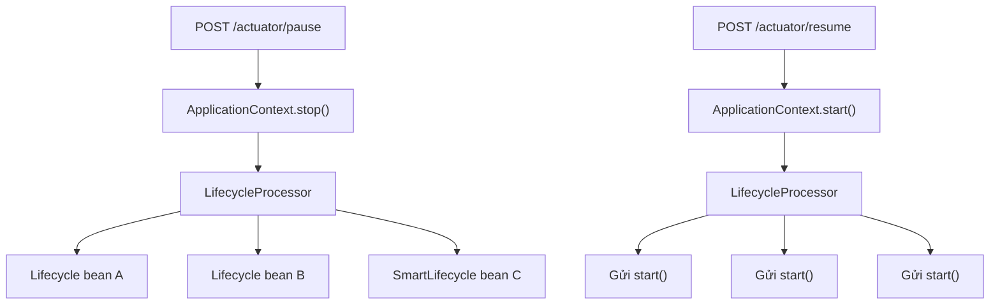
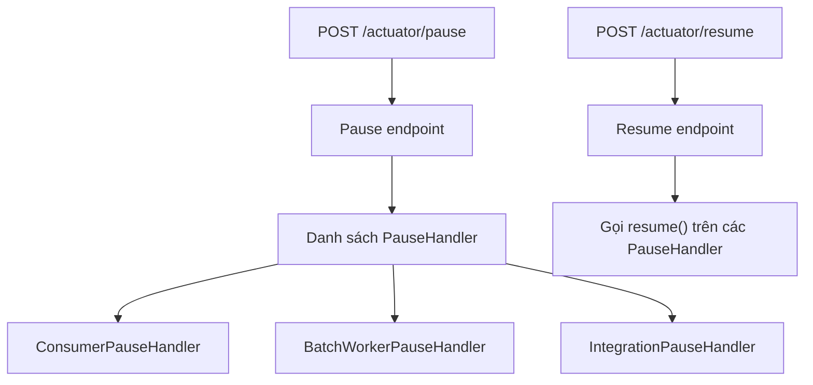
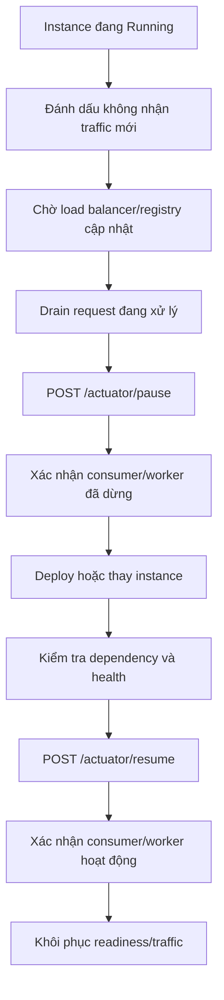

# Endpoint pause, resume và hành vi theo phiên bản triển khai

Spring Cloud cung cấp hai endpoint quản trị `/actuator/pause` và `/actuator/resume` để tạm dừng rồi tiếp tục một số thành phần trong ứng dụng. Ý nghĩa chính xác của hai endpoint này phụ thuộc phiên bản Spring Cloud đang chạy. Ở nhánh Spring Cloud Commons 4.3.x, tài liệu mô tả chúng gọi `stop()` và `start()` trên `ApplicationContext`. Ở nhánh 5.0.x, tài liệu mô tả chúng gọi `pause()` và `resume()` trên các bean `PauseHandler`; Spring Cloud cung cấp handler cho các thành phần Spring Integration triển khai `Pausable`.

Khác biệt này ảnh hưởng trực tiếp tới cách vận hành. Một lệnh pause có thể tác động tới toàn bộ các bean quản lý lifecycle trong context ở một phiên bản, nhưng chỉ tác động tới các handler được đăng ký ở phiên bản khác. Vì vậy, khi triển khai rolling update hoặc chạy nhiều phiên bản ứng dụng cùng lúc, không nên giả định mọi instance có cùng một hành vi chỉ vì URL endpoint giống nhau.

## 1. Pause và resume dùng để làm gì?

Pause là thao tác yêu cầu một phần hoạt động của ứng dụng tạm dừng. Resume yêu cầu phần hoạt động đó tiếp tục. Các tình huống thường gặp:

- Tạm dừng consumer để không nhận thêm message trong khi chuẩn bị bảo trì.
- Dừng một poller hoặc background worker trong lúc thay đổi phụ thuộc.
- Tạm ngừng một luồng tích hợp để xử lý sự cố ở hệ thống đích.
- Điều phối việc rút traffic và thay thế instance trong một đợt triển khai.
- Tạm dừng các thành phần có trạng thái trước khi chuyển đổi cấu hình hoặc tài nguyên.

Pause/resume là thao tác vòng đời của các thành phần Spring được tích hợp với cơ chế tương ứng. Nó không phải lệnh tạm dừng toàn bộ JVM, không tự dừng container và không thay thế thao tác scale hoặc rollout của nền tảng triển khai.

Cần phân biệt:

| Thao tác | Mục đích | Tác động điển hình |
| --- | --- | --- |
| Pause | Tạm dừng hoạt động của thành phần được quản lý | Lifecycle bean hoặc PauseHandler được gọi |
| Resume | Tiếp tục hoạt động đã tạm dừng | Lifecycle bean hoặc PauseHandler được gọi lại |
| Refresh | Cập nhật Environment, rebind hoặc làm mới target theo cấu hình | PropertySource, bean cấu hình và RefreshScope |
| Restart context | Đóng rồi khởi động lại ApplicationContext theo cơ chế endpoint | Vòng đời context được chạy lại |
| Shutdown process | Kết thúc tiến trình JVM/container | Toàn bộ process dừng |
| Scale to zero | Nền tảng triển khai giảm số replica về 0 | Không còn instance phục vụ |

Không dùng pause như một cách viết khác của restart hay shutdown. Pause không mặc nhiên hủy singleton, đóng ApplicationContext hoặc kết thúc process.

## 2. Hai endpoint và cách gọi

Trong ứng dụng Spring Boot có Actuator và Spring Cloud Context phù hợp, hai thao tác thường được gọi bằng HTTP POST:

```text
POST /actuator/pause
POST /actuator/resume
```

Ví dụ gọi trên môi trường local:

```bash
curl -X POST http://localhost:8080/actuator/pause
curl -X POST http://localhost:8080/actuator/resume
```

Đây là write operation của Actuator nên dùng POST. Đường dẫn thực tế có thể thay đổi nếu ứng dụng cấu hình management base path hoặc management port riêng, ví dụ:

```yaml
management:
  server:
    port: 9001
  endpoints:
    web:
      base-path: /manage
```

Khi đó endpoint có thể nằm ở `http://localhost:9001/manage/pause` và `http://localhost:9001/manage/resume`.

Đường dẫn và method phải được xác nhận từ cấu hình runtime hoặc trang Actuator links của đúng phiên bản đang triển khai. Đừng suy đoán rằng mọi ứng dụng Spring Cloud đều expose các endpoint này ngay sau khi thêm dependency.

## 3. Điều kiện để endpoint xuất hiện

Pause và resume thuộc nhóm management endpoint của Spring Cloud Context. Ứng dụng cần các thành phần phù hợp:

- Spring Boot Actuator để cung cấp hạ tầng endpoint.
- Spring Cloud Context/Commons tương thích với Spring Boot release train.
- Cấu hình endpoint được bật và được expose trên kênh quản trị.
- Cơ chế `RestartEndpoint` cần thiết để tạo các nested pause/resume endpoint trong các phiên bản được tài liệu mô tả.

Spring Cloud ghi rõ rằng `/actuator/restart` bị tắt theo mặc định. Nếu `RestartEndpoint` bị vô hiệu hóa, `/actuator/pause` và `/actuator/resume` cũng bị vô hiệu hóa vì chúng được cung cấp như trường hợp đặc biệt của endpoint restart.

Ví dụ cấu hình chủ động:

```yaml
management:
  endpoint:
    restart:
      enabled: true
    pause:
      enabled: true
    resume:
      enabled: true
  endpoints:
    web:
      exposure:
        include: health,info,pause,resume
```

Trong ví dụ, `restart` được bật để Spring Cloud có thể tạo endpoint pause/resume, nhưng `restart` không nằm trong danh sách web exposure. Do đó, nó không được công bố qua HTTP theo danh sách này. Hãy kiểm tra cả kênh JMX hoặc các kênh quản trị khác nếu chúng được bật; không chỉ kiểm tra web exposure.

Không nên dùng `include: "*"` trong production chỉ để làm xuất hiện hai endpoint. Expose đúng các endpoint cần thiết sẽ giảm bề mặt quản trị.

### 3.1. Bật endpoint và expose endpoint là hai việc khác nhau

| Cấu hình | Ý nghĩa |
| --- | --- |
| `management.endpoint.pause.enabled` | Cho phép endpoint pause hoạt động |
| `management.endpoint.resume.enabled` | Cho phép endpoint resume hoạt động |
| `management.endpoint.restart.enabled` | Cho phép tạo RestartEndpoint mà pause/resume phụ thuộc vào |
| `management.endpoints.web.exposure.include` | Chọn endpoint được công bố qua HTTP |
| `management.endpoints.jmx.exposure.include/exclude` | Kiểm soát endpoint được công bố qua JMX |

Endpoint có thể đã được bật nhưng chưa được expose qua HTTP. Ngược lại, thêm tên endpoint vào exposure list không thể tạo ra bean endpoint nếu auto-configuration hoặc điều kiện enablement không thỏa mãn.

## 4. Hành vi ở Spring Cloud Commons 4.3.x: Lifecycle của ApplicationContext

Tài liệu Spring Cloud Commons 4.3.3 mô tả `/actuator/pause` và `/actuator/resume` là các endpoint gọi phương thức `stop()` và `start()` trên `ApplicationContext`.

Trong API Spring, `ConfigurableApplicationContext` mở rộng hợp đồng `Lifecycle`. Khi context nhận tín hiệu stop/start, `LifecycleProcessor` điều phối các bean tham gia lifecycle trong context. Vì vậy, phạm vi tác động rộng hơn một consumer hoặc một handler tùy chỉnh.

Có thể hình dung:



Các thành phần có triển khai `Lifecycle` hoặc `SmartLifecycle` có thể nhận tín hiệu tương ứng. Thành phần không tham gia lifecycle không tự dừng chỉ vì endpoint pause được gọi.

### 4.1. Context stop không phải context close

Cần phân biệt ba trạng thái:

- **Running:** context đang hoạt động bình thường.
- **Stopped:** context nhận tín hiệu stop; các Lifecycle bean được điều phối dừng theo hợp đồng.
- **Closed:** context kết thúc vòng đời, singleton được hủy và context không thể start lại như một context đang mở.

Trong Spring Framework, `stop()` phát tín hiệu dừng và có thể được theo sau bởi `start()`. `close()` là thao tác đóng context và hủy các singleton do context quản lý. Vì thế, pause/resume theo Lifecycle không đồng nghĩa đóng context rồi khởi động lại.

### 4.2. Phạm vi ảnh hưởng phụ thuộc bean lifecycle

Trong nhánh 4.3.x, cần lập danh sách các bean triển khai lifecycle và hiểu tác động của `stop()` đối với từng bean:

| Thành phần | Cần xác minh |
| --- | --- |
| Background worker | Có ngừng nhận công việc mới và xử lý công việc đang chạy đúng cách không? |
| Message listener/container | Có dừng nhận message, giữ offset/acknowledgement đúng không? |
| Scheduler/poller | Có dừng lịch hoặc vòng polling không? |
| Connection/resource manager | Stop có đóng tài nguyên hay chỉ tạm dừng hoạt động? |
| Embedded server | Web server có bị ảnh hưởng bởi lifecycle stop trong stack đang dùng không? |
| Management endpoint | Có còn truy cập được để gọi resume không? |

Đặc biệt, nếu web server hoặc thành phần quản trị bị dừng theo lifecycle, request HTTP để gọi resume có thể không còn đường vào. Không giả định cổng quản trị luôn hoạt động sau pause. Hãy kiểm thử với đúng web stack, management port và cách đóng gói của ứng dụng.

### 4.3. Ví dụ bean tham gia SmartLifecycle

Một background worker có thể triển khai `SmartLifecycle` để nhận tín hiệu start/stop:

```java
import org.springframework.context.SmartLifecycle;
import org.springframework.stereotype.Component;

@Component
public class ReportPoller implements SmartLifecycle {

    private volatile boolean running;

    @Override
    public void start() {
        if (!running) {
            running = true;
            // Khởi động poll loop hoặc scheduler.
        }
    }

    @Override
    public void stop() {
        if (running) {
            running = false;
            // Ngừng nhận công việc mới và đóng poll loop an toàn.
        }
    }

    @Override
    public void stop(Runnable callback) {
        stop();
        callback.run();
    }

    @Override
    public boolean isRunning() {
        return running;
    }

    @Override
    public boolean isAutoStartup() {
        return true;
    }

    @Override
    public int getPhase() {
        return 0;
    }
}
```

Ví dụ rút gọn chỉ minh họa hợp đồng lifecycle. Worker thực tế cần phối hợp với thread, scheduler, queue và xử lý công việc đang chạy. Không chỉ đặt cờ `running=false` nếu vòng lặp hiện tại vẫn tiếp tục lấy việc hoặc không có cơ chế kết thúc an toàn.

## 5. Hành vi ở Spring Cloud Commons 5.0.x: PauseHandler

Tài liệu Spring Cloud Commons 5.0.4 mô tả hai endpoint theo cách khác: `/actuator/pause` gọi `pause()` trên mọi bean `PauseHandler`, còn `/actuator/resume` gọi `resume()` trên mọi bean `PauseHandler`.

`PauseHandler` thuộc package `org.springframework.cloud.context.restart`. Ứng dụng có thể đăng ký handler riêng để điều khiển đúng thành phần cần tạm dừng.



Cách tiếp cận này cho phép ứng dụng quyết định rõ thành phần nào cần pause. Endpoint không mặc nhiên yêu cầu mọi bean trong ApplicationContext dừng lifecycle.

### 5.1. Handler mặc định cho Spring Integration

Spring Cloud 5.0.x cung cấp một handler cho các thành phần Spring Integration triển khai interface `Pausable` khi integration tương ứng có mặt. Handler này thu thập các thành phần Pausable và gọi `pause()`/ `resume()` trên chúng.

Một endpoint Spring Integration bị pause có thể vẫn duy trì kết nối tới hệ thống bên ngoài nhưng không gửi hoặc nhận message trong thời gian pause, tùy loại endpoint và implementation. Điều đó khác với việc đóng connection hoặc dừng toàn bộ ApplicationContext.

Nếu ứng dụng không có thành phần Pausable và không đăng ký custom PauseHandler, không nên kỳ vọng endpoint tự động dừng controller, service hoặc toàn bộ request HTTP.

### 5.2. Đăng ký PauseHandler tùy chỉnh

Ví dụ ứng dụng có một consumer xử lý sự kiện đơn hàng. Ta muốn dừng nhận message mới trong khi vẫn giữ web API quản trị hoạt động:

```java
import org.springframework.cloud.context.restart.PauseHandler;
import org.springframework.stereotype.Component;

@Component
public class OrderConsumerPauseHandler implements PauseHandler {

    private final OrderConsumer consumer;

    public OrderConsumerPauseHandler(OrderConsumer consumer) {
        this.consumer = consumer;
    }

    @Override
    public void pause() {
        consumer.pauseConsumption();
    }

    @Override
    public void resume() {
        consumer.resumeConsumption();
    }
}
```

`OrderConsumer` là thành phần của ứng dụng, cần cung cấp các phương thức pause/resume an toàn. Ví dụ không phụ thuộc một broker cụ thể; nếu dùng Kafka, RabbitMQ hoặc Spring Cloud Stream, nên ưu tiên API lifecycle/binding được hỗ trợ bởi binder và phiên bản tương ứng.

### 5.3. Thiết kế handler có thể gọi lặp

Điều phối có thể gửi pause nhiều lần do retry hoặc timeout, và có thể gọi resume sau khi trạng thái đã trở lại bình thường. Vì vậy handler nên idempotent:

- Pause khi đã paused không làm hỏng trạng thái.
- Resume khi đang running không tạo consumer hoặc scheduler trùng.
- Nếu pause thất bại một phần, trạng thái cần được ghi nhận và có cách phục hồi.
- Không xóa message hoặc bỏ qua offset chỉ để hoàn tất thao tác pause.
- Tài nguyên đang xử lý phải có chính sách drain/timeout rõ ràng.

Nếu nhiều handler có phụ thuộc thứ tự, ví dụ dừng producer trước consumer hoặc ngược lại, nên tạo một handler điều phối duy nhất để kiểm soát thứ tự thay vì phụ thuộc vào thứ tự không được cam kết giữa nhiều bean độc lập.

## 6. So sánh hai nhánh phiên bản

Khác biệt chính được thể hiện trong tài liệu chính thức của hai phiên bản Spring Cloud Commons:

| Tiêu chí | Spring Cloud Commons 4.3.3 | Spring Cloud Commons 5.0.4 |
| --- | --- | --- |
| Mô tả endpoint pause | Gọi `Lifecycle.stop()` trên ApplicationContext | Gọi `pause()` trên mọi PauseHandler bean |
| Mô tả endpoint resume | Gọi `Lifecycle.start()` trên ApplicationContext | Gọi `resume()` trên mọi PauseHandler bean |
| Phạm vi điều khiển | Các Lifecycle bean trong context theo LifecycleProcessor | Các thành phần được đăng ký qua PauseHandler |
| Spring Integration | Phụ thuộc lifecycle integration của phiên bản | Có handler cho thành phần Pausable |
| Điều cần kiểm thử | Tác động của context stop/start lên các Lifecycle bean và management server | Danh sách PauseHandler, thành phần thực sự được pause và resume |
| Nguy cơ hiểu nhầm | Nghĩ rằng chỉ consumer được dừng | Nghĩ rằng toàn bộ ApplicationContext tự dừng |

Không nên dùng kết quả kiểm thử trên Commons 4.3.x để suy ra hành vi của Commons 5.0.x. Cũng không nên chỉ nhìn tên URL endpoint để kết luận semantics giống nhau.

### 6.1. Liên hệ với Spring Boot và release train

Spring Cloud phải đi cùng thế hệ Spring Boot tương thích. Theo bảng tương thích release train hiện hành tại thời điểm viết bài:

| Spring Cloud release train | Spring Boot generation | Dòng Commons tham chiếu |
| --- | --- | --- |
| 2025.1.x | 4.0.x; hỗ trợ 4.1.x từ 2025.1.2 | 5.0.x |
| 2025.0.x | 3.5.x | 4.3.x |
| 2024.0.x | 3.4.x | 4.2.x |

Tài liệu endpoint 4.3.3 mô tả Lifecycle stop/start; tài liệu endpoint 5.0.4 mô tả PauseHandler. Khi nâng Spring Boot, không chỉ đổi version Boot riêng lẻ mà cần chọn Spring Cloud BOM tương thích.

Ví dụ, dự án Spring Boot 4.0 nên chọn release train Spring Cloud 2025.1.x phù hợp. Dự án Boot 3.5 dùng release train 2025.0.x. Kiểm tra bảng tương thích chính thức và service release mới nhất trước khi nâng cấp; không trộn các module Spring Cloud khác release train trong cùng ứng dụng.

### 6.2. Kiểm tra dependency và BOM

Maven nên quản lý các module Spring Cloud bằng BOM:

```xml
<properties>
    <spring-cloud.version>2025.1.4</spring-cloud.version>
</properties>

<dependencyManagement>
    <dependencies>
        <dependency>
            <groupId>org.springframework.cloud</groupId>
            <artifactId>spring-cloud-dependencies</artifactId>
            <version>${spring-cloud.version}</version>
            <type>pom</type>
            <scope>import</scope>
        </dependency>
    </dependencies>
</dependencyManagement>
```

Các dependency cần có tùy ứng dụng, thường gồm Actuator và Spring Cloud Context thông qua starter/module phù hợp. Không nên tự pin một version `spring-cloud-context` khác với release train BOM nếu không có lý do được kiểm thử.

## 7. Bật endpoint trong ứng dụng mẫu

Một cấu hình tối thiểu minh họa:

```yaml
management:
  endpoint:
    restart:
      enabled: true
    pause:
      enabled: true
    resume:
      enabled: true
  endpoints:
    web:
      exposure:
        include: health,info,pause,resume
```

Ở đây:
- RestartEndpoint được bật để các nested pause/resume endpoint có thể được tạo theo cơ chế Spring Cloud.
- Chỉ `health`, `info`, `pause`, `resume` được expose qua HTTP.
- `restart` không được đưa vào web exposure list.

Nếu ứng dụng có JMX exposure, cần cấu hình riêng để endpoint restart không vô tình được công bố ở kênh đó. Cấu hình này cũng chưa thay thế authentication, authorization và network policy.

### 7.1. Gọi endpoint có xác thực

Ví dụ local không có xác thực:

```bash
curl -X POST http://localhost:8080/actuator/pause
curl -X POST http://localhost:8080/actuator/resume
```

Trong production, dùng thông tin xác thực được cấp qua secret manager hoặc công cụ quản trị an toàn. Không ghi password/token trực tiếp vào script được commit hoặc lịch sử terminal chia sẻ. Nếu Spring Security bật CSRF cho các POST request, client quản trị phải gửi CSRF token theo cấu hình bảo mật; không tắt CSRF toàn ứng dụng chỉ để endpoint chạy được.

### 7.2. Tách cổng quản trị

Có thể tách management server khỏi cổng phục vụ API:

```yaml
server:
  port: 8080

management:
  server:
    port: 9001
  endpoints:
    web:
      base-path: /actuator
      exposure:
        include: health,info,pause,resume
```

Management port riêng giúp điều phối dễ hơn, đặc biệt với nhánh 4.3.x nơi lifecycle stop có thể tác động tới các bean quản lý server. Tuy nhiên, phải kiểm thử thực tế xem management server có thuộc phạm vi lifecycle bị dừng hay không; không coi việc tách port là bảo đảm endpoint resume luôn truy cập được.

## 8. Pause/resume không tự quản lý readiness và service registry

Pause endpoint không tự động bảo đảm instance được loại khỏi load balancer hoặc service registry. Việc một consumer ngừng nhận message khác với việc HTTP instance không còn nhận request.

Trong kiến trúc có discovery hoặc Kubernetes, cần phối hợp:
- Readiness probe để ngừng đưa instance mới vào traffic.
- Service registry/load balancer để loại hoặc giảm ưu tiên instance nếu cần.
- Drain request đang chạy.
- Pause consumer/poller/background worker.
- Resume component sau khi phụ thuộc đã sẵn sàng.
- Khôi phục readiness và đăng ký traffic sau khi kiểm tra thành công.

Nếu chỉ gọi pause trong khi readiness vẫn UP, các request mới vẫn có thể được gửi tới instance. Ở nhánh 5.0.x, điều này càng dễ xảy ra nếu custom PauseHandler chỉ dừng message consumer mà không tác động HTTP server.

## 9. Quy trình dùng pause/resume trong rolling deployment

Giả sử cần thay một phiên bản `order-service` đang xử lý HTTP request và message. Một quy trình an toàn có thể là:



Các bước cụ thể phụ thuộc semantics của phiên bản:

- Với 4.3.x, pause có thể dừng các Lifecycle bean ở phạm vi ApplicationContext; phải đánh giá cả management server và web server.
- Với 5.0.x, pause chỉ gọi các PauseHandler; cần xác nhận handler đã đăng ký cho mọi consumer/worker cần dừng.
- Nếu không có handler cho thành phần cần tạm dừng, endpoint trả kết quả không thể được coi là bằng chứng thành phần đó đã dừng.
- Nếu deploy version mới làm thay đổi PauseHandler hoặc lifecycle behavior, không dùng chung giả định với version cũ.

### 9.1. Chờ drain trước khi pause

Không nên pause ngay khi bắt đầu rollout nếu instance còn request hoặc message đang xử lý. Trước tiên:
1. Ngừng nhận công việc mới ở tầng ingress hoặc broker.
2. Chờ số request in-flight giảm về ngưỡng phù hợp.
3. Chờ transaction hoặc message handler đang chạy hoàn tất.
4. Kiểm tra queue lag, retry và dead-letter.
5. Sau đó mới pause phần consumer/background còn lại.

Pause không tự bảo đảm công việc đang chạy được hoàn tất hoặc rollback. Handler và thành phần tích hợp cần có cơ chế graceful drain riêng.

## 10. Triển khai nhiều phiên bản cùng lúc

Trong rolling deployment, có thể cùng tồn tại các instance:
- Version A dùng Spring Cloud Commons 4.3.x.
- Version B dùng Spring Cloud Commons 5.0.x.
- Một phần instance đã nâng cấp, phần còn lại vẫn đang phục vụ traffic.

Nếu cùng gọi `POST /actuator/pause` tới cả hai nhóm, hai nhóm có thể có phạm vi dừng khác nhau. Một nhóm có thể dừng các Lifecycle bean của context, nhóm kia chỉ dừng các PauseHandler đã đăng ký.

Bảng ví dụ:

| Instance | Framework | Hành vi pause theo tài liệu | Cần xác minh |
| --- | --- | --- | --- |
| `order-a` | Commons 4.3.x | Lifecycle stop trên ApplicationContext | Web server, worker và management lifecycle |
| `order-b` | Commons 5.0.x | Gọi mọi PauseHandler | Handler nào tồn tại và component nào được pause |
| `order-c` | Commons 5.0.x | Gọi mọi PauseHandler | Spring Integration Pausable/custom handler có được tạo không? |

Nên có một kế hoạch nâng cấp theo nhóm phiên bản:
- Đọc version của từng instance qua build info hoặc metadata triển khai.
- Chia nhóm hành vi pause/resume.
- Kiểm thử endpoint trên từng nhóm trước khi rollout.
- Không phát lệnh pause đồng loạt nếu semantics giữa các phiên bản khác nhau.
- Chỉ hoàn tất rollout khi các instance mới đạt health/readiness và xử lý công việc đúng.

### 10.1. API endpoint giống nhau không có nghĩa hợp đồng giống nhau

Một client quản trị chỉ biết URL `/actuator/pause` có thể không biết instance đang chạy Commons 4.3.x hay 5.0.x. Vì vậy, hệ thống điều phối nên biết version/build của instance và áp dụng chính sách phù hợp.

Có thể dùng:
- Build info/Actuator info đã được cấu hình.
- Label/version trong orchestrator.
- Metadata instance trong registry.
- Một trường capability do ứng dụng công bố.

Không nên suy ra hành vi chỉ từ HTTP status code. Một request được endpoint chấp nhận không chứng minh mọi consumer đã dừng.

## 11. Thiết kế PauseHandler an toàn ở nhánh 5.0.x

Custom handler cần xác định rõ:
- Thành phần nào được pause/resume.
- Có chờ công việc đang chạy hoàn tất không.
- Có giới hạn thời gian chờ không.
- Trạng thái paused được lưu ở đâu.
- Nếu handler lỗi thì operator nhận được thông tin gì.
- Resume có thể chạy sau process restart hay không.
- Nhiều handler có phụ thuộc thứ tự không.

Ví dụ một handler có trạng thái rõ ràng:

```java
import java.util.concurrent.atomic.AtomicBoolean;

import org.springframework.cloud.context.restart.PauseHandler;
import org.springframework.stereotype.Component;

@Component
public class BillingConsumerPauseHandler implements PauseHandler {

    private final BillingConsumer consumer;
    private final AtomicBoolean paused = new AtomicBoolean(false);

    public BillingConsumerPauseHandler(BillingConsumer consumer) {
        this.consumer = consumer;
    }

    @Override
    public void pause() {
        if (paused.compareAndSet(false, true)) {
            consumer.stopAcceptingMessages();
            consumer.awaitInFlightCompletion();
        }
    }

    @Override
    public void resume() {
        if (paused.compareAndSet(true, false)) {
            consumer.startAcceptingMessages();
        }
    }
}
```

`BillingConsumer` là abstraction minh họa của ứng dụng. Trong code thực tế, cần có timeout cho `awaitInFlightCompletion()`, xử lý lỗi và khôi phục trạng thái nếu thao tác stop thất bại giữa chừng. Nếu pause đã dừng consumer nhưng bước drain timeout, handler cần ghi nhận trạng thái thực tế thay vì chỉ đặt cờ boolean.

### 11.1. Không pause control plane ngoài ý muốn

Một custom handler không nên dừng thành phần mà nó cần để nhận lệnh resume. Ví dụ, nếu handler dừng management server hoặc toàn bộ scheduler chứa cơ chế resume, operator có thể mất đường điều khiển.

Nên phân biệt:
- **Data plane:** HTTP request nghiệp vụ, message consumer, poller, background job.
- **Control plane:** Actuator, health/readiness, telemetry và cơ chế quản trị.

Tùy phiên bản, pause có thể tác động khác nhau tới hai mặt này. Hãy giữ đường điều khiển hoạt động hoặc cung cấp phương thức resume từ bên ngoài tiến trình.

## 12. Kiểm thử endpoint và hành vi thực tế

Kiểm thử không nên dừng ở việc endpoint trả thành công. Cần xác minh thành phần thực sự dừng và hoạt động trở lại.

### 12.1. Kiểm thử trên Commons 4.3.x

Tạo một bean Lifecycle/SmartLifecycle có thể quan sát trạng thái:
- Khởi động context và xác nhận bean đang running.
- Gọi `POST /actuator/pause`.
- Xác nhận bean nhận `stop()` và chuyển sang trạng thái dừng.
- Gọi `POST /actuator/resume`.
- Xác nhận bean nhận `start()`.
- Kiểm tra management endpoint có còn truy cập được trong khoảng pause không.

Đặc biệt kiểm tra hành vi server của đúng phiên bản Spring Boot, web stack và management port đang dùng.

### 12.2. Kiểm thử trên Commons 5.0.x

Đăng ký một bean `PauseHandler` test có bộ đếm hoặc trạng thái:
- Gọi pause endpoint và xác nhận handler được gọi.
- Gọi resume endpoint và xác nhận handler được gọi.
- Gọi pause nhiều lần để xác nhận handler idempotent.
- Kiểm tra handler cho Spring Integration Pausable nếu ứng dụng dùng integration.
- Xác nhận consumer thực sự ngừng nhận message và tiếp tục nhận sau resume.

Nếu ứng dụng có nhiều handler, kiểm tra tất cả handler dự kiến đều được tạo và được gọi.

### 12.3. Kiểm thử HTTP qua MockMvc hoặc WebTestClient

Với ứng dụng web, có thể dùng integration test để gọi endpoint thật qua security filter và Actuator mapping. Test cần xác nhận:
- Endpoint có được enable không.
- Endpoint có được expose không.
- HTTP method POST được chấp nhận.
- Người dùng không có quyền bị từ chối.
- Người dùng có quyền gọi được pause/resume.
- Trạng thái worker/consumer thay đổi đúng sau lời gọi.

Không chỉ mock PauseEndpoint nếu mục tiêu là xác minh auto-configuration, exposure và security. Cần ít nhất một test chạy với context/Actuator thật của phiên bản triển khai.

## 13. Quan sát trạng thái sau pause và resume

Một response từ Actuator chỉ là bằng chứng endpoint đã xử lý request theo implementation. Để xác nhận ứng dụng đã ở trạng thái mong muốn, cần thêm chỉ số ở cấp thành phần.

| Chỉ số | Khi pause thành công | Khi resume thành công |
| --- | --- | --- |
| Consumer state | Paused hoặc không nhận message mới | Đang nhận message |
| In-flight count | Giảm về 0 hoặc ngưỡng drain đã định | Tăng khi có công việc |
| Queue lag | Có thể tăng nếu upstream tiếp tục publish | Giảm theo năng lực xử lý |
| Background worker | Không nhận job mới | Tiếp tục nhận job |
| HTTP readiness | Theo chính sách ingress đã chọn | Chỉ UP khi sẵn sàng nhận traffic |
| Management endpoint | Còn truy cập được qua control plane | Tiếp tục truy cập được |
| Error rate | Không phát sinh lỗi dừng ngoài dự kiến | Không tăng lỗi khởi động lại consumer |

Nên có metric hoặc health indicator riêng cho trạng thái pause của thành phần nghiệp vụ. Health UP mặc định không nhất thiết có nghĩa consumer đang chạy; health DOWN cũng không nhất thiết có nghĩa endpoint pause đã thất bại.

### 13.1. Ghi nhận phiên bản và trạng thái

Trong hệ thống nhiều replica, log/metric nên chứa:
- Instance ID.
- Application version/build.
- Spring Boot version.
- Spring Cloud release train hoặc Commons version.
- Thời điểm nhận pause/resume.
- Handler hoặc Lifecycle component đã được tác động.
- Kết quả drain và trạng thái cuối.
- Correlation ID của lệnh quản trị.

Không ghi credential hoặc token trong log. Dữ liệu version giúp xác định instance đang áp dụng semantics nào trong lúc rollout.

## 14. Lỗi thường gặp và cách xử lý

| Hiện tượng | Nguyên nhân có thể | Hướng kiểm tra |
| --- | --- | --- |
| `404 Not Found` | Endpoint chưa được tạo hoặc chưa expose | Kiểm tra dependency, enablement, RestartEndpoint và exposure list |
| `405 Method Not Allowed` | Gọi bằng GET thay vì POST | Dùng POST theo write operation |
| `401/403` | Thiếu xác thực/quyền hoặc CSRF token | Kiểm tra SecurityFilterChain, role và CSRF policy |
| Pause trả thành công nhưng consumer vẫn chạy | Không có PauseHandler phù hợp ở 5.0.x hoặc component không tham gia Lifecycle ở 4.3.x | Kiểm tra handler/bean và trạng thái consumer |
| Resume không truy cập được | Web server hoặc management lifecycle đã bị dừng ở nhánh Lifecycle | Dùng control plane/cổng quản trị ngoài hoặc quy trình orchestrator |
| Resume trả thành công nhưng consumer không chạy | Handler resume lỗi, dependency chưa sẵn sàng hoặc trạng thái nội bộ không nhất quán | Kiểm tra log, connection, listener container và trạng thái handler |
| Chỉ một số instance dừng | Lệnh không tới tất cả replica hoặc semantics/version khác nhau | Đối chiếu instance ID, version và kết quả từng node |
| Queue lag tăng nhanh | Consumer đã pause nhưng upstream tiếp tục publish | Theo dõi capacity, giới hạn producer hoặc backlog |
| Request HTTP vẫn tới instance | Pause không thay đổi readiness/registry hoặc handler chỉ dừng consumer | Drain ingress và cập nhật readiness/service registry riêng |
| Ứng dụng không khởi động với endpoint pause | Spring Boot và Spring Cloud không tương thích | Kiểm tra release train BOM và compatibility verifier |

### 14.1. Tìm đúng tầng bị lỗi

Khi pause không hoạt động như mong đợi, kiểm tra theo thứ tự:

1. Endpoint có tồn tại trong Actuator links không?
2. Endpoint có được enable và expose không?
3. Request có đi qua security thành công không?
4. Instance đang dùng Commons 4.3.x hay 5.0.x?
5. Với 4.3.x, bean cần dừng có tham gia Lifecycle không?
6. Với 5.0.x, PauseHandler tương ứng có được đăng ký không?
7. Thành phần thực tế có dừng nhận công việc không?
8. Readiness, registry và load balancer đã được điều phối riêng chưa?

Không sửa security hoặc exposure trước khi biết endpoint bị thiếu do bean không được tạo, endpoint bị disable hay chỉ chưa được expose.

## 15. Các nguyên tắc vận hành

- Chọn release train Spring Cloud tương thích với Spring Boot và quản lý bằng BOM.
- Xác định rõ semantics pause/resume theo Commons version đang chạy.
- Không giả định endpoint có mặt hoặc được expose mặc định.
- Chỉ mở endpoint trên management network, bảo vệ bằng authentication/authorization.
- Không expose restart endpoint chỉ để dùng pause/resume qua HTTP.
- Giữ control plane hoạt động để có thể resume, hoặc chuẩn bị thao tác resume từ orchestrator.
- Drain request và message trước khi dừng worker.
- Không coi pause là thao tác deregister service hoặc đổi readiness.
- Thiết kế handler idempotent và có timeout.
- Kiểm thử cả version cũ và version mới trong quá trình nâng cấp.
- Ghi nhận instance/version và trạng thái thực tế sau mỗi lệnh.
- Có quy trình rollback nếu consumer không thể resume hoặc backlog tăng ngoài giới hạn.

## Ghi nhớ

`/actuator/pause` và `/actuator/resume` có cùng tên nhưng phạm vi tác động thay đổi theo phiên bản Spring Cloud. Commons 4.3.x mô tả việc gọi `Lifecycle.stop()`/`start()` trên ApplicationContext; Commons 5.0.x mô tả việc gọi `pause()`/`resume()` trên các PauseHandler, gồm handler cho Spring Integration Pausable. Endpoint cần được enable, expose và bảo vệ đúng cách; thao tác pause cũng cần phối hợp readiness, registry, drain và rollout. Khi triển khai nhiều version cùng lúc, hãy xác định semantics của từng instance và kiểm chứng trạng thái consumer/worker thực tế trước khi coi quá trình tạm dừng hoặc tiếp tục đã hoàn tất.

## Tài liệu tham khảo

- [Spring Cloud Commons 4.3.3 – Spring Cloud Context: Application Context Services](https://docs.spring.io/spring-cloud-commons/reference/4.3/spring-cloud-commons/application-context-services.html)
- [Spring Cloud Commons 5.0.4 – Spring Cloud Context: Application Context Services](https://docs.spring.io/spring-cloud-commons/reference/spring-cloud-commons/application-context-services.html)
- [Spring Framework – ApplicationContext lifecycle events](https://docs.spring.io/spring-framework/reference/core/beans/context-introduction.html)
- [Spring Cloud – Release train and Spring Boot compatibility](https://spring.io/projects/spring-cloud/)
