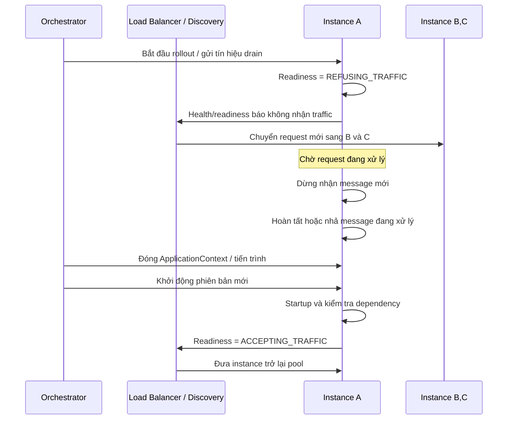

# Ảnh hưởng của restart hoặc pause đến yêu cầu đang xử lý

Một dịch vụ Spring Cloud có thể phải restart để triển khai phiên bản mới, nạp lại cấu hình hoặc khôi phục trạng thái. Dịch vụ cũng có thể được pause tạm thời để dừng một số luồng xử lý trước khi resume. Những thao tác này ảnh hưởng đến request HTTP đang chạy, message đang xử lý, kết nối đến dịch vụ khác và công việc nền.

Muốn tránh mất request hoặc tạo giao dịch trùng lặp, cần phân biệt ba cơ chế. **Graceful shutdown** đóng ứng dụng theo một khoảng chờ để request đang xử lý có cơ hội hoàn tất. **Restart ApplicationContext** đóng context Spring rồi khởi tạo lại context. **Pause/resume** trong Spring Cloud Context gọi các handler hỗ trợ pause/resume; phạm vi tác động phụ thuộc component được đăng ký handler. Các cơ chế này không có cùng semantics và không bảo đảm cùng một kết quả cho request đang chạy.

Bài học thuộc chương **Vòng đời ứng dụng** của **SPRING_CLOUD_CORE**. Trọng tâm là ảnh hưởng của restart hoặc pause đến yêu cầu đang xử lý, cách Spring Boot ngừng nhận traffic và chờ request hoàn tất, cách Spring Cloud cung cấp endpoint quản trị, và cách phối hợp readiness, service discovery, timeout, retry và idempotency khi triển khai hệ thống phân tán.

## 1. Mục tiêu học tập

Sau bài này, người học có thể:

1. Phân biệt restart tiến trình, restart ApplicationContext, graceful shutdown và pause/resume.
2. Mô tả trạng thái của request HTTP đang chạy khi ứng dụng bắt đầu shutdown.
3. Giải thích grace period, timeout theo lifecycle phase và giới hạn của graceful shutdown.
4. Phân biệt readiness với liveness và hiểu vai trò của traffic draining.
5. Giải thích endpoint /actuator/restart, /actuator/pause và /actuator/resume trong Spring Cloud Context.
6. Nhận diện ảnh hưởng của pause đến HTTP request, message consumer và component nền.
7. Thiết kế retry, idempotency, durable queue và quy trình rolling restart để hạn chế mất hoặc xử lý trùng công việc.
8. Kiểm thử hành vi shutdown/pause/resume thay vì chỉ kiểm tra ứng dụng có khởi động thành công.

## 2. Phân biệt các thao tác vòng đời

Từ “restart” thường được dùng cho nhiều thao tác khác nhau. Trước khi dự đoán request sẽ ra sao, hãy xác định thao tác nào đang diễn ra.

| Thao tác | Phạm vi | Điều xảy ra với ứng dụng |
| --- | --- | --- |
| Restart tiến trình | JVM/container/pod | Tiến trình cũ kết thúc; tiến trình mới được tạo |
| Restart ApplicationContext | Spring container trong tiến trình | Context bị đóng rồi được khởi tạo lại theo cơ chế restart |
| Graceful shutdown | Quá trình đóng web server/context | Ngừng nhận request mới, chờ request đang chạy trong thời gian cho phép |
| Immediate shutdown | Quá trình đóng web server/context | Ngừng phục vụ nhanh; request đang chạy có thể bị ngắt |
| Pause | Component có hỗ trợ pause | Component nhận lệnh pause; phạm vi dừng phụ thuộc handler |
| Resume | Component đã pause | Component nhận lệnh tiếp tục hoạt động |

Một pod restart thường bao gồm cả việc ứng dụng đóng context và container runtime kết thúc tiến trình. Một lệnh restart của Spring Cloud có thể chỉ khởi động lại ApplicationContext trong cùng JVM. Pause không nhất thiết đóng context, giải phóng mọi connection pool hoặc ngừng toàn bộ HTTP server.

## 3. Request đang xử lý là gì?

Một request có thể đang ở nhiều giai đoạn khác nhau:

1. Client đã gửi request nhưng chưa đến được ứng dụng.
2. Request đã được web server nhận và đang chờ worker thread.
3. Controller/service đang thực hiện logic nghiệp vụ.
4. Ứng dụng đang gọi database hoặc một service khác.
5. Giao dịch đã commit nhưng response chưa gửi xong.
6. Response đã gửi nhưng client chưa nhận được đầy đủ.
7. Request đã trả HTTP 202 và công việc được chuyển sang xử lý nền.

Các giai đoạn này có kết quả khác nhau khi shutdown. Graceful shutdown chủ yếu kiểm soát việc web server ngừng nhận request mới và cho request đang hoạt động thời gian hoàn tất. Nó không tự bảo đảm một thao tác nghiệp vụ bên ngoài được rollback, cũng không bảo đảm client nhận được response nếu kết nối mạng bị đóng sau khi server đã commit.

### 3.1. Request đã được nhận và đang chạy

Khi web server nhận request trước thời điểm shutdown, request đó có thể tiếp tục chạy trong grace period. Nếu logic nghiệp vụ hoàn tất trong thời gian cho phép và response được gửi thành công, client có thể nhận kết quả bình thường.

Ví dụ, một request tạo đơn hàng đang thực hiện:

- Kiểm tra dữ liệu và quyền truy cập.
- Ghi đơn hàng vào database.
- Ghi sự kiện vào outbox.
- Commit transaction.
- Trả response.

Nếu request hoàn tất trước khi grace period hết, graceful shutdown cho phép nó có cơ hội kết thúc. Nếu quá thời gian chờ, server hoặc tiến trình có thể bị đóng trong khi request vẫn chưa hoàn tất.

### 3.2. Request đang chờ worker thread

Request đã đến socket hoặc server queue nhưng chưa được xử lý có thể bị từ chối khi server chuyển sang trạng thái ngừng nhận traffic. Hành vi cụ thể phụ thuộc web server và phiên bản framework.

Client có thể nhận lỗi kết nối, HTTP 503 hoặc response khác tùy server/proxy. Không nên giả định mọi request đã mở TCP connection đều được bảo đảm xử lý.

### 3.3. Giao dịch đã commit nhưng response bị mất

Đây là trường hợp nguy hiểm nhất khi client retry thiếu kiểm soát:

1. Server nhận request tạo thanh toán.
2. Server ghi nhận giao dịch và commit.
3. Ứng dụng bắt đầu shutdown trước khi response đến client.
4. Client hết timeout và không biết giao dịch đã commit hay chưa.
5. Client gửi lại request.
6. Nếu server không có idempotency, giao dịch có thể bị tạo hai lần.

HTTP timeout hoặc connection reset không chứng minh rằng server chưa thực hiện nghiệp vụ. Với thao tác tạo đơn, thanh toán, chuyển tiền hoặc cấp quyền, cần idempotency key, unique constraint hoặc cơ chế tra cứu kết quả theo request ID.

## 4. Graceful shutdown trong Spring Boot

Graceful shutdown là cơ chế đóng ứng dụng theo thời gian chờ. Trong giai đoạn này, embedded web server ngừng nhận request mới và cho các request đang hoạt động cơ hội hoàn tất. Sau grace period, quá trình đóng ứng dụng tiếp tục theo lifecycle.

Spring Boot tích hợp graceful shutdown với các embedded web server được hỗ trợ và cả ứng dụng Servlet lẫn reactive. Cách server từ chối request mới có thể khác nhau: một số server dừng nhận ở tầng network; một số phiên bản/server có thể trả response từ chối. Kết nối persistent và HTTP keep-alive cũng ảnh hưởng cách client quan sát việc đóng.

### 4.1. Bật graceful shutdown tường minh

Có thể cấu hình:

```yaml
server:
  shutdown: graceful

spring:
  lifecycle:
    timeout-per-shutdown-phase: 30s
```

`server.shutdown` chọn cách đóng server. `spring.lifecycle.timeout-per-shutdown-phase` đặt khoảng chờ cho mỗi lifecycle phase của Spring. Hãy điều chỉnh theo thời gian xử lý request thực tế và thời gian drain mà hệ thống cần.

Một số phiên bản Spring Boot mới bật graceful shutdown mặc định cho các embedded server được hỗ trợ; các phiên bản trước yêu cầu cấu hình `server.shutdown=graceful`. Khai báo tường minh giúp ý định triển khai rõ ràng, nhưng vẫn cần kiểm tra tài liệu của đúng phiên bản Boot và web server đang dùng.

### 4.2. Grace period không phải cam kết request luôn thành công

Graceful shutdown tạo cơ hội cho request hoàn tất trong một khoảng thời gian. Nó không thể bảo đảm request sẽ thành công nếu:

- Request bị treo do database hoặc service phụ thuộc không phản hồi.
- Request có thời gian chạy dài hơn grace period.
- Worker thread bị kẹt hoặc deadlock.
- Process bị hệ điều hành/container runtime buộc kết thúc.
- Máy bị mất điện, crash hoặc bị kill cưỡng bức.
- Client hoặc proxy đóng kết nối trước khi server gửi xong response.

Do đó, ứng dụng vẫn cần timeout ở tầng HTTP client, database, transaction và request tổng thể. Grace period nên lớn hơn thời gian xử lý hợp lệ tối đa của request cần được drain, nhưng không nên kéo dài vô hạn.

### 4.3. Thứ tự shutdown của lifecycle bean

Spring Boot thực hiện graceful shutdown như một phần của quá trình đóng ApplicationContext và phối hợp với `SmartLifecycle` beans. Các component có lifecycle cần dừng theo phase phù hợp để tránh nhận thêm công việc trong khi dependency đã bị đóng.

Ví dụ, nếu một message consumer còn nhận message trong khi database connection pool đã shutdown, consumer có thể thất bại khi ghi dữ liệu. Thiết kế lifecycle cần bảo đảm thứ tự:

1. Ngừng nhận công việc mới.
2. Chờ công việc đang xử lý hoàn tất trong giới hạn thời gian.
3. Commit hoặc acknowledge kết quả theo semantics của hệ thống.
4. Dừng worker/executor và consumer.
5. Đóng client, connection pool và tài nguyên phụ thuộc.

Không phải mọi bean tự động được drain theo cùng một cách. Với executor, scheduler, message listener hoặc resource tự quản lý, cần xem tài liệu component và cấu hình shutdown riêng.

## 5. Readiness và traffic draining

Trước khi dừng một instance, hệ thống cần giảm hoặc ngừng gửi traffic mới đến instance đó. Đây là công việc của readiness và cơ chế load balancing/service discovery.

Spring Boot có `ApplicationAvailability` với các trạng thái liveness và readiness. Readiness cho biết instance có sẵn sàng nhận traffic hay không. Khi ứng dụng bước vào graceful shutdown, Spring Boot chuyển readiness sang `REFUSING_TRAFFIC`; trong giai đoạn hoạt động bình thường, trạng thái sẵn sàng là `ACCEPTING_TRAFFIC`.

### 5.1. Readiness khác liveness

| Trạng thái | Ý nghĩa | Hệ thống điều phối nên làm gì? |
| --- | --- | --- |
| Liveness `CORRECT` | Tiến trình còn sống và không cần bị restart để khôi phục | Không restart chỉ vì một dependency bên ngoài tạm thời lỗi |
| Readiness `ACCEPTING_TRAFFIC` | Instance sẵn sàng nhận request | Có thể đưa instance vào danh sách phục vụ |
| Readiness `REFUSING_TRAFFIC` | Instance không muốn nhận request mới | Ngừng gửi traffic mới đến instance |

Không dùng liveness để biểu diễn trạng thái “đang drain”. Nếu liveness thất bại, Kubernetes có thể restart container, làm mất khoảng thời gian graceful shutdown cần thiết. Readiness phù hợp hơn để đưa instance ra khỏi luồng traffic.

### 5.2. Health probe trong Kubernetes

Spring Boot Actuator có các health group cho readiness và liveness. Với ứng dụng chạy trên Kubernetes, có thể cấu hình probe trỏ đến:

```yaml
livenessProbe:
  httpGet:
    path: /actuator/health/liveness
    port: 8080

readinessProbe:
  httpGet:
    path: /actuator/health/readiness
    port: 8080
```

Khi readiness không đạt, Kubernetes ngừng chọn pod đó cho traffic qua Service theo cơ chế endpoint của nó. Việc cập nhật EndpointSlice, load balancer hoặc ingress có độ trễ riêng; request có thể vẫn đến trong thời gian chuyển tiếp. Vì vậy, readiness và graceful shutdown nên được phối hợp để có một khoảng drain đủ dài.

Nếu Actuator chạy ở management port riêng, probe có thể thành công trong khi web server chính không nhận được connection. Với môi trường cần kiểm tra khả năng phục vụ thực tế, cân nhắc expose probe path trên main server port theo hướng dẫn Spring Boot.

### 5.3. Đánh dấu readiness thủ công

Trong một quy trình drain do ứng dụng điều khiển, có thể phát hành availability event:

```java
AvailabilityChangeEvent.publish(
    applicationContext,
    ReadinessState.REFUSING_TRAFFIC
);
```

Sau khi instance sẵn sàng phục vụ trở lại, trạng thái có thể được chuyển về `ACCEPTING_TRAFFIC` theo quy trình lifecycle phù hợp.

Đây là thay đổi trạng thái readiness trong ứng dụng. Nó không tự bảo đảm mọi load balancer đã cập nhật tức thì và cũng không tự dừng web server. Cần để hệ thống điều phối quan sát probe, ngừng gửi request mới, rồi mới tiến hành bước đóng context/process.

### 5.4. Khoảng drain và termination grace period

Trong Kubernetes, thời gian kết thúc pod cần đủ cho các bước preStop (nếu có), traffic propagation/drain và graceful shutdown của ứng dụng. `terminationGracePeriodSeconds` là ngân sách tổng thể trước khi container bị buộc kết thúc; hook `preStop` cũng tiêu thụ ngân sách đó.

Ví dụ, nếu ứng dụng cần 30 giây để xử lý shutdown và hạ tầng cần thêm thời gian để cập nhật endpoint, không nên đặt termination grace period bằng đúng 30 giây. Hãy đo độ trễ thực tế, cộng thời gian drain và một khoảng dự phòng, sau đó kiểm thử với tải thật.

## 6. Ảnh hưởng của restart đến request đang xử lý

### 6.1. Restart tiến trình/JVM

Khi tiến trình kết thúc, mọi thread, object trong heap và connection thuộc tiến trình sẽ mất. Nếu nhận tín hiệu kết thúc bình thường như `SIGTERM`, Spring Boot có thể đóng ApplicationContext và thực hiện graceful shutdown nếu cấu hình/server hỗ trợ.

Nếu tiến trình bị `SIGKILL`, crash hoặc máy bị dừng đột ngột, không có cơ hội chạy shutdown hook. Các request đang xử lý có thể bị ngắt ngay. Client thường thấy connection reset, EOF, timeout hoặc lỗi gateway.

### 6.2. Restart ApplicationContext bằng Spring Cloud

Spring Cloud Commons cung cấp endpoint quản trị `/actuator/restart` để đóng ApplicationContext rồi restart context. Endpoint này bị tắt mặc định theo tài liệu Spring Cloud. Việc restart context có thể kéo theo lifecycle close của web server và các bean, nhưng nó không phải rolling restart ở tầng orchestration.

Một request gọi chính endpoint restart có thể bị ảnh hưởng bởi quá trình đóng server/context trước khi response được gửi xong. Không nên thiết kế client phụ thuộc vào việc nhận được một response HTTP hoàn chỉnh từ request kích hoạt restart.

Restart context cũng không đồng nghĩa tạo JVM mới. Static state, thread hoặc tài nguyên không được quản lý đúng có thể còn tồn tại trong process nếu code tự tạo ngoài lifecycle Spring. Vì vậy, với thay đổi cần làm sạch hoàn toàn process state hoặc nâng cấp binary, rolling restart ở tầng container/process thường rõ ràng hơn.

### 6.3. Restart tức thời

Nếu server đóng ngay hoặc tiến trình bị buộc kết thúc trước khi request hoàn tất, request đang xử lý sẽ không có bảo đảm hoàn thành. Các transaction database chưa commit có thể rollback khi connection đóng, nhưng side effect đã gửi sang hệ thống ngoài không tự được hoàn tác.

Một lệnh gửi email, gọi cổng thanh toán hoặc publish message có thể đã được hệ thống đích tiếp nhận dù caller chưa nhận response. Đây là lý do retry phải kết hợp idempotency và khả năng tra cứu trạng thái.

### 6.4. Rolling restart trong cụm nhiều instance

Trong một cụm nhiều replica, rolling restart thay từng instance theo từng đợt. Nếu cấu hình readiness và capacity phù hợp, các instance còn lại tiếp tục nhận traffic trong khi một instance drain và restart.

Cần kiểm tra:

- Số replica tối thiểu còn phục vụ khi một instance rời cụm.
- PodDisruptionBudget hoặc chính sách rollout có cho phép đủ instance tiếp tục chạy không.
- Readiness probe có phản ánh đúng khả năng phục vụ không.
- Load balancer/service discovery có loại instance sắp dừng khỏi pool không.
- Client retry có giới hạn và có idempotency không.
- Các consumer message có được dừng/acknowledge theo đúng semantics không.

Rolling restart giảm phạm vi gián đoạn, nhưng không tự bảo đảm không mất request nếu traffic routing, timeout hoặc retry được cấu hình sai.

## 7. Pause và resume trong Spring Cloud Context

Spring Cloud Commons cung cấp các endpoint quản trị pause/resume cho ứng dụng Spring Boot Actuator. Theo tài liệu Spring Cloud Commons hiện hành, `/actuator/pause` và `/actuator/resume` gọi `pause()` và `resume()` trên các bean triển khai `PauseHandler`. Spring Cloud cung cấp handler cho các component Spring Integration hỗ trợ `Pausable`.

Điểm quan trọng là pause/resume tác động đến **các component có handler**, không phải một cam kết chung rằng toàn bộ HTTP server ngừng nhận request và drain mọi request đang chạy.

### 7.1. Pause không đồng nghĩa graceful shutdown

Pause có thể hữu ích khi muốn tạm dừng polling endpoint, consumer hoặc một luồng integration có hỗ trợ pause. Nhưng nó không mặc nhiên:

- Đóng ApplicationContext.
- Đóng JVM.
- Đưa pod ra khỏi service discovery.
- Chuyển readiness sang `REFUSING_TRAFFIC`.
- Dừng tất cả controller HTTP.
- Hủy mọi request đang chạy.
- Đợi mọi transaction hoặc message đang xử lý hoàn tất.
- Đóng toàn bộ connection pool.

Một request HTTP đang xử lý có thể tiếp tục, bị ảnh hưởng bởi component downstream đã pause, hoặc bị từ chối ở một bước tiếp theo. Kết quả phụ thuộc chính component và handler cụ thể.

### 7.2. Hành vi phụ thuộc component

Ví dụ một service sử dụng Spring Integration để poll dữ liệu từ hệ thống ngoài. Khi component hỗ trợ `Pausable` được pause, việc lấy message mới có thể dừng. Tuy nhiên, message đã được nhận và đang chạy qua flow có thể vẫn tiếp tục theo semantics của endpoint, executor và transaction.

Một handler tự viết có thể chọn ngừng nhận công việc mới, chờ in-flight counter về 0 rồi mới báo pause hoàn tất. Handler khác có thể chỉ đặt một cờ và ngăn lần poll tiếp theo. Không thể suy luận rằng mọi handler đều có cùng semantics.

### 7.3. Khác biệt phiên bản Spring Cloud

Tài liệu Spring Cloud Commons hiện hành mô tả endpoint pause/resume theo `PauseHandler`; tài liệu của một số thế hệ cũ mô tả việc gọi các lifecycle method `stop()` và `start()` của ApplicationContext. Hãy kiểm tra tài liệu đúng release train đang dùng và API của component thực tế.

Không nên sao chép giả định từ ví dụ cũ rồi áp dụng cho phiên bản mới. Đặc biệt, việc context bị stop/start không có nghĩa web server đã thực hiện graceful drain giống quy trình đóng ApplicationContext.

### 7.4. Resume không khôi phục request đã mất

Resume cho phép component tiếp tục hoạt động. Nó không khôi phục HTTP request đã bị client hủy, không phát lại transaction bị rollback và không tự xử lý message đã bị mất do acknowledge sai thời điểm.

Nếu công việc cần tiếp tục sau pause/restart, hãy lưu trạng thái công việc ở nơi bền vững và thiết kế cơ chế resume/retry ở tầng nghiệp vụ.

## 8. Endpoint restart, pause và resume

Các endpoint quản trị thuộc Spring Cloud Context được cung cấp khi ứng dụng dùng Spring Boot Actuator và dependency Spring Cloud phù hợp.

| Endpoint | Tác dụng | Ảnh hưởng đến request |
| --- | --- | --- |
| `POST /actuator/restart` | Đóng ApplicationContext rồi restart | Có thể làm request hiện tại và request khác bị gián đoạn trong lúc context/server đóng |
| `POST /actuator/pause` | Gọi pause trên các `PauseHandler` | Phụ thuộc handler; không bảo đảm mọi HTTP request được drain |
| `POST /actuator/resume` | Gọi resume trên các `PauseHandler` | Cho component đã pause hoạt động lại theo semantics của nó |

Restart endpoint bị tắt mặc định trong tài liệu Spring Cloud. Pause/resume cũng có thể bị vô hiệu hóa cùng restart endpoint tùy phiên bản/cấu hình. Các endpoint phải được expose và cấp quyền theo cấu hình Actuator tương ứng.

Ví dụ cấu hình exposure cần được cân nhắc theo phiên bản:

```yaml
management:
  endpoints:
    web:
      exposure:
        include: health,info,restart,pause,resume
```

Ví dụ này chỉ thể hiện việc expose các endpoint qua HTTP. Nó không tự bật mọi endpoint đang bị disable và không thay thế cấu hình access control. Không expose restart/pause/resume trên mạng công khai. Hãy giới hạn network, yêu cầu xác thực và phân quyền, ghi audit log, đồng thời cân nhắc dùng management port riêng.

## 9. Xử lý message và công việc nền khi pause/restart

Một ứng dụng Spring Cloud thường không chỉ phục vụ HTTP. Nó còn có thể tiêu thụ message, chạy scheduled job, poll service registry hoặc xử lý batch. Các công việc này cần chiến lược shutdown riêng.

### 9.1. Message consumer

Khi dừng consumer, cần phân biệt:

- Message đang ở broker nhưng chưa được nhận.
- Message đã được nhận nhưng chưa bắt đầu xử lý.
- Message đang được xử lý.
- Xử lý đã hoàn tất nhưng chưa acknowledge.
- Message đã được acknowledge.

Nếu ứng dụng dừng trước khi acknowledge, broker có thể giao message lại sau đó tùy broker và acknowledgment mode. Nếu acknowledge trước khi công việc bền vững hoàn tất, restart có thể làm mất công việc.

Nguyên tắc an toàn là chỉ acknowledge khi xử lý đã đạt điểm hoàn tất theo hợp đồng của ứng dụng. Nếu xử lý có thể được giao lại, handler phải idempotent để không tạo side effect trùng.

### 9.2. Scheduled task

Một scheduled job có thể đang chạy khi context bắt đầu shutdown. Hãy kiểm tra executor/scheduler có chờ task hiện tại hoàn tất không, có interrupt thread khi shutdown không và task có thể tiếp tục từ checkpoint hay không.

Đối với batch dài, lưu tiến độ theo chunk hoặc checkpoint. Không dựa vào việc thread trong JVM sẽ sống sót qua restart.

### 9.3. Async HTTP request

Nếu controller trả HTTP 202 và chuyển công việc sang `@Async` hoặc executor cục bộ, response thành công chỉ cho biết request đã được tiếp nhận theo logic ứng dụng. Nó không bảo đảm job sẽ sống sót khi process restart.

Nếu công việc phải tồn tại qua restart, hãy ghi job vào database hoặc broker bền vững trước khi trả 202. Worker có thể nhận lại job sau khi ứng dụng khởi động.

### 9.4. Streaming và kết nối dài hạn

SSE, WebSocket, long polling và gRPC stream có thể tồn tại lâu hơn grace period. Khi server đóng, kết nối có thể bị kết thúc dù logic xử lý thông thường vẫn hoạt động.

Client nên hỗ trợ reconnect, cursor/offset hoặc resume token nếu giao thức và nghiệp vụ cho phép. Với stream không thể tiếp tục, cần thông báo trạng thái và thiết kế client lấy lại dữ liệu từ điểm đã xác nhận cuối cùng.

## 10. Retry, timeout và idempotency

Restart/pause làm tăng khả năng client gặp lỗi tạm thời. Retry có thể giúp phục hồi, nhưng retry mù có thể nhân đôi side effect.

### 10.1. Không retry mọi lỗi giống nhau

| Tình huống client quan sát | Khả năng xảy ra | Hành động nên cân nhắc |
| --- | --- | --- |
| Connection refused | Instance đã ngừng nhận connection | Retry có backoff và giới hạn |
| Connection reset/EOF | Kết nối bị đóng giữa request/response | Không biết chắc server đã commit hay chưa; cần idempotency |
| HTTP 503 | Server/proxy đang từ chối traffic | Retry theo Retry-After hoặc policy có giới hạn |
| Read timeout | Server có thể vẫn đang xử lý | Tra cứu kết quả bằng request ID trước khi gửi lại thao tác ghi |
| HTTP 4xx nghiệp vụ | Dữ liệu hoặc quyền không hợp lệ | Thường không retry tự động |
| HTTP 2xx nhưng response body bị mất | Nghiệp vụ có thể đã thành công | Dùng idempotency key hoặc status lookup |

### 10.2. Idempotency key

Với thao tác tạo giao dịch, client gửi một idempotency key ổn định cho cùng một ý định nghiệp vụ. Server lưu key cùng kết quả đã xử lý trong transaction. Nếu client gửi lại cùng key, server trả kết quả trước đó thay vì tạo giao dịch mới.

Ví dụ request:

```http
POST /api/payments
Idempotency-Key: 4f0f4c5e-2d9d-4e8d-9b77-6c8d9e7a2b10
Content-Type: application/json
```

Server cần bảo đảm unique constraint hoặc cơ chế atomic insert cho key. Chỉ lưu key trong cache cục bộ của JVM không đủ nếu request retry đến instance khác hoặc ứng dụng đã restart.

### 10.3. Timeout phải có quan hệ rõ ràng

Các timeout nên được thiết kế theo thứ tự:

- Timeout của dependency (database/HTTP client) phải nhỏ hơn budget request tổng thể.
- Request tổng thể phải nằm trong giới hạn latency mà hệ thống chấp nhận.
- Grace period phải đủ để các request hợp lệ đang chạy có cơ hội kết thúc.
- Orchestrator termination grace phải bao trùm drain và shutdown timeout, cộng thêm khoảng dự phòng.

Nếu dependency timeout lớn hơn shutdown grace, request có thể vẫn chờ dependency khi ứng dụng hết thời gian shutdown. Nếu client timeout ngắn hơn thời gian server hoàn tất, client có thể retry trong khi request cũ vẫn đang chạy.

## 11. Service discovery và load balancer khi một instance rời cụm

Spring Cloud Commons cung cấp abstraction discovery và load balancing; implementation thực tế có thể là Eureka, Consul, Kubernetes hoặc hệ thống khác. Khi instance chuẩn bị restart, việc đánh dấu không sẵn sàng và loại khỏi luồng traffic cần phối hợp với cơ chế discovery/health check.

Một số hệ thống cập nhật danh sách instance qua heartbeat, lease hoặc health check theo chu kỳ. Vì vậy, việc deregister không nhất thiết khiến mọi client ngừng gửi request ngay lập tức. Load balancer có thể giữ cache cũ hoặc một kết nối persistent vẫn còn tồn tại.

Quy trình drain nên gồm:

1. Đánh dấu readiness là `REFUSING_TRAFFIC`.
2. Chờ load balancer/service discovery cập nhật và ngừng gửi request mới.
3. Dừng nhận công việc nền mới hoặc pause consumer theo semantics của component.
4. Cho request/message đang xử lý hoàn tất trong thời gian cho phép.
5. Đóng context/tiến trình.
6. Khởi động instance mới và chỉ đánh dấu ready sau khi hoàn thành startup task.

Không nên chỉ deregister instance rồi lập tức kill process. Hãy xác định độ trễ propagation và cách client xử lý instance stale trong đúng discovery implementation.

## 12. Ví dụ quy trình rolling restart

Giả sử dịch vụ `inventory-service` có ba replica sau load balancer. Mỗi replica phục vụ HTTP request và tiêu thụ message từ broker.

Một quy trình triển khai có thể như sau:



Trong thực tế, readiness propagation và broker consumer pause có thể chạy song song hoặc theo thứ tự phụ thuộc kiến trúc. Điều quan trọng là không dừng dependency mà request đang chạy vẫn cần dùng. Ví dụ, đóng connection pool trước khi request hoàn tất sẽ làm mất lợi ích của graceful shutdown.

### 12.1. Tránh rollout làm cạn capacity

Nếu tất cả replica bị drain cùng lúc, service có thể không còn instance nhận traffic. Dùng rolling strategy phù hợp với capacity, readiness và PodDisruptionBudget. Với workload nhạy cảm, thử rollout khi tải cao và đo latency/error rate thay vì chỉ kiểm thử ở môi trường nhàn rỗi.

## 13. Thiết kế component có thể dừng an toàn

### 13.1. Dừng nhận việc mới trước

Một worker có thể có hai trạng thái riêng:

- `accepting`: có nhận công việc mới không.
- `inFlight`: số công việc đang xử lý.

Khi drain, worker đặt `accepting=false`, sau đó chờ `inFlight` giảm về 0 trong giới hạn thời gian. Nếu hết thời gian, worker phải áp dụng chính sách đã định: để broker redeliver, ghi checkpoint, chuyển job về pending hoặc đánh dấu kết quả chưa xác định.

### 13.2. SmartLifecycle

`SmartLifecycle` cho phép component tham gia start/stop sequence của Spring. Với component có thể dừng bất đồng bộ, phương thức `stop(Runnable callback)` cho phép gọi callback khi component đã dừng.

Mẫu khái quát:

```java
@Component
class InventoryConsumerLifecycle implements SmartLifecycle {

    private volatile boolean running;

    @Override
    public void start() {
        running = true;
        // Bắt đầu nhận công việc mới.
    }

    @Override
    public void stop(Runnable callback) {
        stopAcceptingNewMessages();
        drainInFlightWork().whenComplete((ignored, failure) -> {
            running = false;
            callback.run();
        });
    }

    @Override
    public void stop() {
        running = false;
    }

    @Override
    public boolean isRunning() {
        return running;
    }

    @Override
    public boolean isAutoStartup() {
        return true;
    }
}
```

Đây là skeleton minh họa, không phải consumer hoàn chỉnh. `stopAcceptingNewMessages` và `drainInFlightWork` là các phương thức do ứng dụng triển khai; phương thức drain nên trả về một `CompletableFuture` hoặc cơ chế bất đồng bộ tương đương. Callback chỉ được gọi sau khi quá trình dừng đã hoàn tất; cần xử lý timeout, lỗi drain, đồng bộ state và idempotency khi `stop` được gọi nhiều lần.

### 13.3. Đóng tài nguyên đúng thứ tự

Khi component dừng, đóng theo quan hệ phụ thuộc:

- Dừng nhận request/message mới.
- Chờ handler đang dùng client/database hoàn tất.
- Dừng executor sau khi task kết thúc hoặc được chuyển giao.
- Đóng HTTP client, connection pool và broker connection.
- Giải phóng listener, scheduler và thread nền.

Không tự tạo thread nền không được quản lý bởi Spring nếu không có cơ chế shutdown rõ ràng. Thread không daemon có thể giữ process sống; thread daemon có thể bị mất ngay khi JVM kết thúc.

## 14. Kiểm thử restart, pause và request in-flight

Test chỉ xác nhận endpoint `/actuator/restart` trả HTTP 200 là chưa đủ. Cần kiểm tra hành vi của request đang chạy, request mới, message consumer và trạng thái readiness.

### 14.1. Kiểm thử graceful shutdown với request chậm

Tạo một endpoint test có thể giữ request trong vài giây:

```java
@RestController
class SlowRequestController {

    @GetMapping("/test/slow")
    String slow() throws InterruptedException {
        Thread.sleep(5_000);
        return "completed";
    }
}
```

Trong integration test:

1. Gửi request `/test/slow` và giữ kết nối mở.
2. Bắt đầu đóng ApplicationContext hoặc gửi tín hiệu shutdown hợp lệ.
3. Xác nhận server ngừng nhận request mới.
4. Xác nhận request cũ hoàn tất nếu nằm trong grace period.
5. Lặp lại với request dài hơn timeout và quan sát kết quả khi shutdown deadline hết.

Không dùng `Thread.sleep` như chiến lược xử lý production; đây chỉ là endpoint test để tạo request có thời lượng xác định. Test phải điều khiển shutdown và timeout một cách lặp lại được.

### 14.2. Kiểm thử readiness

Có thể kiểm tra `ApplicationAvailability` hoặc health endpoint:

```java
ReadinessState state =
    applicationAvailability.getReadinessState();

assertThat(state).isEqualTo(ReadinessState.ACCEPTING_TRAFFIC);
```

Khi bắt đầu shutdown, readiness nên chuyển sang `REFUSING_TRAFFIC` theo lifecycle hỗ trợ. Với test orchestration, cần xác nhận load balancer hoặc service test double ngừng chọn instance sau khi quan sát readiness thay đổi.

### 14.3. Kiểm thử pause handler

Với Spring Cloud `/actuator/pause` và `/actuator/resume`, hãy tạo test cho đúng `PauseHandler`/component được sử dụng:

- Xác nhận pause ngăn nhận công việc mới theo semantics của handler.
- Xác nhận công việc đã nhận được xử lý hoặc được nhả theo policy.
- Xác nhận resume cho phép nhận công việc mới trở lại.
- Xác nhận trạng thái pause không làm mất message.
- Xác nhận HTTP request độc lập không bị hiểu nhầm là đã drain chỉ vì handler đã pause.

Không dùng một unit test cho `PauseHandler` để kết luận toàn bộ web server có graceful shutdown.

### 14.4. Kiểm thử idempotency khi response bị mất

Một test nghiệp vụ hữu ích là mô phỏng:

1. Server commit giao dịch.
2. Test client chủ động ngắt kết nối trước khi đọc response.
3. Client gửi lại cùng idempotency key.
4. Server trả kết quả cũ và không tạo thêm giao dịch.

Test này kiểm tra đúng tình huống restart/network failure dễ gây side effect trùng.

## 15. Quan sát và vận hành

Trong rollout hoặc restart, cần quan sát các chỉ số:

- Số request đang hoạt động.
- Số request mới bị từ chối trong giai đoạn drain.
- Thời gian graceful shutdown thực tế.
- Số request kết thúc bằng timeout, reset hoặc 5xx.
- Số message đang in-flight và số lần redelivery.
- Số task nền chưa hoàn tất.
- Thời gian readiness chuyển sang refusing traffic và thời gian endpoint/discovery cập nhật.
- Số lần retry và số request bị deduplicate bằng idempotency key.

Log nên chứa correlation ID/request ID và trạng thái lifecycle, nhưng không ghi payload nhạy cảm hoặc credential. Khi một instance restart, các log của instance cũ và instance mới cần có instance ID để phân biệt.

Một shutdown kéo dài thường là dấu hiệu request, executor hoặc dependency không hoàn tất. Đừng chỉ tăng timeout mà không xác định thành phần đang chờ. Có thể dùng thread dump, request metrics và broker consumer metrics để tìm nguyên nhân.

## 16. Những hiểu lầm phổ biến

**“Restart luôn chờ request hiện tại hoàn tất.”** Chỉ graceful shutdown có grace period và request phải kết thúc trong giới hạn đó. Crash hoặc forced kill không chờ.

**“/actuator/restart giống rolling restart của Kubernetes.”** Endpoint Spring Cloud đóng và restart ApplicationContext; orchestration restart tiến trình/container và có thể thay binary/image.

**“Pause đồng nghĩa server ngừng nhận HTTP request.”** Spring Cloud pause/resume gọi các PauseHandler. Chỉ component có handler mới chịu tác động theo semantics của nó.

**“Resume khôi phục request bị ngắt.”** Resume chỉ tiếp tục component đã pause; nó không khôi phục request hoặc transaction đã mất.

**“Readiness false lập tức chặn mọi request.”** Load balancer và discovery cần thời gian cập nhật; connection cũ hoặc traffic đang trên đường có thể vẫn đến.

**“HTTP timeout nghĩa server chưa commit.”** Server có thể đã commit nhưng response bị mất. Cần idempotency và status lookup.

**“Message consumer dừng là message đang xử lý tự được redeliver.”** Điều đó phụ thuộc acknowledgment, transaction và broker. Acknowledge quá sớm có thể làm mất công việc.

**“Tăng shutdown timeout giải quyết mọi vấn đề.”** Request có thể bị treo vô hạn hoặc dependency không phản hồi. Cần timeout theo tầng và quan sát nguyên nhân.

**“Một bean SmartLifecycle là đủ để drain toàn ứng dụng.”** Mỗi server, executor, consumer và resource có lifecycle riêng; phải phối hợp theo dependency.

## 17. Checklist trước khi restart hoặc pause

Trước khi thao tác trên một instance production, hãy kiểm tra:

1. **Loại thao tác:** restart process, restart context, graceful shutdown hay pause handler?
2. **Readiness:** instance đã chuyển sang `REFUSING_TRAFFIC` chưa?
3. **Traffic drain:** load balancer/discovery đã ngừng gửi request mới chưa?
4. **Request in-flight:** có request dài, streaming hoặc transaction đang chạy không?
5. **Grace period:** timeout có đủ cho request hợp lệ và lifecycle phase không?
6. **Orchestrator:** termination grace period có bao trùm preStop, drain và shutdown không?
7. **Message consumer:** đã dừng nhận message mới và xử lý/nhả message in-flight đúng cách chưa?
8. **Background task:** job có checkpoint hoặc durable queue để phục hồi không?
9. **Idempotency:** client retry có thể tạo side effect trùng không?
10. **Dependencies:** database/client/pool có được đóng sau khi request hoàn tất không?
11. **Endpoint security:** endpoint quản trị có bị expose công khai không?
12. **Resume/readiness:** instance chỉ được nhận traffic lại sau khi startup và health checks hoàn tất chưa?

## 18. Bài tập áp dụng

### Bài tập 1. Request tạo đơn bị ngắt

Một request tạo đơn hàng mất 8 giây. Ứng dụng có graceful shutdown timeout 5 giây. Server commit database ở giây thứ 6, nhưng process bị kết thúc trước khi response đến client.

Hãy giải thích:

- Client có thể quan sát lỗi gì?
- Vì sao retry có thể tạo đơn trùng?
- Cần idempotency key hoặc status lookup như thế nào?
- Nên điều chỉnh timeout nào và cần bảo đảm gì với orchestrator?

### Bài tập 2. Pause một message consumer

Một ứng dụng dùng Spring Integration để poll broker và xử lý message. Khi gọi `/actuator/pause`, một message đã được nhận nhưng chưa commit transaction.

Hãy xác định các trạng thái message có thể có, điều gì phụ thuộc vào `PauseHandler` và acknowledgment mode, và cách thiết kế để message không mất khi pause/restart.

### Bài tập 3. Rolling restart ba replica

Một dịch vụ có ba replica, mỗi replica xử lý request tối đa 10 giây. Load balancer cần khoảng 4 giây để cập nhật trạng thái instance. Hãy đề xuất:

- Trình tự readiness, drain và shutdown.
- Giá trị grace period tối thiểu cần kiểm thử.
- Cách đặt termination grace period có thêm khoảng dự phòng.
- Cách bảo đảm còn đủ capacity trong rollout.

### Bài tập 4. Phân biệt restart và pause

Một nhóm vận hành muốn dừng polling trong 2 phút nhưng vẫn giữ HTTP API hoạt động. Hãy xác định vì sao pause handler của component polling phù hợp hơn restart ApplicationContext, những gì cần kiểm thử trước/sau pause, và cách bảo đảm request HTTP không phụ thuộc vào component đã pause.

### Câu hỏi tự kiểm tra

1. Graceful shutdown khác immediate shutdown ở đâu?
2. `server.shutdown` và `spring.lifecycle.timeout-per-shutdown-phase` điều khiển phần nào?
3. Vì sao readiness và liveness phải được phân biệt?
4. Request đã commit nhưng response bị mất có thể gây vấn đề gì khi retry?
5. `/actuator/restart` khác restart JVM/container như thế nào?
6. `/actuator/pause` và `/actuator/resume` tác động đến loại bean nào trong Spring Cloud Commons hiện hành?
7. Vì sao pause không tự bảo đảm HTTP request đang chạy được drain?
8. Message consumer nên acknowledge ở thời điểm nào để hạn chế mất message?
9. `SmartLifecycle` hỗ trợ quá trình dừng component ra sao?
10. Vì sao cần kiểm thử idempotency và rolling restart dưới tải?

## 19. Nguồn tham chiếu

- [Spring Boot Reference — Graceful Shutdown](https://docs.spring.io/spring-boot/reference/web/graceful-shutdown.html): cách embedded web server ngừng nhận request mới và chờ request hiện tại trong shutdown grace period.
- [Spring Boot Reference — Actuator Endpoints and Kubernetes Probes](https://docs.spring.io/spring-boot/reference/actuator/endpoints.html): readiness, liveness, health probes và trạng thái ứng dụng theo lifecycle.
- [Spring Cloud Commons — Application Context Services](https://docs.spring.io/spring-cloud-commons/reference/spring-cloud-commons/application-context-services.html): restart, pause/resume, refresh scope và các endpoint quản trị context.
- [Spring Framework Reference — Lifecycle Callbacks](https://docs.spring.io/spring-framework/reference/core/beans/factory-nature.html): lifecycle callback và quản lý vòng đời bean.
- [Spring Integration Reference](https://docs.spring.io/spring-integration/reference/): cách quản lý lifecycle các integration endpoint; kiểm tra semantics của component cụ thể.

## Ghi nhớ

Restart có thể đóng context hoặc kết thúc cả tiến trình; pause chỉ tác động đến component có cơ chế pause tương ứng. Graceful shutdown cho request đang xử lý một khoảng thời gian để hoàn tất, nhưng không bảo đảm thành công nếu request vượt timeout hoặc process bị kill. Muốn giảm lỗi khi triển khai, hãy chuyển readiness sang từ chối traffic, drain load balancer, dừng nhận công việc mới, hoàn tất hoặc lưu bền vững công việc đang chạy, rồi mới đóng tài nguyên. Client vẫn phải có timeout, retry có giới hạn và idempotency vì response có thể bị mất sau khi server đã commit.
