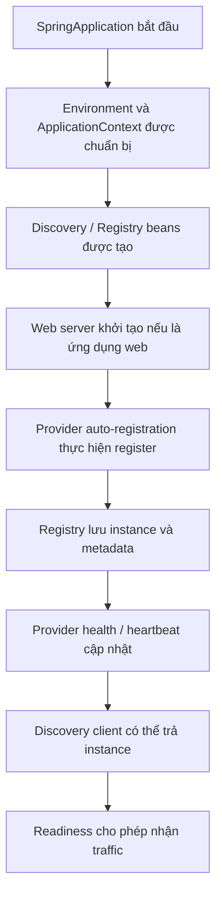
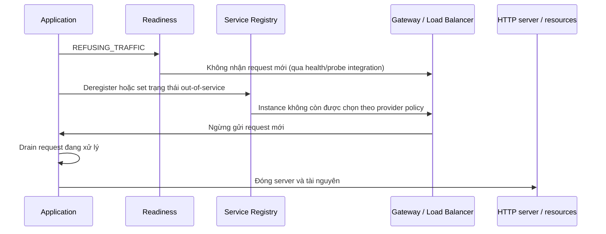

# Phân biệt trạng thái ứng dụng với trạng thái đăng ký dịch vụ

Trong hệ thống phân tán, một instance có thể đã khởi động xong nhưng chưa nên nhận request; một instance khác có thể đã được ghi vào service registry nhưng đang lỗi kết nối database; cũng có trường hợp ứng dụng đã sẵn sàng nhưng registry vẫn giữ một bản ghi cũ. Những tình huống này xuất hiện vì **trạng thái của ứng dụng** và **trạng thái đăng ký dịch vụ** là hai khái niệm liên quan nhưng độc lập.

Spring Boot cung cấp `ApplicationAvailability` cùng các trạng thái liveness/readiness để biểu diễn khả năng sống và khả năng nhận traffic của ứng dụng. Spring Cloud Commons cung cấp các abstraction như `ServiceRegistry`, `Registration` và `DiscoveryClient` để đăng ký, hủy đăng ký và tìm các instance dịch vụ. Registry có thể lưu trạng thái riêng của instance; discovery client và load balancer lại có quy tắc chọn instance riêng.

Với **SPRING_CLOUD_CORE**, hiểu đúng các ranh giới này giúp vận hành discovery, service registry, giao tiếp dịch vụ và health check an toàn. Bài học thuộc chương **Vòng đời ứng dụng**, tập trung vào cách phối hợp availability của ứng dụng với registration và khả năng được định tuyến trong hệ thống phân tán.

## 1. Mục tiêu học tập

Sau bài này, bạn có thể:

- Phân biệt liveness, readiness, registration, discovery và khả năng nhận request.
- Đọc trạng thái ứng dụng qua `ApplicationAvailability`.
- Giải thích vai trò của `LivenessState` và `ReadinessState`.
- Mô tả hợp đồng `ServiceRegistry`, `Registration` và `DiscoveryClient`.
- Nhận biết thời điểm auto-registration thường xảy ra và vì sao nó phụ thuộc provider.
- Giải thích vì sao một instance có thể đã đăng ký nhưng chưa sẵn sàng.
- Phân biệt health check của ứng dụng với health/status được registry sử dụng.
- Thiết kế startup, shutdown, graceful draining và deregistration.
- Cấu hình health probes cho môi trường container/Kubernetes.
- Kiểm thử các tổ hợp trạng thái và chẩn đoán registration bị stale.

## 2. Hai chiều trạng thái khác nhau

Một hệ thống cần trả lời ít nhất hai câu hỏi:

1. **Ứng dụng có đang hoạt động và sẵn sàng xử lý công việc không?** Đây là phần Spring Boot availability.
2. **Instance có được công bố trong hệ thống discovery/registry và có thể được chọn để gọi không?** Đây là phần service registration/discovery.

Hai câu hỏi này có liên quan nhưng không đồng nhất.

| Khái niệm | Ai quản lý chính? | Ý nghĩa |
| --- | --- | --- |
| Liveness | Spring Boot / application health | Tiến trình có còn sống và có thể tiếp tục hoạt động không? |
| Readiness | Spring Boot / application health | Instance đã sẵn sàng nhận traffic chưa? |
| Registration | Service registry adapter / provider | Instance đã được công bố lên registry chưa? |
| Discovery | `DiscoveryClient` và registry | Client có tìm thấy instance theo service ID không? |
| Routability | Load balancer, gateway, network và provider | Instance có thực sự được chọn và nhận được request không? |

Một instance chỉ nên nhận traffic khi các điều kiện cần thiết cùng thỏa mãn. Có bản ghi registry không chứng minh tiến trình khỏe; liveness `CORRECT` cũng không chứng minh instance đã đăng ký thành công.

### 2.1. Ma trận các trạng thái thường gặp

| Trạng thái ứng dụng | Trạng thái registry | Ý nghĩa vận hành |
| --- | --- | --- |
| Chưa ready | Chưa đăng ký | Trường hợp bình thường trong một phần của startup |
| Chưa ready | Đã đăng ký | Có thể xảy ra khi auto-registration hoàn tất trước startup checks hoặc khi registry không dùng readiness của ứng dụng |
| Ready | Đã đăng ký và được discovery trả về | Trạng thái mong muốn để phục vụ traffic |
| Ready | Chưa đăng ký | Ứng dụng có thể phục vụ nội bộ nhưng client discovery không tìm thấy instance |
| Not ready | Vẫn được discovery trả về | Cần loại instance khỏi traffic bằng readiness/registry/provider policy |
| Đã dừng | Registry vẫn còn bản ghi | Registration stale; cần deregistration, lease expiry hoặc health check loại bỏ |

Điểm cần nhớ: **readiness không tự động đồng bộ với trạng thái registry trong mọi provider**. Mức độ liên kết phụ thuộc cách triển khai discovery và cách nền tảng sử dụng health information.

## 3. Trạng thái ứng dụng trong Spring Boot

Spring Boot biểu diễn availability qua các kiểu:

- `ApplicationAvailability`: giao diện truy vấn trạng thái hiện hành.
- `AvailabilityState`: hợp đồng chung cho một trạng thái availability.
- `LivenessState`: ứng dụng còn sống hay đã ở trạng thái lỗi nghiêm trọng.
- `ReadinessState`: ứng dụng có chấp nhận traffic hay không.
- `AvailabilityChangeEvent`: sự kiện thông báo thay đổi trạng thái.

Có thể inject `ApplicationAvailability`:

```java
@Component
public class AvailabilityReporter {

    private final ApplicationAvailability availability;

    public AvailabilityReporter(ApplicationAvailability availability) {
        this.availability = availability;
    }

    public void report() {
        LivenessState liveness = availability.getLivenessState();
        ReadinessState readiness = availability.getReadinessState();

        // Report the states through a safe metric or diagnostic.
    }
}
```

### 3.1. LivenessState

`LivenessState` có hai giá trị chính:

| Giá trị | Ý nghĩa |
| --- | --- |
| `CORRECT` | Ứng dụng được xem là còn sống |
| `BROKEN` | Ứng dụng đang ở trạng thái không thể tiếp tục hoạt động bình thường |

Liveness trả lời câu hỏi: **có nên tiếp tục giữ tiến trình này chạy không?**

Nếu liveness probe thất bại trong Kubernetes, kubelet có thể khởi động lại container theo chính sách restart. Vì vậy, không nên đưa mọi lỗi dependency tạm thời vào liveness. Ví dụ database mất kết nối ngắn hạn không nhất thiết có nghĩa JVM đã hỏng và cần restart ngay.

### 3.2. ReadinessState

`ReadinessState` có hai giá trị chính:

| Giá trị | Ý nghĩa |
| --- | --- |
| `ACCEPTING_TRAFFIC` | Ứng dụng sẵn sàng nhận request |
| `REFUSING_TRAFFIC` | Ứng dụng chưa sẵn sàng hoặc đang ngừng nhận traffic |

Readiness trả lời câu hỏi: **có nên gửi request mới tới instance này không?**

Readiness có thể chuyển từ `REFUSING_TRAFFIC` sang `ACCEPTING_TRAFFIC` sau khi các bước khởi tạo bắt buộc hoàn tất. Trong quá trình shutdown hoặc khi ứng dụng cần rút khỏi traffic, trạng thái có thể chuyển ngược lại.

### 3.3. ApplicationReadyEvent không phải registration event

`ApplicationReadyEvent` cho biết quá trình startup của Spring Boot đã hoàn tất, bao gồm cả `ApplicationRunner` và `CommandLineRunner`. Nó không có nghĩa:

- Service registry chắc chắn đã nhận registration.
- Registry đã cập nhật health status.
- Mọi discovery client đã nhìn thấy instance.
- Load balancer đã chọn instance.
- Downstream service đã sẵn sàng.

Tương tự, một registration event từ provider không chứng minh application readiness đã chuyển sang `ACCEPTING_TRAFFIC`.

## 4. Thay đổi availability bằng AvailabilityChangeEvent

Ứng dụng có thể phát `AvailabilityChangeEvent` để thay đổi trạng thái availability:

```java
AvailabilityChangeEvent.publish(
        applicationContext,
        ReadinessState.REFUSING_TRAFFIC);
```

Khi điều kiện phục vụ đã được khôi phục:

```java
AvailabilityChangeEvent.publish(
        applicationContext,
        ReadinessState.ACCEPTING_TRAFFIC);
```

Đối với trạng thái liveness, chỉ chuyển sang `BROKEN` khi ứng dụng thực sự không thể tiếp tục hoạt động theo chính sách đã định. Không dùng `BROKEN` như một cách tạm thời loại instance khỏi traffic; mục đích đó thuộc readiness.

### 4.1. Ai nên phát availability event?

Một thành phần điều phối startup có thể phát readiness state sau khi hoàn tất kiểm tra bắt buộc. Một thành phần quản lý shutdown có thể chuyển sang `REFUSING_TRAFFIC` trước khi ngừng nhận request.

Ví dụ:

```java
@Component
public class StartupChecks implements ApplicationRunner {

    @Override
    public void run(ApplicationArguments args) {
        // Complete checks that must succeed before the application is ready.
        // Throw an exception if a mandatory check fails.
    }
}
```

Spring Boot tự chuyển readiness sang `ACCEPTING_TRAFFIC` sau khi startup và mọi runner hoàn tất. Runner nên thực hiện các kiểm tra bắt buộc và ném exception nếu không đạt; không nên tự đánh dấu accepting ngay trong runner đầu tiên vì các runner khác có thể vẫn chưa chạy. Chỉ phát state chủ động khi ứng dụng có điều kiện readiness riêng và đã phối hợp rõ với lifecycle mặc định.

## 5. Health probes và Actuator

Spring Boot Actuator có thể expose health group cho liveness và readiness:

- `/actuator/health/liveness`
- `/actuator/health/readiness`

Khi dùng Kubernetes, Spring Boot có thể tự cấu hình availability health groups khi phát hiện môi trường Kubernetes; cũng có thể bật rõ bằng cấu hình:

```yaml
management:
  endpoint:
    health:
      probes:
        enabled: true
  endpoints:
    web:
      exposure:
        include: health
```

Hai endpoint này phản ánh availability state qua health status. Đường dẫn thực tế phụ thuộc management base path và cấu hình Actuator.

### 5.1. Liveness probe

Liveness nên phản ánh khả năng tiếp tục chạy của chính ứng dụng. Tránh đưa database, Config Server hoặc service registry vào liveness nếu lỗi dependency chỉ là tạm thời. Nếu liveness thất bại vì dependency ngoài, hệ thống orchestration có thể restart hàng loạt instance trong khi vấn đề thật nằm ở dependency đó.

### 5.2. Readiness probe

Readiness nên phản ánh khả năng instance phục vụ request mới. Có thể bao gồm các điều kiện thiết yếu mà request cần để xử lý an toàn, nhưng cần thận trọng khi đưa dependency chung vào readiness:

- Nếu một dependency dùng chung bị lỗi, toàn bộ instance có thể đồng loạt not ready.
- Khi mọi instance cùng rút khỏi traffic, hệ thống không còn nơi xử lý request.
- Nếu dependency vẫn cho phép degraded operation, readiness không nhất thiết phải fail.

Chỉ thêm health indicator vào readiness group khi việc dependency đó không sẵn sàng thực sự có nghĩa instance không thể phục vụ request.

Ví dụ cấu hình nhóm health:

```yaml
management:
  endpoint:
    health:
      group:
        readiness:
          include: readinessState,db
```

Đây chỉ là ví dụ; `db` cần có health indicator tương ứng và việc đưa nó vào readiness phải phù hợp với chính sách nghiệp vụ.

### 5.3. Startup probe

Kubernetes startup probe hữu ích khi ứng dụng cần thời gian khởi động dài. Trong thời gian startup probe chưa thành công, kubelet có thể trì hoãn việc áp dụng liveness/readiness probe theo cấu hình. Startup probe là cơ chế của nền tảng container; nó không thay thế `LivenessState` hoặc `ReadinessState` bên trong Spring.

## 6. ServiceRegistry và Registration trong Spring Cloud

Spring Cloud Commons định nghĩa abstraction để ứng dụng làm việc với service registry mà không phụ thuộc trực tiếp vào một provider.

### 6.1. Registration

`Registration` biểu diễn thông tin một instance dịch vụ được đăng ký. Các thông tin thường có:

- Service ID hoặc tên dịch vụ.
- Host.
- Port.
- Cờ kết nối bảo mật.
- Metadata bổ sung.

Thông tin thực tế và cách provider diễn giải metadata phụ thuộc implementation. Ví dụ Eureka, Consul và Kubernetes có mô hình đăng ký và health khác nhau.

### 6.2. ServiceRegistry

`ServiceRegistry<R extends Registration>` định nghĩa các thao tác chung:

```java
public interface ServiceRegistry<R extends Registration> {
    void register(R registration);
    void deregister(R registration);
    void close();
    void setStatus(R registration, Object status);
    Object getStatus(R registration);
}
```

Các thao tác có ý nghĩa:

| API | Ý nghĩa |
| --- | --- |
| `register(registration)` | Đăng ký instance với provider |
| `deregister(registration)` | Hủy đăng ký instance |
| `setStatus(registration, status)` | Cập nhật trạng thái theo cách provider hỗ trợ |
| `getStatus(registration)` | Đọc trạng thái registration |
| `close()` | Đóng tài nguyên/đăng ký theo implementation |

`status` là `Object` vì các provider có tập trạng thái và kiểu biểu diễn khác nhau. Không giả định chuỗi `"UP"` hoặc `"OUT_OF_SERVICE"` có cùng ý nghĩa trên mọi registry.

### 6.3. DiscoveryClient

`DiscoveryClient` cung cấp khả năng tìm instance theo service ID:

```java
List<ServiceInstance> instances =
        discoveryClient.getInstances("inventory-service");
```

Kết quả là các instance mà discovery implementation trả về tại thời điểm truy vấn. Nó không nhất thiết là danh sách mọi process đang chạy trên mạng; provider có thể lọc theo health, status, lease, namespace hoặc policy riêng.

### 6.4. AutoServiceRegistration

Spring Cloud Commons có abstraction `AutoServiceRegistration` và cơ chế auto-registration để provider tự đăng ký instance trong lifecycle ứng dụng khi tính năng được bật.

Trong cấu hình thông thường, starter của provider có thể tự đăng ký service. Khi đó không nên viết thêm một đoạn `ServiceRegistry.register(...)` thủ công nếu không có yêu cầu đặc biệt, vì có thể tạo registration trùng, metadata khác nhau hoặc lifecycle không đồng nhất.

Nếu muốn tắt auto-registration, Spring Cloud Commons cung cấp property:

```yaml
spring:
  cloud:
    service-registry:
      auto-registration:
        enabled: false
```

Tên property và hành vi cụ thể cần đối chiếu với release train và provider đang sử dụng.

## 7. Registration được thực hiện khi nào?

Không có một thời điểm duy nhất áp dụng cho mọi registry. Một số auto-registration implementation phổ biến của Spring Cloud gắn việc đăng ký với sự kiện web server đã khởi tạo, ví dụ `WebServerInitializedEvent`. Provider khác có thể dùng lifecycle hoặc callback riêng.

Luồng khái quát thường gặp:



Sơ đồ minh họa một luồng phổ biến, không phải hợp đồng thứ tự bắt buộc. Một provider có thể đăng ký sớm hơn, muộn hơn hoặc dùng health check để chỉ công bố instance sau khi điều kiện khác thỏa mãn.

### 7.1. Vì sao registration có thể xảy ra trước readiness?

Auto-registration có thể chạy khi web server đã có host/port, trong khi ứng dụng còn đang thực hiện startup checks hoặc runners. Vì vậy, registry có thể đã chứa instance trước khi Spring Boot phát `ApplicationReadyEvent`.

Điều này không nhất thiết là lỗi. Điều quan trọng là hệ thống định tuyến phải có cơ chế loại instance chưa ready:

- Registry/provider có health status riêng.
- Discovery client lọc instance theo trạng thái.
- Kubernetes Service chỉ chọn endpoint đủ điều kiện theo readiness.
- Gateway hoặc load balancer có health check riêng.

Nếu không có cơ chế liên kết nào, một instance đã đăng ký có thể nhận request quá sớm.

### 7.2. Không dùng ApplicationReadyEvent làm registration contract

Không giả định mọi provider đều đăng ký đúng tại `ApplicationReadyEvent`. Nếu ứng dụng cần kiểm soát chặt chẽ thứ tự “ready rồi mới register”, phải thiết kế lifecycle tích hợp provider có chủ đích và kiểm thử trên provider thật. Với auto-registration mặc định, hãy hiểu thời điểm và health behavior của adapter đang dùng.

## 8. Trạng thái registry không phải ReadinessState

Registry có thể lưu trạng thái như `UP`, `DOWN`, `OUT_OF_SERVICE`, trạng thái health check hoặc lease. Những trạng thái này thuộc mô hình của provider.

| Trạng thái | Nguồn | Ý nghĩa |
| --- | --- | --- |
| `ReadinessState.ACCEPTING_TRAFFIC` | Spring Boot | Ứng dụng sẵn sàng nhận traffic theo đánh giá nội bộ |
| `ReadinessState.REFUSING_TRAFFIC` | Spring Boot | Ứng dụng từ chối traffic mới |
| `LivenessState.CORRECT` | Spring Boot | Ứng dụng còn sống |
| `UP` | Ví dụ trạng thái Eureka/provider | Registry coi instance ở trạng thái hoạt động |
| `OUT_OF_SERVICE` | Ví dụ trạng thái Eureka/provider | Instance được đưa ra khỏi phục vụ theo semantics của provider |
| Health check passing | Ví dụ Consul | Health check do Consul quản lý đang đạt |
| Endpoint ready | Kubernetes | Pod/endpoint đủ điều kiện tham gia Service routing theo readiness |

Không chuyển đổi các giá trị này một cách máy móc. Ví dụ, `ReadinessState.REFUSING_TRAFFIC` không tự động gọi `ServiceRegistry.setStatus(..., OUT_OF_SERVICE)` trừ khi ứng dụng hoặc provider adapter có tích hợp rõ ràng.

## 9. Phối hợp readiness và registry khi startup

Một startup an toàn thường có các bước:

1. Nạp cấu hình và kiểm tra property bắt buộc.
2. Tạo các bean, kết nối tài nguyên thiết yếu.
3. Khởi động web server và các thành phần nền.
4. Đăng ký instance theo lifecycle của provider.
5. Chờ các startup checks cần thiết hoàn tất.
6. Chuyển readiness sang `ACCEPTING_TRAFFIC`.
7. Đảm bảo gateway/load balancer/provider chỉ gửi traffic tới instance đủ điều kiện.

Thứ tự chính xác của bước 4 và bước 5 phụ thuộc provider và thiết kế ứng dụng. Có hai chiến lược thường gặp:

### 9.1. Đăng ký sớm, provider lọc health

Instance được đăng ký khi web server sẵn sàng. Provider health check hoặc status update quyết định lúc nào instance được xem là healthy/discoverable.

Phù hợp khi registry có health check tin cậy và cập nhật status rõ ràng. Cần bảo đảm health check không đánh dấu healthy trước khi ứng dụng thật sự ready.

### 9.2. Chỉ công bố instance sau startup checks

Ứng dụng trì hoãn registration hoặc giữ instance ở trạng thái không phục vụ cho tới khi kiểm tra bắt buộc hoàn tất.

Phù hợp khi provider hỗ trợ lifecycle/status rõ ràng. Cần xử lý trường hợp registration thất bại sau khi ứng dụng đã ready: readiness phải phản ánh rằng instance chưa thể được tìm thấy/định tuyến theo yêu cầu.

### 9.3. Quy tắc cho ứng dụng phân tán

Nếu một service chỉ có thể phục vụ traffic khi đã đăng ký thành công, trạng thái registration phải là một điều kiện readiness. Nếu ứng dụng vẫn có thể phục vụ qua một đường khác, chẳng hạn ingress trực tiếp hoặc static routing, không nên mặc định registration thất bại luôn đồng nghĩa toàn bộ ứng dụng không ready.

Readiness là quyết định theo khả năng phục vụ thực tế, không phải bản sao trạng thái của registry.

## 10. Phối hợp khi shutdown và graceful draining

Shutdown an toàn cần ngăn request mới trước khi đóng tài nguyên đang được request hiện tại sử dụng.

Một trình tự khái niệm:



Đây là trình tự mong muốn về mặt vận hành. Cơ chế thực tế phụ thuộc thời gian cập nhật registry, health probe, load balancer và graceful shutdown của server.

### 10.1. Readiness phải giảm trước khi process biến mất

Nếu process dừng ngay mà không có thời gian drain, registry hoặc load balancer có thể tiếp tục giữ instance trong một khoảng thời gian. Request đang bay tới có thể gặp connection reset hoặc timeout.

Vì vậy, quy trình shutdown nên:

- Chuyển readiness sang `REFUSING_TRAFFIC`.
- Ngừng nhận request mới.
- Hủy đăng ký hoặc cập nhật status theo provider.
- Chờ thời gian propagation và drain phù hợp.
- Đóng web server, connection pool và tài nguyên.

Không có một khoảng chờ cố định phù hợp mọi hệ thống. Cần đo thời gian propagation thực tế và cấu hình termination grace period đủ lớn.

### 10.2. Graceful shutdown của Spring Boot

Spring Boot hỗ trợ graceful shutdown cho embedded web server. Có thể cấu hình:

```yaml
server:
  shutdown: graceful

spring:
  lifecycle:
    timeout-per-shutdown-phase: 30s
```

Graceful shutdown giúp server ngừng nhận request mới và cho request đang xử lý thời gian hoàn tất theo cơ chế hỗ trợ của server. Nó không tự bảo đảm mọi service registry đã xóa registration ngay lập tức; cần kiểm tra adapter và orchestration.

### 10.3. Kubernetes termination

Trong Kubernetes, khi Pod bị terminate, EndpointSlice/Service routing cần thời gian cập nhật. `terminationGracePeriodSeconds`, `preStop` hook, readiness probe và graceful server shutdown phải được thiết kế đồng bộ.

Không giả định một thay đổi readiness sẽ lập tức loại Pod khỏi mọi kết nối đang tồn tại. Request đã được gửi hoặc connection keep-alive có thể vẫn đang hoạt động; ứng dụng cần hỗ trợ drain đúng cách.

## 11. Các kịch bản sai lệch thường gặp

### 11.1. Registered nhưng chưa ready

Tình huống:

- Web server đã mở port.
- Provider auto-registration đã gửi instance lên registry.
- `ApplicationRunner` còn đang warm up cache.
- Registry trả instance cho client.

Hệ quả: request có thể tới instance trước khi cache hoặc dependency thiết yếu sẵn sàng.

Khắc phục: dùng readiness health check, provider health status hoặc trì hoãn công bố instance theo khả năng provider. Không dựa vào việc “đã có registration” để kết luận ứng dụng đã sẵn sàng.

### 11.2. Ready nhưng chưa registered

Tình huống:

- Spring Boot hoàn tất startup.
- Readiness là `ACCEPTING_TRAFFIC`.
- Đăng ký Consul/Eureka thất bại do network hoặc credential.

Hệ quả: health endpoint nội bộ trả healthy nhưng client discovery không tìm thấy instance.

Khắc phục: nếu discovery là đường phục vụ bắt buộc, đưa trạng thái registration vào readiness policy hoặc tạo startup failure theo yêu cầu. Nếu registration chỉ là đường phụ, báo lỗi qua metrics/alert mà không nhất thiết đánh dấu toàn bộ app not ready.

### 11.3. Not ready nhưng registry vẫn trả instance

Tình huống:

- Ứng dụng chuyển `ReadinessState.REFUSING_TRAFFIC`.
- Registry không nhận được status update hoặc không dùng readiness probe.
- DiscoveryClient vẫn trả instance.

Hệ quả: load balancer có thể tiếp tục chọn instance.

Khắc phục: kết nối readiness với provider health/status hoặc gateway filtering. Kiểm thử hành vi thật của provider, không giả định `ApplicationAvailability` tự đồng bộ registry.

### 11.4. Process chết nhưng registration còn

Tình huống:

- JVM bị kill -9 hoặc node mất mạng.
- Không có deregistration callback.
- Registry giữ registration cũ cho tới khi heartbeat/lease/health check hết hạn.

Khắc phục: cấu hình heartbeat/lease/health check phù hợp, timeout phát hiện instance chết và alert registration stale. Graceful shutdown chỉ giải quyết đường dừng có kiểm soát; nó không xử lý được mọi crash đột ngột.

## 12. Khác biệt theo provider

Spring Cloud Commons cung cấp abstraction chung, nhưng provider có semantics riêng.

| Provider/nền tảng | Cách đăng ký/health phổ biến | Điều cần kiểm tra |
| --- | --- | --- |
| Eureka | Instance registration, heartbeat và status như `UP`/`OUT_OF_SERVICE` | Lease expiration, health check integration, metadata và status override |
| Consul | Service registration cùng health check hoặc TTL check | Passing/critical status, deregistration behavior, check interval và TTL |
| Kubernetes | Service/Pod/EndpointSlice, readiness probe ảnh hưởng endpoint đủ điều kiện | Pod readiness, selector, endpoint propagation, termination behavior |
| Registry tùy chỉnh | Theo API và policy của adapter | Cách register/deregister, heartbeat, health và lọc instance |

Không nên viết logic ứng dụng phụ thuộc trực tiếp vào chuỗi status của một provider nếu có thể dùng abstraction chung. Khi cần thao tác provider-specific, cô lập nó trong adapter và viết test cho semantics tương ứng.

## 13. Kiểm thử availability và registration

Một bộ kiểm thử tốt phải xác minh cả hai chiều trạng thái.

### 13.1. Kiểm thử ApplicationAvailability

Có thể truy vấn trạng thái:

```java
LivenessState liveness =
        applicationAvailability.getLivenessState();

ReadinessState readiness =
        applicationAvailability.getReadinessState();
```

Kiểm thử các chuyển đổi:

- Sau startup thành công, liveness ở `CORRECT`.
- Trước khi sẵn sàng, readiness ở `REFUSING_TRAFFIC` nếu ứng dụng chủ động giữ trạng thái này.
- Sau startup checks, readiness chuyển sang `ACCEPTING_TRAFFIC`.
- Khi bắt đầu draining, readiness chuyển về `REFUSING_TRAFFIC`.

Trạng thái ban đầu và thời điểm phát event có thể phụ thuộc lifecycle Spring Boot; test nên xác minh mốc mà ứng dụng cam kết, không hard-code giả định trước khi context khởi động.

### 13.2. Kiểm thử ServiceRegistry

Với adapter registry, kiểm tra:

- `register` tạo đúng service ID, host, port và metadata.
- `getStatus` phản ánh status provider mong đợi.
- `setStatus` thay đổi status theo semantics provider.
- `deregister` loại instance khỏi registry.
- Registration thất bại được xử lý theo chính sách startup/readiness.
- Crash không graceful được phát hiện qua heartbeat/lease/health check.

Unit test có thể mock `ServiceRegistry`; integration test nên chạy provider thật hoặc test container phù hợp để xác minh propagation và discovery.

### 13.3. Kiểm thử DiscoveryClient

Kiểm tra:

```java
List<ServiceInstance> instances =
        discoveryClient.getInstances("inventory-service");
```

Các trường hợp cần có:

- Instance registered và healthy xuất hiện trong kết quả.
- Instance `OUT_OF_SERVICE` hoặc health check fail bị lọc nếu provider có semantics đó.
- Instance đã deregister biến mất sau thời gian propagation phù hợp.
- Khi registry unavailable, ứng dụng xử lý lỗi discovery theo timeout/fallback đã thiết kế.

Không nên giả định mọi provider lọc status giống nhau; test phải gắn với provider thực tế.

### 13.4. Ma trận test kết hợp

| Application readiness | Registration | Kỳ vọng |
| --- | --- | --- |
| Refusing traffic | Chưa đăng ký | Không được nhận traffic |
| Refusing traffic | Registered | Provider/gateway phải lọc hoặc giữ status không phục vụ |
| Accepting traffic | Registered | Có thể phục vụ nếu health/discovery/network đều đạt |
| Accepting traffic | Registration failed | Alert; readiness phụ thuộc registration có bắt buộc hay không |
| Refusing traffic khi shutdown | Deregistering | Không nhận request mới; drain request đang chạy |
| Process crash | Registration stale | Heartbeat/lease/health check phải loại instance theo timeout |

## 14. Quan sát và vận hành

Để chẩn đoán instance không nhận traffic, hãy kiểm tra theo lớp:

1. **Process:** JVM/container còn chạy không?
2. **Liveness:** `/actuator/health/liveness` có đạt không?
3. **Readiness:** `/actuator/health/readiness` có `UP` không?
4. **Registration:** provider đã nhận instance với đúng service ID/host/port chưa?
5. **Registry health/status:** instance có đang ở trạng thái phục vụ không?
6. **Discovery:** `DiscoveryClient` có trả instance cho service ID không?
7. **Load balancer:** instance có được chọn không?
8. **Network:** kết nối tới host/port có thông không?
9. **Application logs:** có lỗi startup check, registration, heartbeat hoặc deregistration không?

### 14.1. Metrics nên theo dõi

- Availability state hiện tại.
- Số lần chuyển readiness state.
- Thời gian từ process start đến readiness accepting.
- Thời gian từ startup đến registration thành công.
- Registration failure và deregistration failure.
- Số instance trả về từ discovery theo service ID.
- Thời gian propagation khi status thay đổi.
- Số request bị gửi tới instance not ready hoặc đã draining.

Không log secret, credential hoặc toàn bộ metadata nhạy cảm của registration. Chỉ ghi những trường nhận diện cần thiết như service ID, instance ID, host/port đã được phép và trạng thái.

## 15. Ví dụ quy trình startup/shutdown cho checkout-service

Giả sử `checkout-service` cần Config Server, registry và `inventory-service`.

### 15.1. Startup

```text
1. Nạp cấu hình application và Config Server.
2. Validate endpoint, timeout và credential reference.
3. Tạo các bean và khởi tạo tài nguyên thiết yếu.
4. Khởi động web server.
5. Provider thực hiện auto-registration theo lifecycle của nó.
6. Kiểm tra registry/discovery nếu đây là điều kiện bắt buộc.
7. Warm up dữ liệu/cache cần thiết.
8. Chuyển ReadinessState sang ACCEPTING_TRAFFIC.
9. Gateway/load balancer chỉ gửi request tới instance đủ điều kiện.
```

Thứ tự thực tế giữa registration và startup checks có thể khác. Nếu provider đăng ký sớm, cần health filtering; nếu ứng dụng yêu cầu registration trước readiness, phải xác minh registration thành công trước khi chuyển readiness.

### 15.2. Shutdown

```text
1. Chuyển readiness sang REFUSING_TRAFFIC.
2. Provider/gateway ngừng chọn instance cho request mới.
3. Deregister hoặc đặt status out-of-service theo provider.
4. Chờ propagation và drain request đang chạy.
5. Gracefully stop web server.
6. Đóng client, pool, executor và tài nguyên.
```

Với crash đột ngột, các bước 1–6 có thể không chạy; heartbeat, lease hoặc health check phải phát hiện registration stale.

## 16. Nguyên tắc thiết kế

- Dùng liveness để phản ánh khả năng tiếp tục chạy; dùng readiness để quyết định nhận traffic.
- Không coi `ApplicationReadyEvent` là bằng chứng registration thành công.
- Không coi registration tồn tại là bằng chứng instance healthy.
- Hiểu semantics status của provider trước khi gọi `ServiceRegistry.setStatus`.
- Tránh đăng ký thủ công nếu auto-registration đã quản lý lifecycle.
- Nếu registration là điều kiện bắt buộc để phục vụ, đưa nó vào readiness policy một cách rõ ràng.
- Đảm bảo provider/gateway thực sự lọc instance chưa ready.
- Chuyển readiness sang refusing trước khi shutdown và drain request.
- Dùng heartbeat/lease/health check để xử lý crash không graceful.
- Kiểm thử trên provider thật các mốc registration, discovery và deregistration.
- Theo dõi trạng thái ứng dụng, registry và load balancer như ba lớp riêng biệt.

## 17. Tổng kết

Trạng thái ứng dụng và trạng thái đăng ký dịch vụ mô tả hai khía cạnh khác nhau. Spring Boot dùng `LivenessState` và `ReadinessState` để biểu diễn ứng dụng còn sống và có sẵn sàng nhận traffic hay không. Spring Cloud Commons dùng `ServiceRegistry`, `Registration` và `DiscoveryClient` để đăng ký, hủy đăng ký và tìm các instance dịch vụ.

Một instance có thể registered nhưng chưa ready, ready nhưng chưa registered, hoặc đã dừng nhưng registration vẫn còn do heartbeat/lease chưa hết hạn. Vì vậy, readiness phải được kết nối với cơ chế định tuyến phù hợp; registry status và health check cần được hiểu theo semantics của provider.

Trong startup, hãy đảm bảo cấu hình và dependency bắt buộc đã sẵn sàng trước khi cho phép traffic. Trong shutdown, chuyển readiness sang refusing, ngừng nhận request mới, deregister hoặc cập nhật status, drain request rồi mới đóng tài nguyên. Kiểm thử riêng availability, registration, discovery và load balancing sẽ giúp phát hiện sớm các trạng thái lệch nhau trong hệ thống phân tán.

## 18. Tài liệu tham khảo

- [Spring Boot Reference — Application Availability](https://docs.spring.io/spring-boot/reference/features/spring-application.html#features.spring-application.application-availability)
- [Spring Boot Reference — Kubernetes Probes](https://docs.spring.io/spring-boot/reference/actuator/endpoints.html#actuator.endpoints.kubernetes-probes)
- [Spring Boot Reference — Graceful Shutdown](https://docs.spring.io/spring-boot/reference/web/graceful-shutdown.html)
- [Spring Boot Actuator — Health Groups](https://docs.spring.io/spring-boot/reference/actuator/endpoints.html#actuator.endpoints.health)
- [Spring Cloud Commons — ServiceRegistry and DiscoveryClient](https://docs.spring.io/spring-cloud-commons/reference/spring-cloud-commons/common-abstractions.html)
- [Spring Cloud Commons — Service Registration and Discovery](https://docs.spring.io/spring-cloud-commons/reference/spring-cloud-commons/service-registry.html)
- [Spring Cloud Commons API — ServiceRegistry](https://docs.spring.io/spring-cloud-commons/docs/current/javadoc-api/org/springframework/cloud/client/serviceregistry/ServiceRegistry.html)
- [Spring Cloud Commons API — Registration](https://docs.spring.io/spring-cloud-commons/docs/current/javadoc-api/org/springframework/cloud/client/serviceregistry/Registration.html)
