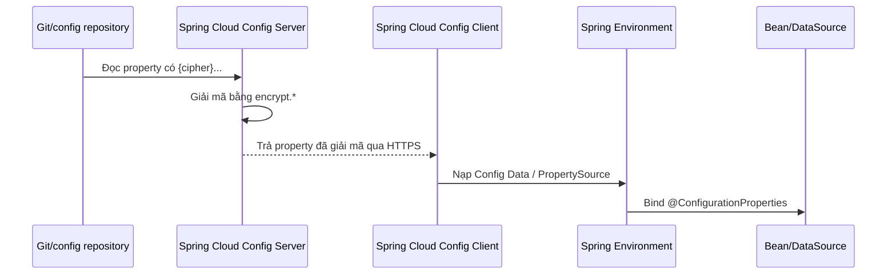
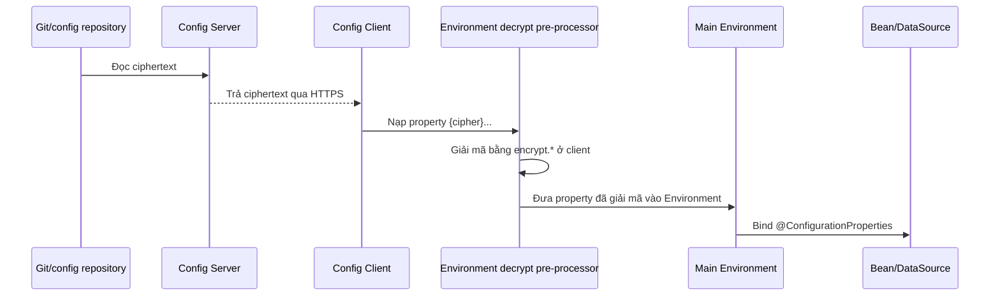
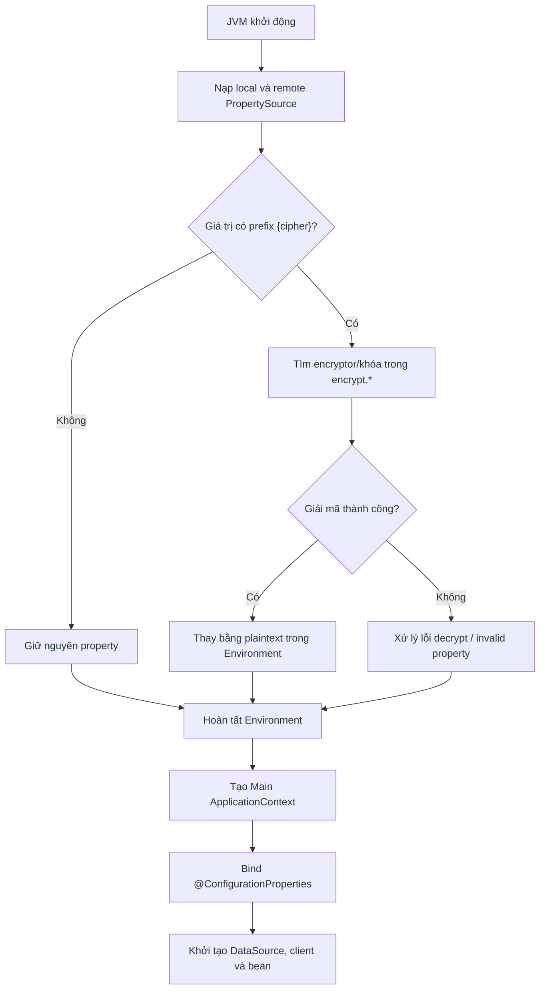

# Giá trị dạng {cipher} và quá trình giải mã trước khi tạo bean

## 1. Bài toán: lưu cấu hình bí mật dưới dạng ciphertext

Ứng dụng Spring Boot/Spring Cloud thường cần các giá trị nhạy cảm như database password, API token, client secret hoặc thông tin xác thực để kết nối message broker. Nếu lưu trực tiếp các giá trị này trong file cấu hình được quản lý bằng Git, người có quyền đọc repository cũng có thể đọc được secret.

Spring Cloud Config hỗ trợ mã hóa giá trị cấu hình. Giá trị đã mã hóa được lưu dưới dạng ciphertext và đánh dấu bằng tiền tố **{cipher}**. Khi cấu hình được nạp, Spring Cloud có thể giải mã giá trị trước khi ứng dụng chính tạo bean và bind các thuộc tính.

Ví dụ một file cấu hình trong repository:

```yaml
spring:
  datasource:
    username: order_app
    password: '{cipher}BASE64_CIPHERTEXT_PLACEHOLDER'

app:
  partner:
    api-token: '{cipher}ANOTHER_CIPHERTEXT_PLACEHOLDER'
```

Các chuỗi phía sau {cipher} trong ví dụ chỉ là placeholder, không phải ciphertext có thể sử dụng. Khi ứng dụng nhận được cấu hình đã giải mã, code có thể đọc property theo cách thông thường bằng Environment hoặc bind bằng @ConfigurationProperties. Bean không cần tự gọi hàm decrypt nếu quá trình giải mã đã được cấu hình đúng ở tầng Spring Cloud.

Bài học thuộc chương **Mã hóa cấu hình** của **SPRING_CLOUD_CORE**. Trọng tâm là hiểu ý nghĩa của marker {cipher}, phân biệt giải mã ở Config Server và giải mã tại client, và theo dõi thứ tự từ lúc nạp property đến lúc Spring tạo bean.

## 2. {cipher} là marker, không phải thuật toán mã hóa

{cipher} là tiền tố cho biết giá trị property tiếp theo là dữ liệu đã mã hóa. Nó không tự chứa khóa, không xác định đầy đủ thuật toán, và không thay thế TLS hay xác thực.

Một property có thể được lưu như sau:

```yaml
spring:
  datasource:
    password: '{cipher}ENCRYPTED_VALUE'
```

Trong đó:

- {cipher} là marker để cơ chế decrypt nhận diện giá trị cần xử lý.
- ENCRYPTED_VALUE là ciphertext được tạo từ plaintext và khóa tương ứng.
- Khóa hoặc keystore được cấu hình riêng bằng các thuộc tính encrypt.*.
- Sau khi giải mã thành công, giá trị plaintext được đưa vào property source/Environment theo flow đã chọn.

**Không đặt plaintext cạnh ciphertext trong cùng repository chỉ để làm fallback.** Nếu decrypt lỗi, ứng dụng có thể lấy một giá trị cùng key từ property source thấp hơn hoặc khởi động với cấu hình không mong muốn. Secret bắt buộc nên được kiểm tra rõ ràng và ứng dụng nên fail fast khi thiếu hoặc sai.

### 2.1. Cách ghi trong YAML và file Properties

Trong YAML, nên đặt giá trị chứa dấu ngoặc nhọn trong dấu nháy đơn:

```yaml
spring:
  datasource:
    password: '{cipher}ENCRYPTED_VALUE'
```

Dấu nháy đơn giúp YAML parser coi toàn bộ giá trị là scalar. Nếu bỏ quote, chuỗi có thể bị diễn giải theo cú pháp flow collection tùy vị trí và nội dung.

Trong file Java Properties, giá trị mã hóa **không được bọc trong dấu nháy**:

```properties
spring.datasource.username=order_app
spring.datasource.password={cipher}ENCRYPTED_VALUE
```

Theo tài liệu Spring Cloud Config, nếu encrypted value trong file Properties được bọc trong dấu nháy, giá trị sẽ không được giải mã như mong muốn. Hãy giữ đúng cú pháp của định dạng file.

## 3. Hai vị trí có thể giải mã

Spring Cloud Config hỗ trợ hai mô hình. Cần chọn rõ mô hình vì nó quyết định nơi giữ private key hoặc symmetric key.

### 3.1. Giải mã ở Config Server — mặc định

Trong flow thông thường, repository cấu hình chỉ lưu ciphertext. Config Server đọc property source, nhận diện các giá trị bắt đầu bằng {cipher} và giải mã chúng **trước khi gửi response HTTP cho Config Client**.



Đặc điểm:

- Secret ở trạng thái lưu trữ trong repository là ciphertext.
- Config Server giữ khóa giải mã hoặc private key.
- Client nhận plaintext qua kênh HTTP đã được bảo vệ bằng TLS và cơ chế xác thực phù hợp.
- Client không cần giữ khóa giải mã chỉ để đọc các property đã được server decrypt.
- Quyền truy cập Config Server trở thành ranh giới bảo mật quan trọng vì response có thể chứa plaintext.

Đây là mô hình phù hợp khi muốn tập trung quản lý khóa và không phân phối private key tới mọi ứng dụng. Tuy nhiên, cần bảo vệ Config Server, endpoint cấu hình, log, trace, cache và đường truyền.

### 3.2. Giải mã tại client — tùy chọn

Một số kiến trúc muốn Config Server chỉ phân phối ciphertext. Khi đó, Config Server không decrypt outgoing property; từng client nhận ciphertext và tự giải mã trong quá trình chuẩn bị Environment.

Cấu hình ở Config Server:

```yaml
spring:
  cloud:
    config:
      server:
        encrypt:
          enabled: false
```

Trong legacy bootstrap mode, tài liệu Spring Cloud Config yêu cầu đặt thuộc tính này trong bootstrap.yml hoặc bootstrap.properties của **Config Server**, để nó có hiệu lực ở giai đoạn bootstrap. Hãy xác nhận thuộc tính nằm ở server đang phục vụ client và không nhầm với cấu hình bootstrap của chính Config Client.

Khi chọn mô hình này, ứng dụng client cần có thư viện mã hóa cần thiết và cấu hình khóa giải mã qua encrypt.*. Spring Cloud có Environment pre-processor để giải mã property dạng {cipher}* **trước khi main application context nhận Environment**.



Trong mô hình này, private key hoặc symmetric key được cấp cho từng client cần giải mã. Nó giảm việc Config Server phải giữ khóa giải mã, nhưng làm tăng phạm vi phân phối và vận hành khóa. Chỉ cấp private key cho đúng client, quản lý quyền file/secret, và có quy trình rotation cho từng nhóm ứng dụng.

**Không nhầm hai flow:** mặc định server-side decryption trả plaintext cho client; client-side decryption yêu cầu tắt giải mã outgoing ở server và cấu hình decrypt ở client.

## 4. Quá trình giải mã trước khi tạo bean

Khi dùng local Environment pre-processor, thứ tự xử lý khái quát như sau:

1. JVM khởi động và Spring Boot bắt đầu nạp các nguồn cấu hình.
2. Spring Cloud bootstrap/Environment processing nạp external property sources.
3. Decrypt pre-processor tìm các property value có marker {cipher}.
4. Cơ chế mã hóa lấy encryptor phù hợp từ cấu hình encrypt.*.
5. Ciphertext được giải mã thành plaintext.
6. Environment chứa giá trị đã giải mã.
7. Main ApplicationContext tiếp tục refresh và tạo bean.
8. @ConfigurationProperties và auto-configuration đọc giá trị từ Environment.

Sơ đồ rút gọn:



Ví dụ typed configuration:

```java
@ConfigurationProperties(prefix = "spring.datasource")
public record DatabaseCredentials(
        String username,
        String password
) {
}
```

Một component khác có thể đọc cùng property bằng @Value:

```java
import org.springframework.beans.factory.annotation.Value;
import org.springframework.stereotype.Component;

@Component
public class DatabaseSecretConsumer {

    private final String password;

    public DatabaseSecretConsumer(
            @Value("${spring.datasource.password}") String password) {
        this.password = password;
    }
}
```

Trong cả hai ví dụ, giá trị được inject là giá trị Environment đã resolve sau bước decrypt tương ứng. Không log hoặc expose trường password.

Nếu quá trình decrypt được thiết lập đúng, trường password nhận giá trị plaintext. Không cần tự gọi decrypt lần nữa; giải mã lần thứ hai có thể làm hỏng dữ liệu và tạo thêm điểm xử lý secret trong code.

Điểm cần nhớ là **giải mã xảy ra trong giai đoạn xử lý Environment, trước khi main context tạo bean**. Nếu cấu hình decrypt sai, lỗi có thể xuất hiện ngay lúc khởi động hoặc khiến property không có giá trị hợp lệ khi binder tạo bean.

## 5. Chuẩn bị dependency cho giải mã tại client

Theo tài liệu Spring Cloud Context, ứng dụng cần thư viện **Spring Security RSA** trên classpath để sử dụng tính năng giải mã local:

```xml
<dependency>
    <groupId>org.springframework.security</groupId>
    <artifactId>spring-security-rsa</artifactId>
</dependency>
```

Hãy quản lý version qua Spring Cloud/Boot dependency management tương thích với release train đang dùng; không tự chọn version ngẫu nhiên cho thư viện mã hóa.

Nếu chỉ sử dụng Config Server để decrypt ở server, dependency mã hóa ở client có thể không cần thiết chỉ để nhận property plaintext. Server phải có dependency và cấu hình encryptor phù hợp với kiểu khóa được chọn.

Với các runtime Java hiện đại, kiểm tra khả năng hỗ trợ thuật toán và độ dài khóa của JDK đang dùng. Lỗi Illegal key size thường liên quan đến chính sách hoặc provider mã hóa không hỗ trợ độ dài khóa yêu cầu; không nên sao chép hướng dẫn cài JCE cũ cho mọi JDK. Hãy xác minh provider, phiên bản Java và thuật toán thực tế trước khi thay đổi runtime.

## 6. Quản lý khóa đối xứng

Khóa đối xứng dùng cùng một secret để mã hóa và giải mã. Spring Cloud Config cho phép cấu hình khóa qua thuộc tính encrypt.key.

Ví dụ ở Config Server:

```yaml
encrypt:
  key: ${ENCRYPT_KEY}
```

Có thể cấp giá trị qua biến môi trường ENCRYPT_KEY để tránh ghi trực tiếp khóa vào file cấu hình. Ví dụ trên chỉ minh họa tên biến; không đặt khóa thật trong source code, shell script commit vào Git, Dockerfile hoặc file cấu hình công khai. Trong production, cấp biến/secret từ secret manager hoặc cơ chế quản lý secret của nền tảng, giới hạn quyền đọc và tránh đưa giá trị ra log.

Khi legacy bootstrap mode được kích hoạt trên Config Server bằng spring-cloud-starter-bootstrap hoặc spring.cloud.bootstrap.enabled=true, tài liệu yêu cầu đặt encrypt.key trong bootstrap.properties của Config Server để khóa có sẵn ở đúng giai đoạn bootstrap.

Ưu điểm của khóa đối xứng là cấu hình đơn giản. Nhược điểm là bất kỳ thành phần nào cần decrypt đều phải có cùng secret. Nếu cấp cùng khóa cho nhiều client, một client bị xâm nhập có thể làm lộ khả năng giải mã dữ liệu dùng chung khóa.

## 7. Quản lý khóa bất đối xứng bằng RSA keystore

Với mã hóa bất đối xứng, public key dùng để mã hóa và private key dùng để giải mã. Điều này cho phép tách quyền mã hóa khỏi quyền giải mã:

- Config Server chỉ cần public key nếu nó chỉ mã hóa giá trị.
- Thành phần thực hiện decrypt phải có private key tương ứng.
- Nếu Config Server decrypt trước khi trả client, server phải có private key.
- Nếu client decrypt local, client cần private key và Config Server có thể chỉ giữ public key.

Spring Cloud Config hỗ trợ cấu hình keystore qua các thuộc tính encrypt.keyStore.*:

| Thuộc tính | Ý nghĩa |
| --- | --- |
| encrypt.keyStore.location | Vị trí resource chứa keystore |
| encrypt.keyStore.password | Mật khẩu mở keystore |
| encrypt.keyStore.alias | Alias của key cần dùng |
| encrypt.keyStore.type | Loại keystore; mặc định là jks |
| encrypt.keyStore.secret | Secret của key entry khi cần tách khỏi store password |

Ví dụ cấu hình minh họa với PKCS12:

```yaml
encrypt:
  key-store:
    location: file:/run/secrets/config-encryption.p12
    password: ${CONFIG_KEYSTORE_PASSWORD}
    alias: config-encryption
    secret: ${CONFIG_KEY_PASSWORD}
    type: PKCS12
```

Keystore không nên được đóng gói vào image nếu chứa private key. Mount file với quyền đọc tối thiểu hoặc lấy từ secret manager; bảo vệ cả keystore password và key password. Việc dùng asymmetric encryption không loại bỏ nhu cầu bảo vệ private key.

### 7.1. Tạo keystore chỉ để thử nghiệm

Có thể tạo key pair thử nghiệm bằng keytool của JDK:

```bash
keytool -genkeypair \
  -alias config-encryption \
  -keyalg RSA \
  -keysize 3072 \
  -storetype PKCS12 \
  -keystore config-encryption.p12 \
  -storepass TEST_STORE_PASSWORD \
  -keypass TEST_KEY_PASSWORD \
  -dname "CN=Config Encryption Test"
```

Đây là ví dụ cho môi trường học tập. Dùng mật khẩu thử nghiệm không được tái sử dụng trong production; giữ file keystore ở ngoài repository và không gửi private key qua chat, ticket hoặc log. Với PKCS12 trên các JDK mới, cần lưu ý một số provider yêu cầu store password và key password trùng nhau.

## 8. Mã hóa property bằng endpoint /encrypt

Config Server cung cấp endpoint HTTP /encrypt để mã hóa plaintext thành ciphertext. Endpoint này cần được bảo vệ và chỉ cho phép tác nhân được ủy quyền sử dụng.

Ví dụ minh họa với một giá trị giả lập:

```bash
curl -s \
  -H "Content-Type: text/plain" \
  --data-binary "sample-value-for-local-test" \
  http://localhost:8888/encrypt
```

Response là ciphertext. Khi ghi vào file YAML, thêm marker {cipher}:

```yaml
spring:
  datasource:
    password: '{cipher}<ciphertext-returned-by-encrypt-endpoint>'
```

Endpoint /decrypt là phép thử ngược lại nếu server được cấu hình symmetric key hoặc đầy đủ key pair:

```bash
curl -s \
  -H "Content-Type: text/plain" \
  --data-binary "<ciphertext-without-cipher-prefix>" \
  http://localhost:8888/decrypt
```

Một số ký tự như dấu cộng (+) có thể bị xử lý như form encoding nếu gửi body không đúng. Khi dùng curl để thử với dữ liệu có ký tự đặc biệt, tài liệu Spring Cloud khuyến nghị dùng --data-urlencode với giá trị được prefix bằng = hoặc đặt Content-Type: text/plain để đảm bảo body được mã hóa đúng.

Không đưa password/token thật trực tiếp vào command line nếu shell history, process list hoặc log terminal có thể lưu lại. Hãy dùng secret file/secret manager và một client được bảo vệ phù hợp cho quy trình vận hành.

## 9. Giải mã lỗi và property invalid

Nếu Config Server không thể giải mã một giá trị, server không nên trả ciphertext dưới đúng key secret như thể đó là plaintext. Thay vào đó, response tạo property có tên được prefix invalid, thường có giá trị <n/a>.

Ví dụ minh họa response:

```json
{
  "propertySources": [
    {
      "name": "application-prod.yml",
      "source": {
        "invalid.spring.datasource.password": "<n/a>"
      }
    },
    {
      "name": "application.yml",
      "source": {
        "spring.datasource.password": "fallback-value"
      }
    }
  ]
}
```

Trong ví dụ, source profile-specific có encrypted property nhưng decrypt thất bại. Source khác vẫn có property spring.datasource.password. Khi Config Client resolve đúng key, giá trị từ source thấp hơn có thể được chọn thay vì ciphertext. Vì vậy, nếu không kiểm tra kỹ, ứng dụng có thể khởi động với fallback ngoài ý muốn.

Thuộc tính spring.cloud.config.server.encrypt.prefix-invalid-properties điều khiển hành vi prefix invalid; mặc định server tạo key invalid để tránh ciphertext bị dùng như password. Nếu tắt cơ chế prefix này, response có thể chứa ciphertext dưới key gốc. Điều đó không biến ciphertext thành plaintext và không nên xem là cách sửa lỗi.

Khi secret là bắt buộc:

- Không cung cấp một fallback credential yếu hoặc credential dùng chung trong file khác.
- Kiểm tra property bắt buộc khi khởi động và fail fast nếu thiếu.
- Kiểm tra log server để tìm lỗi decrypt, alias hoặc key mismatch; không log plaintext.
- Xác minh client đang nhận response từ đúng application/profile/label.
- Kiểm tra nguồn cấu hình có bị một property source khác ghi đè hay không.

## 10. Key alias và luân chuyển khóa

Với keystore có nhiều key, Spring Cloud Config hỗ trợ prefix metadata trước ciphertext. Ví dụ:

```yaml
app:
  partner:
    api-token: '{cipher}{key:config-key-v2}ENCRYPTED_VALUE'
```

Default key locator có thể dùng alias sau key: để tìm key tương ứng trong keystore. Prefix secret: cũng có thể được dùng cho secret bổ sung theo cơ chế locator; nếu dùng secret riêng, cần cấu hình SecretLocator phù hợp để bảo vệ và phân giải nó.

Quy trình rotation nên có giai đoạn chuyển tiếp:

1. Tạo key mới và đưa alias mới vào keystore của thành phần thực hiện decrypt.
2. Xác nhận key alias mới đã sẵn sàng ở các instance cần giải mã.
3. Mã hóa lại từng property bằng key mới và thêm prefix alias tương ứng.
4. Deploy cấu hình mới; kiểm tra Config Server/client giải mã đúng.
5. Theo dõi đến khi không còn ciphertext dùng key cũ.
6. Chỉ gỡ key cũ sau khi xác nhận không còn cấu hình, bản rollback hoặc instance cũ phụ thuộc vào nó.

Không xóa key cũ ngay sau khi thêm key mới. Một instance đang chạy phiên bản cấu hình cũ hoặc một bản rollback có thể vẫn cần alias cũ. Nếu mỗi ứng dụng/profile cần encryptor riêng, có thể cung cấp bean TextEncryptorLocator; locator mặc định dùng cùng key cho các lần mã hóa nếu không được tùy chỉnh.

## 11. Giới hạn bảo mật cần hiểu đúng

Mã hóa property giúp bảo vệ giá trị **khi lưu trữ** trong repository hoặc backend cấu hình. Nó không thay thế các lớp bảo vệ khác:

| Cơ chế | Bảo vệ điều gì? | Không giải quyết điều gì? |
| --- | --- | --- |
| {cipher} và encryptor | Ciphertext trong kho cấu hình khi chưa decrypt | Phân quyền truy cập Config Server, bảo vệ plaintext sau decrypt |
| HTTPS/TLS | Dữ liệu trên đường truyền | Bảo vệ repository hoặc file cấu hình ở trạng thái lưu trữ |
| Authentication/authorization | Ai được đọc hoặc gọi endpoint cấu hình | Mã hóa dữ liệu nếu repository bị đọc trực tiếp |
| Secret manager / KMS | Cấp phát, lưu trữ và quản lý vòng đời khóa | Tự động thay thế validation và phân quyền ở ứng dụng |
| Audit và rotation | Theo dõi thay đổi và thay khóa | Ngăn mọi lỗi do plaintext bị log hoặc memory dump |

Một số nguyên tắc vận hành:

- Bảo vệ Config Server bằng authentication/authorization và chỉ expose endpoint cần thiết.
- Bắt buộc TLS khi client kết nối Config Server qua mạng.
- Bảo vệ /encrypt và /decrypt; không expose công khai hoặc cho người dùng ứng dụng thông thường gọi.
- Không log ciphertext cùng plaintext, không log object cấu hình chứa password và không đưa secret vào exception message.
- Giới hạn người có thể đọc keystore/private key và người có thể cập nhật repository cấu hình.
- Xem xét dump heap, crash dump, tracing, actuator env/configprops và telemetry vì plaintext có thể xuất hiện sau khi decrypt.
- Dùng secret manager/KMS hoặc cơ chế bảo vệ khóa của nền tảng khi yêu cầu bảo mật cao; không để khóa và ciphertext cùng một nơi có cùng quyền truy cập.

## 12. Ví dụ hoàn chỉnh: password database được giải mã trước DataSource

Giả sử Config Server dùng RSA keystore và repository cấu hình có:

```yaml
spring:
  datasource:
    url: jdbc:postgresql://postgres:5432/orders
    username: order_app
    password: '{cipher}{key:config-key-v2}ENCRYPTED_VALUE'
```

Trong flow server-side decryption:

1. Config Server đọc file theo application, profile và label.
2. Server chọn encryptor theo key alias.
3. Server giải mã password.
4. Config Server trả property đã giải mã cho client qua HTTPS.
5. Client đưa property vào Environment.
6. Spring Boot DataSource auto-configuration bind URL, username và password.
7. DataSource được khởi tạo và mở kết nối.

Trong flow client-side decryption, bước 3 xảy ra ở client Environment pre-processor. Client cần private key phù hợp và Config Server phải tắt decryption outgoing. Các bước bind DataSource tiếp tục sau khi Environment có giá trị plaintext.

Có thể inject cấu hình vào một bean kiểm tra trạng thái mà không in password:

```java
import org.springframework.core.env.Environment;
import org.springframework.stereotype.Component;

@Component
public class DatabaseConfigurationCheck {

    private final Environment environment;

    public DatabaseConfigurationCheck(Environment environment) {
        this.environment = environment;
    }

    public boolean hasDatabaseCredentials() {
        String username =
                environment.getProperty("spring.datasource.username");
        String password =
                environment.getProperty("spring.datasource.password");

        return username != null && !username.isBlank()
                && password != null && !password.isBlank();
    }
}
```

Đoạn code chỉ kiểm tra sự hiện diện của giá trị. Trong ứng dụng thực tế, nên dùng health check hoặc kết nối thử có kiểm soát để xác nhận DataSource hoạt động. Không trả password về API và không ghi nó vào log.

## 13. Chẩn đoán lỗi thường gặp

| Triệu chứng | Nguyên nhân có thể | Hướng kiểm tra |
| --- | --- | --- |
| Bean nhận nguyên chuỗi {cipher}... | Decrypt không được bật, thiếu dependency hoặc sai mô hình server/client | Xác định nơi decrypt; kiểm tra spring-security-rsa, encrypt.* và spring.cloud.config.server.encrypt.enabled |
| Config Server trả invalid.<property> | Sai key, alias, ciphertext bị hỏng hoặc thuật toán không khớp | Kiểm tra server log, keystore alias, key version và nguồn ciphertext |
| Client nhận ciphertext thay vì plaintext | Server đã tắt decrypt outgoing nhưng client chưa cấu hình local decrypt | Kiểm tra dependency và khóa private/symmetric trên client |
| YAML không nạp đúng giá trị | Scalar {cipher}... chưa được quote hoặc YAML parse sai | Dùng dấu nháy đơn cho toàn bộ giá trị |
| File Properties không decrypt | Encrypted value bị bọc trong dấu nháy | Bỏ quote quanh giá trị {cipher}... |
| Illegal key size hoặc lỗi provider | JDK/provider/thuật toán không tương thích | Xác minh Java runtime, provider và độ dài khóa |
| /encrypt trả lỗi hoặc ciphertext sai | Endpoint không được bảo vệ đúng, request body encoding sai hoặc key chưa cấu hình | Kiểm tra HTTP status, Content-Type, cách gửi body và server encryptor |
| Ứng dụng khởi động nhưng dùng credential cũ | Một property source thấp hơn cung cấp cùng key khi decrypt thất bại | Kiểm tra invalid.*, property source order và fail-fast validation |
| Một profile decrypt được, profile khác thất bại | Key alias hoặc cấu hình key không có ở môi trường đó | Kiểm tra application/profile/label và keystore tương ứng |

Khi kiểm tra, ưu tiên xem trạng thái và tên property source. Không bật log debug làm lộ plaintext hoặc copy response chứa secret vào ticket/chat.

## 14. Kiểm thử quá trình decrypt trước khi tạo bean

Một quy trình kiểm thử có thể dùng giá trị giả lập trong môi trường local:

1. Tạo key/keystore thử nghiệm, không dùng khóa production.
2. Khởi động Config Server với encryptor và repository cấu hình local.
3. Gửi giá trị thử nghiệm tới /encrypt, nhận ciphertext.
4. Ghi ciphertext với marker {cipher} vào YAML hoặc file Properties theo đúng cú pháp.
5. Kiểm tra response Config Server theo đúng mô hình server-side hoặc client-side đã chọn.
6. Khởi động Config Client và bind property vào một @ConfigurationProperties bean hoặc DataSource test.
7. Xác minh bean nhận giá trị mong đợi bằng cách so sánh trong test; không in giá trị secret.
8. Thử sai alias/key để xác nhận hệ thống báo lỗi và không âm thầm sử dụng credential fallback.
9. Thử rotation với hai alias, bảo đảm cấu hình mới và đường rollback đều giải mã được.

Có thể dùng integration test với test key và ciphertext được tạo trong test setup. Tránh commit ciphertext thực của production vào test resource vì ciphertext vẫn gắn với key và quy trình vận hành cụ thể.

## 15. Câu hỏi tự kiểm tra

1. Tiền tố {cipher} có vai trò gì? Nó có phải tên thuật toán mã hóa không?
2. Vì sao YAML nên quote giá trị {cipher}..., trong khi file Properties không được quote?
3. Trong flow mặc định, Config Server giải mã ở thời điểm nào so với lúc gửi response HTTP?
4. Nếu client tự giải mã, thuộc tính nào tắt decryption outgoing ở Config Server?
5. Vì sao @Value và @ConfigurationProperties có thể nhận plaintext mà không cần gọi decrypt trong bean?
6. Khóa đối xứng khác RSA key pair ở cách phân phối quyền encrypt/decrypt như thế nào?
7. Khi Config Server không giải mã được property, invalid.<key> giúp tránh rủi ro gì?
8. Vì sao phải bảo vệ /encrypt và /decrypt endpoint?
9. Một quy trình key rotation an toàn cần giữ key cũ trong bao lâu?
10. Mã hóa cấu hình có thay thế TLS, authorization và secret manager không?

## 16. Tài liệu tham khảo chính thức

- [Spring Cloud Config — Encryption and Decryption](https://docs.spring.io/spring-cloud-config/reference/server/encryption-and-decryption.html) — marker {cipher}, endpoint /encrypt và /decrypt, lỗi decrypt và invalid.*
- [Spring Cloud Config — Key Management](https://docs.spring.io/spring-cloud-config/reference/server/key-management.html) — khóa đối xứng, RSA keystore và vị trí lưu khóa.
- [Spring Cloud Config — Using Multiple Keys and Key Rotation](https://docs.spring.io/spring-cloud-config/reference/server/using-multiple-keys-and-key-rotation.html) — key alias, TextEncryptorLocator và rotation.
- [Spring Cloud Config — Serving Encrypted Properties](https://docs.spring.io/spring-cloud-config/reference/server/serving-encrypted-properties.html) — để client decrypt local thay vì server.
- [Spring Cloud Context — Application Context Services](https://docs.spring.io/spring-cloud-commons/reference/spring-cloud-commons/application-context-services.html) — Environment pre-processor và giải mã local trước main application context.

*Tài liệu phân biệt giải mã tại Config Server với giải mã tại client. Cần chọn một flow rõ ràng, quản lý khóa ngoài repository, và xác minh hành vi trên đúng release train Spring Boot/Spring Cloud của hệ thống.*
