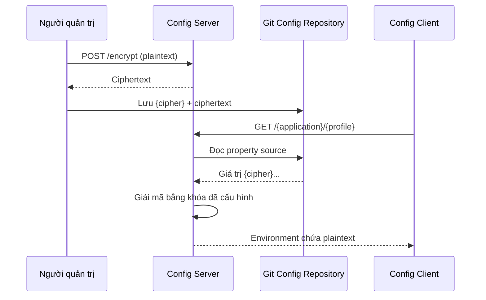

# Cấu hình khóa đối xứng và khóa bất đối xứng trong Spring Cloud Config

## 1. Vì sao Config Server cần khóa mã hóa?

Spring Cloud Config tập trung cấu hình của nhiều ứng dụng trong một nơi, thường là Git repository. Cấu hình có thể chứa mật khẩu database, API token hoặc credential kết nối dịch vụ. Nếu lưu trực tiếp các giá trị này dưới dạng văn bản thuần, người có quyền đọc repository cũng có thể đọc được bí mật.

Spring Cloud Config Server hỗ trợ mã hóa từng giá trị cấu hình. Giá trị đã mã hóa được lưu trong repository với tiền tố **{cipher}**. Khi Config Server đọc property source, nó có thể giải mã giá trị trước khi trả cấu hình cho Config Client qua HTTP.

Để mã hóa và giải mã, Config Server cần một khóa. Spring Cloud Config hỗ trợ hai mô hình:

- **Khóa đối xứng (symmetric key):** cùng một bí mật được dùng cho cả mã hóa và giải mã.
- **Khóa bất đối xứng (asymmetric key):** dùng một cặp khóa công khai và riêng tư; khóa công khai mã hóa, khóa riêng tư giải mã.

Khác biệt quan trọng nhất nằm ở cách phân phối khóa. Với khóa đối xứng, mọi thành phần cần mã hóa hoặc giải mã đều phải có cùng bí mật. Với khóa bất đối xứng, người tạo ciphertext chỉ cần khóa công khai, còn khóa riêng tư có thể được giữ tập trung ở Config Server.

## 2. Luồng mã hóa cấu hình

Một luồng điển hình gồm các bước:

1. Người quản trị hoặc pipeline gửi giá trị nhạy cảm tới endpoint **/encrypt** của Config Server.
2. Config Server mã hóa giá trị bằng khóa đã cấu hình và trả về ciphertext.
3. Người quản trị thêm tiền tố **{cipher}** vào ciphertext rồi lưu vào file cấu hình trong repository.
4. Config Client yêu cầu cấu hình theo application, profile và label.
5. Config Server đọc property source, nhận diện giá trị có tiền tố **{cipher}** và giải mã trước khi trả kết quả cho client.
6. Client nhận giá trị đã giải mã và bind vào **Environment** như một thuộc tính thông thường.



Mô hình mặc định giúp bí mật không nằm ở dạng văn bản thuần trong Git. Tuy nhiên, khi Config Server giải mã và trả cấu hình, client nhận được giá trị rõ. Mã hóa giá trị trong repository không thay thế TLS, xác thực, phân quyền truy cập Config Server hoặc bảo vệ bộ nhớ và log của ứng dụng.

## 3. So sánh khóa đối xứng và khóa bất đối xứng

| Tiêu chí | Khóa đối xứng | Khóa bất đối xứng |
| --- | --- | --- |
| Thành phần khóa | Một bí mật dùng cho mã hóa và giải mã | Một cặp public key và private key |
| Mã hóa | Dùng shared secret | Dùng public key |
| Giải mã | Dùng cùng shared secret | Dùng private key tương ứng |
| Phân phối khóa | Phải bảo vệ và phân phối cùng bí mật tới mọi nơi cần dùng | Có thể phân phối public key rộng hơn; giữ private key ở nơi cần giải mã |
| Cấu hình Config Server | **encrypt.key** hoặc **ENCRYPT_KEY** | Keystore qua **encrypt.keyStore.*** |
| Độ phức tạp vận hành | Đơn giản hơn | Cần quản lý keystore, alias, mật khẩu và vòng đời cặp khóa |
| Phù hợp | Môi trường nhỏ, quy trình quản lý secret đơn giản | Cần tách quyền mã hóa và giải mã, hoặc nhiều bên cần tạo ciphertext |

Chọn mô hình dựa trên ranh giới tin cậy và cách phân phối khóa. Nếu mọi người có quyền mã hóa cũng có quyền truy cập shared secret, họ cũng có khả năng giải mã ciphertext. Với mô hình bất đối xứng, pipeline có thể chỉ giữ public key để mã hóa, trong khi private key được bảo vệ riêng ở Config Server.

## 4. Cấu hình khóa đối xứng

### 4.1. Dùng encrypt.key

Với khóa đối xứng, Config Server nhận một chuỗi bí mật qua thuộc tính **encrypt.key**:

```yaml
encrypt:
  key: ${ENCRYPT_KEY}
```

Hoặc cấu hình trực tiếp bằng biến môi trường **ENCRYPT_KEY**. Spring Cloud Config nhận biết biến môi trường này để cung cấp khóa cho bộ mã hóa. Nên đưa secret từ secret manager hoặc hệ thống quản lý bí mật của nền tảng triển khai vào môi trường tiến trình.

Không commit giá trị thật của **encrypt.key** vào Git, Docker image hoặc file cấu hình dùng chung. Đoạn YAML trên chỉ tham chiếu biến môi trường; giá trị thật được cấp lúc chạy.

### 4.2. Chọn đúng nơi đặt khóa khi dùng bootstrap

Nếu Config Server dùng **spring-cloud-starter-bootstrap** hoặc bật **spring.cloud.bootstrap.enabled=true** bằng system property, tài liệu Spring Cloud Config yêu cầu đặt **encrypt.key** trong **bootstrap.properties** hoặc **bootstrap.yml** để khóa có mặt trong giai đoạn bootstrap.

Nếu ứng dụng không dùng legacy bootstrap, có thể nạp thuộc tính theo cơ chế cấu hình của Spring Boot đang dùng. Dù đặt ở đâu, khóa phải được cung cấp cho **Config Server**, không phải chỉ đặt trong repository cấu hình của các client.

Ví dụ với legacy bootstrap:

```yaml
# bootstrap.yml của Config Server
encrypt:
  key: ${ENCRYPT_KEY}
```

Không dùng **encrypt.key** để khai báo một cặp khóa RSA. Thuộc tính này dành cho khóa đối xứng.

### 4.3. Khi nào chọn khóa đối xứng?

Khóa đối xứng thuận tiện khi:

- Chỉ một nhóm nhỏ người vận hành được quyền mã hóa cấu hình.
- Config Server là nơi duy nhất cần giải mã.
- Có secret manager để phân phối shared secret an toàn tới Config Server và công cụ mã hóa được cấp quyền.
- Quy trình thay khóa có thể phối hợp với việc mã hóa lại các giá trị đang lưu.

Điểm cần quản lý là mọi nơi biết shared secret đều có cùng khả năng giải mã. Không đặt shared secret trong repository chỉ vì ciphertext đã được mã hóa.

## 5. Cấu hình khóa bất đối xứng bằng RSA keystore

### 5.1. Public key và private key

Với mô hình RSA:

- Public key được dùng để mã hóa giá trị.
- Private key tương ứng được dùng để giải mã.
- Keystore có thể chứa cặp khóa và chứng thư liên quan. Config Server xác định khóa cần dùng qua alias.

Người hoặc pipeline chỉ cần public key có thể tạo ciphertext mà không cần biết private key. Config Server giữ private key để giải mã khi phục vụ cấu hình. Đây là lợi thế về phân quyền khi nhiều nhóm cần gửi bí mật vào repository.

### 5.2. Tạo keystore bằng keytool

**keytool** được cung cấp cùng JDK. Ví dụ tạo một cặp RSA trong keystore PKCS12:

```bash
keytool -genkeypair -alias config-server-prod -keyalg RSA -keysize 3072 -storetype PKCS12 -keystore config-server-prod.p12 -validity 3650
```

Lệnh yêu cầu nhập mật khẩu keystore và thông tin chứng thư. Với PKCS12 trên JDK hiện đại, mật khẩu private key thường phải trùng mật khẩu keystore; có thể nhấn Enter ở lời nhắc mật khẩu khóa để dùng lại mật khẩu keystore. Không đưa mật khẩu production trực tiếp vào dòng lệnh hoặc commit vào script.

Kiểm tra alias và loại keystore:

```bash
keytool -list -v -keystore config-server-prod.p12 -storetype PKCS12
```

Ví dụ dùng PKCS12 và khai báo rõ **type** giúp tránh nhầm giữa phần mở rộng file và định dạng thực tế. Nếu tạo JKS, hãy dùng tùy chọn **-storetype JKS** và cấu hình **encrypt.keyStore.type: JKS** tương ứng.

Các giá trị mật khẩu trong ví dụ là do người vận hành nhập khi keytool hỏi. Không dùng mật khẩu mẫu trong tài liệu cho môi trường thật.

### 5.3. Cấu hình keystore cho Config Server

Đặt keystore tại vị trí được bảo vệ, ví dụ mount từ secret volume của nền tảng triển khai:

```yaml
encrypt:
  keyStore:
    location: file:/run/secrets/config-server-prod.p12
    password: ${CONFIG_KEYSTORE_PASSWORD}
    alias: config-server-prod
    type: PKCS12
```

Ý nghĩa các thuộc tính:

| Thuộc tính | Ý nghĩa |
| --- | --- |
| **encrypt.keyStore.location** | Vị trí Resource chứa keystore; có thể là **classpath:** hoặc **file:** |
| **encrypt.keyStore.password** | Mật khẩu mở keystore |
| **encrypt.keyStore.alias** | Alias xác định cặp khóa được dùng |
| **encrypt.keyStore.type** | Định dạng keystore, ví dụ **PKCS12** hoặc **JKS**; mặc định tài liệu là **jks** |
| **encrypt.keyStore.secret** | Mật khẩu riêng của private key nếu khác mật khẩu keystore; nếu không cung cấp, Spring Cloud Config dùng mật khẩu keystore theo cơ chế mặc định |

Nếu private key có mật khẩu riêng, bổ sung **secret** từ một secret store:

```yaml
encrypt:
  keyStore:
    location: file:/run/secrets/config-server-prod.p12
    password: ${CONFIG_KEYSTORE_PASSWORD}
    alias: config-server-prod
    type: PKCS12
    secret: ${CONFIG_PRIVATE_KEY_PASSWORD}
```

Không đặt file keystore chứa private key trong repository cấu hình client hoặc trong image công khai. Hạn chế quyền đọc file, giới hạn user chạy Config Server và sao lưu theo quy trình quản lý khóa.

### 5.4. Có thể chỉ đặt public key ở Config Server không?

Về nguyên tắc, Config Server có thể chỉ có public key để thực hiện mã hóa; khi đó private key phải nằm ở nơi khác để giải mã, ví dụ từng client. Cách này làm tăng phạm vi phân phối private key và phức tạp hóa vận hành. Nó chỉ phù hợp khi có lý do rõ ràng để Config Server không giữ private key và số client có thể được quản lý chặt.

Trong mô hình phổ biến, Config Server giữ keystore có private key để giải mã **{cipher}** trước khi gửi cấu hình cho client.

## 6. Dùng endpoint encrypt và decrypt

Khi khóa đã được cấu hình và Config Server đã khởi động, server cung cấp hai endpoint:

- **POST /encrypt:** nhận plaintext trong request body và trả về ciphertext.
- **POST /decrypt:** nhận ciphertext và trả về plaintext nếu server có khóa giải mã tương ứng.

Ví dụ gọi endpoint trong môi trường phát triển:

```bash
curl -sS -X POST http://localhost:8888/encrypt -H "Content-Type: text/plain" --data-binary @secret.txt
```

Giả sử **secret.txt** chứa một giá trị thử nghiệm. Kết quả trả về là ciphertext dạng văn bản có thể lưu vào repository sau khi thêm tiền tố **{cipher}**. Không để file plaintext thử nghiệm trong Git hoặc thư mục dùng chung.

Có thể kiểm tra chiều ngược lại bằng cách gửi ciphertext tới **/decrypt**:

```bash
curl -sS -X POST http://localhost:8888/decrypt -H "Content-Type: text/plain" --data-binary @ciphertext.txt
```

Các endpoint này có thể làm lộ plaintext nếu bị gọi trái phép. Tài liệu Spring Cloud Config yêu cầu chúng chỉ được truy cập bởi tác nhân được ủy quyền. Hãy bảo vệ bằng Spring Security, giới hạn mạng quản trị và không expose công khai.

### 6.1. Lưu ciphertext trong YAML và properties

Trong YAML, đặt giá trị **{cipher}** trong dấu nháy đơn để YAML parser xem toàn bộ nội dung là một chuỗi:

```yaml
spring:
  datasource:
    username: app_user
    password: '{cipher}AQB64_ENCRYPTED_VALUE'
```

Trong file **.properties**, giá trị mã hóa không được bọc trong dấu nháy:

```properties
spring.datasource.username=app_user
spring.datasource.password={cipher}AQB64_ENCRYPTED_VALUE
```

Nếu bọc giá trị **{cipher}** trong dấu nháy ở file **.properties**, Config Server có thể không nhận diện để giải mã. Chuỗi ciphertext trong ví dụ chỉ là chỗ giữ chỗ; phải thay bằng kết quả thực từ endpoint **/encrypt**.

## 7. Config Server giải mã trước hay client tự giải mã?

Mặc định, nếu remote property source chứa giá trị bắt đầu bằng **{cipher}**, Config Server giải mã trước khi trả dữ liệu qua HTTP. Điều đó có nghĩa client nhận giá trị rõ và không cần cấu hình khóa mã hóa chỉ để tiêu thụ cấu hình.

Nếu muốn client tự giải mã, Config Server có thể được cấu hình để giữ ciphertext khi trả property source:

```yaml
spring:
  cloud:
    config:
      server:
        encrypt:
          enabled: false
```

Thuộc tính đầy đủ là `spring.cloud.config.server.encrypt.enabled=false`. Với Config Server dùng legacy bootstrap, đặt thuộc tính này trong `bootstrap.yml` hoặc `bootstrap.properties` để nó có hiệu lực ở giai đoạn bootstrap.

Trong mô hình này, client cần có cơ chế và khóa phù hợp để giải mã cục bộ. Với RSA, điều đó có thể yêu cầu phân phối private key tới client, làm thay đổi đáng kể ranh giới bảo mật. Chỉ chọn cách này khi đã đánh giá rõ nơi giữ private key và số lượng client được phép giải mã.

Nếu không cần client tự giải mã, giữ mặc định server-side decryption thường đơn giản hơn: private key tập trung tại Config Server, client chỉ cần được xác thực để lấy cấu hình.

### 7.1. Điều gì xảy ra khi giải mã thất bại?

Nếu Config Server không giải mã được giá trị, giá trị mã hóa bị loại khỏi property source và một thuộc tính bổ sung được tạo với cùng tên có tiền tố **invalid**, thường mang giá trị **<n/a>**. Cách xử lý này giúp ciphertext không vô tình bị ứng dụng sử dụng như mật khẩu hoặc token thật.

Khi thấy thuộc tính **invalid.***, hãy kiểm tra:

- Khóa đang chạy có đúng với khóa đã mã hóa ciphertext không.
- Alias có tồn tại trong keystore không.
- Config Server có đọc được keystore và mở được private key không.
- Ciphertext có bị cắt, thêm dấu cách hoặc sửa khi commit không.
- Prefix **{cipher}** có được ghi đúng trong YAML/properties không.

Không nên âm thầm thay một secret bị giải mã lỗi bằng giá trị mặc định trong production.

## 8. Quản lý nhiều khóa và xoay vòng khóa

Trong môi trường thật, khóa có vòng đời: tạo, cấp phát, sử dụng, sao lưu, thay thế và thu hồi. Xoay vòng có thể cần thiết khi khóa bị lộ, người có quyền thay đổi, hoặc chính sách bảo mật yêu cầu thay khóa định kỳ.

### 8.1. Nhiều alias trong keystore

Spring Cloud Config hỗ trợ tiền tố **{key:alias}** sau **{cipher}** để chọn alias trong keystore:

```yaml
spring:
  datasource:
    password: '{cipher}{key:config-2026}AQB64_ENCRYPTED_VALUE'
```

Khi dùng alias, default **TextEncryptorLocator** có thể tìm khóa theo alias đó. Nếu không có prefix **{key:...}**, Config Server dùng khóa mặc định đã cấu hình.

Một quy trình xoay vòng RSA có thể thực hiện như sau:

1. Tạo alias mới trong keystore, giữ alias cũ trong giai đoạn chuyển tiếp.
2. Triển khai keystore chứa cả khóa cũ và khóa mới tới Config Server.
3. Mã hóa các giá trị mới bằng alias mới.
4. Cập nhật repository với **{cipher}{key:alias-moi}...**.
5. Xác nhận Config Server giải mã được cả giá trị cũ và mới; client nhận được cấu hình hợp lệ.
6. Mã hóa lại các giá trị còn dùng alias cũ.
7. Chỉ xóa alias cũ sau khi không còn ciphertext tham chiếu alias đó và các phiên bản cấu hình cũ không cần rollback nữa.

Tài liệu Spring Cloud Config lưu ý client và repository phải dùng alias có sẵn trong keystore của Config Server. Không xóa private key cũ trước khi mọi ciphertext cần nó đã được chuyển đổi.

### 8.2. Xoay vòng khóa đối xứng

Với khóa đối xứng đơn, ciphertext được tạo bằng khóa cũ không thể tự giải mã bằng khóa mới. Quy trình thay khóa cần phối hợp:

1. Chuẩn bị khóa mới và triển khai theo một kế hoạch có thể kiểm soát.
2. Giải mã các giá trị đang dùng bằng khóa cũ trong môi trường được bảo vệ.
3. Mã hóa lại bằng khóa mới.
4. Cập nhật ciphertext trong repository.
5. Chuyển Config Server sang khóa mới sau khi dữ liệu đã được chuẩn bị và kiểm thử.
6. Xác nhận không còn ciphertext cần khóa cũ; sau đó thu hồi khóa cũ theo chính sách.

Nếu cần hỗ trợ đồng thời nhiều khóa đối xứng, cần triển khai **TextEncryptorLocator** tùy chỉnh để chọn encryptor phù hợp; không giả định cấu hình **encrypt.key** mặc định tự nhận diện nhiều shared secret.

## 9. Nguyên tắc bảo vệ khóa

Mã hóa cấu hình chỉ có ích khi khóa được bảo vệ tốt. Một số nguyên tắc thực tế:

1. Không commit **encrypt.key**, mật khẩu keystore, private key hoặc file keystore production vào Git.
2. Cấp secret qua Vault, secret manager của cloud hoặc secret volume được nền tảng quản lý.
3. Giới hạn quyền đọc keystore và quyền gọi endpoint **/encrypt**, **/decrypt**.
4. Dùng TLS cho kết nối tới Config Server; mã hóa tại repository không bảo vệ plaintext trên đường truyền.
5. Không ghi plaintext, ciphertext nhạy cảm hoặc nội dung secret vào log, exception message và tracing.
6. Tách quyền tạo ciphertext khỏi quyền lấy plaintext nếu mô hình tổ chức yêu cầu.
7. Sao lưu private key và kế hoạch khôi phục ở nơi được kiểm soát; mất private key có thể khiến ciphertext cũ không thể giải mã.
8. Ghi nhận alias, thời điểm tạo, mục đích và trạng thái khóa trong hệ thống quản lý khóa.
9. Thử khôi phục từ backup và thử giải mã ciphertext đại diện trước khi triển khai thay đổi khóa.
10. Dùng HTTPS và xác thực cho client API; **{cipher}** không thay thế phân quyền truy cập Config Server.

Đặc biệt, nếu Config Server giải mã trước khi gửi cho client, người có quyền đọc API cấu hình vẫn có thể nhận plaintext. Cần bảo vệ cả API lấy cấu hình và API mã hóa/giải mã.

## 10. Kiểm thử cấu hình khóa

Nên kiểm thử riêng từng tầng thay vì chỉ xác nhận Config Server khởi động thành công.

| Ca kiểm thử | Cách thực hiện | Kết quả mong đợi |
| --- | --- | --- |
| Mã hóa đối xứng | Gửi plaintext tới **/encrypt** với **encrypt.key** đã cấu hình | Nhận ciphertext |
| Giải mã đối xứng | Gửi ciphertext vừa tạo tới **/decrypt** | Nhận lại đúng plaintext |
| Mã hóa RSA | Dùng keystore có public key và alias hợp lệ | Nhận ciphertext |
| Giải mã RSA | Dùng keystore có private key tương ứng | Nhận lại đúng plaintext |
| Property **{cipher}** | Đặt ciphertext vào Config Repository rồi gọi endpoint environment | Client nhận plaintext theo chế độ server-side decrypt mặc định |
| Sai khóa | Thay khóa hoặc alias không khớp | Giải mã thất bại; thuộc tính bị đánh dấu invalid theo cơ chế Config Server |
| Alias không tồn tại | Dùng **{key:unknown}** | Phát hiện lỗi định vị khóa |
| Ciphertext bị sửa | Cắt hoặc thay ký tự ciphertext | Giải mã thất bại |
| Endpoint không có quyền | Gọi **/encrypt** hoặc **/decrypt** bằng danh tính không được phép | Request bị từ chối |

Một kiểm tra round-trip đơn giản là:

1. Chọn một chuỗi thử nghiệm không chứa dữ liệu thật.
2. Gọi **/encrypt** và lưu ciphertext.
3. Gọi **/decrypt** với ciphertext đó.
4. So sánh kết quả giải mã với chuỗi ban đầu.
5. Đưa ciphertext vào một property thử nghiệm có prefix **{cipher}** và xác nhận Config Client nhận giá trị rõ trong cấu hình đã tải.

Không kiểm thử bằng password production hoặc token đang hoạt động. Dùng secret giả lập và xóa file tạm chứa plaintext/ciphertext theo quy trình của môi trường kiểm thử.

## 11. Lỗi thường gặp và cách chẩn đoán

| Triệu chứng | Nguyên nhân có thể | Hướng xử lý |
| --- | --- | --- |
| Config Server không khởi động khi bật mã hóa | **encrypt.key** thiếu hoặc không đọc được keystore | Kiểm tra biến môi trường, Resource location, password và alias |
| **/encrypt** trả lỗi | Bộ mã hóa chưa được cấu hình hoặc endpoint bị bảo vệ | Kiểm tra **encrypt.***, log server và quyền gọi endpoint |
| **/decrypt** không trả plaintext | Shared secret sai hoặc private key không khớp | Kiểm tra đúng khóa/keystore đã tạo ciphertext |
| Config Client nhận **invalid.*** | Config Server không giải mã được **{cipher}** | Kiểm tra prefix, ciphertext, key, alias và keystore |
| Giá trị trong **.properties** không được giải mã | **{cipher}** bị bọc trong dấu nháy | Bỏ dấu nháy trong file properties |
| YAML không parse được giá trị cipher | Chuỗi bắt đầu bằng dấu ngoặc nhọn không được quote | Bọc toàn bộ giá trị bằng dấu nháy đơn |
| Keystore mở được nhưng private key không dùng được | Sai alias hoặc mật khẩu riêng của private key | Kiểm tra alias và **encrypt.keyStore.secret** |
| Lỗi password khi dùng PKCS12 trên JDK 11+ | Key password và store password khác nhau nhưng loại store không hỗ trợ | Dùng cùng mật khẩu hoặc chọn định dạng phù hợp |
| Client nhận ciphertext thay vì plaintext | Server-side decrypt đã bị tắt hoặc Config Server không có khóa giải mã | Kiểm tra **spring.cloud.config.server.encrypt.enabled** và khóa server |
| Xoay khóa làm cấu hình cũ lỗi | Đã thu hồi alias/secret trước khi mã hóa lại dữ liệu | Khôi phục khóa cũ, re-encrypt và chỉ thu hồi sau khi xác minh |

## 12. Chọn mô hình khóa cho hệ thống

Có thể dùng các câu hỏi sau để quyết định:

- Nếu một nhóm vận hành nhỏ có quyền mã hóa và Config Server là nơi duy nhất giải mã, khóa đối xứng có thể là lựa chọn đơn giản.
- Nếu nhiều nhóm hoặc pipeline cần mã hóa nhưng không được phép giải mã bí mật, dùng RSA public key để mã hóa và giữ private key tại Config Server.
- Nếu có nhiều môi trường hoặc nhóm ứng dụng với vòng đời khóa riêng, cân nhắc nhiều alias và **TextEncryptorLocator** thay vì dùng một khóa chung cho tất cả.
- Nếu cần client giải mã tại chỗ, phải tính đến việc phân phối private key tới client và giới hạn phạm vi bí mật bị lộ khi một client bị xâm nhập.

Không có lựa chọn nào tự động thay thế quản lý secret. Khóa phải có chủ sở hữu, nơi lưu trữ, quyền truy cập, quy trình backup và quy trình thu hồi rõ ràng.

## 13. Tài liệu tham khảo

- [Spring Cloud Config — Encryption and Decryption](https://docs.spring.io/spring-cloud-config/reference/server/encryption-and-decryption.html): endpoint **/encrypt**, **/decrypt**, tiền tố **{cipher}** và hành vi giải mã property source.
- [Spring Cloud Config — Key Management](https://docs.spring.io/spring-cloud-config/reference/server/key-management.html): cấu hình khóa đối xứng **encrypt.key** và keystore bất đối xứng.
- [Spring Cloud Config — Creating a Key Store for Testing](https://docs.spring.io/spring-cloud-config/reference/server/creating-a-key-store-for-testing.html): tạo keystore bằng **keytool**.
- [Spring Cloud Config — Using Multiple Keys and Key Rotation](https://docs.spring.io/spring-cloud-config/reference/server/using-multiple-keys-and-key-rotation.html): alias, nhiều khóa và quy trình xoay vòng.
- [Spring Cloud Config — Serving Encrypted Properties](https://docs.spring.io/spring-cloud-config/reference/server/serving-encrypted-properties.html): cấu hình để client giải mã thay cho Config Server.

Khóa đối xứng giúp triển khai nhanh vì chỉ cần một shared secret; khóa bất đối xứng tách quyền mã hóa và giải mã nhờ public/private key. Trong Spring Cloud Config, hai lựa chọn này có cấu hình khác nhau: **encrypt.key** dành cho khóa đối xứng, còn RSA dùng keystore qua **encrypt.keyStore.***. Khi đã chọn mô hình, cần bảo vệ khóa, kiểm thử round-trip, giới hạn endpoint và lập kế hoạch xoay vòng trước khi lưu ciphertext vào repository dùng chung.
