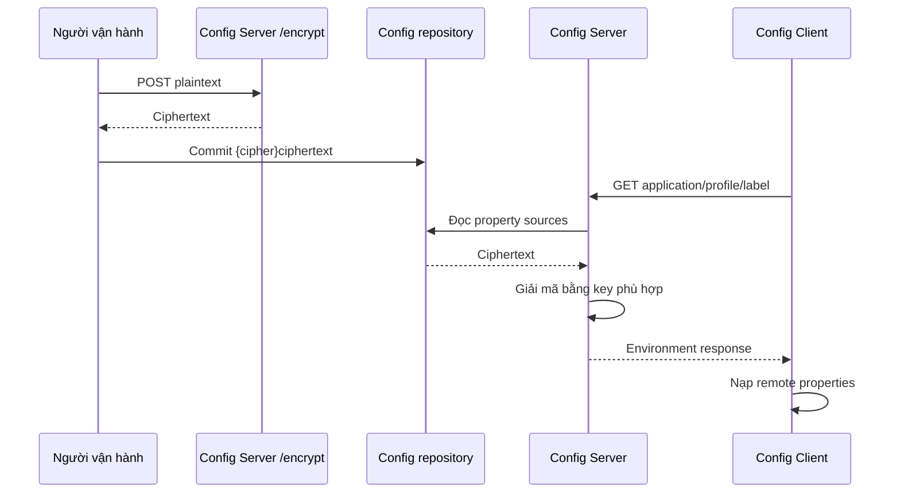

# Nhận diện lỗi sai khóa, thiếu khóa và thuật toán không phù hợp

Spring Cloud Config có thể mã hóa giá trị cấu hình để dữ liệu nhạy cảm không nằm ở dạng rõ trong Git hoặc backend lưu trữ. Khi Config Server đọc property source, nó có thể giải mã giá trị mang tiền tố **{cipher}** trước khi gửi cho Config Client. Spring Cloud Context cũng hỗ trợ giải mã cục bộ trong Environment nếu ứng dụng được cấu hình key và có thư viện cần thiết.

Các lỗi thường gặp xuất hiện khi ciphertext được tạo bằng một khóa khác với khóa đang dùng để giải mã, key hoặc keystore không được nạp, alias không tồn tại, dữ liệu mã hóa bị thay đổi, hoặc JVM/provider không hỗ trợ thuật toán và độ dài khóa yêu cầu. Những lỗi này có thể làm thuộc tính biến mất khỏi response, trả về giá trị ciphertext, khiến ứng dụng dùng fallback hoặc làm quá trình khởi động thất bại.

Bài học thuộc chương **Mã hóa cấu hình** của module **SPRING_CLOUD_CORE**. Trọng tâm là phân biệt nguyên nhân, đọc đúng dấu hiệu ở Config Server và Config Client, kiểm tra key/keystore/algorithm, xử lý an toàn và thiết kế kiểm thử để tránh đưa cấu hình sai vào production.

## 1. Mục tiêu học tập

Sau bài học, người học có thể:

- Mô tả luồng mã hóa và giải mã của Spring Cloud Config.
- Phân biệt lỗi sai khóa, thiếu khóa, sai keystore password, sai alias và ciphertext bị hỏng.
- Nhận biết lỗi do thuật toán, padding, provider hoặc giới hạn độ dài khóa của JVM.
- Giải thích response có **invalid.<property>** khi Config Server không giải mã được một giá trị.
- Kiểm tra tiền tố **{cipher}** và cách viết giá trị trong YAML/Properties.
- Chẩn đoán đúng nơi giải mã: Config Server hay Config Client.
- Xử lý key rotation mà vẫn đọc được ciphertext của revision cũ trong thời gian chuyển đổi.
- Viết kiểm thử cho cả trường hợp giải mã thành công và thất bại mà không làm lộ secret.

## 2. Luồng mã hóa và giải mã trong Spring Cloud

Spring Cloud Config thường dùng mô hình server-side decryption:

1. Người vận hành gửi plaintext đến endpoint /encrypt đã được bảo vệ.
2. Config Server mã hóa plaintext và trả về ciphertext.
3. Người vận hành thêm tiền tố {cipher} vào ciphertext rồi lưu trong repository cấu hình.
4. Khi Config Client yêu cầu cấu hình, Config Server đọc property source và giải mã các giá trị {cipher}.
5. Config Server gửi property sources đã giải mã qua HTTP; Config Client đưa chúng vào Environment.



Trong mô hình này, key giải mã phải có tại Config Server. Client nhận plaintext qua kết nối HTTP của Config Server; vì vậy production vẫn cần TLS/HTTPS để bảo vệ dữ liệu trên đường truyền.

Một kiến trúc khác là **client-side decryption**: Config Server giữ ciphertext trong response, còn ứng dụng client tự giải mã trước khi tạo application context. Cách này cần cấu hình rõ ràng và phân phối key tới các client. Đừng trộn lẫn hai mô hình khi điều tra lỗi; trước tiên phải xác định thành phần nào đang chịu trách nhiệm giải mã.

## 3. Các thành phần khóa cần kiểm tra

Spring Cloud Config hỗ trợ hai cách quản lý khóa chính:

| Kiểu | Cấu hình | Thành phần dùng để giải mã |
| --- | --- | --- |
| Symmetric key | encrypt.key | Cùng một secret key được dùng cho mã hóa và giải mã |
| Asymmetric key | encrypt.keyStore.* | Public key mã hóa; private key tương ứng giải mã |

### 3.1. Symmetric key

Ví dụ cấu hình Config Server:

```yaml
encrypt:
  key: ${ENCRYPT_KEY}
```

Giá trị ENCRYPT_KEY phải được inject vào đúng tiến trình Config Server. Không commit key thật vào application.yml, Docker image hoặc Git repository. Nếu ứng dụng bật bootstrap legacy bằng spring-cloud-starter-bootstrap hoặc spring.cloud.bootstrap.enabled=true, tài liệu Spring Cloud yêu cầu đặt encrypt.key trong bootstrap.properties/bootstrap.yml theo cơ chế bootstrap đang sử dụng.

Một lỗi phổ biến là key có trong môi trường developer nhưng không có trong container production. Config Server vẫn có thể chạy, nhưng không có cùng khả năng giải mã như môi trường đã tạo ciphertext.

### 3.2. Asymmetric key và keystore

Với RSA, ciphertext được tạo bằng public key và chỉ private key tương ứng mới giải mã được. Config Server thường đọc private key từ keystore:

```yaml
encrypt:
  key-store:
    location: file:/run/secrets/config-server.p12
    password: ${CONFIG_KEYSTORE_PASSWORD}
    alias: config-server
    secret: ${CONFIG_PRIVATE_KEY_PASSWORD}
    type: PKCS12
```

Các thuộc tính có ý nghĩa:

- location: vị trí resource chứa keystore; phải tồn tại trong môi trường chạy.
- password: mật khẩu mở keystore.
- alias: tên entry chứa key cần sử dụng.
- secret: mật khẩu bảo vệ private key entry nếu có.
- type: định dạng keystore, ví dụ PKCS12 hoặc JKS.

Cần phân biệt **keystore password** với **private key password**. Một số cấu hình PKCS12 trên JDK mới yêu cầu store password và key password trùng nhau; nếu keytool cảnh báo rằng định dạng không hỗ trợ hai mật khẩu khác nhau, hãy kiểm tra lại keystore được tạo ra và cấu hình tương ứng.

### 3.3. Phạm vi của key

Key phải được xác định theo đúng môi trường và phạm vi sử dụng:

- Config Server production phải có key hoặc private key tương ứng với ciphertext được lưu.
- Nếu mỗi ứng dụng/profile dùng key riêng, cần có TextEncryptorLocator phù hợp để chọn encryptor theo application/profile.
- Cấu hình nhiều alias trong một keystore cần chỉ rõ alias bằng metadata {key:...} trong ciphertext.
- Không giả định một key đang có ở staging cũng có mặt ở production.

Giá trị key giống nhau về tên biến môi trường chưa chứng minh byte sequence thực tế giống nhau. Secret manager, deployment manifest, newline cuối file hoặc encoding có thể khiến giá trị runtime khác nhau.

## 4. Nhận diện lỗi sai khóa

**Sai khóa** xảy ra khi ciphertext được tạo bằng key A nhưng hệ thống giải mã bằng key B. Với symmetric encryption, cả hai phía phải sử dụng đúng cùng key. Với RSA, private key phải thuộc đúng key pair đã dùng public key để mã hóa.

Các dấu hiệu thường gặp:

- /decrypt thất bại dù endpoint hoạt động và key/keystore đã được nạp.
- Java crypto báo lỗi padding hoặc block khi giải mã.
- Config Server trả property có tên invalid.<property> thay vì giá trị gốc.
- Ứng dụng nhận fallback từ property source khác và vẫn khởi động, nhưng dùng sai credential hoặc endpoint.
- Staging giải mã được nhưng production không giải mã được cùng ciphertext.

Một số exception thường thấy là BadPaddingException, IllegalBlockSizeException hoặc InvalidKeyException. Chúng không tự xác định duy nhất nguyên nhân: key sai, ciphertext bị cắt, encoding sai hoặc transformation/padding không khớp đều có thể dẫn đến lỗi tương tự.

### 4.1. Kiểm tra cùng ciphertext bằng đúng Config Server

Dùng ciphertext thử nghiệm không nhạy cảm, gọi /decrypt trên đúng Config Server đang phục vụ môi trường lỗi:

```bash
curl -sS \
  -H "Content-Type: text/plain" \
  --data-binary "BASE64_CIPHERTEXT" \
  https://config.example.internal/decrypt
```

Endpoint /decrypt nhận ciphertext; trong file cấu hình, giá trị phải có tiền tố {cipher}. Không gửi plaintext hoặc ciphertext bí mật qua một endpoint không được xác thực, không dùng HTTP không mã hóa hoặc dán kết quả plaintext vào ticket/log.

Nếu lệnh trên thất bại:

1. Xác nhận Config Server đang dùng đúng encrypt.key hoặc keystore.
2. Kiểm tra alias được chọn và private key có thuộc key pair đã mã hóa ciphertext không.
3. Xác nhận ciphertext không bị cắt, thêm dấu nháy hoặc thêm newline ngoài ý muốn.
4. So sánh cấu hình runtime của instance lỗi với instance đã giải mã thành công.
5. Thử mã hóa và giải mã một giá trị kiểm thử mới trong môi trường cô lập để xác định key đang hoạt động.

Không giải quyết bằng cách thay key production ngay lập tức. Thay key mà chưa mã hóa lại các giá trị hiện có có thể khiến toàn bộ cấu hình cũ không thể giải mã.

## 5. Nhận diện lỗi thiếu khóa

**Thiếu khóa** thường là lỗi triển khai hoặc cấu hình secret, không phải lỗi dữ liệu ciphertext.

Các trường hợp thường gặp:

- Biến môi trường ENCRYPT_KEY chưa được inject vào Config Server.
- Tên biến môi trường sai hoặc secret mount chưa xuất hiện trong container.
- encrypt.key được đặt ở file cấu hình không được nạp trong bootstrap mode hiện tại.
- Keystore không có ở đường dẫn đã khai báo.
- Secret của keystore hoặc private key entry không được inject.
- Config Server chỉ có public key trong khi nhiệm vụ hiện tại yêu cầu giải mã.
- Client-side decryption được bật nhưng client thiếu key hoặc thư viện Spring Security RSA.

### 5.1. Kiểm tra cấu hình symmetric key

Với symmetric key, kiểm tra tên biến và sự hiện diện của nó trong tiến trình Config Server. Không in giá trị key ra terminal hoặc log.

Ví dụ kiểm tra chỉ báo có/không trên PowerShell:

```powershell
if ([string]::IsNullOrWhiteSpace($env:ENCRYPT_KEY)) {
    Write-Output "ENCRYPT_KEY is missing"
} else {
    Write-Output "ENCRYPT_KEY is present"
}
```

Không dùng lệnh echo $env:ENCRYPT_KEY hoặc printenv ENCRYPT_KEY trong log CI/CD vì chúng có thể làm lộ secret.

### 5.2. Kiểm tra keystore

Có thể dùng keytool -list để xác nhận file đọc được, loại keystore và alias tồn tại. Chỉ cung cấp password qua cơ chế nhập an toàn của keytool hoặc secret store; không đưa password thật vào command history.

Ví dụ kiểm tra cấu trúc:

```bash
keytool -list -keystore /run/secrets/config-server.p12 -storetype PKCS12
```

Xác nhận:

- File có mặt trong container và user chạy Java có quyền đọc.
- Keystore type khớp với encrypt.keyStore.type.
- Alias khai báo tồn tại chính xác, kể cả chữ hoa/chữ thường.
- Entry chứa private key có thể được mở bằng mật khẩu tương ứng.
- Keystore không bị thay bằng file khác trong quá trình mount/deploy.

Nếu key store được mở nhưng alias không có private key phù hợp, Config Server vẫn không thể giải mã RSA ciphertext.

## 6. Nhận diện lỗi keystore password, alias và key pair

Các lỗi này thường bị nhầm với “sai thuật toán”, nhưng cần kiểm tra riêng:

| Dấu hiệu | Nguyên nhân có thể | Hướng kiểm tra |
| --- | --- | --- |
| Không mở được keystore | Sai store password, sai type hoặc file hỏng | Kiểm tra password, PKCS12/JKS và file mount |
| Không lấy được private key entry | Sai key password hoặc entry không chứa private key | Kiểm tra secret và loại entry |
| Alias không tìm thấy | encrypt.keyStore.alias sai hoặc ciphertext yêu cầu alias khác | Liệt kê alias và đối chiếu metadata {key:...} |
| RSA giải mã thất bại | Private key không khớp public key đã mã hóa | Xác minh đúng key pair và lịch sử rotation |
| Staging chạy, production lỗi | Hai môi trường dùng keystore/key version khác nhau | So sánh alias, fingerprint và deployment version; không in private key |

Với keystore có nhiều key, Spring Cloud Config hỗ trợ tiền tố {key:alias} ngay sau {cipher}. Ví dụ:

```yaml
spring:
  datasource:
    password: '{cipher}{key:db-key-2026}BASE64_CIPHERTEXT'
```

Config Server dùng alias db-key-2026 để chọn key tương ứng. Alias phải tồn tại trong keystore đang được Config Server sử dụng. Nếu hệ thống dùng TextEncryptorLocator tùy biến, logic chọn key phải nhất quán với quy tắc đã dùng khi mã hóa.

## 7. Nhận diện lỗi thuật toán, padding hoặc provider

Một ciphertext chỉ có thể giải mã đúng khi hệ thống sử dụng đúng bộ quy tắc mật mã: loại key, thuật toán, mode, padding, encoding và provider tương thích. Hai hệ thống có thể cùng dùng RSA hoặc AES nhưng vẫn không tương thích nếu cấu hình transformation hoặc định dạng dữ liệu khác nhau.

Một số exception có thể xuất hiện:

| Exception/dấu hiệu | Ý nghĩa cần kiểm tra |
| --- | --- |
| NoSuchAlgorithmException | JCA không tìm thấy thuật toán được yêu cầu |
| NoSuchPaddingException | Provider không hỗ trợ padding được yêu cầu |
| InvalidKeyException | Key sai loại, sai kích thước, không hợp lệ hoặc bị policy/provider từ chối |
| InvalidAlgorithmParameterException | Tham số như IV hoặc parameter spec không phù hợp |
| BadPaddingException | Key, ciphertext, mode hoặc padding không khớp; dữ liệu có thể bị thay đổi |
| IllegalBlockSizeException | Kích thước dữ liệu không phù hợp với chế độ xử lý block |
| Illegal key size | Giới hạn cryptographic policy hoặc key size không được runtime/provider chấp nhận |
| IllegalArgumentException khi decode | Ciphertext có thể không phải Base64 hợp lệ hoặc bị thêm ký tự |

Không thay đổi thuật toán chỉ dựa trên tên exception. Hãy kiểm tra stack trace đầy đủ ở môi trường bảo mật, phiên bản JDK, provider đang hoạt động và cấu hình mã hóa đã dùng để tạo ciphertext.

### 7.1. Kiểm tra JCE policy và JDK

Tài liệu Spring Cloud có đề cập yêu cầu full-strength JCE và lỗi Illegal key size. Tuy nhiên, hướng xử lý phụ thuộc phiên bản JDK:

- Với JDK 8 trước các bản cập nhật có unlimited-strength policy mặc định (ví dụ trước 8u161), giới hạn độ dài khóa có thể gây Illegal key size.
- Từ JDK 9 trở lên, unlimited-strength policy được đóng gói và bật mặc định trong Oracle JDK. Không cần tải policy files cũ chỉ vì thấy exception này.
- Nếu môi trường đặt crypto.policy=limited, dùng custom policy, FIPS provider hoặc provider của bên thứ ba, cần kiểm tra chính sách và thuật toán được phép.
- Khi thay JDK/container image, kiểm tra provider và security properties trong đúng runtime image đang chạy ứng dụng.

Có thể kiểm tra giới hạn độ dài key bằng Java:

```java
import javax.crypto.Cipher;

public class CryptoPolicyCheck {
    public static void main(String[] args) throws Exception {
        System.out.println(
            "Max AES key length = " +
            Cipher.getMaxAllowedKeyLength("AES")
        );
    }
}
```

Kết quả chỉ cho biết giới hạn của policy đang hoạt động với transformation/algorithm được hỏi. Nó không chứng minh key, ciphertext hoặc provider của Spring Cloud Config đã đúng.

### 7.2. Kiểm tra provider và dependency

Khi lỗi xuất hiện sau khi nâng JDK hoặc Spring Cloud:

- Xác nhận dependency org.springframework.security:spring-security-rsa có trong classpath nếu ứng dụng cần local decryption.
- Kiểm tra provider được đăng ký và provider có hỗ trợ transformation đang dùng.
- Kiểm tra FIPS mode hoặc security policy có vô hiệu hóa thuật toán/độ dài key không.
- Đảm bảo Config Server và client dùng phiên bản Spring Cloud/Spring Boot tương thích qua BOM.
- Không tự thêm một crypto provider hoặc đổi padding trong production khi chưa kiểm thử tương thích với ciphertext hiện có.

Lỗi NoSuchAlgorithmException/NoSuchPaddingException thường hướng tới provider hoặc transformation; BadPaddingException thường cần kiểm tra key và dữ liệu trước. Đây là hướng phân loại ban đầu, không phải kết luận chắc chắn.

## 8. Kiểm tra tiền tố {cipher} và định dạng file

Config Server chỉ nhận diện giá trị được đánh dấu mã hóa theo quy tắc của nó. Kiểm tra cú pháp file trước khi kết luận key bị sai.

### 8.1. YAML

Trong YAML, giá trị có dấu ngoặc nhọn nên được đặt trong dấu nháy:

```yaml
spring:
  datasource:
    username: app_user
    password: '{cipher}BASE64_CIPHERTEXT'
```

### 8.2. application.properties

Trong file .properties, giá trị mã hóa **không được đặt trong dấu nháy**:

```properties
spring.datasource.username=app_user
spring.datasource.password={cipher}BASE64_CIPHERTEXT
```

Nếu bọc giá trị bằng dấu nháy trong .properties, dấu nháy có thể trở thành một phần của value và khiến Config Server không nhận diện/giải mã như mong đợi.

### 8.3. Các lỗi định dạng thường gặp

- Thiếu {cipher} ở đầu giá trị.
- Gõ sai chính tả hoặc thêm khoảng trắng trước tiền tố.
- Copy cả dấu nháy hoặc ký tự xuống dòng vào ciphertext.
- Copy kèm thông báo thống kê của curl thay vì chỉ lấy ciphertext.
- Mã hóa một giá trị có ký tự +, &, % nhưng gửi request không đúng content type/URL encoding.
- Dùng ciphertext từ môi trường khác hoặc từ key alias đã bị thay thế.

Khi mã hóa bằng curl, tài liệu Spring Cloud khuyến nghị dùng --data-urlencode với giá trị bắt đầu bằng = hoặc đặt Content-Type: text/plain để tránh ký tự đặc biệt bị diễn giải sai. Dùng -sS để output không lẫn progress meter vào ciphertext.

## 9. Hiểu response invalid.<property> khi giải mã thất bại

Khi Config Server không giải mã được một giá trị, hành vi mặc định là **loại property gốc khỏi property source và thêm một property có tên được prefix bằng invalid**. Ví dụ:

```json
{
  "propertySources": [
    {
      "name": "application-prod.yml",
      "source": {
        "invalid.datasource.password": "<n/a>"
      }
    },
    {
      "name": "application.yml",
      "source": {
        "datasource.password": "fallback-value"
      }
    }
  ]
}
```

Trong ví dụ này, Config Server không giải mã được datasource.password trong file application-prod.yml. Property gốc bị loại khỏi source đó; response có invalid.datasource.password. Một property source thấp hơn vẫn có datasource.password, nên Config Client có thể nhận fallback-value.

Điều này có hai hệ quả:

1. Ứng dụng có thể khởi động thành công dù secret production không được giải mã.
2. Ứng dụng có thể dùng fallback từ file chung hoặc local mà người vận hành không dự định dùng.

Vì vậy, HTTP response thành công hoặc process chạy được không đủ để kết luận giải mã thành công. Hãy kiểm tra invalid.* trong response và xác nhận giá trị hiệu lực đến từ đúng property source.

Có thể tắt hành vi prefix-invalid bằng:

```yaml
spring:
  cloud:
    config:
      server:
        encrypt:
          prefix-invalid-properties: false
```

Khi tắt tùy chọn này, ciphertext không giải mã được có thể xuất hiện lại dưới tên property gốc. Nếu client không tự giải mã, ứng dụng có thể nhận chuỗi ciphertext thay vì plaintext. Chỉ thay đổi tùy chọn này khi đã hiểu rõ mô hình server-side/client-side decryption và đã có kiểm thử.

## 10. Phân biệt server-side và client-side decryption

### 10.1. Server-side decryption

Đây là hành vi thường dùng: Config Server có key và giải mã property trước khi trả response. Client không cần giữ key giải mã.

Ưu điểm:

- Tập trung key management tại Config Server.
- Client không cần phân phối private key hoặc symmetric key.
- Config Client nhận property đã giải mã trong Environment.

Điều cần bảo vệ:

- Config Server phải giữ key an toàn.
- Response phải được truyền qua TLS.
- Endpoint /encrypt và /decrypt phải có authentication/authorization và giới hạn truy cập.
- Không log response chứa plaintext hoặc ghi plaintext vào cache không được bảo vệ.

### 10.2. Client-side decryption

Nếu muốn Config Server trả ciphertext để client tự giải mã, có thể cấu hình:

```yaml
spring:
  cloud:
    config:
      server:
        encrypt:
          enabled: false
```

Đặt cấu hình này theo đúng bootstrap/configuration mode của Config Server. Client cần có cấu hình encrypt.* và dependency Spring Security RSA theo hướng dẫn Spring Cloud Context. Khi đó lỗi thiếu key, sai key hoặc provider có thể xuất hiện ở client thay vì server.

Với Maven, dependency cho local decryption có tọa độ:

```xml
<dependency>
    <groupId>org.springframework.security</groupId>
    <artifactId>spring-security-rsa</artifactId>
</dependency>
```

Chọn phiên bản tương thích với Spring Cloud release train và dependency management của dự án. Nếu dùng symmetric key, client cần nhận đúng secret qua `encrypt.key`; nếu dùng RSA, client cần cấu hình keystore/private key thích hợp. Không phân phối private key cho mọi client nếu kiến trúc không yêu cầu client-side decryption.

Không cấu hình server tắt decryption trong khi client chưa có key. Trong tình huống đó, ciphertext có thể đi thẳng vào Environment và bị ứng dụng sử dụng như plaintext.

## 11. Quy trình chẩn đoán có thứ tự

Khi một property mã hóa không hoạt động, xử lý theo thứ tự để tránh thay đổi nhiều biến cùng lúc:

1. **Xác định nơi giải mã.** Config Server hay Config Client đang chịu trách nhiệm giải mã?
2. **Xác định property source.** Application, profile, label và file nào chứa ciphertext?
3. **Kiểm tra cú pháp.** Giá trị có tiền tố {cipher} đúng và được đặt đúng định dạng YAML/Properties không?
4. **Kiểm tra key material.** Symmetric key có mặt không; keystore có đọc được không; alias/private key có đúng không?
5. **Kiểm tra ciphertext.** Có bị cắt, sửa, thêm dấu nháy, newline hoặc lỗi Base64 không?
6. **Thử /decrypt bằng ciphertext thử nghiệm.** Dùng đúng Config Server và key của môi trường đang lỗi.
7. **Đọc response Environment.** Tìm invalid.<property> và kiểm tra property source fallback.
8. **Kiểm tra runtime crypto.** JDK version, crypto.policy, provider, dependency và FIPS mode.
9. **So sánh phiên bản.** Xác nhận Spring Cloud BOM tương thích Spring Boot và các môi trường dùng cùng cấu hình crypto.
10. **Kiểm thử lại sau sửa.** Mã hóa một giá trị test, giải mã lại, tải qua endpoint environment và xác nhận client nhận đúng giá trị mong đợi.

Không đưa key, password, private key hoặc plaintext vào log để “so sánh”. Có thể so sánh fingerprint của public certificate/keystore entry hoặc secret version ID nếu quy trình quản lý key hỗ trợ.

## 12. Key rotation và tương thích ciphertext cũ

Key rotation thường cần thiết khi key bị lộ, cần thay đổi chính sách hoặc có quy trình định kỳ. Tuy nhiên, đổi key ngay lập tức có thể làm ciphertext cũ không giải mã được.

Một quy trình chuyển đổi an toàn:

1. Tạo key mới và nạp key/alias mới vào keystore của Config Server.
2. Xác nhận Config Server có thể truy cập alias mới.
3. Mã hóa lại từng property bằng key mới.
4. Gắn metadata {key:new-alias} vào ciphertext nếu dùng nhiều alias.
5. Commit revision mới và kiểm thử với đúng application/profile.
6. Rollout Config Server có khả năng đọc cả ciphertext cũ lẫn mới trong thời gian chuyển tiếp.
7. Xác nhận mọi repository, branch và instance đã chuyển sang key mới.
8. Thu hồi key cũ sau khi không còn ciphertext cần giải mã bằng key đó.

Ví dụ:

```yaml
database:
  password: '{cipher}{key:db-key-2026}BASE64_CIPHERTEXT'
```

Nếu cần nhiều key theo ứng dụng/profile, triển khai TextEncryptorLocator để chọn đúng encryptor. Locator mặc định không tự tạo key riêng theo từng application/profile; nếu muốn hành vi granular, cần cấu hình custom locator.

Không xóa alias cũ khỏi keystore trước khi đã tìm và mã hóa lại mọi ciphertext tham chiếu alias đó. Trong sự cố key compromise, cần phối hợp rotation với thu hồi credential ở hệ thống đích; chỉ mã hóa lại file cấu hình không làm password cũ mất hiệu lực trong database hoặc dịch vụ phụ thuộc.

## 13. Kiểm thử mã hóa và giải mã

Một bộ kiểm thử nên xác nhận toàn bộ đường đi thay vì chỉ test hàm encrypt/decrypt độc lập.

| Ca kiểm thử | Thiết lập | Kết quả mong đợi |
| --- | --- | --- |
| Round trip symmetric | Mã hóa rồi giải mã bằng cùng key | Plaintext khớp ban đầu |
| Wrong symmetric key | Mã hóa bằng key A, giải mã bằng key B | Giải mã thất bại hoặc Config Server đánh dấu invalid |
| Missing symmetric key | Không inject ENCRYPT_KEY | Startup/operation thể hiện lỗi rõ; không dùng plaintext fallback ngoài dự kiến |
| RSA pair hợp lệ | Encrypt bằng public key, decrypt bằng private key tương ứng | Plaintext khớp ban đầu |
| Wrong RSA alias | Ciphertext yêu cầu alias không có trong keystore | Không giải mã; response/health ghi nhận lỗi |
| Wrong keystore password | Password không mở được store | Key store load thất bại |
| Corrupt ciphertext | Thay đổi/truncate một phần ciphertext | Decode/decrypt thất bại |
| Missing {cipher} | Giá trị ciphertext không có marker | Xác nhận server xử lý theo quy tắc property thường, không giả định tự giải mã |
| Invalid property response | Dùng ciphertext không giải mã được | Có invalid.<property> theo mặc định |
| Fallback source | Có giá trị cùng key ở source thấp hơn | Xác nhận giá trị hiệu lực và cảnh báo fallback |
| Client-side decryption | Server không giải mã, client có key | Client nhận plaintext sau local preprocessing |
| Provider/JDK mismatch | Dùng runtime thiếu thuật toán hoặc policy bị giới hạn | Kiểm tra lỗi algorithm/provider có thể tái lập |

### 13.1. Kiểm thử hợp đồng bằng endpoint

Trong môi trường test:

1. Gửi một giá trị test tới /encrypt.
2. Lưu ciphertext trả về vào file cấu hình test với tiền tố {cipher}.
3. Gọi endpoint environment của Config Server với đúng application/profile/label.
4. Xác nhận property source chứa plaintext sau server-side decryption.
5. Lặp lại bằng key sai và xác nhận response có invalid.<property>.
6. Thử một property cùng tên ở source thấp hơn để chứng minh fallback có thể che lỗi giải mã.

Dùng dữ liệu test giả. Không dùng mật khẩu production để thử /encrypt hoặc /decrypt trong pipeline CI.

### 13.2. Kiểm thử fail-closed

Với credential bắt buộc, cấu hình ứng dụng nên phát hiện khi giá trị bị thiếu hoặc không hợp lệ. Không chỉ dựa vào việc invalid.<property> xuất hiện trong JSON; hãy thêm kiểm tra ở integration test hoặc startup validation để ứng dụng không âm thầm dùng một default không an toàn.

Ví dụ, kiểm tra giá trị endpoint/password bắt buộc sau khi Environment đã được nạp và xác nhận nó đến từ property source mong muốn. Nếu hệ thống chấp nhận fallback, fallback phải được quy định rõ và có metric/alert.

## 14. Bảng tra cứu nhanh sự cố

| Triệu chứng | Nhóm nguyên nhân | Bước kiểm tra đầu tiên |
| --- | --- | --- |
| invalid.db.password trong response | Không giải mã được | Kiểm tra key, alias, ciphertext và server-side decrypt |
| /decrypt báo lỗi padding | Sai key, ciphertext hỏng hoặc transformation không khớp | So sánh key/alias và tạo ciphertext test mới |
| ENCRYPT_KEY rỗng ở production | Thiếu secret injection | Kiểm tra deployment secret và tiến trình Config Server |
| Không mở được keystore | Sai password, type, path hoặc file mount | Dùng keytool kiểm tra store trong đúng container |
| Không tìm thấy alias | Alias sai hoặc thiếu key version | Kiểm tra alias trong keystore và {key:...} prefix |
| Illegal key size | Crypto policy hoặc key size/provider | Kiểm tra JDK, crypto.policy và provider |
| NoSuchAlgorithmException | Thuật toán không được provider hỗ trợ | Kiểm tra transformation và provider |
| NoSuchPaddingException | Padding không được provider hỗ trợ | Kiểm tra cấu hình mã hóa và provider |
| Client nhận chuỗi {cipher}... | Server chưa giải mã hoặc client-side decrypt chưa cấu hình | Xác định decryption mode và key ở đúng phía |
| App chạy với password fallback | invalid.* và source thấp hơn cung cấp giá trị | Kiểm tra property source precedence và startup validation |
| Chỉ production lỗi | Key/alias/runtime image khác môi trường test | So sánh secret version, keystore fingerprint, JDK và provider |

## 15. Bảo mật và vận hành

- Không commit encrypt.key, keystore password, private key hoặc plaintext secret vào Git.
- Lấy key từ secret manager hoặc cơ chế secret injection của nền tảng.
- Giới hạn quyền đọc keystore và quyền truy cập process chạy Config Server.
- Bảo vệ /encrypt, /decrypt và endpoint cấu hình bằng authentication/authorization.
- Dùng HTTPS/TLS cho Config Server trong production.
- Không log plaintext, ciphertext nhạy cảm, key, password hoặc toàn bộ Environment response.
- Theo dõi số property invalid.*, lỗi decrypt, lỗi load keystore và revision cấu hình.
- Tách key giữa các môi trường; không dùng một key dùng chung cho dev, staging và production nếu không có lý do rõ ràng.
- Có quy trình rotation, rollback và xác nhận alias cũ không còn được tham chiếu trước khi thu hồi.
- Cập nhật JDK/provider theo quy trình kiểm thử tương thích; không thay thuật toán trong production chỉ để làm biến mất exception.

Mã hóa cấu hình bảo vệ dữ liệu khi lưu trữ. Khi Config Server giải mã, plaintext vẫn cần được bảo vệ bằng TLS, quyền truy cập, log policy và kiểm soát bộ nhớ/runtime.

## 16. Bài tập vận dụng

Một payment-service đọc các thuộc tính từ Config Server:

```yaml
payment:
  gateway:
    url: https://gateway.internal
    username: payment_app
    password: '{cipher}OLD_CIPHERTEXT'
```

Sau khi triển khai phiên bản mới, production xuất hiện invalid.payment.gateway.password, nhưng ứng dụng vẫn khởi động và lấy password từ application.yml chung.

Hãy thực hiện:

1. Xác định Config Server hay Config Client đang giải mã.
2. Kiểm tra key/keystore, alias và revision đã tạo OLD_CIPHERTEXT.
3. Dùng một ciphertext thử nghiệm để kiểm tra /decrypt trên đúng Config Server production mà không đưa secret thật vào log.
4. Giải thích vì sao invalid.payment.gateway.password có thể khiến giá trị ở source thấp hơn được sử dụng.
5. Đề xuất startup validation để payment-service không âm thầm dùng fallback khi password production bắt buộc phải có.
6. Tạo key mới, mã hóa lại property và thiết kế giai đoạn hỗ trợ alias cũ/mới.
7. Kiểm thử sai key, thiếu key, keystore password sai, alias không tồn tại và ciphertext bị cắt.
8. Kiểm tra JDK/provider để phân biệt Illegal key size với BadPaddingException.

**Tiêu chí hoàn thành:** chỉ ra được nơi lỗi xảy ra; phân biệt được lỗi key với lỗi provider; giải thích response invalid.* và fallback; có quy trình sửa/rotation không làm mất khả năng đọc ciphertext cũ trong giai đoạn chuyển tiếp.

## 17. Ghi nhớ

- {cipher} đánh dấu property cần giải mã; YAML nên đặt value trong dấu nháy, còn .properties không được bọc dấu nháy.
- Symmetric key dùng cùng secret để mã hóa và giải mã; RSA dùng public key để mã hóa và private key tương ứng để giải mã.
- encrypt.key dành cho symmetric key; RSA cần keystore với location, password, alias, type và private key.
- Sai key, thiếu key, sai alias, sai keystore password và ciphertext hỏng có thể tạo lỗi giải mã khác nhau.
- NoSuchAlgorithmException/NoSuchPaddingException hướng tới provider/transformation; BadPaddingException cần kiểm tra key và ciphertext; Illegal key size cần kiểm tra key size và crypto policy.
- JDK 9+ bật unlimited-strength policy mặc định; không áp dụng hướng dẫn cài JCE policy files cũ một cách máy móc.
- Khi Config Server không giải mã được, response mặc định có invalid.<property>; source thấp hơn vẫn có thể cung cấp fallback.
- Phải xác định rõ server-side hay client-side decryption trước khi chẩn đoán.
- Key rotation cần giữ khả năng đọc ciphertext cũ trong giai đoạn chuyển đổi và chỉ thu hồi alias cũ khi đã thay hết tham chiếu.
- Mã hóa at-rest không thay thế TLS, phân quyền, secret management và log hygiene.

## 18. Tài liệu tham khảo

- [Spring Cloud Config — Encryption and Decryption](https://docs.spring.io/spring-cloud-config/reference/server/encryption-and-decryption.html): tiền tố {cipher}, endpoint encrypt/decrypt và response invalid.<property>.
- [Spring Cloud Config — Key Management](https://docs.spring.io/spring-cloud-config/reference/server/key-management.html): symmetric key, RSA key pair và cấu hình keystore.
- [Spring Cloud Config — Using Multiple Keys and Key Rotation](https://docs.spring.io/spring-cloud-config/reference/server/using-multiple-keys-and-key-rotation.html): alias, TextEncryptorLocator và rotation.
- [Spring Cloud Config — Serving Encrypted Properties](https://docs.spring.io/spring-cloud-config/reference/server/serving-encrypted-properties.html): server-side và client-side decryption.
- [Spring Cloud Commons — Application Context Services](https://docs.spring.io/spring-cloud-commons/reference/spring-cloud-commons/application-context-services.html): giải mã cục bộ trong Environment và dependency Spring Security RSA.
- [Oracle JDK Security Updates](https://docs.oracle.com/en/java/javase/17/migrate/security-updates.html): thay đổi mặc định JCE unlimited từ JDK 9.

