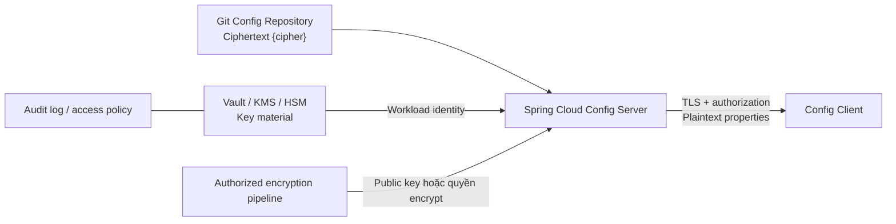
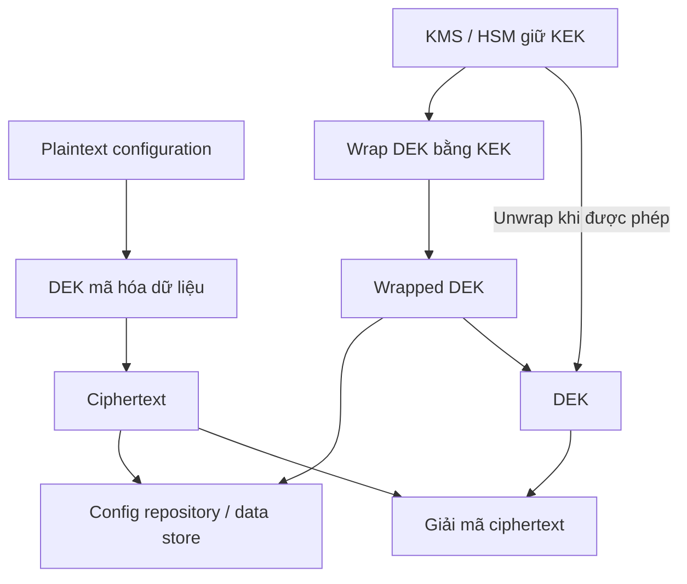

# Vị trí lưu khóa và tránh đặt khóa cùng bản mã

## 1. Vì sao vị trí lưu khóa quan trọng?

Mã hóa cấu hình giúp lưu thông tin nhạy cảm dưới dạng ciphertext trong repository, artifact hoặc kho cấu hình. Tuy nhiên, nếu khóa giải mã nằm ngay cạnh ciphertext và được bảo vệ bằng cùng một quyền truy cập, kẻ tấn công lấy được một nơi có thể lấy luôn nơi còn lại. Khi đó, mã hóa không tạo ra ranh giới bảo vệ hữu ích.

Bài học thuộc chương **Mã hóa cấu hình** của module **SPRING_CLOUD_CORE**. Module tập trung vào Spring Cloud Commons, Spring Cloud Context, cấu hình ngoài, tương thích Spring Boot, refresh scope, discovery, service registry và cách kiểm thử/vận hành các abstraction chung. Trong bối cảnh Spring Cloud Config, bài này giải thích cách giữ ciphertext trong kho cấu hình nhưng quản lý khóa ở một vùng tin cậy riêng.

Sau bài này, người học có thể:

- Phân biệt khóa mã hóa, ciphertext, plaintext và thông tin xác thực dùng để mở keystore.
- Giải thích vì sao khóa và bản mã phải nằm ở các vị trí hoặc ranh giới quyền truy cập khác nhau.
- Chọn nơi lưu khóa phù hợp: secret manager, KMS, Vault, HSM hoặc file keystore được mount an toàn.
- Cấu hình khóa đối xứng và keystore bất đối xứng cho Spring Cloud Config Server.
- Hiểu vai trò của tiền tố `{cipher}`, endpoint `/encrypt` và `/decrypt`.
- Thiết kế quyền truy cập, rotation, backup và khôi phục khóa.
- Phân tích rủi ro khi khóa bị lộ, bị mất hoặc được đóng gói cùng ứng dụng.

## 2. Phân biệt dữ liệu được bảo vệ và vật liệu khóa

Một quy trình mã hóa cấu hình thường có các thành phần sau:

| Thành phần | Ý nghĩa | Ví dụ |
| --- | --- | --- |
| Plaintext | Giá trị gốc cần bảo vệ | Mật khẩu database, API token |
| Ciphertext | Kết quả sau mã hóa | Chuỗi bắt đầu bằng `{cipher}` trong file cấu hình |
| Encryption key | Khóa thực hiện phép mã hóa | Khóa đối xứng hoặc public key |
| Decryption key | Khóa dùng để giải mã | Cùng symmetric key hoặc private key |
| Keystore | Vật chứa key/certificate và metadata | File PKCS12/JKS |
| Keystore password | Bí mật mở keystore | Secret được cấp riêng cho Config Server |
| Key identifier/version | Nhãn để biết ciphertext dùng khóa nào | Alias hoặc metadata do hệ thống quản lý |

Không được đồng nhất password của keystore với encryption key. Password mở file keystore; private key bên trong mới là vật liệu mật mã dùng để giải mã. Nếu lưu keystore và password cùng một chỗ, kẻ tấn công lấy được cả hai có thể mở khóa.

Tương tự, ciphertext không phải là khóa. Có thể đưa ciphertext vào Git để quản lý phiên bản, nhưng khóa giải mã phải được lưu ở một hệ thống hoặc vùng truy cập khác.

### 2.1. Mô hình rủi ro khi đặt khóa cùng bản mã

Giả sử repository có:

```text
config-repo/
  application-prod.yml
  encryption-key.txt
```

File YAML chứa ciphertext, còn file thứ hai chứa khóa giải mã. Người có quyền đọc repository có thể tải cả hai. Nếu repository được clone sang máy cá nhân, mirror, backup hoặc pipeline, khóa sẽ lan theo cùng các bản sao đó.

Cùng một vấn đề xuất hiện khi:

- Đưa khóa vào source code hoặc resource trong JAR.
- Đặt keystore và password trong cùng Docker image.
- Đưa khóa vào Helm values hoặc Terraform state cùng ciphertext.
- Lưu khóa trong CI artifact, build log hoặc cache.
- Mount khóa vào mọi container chỉ vì chúng đều cần đọc cấu hình.
- Dùng cùng một service account để đọc repository ciphertext và đọc secret chứa khóa mà không có giới hạn.

Vấn đề cốt lõi là **cùng một quyền truy cập có thể lấy cả dữ liệu mã hóa và phương tiện giải mã**. Tách file nhưng vẫn cấp quyền đọc cả hai cho cùng một danh tính không tạo ra sự phân tách đáng kể.

### 2.2. Mô hình tách biệt

Một kiến trúc tốt hơn đặt ciphertext và key material ở hai ranh giới khác nhau:



- Repository lưu ciphertext và metadata không nhạy cảm.
- Secret manager/KMS/Vault/HSM giữ khóa hoặc private key.
- Chỉ Config Server có danh tính workload được phép lấy khóa giải mã.
- Pipeline mã hóa có thể chỉ cần quyền dùng public key hoặc quyền gọi thao tác encrypt.
- Client nhận cấu hình sau khi Config Server giải mã; đường truyền vẫn phải được bảo vệ bằng TLS và xác thực.

Đây là phân tách theo quyền truy cập và danh tính workload. Trong hệ thống có yêu cầu cao, nên tách cả quyền quản trị repository, quyền quản trị khóa và quyền triển khai Config Server.

## 3. Spring Cloud Config mã hóa cấu hình như thế nào?

### 3.1. Tiền tố {cipher} và dữ liệu lưu trong repository

Spring Cloud Config Server nhận diện giá trị mã hóa thông qua tiền tố `{cipher}`. Khi remote property source chứa giá trị này, Config Server giải mã trước khi gửi cấu hình cho Config Client qua HTTP.

Ví dụ file YAML trong repository:

```yaml
spring:
  datasource:
    username: order_app
    password: '{cipher}ENCRYPTED_VALUE_FROM_CONFIG_SERVER'
```

Với file `application.properties`, giá trị mã hóa không được đặt trong dấu nháy:

```properties
spring.datasource.username=order_app
spring.datasource.password={cipher}ENCRYPTED_VALUE_FROM_CONFIG_SERVER
```

Trong YAML, nên đặt giá trị có dấu ngoặc nhọn trong dấu nháy để parser xử lý đúng scalar. Trong properties, không bọc giá trị bằng dấu nháy vì Config Server cần nhận đúng tiền tố.

Luồng xử lý khái quát:

1. Người vận hành hoặc pipeline được cấp quyền gửi plaintext đến endpoint mã hóa.
2. Config Server mã hóa giá trị và trả ciphertext.
3. Pipeline ghi ciphertext cùng tiền tố `{cipher}` vào file cấu hình.
4. Ciphertext được commit vào repository.
5. Khi Config Client yêu cầu cấu hình, Config Server đọc property source và giải mã.
6. Config Server gửi giá trị plaintext đến client qua kết nối đã bảo vệ.

Điều này bảo vệ giá trị khi lưu trong Git. Nó không có nghĩa Config Client nhận ciphertext hoặc secret được mã hóa đầu-cuối: trong mô hình mặc định, plaintext xuất hiện tại Config Server và được gửi đến client sau giải mã.

### 3.2. Endpoint /encrypt và /decrypt

Config Server cung cấp hai endpoint:

- `POST /encrypt`: nhận plaintext và trả ciphertext.
- `POST /decrypt`: nhận ciphertext và trả plaintext.

Ví dụ luồng sử dụng:

```text
POST /encrypt
Body: <plaintext-secret>

Response: <ciphertext>
```

Sau đó, thêm tiền tố `{cipher}` trước ciphertext khi lưu vào YAML hoặc properties.

Hai endpoint này phải được bảo vệ bằng authentication, authorization và TLS. Đặc biệt, `/decrypt` có thể trả plaintext trực tiếp, vì vậy chỉ cấp quyền cho danh tính vận hành thực sự cần chức năng đó. Nếu pipeline chỉ cần mã hóa, không cấp quyền giải mã cho pipeline.

Không đưa plaintext vào command line, shell history, build log hoặc output CI. Dùng input/secret injection có kiểm soát và tránh in response nhạy cảm ra log. Ciphertext có thể được lưu trong Git; plaintext và key material thì không.

### 3.3. Khi giải mã thất bại

Nếu Config Server không giải mã được một giá trị, theo hành vi mặc định tài liệu hiện hành, property có thể bị thay bằng tên có tiền tố `invalid.` và giá trị như `<n/a>`. Điều này nhằm tránh trường hợp ciphertext vô tình bị dùng như password.

Ví dụ response có thể chứa:

```json
{
  "source": {
    "invalid.spring.datasource.password": "<n/a>"
  }
}
```

Ứng dụng không nên xem đây là một giá trị hợp lệ. Cần:

- Theo dõi lỗi giải mã ở Config Server.
- Cảnh báo khi response chứa property có tiền tố `invalid.`.
- Validate các khóa bắt buộc trước khi readiness thành công.
- Không để ứng dụng fallback âm thầm sang một mật khẩu mặc định yếu.
- Kiểm tra key version, alias, profile, label và ciphertext có bị cắt hoặc thay đổi hay không.

Nếu thay đổi cấu hình `spring.cloud.config.server.encrypt.prefix-invalid-properties`, cần đánh giá tác động đến client và validation. Tắt tiền tố invalid không làm cho giải mã thành công; client có thể nhận ciphertext như một giá trị thông thường.

## 4. Chọn nơi lưu khóa

### 4.1. Secret manager hoặc Vault

Với hệ thống có nhiều dịch vụ hoặc nhiều môi trường, nên dùng một secret manager như HashiCorp Vault hoặc dịch vụ quản lý secret của nền tảng. Config Server xác thực bằng workload identity, service account hoặc cơ chế phù hợp rồi lấy key material khi cần.

Ưu điểm:

- Quản lý quyền đọc theo service identity.
- Có audit log cho thao tác đọc và thay đổi secret.
- Hỗ trợ versioning, rotation và thu hồi.
- Có thể cấp secret ngắn hạn hoặc credential động.
- Khóa không cần nằm trong source code, JAR hoặc Git repository.

Cần giới hạn quyền của Config Server theo đúng key/secret cần dùng. Không cấp quyền quản trị toàn bộ Vault chỉ vì server cần đọc một encryption key.

### 4.2. KMS và HSM

KMS (Key Management Service) quản lý khóa và cung cấp thao tác mã hóa/giải mã hoặc bọc khóa. HSM (Hardware Security Module) bảo vệ key material trong phần cứng chuyên dụng và có thể thực hiện thao tác mật mã trong ranh giới bảo vệ của thiết bị.

KMS/HSM phù hợp khi:

- Chính sách yêu cầu kiểm soát vòng đời khóa tập trung.
- Cần audit và phân quyền thao tác cryptographic.
- Nhiều dịch vụ dùng khóa theo workload identity.
- Có yêu cầu quản lý khóa do tổ chức kiểm soát hoặc tuân thủ tiêu chuẩn.

Không phải mọi cấu hình Spring Cloud Config mặc định đều tự kết nối KMS/HSM. Các ví dụ `encrypt.key` và `encrypt.keyStore.*` là cơ chế cấu hình khóa của Config Server. Muốn dùng thao tác KMS hoặc Vault chuyên biệt, cần integration phù hợp hoặc triển khai encryptor/locator tùy biến; không giả định chỉ đổi tên property là Config Server tự dùng KMS.

### 4.3. File keystore được mount bên ngoài ứng dụng

Nếu chưa có secret manager, có thể đặt keystore ở một vị trí riêng bên ngoài JAR và repository, sau đó mount vào Config Server với quyền đọc hạn chế.

Ví dụ:

```text
/run/secrets/config-server-keystore.p12
```

Nguyên tắc triển khai:

- Mount read-only.
- Giới hạn owner/group và quyền file cho đúng user chạy Config Server.
- Không đóng gói keystore vào JAR hoặc Docker image.
- Cấp password mở keystore qua một secret channel khác.
- Không mount keystore vào Config Client nếu client không cần private key.
- Bảo vệ bản backup keystore theo cùng mức độ nhạy cảm.

File keystore không tự trở nên an toàn chỉ vì có đuôi `.p12` hoặc `.jks`. Bảo vệ còn phụ thuộc password, filesystem permission, backup, danh tính process và quyền truy cập host.

### 4.4. Environment variable: cách injection có giới hạn

Spring Cloud Config hỗ trợ cấu hình symmetric key qua property `encrypt.key` hoặc biến môi trường `ENCRYPT_KEY`. Cách này giúp tránh ghi plaintext key vào file cấu hình thông thường.

Tuy nhiên, environment variable không phải kho khóa chuyên dụng. Tùy hệ điều hành và cách triển khai, giá trị có thể bị lộ qua process inspection, crash dump, debug tooling hoặc quyền truy cập runtime. OWASP khuyến nghị đánh giá các rủi ro này và ưu tiên secure storage khi có thể.

Nếu dùng environment variable:

- Được cấp từ secret manager tại thời điểm chạy, không lấy từ file `.env` đã commit.
- Không ghi giá trị vào log hoặc output của pipeline.
- Hạn chế quyền xem cấu hình process và môi trường container.
- Không truyền secret trong Dockerfile `ENV` hoặc build argument.
- Có quy trình thay đổi/rotation và kiểm tra lại process sau cập nhật.

### 4.5. So sánh các lựa chọn

| Vị trí | Mức kiểm soát | Phù hợp | Lưu ý |
| --- | --- | --- | --- |
| KMS/HSM | Tập trung, có IAM/audit và khả năng quản lý vòng đời | Hệ thống production, yêu cầu bảo mật/tuân thủ cao | Cần integration, quyền workload và kế hoạch khả dụng |
| Vault/secret manager | Phân quyền theo secret, audit, version và rotation | Nhiều ứng dụng/môi trường | Bảo vệ identity truy cập Vault và đường dự phòng |
| Keystore mount read-only | Bảo vệ bằng file permission và password | Hệ thống nhỏ hoặc triển khai tự quản lý | Tách password, backup và không đóng gói keystore |
| Environment variable từ secret injection | Dễ triển khai, hỗ trợ trực tiếp với `ENCRYPT_KEY` | Môi trường có kiểm soát process inspection | Có thể lộ qua runtime metadata; không dùng như kho khóa dài hạn |
| Source code, Git hoặc JAR | Rất thấp | Không phù hợp | Người lấy artifact/repository có thể lấy luôn khóa |

## 5. Khóa đối xứng và bất đối xứng trong Spring Cloud Config

### 5.1. Khóa đối xứng với encrypt.key

Mã hóa đối xứng dùng cùng một bí mật cho cả mã hóa và giải mã. Config Server có thể nhận khóa qua property `encrypt.key` hoặc biến môi trường `ENCRYPT_KEY`.

Ví dụ file cấu hình của Config Server chỉ tham chiếu đến secret được cấp lúc runtime:

```yaml
encrypt:
  key: ${ENCRYPT_KEY}
```

Giá trị thực của `ENCRYPT_KEY` được cấp qua secret manager hoặc runtime secret injection. Không ghi literal key vào file trên Git.

Nếu Config Server dùng legacy bootstrap (ví dụ có `spring-cloud-starter-bootstrap` hoặc bật `spring.cloud.bootstrap.enabled=true`), tài liệu Spring Cloud Config yêu cầu đặt `encrypt.key` trong `bootstrap.properties` để key có sẵn đúng thời điểm bootstrap. Với mô hình khác, đặt thuộc tính theo quy trình cấu hình phù hợp của phiên bản đang dùng.

Ưu điểm của symmetric key là cấu hình đơn giản. Nhược điểm là bất kỳ thành phần nào có key đều có thể vừa mã hóa vừa giải mã. Khi key bị lộ, ciphertext được bảo vệ bởi key đó có thể bị giải mã; do đó, số lượng nơi giữ key cần được giới hạn.

### 5.2. Khóa bất đối xứng và keystore

Mã hóa bất đối xứng dùng một cặp khóa:

- **Public key:** dùng để mã hóa; có thể phân phối cho pipeline hoặc bên tạo ciphertext.
- **Private key:** dùng để giải mã; phải được giữ bí mật.

Spring Cloud Config hỗ trợ keystore với các thuộc tính:

| Thuộc tính | Ý nghĩa |
| --- | --- |
| `encrypt.keyStore.location` | Resource/file chứa keystore |
| `encrypt.keyStore.password` | Password mở keystore |
| `encrypt.keyStore.alias` | Alias của key cần sử dụng |
| `encrypt.keyStore.type` | Loại keystore; mặc định là JKS |

Ví dụ Config Server dùng keystore được mount bên ngoài:

```yaml
encrypt:
  key-store:
    location: file:/run/secrets/config-server-keystore.p12
    password: ${CONFIG_KEYSTORE_PASSWORD}
    alias: config-server
    type: PKCS12
```

Trong mô hình Config Server giải mã trước khi trả cấu hình, private key nằm tại vùng tin cậy của Config Server. Pipeline có thể dùng public key để mã hóa mà không cần biết private key.

Tài liệu Spring Cloud Config cũng cho phép mô hình chỉ đặt public key trên server để mã hóa, còn private key được dùng ở nơi giải mã. Cách này có thể hữu ích trong một số kiến trúc, nhưng sẽ phân tán key management đến các client; chỉ chọn khi threat model và vận hành thực sự cần thiết.

### 5.3. Chọn mô hình theo luồng sử dụng

| Nhu cầu | Lựa chọn có thể phù hợp |
| --- | --- |
| Một Config Server mã hóa và giải mã, ít thành phần tham gia | Symmetric key được cấp từ secret manager |
| Pipeline chỉ cần mã hóa, private key cần tập trung | Asymmetric key; pipeline chỉ nhận public key |
| Cần audit và kiểm soát thao tác dùng khóa | KMS/HSM hoặc secret manager có policy |
| Mỗi ứng dụng/profile có khóa riêng | Thiết kế `TextEncryptorLocator` theo application/profile và quy trình quản lý key riêng |

Mặc định `TextEncryptorLocator` của Spring Cloud Config dùng cùng encryptor/key cho các lần mã hóa. Nếu cần khóa riêng theo application hoặc profile, cần cung cấp `TextEncryptorLocator` tùy biến theo tài liệu; không giả định URL endpoint theo application/profile tự tạo ra khóa riêng.

## 6. Tách quyền đọc ciphertext và quyền dùng khóa

Tách vị trí lưu chỉ hiệu quả khi quyền truy cập cũng được tách.

Một cách phân chia vai trò:

| Danh tính | Quyền nên có | Quyền không cần mặc định |
| --- | --- | --- |
| Developer | Đọc cấu hình không nhạy cảm, commit ciphertext theo quy trình | Đọc private key hoặc secret giải mã production |
| CI encryption job | Gọi thao tác mã hóa hoặc dùng public key | Gọi `/decrypt`, đọc private key |
| Config Server workload | Đọc đúng key/keystore cần giải mã và đọc repository cấu hình | Quản trị toàn bộ secret store |
| Config Client workload | Nhận cấu hình qua endpoint đã xác thực/TLS | Đọc key giải mã của Config Server |
| Security/key administrator | Quản lý version, rotation, policy và audit | Sử dụng secret production cho tác vụ phát triển thường ngày |
| Auditor | Đọc metadata và audit log | Đọc plaintext hoặc key material |

Trong mô hình symmetric key, pipeline cần mã hóa phải có khả năng gọi một dịch vụ thực hiện encryption hoặc nhận key; nếu cấp key trực tiếp thì pipeline cũng có khả năng giải mã. Đây là một lý do asymmetric encryption hoặc encryption service có phân quyền rõ ràng có thể phù hợp hơn.

Với Config Server, bảo vệ tối thiểu:

- TLS cho kết nối client-server và kết nối đến secret manager.
- Authentication/authorization cho Config Server và các endpoint mã hóa.
- Chỉ expose endpoint cần thiết; giới hạn `/encrypt` và đặc biệt `/decrypt`.
- Không để người dùng không tin cậy truy cập trực tiếp kho cấu hình production.
- Audit việc đọc, tạo, thay đổi, rotate và revoke key.
- Không ghi plaintext, private key, keystore password hoặc token vào log.

Lưu ý: Config Server giải mã trước khi trả property source cho client, do đó client có thể nhìn thấy plaintext trong `Environment`, heap hoặc diagnostic endpoint. Hãy bảo vệ Actuator `env`, `configprops`, heap dump, debug endpoint và log theo cùng mức độ nhạy cảm.

## 7. Envelope encryption: bảo vệ cả khóa dữ liệu

Trong một số kiến trúc, dữ liệu được mã hóa bằng **Data Encryption Key (DEK)**. DEK lại được mã hóa bằng **Key Encryption Key (KEK)** do KMS hoặc hệ thống quản lý khóa giữ.



- DEK thực hiện mã hóa dữ liệu.
- KEK bảo vệ DEK; KEK không cần nằm trong repository.
- Ciphertext và wrapped DEK có thể được lưu cùng dữ liệu.
- KMS/HSM kiểm soát thao tác unwrap DEK bằng policy và workload identity.

Mô hình này giúp thay KEK bằng thao tác re-wrap DEK mà không nhất thiết mã hóa lại toàn bộ ciphertext. Nếu thay DEK, dữ liệu tương ứng phải được mã hóa lại.

Envelope encryption là mô hình quản lý khóa tổng quát. Spring Cloud Config không tự động triển khai toàn bộ luồng DEK/KEK chỉ bằng `encrypt.key`; cần dịch vụ KMS hoặc integration/encryptor phù hợp.

## 8. Rotation khóa và mã hóa lại cấu hình

Khóa không nên được giữ vô thời hạn. Cần rotation theo chu kỳ rủi ro, khi có nghi ngờ lộ khóa, khi người có quyền truy cập rời tổ chức hoặc khi thuật toán/implementation cần thay thế.

### 8.1. Vì sao không thể chỉ thay giá trị encrypt.key?

Ciphertext được tạo bằng khóa cũ thường không giải mã được bằng khóa mới. Nếu đổi symmetric key ngay lập tức mà không có kế hoạch, Config Server có thể không đọc được những property đã mã hóa trước đó.

Đối với private key bất đối xứng, thay hoặc xóa private key cũ cũng có thể khiến ciphertext cũ không thể giải mã. Vì vậy, rotation phải tính đến cả dữ liệu hiện tại, lịch sử Git và backup.

### 8.2. Quy trình rotation có kiểm soát

Một quy trình tổng quát:

1. **Tạo khóa mới:** sinh bằng công cụ mật mã an toàn hoặc KMS/HSM; gắn metadata về mục đích, owner, version và ngày tạo.
2. **Lưu khóa mới:** đưa key material vào secret manager/keystore mới với quyền truy cập tối thiểu.
3. **Chuẩn bị giai đoạn chuyển tiếp:** bảo đảm hệ thống có thể giải mã ciphertext cũ và mới trong thời gian migration. Nếu cơ chế mặc định chỉ dùng một key, cần triển khai kế hoạch chuyển đổi có kiểm thử hoặc `TextEncryptorLocator`/key ring tùy biến.
4. **Mã hóa giá trị mới:** dùng khóa mới cho mọi ciphertext được tạo từ thời điểm chuyển đổi.
5. **Mã hóa lại cấu hình hiện có:** cập nhật ciphertext trong repository, giữ nguyên tên property và profile.
6. **Kiểm tra giải mã:** kiểm thử từng ứng dụng/profile, xác nhận Config Server trả giá trị hợp lệ và client bind thành công.
7. **Theo dõi rollout:** kiểm tra mọi Config Server instance dùng đúng key version và không có lỗi `invalid.*`.
8. **Thu hồi khóa cũ:** chỉ sau khi dữ liệu đang dùng và backup cần thiết đã được xử lý theo policy; nếu khóa cũ bị lộ, phải ưu tiên containment và thu hồi thay vì giữ để thuận tiện.
9. **Lưu audit:** ghi người thực hiện, thời điểm, key version, phạm vi cấu hình và kết quả xác minh; không ghi key hoặc plaintext.

Không giả định Spring Cloud Config tự động giữ một key ring cho mọi phiên bản ciphertext. Cần xác định rõ cách triển khai có hỗ trợ đồng thời khóa cũ/mới hay không trước khi bắt đầu rotation.

### 8.3. Per-application hoặc per-profile key

Nếu mỗi ứng dụng hoặc profile dùng một key khác nhau, phạm vi sự cố có thể được giới hạn. Ví dụ, key của `order-service/prod` không cần dùng để giải mã `payment-service/prod`.

Spring Cloud Config hỗ trợ endpoint mã hóa/giải mã theo application/profile, nhưng để chọn encryptor tương ứng cần cung cấp `TextEncryptorLocator` tùy biến. Việc phân tách key làm tăng số lượng key cần inventory, rotation và backup; cần tự động hóa để tránh cấu hình sai hoặc mất key.

## 9. Backup và khôi phục khóa

Mất khóa giải mã có thể khiến ciphertext không thể khôi phục. Vì vậy, backup key material là một phần của thiết kế mã hóa.

- Backup keystore hoặc key version trong kho riêng có kiểm soát.
- Bảo vệ backup bằng mã hóa và quyền độc lập với repository ciphertext.
- Giữ bản backup ở vùng phục hồi khác với hệ thống production chính.
- Ghi metadata: key owner, alias, version, purpose, thời gian tạo, thời hạn và cách phục hồi.
- Kiểm thử restore định kỳ trong môi trường cô lập.
- Duy trì quyền break-glass có kiểm soát, ghi audit và kiểm tra định kỳ.
- Không đặt backup key cạnh backup Git repository hoặc backup database chứa ciphertext.

Quy trình khôi phục cần xác minh rằng key version được phục hồi có thể giải mã bản cấu hình cần thiết. Chỉ có file backup mà chưa thử mở/giải mã không chứng minh khả năng phục hồi.

Nếu khóa đã bị xâm phạm, không nên giữ nó hoạt động chỉ vì backup cũ cần đọc. Hãy tách quy trình incident response khỏi quy trình khôi phục thông thường; dữ liệu backup có thể cần được mã hóa lại bằng khóa mới trước khi hủy khóa bị lộ.

## 10. Khi khóa bị lộ hoặc ciphertext bị lấy cắp

Nếu khóa bị lộ, giả định rằng mọi ciphertext được bảo vệ bởi khóa đó có thể bị giải mã. Các bước xử lý nên gồm:

1. Xác định phạm vi khóa, ứng dụng, profile, repository, backup và thời gian có thể bị truy cập.
2. Thu hồi hoặc vô hiệu hóa quyền sử dụng key cũ theo quy trình incident response.
3. Tạo key mới và cập nhật Config Server.
4. Mã hóa lại các giá trị cấu hình hiện hành.
5. Rotate cả credential plaintext được bảo vệ bởi khóa đó, chẳng hạn database password hoặc API token.
6. Kiểm tra log truy cập Config Server, secret manager, CI/CD và Git.
7. Xử lý các bản sao ciphertext/keystore đã bị lộ theo chính sách lưu trữ và incident response.
8. Thông báo cho owner của dịch vụ và ghi lại phạm vi, quyết định, thời điểm khắc phục.

Xóa file chứa khóa khỏi commit mới không thu hồi khóa đã lộ. Git history, fork, mirror, build cache và backup có thể vẫn giữ bản cũ. Phải rotate/revoke key và secret liên quan; viết lại lịch sử Git chỉ là một bước xử lý bản sao, không thay thế rotation.

Nếu chỉ ciphertext bị lộ mà key vẫn được bảo vệ độc lập, dữ liệu vẫn có thể được bảo vệ theo thiết kế mật mã. Tuy vậy, cần kiểm tra thuật toán, key length, access boundary và việc ciphertext có bị ghép với metadata nhạy cảm hay không.

## 11. Các lỗi thường gặp

| Lỗi / ngộ nhận | Hậu quả | Cách xử lý |
| --- | --- | --- |
| Lưu key trong cùng Git repo với `{cipher}` | Người đọc repo có cả ciphertext và key | Chuyển key sang secret manager hoặc keystore riêng |
| Đưa private keystore vào JAR/Docker image | Mọi người có artifact có thể lấy key material | Mount key ở runtime với quyền hạn chế |
| Đặt keystore password cạnh keystore | Lấy file là mở được private key | Cấp password qua secret channel khác |
| Cho pipeline quyền `/decrypt` dù chỉ cần encrypt | Mở rộng số nơi có thể xem plaintext | Chỉ cấp thao tác encrypt hoặc public key |
| Dùng `ENCRYPT_KEY` như file `.env` commit | Key vẫn nằm trong version control | Runtime secret injection và kiểm soát process inspection |
| Chỉ bật TLS mà không tách key | Bảo vệ đường truyền nhưng không bảo vệ key ở repository | Tách key storage và phân quyền |
| Nghĩ `{cipher}` bảo vệ secret đầu-cuối | Config Server vẫn giải mã và gửi plaintext cho client | Bảo vệ Config Server, TLS, client identity và runtime |
| Đổi key nhưng không mã hóa lại dữ liệu | Ciphertext cũ không giải mã được | Lập kế hoạch migration/key overlap có kiểm thử |
| Xóa key khỏi Git rồi cho rằng đã thu hồi | Key có thể còn trong history, clone và backup | Revoke key, rotate secret và xử lý bản sao |
| Không backup private key | Mất keystore có thể làm mất khả năng giải mã cấu hình | Backup riêng và thử restore |
| Log request `/decrypt` hoặc Environment | Plaintext/secret xuất hiện trong log | Mask dữ liệu và giới hạn diagnostic access |
| Dùng chung một key cho mọi app/profile | Một lần lộ khóa ảnh hưởng phạm vi lớn | Cân nhắc key separation theo app/profile và vận hành key lifecycle |

## 12. Checklist thiết kế vị trí lưu khóa

Trước khi triển khai, hãy xác nhận:

1. Ciphertext đang được lưu ở repository, database hay artifact nào?
2. Key material được lưu ở hệ thống nào và có tách khỏi ciphertext không?
3. Keystore password có nằm ở một secret channel khác không?
4. Config Server có workload identity riêng để đọc khóa không?
5. Pipeline chỉ có quyền cần thiết để mã hóa, không có quyền giải mã ngoài nhu cầu?
6. Client có nhận plaintext qua TLS và authentication không?
7. Endpoint `/encrypt` và `/decrypt` có được bảo vệ và giới hạn không?
8. Actuator/log/heap dump có thể tiết lộ key hoặc plaintext không?
9. Có key owner, version, alias, purpose và lịch rotation rõ ràng không?
10. Có thể giải mã ciphertext cũ trong giai đoạn chuyển khóa không?
11. Backup key có được tách khỏi backup ciphertext và đã thử restore chưa?
12. Có quy trình revoke/rotate khi key bị lộ không?
13. CI/CD, Docker image, Helm values và Terraform state có chứa key không?
14. Có cảnh báo khi Config Server không giải mã được property hoặc trả về `invalid.*` không?

## 13. Tài liệu tham khảo chính thức

- [Spring Cloud Config — Key Management](https://docs.spring.io/spring-cloud-config/reference/server/key-management.html): khóa đối xứng `encrypt.key`, biến môi trường `ENCRYPT_KEY` và keystore bất đối xứng.
- [Spring Cloud Config — Encryption and Decryption](https://docs.spring.io/spring-cloud-config/reference/server/encryption-and-decryption.html): tiền tố `{cipher}`, endpoint `/encrypt`, `/decrypt` và hành vi khi giải mã thất bại.
- [OWASP — Cryptographic Storage Cheat Sheet](https://cheatsheetseries.owasp.org/cheatsheets/Cryptographic_Storage_Cheat_Sheet.html): tách khóa khỏi dữ liệu mã hóa, key generation, key rotation, DEK/KEK và nơi lưu khóa.
- [OWASP — Secrets Management Cheat Sheet](https://cheatsheetseries.owasp.org/cheatsheets/Secrets_Management_Cheat_Sheet.html): quản lý vòng đời secret, least privilege, audit, backup và rotation.
- [Spring Cloud Config — Server Security](https://docs.spring.io/spring-cloud-config/reference/server/security.html): bảo vệ Config Server và các endpoint quản trị.

**Ghi nhớ:** Có thể lưu ciphertext trong Git để quản lý phiên bản, nhưng khóa giải mã phải nằm trong một vùng tin cậy riêng với quyền truy cập độc lập. Với Spring Cloud Config, Config Server thường giải mã `{cipher}` trước khi gửi cho client, vì vậy cần bảo vệ cả nơi giữ private key, endpoint giải mã, kết nối TLS và nơi plaintext xuất hiện trong runtime.
