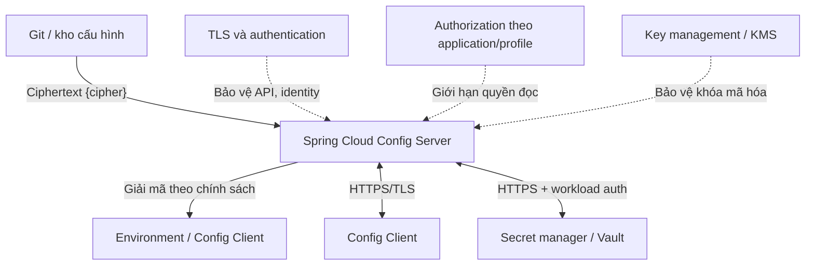
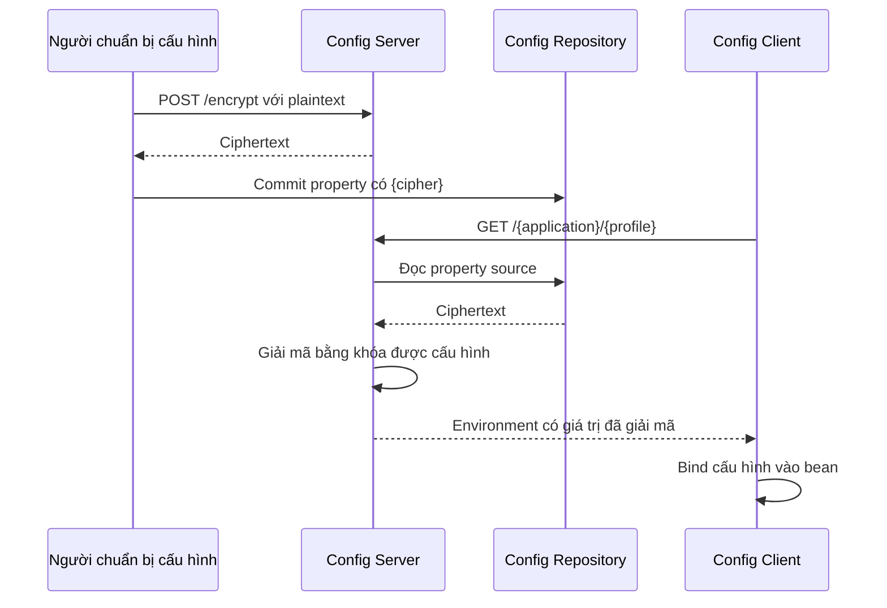

# Phân biệt mã hóa cấu hình với TLS và hệ thống quản lý bí mật

> **Chương:** Mã hóa cấu hình  
> **Module:** `SPRING_CLOUD_CORE` — các nền tảng cốt lõi của Spring Cloud trong hệ thống phân tán, đặc biệt Spring Cloud Commons, Context, cấu hình bên ngoài và tương thích phiên bản với Spring Boot. Người học tìm hiểu refresh scope, discovery, service registry, giao tiếp dịch vụ và cách kiểm thử, vận hành các abstraction chung.  
> **Trọng tâm:** Mã hóa giá trị cấu hình, bảo vệ kết nối truyền dữ liệu và quản lý vòng đời secret là ba nhiệm vụ bảo mật khác nhau. Bài học sử dụng Spring Cloud Config để chỉ ra mỗi cơ chế bảo vệ dữ liệu ở đâu, giới hạn ra sao và cách phối hợp chúng trong production.

## 1. Vì sao phải phân biệt ba cơ chế?

Một microservice có thể cần password database, API token, private key, credential của Config Server và địa chỉ endpoint nội bộ. Nếu lưu mọi thứ trong application.yml rồi commit lên Git, secret có thể bị lộ qua repository, lịch sử commit, bản sao lưu hoặc log build.

Spring Cloud cung cấp một số cách làm việc với cấu hình nhạy cảm. Tuy nhiên, ba khái niệm thường bị xem như một:

- **Mã hóa cấu hình:** biến giá trị nhạy cảm thành ciphertext trước khi lưu vào nguồn cấu hình, ví dụ giá trị có tiền tố `{cipher}` trong Git.
- **TLS/HTTPS:** bảo vệ dữ liệu khi truyền qua mạng, xác thực máy chủ và tùy cấu hình có thể xác thực cả client.
- **Hệ thống quản lý bí mật (secret manager):** lưu trữ, cấp quyền, phân phối, audit, thu hồi và trong nhiều trường hợp tự động xoay vòng secret.

Ba cơ chế bảo vệ những ranh giới khác nhau. Một password được mã hóa trong Git vẫn có thể bị lộ khi Config Server trả plaintext qua HTTP. Một kết nối HTTPS vẫn có thể truyền password đang được lưu plaintext trong repository. Một secret manager có thể cấp token an toàn nhưng ứng dụng vẫn có thể ghi token đó vào log.

### Kết quả học tập

Sau bài này, người học có thể:

1. phân biệt mã hóa dữ liệu at rest, TLS in transit và secret lifecycle management;
2. giải thích cách Spring Cloud Config xử lý property có tiền tố `{cipher}`;
3. cấu hình khóa đối xứng hoặc keystore RSA cho Config Server;
4. sử dụng endpoint `/encrypt` và `/decrypt` đúng mục đích;
5. phân biệt giải mã tại Config Server với giải mã tại Config Client;
6. bảo vệ Config Server bằng TLS, authentication và per-application authorization;
7. lựa chọn Config Server encryption, Vault backend hoặc secret manager theo yêu cầu;
8. lập kế hoạch quản lý khóa, rotation, rollback và kiểm thử lỗi giải mã.

## 2. Ba lớp bảo vệ và vị trí của chúng

### 2.1. Mã hóa cấu hình bảo vệ dữ liệu khi lưu trữ

Khi một property được mã hóa trước khi commit, repository chỉ lưu ciphertext. Với Spring Cloud Config, giá trị mã hóa được đánh dấu bằng tiền tố `{cipher}`.

Ví dụ:

```yaml
spring:
  datasource:
    username: app_user
    password: '{cipher}ENCRYPTED_VALUE'
```

Nếu Config Server có khóa phù hợp, nó nhận diện tiền tố và giải mã giá trị theo chính sách đang dùng. Mục tiêu chính là tránh lưu secret dưới dạng plaintext trong Git hoặc một kho cấu hình có quyền truy cập rộng.

Mã hóa cấu hình không tự bảo vệ:

- dữ liệu sau khi Config Server giải mã;
- request/response đi qua mạng;
- log, heap dump, crash dump hoặc endpoint quản trị;
- người dùng được cấp quyền đọc plaintext;
- khóa giải mã được lưu hoặc phân phối không an toàn.

Ciphertext cũng không che giấu toàn bộ cấu trúc repository. Tên property, tên ứng dụng, profile, label, tên file và các giá trị không được mã hóa vẫn có thể tiết lộ thông tin kiến trúc.

Mã hóa giá trị không thay thế quyền ghi và quy trình review của repository. Người có quyền sửa cấu hình vẫn có thể thay endpoint, profile, feature flag hoặc ciphertext bằng một giá trị khác. Hãy dùng branch protection, code review, audit và quyền ghi theo least privilege cho kho cấu hình.

### 2.2. TLS bảo vệ dữ liệu khi truyền

TLS tạo kênh được mã hóa giữa hai đầu kết nối và xác thực danh tính server qua certificate. Khi dùng HTTPS cho Config Server, credential và property values được bảo vệ trong quá trình truyền qua mạng.

TLS không mã hóa file cấu hình đang nằm trong Git. Nó cũng không quyết định ai được phép đọc cấu hình của application nào. Một client đã được xác thực nhưng có quyền quá rộng vẫn có thể lấy secret của service khác nếu authorization policy không giới hạn.

### 2.3. Secret manager quản lý quyền và vòng đời

Secret manager như HashiCorp Vault hoặc dịch vụ quản lý secret của cloud thường cung cấp:

- policy kiểm soát ai hoặc workload nào được đọc secret;
- authentication dựa trên workload identity, Kubernetes, AppRole hoặc cơ chế tương đương;
- audit log cho thao tác truy cập;
- versioning, revoke và rotation;
- secret động hoặc credential có thời hạn trong các backend được hỗ trợ;
- một nơi tập trung để quản lý secret thay vì phân phối một khóa giải mã chung cho nhiều ứng dụng.

Secret manager không tự bảo vệ dữ liệu khi truyền. Ứng dụng vẫn cần TLS để kết nối với Vault hoặc dịch vụ secret. Nó cũng không thay thế authorization ở Config Server nếu Config Server tiếp tục phục vụ nhiều application.

### 2.4. Bảng so sánh

| Cơ chế | Bảo vệ chính | Vị trí áp dụng | Không tự giải quyết |
| --- | --- | --- | --- |
| Mã hóa cấu hình `{cipher}` | Ciphertext thay plaintext trong kho cấu hình | Git, file hoặc backend cấu hình | TLS, phân quyền đọc, rotation tự động, log hygiene |
| TLS/HTTPS | Confidentiality và integrity của kênh truyền; xác thực peer theo certificate | Client–Config Server, Config Server–Vault, service-to-service | Mã hóa file trong Git, quyền đọc property, secret lifecycle |
| Secret manager | Lưu trữ, cấp quyền, audit, revoke và rotation secret | Vault/KMS/secret service và workload identity | Bảo vệ mọi network hop, cấu hình TLS, kiểm soát log của ứng dụng |
| Authentication/authorization | Xác định ai được gọi API và đọc application/profile nào | Config Server, Vault, API gateway | Mã hóa dữ liệu ở storage hoặc transport |

### 2.5. Sơ đồ các lớp bảo vệ



Sơ đồ thể hiện các lớp có thể phối hợp. Một triển khai cụ thể có thể lấy ciphertext từ Git, lấy secret từ Vault hoặc dùng cả hai cho những nhóm property khác nhau.

## 3. Threat model: bảo vệ trước ai và ở đâu?

Trước khi chọn cơ chế, hãy xác định tài sản, ranh giới tin cậy và đối tượng có thể truy cập.

| Tình huống | Rủi ro | Cơ chế cần có |
| --- | --- | --- |
| Repository bị sao chép trái phép | Lộ password/API token lưu plaintext | Mã hóa at rest hoặc không lưu secret trong Git |
| Kẻ tấn công nghe lén mạng | Lộ credential và property khi fetch config | HTTPS/TLS, kiểm tra certificate |
| Client service A đọc config service B | Lộ secret chéo giữa các ứng dụng | Authentication và authorization theo application |
| Người dùng trái phép gọi `/decrypt` | Có thể giải mã ciphertext thành plaintext | Bảo vệ endpoint, giới hạn mạng và quyền vận hành |
| Khóa mã hóa bị lấy cắp | Ciphertext cũ có thể bị giải mã | KMS/secret manager, rotation, hạn chế quyền truy cập khóa |
| Config Server bị chiếm quyền | Plaintext có thể bị đọc trong memory hoặc qua API | Hardening, least privilege, TLS, network isolation, audit |
| Ứng dụng bị compromise | Secret đã cấp cho process có thể bị lấy từ memory/env | Workload isolation, secret ngắn hạn, giảm quyền và phát hiện truy cập |
| Plaintext bị ghi vào log | Secret lộ dù repository đã mã hóa | Redaction, log access control và kiểm thử log |

Không có một property duy nhất có thể xử lý mọi tình huống. Mã hóa ciphertext trong Git giảm tác động khi repository bị đọc, nhưng nếu attacker lấy được khóa giải mã hoặc quyền gọi Config Server, secret vẫn có thể lộ.

## 4. Spring Cloud Config mã hóa property như thế nào?

### 4.1. Tiền tố `{cipher}`

Spring Cloud Config nhận diện property được mã hóa bằng tiền tố `{cipher}`. Khi Config Server chạy theo chế độ giải mã phía server mặc định, nó giải mã các property này trước khi trả Environment cho Config Client qua HTTP.

Repository có thể chứa:

```yaml
spring:
  datasource:
    username: app_user
    password: '{cipher}BASE64_OR_CIPHER_TEXT'
```

Giá trị sau `{cipher}` là ciphertext được tạo bằng khóa và cơ chế mã hóa mà Config Server đã cấu hình. Chuỗi trong ví dụ chỉ là placeholder, không phải ciphertext có thể dùng thực tế.

Với YAML, nên đặt giá trị trong dấu nháy đơn hoặc kép để parser giữ nguyên chuỗi bắt đầu bằng `{cipher}`. Với application.properties, giá trị mã hóa không được bọc trong dấu nháy; dấu nháy có thể làm Config Server không nhận diện và giải mã đúng.

### 4.2. Quy trình từ lúc mã hóa đến lúc client nhận cấu hình



Ở mô hình này:

1. Người được phép chuẩn bị cấu hình gửi plaintext tới endpoint mã hóa.
2. Config Server trả ciphertext.
3. Người chuẩn bị thêm tiền tố `{cipher}` và lưu ciphertext vào repository.
4. Config Client yêu cầu cấu hình theo application/profile/label.
5. Config Server đọc property source, giải mã property và trả kết quả.
6. Client nhận giá trị đã giải mã và bind vào ứng dụng.

TLS vẫn cần thiết cho request `/encrypt`, request lấy cấu hình và mọi kết nối giữa các thành phần.

### 4.3. Giải mã lỗi và property `invalid`

Nếu Config Server không giải mã được giá trị, nó có thể loại property lỗi khỏi property source và thêm một property có cùng tên nhưng được gắn tiền tố `invalid`, thường có giá trị `<n/a>`. Hành vi này giúp ciphertext không bị sử dụng nhầm như một password.

Ví dụ rút gọn:

```json
{
  "propertySources": [
    {
      "name": "application-prod.yml",
      "source": {
        "invalid.spring.datasource.password": "<n/a>"
      }
    }
  ]
}
```

Nếu có property source khác cung cấp `spring.datasource.password`, ứng dụng có thể nhận giá trị fallback từ nguồn đó. Điều này không có nghĩa secret đã giải mã thành công. Cần kiểm tra `invalid.*` và fail deployment nếu property bắt buộc không có giá trị hợp lệ.

Có thể cấu hình `spring.cloud.config.server.encrypt.prefix-invalid-properties=false` để không đổi tên key thành `invalid.*`. Khi đó client có thể nhận ciphertext thay vì giá trị plaintext nếu server không giải mã được. Không tắt cơ chế này nếu ứng dụng chưa có cách phát hiện lỗi giải mã khác.

## 5. Mã hóa và giải mã bằng endpoint

### 5.1. Endpoint `/encrypt`

Config Server cung cấp endpoint `POST /encrypt` để mã hóa plaintext bằng khóa đã cấu hình.

Ví dụ với chuỗi giả định:

```bash
curl -sS -X POST \
  -H "Content-Type: text/plain" \
  --data-binary "REPLACE_WITH_SECRET" \
  https://config.example.internal/encrypt
```

Endpoint trả ciphertext. Sau đó lưu ciphertext vào property với tiền tố `{cipher}`.

Khi dùng `curl` với dữ liệu chứa ký tự đặc biệt như dấu `+`, hãy chú ý cách URL-encode form data. Có thể dùng `--data-urlencode` với cú pháp phù hợp hoặc chỉ rõ `Content-Type: text/plain` để tránh curl diễn giải sai nội dung. Không để thống kê hoặc thông báo của curl bị ghép vào ciphertext.

Ví dụ file YAML sau khi nhận kết quả:

```yaml
spring:
  datasource:
    password: '{cipher}PASTE_CIPHERTEXT_HERE'
```

Không ghi plaintext vào cùng file, comment, commit message, shell history hoặc log CI.

### 5.2. Endpoint `/decrypt`

`POST /decrypt` giải mã ciphertext khi Config Server có khóa phù hợp:

```bash
curl -sS -X POST \
  -H "Content-Type: text/plain" \
  --data-binary "PASTE_CIPHERTEXT_HERE" \
  https://config.example.internal/decrypt
```

Endpoint này có thể trả plaintext. Vì vậy, quyền gọi `/decrypt` cần hẹp hơn quyền đọc cấu hình thông thường. Chỉ người vận hành hoặc pipeline được ủy quyền mới nên sử dụng. Tránh gọi endpoint từ trình duyệt, ticket, chat hoặc log nơi response có thể bị lưu lại.

### 5.3. Bảo vệ endpoint mã hóa

Các endpoint `/encrypt` và `/decrypt` là API quản trị nhạy cảm. Cần:

- yêu cầu authentication;
- giới hạn authorization riêng cho encrypt/decrypt;
- chỉ cho phép truy cập qua mạng quản trị hoặc pipeline tin cậy;
- dùng HTTPS;
- audit người gọi, thời gian và hành động mà không ghi plaintext;
- không expose công khai qua load balancer;
- cân nhắc tắt hoặc chặn endpoint khi không còn nhu cầu vận hành.

Bảo vệ endpoint không chỉ là bật HTTP Basic. Cần phân biệt người được quyền lấy cấu hình với người được quyền giải mã plaintext tùy ý.

### 5.4. Mã hóa theo application/profile

Spring Cloud Config có thể hỗ trợ đường dẫn endpoint mã hóa/giải mã theo application và profile. Tuy nhiên, để chọn encryptor khác nhau theo tên ứng dụng hoặc profile, cần cung cấp `TextEncryptorLocator` tùy chỉnh. Encryptor mặc định dùng cùng khóa cho mọi thao tác, nên không nên cho rằng chỉ thêm `{application}` vào URL là tự động tách khóa.

## 6. Quản lý khóa đối xứng và RSA

### 6.1. Khóa đối xứng

Khóa đối xứng là một secret dùng cho cả mã hóa và giải mã. Trong Spring Cloud Config, có thể cấu hình `encrypt.key` bằng một chuỗi bí mật hoặc biến môi trường `ENCRYPT_KEY`.

Ví dụ dùng biến môi trường trên môi trường triển khai:

```bash
ENCRYPT_KEY=<INJECTED_SECRET_FROM_SECURE_STORE>
```

Hoặc cấu hình ở runtime qua secret injection của nền tảng. Không commit giá trị thật vào application.yml, Dockerfile, Helm values công khai, pipeline YAML hoặc script triển khai.

Nếu ứng dụng dùng legacy bootstrap (ví dụ có `spring-cloud-starter-bootstrap` hoặc bật `spring.cloud.bootstrap.enabled=true` bằng system property), tài liệu Spring Cloud yêu cầu đặt `encrypt.key` trong `bootstrap.properties`. Với cấu hình hiện đại, đặt khóa ở nguồn khởi tạo phù hợp với lifecycle của Config Server.

Ưu điểm của khóa đối xứng là cấu hình đơn giản. Hạn chế là bất kỳ thành phần nào có khóa đều có thể giải mã, và nếu nhiều hệ thống chia sẻ cùng một key thì phạm vi ảnh hưởng khi key lộ sẽ lớn.

### 6.2. Khóa bất đối xứng RSA

Với RSA, public key dùng để mã hóa và private key dùng để giải mã. Spring Cloud Config hỗ trợ keystore với các property:

| Property | Ý nghĩa |
| --- | --- |
| `encrypt.keyStore.location` | Resource chứa keystore |
| `encrypt.keyStore.password` | Password mở keystore |
| `encrypt.keyStore.alias` | Alias của key được chọn |
| `encrypt.keyStore.type` | Loại keystore, mặc định thường là `jks` |

Ví dụ minh họa:

```yaml
encrypt:
  key-store:
    location: file:/run/secrets/config-encryption.jks
    password: ${CONFIG_KEYSTORE_PASSWORD}
    alias: config-encryption
    type: jks
```

File keystore và password phải được cấp từ nguồn bảo mật tại runtime. Không đặt chúng trong cùng repository chứa ciphertext.

Trong một thiết kế chỉ mã hóa tại server, có thể giữ private key tại Config Server. Public key có thể được sử dụng ở nơi tạo ciphertext. Nếu chọn giải mã tại client, private key phải được phân phối tới các client cần giải mã; điều này mở rộng phạm vi nơi chứa khóa nhạy cảm và tăng công việc quản lý key.

### 6.3. Chọn đối xứng hay bất đối xứng?

| Tiêu chí | Khóa đối xứng | RSA key pair |
| --- | --- | --- |
| Thành phần bí mật | Một shared key | Private key |
| Mã hóa | Dùng shared key | Dùng public key |
| Giải mã | Dùng shared key | Dùng private key |
| Phân phối khóa | Mọi bên cần thao tác phải bảo vệ cùng secret | Public key có thể phân phối rộng hơn; private key phải giới hạn |
| Vận hành | Đơn giản hơn | Cần keystore, alias và quy trình quản lý key pair |
| Trường hợp phù hợp | Môi trường nhỏ, ranh giới tin cậy rõ | Muốn tách quyền mã hóa và giải mã hoặc quản lý key pair tập trung |

Không có lựa chọn nào tự động bảo đảm an toàn nếu khóa được lưu trong repository, log hoặc image. Cách phân phối và kiểm soát quyền truy cập quan trọng hơn tên thuật toán.

## 7. Giải mã tại Config Server hay tại Config Client?

### 7.1. Server-side decryption là mặc định phổ biến

Trong chế độ mặc định, Config Server đọc ciphertext, giải mã bằng khóa của server và gửi giá trị đã giải mã cho client.

Ưu điểm:

- client không cần giữ khóa giải mã;
- tập trung key management tại một nơi;
- client đơn giản hơn;
- giảm số workload có khả năng giải mã ciphertext.

Rủi ro:

- Config Server có thể thấy plaintext trong memory;
- Config Server trở thành thành phần có quyền truy cập nhiều secret;
- TLS và authorization phải được cấu hình chặt chẽ;
- nếu server bị compromise, phạm vi secret có thể rộng.

### 7.2. Client-side decryption

Một số hệ thống muốn Config Server chỉ phân phối ciphertext. Khi đó cần cấu hình key phù hợp ở client và tắt giải mã property gửi ra bằng:

```yaml
spring:
  cloud:
    config:
      server:
        encrypt:
          enabled: false
```

Trong legacy bootstrap, tài liệu yêu cầu đặt property này trong bootstrap.yml hoặc bootstrap.properties của Config Server. Cần kiểm tra release train và lifecycle đang sử dụng trước khi triển khai.

Với RSA, Config Server có thể chỉ giữ public key để mã hóa, còn private key nằm ở client được phép giải mã. Cách này có thể hữu ích khi Config Server được xem là một vùng tin cậy thấp hơn client, nhưng nó phân phối private key tới nhiều workload và làm tăng phạm vi rò rỉ khi một client bị chiếm quyền.

### 7.3. So sánh hai mô hình

| Tiêu chí | Server-side decryption | Client-side decryption |
| --- | --- | --- |
| Nơi giữ khóa giải mã | Config Server | Các client được phép giải mã |
| Dữ liệu trên đường Config Server–client | Plaintext sau khi giải mã | Ciphertext |
| Độ phức tạp client | Thấp hơn | Cao hơn, phải có decryptor/key |
| Phạm vi key compromise | Config Server và các hệ thống quản lý key | Mọi client được cấp private/shared key |
| Phù hợp khi | Config Server là trust boundary được bảo vệ tốt | Chỉ một số client có quyền giữ private key và server không nên thấy plaintext |

Dù chọn mô hình nào, vẫn cần TLS. Ciphertext qua mạng không làm cho TLS trở nên thừa, vì request còn chứa metadata, authentication token và nhiều property không được mã hóa.

## 8. TLS/HTTPS cho Config Server

### 8.1. TLS bảo vệ kênh truyền

Trong production, Config Server nên được phục vụ qua HTTPS. Có thể cấu hình TLS bằng property SSL chuẩn của Spring Boot (`server.ssl.*`) hoặc đặt Config Server sau reverse proxy/gateway kết thúc TLS.

Ví dụ minh họa khi server tự terminate TLS:

```yaml
server:
  port: 8888
  ssl:
    enabled: true
    key-store: file:/run/secrets/config-server.p12
    key-store-type: PKCS12
    key-store-password: ${CONFIG_SERVER_KEYSTORE_PASSWORD}
```

Keystore chứa certificate và private key của server. Password phải được cấp từ secret store/runtime environment. Nếu TLS kết thúc tại reverse proxy, phải bảo vệ đoạn kết nối proxy–Config Server bằng network policy và TLS nội bộ phù hợp với threat model.

### 8.2. Trust store và client certificate

Config Client cần xác minh certificate của Config Server. Nếu certificate do CA nội bộ cấp, client phải có trust chain tương ứng. Một số triển khai còn yêu cầu mutual TLS (mTLS), trong đó client cũng trình certificate để server xác minh danh tính.

Các thuộc tính TLS phía Config Client thay đổi theo phiên bản Spring Cloud Config. Ví dụ hiện đại có nhóm `spring.cloud.config.tls.*` với trust store, key store và password. Hãy đối chiếu reference của đúng release train, không sao chép property từ phiên bản cũ mà không kiểm tra.

### 8.3. TLS không thay authorization

HTTPS chỉ xác lập kênh và danh tính ở tầng transport. Sau khi TLS handshake hoàn tất, Config Server vẫn phải xác định principal được phép lấy application/profile nào.

Một client có certificate hợp lệ không nên mặc nhiên đọc được mọi secret. Kết hợp TLS với authentication và authorization theo least privilege.

## 9. Authentication và authorization trên Config Server

### 9.1. Authentication

Config Server có thể được bảo vệ bằng Spring Security theo mô hình phù hợp, ví dụ HTTP Basic, OAuth2/JWT bearer token hoặc cơ chế xác thực của nền tảng. Client phải gửi credential/token tới server theo cấu hình.

Không commit username/password, bearer token hoặc private key vào Git. Có thể cấp credential bằng environment-specific override, workload identity hoặc Spring Cloud Vault.

### 9.2. Per-application access control

Theo mặc định, một người dùng đã authenticated có thể yêu cầu cấu hình của bất kỳ application nào nếu biết tên application đó. Nếu chỉ kiểm tra đăng nhập mà không giới hạn application, một client có thể thử thay `{application}` trong URL để đọc cấu hình của service khác.

Ví dụ:

```text
GET /orders/prod
GET /payments/prod
GET /identity/prod
```

Nếu client `orders` có thể tự đổi URL và lấy `payments`, secret đã được cô lập trong Git vẫn có thể bị lộ qua Config Server.

Cần authorization policy liên kết principal/claim với application path. Có thể dùng custom `SecurityFilterChain` hoặc `RequestMatcher` để bảo đảm client chỉ đọc cấu hình thuộc service của nó, cùng những nguồn shared config đã được cấp quyền rõ ràng.

### 9.3. Phân quyền endpoint quản trị

Quyền đọc cấu hình, quyền gọi `/encrypt`, quyền gọi `/decrypt` và quyền quản trị Actuator nên được xem là các capability riêng. Không cấp toàn bộ cho mọi client.

- Runtime client: chỉ đọc đúng application/profile cần thiết.
- Pipeline mã hóa: có quyền gọi `/encrypt` nếu thực sự cần.
- Nhóm quản trị khóa: truy cập keystore/KMS và thực hiện rotation.
- Người vận hành: có quyền quan sát health và audit theo phạm vi công việc.
- `/decrypt`: chỉ cấp cho nhóm cực kỳ hạn chế, vì endpoint trả plaintext.

## 10. Secret manager và Spring Cloud Vault

### 10.1. Khi nào nên dùng secret manager?

Mã hóa `{cipher}` phù hợp khi cần lưu ciphertext trong repository cấu hình và có quy trình quản lý khóa ổn định. Secret manager phù hợp hơn khi cần quản lý vòng đời secret:

- cấp quyền riêng cho từng workload;
- audit ai đọc secret;
- thu hồi credential khi workload bị xóa;
- rotation định kỳ hoặc theo sự cố;
- cấp credential động có thời hạn cho database/cloud service;
- tránh dùng một shared decryption key cho nhiều service.

Với secret động, ứng dụng có thể nhận credential có TTL và phải xử lý renewal/expiration. Không nên giả định mọi secret manager hoặc mọi backend đều cung cấp dynamic credentials cho mọi hệ thống; khả năng phụ thuộc engine và integration.

### 10.2. Config Server dùng Vault làm backend

Spring Cloud Config Server hỗ trợ Vault làm environment repository. Có thể bật profile `vault` và cấu hình địa chỉ/backend/authentication phù hợp:

```yaml
spring:
  profiles:
    active: vault
  cloud:
    config:
      server:
        vault:
          host: vault.internal.example
          port: 8200
          scheme: https
          backend: secret
          kv-version: 2
```

Đây là ví dụ cấu hình kết nối cơ bản. Credential hoặc workload authentication phải được cấu hình qua nguồn bảo mật; không thêm token thật vào file trong repository. Vault hỗ trợ token và nhiều phương thức authentication khác như AppRole hoặc Kubernetes authentication, tùy phiên bản và dependency tích hợp.

Config Server có thể truy vấn Vault rồi phục vụ các property source theo application/profile. Ví dụ đường dẫn có thể tách cấu hình chung và cấu hình riêng:

```text
secret/application
secret/orders
secret/application,prod
secret/orders,prod
```

Cấu trúc path thực tế phụ thuộc backend, defaultKey, profileSeparator, KV version và cấu hình Vault. Cần kiểm tra path resolution trước khi đưa vào production.

### 10.3. Config Server Vault backend và Spring Cloud Vault client

Hai mô hình có luồng truy cập khác nhau:

| Mô hình | Ai gọi Vault? | Điểm quản lý quyền |
| --- | --- | --- |
| Config Server Vault backend | Config Server | Config Server dùng identity/token để đọc path được cấp |
| Spring Cloud Vault client | Mỗi ứng dụng | Mỗi workload có identity và policy riêng |
| Config Server với Git `{cipher}` | Config Server giải mã ciphertext bằng key | Config Server quản lý key mã hóa/giải mã |

Nếu mọi ứng dụng lấy secret qua cùng một Config Server identity, cần xem xét liệu policy của server có quá rộng hay không. Nếu ứng dụng gọi Vault trực tiếp, cần quản lý workload identity và network access của từng service.

### 10.4. KMS không hoàn toàn giống secret manager

KMS chủ yếu quản lý khóa mã hóa, quyền sử dụng key và thao tác encrypt/decrypt/wrap/unwrap. Secret manager quản lý giá trị bí mật, policy truy cập và vòng đời secret. Một nền tảng có thể tích hợp KMS để bảo vệ encryption key của Vault hoặc secret store, nhưng hai vai trò vẫn khác nhau.

Không nên gọi một biến môi trường là secret manager. Environment variable chỉ là một cách inject giá trị vào process; nó không tự cung cấp policy, audit, rotation hay revoke.

## 11. Quản lý khóa và rotation

### 11.1. Vì sao phải có kế hoạch rotation?

Khóa mã hóa có thể cần thay đổi khi:

- nghi ngờ hoặc xác nhận key bị lộ;
- người có quyền truy cập khóa rời khỏi nhóm;
- thay đổi boundary giữa các môi trường;
- quy định nội bộ yêu cầu rotation định kỳ;
- cần tách khóa dev, staging và production;
- chuyển từ shared key sang key pair hoặc KMS-backed key management.

Nếu chỉ đổi key tại Config Server mà không mã hóa lại các property hiện có, ciphertext cũ có thể không giải mã được. Việc thay key phải phối hợp với repository và quá trình triển khai.

### 11.2. Nhiều key và alias

Với keystore, Spring Cloud Config hỗ trợ prefix như `{key:alias}` trước ciphertext để chọn key alias tương ứng. Ví dụ:

```yaml
database:
  password: '{cipher}{key:config-key-2026}CIPHERTEXT_VALUE'
```

Config Server phải có alias `config-key-2026` trong keystore và `TextEncryptorLocator` phải chọn được encryptor tương ứng. Có thể dùng `{secret:...}` trong một số cấu hình locator, nhưng secret trong prefix cũng phải được bảo vệ; tài liệu khuyến nghị dùng custom `SecretLocator` nếu cần quản lý secret đó.

### 11.3. Quy trình rotation có kiểm soát

Một quy trình minh họa:

1. Tạo key mới trong KMS/keystore, đặt alias rõ ràng.
2. Cấp quyền để Config Server sử dụng key mới.
3. Kiểm tra encrypt/decrypt bằng dữ liệu thử không nhạy cảm.
4. Mã hóa lại các property cần chuyển sang key mới.
5. Thêm prefix `{key:new-alias}` và cập nhật ciphertext trong repository.
6. Kiểm tra Config Server giải mã được mọi property và không sinh `invalid.*`.
7. Triển khai theo canary hoặc môi trường thử trước.
8. Theo dõi Config Client, downstream connection và lỗi authentication.
9. Giữ key cũ trong khoảng rollback đã định nếu không có dấu hiệu compromise.
10. Thu hồi/xóa key cũ khi không còn ciphertext phụ thuộc vào nó.

Nếu key bị compromise, ưu tiên containment: thu hẹp hoặc thu hồi quyền, phát hành key mới, mã hóa lại secret, rotate cả secret gốc nếu cần và đánh giá ciphertext cũ có thể đã bị lấy cắp hay chưa. Rotation key mã hóa không tự làm thay đổi password database/API token đã bị lộ; những credential đó có thể cần rotate riêng.

### 11.4. Phân tách khóa theo môi trường

Không dùng một shared key cho development, staging và production nếu không có lý do được phê duyệt. Tách key giúp:

- giới hạn tác động nếu môi trường dev bị compromise;
- cho phép thu hồi khóa của một môi trường độc lập;
- kiểm soát nhóm vận hành và quyền truy cập;
- giảm nguy cơ ciphertext từ môi trường này bị giải mã ở môi trường khác.

Không đưa key production vào laptop developer hoặc CI job không cần quyền đó.

## 12. Những lỗi thường gặp và cách chẩn đoán

| Triệu chứng | Nguyên nhân có thể | Cách kiểm tra |
| --- | --- | --- |
| Client nhận `invalid.*` | Key/alias sai, keystore không đọc được hoặc ciphertext không tương thích | Log Config Server, alias, key version và kết quả decrypt |
| Client nhận ciphertext thay vì plaintext | Server tắt decrypt hoặc cấu hình key không được nạp | `spring.cloud.config.server.encrypt.enabled`, vị trí key |
| YAML không giải mã property | Thiếu `{cipher}`, giá trị bị parser biến đổi hoặc file format sai | Kiểm tra chuỗi ciphertext và quote YAML |
| `application.properties` không giải mã | Giá trị ciphertext bị bọc trong dấu nháy | Bỏ dấu nháy theo hướng dẫn Config Server |
| `/encrypt` trả lỗi | Endpoint bị chặn, thiếu key hoặc payload encoding sai | Security policy, Content-Type và cách gửi body |
| `/decrypt` không trả plaintext | Key không khớp hoặc endpoint không được cấp quyền | Key store, alias và authorization |
| Config Client nhận plaintext qua HTTP | Chưa bật TLS hoặc proxy kết thúc TLS không bảo vệ hop nội bộ | Kiểm tra scheme, certificate và network path |
| Service A đọc config Service B | Thiếu per-application authorization | SecurityFilterChain/RequestMatcher và principal mapping |
| Rotation làm nhiều service fail startup | Ciphertext mới dùng alias chưa được cấp hoặc key cũ bị xóa sớm | Kiểm tra alias ở tất cả server instance và config revision |
| Secret xuất hiện trong log | Debug logging, exception hoặc endpoint Actuator không được masking | Log pattern, redaction và quyền Actuator |
| Vault trả 403 hoặc thiếu key | Token/policy/path/KV version sai | Vault audit, policy và path resolution |

### 12.1. Kiểm tra lỗi giải mã có chủ đích

Trong môi trường test, có thể tạo ciphertext bằng key A rồi cấu hình Config Server chỉ có key B. Kiểm tra:

- Config Server có log lỗi giải mã;
- response có `invalid.*` theo chính sách;
- Config Client không vô tình dùng fallback không an toàn;
- health/readiness hoặc deployment gate phát hiện secret bắt buộc thiếu;
- pipeline chặn phát hành revision lỗi.

Không kiểm tra bằng cách cố tình làm hỏng key production hoặc đưa secret thật vào test log.

### 12.2. Kiểm tra quyền truy cập chéo

Tạo hai principal test cho `orders` và `payments`. Xác nhận:

- `orders` đọc được cấu hình được cấp cho `orders`;
- `orders` không đọc được `/payments/prod`;
- principal quản trị có đúng quyền cần thiết;
- `/decrypt` và Actuator không mở rộng quyền ngoài ý muốn.

Đây là kiểm thử authorization, không chỉ kiểm tra authentication thành công.

## 13. Thực hành thiết kế theo tình huống

### 13.1. Tình huống A — Repository Git chứa password database

Yêu cầu: developer cần versioning cấu hình cùng source code, nhưng không muốn password xuất hiện plaintext trong Git.

Hướng xử lý:

1. dùng Spring Cloud Config encryption để tạo ciphertext;
2. commit giá trị `{cipher}` trong file cấu hình;
3. giữ khóa tại Config Server hoặc KMS/secret store;
4. dùng HTTPS giữa client và Config Server;
5. giới hạn per-application access;
6. kiểm tra lỗi decrypt và rotation.

Nếu password cần rotation thường xuyên hoặc có thể cấp credential động, cân nhắc đưa password vào Vault/database secret engine thay vì duy trì ciphertext tĩnh trong Git.

### 13.2. Tình huống B — Config Server nằm sau mạng không tin cậy

Yêu cầu: server được truy cập qua nhiều network segment.

Hướng xử lý:

- cấu hình TLS ở Config Server hoặc reverse proxy;
- dùng client certificate/mTLS khi cần xác thực workload ở transport layer;
- xác minh trust chain, hostname và certificate expiry;
- bảo vệ Config Server bằng authentication và per-app authorization;
- chỉ phân phối ciphertext nếu có lý do rõ ràng và key distribution phía client được kiểm soát;
- không coi `{cipher}` là lý do để bỏ HTTPS.

### 13.3. Tình huống C — Nhiều microservice có secret riêng

Yêu cầu: `orders`, `payments` và `identity` có credential khác nhau; mỗi nhóm chỉ được đọc secret của service mình.

Hướng xử lý:

- tạo identity riêng cho từng workload;
- cấp policy riêng theo application/path;
- nếu dùng Config Server, ánh xạ principal với application path;
- nếu dùng Vault trực tiếp, cấp workload identity và policy riêng cho mỗi service;
- không dùng một shared token có quyền đọc tất cả secret;
- audit các lần truy cập và thử truy cập chéo trong CI/security test.

### 13.4. Tình huống D — Secret có vòng đời ngắn

Yêu cầu: database credential được cấp theo lease và tự hết hạn.

Hướng xử lý:

- dùng secret manager/database engine có khả năng cấp credential động;
- ứng dụng phải xử lý TTL, renewal và credential rotation;
- connection pool phải có chiến lược chuyển credential và tạo connection mới;
- giám sát lease renewal và lỗi xác thực;
- không kỳ vọng ciphertext tĩnh trong Git tự tạo ra dynamic credential.

## 14. Checklist bảo mật cấu hình trong production

Trước khi triển khai, hãy xác nhận:

1. Mỗi property nhạy cảm đã được phân loại và có owner.
2. Secret không xuất hiện plaintext trong Git, image, log, ticket hoặc artifact.
3. `{cipher}` chỉ được dùng cho property thực sự cần lưu ciphertext trong repository.
4. Khóa đối xứng/RSA được cấp qua secret store hoặc keystore được bảo vệ.
5. Dev, staging và production có key/identity riêng.
6. `/encrypt` và `/decrypt` được bảo vệ bằng authorization hẹp.
7. Config Server và các hop chứa credential dùng TLS.
8. Certificate được kiểm tra, gia hạn và rotation có kế hoạch.
9. Client chỉ đọc application/profile được cấp quyền.
10. Vault policy hoặc secret manager policy theo least privilege.
11. Có audit log nhưng không ghi plaintext secret.
12. Có quy trình rotation key và rotation credential riêng.
13. Có kiểm thử `invalid.*`, sai alias, key hết hạn và Vault authorization failure.
14. Có canary/rollback khi thay đổi key hoặc secret ảnh hưởng nhiều service.
15. Có quy trình xử lý khi plaintext đã từng bị commit: thu hồi/rotate credential, đánh giá lịch sử repository và loại bỏ dữ liệu nhạy cảm khỏi history theo quy trình kiểm soát phù hợp.

## 15. Bài tập vận dụng

### Bài tập 1 — Phân biệt ba lớp bảo vệ

Một ứng dụng lưu password dưới dạng `{cipher}` trong Git, Config Server phục vụ qua HTTP và client có thể truy cập endpoint `/decrypt`.

Hãy xác định ba rủi ro độc lập và đề xuất cách khắc phục cho từng rủi ro. Giải thích vì sao mã hóa Git không bảo vệ password khi truyền qua HTTP.

### Bài tập 2 — Server-side hay client-side decryption?

Một tổ chức có Config Server dùng chung cho 40 service. Nhóm bảo mật không muốn client giữ khóa giải mã, nhưng yêu cầu server phải được bảo vệ nghiêm ngặt.

Hãy so sánh hai mô hình, xác định trust boundary, key distribution và blast radius. Chọn mô hình phù hợp với yêu cầu và giải thích điều kiện để quyết định đó an toàn.

### Bài tập 3 — Lỗi `invalid.*`

Config Server trả `invalid.spring.datasource.password=<n/a>`, nhưng application vẫn khởi động vì một file local cung cấp password mặc định.

Hãy giải thích thứ tự property source có thể làm giá trị fallback thắng như thế nào. Đề xuất deployment gate để phát hiện invalid property và ngăn ứng dụng chạy với credential mặc định không an toàn.

### Bài tập 4 — Per-application authorization

Principal `orders-client` có thể đọc `/payments/prod` dù đã đăng nhập thành công.

Hãy xác định vì sao authentication chưa đủ, đề xuất policy so sánh principal/claim với application path và viết các test cho phép/từ chối truy cập.

### Bài tập 5 — Rotation RSA key

Một keystore có alias `config-key-old`. Nhóm vận hành cần chuyển sang `config-key-new` mà không làm các service mất khả năng lấy cấu hình.

Hãy lập thứ tự tạo alias, xác minh key, mã hóa lại ciphertext, cập nhật `{key:...}`, triển khai canary, giữ key cũ cho rollback và thu hồi sau khi migration hoàn tất.

### Bài tập 6 — Chọn Vault hay ciphertext trong Git

Một service cần database credential có TTL 30 phút, audit từng lần cấp và tự động revoke khi workload bị xóa.

Hãy giải thích vì sao ciphertext tĩnh trong Git không đáp ứng đầy đủ yêu cầu vòng đời. Đề xuất Vault/backend phù hợp, workload authentication và cách xử lý connection pool khi credential đổi.

### Tự kiểm tra nhanh

1. `{cipher}` bảo vệ dữ liệu ở đâu? **Chủ yếu khi giá trị được lưu trong repository hoặc kho cấu hình.**
2. TLS bảo vệ dữ liệu ở đâu? **Trên đường truyền giữa các thành phần.**
3. Secret manager bổ sung khả năng gì? **Policy, audit, revoke, rotation và trong một số backend là secret động.**
4. Config Server mặc định giải mã `{cipher}` ở đâu? **Tại server trước khi gửi property source cho client.**
5. `encrypt.key` dùng cho mô hình nào? **Khóa đối xứng dùng chung.**
6. RSA mã hóa và giải mã bằng khóa nào? **Public key mã hóa, private key giải mã.**
7. Vì sao `/decrypt` cần quyền hẹp? **Vì response có thể chứa plaintext secret.**
8. Vì sao HTTPS vẫn cần khi property đã mã hóa trong Git? **Vì server có thể giải mã trước khi trả; credential và property khác cũng đi qua mạng.**
9. Authentication có đủ để cô lập cấu hình giữa service không? **Không; cần authorization theo application/profile/path.**
10. Rotation encryption key có tự rotate password database không? **Không; credential gốc có thể phải rotate riêng.**

**Thông điệp cốt lõi:** Mã hóa cấu hình bảo vệ ciphertext khi lưu trữ; TLS bảo vệ kênh truyền; secret manager quản lý quyền truy cập và vòng đời secret. Spring Cloud Config `{cipher}` hữu ích khi cần lưu ciphertext trong Git, nhưng Config Server, khóa giải mã, endpoint quản trị và client vẫn phải được bảo vệ. Chọn đúng lớp theo threat model và kết hợp chúng theo least privilege, TLS, audit, key rotation và kiểm thử truy cập chéo.

**Tài liệu tham khảo:** [Spring Cloud Config — Encryption and Decryption](https://docs.spring.io/spring-cloud-config/reference/server/encryption-and-decryption.html), [Spring Cloud Config — Key Management](https://docs.spring.io/spring-cloud-config/reference/server/key-management.html), [Spring Cloud Config — Serving Encrypted Properties](https://docs.spring.io/spring-cloud-config/reference/server/serving-encrypted-properties.html), [Spring Cloud Config — Security](https://docs.spring.io/spring-cloud-config/reference/server/security.html), [Spring Cloud Config — Vault Backend](https://docs.spring.io/spring-cloud-config/reference/server/environment-repository/vault-backend.html) và [Spring Cloud Config — Using Multiple Keys and Key Rotation](https://docs.spring.io/spring-cloud-config/reference/server/using-multiple-keys-and-key-rotation.html). Các property và chi tiết lifecycle có thể thay đổi theo release train; đối chiếu tài liệu đúng phiên bản đang triển khai.
