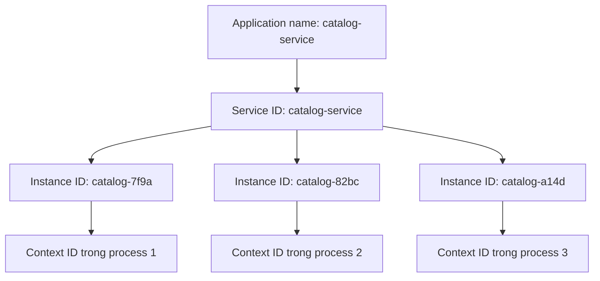
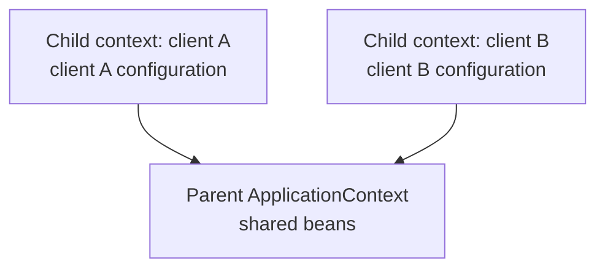
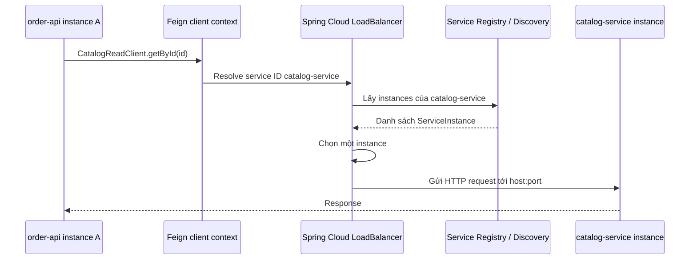

# Phân biệt application name, service ID, instance ID và context ID

Trong hệ thống Spring Cloud, một ứng dụng có thể được triển khai thành nhiều replica, đăng ký vào service registry và tạo nhiều ApplicationContext con để cô lập cấu hình cho các client. Các thành phần này đều có tên hoặc ID, nhưng chúng trả lời những câu hỏi khác nhau. Nếu dùng lẫn spring.application.name, service ID, instance ID và context ID, hệ thống có thể tra cứu nhầm dịch vụ, đăng ký trùng instance hoặc ghi log khiến người vận hành không xác định được process nào đang gặp lỗi.

Bài học thuộc chương **Định danh và mạng** của module SPRING_CLOUD_CORE. Mục tiêu là phân biệt bốn khái niệm, hiểu cách chúng liên hệ trong Spring Cloud Commons, service discovery và context hierarchy, đồng thời biết chọn giá trị phù hợp khi triển khai nhiều instance hoặc nhiều client trong cùng một JVM.

## 1. Bốn câu hỏi, bốn loại định danh

| Định danh | Câu hỏi được trả lời | Phạm vi điển hình |
| --- | --- | --- |
| Application name | Ứng dụng logic này tên gì? | Một loại ứng dụng/service qua các môi trường và replica |
| Service ID | Muốn tìm hoặc gọi nhóm dịch vụ logic nào trong registry/load balancer? | Một logical service có thể có nhiều instance |
| Instance ID | Bản đăng ký cụ thể nào đang cung cấp dịch vụ? | Một process/container/replica cụ thể trong registry |
| Context ID | ApplicationContext hoặc context con cụ thể nào đang quản lý bean/cấu hình? | Một Spring context trong một JVM |

Ví dụ hệ thống có ba replica của catalog-service:



Đây là một mô hình minh họa, không phải quy tắc bắt buộc rằng service ID luôn bằng application name hoặc context ID luôn có cùng cấu trúc. Giá trị thực tế phụ thuộc cấu hình ứng dụng, discovery implementation và cách tạo context.

## 2. Application name: tên của ứng dụng logic

### 2.1. spring.application.name

Trong Spring Boot, thuộc tính phổ biến để đặt tên ứng dụng là spring.application.name:

```yaml
spring:
  application:
    name: catalog-service
```

Hoặc qua biến môi trường:

```text
SPRING_APPLICATION_NAME=catalog-service
```

Tên này mô tả ứng dụng logic đang chạy. Các thành phần Spring Cloud thường dùng nó làm giá trị mặc định cho một số chức năng như tên ứng dụng khi lấy cấu hình từ Config Server hoặc tên dịch vụ khi đăng ký discovery, trừ khi có thuộc tính chuyên biệt ghi đè.

Application name nên ổn định giữa các replica của cùng một service. Ba Pod chạy cùng artifact catalog-service thường có cùng spring.application.name, dù hostname, IP, port và instance ID khác nhau.

### 2.2. Application name tham gia lấy cấu hình

Spring Cloud Config Client sử dụng tên ứng dụng, profile và label để yêu cầu bộ cấu hình phù hợp. Ví dụ:

```yaml
spring:
  application:
    name: catalog-service
  config:
    import: "optional:configserver:"
  cloud:
    config:
      label: main
```

Config Server có thể dùng tên catalog-service cùng profile prod và label main để chọn các property source tương ứng. Tên ứng dụng vì vậy cần thống nhất với quy ước repository cấu hình.

Trong một số cấu hình Config Client, spring.cloud.config.name có thể chỉ định tên được dùng riêng cho việc yêu cầu cấu hình. Nếu thuộc tính chuyên biệt này được đặt, không nên giả định tên yêu cầu Config Server luôn trùng spring.application.name; hãy kiểm tra request và log của client.

### 2.3. Application name không phải instance identity

Không dùng hostname hoặc Pod name làm spring.application.name chỉ để phân biệt replica. Làm vậy sẽ biến mỗi replica thành một ứng dụng logic riêng, gây khó khăn cho service discovery, load balancing và việc tổ chức cấu hình dùng chung.

Ví dụ không nên dùng cho ba replica cùng một service:

```text
SPRING_APPLICATION_NAME=catalog-pod-7f9a
SPRING_APPLICATION_NAME=catalog-pod-82bc
SPRING_APPLICATION_NAME=catalog-pod-a14d
```

Trong mô hình thông thường, cả ba nên dùng:

```text
SPRING_APPLICATION_NAME=catalog-service
```

Hostname hoặc Pod UID có thể được dùng trong instance ID, metadata hoặc log để nhận diện từng bản chạy.

## 3. Service ID: định danh logic dùng để tìm dịch vụ

### 3.1. Service ID trong service discovery

Service ID là tên logic mà client dùng để tìm nhóm instance cung cấp một dịch vụ. Trong Spring Cloud Commons, abstraction DiscoveryClient cung cấp các thao tác như liệt kê service ID và lấy các ServiceInstance theo service ID.

Ví dụ sử dụng abstraction:

```java
import java.util.List;

import org.springframework.cloud.client.ServiceInstance;
import org.springframework.cloud.client.discovery.DiscoveryClient;
import org.springframework.stereotype.Component;

@Component
public class CatalogDiscovery {
    private final DiscoveryClient discoveryClient;

    public CatalogDiscovery(DiscoveryClient discoveryClient) {
        this.discoveryClient = discoveryClient;
    }

    public List<ServiceInstance> catalogInstances() {
        return discoveryClient.getInstances("catalog-service");
    }
}
```

Ở đây catalog-service là service ID được tra cứu. Registry trả về danh sách instance tương ứng nếu có đăng ký hợp lệ và discovery client nhìn thấy chúng.

### 3.2. Service ID thường trùng application name nhưng không bắt buộc

Trong cấu hình đơn giản, spring.application.name thường được dùng làm service ID mặc định khi đăng ký. Tuy nhiên, service ID là khái niệm ở lớp discovery/load balancing; application name là tên ứng dụng. Từng discovery implementation có thuộc tính riêng để thay đổi tên đăng ký hoặc cách chuẩn hóa tên.

Ví dụ:

| Thành phần | Giá trị minh họa |
| --- | --- |
| spring.application.name | catalog-api |
| Service ID đăng ký trong registry | catalog-service |
| Instance ID | catalog-service:pod-7f9a |

Mô hình này có thể xuất hiện khi ứng dụng logic có tên nội bộ khác với tên dịch vụ công bố. Tuy nhiên, cần cấu hình rõ và kiểm thử vì Config Server, metrics, logs và registry có thể dùng các tên khác nhau.

### 3.3. Service ID được dùng trong LoadBalancer và client

Client-side load balancing thường nhận service ID làm đầu vào, lấy danh sách instance rồi chọn một instance phù hợp. Ví dụ về ý tưởng:

```text
Client
  -> LoadBalancer("catalog-service")
      -> DiscoveryClient.getInstances("catalog-service")
          -> instance A
          -> instance B
          -> instance C
```

Với Spring Cloud OpenFeign, thuộc tính name của @FeignClient thường xác định tên dịch vụ mà client gọi qua LoadBalancer:

```java
import org.springframework.cloud.openfeign.FeignClient;
import org.springframework.web.bind.annotation.GetMapping;
import org.springframework.web.bind.annotation.PathVariable;

@FeignClient(name = "catalog-service")
public interface CatalogClient {
    @GetMapping("/catalog/{id}")
    CatalogItem getById(@PathVariable("id") String id);
}
```

Trong ví dụ này, catalog-service là service name/service ID được dùng để định tuyến. Client không cần biết trước IP của từng Pod; discovery và load balancing xử lý việc chọn instance theo cấu hình.

## 4. Instance ID: định danh một bản đăng ký cụ thể

### 4.1. Vì sao cần instance ID?

Một service ID có thể có nhiều instance cùng cung cấp dịch vụ. Registry cần phân biệt từng bản đăng ký để cập nhật trạng thái, heartbeat/lease, metadata và deregistration.

Ví dụ:

| Service ID | Instance ID | Host | Port |
| --- | --- | --- | ---: |
| catalog-service | catalog-pod-7f9a | 10.0.1.21 | 8080 |
| catalog-service | catalog-pod-82bc | 10.0.1.22 | 8080 |
| catalog-service | catalog-pod-a14d | 10.0.1.23 | 8080 |

Ba bản đăng ký thuộc cùng một service ID nhưng có instance ID riêng. Khi một Pod dừng, registry cần xác định đúng registration cần xóa hoặc đánh dấu không khỏe; không được xóa toàn bộ service.

### 4.2. Instance ID phải duy nhất trong phạm vi registry

Instance ID nên duy nhất theo phạm vi mà registry yêu cầu, thường là trong một service ID hoặc namespace/tenant tương ứng. Nếu hai replica cùng đăng ký một service ID với cùng instance ID, registry có thể ghi đè registration, cập nhật nhầm địa chỉ hoặc làm trạng thái health không chính xác.

Các nguồn thường dùng để tạo instance ID:

- Pod UID hoặc container/task ID.
- Hostname kết hợp port.
- Machine ID cộng với process/port.
- ID được cấp khi tiến trình khởi động.

Không nên chỉ dùng một giá trị cố định như catalog-1 cho mọi replica. Nếu cần ổn định qua restart, hãy hiểu semantics của registry và cách nền tảng tái sử dụng identity. Một instance ID mới cho mỗi Pod thường phù hợp với môi trường orchestration; một ID ổn định có thể phù hợp với process được quản lý cố định.

### 4.3. Instance ID phụ thuộc discovery implementation

Spring Cloud Commons cung cấp abstraction chung, nhưng quy tắc tạo instance ID thường do discovery client/registry cụ thể quyết định. Eureka, Consul, Kubernetes discovery hoặc implementation khác có mô hình registration và thuộc tính cấu hình khác nhau.

Ví dụ với Eureka, eureka.instance.instance-id là thuộc tính thường dùng để tùy chỉnh ID instance. Cấu hình minh họa:

```yaml
spring:
  application:
    name: catalog-service

eureka:
  instance:
    instance-id: "catalog-service:catalog-pod-7f9a:8080"
```

Đây là ví dụ cho Eureka, không phải thuộc tính chung áp dụng cho mọi registry. Giá trị thực tế nên được cấp riêng cho từng Pod hoặc process. Không giả định default instance ID giống nhau giữa các discovery provider. Khi di chuyển từ Eureka sang Consul hoặc một registry khác, hãy kiểm tra cách registration identity được tạo, cập nhật và deregister.

### 4.4. Metadata không phải instance ID

Metadata là các cặp key/value gắn với registration, ví dụ:

```yaml
eureka:
  instance:
    metadata-map:
      zone: ap-southeast-1a
      version: v2
      team: catalog
```

Metadata có thể giúp load balancer hoặc hệ thống vận hành chọn instance theo zone/version/team. Nó không thay thế instance ID. Nhiều instance có thể có cùng metadata zone=ap-southeast-1a, nhưng vẫn cần identity riêng.

## 5. Context ID: định danh một Spring ApplicationContext

### 5.1. ApplicationContext có ID riêng

ApplicationContext là container quản lý bean, event, resource và quan hệ parent-child. Mỗi context có ID có thể quan sát qua ApplicationContext.getId().

```java
import org.springframework.context.ApplicationContext;
import org.springframework.stereotype.Component;

@Component
public class ContextIdentityReporter {
    private final ApplicationContext applicationContext;

    public ContextIdentityReporter(ApplicationContext applicationContext) {
        this.applicationContext = applicationContext;
    }

    public String currentContextId() {
        return applicationContext.getId();
    }
}
```

Context ID giúp nhận diện context đang quản lý bean. Nó không phải địa chỉ mạng, không phải service ID trong registry và cũng không phải ID của một replica.

Giá trị mặc định của context ID có thể phụ thuộc Spring Boot, Spring Cloud initializer, cách tạo context và cấu hình ứng dụng. Khi cần identity ổn định, hãy quan sát getId() trong runtime và cấu hình/khởi tạo context một cách tường minh theo API phù hợp, thay vì suy luận rằng nó luôn bằng spring.application.name.

### 5.2. Parent-child context

Một JVM có thể có nhiều context:



Context con có thể tra cứu bean từ parent; parent không nhìn thấy bean chỉ tồn tại trong child. Mỗi context có lifecycle và phạm vi quản lý riêng. Context ID giúp phân biệt các context này trong log và chẩn đoán bean/configuration.

Một ứng dụng có thể có một application name duy nhất, một service ID được đăng ký trong registry, nhưng có nhiều context ID trong cùng process. Điều này thường xuất hiện khi Spring Cloud tạo named context để cô lập cấu hình cho client hoặc thành phần con.

### 5.3. Context ID của client con

Một số Spring Cloud integration có thuộc tính contextId để định danh context cấu hình dành riêng cho client. Ví dụ Spring Cloud OpenFeign:

```java
import org.springframework.cloud.openfeign.FeignClient;

@FeignClient(
    name = "catalog-service",
    contextId = "catalogReadClient"
)
public interface CatalogReadClient {
    // API đọc catalog.
}

@FeignClient(
    name = "catalog-service",
    contextId = "catalogAdminClient"
)
public interface CatalogAdminClient {
    // API quản trị catalog.
}
```

Hai client có thể gọi cùng service ID catalog-service, nhưng dùng contextId khác nhau để phân biệt cấu hình/client ensemble riêng. Ví dụ một client có timeout đọc dài, client còn lại có timeout quản trị ngắn.

contextId ở đây là thuộc tính của OpenFeign client configuration, không phải service ID được đăng ký trong registry và cũng không nhất thiết là giá trị trực tiếp của ApplicationContext.getId() trong mọi phiên bản. Nó định danh client context/ensemble theo quy ước của integration.

Không nên đổi name chỉ để tránh xung đột cấu hình client nếu ý định là gọi cùng một service. Hãy dùng contextId cho mục đích phân biệt client context khi integration hỗ trợ.

## 6. Mối quan hệ giữa bốn định danh

Giả sử một ứng dụng order-api gọi catalog-service và chạy ba replica. Mỗi replica có một Spring context chính và một named context cho Feign client.

| Thành phần | Replica A | Replica B | Replica C |
| --- | --- | --- | --- |
| Application name | order-api | order-api | order-api |
| Service ID đăng ký của ứng dụng gọi | order-api | order-api | order-api |
| Instance ID đăng ký | order-api-a1 | order-api-b2 | order-api-c3 |
| Context ID chính | order-api-main-a | order-api-main-b | order-api-main-c |
| Feign service ID đích | catalog-service | catalog-service | catalog-service |
| Feign contextId | catalogReadClient | catalogReadClient | catalogReadClient |

Các giá trị trong bảng minh họa các phạm vi identity khác nhau. Context ID chính được đặt riêng để dễ đọc; không phải quy tắc mặc định của Spring. catalogReadClient có thể giống nhau giữa các JVM vì nó định danh loại client context trong mỗi process, không phải instance ID toàn cụm.

Luồng gọi:



Application name của caller, service ID của callee, instance ID được registry trả về và context ID của client đều tham gia các lớp khác nhau trong cùng một request.

## 7. Các abstraction Spring Cloud Commons liên quan

Spring Cloud Commons cung cấp abstraction để ứng dụng ít phụ thuộc vào một registry cụ thể.

### 7.1. DiscoveryClient

DiscoveryClient cho phép truy vấn các service đã biết và lấy danh sách instance theo service ID:

```java
List<String> serviceIds = discoveryClient.getServices();
List<ServiceInstance> instances =
        discoveryClient.getInstances("catalog-service");
```

Kết quả ServiceInstance thường cung cấp các thông tin như service ID, host, port, URI, secure flag và metadata. Các field cụ thể có thể phụ thuộc implementation; instance ID có thể không có hoặc có cách biểu diễn riêng.

### 7.2. ServiceRegistry và Registration

ServiceRegistry là abstraction để đăng ký, hủy đăng ký và cập nhật trạng thái registration. Registration biểu diễn thông tin instance mà discovery provider cần để công bố service.

Về mặt khái niệm:

```text
ServiceRegistry
  register(Registration)
  deregister(Registration)
  setStatus(Registration, status)

Registration / ServiceInstance
  serviceId
  host
  port
  secure
  metadata
  instance identity (implementation-dependent)
```

Ứng dụng thường để auto-configuration và lifecycle integration quản lý đăng ký. Chỉ gọi ServiceRegistry.register() thủ công khi có yêu cầu rõ ràng; đăng ký lặp hoặc tự deregister sai thời điểm có thể làm registry mất trạng thái đúng.

### 7.3. LoadBalancer

Spring Cloud LoadBalancer nhận service ID và chọn một ServiceInstance từ danh sách instance khả dụng. Nó hoạt động ở lớp client-side routing; service ID là đầu vào logic, instance host/port là đích vật lý sau khi lựa chọn.

LoadBalancer có thể áp dụng policy như round-robin hoặc custom supplier. Metadata có thể được dùng để lọc instance theo zone, version hoặc thuộc tính khác nếu có cấu hình tương ứng.

## 8. Quy tắc đặt tên và thiết kế identity

### 8.1. Application name

- Dùng tên ổn định, dễ nhận diện và nhất quán với domain/service.
- Các replica cùng ứng dụng dùng cùng application name.
- Tránh đưa Pod UID, hostname hoặc random suffix vào application name.
- Đồng bộ tên với Config Server repository và conventions của metrics/logging.

### 8.2. Service ID

- Dùng tên logic mà caller sẽ tra cứu.
- Tránh dùng địa chỉ IP/port làm service ID.
- Nếu service ID khác application name, ghi rõ mapping và cấu hình của registry/load balancer.
- Dùng cùng service ID cho các instance cùng cung cấp một hợp đồng dịch vụ tương thích.

### 8.3. Instance ID

- Bảo đảm duy nhất trong phạm vi registry yêu cầu.
- Gắn với một registration/process/container cụ thể.
- Không dùng cùng ID cho nhiều replica đồng thời.
- Xác định ID có ổn định qua restart hay thay đổi theo Pod lifecycle.
- Đảm bảo deregistration/lease cleanup khi instance dừng hoặc mất kết nối.

### 8.4. Context ID

- Dùng để phân biệt context trong cùng process hoặc named client context.
- Giữ ID ổn định và dễ đọc nếu cần dùng trong log/diagnostics.
- Không dùng context ID làm service ID trong registry.
- Với Feign hoặc named client integration, dùng contextId để phân biệt cấu hình client khi cần nhiều client cùng gọi một service.
- Quản lý đóng context con và resource mà context sở hữu.

## 9. Ví dụ cấu hình cho nhiều replica

Giả sử catalog-service chạy ba replica trên Kubernetes. Cấu hình chung trong image:

```yaml
spring:
  application:
    name: catalog-service

server:
  port: 8080
```

Mỗi Pod có hostname riêng do nền tảng cấp. Với registry hỗ trợ tùy chỉnh instance ID, có thể sử dụng Pod name/UID kết hợp service name và port. Ví dụ về giá trị được cấp cho từng container:

```text
SPRING_APPLICATION_NAME=catalog-service
INSTANCE_ID=catalog-service:catalog-7f9a:8080
```

Việc ánh xạ INSTANCE_ID vào property riêng của discovery provider phụ thuộc implementation; Spring Cloud Commons không quy định một biến môi trường chung tên INSTANCE_ID cho mọi registry.

Nếu dùng Eureka, có thể cấu hình:

```yaml
eureka:
  instance:
    instance-id: "catalog-service:catalog-pod-7f9a:8080"
```

Ví dụ cần điều chỉnh theo cách cấp giá trị cho từng Pod và bảo đảm kết quả khác nhau giữa các replica. Với Consul hoặc provider khác, dùng thuộc tính registration tương ứng thay vì sao chép eureka.instance.instance-id.

Khi caller muốn gọi catalog:

```java
@FeignClient(name = "catalog-service", contextId = "catalogReadClient")
public interface CatalogReadClient {
    @GetMapping("/catalog/{id}")
    CatalogItem get(@PathVariable("id") String id);
}
```

Caller chỉ cần service ID catalog-service. Discovery trả các instance hiện có và LoadBalancer chọn đích phù hợp. Instance ID giúp registry phân biệt bản đăng ký; context ID giúp Spring cô lập cấu hình client trong process caller.

## 10. Chẩn đoán lỗi định danh

| Triệu chứng | Nguyên nhân có thể | Hướng kiểm tra |
| --- | --- | --- |
| Config Server trả nhầm cấu hình | spring.application.name, config name, profile hoặc label không đúng | Kiểm tra request Config Client và tên file/revision phía server |
| Registry xuất hiện nhiều service lạ | Mỗi replica dùng application name khác nhau | Kiểm tra SPRING_APPLICATION_NAME trên từng Pod |
| Chỉ thấy một replica trong registry | Instance ID bị trùng hoặc registration bị ghi đè | Kiểm tra instance ID, host, port và provider config |
| Registry còn instance đã dừng | Deregistration/lease/health check không hoạt động | Kiểm tra shutdown lifecycle, heartbeat và TTL |
| LoadBalancer không tìm thấy service | Service ID caller dùng khác service ID đăng ký | So sánh @FeignClient(name=...), DiscoveryClient service list và registry |
| Gọi nhầm service | Dùng nhầm application name thay cho service ID hoặc alias | Xác nhận mapping logic name và registry name |
| Hai Feign client đụng cấu hình | Dùng cùng contextId khi cần cấu hình client riêng | Đặt contextId khác nhau theo integration |
| Không tìm được bean trong context con | Nhầm parent-child visibility hoặc context ID | Kiểm tra context hierarchy và nơi bean được đăng ký |
| Log khó xác định context gây lỗi | Context ID không rõ hoặc không được ghi vào log | Ghi application name, instance ID và context ID phù hợp |

Trình tự điều tra:

1. Xác nhận spring.application.name trong đúng process.
2. Xác nhận service ID mà registry đang lưu.
3. Liệt kê instance theo service ID và kiểm tra instance ID/host/port/health.
4. Xác nhận caller dùng đúng service ID khi gọi LoadBalancer/Feign.
5. Kiểm tra context ID của named client hoặc context con nếu lỗi liên quan cấu hình/bean.
6. So sánh các replica để tìm giá trị application name, instance ID hoặc profile bị lệch.

Không chỉ dựa vào tên hiển thị trong dashboard. Một số registry chuẩn hóa chữ hoa/thường, namespace hoặc tên service theo quy tắc riêng; hãy xác minh giá trị thực được đăng ký qua API hoặc log của provider.

## 11. Kiểm thử identity và discovery

| Mục tiêu | Cách kiểm thử | Điều cần xác nhận |
| --- | --- | --- |
| Application name | Khởi động context với property test | Environment có spring.application.name mong đợi |
| Service ID | Dùng DiscoveryClient lấy danh sách service | Caller lookup đúng service ID |
| Instance ID uniqueness | Khởi động hai registration test cùng service ID | Hai instance có identity khác nhau theo yêu cầu provider |
| Registration lifecycle | Register, update status, deregister trong test registry | Đúng registration được thêm/cập nhật/xóa |
| LoadBalancer | Cung cấp nhiều ServiceInstance test | Chọn instance theo policy dự kiến |
| Context ID | Tạo parent và nhiều child context | getId() phân biệt context cần quan sát |
| Feign contextId | Khai báo hai client cùng name nhưng contextId khác | Cấu hình client không va chạm theo integration |
| Multi-replica | Chạy nhiều process/container | Cùng application/service identity, instance identity riêng |
| Stale registration | Dừng instance bất thường hoặc giả lập lease hết hạn | Registry loại instance theo health/lease policy |

Ví dụ kiểm tra application name và context ID trong test:

```java
import static org.assertj.core.api.Assertions.assertThat;

import org.junit.jupiter.api.Test;
import org.springframework.beans.factory.annotation.Autowired;
import org.springframework.boot.test.context.SpringBootTest;
import org.springframework.context.ApplicationContext;
import org.springframework.core.env.Environment;

@SpringBootTest(properties = "spring.application.name=catalog-service")
class ApplicationIdentityTest {
    @Autowired
    Environment environment;

    @Autowired
    ApplicationContext context;

    @Test
    void exposesApplicationAndContextIdentity() {
        assertThat(environment.getProperty("spring.application.name"))
                .isEqualTo("catalog-service");
        assertThat(context.getId()).isNotBlank();
    }
}
```

Test này xác nhận application name và có context ID; nó không chứng minh service đã đăng ký với registry hoặc instance ID duy nhất. Muốn kiểm thử registration, dùng test registry/provider hoặc integration test riêng.

## 12. Thực hành: thiết kế identity cho order-api và catalog-service

Giả sử:

- order-api có hai replica.
- catalog-service có ba replica.
- Mỗi order-api có một Feign client đọc catalog và một Feign client quản trị catalog.

Một thiết kế có thể như sau:

| Đối tượng | Application name | Service ID | Instance ID | Context/client ID |
| --- | --- | --- | --- | --- |
| order-api replica A | order-api | order-api | order-api-a | main context A |
| order-api replica B | order-api | order-api | order-api-b | main context B |
| catalog replica 1 | catalog-service | catalog-service | catalog-1 | main context 1 |
| catalog replica 2 | catalog-service | catalog-service | catalog-2 | main context 2 |
| catalog replica 3 | catalog-service | catalog-service | catalog-3 | main context 3 |
| Feign read client | — | catalog-service | — | catalogReadClient |
| Feign admin client | — | catalog-service | — | catalogAdminClient |

Các bước triển khai:

1. Đặt spring.application.name ổn định cho mỗi ứng dụng logic.
2. Đảm bảo registry đăng ký đúng service ID; nếu khác application name, ghi rõ mapping.
3. Cấp instance ID duy nhất cho từng replica theo quy tắc của discovery provider.
4. Cấu hình hai Feign client dùng cùng service ID catalog-service nhưng contextId khác nhau để tách cấu hình.
5. Ghi application name và instance ID vào log/metric; ghi context ID khi chẩn đoán named context.
6. Kiểm thử scale up/down, Pod restart, registration cleanup và LoadBalancer lookup.

### Câu hỏi tự kiểm tra

1. spring.application.name trả lời câu hỏi nào trong hệ thống?
2. Vì sao các replica cùng một service thường dùng cùng application name?
3. Service ID được dùng ở đâu trong discovery/load balancing?
4. Vì sao một service ID có thể ánh xạ tới nhiều instance ID?
5. Điều gì có thể xảy ra nếu hai replica cùng đăng ký một instance ID?
6. Instance ID có quy tắc mặc định giống nhau với mọi discovery provider không?
7. ApplicationContext.getId() cho biết điều gì?
8. Một JVM có thể có nhiều context ID dù chỉ có một application name không?
9. Trong @FeignClient, name và contextId có vai trò khác nhau thế nào?
10. Vì sao metadata zone hoặc version không thay thế instance ID?

**Gợi ý đáp án:** (1) Tên ứng dụng logic; (2) Để Config Server, registry và vận hành nhận diện cùng một ứng dụng qua các replica; (3) Là khóa logic để discovery tìm instance và LoadBalancer chọn đích; (4) Một service có nhiều bản chạy; (5) Registration có thể ghi đè hoặc cập nhật nhầm; (6) Không, phụ thuộc provider; (7) ID của Spring ApplicationContext; (8) Có, ví dụ parent-child hoặc named client contexts; (9) name là service name/service ID đích, contextId phân biệt context/ensemble cấu hình client; (10) Metadata mô tả thuộc tính instance, không xác định duy nhất registration.

## 13. Những nguyên tắc cần nhớ

- spring.application.name định danh ứng dụng logic và thường là đầu vào mặc định cho một số tích hợp Spring Cloud.
- Service ID là tên logic được discovery/load balancer dùng để tìm nhóm instance; nó thường trùng application name nhưng có thể được cấu hình khác.
- Instance ID phân biệt một registration cụ thể trong nhóm service; phải duy nhất theo phạm vi registry yêu cầu.
- Context ID định danh một Spring ApplicationContext hoặc named client context trong phạm vi process; một JVM có thể có nhiều context ID.
- Với OpenFeign, name chọn dịch vụ đích, còn contextId phân biệt client context/ensemble khi cần.
- Spring Cloud Commons cung cấp DiscoveryClient, ServiceRegistry, Registration và ServiceInstance để tách ứng dụng khỏi discovery provider cụ thể.
- Quy tắc tạo instance ID và registration phụ thuộc provider; không áp dụng cấu hình Eureka cho Consul/Kubernetes một cách máy móc.
- Kiểm thử riêng application name, service lookup, instance uniqueness, context hierarchy và client context để xác định đúng lớp identity gây lỗi.

Phân biệt đúng application name, service ID, instance ID và context ID giúp hệ thống Spring Cloud định tuyến đúng dịch vụ, quản lý nhiều replica chính xác và cô lập cấu hình giữa các context. Khi mỗi định danh được dùng đúng phạm vi, việc quan sát, scale và xử lý sự cố trong hệ thống phân tán trở nên rõ ràng hơn.
