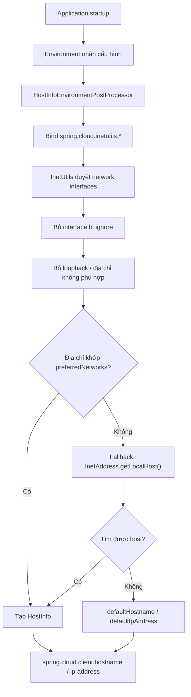

# Ưu tiên dải địa chỉ bằng preferredNetworks

Một máy chạy dịch vụ Spring Cloud có thể có nhiều địa chỉ mạng cùng lúc: loopback, card mạng LAN, card bridge của Docker, interface của Kubernetes, VPN và mạng quản trị. Nếu ứng dụng tự chọn nhầm địa chỉ, service registry có thể quảng bá một IP mà các service khác không thể truy cập. Khi đó, ứng dụng vẫn khởi động thành công nhưng lời gọi qua service discovery lại timeout hoặc kết nối sai mạng.

Spring Cloud Commons cung cấp `InetUtils` và thuộc tính `spring.cloud.inetutils.preferred-networks` để ưu tiên các địa chỉ phù hợp khi xác định thông tin host của ứng dụng. Thuộc tính này hữu ích trong môi trường nhiều interface, đặc biệt khi chạy container hoặc máy ảo có nhiều mạng.

Bài học thuộc chương **Định danh và mạng** của **SPRING_CLOUD_CORE**. Trọng tâm là hiểu cách `preferredNetworks` lọc địa chỉ, cách phối hợp với `ignored-interfaces` và `use-only-site-local-interfaces`, cách cấu hình biểu thức chính quy, và cách kiểm tra IP mà Spring Cloud đưa vào Environment để service registration sử dụng.

## 1. Mục tiêu học tập

Sau bài này, người học có thể:

1. Giải thích vì sao một máy có thể có nhiều địa chỉ IP và vì sao lựa chọn sai ảnh hưởng service discovery.
2. Mô tả vai trò của `InetUtils` và `HostInfoEnvironmentPostProcessor`.
3. Cấu hình `spring.cloud.inetutils.preferred-networks` bằng prefix hoặc Java regular expression.
4. Phân biệt preferred network với CIDR, routing table và địa chỉ bind của web server.
5. Kết hợp `preferred-networks` với `ignored-interfaces`.
6. Giải thích tương tác giữa `preferred-networks` và `use-only-site-local-interfaces`.
7. Chẩn đoán fallback khi không có địa chỉ nào khớp.
8. Kiểm thử kết quả chọn địa chỉ và xác minh IP được quảng bá khi đăng ký service.

## 2. Vì sao cần ưu tiên địa chỉ mạng?

Một máy Linux hoặc container có thể nhìn thấy nhiều network interface. Ví dụ:

| Interface | Địa chỉ | Vai trò |
| --- | --- | --- |
| `lo` | `127.0.0.1` | Loopback nội bộ |
| `docker0` | `172.17.0.1` | Bridge của Docker |
| `eth0` | `10.24.8.15` | Mạng ứng dụng trong private subnet |
| `wlan0` | `192.168.1.25` | Mạng Wi-Fi quản trị |
| `tun0` | `100.64.2.10` | Interface VPN |

Nếu ứng dụng quảng bá `192.168.1.25` nhưng các service khác chỉ truy cập được mạng `10.24.0.0`, service registry có thể lưu một endpoint không thể kết nối từ cụm ứng dụng.

Điều này thường xuất hiện trong các môi trường:

- Máy phát triển có cả Ethernet, Wi-Fi và VPN.
- Docker host có bridge và virtual Ethernet interfaces.
- Kubernetes node có nhiều NIC hoặc nhiều network attachment.
- Máy ảo cloud có interface quản trị và interface ứng dụng.
- Máy chủ có cả mạng public và private.
- Môi trường kiểm thử có loopback, bridge và adapter ảo.

`preferredNetworks` giúp Spring Cloud ưu tiên địa chỉ thuộc nhóm mong muốn khi xác định host information. Nó không cấu hình route của hệ điều hành và không thay đổi địa chỉ IP trên card mạng.

## 3. InetUtils và thông tin host của Spring Cloud

### 3.1. InetUtils làm nhiệm vụ gì?

`InetUtils` thuộc Spring Cloud Commons, hỗ trợ tìm địa chỉ không phải loopback và chuyển địa chỉ đó thành thông tin host gồm hostname và IP.

Trong quá trình khởi động, `HostInfoEnvironmentPostProcessor` đọc cấu hình `InetUtilsProperties` từ `Environment`, tạo `InetUtils` rồi tìm host information. Kết quả được đưa trở lại Environment dưới hai key dùng chung:

- `spring.cloud.client.hostname`
- `spring.cloud.client.ip-address`

Các discovery client hoặc service registration implementation có thể dùng những giá trị này làm thông tin mặc định để đăng ký instance. Registry cụ thể vẫn có thể cung cấp thuộc tính riêng để ghi đè hostname hoặc IP.

### 3.2. Luồng xử lý khái quát



Sơ đồ mô tả đường xử lý chính của implementation hiện hành. Việc tìm interface và địa chỉ cụ thể còn phụ thuộc trạng thái interface, thứ tự interface của hệ điều hành và các thuộc tính lọc đã cấu hình.

### 3.3. Host IP không phải địa chỉ bind của web server

Cần phân biệt hai nhóm cấu hình:

| Mục đích | Cấu hình/giá trị |
| --- | --- |
| Chọn host IP để Spring Cloud công bố | `spring.cloud.inetutils.preferred-networks` |
| Thông tin host dùng chung trong Environment | `spring.cloud.client.ip-address` |
| Chọn địa chỉ mà embedded web server bind để lắng nghe | `server.address` |
| Chọn interface/route cho lưu lượng đi ra | Routing và network configuration của hệ điều hành/container |

Ví dụ, `preferred-networks` có thể giúp ứng dụng quảng bá `10.24.8.15` trong registry, nhưng không tự buộc Tomcat hoặc Netty chỉ lắng nghe trên IP đó. Muốn giới hạn địa chỉ bind, hãy cấu hình `server.address` và kiểm tra network policy tương ứng.

## 4. Cấu hình preferred-networks

### 4.1. Cấu hình bằng YAML

Ví dụ ứng dụng cần ưu tiên mạng ứng dụng có prefix `10.24.`:

```yaml
spring:
  cloud:
    inetutils:
      preferred-networks:
        - "10.24."
```

Hoặc cho phép hai nhóm địa chỉ:

```yaml
spring:
  cloud:
    inetutils:
      preferred-networks:
        - "10.24."
        - "192.168.50."
```

Các ví dụ trên dùng dạng prefix đơn giản. Khi địa chỉ IPv4 bắt đầu bằng một trong các chuỗi đã khai báo, địa chỉ đó được xem là phù hợp.

Tên property chuẩn nên viết theo kebab-case `preferred-networks`. Spring Boot relaxed binding cũng hỗ trợ dạng camelCase `preferredNetworks` xuất hiện trong một số tài liệu Spring Cloud cũ.

### 4.2. Cấu hình bằng properties

Có thể biểu diễn cùng danh sách trong `application.properties`:

```properties
spring.cloud.inetutils.preferred-networks[0]=10.24.
spring.cloud.inetutils.preferred-networks[1]=192.168.50.
```

Index của danh sách bắt đầu từ `0`. Dùng YAML thường dễ đọc hơn khi có nhiều pattern.

### 4.3. Danh sách pattern không phải danh sách thứ hạng

Các phần tử trong `preferred-networks` là những pattern được chấp nhận. Implementation hiện hành kiểm tra từng pattern và chấp nhận địa chỉ khi **bất kỳ** pattern nào khớp.

Ví dụ:

```yaml
spring:
  cloud:
    inetutils:
      preferred-networks:
        - "10.24."
        - "192.168.50."
```

Địa chỉ `10.24.8.15` và `192.168.50.20` đều có thể được chấp nhận. Việc đặt `10.24.` ở vị trí đầu không có nghĩa Spring luôn chọn mạng `10.24.` trước mạng `192.168.50.`. Danh sách không phải một bảng xếp hạng ưu tiên theo thứ tự phần tử.

Nếu nhiều interface đều có địa chỉ hợp lệ, việc chọn candidate còn phụ thuộc thứ tự duyệt interface và địa chỉ trong implementation cùng môi trường vận hành. Đừng dùng thứ tự phần tử trong YAML để điều khiển thứ tự chọn NIC.

## 5. preferredNetworks dùng prefix và Java regular expression

Tên property có chữ “Networks”, nhưng giá trị không được phân tích như một CIDR subnet. Spring Cloud mô tả đây là danh sách **Java regular expressions** cho địa chỉ mạng. Implementation hiện hành kiểm tra địa chỉ bằng hai phép:

1. `address.matches(pattern)` — toàn bộ chuỗi địa chỉ khớp Java regular expression.
2. `address.startsWith(pattern)` — chuỗi địa chỉ bắt đầu bằng chính chuỗi pattern.

Nếu một trong hai phép đúng, địa chỉ được chấp nhận.

### 5.1. Prefix đơn giản

Ví dụ:

```yaml
spring:
  cloud:
    inetutils:
      preferred-networks:
        - "192.168."
```

`192.168.10.25` bắt đầu bằng chuỗi `192.168.` nên được chấp nhận. Cách viết này phù hợp khi muốn chọn một nhóm địa chỉ có prefix ổn định.

### 5.2. Regular expression đầy đủ

Nếu cần giới hạn octet hoặc mô tả pattern chi tiết, có thể dùng regex:

```yaml
spring:
  cloud:
    inetutils:
      preferred-networks:
        - '^10\.24\.[0-9]{1,3}\.[0-9]{1,3}$'
```

Pattern này được dùng như Java regex và cần khớp toàn bộ chuỗi khi gọi `matches`. Dấu chấm được escape thành `\.` để biểu thị dấu chấm literal của địa chỉ IPv4.

Trong YAML, đặt pattern trong dấu nháy đơn giúp giữ nguyên dấu gạch chéo ngược. Hãy kiểm tra pattern bằng một unit test vì regex sai có thể làm mọi địa chỉ bị loại.

### 5.3. Không dùng CIDR như thể Binder hiểu subnet mask

Ví dụ sau không phải cú pháp CIDR được `preferred-networks` phân tích:

```yaml
spring:
  cloud:
    inetutils:
      preferred-networks:
        - "10.24.0.0/16"
```

`InetUtils` không chuyển chuỗi trên thành subnet mask rồi kiểm tra địa chỉ nằm trong mạng /16. Nó xử lý giá trị như pattern/chuỗi prefix. Địa chỉ IPv4 thông thường không bắt đầu bằng toàn chuỗi `10.24.0.0/16`, vì vậy cấu hình này thường không khớp.

Nếu muốn chọn mọi địa chỉ bắt đầu bằng `10.24.`, dùng prefix `10.24.`. Nếu cần điều kiện chặt hơn, viết Java regex. Nếu nghiệp vụ cần subnet calculation thật sự, hãy dùng thư viện IP/CIDR chuyên dụng trong logic riêng thay vì giả định property này hỗ trợ CIDR.

### 5.4. Bảng ví dụ

| Pattern | Địa chỉ kiểm tra | Kết quả mong đợi | Lý do |
| --- | --- | --- | --- |
| `10.24.` | `10.24.8.15` | Khớp | Bắt đầu bằng prefix |
| `10.24.` | `10.25.8.15` | Không khớp | Prefix khác |
| `^10\.24\..*` | `10.24.8.15` | Khớp | Regex khớp toàn chuỗi |
| `^10\.24\..*` | `10.25.8.15` | Không khớp | Không khớp regex |
| `10.24.0.0/16` | `10.24.8.15` | Không khớp theo ý nghĩa CIDR | Property không phân tích CIDR |

## 6. Cách InetUtils chọn địa chỉ

Hiểu quy trình giúp chẩn đoán vì sao cấu hình đúng nhưng ứng dụng vẫn quảng bá một IP khác.

### 6.1. Chỉ xét interface đang hoạt động

`InetUtils` duyệt các network interface mà Java nhìn thấy và kiểm tra interface có đang up hay không. Interface không hoạt động sẽ không được dùng làm candidate.

### 6.2. Bỏ interface theo ignored-interfaces

Nếu display name của interface khớp một pattern trong `ignored-interfaces`, interface đó bị bỏ qua. Phần này được trình bày chi tiết ở mục sau.

### 6.3. Bỏ địa chỉ loopback và lọc địa chỉ

Trong đường chọn địa chỉ hiện hành, `InetUtils` xét các địa chỉ IPv4 không phải loopback. Sau đó nó áp dụng `use-only-site-local-interfaces` hoặc danh sách `preferred-networks` để quyết định địa chỉ có hợp lệ hay không.

Điều này có nghĩa cấu hình `preferred-networks` không phải bộ chọn IPv6 tổng quát. Nếu môi trường chỉ có IPv6, cần kiểm tra fallback và cách discovery implementation hỗ trợ địa chỉ IPv6 thay vì mặc định rằng regex sẽ làm InetUtils chọn được IPv6.

### 6.4. Chọn candidate và fallback

Nếu tìm được địa chỉ phù hợp, InetUtils tạo `HostInfo` từ địa chỉ đó. Nếu không tìm được candidate, implementation thử `InetAddress.getLocalHost()`. Khi không thể lấy host information, nó dùng giá trị mặc định:

| Property | Giá trị mặc định |
| --- | --- |
| `spring.cloud.inetutils.default-hostname` | `localhost` |
| `spring.cloud.inetutils.default-ip-address` | `127.0.0.1` |
| `spring.cloud.inetutils.timeout-seconds` | `1` |

`timeout-seconds` điều khiển thời gian chờ khi xác định hostname từ địa chỉ đã chọn; nó không phải timeout kết nối service discovery. Nếu reverse DNS không trả lời đúng hạn, hostname có thể fallback về `localhost` trong khi IP đã chọn vẫn được giữ.

## 7. Kết hợp với ignored-interfaces

`preferred-networks` lọc địa chỉ IP; `ignored-interfaces` loại cả interface theo tên hiển thị. Hai thuộc tính giải quyết hai vấn đề khác nhau.

### 7.1. Ví dụ bỏ Docker bridge và virtual Ethernet

```yaml
spring:
  cloud:
    inetutils:
      ignored-interfaces:
        - "docker0"
        - "veth.*"
      preferred-networks:
        - "10.24."
```

Trong ví dụ:

- Interface có display name khớp `docker0` bị bỏ qua.
- Interface có display name bắt đầu bằng `veth` bị bỏ qua.
- Các interface còn lại chỉ cung cấp candidate phù hợp nếu địa chỉ của chúng khớp `10.24.`.

`ignored-interfaces` cũng nhận Java regular expression. Pattern `veth.*` có thể khớp tên như `veth1234` hoặc `vethabcd`.

### 7.2. Khi nào dùng từng thuộc tính?

| Tình huống | Thuộc tính phù hợp |
| --- | --- |
| Biết chính xác interface ảo cần loại | `ignored-interfaces` |
| Có nhiều interface nhưng chỉ muốn một nhóm IP | `preferred-networks` |
| Muốn chỉ dùng địa chỉ site-local theo Java | `use-only-site-local-interfaces` |
| Muốn tránh loopback | InetUtils đã loại loopback trong quá trình tìm candidate |

Không nên dùng `ignored-interfaces` để thay thế hoàn toàn `preferred-networks` nếu tên interface thay đổi giữa các máy. Ngược lại, nếu một interface luôn không được phép quảng bá dù địa chỉ hiện tại tình cờ khớp, loại interface trực tiếp sẽ rõ ràng hơn.

## 8. Tương tác với use-only-site-local-interfaces

`use-only-site-local-interfaces` yêu cầu InetUtils chỉ chấp nhận địa chỉ mà `InetAddress.isSiteLocalAddress()` trả về true.

Ví dụ:

```yaml
spring:
  cloud:
    inetutils:
      use-only-site-local-interfaces: true
```

Đây là một bộ lọc theo định nghĩa site-local của Java. Không nên đồng nhất nó với một CIDR tùy ý hoặc với toàn bộ khái niệm “private IP” trong mọi môi trường cloud.

### 8.1. Khi bật thuộc tính này, preferredNetworks không được áp dụng đồng thời

Trong implementation hiện hành, khi `use-only-site-local-interfaces=true`, InetUtils trả kết quả dựa trên `isSiteLocalAddress()` trước khi kiểm tra `preferred-networks`. Vì vậy, hai thuộc tính không hoạt động như hai filter được giao nhau trong cùng một lần kiểm tra.

Ví dụ, cấu hình:

```yaml
spring:
  cloud:
    inetutils:
      use-only-site-local-interfaces: true
      preferred-networks:
        - "192.168.50."
```

không có nghĩa là “chỉ chọn địa chỉ site-local thuộc prefix 192.168.50”. Khi cờ site-local bật, địa chỉ site-local được chấp nhận theo phép kiểm tra đó mà không áp dụng thêm prefix `192.168.50.`.

Nếu cần giới hạn một dải cụ thể, hãy để `use-only-site-local-interfaces=false` và khai báo `preferred-networks` phù hợp. Nếu chỉ cần loại địa chỉ không site-local, dùng cờ site-local và không kỳ vọng danh sách preferred tiếp tục thu hẹp kết quả.

## 9. Ví dụ triển khai trong Docker hoặc Kubernetes

Giả sử service chạy trong container và có các interface:

| Interface | IP | Vai trò |
| --- | --- | --- |
| `lo` | `127.0.0.1` | Loopback |
| `eth0` | `10.24.8.15` | Pod/container network |
| `eth1` | `172.18.0.2` | Network phụ |
| `vethabc123` | `172.17.0.1` | Virtual Ethernet phía host |

Ứng dụng cần quảng bá IP thuộc mạng pod `10.24.` và tránh interface virtual Ethernet.

Cấu hình:

```yaml
spring:
  cloud:
    inetutils:
      ignored-interfaces:
        - "veth.*"
      preferred-networks:
        - "10.24."
```

Khi đó:

1. Loopback bị loại theo quy tắc của InetUtils.
2. Interface khớp `veth.*` bị bỏ qua.
3. Địa chỉ `172.18.0.2` không khớp preferred prefix.
4. Địa chỉ `10.24.8.15` là candidate phù hợp.
5. Host information được công bố vào Environment để các thành phần Spring Cloud có thể sử dụng.

Cấu hình phải được xác minh bên trong chính container/pod đang chạy. Địa chỉ nhìn thấy trên host machine không nhất thiết là địa chỉ mà network namespace của container nhìn thấy.

## 10. Nguồn cấu hình và thời điểm InetUtils đọc property

`HostInfoEnvironmentPostProcessor` xác định host information trong quá trình khởi động ứng dụng. Nó bind `spring.cloud.inetutils.*` từ Environment tại thời điểm post processor chạy, sau đó thêm `spring.cloud.client.hostname` và `spring.cloud.client.ip-address`.

Điều này dẫn đến ba điểm cần chú ý:

1. Property phải có mặt trong nguồn cấu hình được nạp trước khi host information được tính.
2. Thay đổi một file cấu hình sau startup không tự làm post processor chạy lại để chọn IP mới.
3. Nếu đổi mạng hoặc đổi preferred pattern khi ứng dụng đang chạy, hãy xác định có cần restart instance để tính lại host information và đăng ký lại service hay không.

Tài liệu Spring Cloud Commons ở các thế hệ khác nhau có ví dụ cấu hình `preferredNetworks` trong `bootstrap.yml`. Với ứng dụng dùng Spring Boot Config Data, hãy đặt property trong nguồn cấu hình được nạp ở phase phù hợp, thường là `application.yml` hoặc Config Data import có sẵn trước khi host information được xác định. Cần kiểm tra release train và bootstrap mode của ứng dụng; không giả định mọi nguồn cấu hình remote đều có sẵn ở cùng thời điểm.

Ví dụ với application configuration:

```yaml
spring:
  cloud:
    inetutils:
      preferred-networks:
        - "10.24."
```

Nếu dùng Spring Cloud Config, xác minh property đã được nạp vào Environment trong giai đoạn khởi động mà HostInfoEnvironmentPostProcessor sử dụng. Một property chỉ xuất hiện sau đó không thể thay đổi IP đã được tính cho lần khởi động hiện tại.

## 11. Quan hệ với service registration và discovery

### 11.1. IP được chọn có thể trở thành địa chỉ quảng bá

Spring Cloud Commons cung cấp các key dùng chung như `spring.cloud.client.ip-address` và `spring.cloud.client.hostname`. Service registry integration có thể dùng các key này để tạo thông tin instance.

Ví dụ, khi một service đăng ký với registry, bản ghi có thể chứa:

- Service ID.
- Hostname hoặc IP.
- Port.
- Metadata.
- Trạng thái instance.

Nếu IP quảng bá sai, registry vẫn có thể ghi nhận instance là đang tồn tại nhưng client không kết nối được đến endpoint đó.

### 11.2. Registry implementation có thể có thuộc tính ghi đè riêng

`preferred-networks` điều khiển việc xác định host information chung của Spring Cloud. Các registry như Eureka hoặc Consul còn có cấu hình riêng cho hostname, IP, port, secure port và registration behavior.

Vì vậy, nếu cấu hình preferred đúng nhưng registry vẫn hiển thị IP khác, hãy kiểm tra:

1. Giá trị `spring.cloud.client.ip-address` trong Environment.
2. Property riêng của registry.
3. Registration object thực tế trước khi gửi đến registry.
4. Bản ghi instance mà registry lưu.
5. Địa chỉ mà client load balancer thực sự sử dụng.

Đừng kết luận InetUtils sai chỉ từ một màn hình registry; một property riêng của provider có thể đang ghi đè giá trị chung.

### 11.3. Không dùng preferred-networks làm biện pháp bảo mật

`preferred-networks` không chặn kết nối từ mạng khác, không cấu hình firewall, không thay security group và không tạo route. Nó chỉ ảnh hưởng việc lựa chọn địa chỉ host trong Spring Cloud.

Muốn giới hạn truy cập, hãy dùng network policy, firewall, security group, authentication và authorization tương ứng.

## 12. Chẩn đoán khi ứng dụng quảng bá sai IP

Khi registry hiển thị địa chỉ không mong muốn, hãy kiểm tra theo thứ tự.

### 12.1. Xem interface bên trong runtime

Trên Linux host hoặc container có công cụ phù hợp:

```bash
ip -brief address
ip route
```

Trong Java, có thể liệt kê interface và địa chỉ bằng:

```java
Enumeration<NetworkInterface> interfaces =
    NetworkInterface.getNetworkInterfaces();

while (interfaces.hasMoreElements()) {
    NetworkInterface networkInterface = interfaces.nextElement();

    System.out.println(
        networkInterface.getDisplayName()
        + " up=" + networkInterface.isUp()
    );

    Enumeration<InetAddress> addresses =
        networkInterface.getInetAddresses();

    while (addresses.hasMoreElements()) {
        System.out.println(addresses.nextElement().getHostAddress());
    }
}
```

Danh sách này giúp xác nhận tên display name và IP mà JVM thực sự nhìn thấy. Không chỉ kiểm tra output trên host nếu ứng dụng chạy trong container network namespace.

### 12.2. Xem host information của Spring Cloud

Có thể đọc các key trong Environment:

```java
@Component
class HostInfoLogger implements ApplicationRunner {

    private final Environment environment;

    HostInfoLogger(Environment environment) {
        this.environment = environment;
    }

    @Override
    public void run(ApplicationArguments args) {
        String ip = environment.getProperty(
            "spring.cloud.client.ip-address", "unknown"
        );
        String hostname = environment.getProperty(
            "spring.cloud.client.hostname", "unknown"
        );

        log.info("Spring Cloud host info: ip={}, hostname={}",
            ip, hostname);
    }
}
```

Đây là ví dụ minh họa; cần khai báo logger phù hợp. Chỉ log host information cần thiết, tránh đưa dữ liệu nhạy cảm khác trong Environment ra log.

### 12.3. Dùng Actuator khi phù hợp

Endpoint `/actuator/env` có thể giúp xem property source và giá trị hiệu lực nếu endpoint được expose và bảo vệ. Không expose endpoint quản trị cấu hình công khai. Hãy giới hạn truy cập, bật masking và xác thực theo chính sách vận hành.

Sau đó đối chiếu với registration record trong Eureka/Consul hoặc discovery provider đang dùng. Giá trị Environment và giá trị registry có thể khác nếu provider có property ghi đè.

### 12.4. Bật log chẩn đoán

Có thể tăng log cho class InetUtils khi điều tra:

```yaml
logging:
  level:
    org.springframework.cloud.commons.util.InetUtils: TRACE
```

Trace log giúp thấy interface và địa chỉ bị loại hoặc được chọn trong các phiên bản có ghi log tương ứng. Không nên giữ trace quá lâu trong production nếu lượng interface hoặc log lớn.

## 13. Kiểm thử preferredNetworks

Nên kiểm thử pattern riêng biệt với test tích hợp khởi động cả service registry. Trong module test cùng package với `InetUtils`, có thể gọi phương thức kiểm tra địa chỉ của implementation để xác nhận regex.

### 13.1. Kiểm thử prefix

```java
class PreferredNetworksTests {

    @Test
    void acceptsAddressWithPreferredPrefix() throws Exception {
        InetUtilsProperties properties = new InetUtilsProperties();
        properties.setPreferredNetworks(List.of("10.24."));

        try (InetUtils inetUtils = new InetUtils(properties)) {
            InetAddress preferred =
                InetAddress.getByName("10.24.8.15");
            InetAddress other =
                InetAddress.getByName("10.25.8.15");

            assertThat(inetUtils.isPreferredAddress(preferred)).isTrue();
            assertThat(inetUtils.isPreferredAddress(other)).isFalse();
        }
    }
}
```

Ví dụ dùng method package-private để kiểm tra predicate trong test cùng package. Nếu phiên bản implementation thay đổi visibility hoặc thuật toán, hãy điều chỉnh test theo API của phiên bản đang sử dụng.

### 13.2. Kiểm thử nhiều pattern

```java
@Test
void acceptsAddressMatchingAnyPreferredPattern() throws Exception {
    InetUtilsProperties properties = new InetUtilsProperties();
    properties.setPreferredNetworks(
        List.of("10.24.", "192.168.50.")
    );

    try (InetUtils inetUtils = new InetUtils(properties)) {
        assertThat(inetUtils.isPreferredAddress(
            InetAddress.getByName("10.24.1.10")
        )).isTrue();

        assertThat(inetUtils.isPreferredAddress(
            InetAddress.getByName("192.168.50.20")
        )).isTrue();

        assertThat(inetUtils.isPreferredAddress(
            InetAddress.getByName("172.18.0.2")
        )).isFalse();
    }
}
```

Test xác nhận các pattern là lựa chọn OR. Thứ tự trong danh sách không biểu thị độ ưu tiên xếp hạng.

### 13.3. Kiểm thử site-local filter

Khi bật `useOnlySiteLocalInterfaces`, implementation hiện hành kiểm tra site-local trước danh sách preferred networks:

```java
@Test
void siteLocalFilterTakesPrecedenceOverPreferredNetworks() throws Exception {
    InetUtilsProperties properties = new InetUtilsProperties();
    properties.setUseOnlySiteLocalInterfaces(true);
    properties.setPreferredNetworks(List.of("192.168.50."));

    try (InetUtils inetUtils = new InetUtils(properties)) {
        assertThat(inetUtils.isPreferredAddress(
            InetAddress.getByName("10.24.8.15")
        )).isTrue();
    }
}
```

`10.24.8.15` là địa chỉ site-local theo cách phân loại của Java. Test này minh họa rằng khi site-local filter bật, pattern `192.168.50.` không được áp dụng như một filter thứ hai trong implementation hiện hành.

### 13.4. Kiểm thử registration integration

Unit test cho pattern chưa chứng minh registry nhận đúng IP. Một integration test nên:

1. Khởi động application context với preferred pattern đã định.
2. Xác nhận `spring.cloud.client.ip-address`.
3. Khởi tạo registration object của discovery provider.
4. Kiểm tra host/IP trong registration.
5. Kiểm tra provider-specific property không ghi đè ngoài dự kiến.

Không phụ thuộc vào một IP cụ thể của máy CI vì interface và địa chỉ trên runner có thể thay đổi. Dùng test double hoặc test trong network namespace được kiểm soát nếu cần kiểm tra lựa chọn interface end-to-end.

## 14. Những lỗi thường gặp

| Triệu chứng | Nguyên nhân có thể | Cách xử lý |
| --- | --- | --- |
| Registry hiển thị IP Docker bridge | Chưa loại interface bridge hoặc chưa lọc prefix | Dùng `ignored-interfaces` và `preferred-networks` |
| Registry hiển thị IP Wi-Fi/VPN | Pattern đang cho phép nhiều mạng hoặc config chưa được nạp | Kiểm tra interface, regex và Environment |
| Không có IP khớp nhưng app vẫn có hostname/IP | Fallback sang `InetAddress.getLocalHost()` hoặc default values | Kiểm tra fallback và cấu hình network |
| Pattern CIDR không hoạt động | Property không parse CIDR | Dùng prefix hoặc Java regex |
| Hai prefix trong list nhưng vẫn chọn mạng khác | Interface enumeration hoặc fallback; property có thể chưa được bind | Kiểm tra giá trị thực tế và trace log |
| Bật site-local nhưng vẫn chọn IP khác với preferred prefix | Site-local filter thay thế preferred pattern | Chọn một chiến lược lọc phù hợp |
| Registry không khớp Environment | Provider có thuộc tính riêng ghi đè | Kiểm tra registration object và provider config |
| Đổi YAML nhưng IP không đổi | Host info được tính trong startup phase | Restart instance sau khi xác minh nguồn cấu hình |

## 15. Quy trình triển khai an toàn

Trước khi đưa cấu hình preferred network vào production:

1. Liệt kê interface và địa chỉ từ bên trong container/VM chạy ứng dụng.
2. Xác định IP mà các service consumer có thể truy cập.
3. Chọn prefix hoặc Java regex đủ hẹp để tránh khớp nhầm.
4. Loại interface ảo theo tên nếu cần.
5. Kiểm tra tương tác với `use-only-site-local-interfaces`.
6. Đảm bảo property có trong Environment đúng thời điểm host information được tính.
7. Xác nhận `spring.cloud.client.ip-address` và `spring.cloud.client.hostname`.
8. Xác nhận registry lưu đúng host/port.
9. Thử gọi service từ một consumer ở mạng thực tế.
10. Kiểm tra lại sau restart, reschedule pod hoặc thay đổi NIC.
11. Giữ network policy/firewall độc lập với preferred network selection.

Nếu môi trường có nhiều network attachment hoặc IP thay đổi theo node, hãy kiểm tra trên từng loại node/pod. Không nên dùng một pattern quá rộng chỉ vì nó chạy được trên một máy phát triển.

## 16. Bài tập áp dụng

### Bài tập 1. Chọn mạng ứng dụng

Một VM có các địa chỉ:

- `127.0.0.1` trên `lo`.
- `172.17.0.1` trên `docker0`.
- `10.32.4.18` trên `eth0`.
- `192.168.10.20` trên `wlan0`.

Service chỉ được quảng bá IP thuộc mạng `10.32.`. Hãy viết cấu hình `preferred-networks`, giải thích vì sao loopback không được chọn và vì sao `192.168.10.20` không phù hợp.

### Bài tập 2. Regex hay CIDR?

Một nhóm vận hành khai báo `10.32.0.0/16` và thấy ứng dụng không chọn địa chỉ mong muốn. Hãy giải thích vì sao property không xử lý CIDR, rồi viết một prefix hoặc regex tương đương với yêu cầu chọn địa chỉ `10.32.`.

### Bài tập 3. Nhiều pattern

Ứng dụng có hai mạng hợp lệ là `10.32.` và `192.168.40.`. Hãy cấu hình cả hai và giải thích vì sao thứ tự phần tử YAML không phải thứ tự ưu tiên khi chọn interface.

### Bài tập 4. Site-local và preferred networks

Một ứng dụng cấu hình đồng thời `use-only-site-local-interfaces=true` và `preferred-networks=192.168.40.`. Hãy dự đoán địa chỉ `10.32.4.18` có được chấp nhận không, dựa trên cách implementation hiện hành kiểm tra hai thuộc tính.

### Bài tập 5. Điều tra registry sai IP

Registry hiển thị `172.17.0.1` trong khi Environment hiển thị `10.32.4.18`. Hãy lập kế hoạch kiểm tra property riêng của discovery provider, registration object, interface trong container và bản ghi registry.

### Câu hỏi tự kiểm tra

1. `InetUtils` và `HostInfoEnvironmentPostProcessor` đảm nhiệm phần nào?
2. `preferred-networks` nhận Java regex hay CIDR?
3. Các phần tử trong danh sách preferred được kết hợp theo AND hay OR?
4. Vì sao thứ tự pattern không phải thứ hạng ưu tiên interface?
5. `ignored-interfaces` lọc interface hay lọc địa chỉ IP?
6. `use-only-site-local-interfaces` tương tác với `preferred-networks` ra sao?
7. Khi không có địa chỉ khớp, InetUtils fallback theo thứ tự nào?
8. `spring.cloud.client.ip-address` khác `server.address` ở điểm nào?
9. Vì sao thay property sau startup không tự chọn lại host IP?
10. Làm sao xác minh registry đang quảng bá đúng địa chỉ mà consumer có thể truy cập?

## 17. Nguồn tham chiếu

- [Spring Cloud Commons Reference — Ignore Network Interfaces](https://docs.spring.io/spring-cloud-commons/reference/spring-cloud-commons/common-abstractions.html#ignore-network-interfaces): ví dụ `ignoredInterfaces`, `preferredNetworks` và `useOnlySiteLocalInterfaces`.
- [Spring Cloud Commons — Configuration Properties](https://docs.spring.io/spring-cloud-commons/reference/configprops.html): danh sách property, kiểu dữ liệu và mô tả của `spring.cloud.inetutils`.
- [InetUtils.java — Spring Cloud Commons source](https://github.com/spring-cloud/spring-cloud-commons/blob/main/spring-cloud-commons/src/main/java/org/springframework/cloud/commons/util/InetUtils.java): cách duyệt interface, lọc địa chỉ và fallback hiện hành.
- [InetUtilsProperties.java — Spring Cloud Commons source](https://github.com/spring-cloud/spring-cloud-commons/blob/main/spring-cloud-commons/src/main/java/org/springframework/cloud/commons/util/InetUtilsProperties.java): prefix và các thuộc tính cấu hình InetUtils.
- [HostInfoEnvironmentPostProcessor.java — Spring Cloud Commons source](https://github.com/spring-cloud/spring-cloud-commons/blob/main/spring-cloud-commons/src/main/java/org/springframework/cloud/client/HostInfoEnvironmentPostProcessor.java): cách đưa hostname và IP được chọn vào Environment.
- [Java InetAddress API](https://docs.oracle.com/en/java/javase/21/docs/api/java.base/java/net/InetAddress.html): các phép kiểm tra địa chỉ như loopback và site-local.

## Ghi nhớ

`preferred-networks` giúp Spring Cloud Commons chọn địa chỉ IP phù hợp khi xác định host information của ứng dụng. Giá trị của nó là danh sách Java regex/prefix, không phải CIDR; các pattern được chấp nhận theo logic OR và thứ tự trong list không xếp hạng interface. Hãy phối hợp với `ignored-interfaces` khi cần loại NIC cụ thể, hiểu rằng `use-only-site-local-interfaces` thay thế việc kiểm tra preferred pattern trong implementation hiện hành, và luôn xác minh `spring.cloud.client.ip-address` cùng registration record từ bên trong môi trường triển khai thật.
